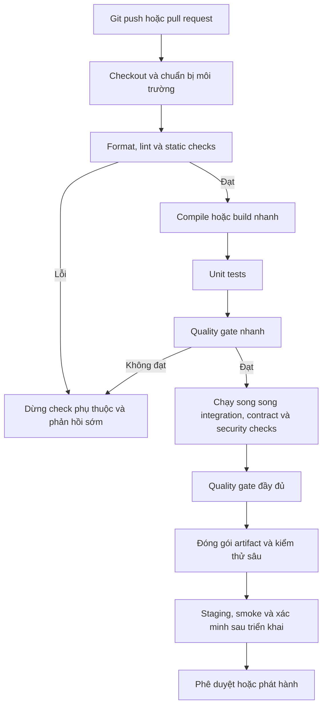
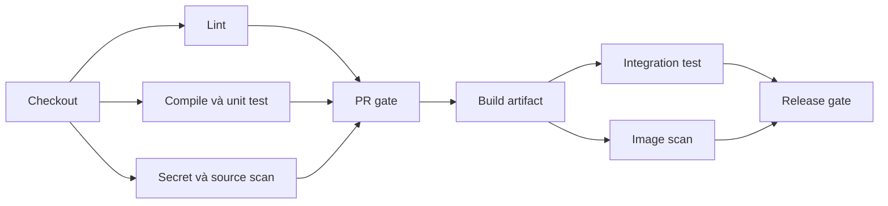

# Đưa kiểm tra nhanh và có giá trị phản hồi cao lên sớm

Trong CI/CD, thời điểm phát hiện lỗi ảnh hưởng trực tiếp đến tốc độ phát triển. Nếu một lỗi định dạng, lỗi biên dịch hoặc unit test thất bại chỉ được phát hiện sau khi pipeline đã build image, triển khai staging và chạy một bộ kiểm thử dài, nhóm phải chờ lâu và tốn tài nguyên trước khi nhận được thông tin có thể hành động.

Một chiến lược hiệu quả là **đưa các kiểm tra nhanh, ổn định và có tín hiệu tốt lên đầu pipeline**. Khi lập trình viên push commit hoặc mở pull request, hệ thống sớm phản hồi về những vấn đề dễ phát hiện và thường xuyên gặp. Các kiểm tra sâu hơn vẫn chạy ở những giai đoạn phù hợp để đánh giá tích hợp, hiệu năng, bảo mật và khả năng phát hành.

Mục tiêu không đơn giản là chạy bước có thời lượng ngắn nhất trước. Một kiểm tra có giá trị phản hồi cao cần phát hiện được lỗi có ý nghĩa, cho kết quả đáng tin, chỉ rõ nguyên nhân và hoàn tất đủ sớm để người viết thay đổi còn đang tập trung xử lý. Vì vậy, thứ tự pipeline nên cân bằng thời gian, xác suất phát hiện lỗi, mức độ nghiêm trọng và chi phí của từng check.

## 1. Feedback latency là gì?

**Feedback latency** là khoảng thời gian từ khi một thay đổi được gửi vào quy trình kiểm tra đến khi người phát triển nhận được kết quả đủ rõ để quyết định bước tiếp theo. Có thể đo ở nhiều mốc:

- **Time to first signal:** thời gian từ lúc push hoặc mở pull request đến tín hiệu đầu tiên có ích, chẳng hạn formatter hoặc unit test báo lỗi.
- **Time to required checks:** thời gian để hoàn tất toàn bộ check bắt buộc cho phép merge.
- **Time to release confidence:** thời gian để có đủ bằng chứng từ integration test, security scan, staging và các cổng phát hành.

Ba mốc phục vụ các mục tiêu khác nhau. Tín hiệu đầu tiên cần đến nhanh để giảm thời gian chờ của lập trình viên. Bộ check bắt buộc cần đủ sâu để bảo vệ nhánh chính. Bằng chứng phát hành cần bao phủ rủi ro vận hành và nghiệp vụ. Không nên rút ngắn mốc đầu tiên bằng cách bỏ các kiểm tra quan trọng ở những mốc sau.

Ví dụ, một pull request thay đổi logic tính phí. Formatter có thể hoàn tất trong vài giây, unit test trong một phút, integration test với database thử nghiệm mất vài phút và end-to-end test trên môi trường riêng mất lâu hơn. Nếu unit test phát hiện lỗi làm tròn tiền, nhóm có thể sửa ngay mà không phải chờ môi trường end-to-end được dựng lên.

## 2. Chọn kiểm tra có giá trị phản hồi cao

Khi quyết định check nào nên chạy sớm, hãy đánh giá bốn yếu tố:

1. **Thời gian chạy:** check càng nhanh thì càng sớm trả kết quả, nhưng thời gian ngắn không đủ để chứng minh check hữu ích.
2. **Khả năng phát hiện lỗi:** check có thường phát hiện lỗi thực tế trong loại thay đổi đang xét không?
3. **Độ tin cậy:** kết quả có ổn định giữa các lần chạy không, hay thường xuyên báo lỗi giả do môi trường hoặc test flaky?
4. **Khả năng hành động:** thông báo có chỉ ra file, dòng, test case hoặc điều kiện thất bại để người phát triển sửa nhanh không?

Một cách đánh giá định tính là xem check có tạo ra nhiều tín hiệu đúng và có thể xử lý trên mỗi phút chờ hay không. Không cần ép mọi nhóm dùng một công thức chung; hãy dùng dữ liệu của repository để điều chỉnh thứ tự.

| Loại kiểm tra | Giá trị phản hồi thường gặp | Vị trí thường phù hợp |
|---|---|---|
| Kiểm tra cấu trúc, whitespace, formatter | Phát hiện lỗi định dạng và quy ước rất sớm | Local, pre-commit hoặc đầu CI |
| Lint và static analysis nhanh | Phát hiện lỗi cú pháp, API nguy hiểm hoặc vi phạm quy tắc | Đầu CI, trước build/package nặng |
| Compile hoặc type check | Phát hiện lỗi biên dịch và kiểu dữ liệu | Sớm sau khi chuẩn bị toolchain |
| Unit test | Phản hồi nhanh về logic của thành phần nhỏ | Sớm trong pull request pipeline |
| Kiểm tra dependency và secret cơ bản | Phát hiện dependency không hợp lệ hoặc secret bị commit | Sớm, theo mức độ và thời gian scan |
| Integration/contract test | Phát hiện lỗi giữa các thành phần hoặc vi phạm hợp đồng | Sau check nhanh; có thể chạy song song |
| End-to-end test | Xác minh luồng người dùng xuyên hệ thống | Giai đoạn sau hoặc trên môi trường phù hợp |
| Load, performance và kiểm tra chuyên sâu | Đánh giá hành vi dưới tải hoặc điều kiện đặc biệt | Pipeline định kỳ, trước release hoặc khi thay đổi có rủi ro |

Vị trí cụ thể phụ thuộc dự án. Ví dụ, một dự án frontend có thể chạy type check rất nhanh và nên đặt trước unit test; một dự án có schema generation bắt buộc phải chạy generator trước compile. Điều quan trọng là dependency giữa các bước phải đúng và tín hiệu sớm không bị trì hoãn bởi các bước không cần thiết.

## 3. Sắp xếp pipeline theo tầng phản hồi

Một pipeline tham khảo có thể chia thành các tầng:



Đây là cấu trúc khái niệm. Pipeline thực tế có thể cho compile và một số scan chạy song song, hoặc cần tạo artifact trước khi chạy kiểm tra trên artifact. Hãy thiết kế DAG theo dependency thực tế, không ép tất cả check thành một chuỗi tuần tự nếu chúng độc lập.

### Tầng 1: phản hồi ngay trên máy phát triển

Formatter, lint, type check nhẹ và unit test liên quan có thể chạy trong IDE, pre-commit hook hoặc lệnh kiểm tra nhanh. Người viết nhận lỗi trước khi push, khi bối cảnh thay đổi vẫn còn mới.

Local checks không thay thế CI. Môi trường máy cá nhân có thể khác runner, hook có thể bị bỏ qua và một số kiểm tra cần dịch vụ mà máy local không có. CI vẫn cần chạy các check bắt buộc trên revision được push.

### Tầng 2: check nhanh cho mỗi push/pull request

Chạy formatter/lint, static analysis, compile và unit test. Đây thường là nhóm check có thể trả tín hiệu hữu ích nhanh mà không cần dựng toàn bộ hệ thống. Nếu một check thất bại, pipeline có thể dừng những nhánh phụ thuộc vào nó và hiển thị log rõ ràng.

### Tầng 3: kiểm tra tích hợp và bảo mật

Khi check nhanh đạt, chạy integration test, contract test, dependency scan, container scan và các kiểm tra khác theo rủi ro. Những job độc lập có thể chạy song song để giảm thời gian tổng thể.

### Tầng 4: kiểm thử sâu và xác minh phát hành

End-to-end, performance, migration test, staging smoke test và xác minh sau triển khai thường cần môi trường hoặc dữ liệu phức tạp hơn. Chúng bảo vệ các quyết định merge, deploy hoặc release theo chính sách của tổ chức.

## 4. Đặt kiểm tra đúng thứ tự và song song hóa có chủ đích

Một quy tắc thực tế là đưa check rẻ, ổn định và thường phát hiện lỗi sớm lên trước những bước tốn tài nguyên. Tuy nhiên, thứ tự còn phải xét dependency:

- Formatter và lint thường không cần artifact, nên có thể chạy ngay sau checkout.
- Compile cần toolchain và có thể cần generated source, do đó chạy sau bước chuẩn bị/generate tương ứng.
- Unit test thường cần class đã compile nhưng không cần database hoặc môi trường production-like.
- Integration test cần service phụ trợ, container hoặc database nên thường được khởi động sau check nhanh.
- Kiểm thử trên artifact cần artifact được tạo và định danh trước.

Nếu hai check không phụ thuộc nhau, chạy song song. Ví dụ security scan trên source, unit test và compile có thể chạy đồng thời nếu runner đủ tài nguyên và scan không cần artifact. Nếu tất cả cùng tranh CPU hoặc memory trên một runner nhỏ, song song hóa quá mức có thể làm mỗi job chậm hơn và tăng thời gian phản hồi.

Hãy phân biệt **critical path** với tổng thời lượng cộng dồn. Với các job song song, thời gian hoàn tất pipeline phụ thuộc vào nhánh lâu nhất và thời gian chờ tài nguyên. Tối ưu pipeline bằng cách rút ngắn critical path, giảm queue time và loại bỏ dependency tuần tự không cần thiết.

Ví dụ DAG:



Sơ đồ cho thấy nhiều check có thể chạy đồng thời, nhưng release gate chỉ hoàn tất khi mọi check bắt buộc đã có kết quả hợp lệ. Việc một nhánh được skip phải dựa trên điều kiện đã định nghĩa và không được nhầm với pass.

## 5. Ví dụ pipeline với GitHub Actions và Gradle

Ví dụ sau minh họa check nhanh chạy trước, sau đó các kiểm tra sâu hơn chạy khi check nhanh thành công. SHA của action là placeholder; cần thay bằng commit SHA đầy đủ đã xác minh theo chính sách repository.

```yaml
name: ci

on:
  pull_request:
  push:
    branches: [main]

jobs:
  fast_checks:
    runs-on: ubuntu-24.04
    steps:
      - uses: actions/checkout@<CHECKOUT_ACTION_SHA>

      - name: Check formatting
        run: ./gradlew spotlessCheck

      - name: Compile and run unit tests
        run: ./gradlew compileJava test

  integration:
    needs: fast_checks
    runs-on: ubuntu-24.04
    steps:
      - uses: actions/checkout@<CHECKOUT_ACTION_SHA>
      - name: Run integration tests
        run: ./gradlew integrationTest

  quality_gate:
    if: always()
    needs: [fast_checks, integration]
    runs-on: ubuntu-24.04
    steps:
      - name: Evaluate required results
        env:
          FAST_RESULT: ${{ needs.fast_checks.result }}
          INTEGRATION_RESULT: ${{ needs.integration.result }}
        run: |
          test "$FAST_RESULT" = "success"
          test "$INTEGRATION_RESULT" = "success"
```

Đây là ví dụ cấu trúc, không phải workflow hoàn chỉnh cho mọi dự án. `spotlessCheck`, `integrationTest` và task Gradle phải tồn tại trong build. Nếu dự án không có task `integrationTest`, hãy thay bằng task thực tế. Trong GitHub Actions, `needs` và `if: always()` cần được dùng cẩn thận để quality gate có thể đọc kết quả upstream sau failure mà vẫn trả exit code khác 0 khi một check bắt buộc thất bại. Với nhiều job tùy chọn, gate phải phân biệt rõ success, failure, skipped và cancelled theo chính sách.

Nếu check nhanh thất bại, job `integration` không cần chạy vì dependency `fast_checks` chưa đạt. Quality gate vẫn được thực thi để tổng hợp kết quả và bảo đảm trạng thái thất bại không bị che khuất.

## 6. Kiểm tra theo phạm vi thay đổi

Trong monorepo hoặc repository lớn, chạy toàn bộ test sau mọi thay đổi có thể kéo dài feedback latency. Có thể chọn test theo file thay đổi và dependency graph:

- Thay đổi tài liệu có thể chỉ cần documentation lint.
- Thay đổi module Java có thể chạy unit test của module và các module phụ thuộc.
- Thay đổi API schema cần chạy contract test và test của consumer liên quan.
- Thay đổi build script, plugin hoặc thư viện dùng chung có thể ảnh hưởng nhiều module và cần chạy phạm vi rộng hơn.

Selective testing chỉ an toàn khi hệ thống biết được quan hệ phụ thuộc đủ chính xác. Một file thay đổi trong thư viện dùng chung có thể tác động đến nhiều dịch vụ dù các thư mục dịch vụ không đổi. Nếu dependency graph thiếu hoặc không chắc chắn, mở rộng phạm vi kiểm tra hoặc chạy toàn bộ bộ test bắt buộc.

Ngay cả khi chỉ chạy test liên quan trên mỗi pull request, pipeline vẫn nên có bộ kiểm tra rộng hơn trên merge queue, nhánh chính, lịch định kỳ hoặc trước release. Kiểm tra theo tác động tối ưu phản hồi, còn kiểm tra rộng giúp phát hiện dependency bị bỏ sót trong quy tắc chọn test.

## 7. Giữ tín hiệu sớm đáng tin cậy

Một check chạy nhanh nhưng thường xuyên báo lỗi giả sẽ làm người phát triển mất niềm tin. Khi đó, họ có thể bỏ qua cảnh báo hoặc retry nhiều lần cho đến khi xanh. Cần quản lý chất lượng của chính bộ kiểm tra.

### Giảm flaky tests

Flaky test cho kết quả khác nhau khi chạy lại với cùng revision và điều kiện dự kiến. Nguyên nhân thường gồm race condition, phụ thuộc thời gian, thứ tự test, dữ liệu dùng chung, dịch vụ ngoài hoặc cleanup không đầy đủ.

Khi phát hiện flaky test:

1. Ghi nhận test, commit, runner, thời điểm và log của từng lần chạy.
2. Phân biệt lỗi sản phẩm với lỗi môi trường hoặc đồng bộ test.
3. Tạo issue và người chịu trách nhiệm sửa test.
4. Chỉ quarantine tạm thời khi có lý do và thời hạn; giữ một tín hiệu theo dõi riêng.
5. Không để retry vô hạn biến một test thất bại thành pass mà không lưu lịch sử.

Retry có thể hữu ích với lỗi hạ tầng tạm thời, nhưng không nên che giấu assertion failure hoặc test không ổn định. Nếu retry được cho phép, báo cáo phải giữ số lần thử và kết quả từng attempt.

### Viết thông báo có thể hành động

Một phản hồi tốt nên cho biết check nào thất bại, commit nào được kiểm tra, test case hoặc file liên quan, log/report ở đâu và cách chạy lại cục bộ. Tránh chỉ hiện “CI failed” mà không có ngữ cảnh.

Giữ log và report ngay cả khi pipeline dừng sớm. Bước upload diagnostics có thể chạy sau failure để người phát triển không phải chạy lại chỉ nhằm lấy log. Tuy nhiên, job thu thập log thành công không làm thay đổi kết quả của check đã thất bại.

## 8. Tối ưu tốc độ mà vẫn giữ chất lượng

Có thể giảm feedback latency bằng một số cách:

- **Incremental build:** chỉ build module hoặc task bị ảnh hưởng khi build system xác định dependency chính xác.
- **Dependency/build cache:** tái sử dụng dữ liệu có cache key và input fingerprint đúng; không dùng cache như bằng chứng test đã đạt.
- **Test distribution:** chia test độc lập thành nhiều nhóm hoặc runner để giảm critical path.
- **Test selection:** chạy nhóm test liên quan đến thay đổi, kèm bộ test rộng hơn ở các mốc bảo vệ.
- **Giảm thời gian khởi tạo:** dùng runner image chuẩn, dependency mirror và dịch vụ test sẵn sàng theo cách an toàn.
- **Fail fast có chọn lọc:** dừng nhánh phụ thuộc khi check nền tảng thất bại, nhưng vẫn thu thập diagnostics cần thiết.
- **Loại bỏ bước trùng lặp:** tránh chạy cùng một formatter hoặc cùng bộ unit test nhiều lần ở các job không tạo thêm bằng chứng.

Tối ưu phải dựa trên dữ liệu. Ví dụ, nếu phần lớn thời gian nằm ở queue chờ runner, tăng tốc lệnh test sẽ không giải quyết nút thắt. Nếu unit test chạy lâu vì khởi động một ứng dụng cho từng test, cải thiện fixture hoặc chia suite có thể hiệu quả hơn việc tăng số runner.

## 9. Đo lường chất lượng phản hồi

Không chỉ đo tổng thời gian pipeline. Một số chỉ số hữu ích:

| Chỉ số | Cách hiểu | Điều cần xem xét |
|---|---|---|
| Time to first signal | Thời gian từ push đến kết quả đầu tiên có ích | Queue time, startup và thứ tự check |
| Time to required checks | Thời gian hoàn tất check bắt buộc | Critical path và job tuần tự không cần thiết |
| Queue time | Thời gian chờ runner trước khi job bắt đầu | Năng lực runner, giới hạn concurrency và phân bổ tài nguyên |
| Flaky rate | Tỷ lệ test cho kết quả không ổn định | Chất lượng test, dữ liệu và môi trường |
| Actionable failure rate | Tỷ lệ failure dẫn đến lỗi thực có thể sửa | False positive, chất lượng log và quy tắc scan |
| Re-run rate | Tỷ lệ pipeline phải chạy lại để có kết quả đáng tin | Flaky tests, lỗi hạ tầng và thay đổi đầu vào |

Nên phân tích theo repository, loại job và nhóm test. Một pipeline có thời gian trung bình thấp nhưng thỉnh thoảng bị treo hàng giờ có thể gây trải nghiệm kém hơn pipeline có thời gian ổn định. Theo dõi cả median và percentile cao như p90/p95 giúp nhìn thấy trường hợp chậm bất thường.

## 10. Những sai lầm thường gặp

| Sai lầm | Hệ quả | Cách điều chỉnh |
|---|---|---|
| Chỉ sắp xếp theo thời gian chạy | Check rất nhanh nhưng ít giá trị chiếm vị trí đầu | Xem cả khả năng phát hiện lỗi, độ tin cậy và khả năng hành động |
| Đưa mọi test vào một job tuần tự | Tạo critical path dài và khó xác định lỗi | Tách job theo dependency, song song hóa check độc lập |
| Bỏ integration/security test để pipeline nhanh | Tăng nguy cơ lỗi lọt qua cổng merge/release | Giữ check sâu ở giai đoạn phù hợp và định nghĩa gate rõ ràng |
| Retry đến khi xanh | Che giấu flaky test hoặc lỗi thật | Giới hạn retry, lưu mọi attempt và xử lý nguyên nhân |
| Chọn test chỉ theo thư mục thay đổi | Bỏ sót tác động qua thư viện dùng chung | Dựa vào dependency graph và mở rộng khi không chắc chắn |
| Đánh dấu check bị skip là success | Cổng chất lượng có thể chấp nhận thay đổi chưa được kiểm tra | Phân biệt skipped hợp lệ với skipped ngoài dự kiến |
| Chạy song song quá mức | Runner tranh CPU/memory, tổng thời gian tăng | Đo tải và tối ưu critical path cùng năng lực runner |

## 11. Checklist đưa phản hồi có giá trị lên sớm

- [ ] Xác định thời gian mục tiêu cho tín hiệu đầu tiên và check bắt buộc.
- [ ] Đặt formatter, lint, static checks và unit test nhanh ở đầu pipeline khi dependency cho phép.
- [ ] Chọn check theo giá trị phát hiện lỗi, độ ổn định và khả năng hành động, không chỉ theo thời gian chạy.
- [ ] Tách check thành job có dependency rõ ràng và chạy song song những nhánh độc lập.
- [ ] Giữ integration, contract, security, end-to-end và performance checks ở các cổng phù hợp.
- [ ] Dùng selective testing chỉ khi dependency graph đủ tin cậy; có bộ kiểm tra rộng hơn ở mốc bảo vệ.
- [ ] Phân biệt success, failure, skipped và cancelled trong quality gate.
- [ ] Theo dõi flaky tests, giới hạn retry và lưu diagnostics khi failure.
- [ ] Đo queue time, time to first signal, time to required checks và p90/p95.
- [ ] Tối ưu cache, incremental build và runner dựa trên số liệu thực tế.

Đưa kiểm tra nhanh và có giá trị phản hồi cao lên sớm giúp người phát triển phát hiện lỗi khi chi phí sửa còn thấp. Kết hợp với các kiểm tra sâu hơn, quality gate rõ ràng và số liệu vận hành, pipeline vừa phản hồi nhanh trong quá trình phát triển vừa giữ đủ bằng chứng để tích hợp và phát hành an toàn.
