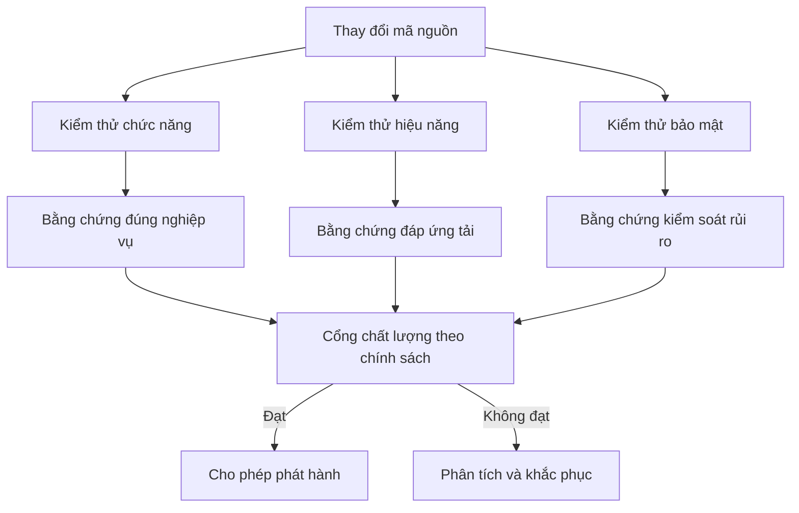
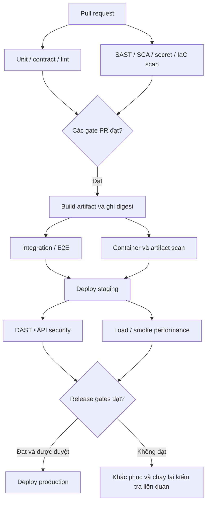

# Tách kiểm thử chức năng với hiệu năng và bảo mật

Một pipeline CI/CD đáng tin cậy phải trả lời được ba câu hỏi khác nhau: **ứng dụng có làm đúng điều người dùng cần không, có đáp ứng được tải dự kiến không, và có chống chịu được các hành vi tấn công hay không?** Ba câu hỏi này tương ứng với kiểm thử chức năng (functional testing), kiểm thử hiệu năng (performance testing) và kiểm thử bảo mật (security testing).

Chúng có thể kiểm tra cùng một dịch vụ và đôi khi dùng chung môi trường hoặc dữ liệu, nhưng mục tiêu, cách tạo tải, cách xác định lỗi và tiêu chí đạt không giống nhau. Nếu gộp mọi kết quả vào một job “test” duy nhất, nhóm khó biết rủi ro nào đang được kiểm soát, khi nào cần chặn phát hành và ai cần xử lý kết quả. Thiết kế tốt sẽ tách các luồng kiểm thử theo mục tiêu, sau đó tổng hợp bằng chứng ở các cổng chất lượng phù hợp.

## 1. Ba nhóm kiểm thử trả lời ba câu hỏi khác nhau

| Nhóm | Câu hỏi chính | Đối tượng quan sát | Kết quả thường dùng để đánh giá |
|---|---|---|---|
| Chức năng | Hệ thống có thực hiện đúng yêu cầu và quy tắc nghiệp vụ không? | Đầu vào, đầu ra, trạng thái, hành vi API/UI, dữ liệu và luồng nghiệp vụ | Assertion, test pass/fail, contract và báo cáo lỗi |
| Hiệu năng | Hệ thống có đáp ứng tải, độ trễ và giới hạn tài nguyên đã đặt ra không? | Latency, throughput, error rate, CPU, RAM, I/O, saturation và hành vi khi tải thay đổi | Percentile, thông lượng, tỷ lệ lỗi, resource metrics và so sánh baseline |
| Bảo mật | Hệ thống có thể bị khai thác hoặc làm lộ/sửa dữ liệu trái phép không? | Mã nguồn, dependency, cấu hình, image, API, quyền truy cập, luồng dữ liệu và bề mặt tấn công | Finding, severity, exploitability, bằng chứng tái hiện và trạng thái khắc phục |

Ví dụ với API thanh toán:

- Kiểm thử chức năng xác minh giao dịch hợp lệ trừ đúng số tiền, giao dịch bị từ chối không làm thay đổi số dư và yêu cầu lặp lại không tạo hai lần thanh toán.
- Kiểm thử hiệu năng đo thời gian phản hồi và tỷ lệ lỗi khi có số lượng giao dịch đồng thời theo mô hình tải đã định nghĩa.
- Kiểm thử bảo mật xác minh người dùng không thể đọc giao dịch của tài khoản khác, token không bị lộ, API chống được đầu vào độc hại và dependency không có lỗ hổng vượt ngưỡng chính sách.

Một request trả về HTTP 200 chưa đủ chứng minh cả ba điều. Nội dung trả về có thể sai nghiệp vụ, phản hồi có thể quá chậm, hoặc endpoint có thể cho phép người dùng truy cập dữ liệu không thuộc quyền của họ.



Ba luồng có thể chạy song song khi đầu vào và môi trường cho phép. Tuy nhiên, cổng phát hành phải tổng hợp kết quả bắt buộc của cả ba, thay vì coi một nhóm kiểm thử thành công là đại diện cho hai nhóm còn lại.

## 2. Kiểm thử chức năng: xác minh hành vi và quy tắc nghiệp vụ

Kiểm thử chức năng xác minh hệ thống thực hiện đúng đặc tả, yêu cầu và hợp đồng giao tiếp. Nó tập trung vào **điều gì phải xảy ra** khi hệ thống nhận một đầu vào hoặc trải qua một sự kiện.

Các cấp độ thường gặp:

- **Unit test:** kiểm tra hàm hoặc đơn vị nhỏ với dependency được thay thế khi phù hợp. Ví dụ tính thuế hoặc xác định trạng thái đơn hàng.
- **Component/service test:** kiểm tra một thành phần hoặc service trong ranh giới tương đối độc lập.
- **Integration test:** kiểm tra tương tác giữa ứng dụng với database, message broker, cache hoặc dịch vụ phụ thuộc.
- **Contract test:** xác minh producer và consumer tuân thủ hợp đồng API hoặc message schema.
- **End-to-end test:** mô phỏng luồng người dùng hoặc nghiệp vụ xuyên qua nhiều thành phần.
- **Acceptance test:** xác minh tiêu chí chấp nhận từ góc nhìn nghiệp vụ hoặc người dùng.

Một test chức năng tốt cần có đầu vào rõ ràng, trạng thái ban đầu xác định, hành động cần kiểm tra và kết quả mong đợi. Với API, nên kiểm tra cả status code, response schema, dữ liệu trả về, side effect và quyền truy cập. Với luồng ghi dữ liệu, cần xác minh trạng thái database hoặc event được phát ra, không chỉ kiểm tra thông báo trên giao diện.

Ví dụ kiểm tra chức năng bằng pytest:

```python
def test_rejects_payment_when_balance_is_insufficient(client, account):
    account.balance = 50

    response = client.post(
        "/payments",
        json={"account_id": account.id, "amount": 80},
    )

    assert response.status_code == 422
    assert response.json()["code"] == "INSUFFICIENT_FUNDS"
    assert account.refresh().balance == 50
```

Ví dụ kiểm tra ba điều: API trả đúng lỗi, mã lỗi đúng và số dư không bị thay đổi. Trong test thực tế, fixture phải tạo dữ liệu cô lập và dọn dẹp sau mỗi lượt chạy để test có thể lặp lại.

### Đặc điểm vận hành của kiểm thử chức năng

- Nên chạy unit test và phần lớn test nhanh ở mỗi pull request để phản hồi sớm.
- Integration và end-to-end test thường cần service phụ thuộc, dữ liệu khởi tạo và thời gian thực thi lớn hơn.
- Test cần độc lập, có thể chạy lại và không phụ thuộc thứ tự test khác.
- Khi test thất bại, lưu log, report, input tối thiểu và correlation ID để tái hiện.
- Với test bất đồng bộ, cần đợi điều kiện hoàn tất bằng timeout có giới hạn thay vì sleep cố định quá lâu.

Kiểm thử chức năng có thể phát hiện một số vấn đề hiệu năng hoặc bảo mật nếu test được thiết kế cho chúng, nhưng bộ assertion nghiệp vụ thông thường không thay thế các phép đo tải hoặc kiểm tra bảo mật chuyên biệt.

## 3. Kiểm thử hiệu năng: đo khả năng đáp ứng dưới tải

Kiểm thử hiệu năng đánh giá cách hệ thống phản hồi khi số lượng người dùng, request, dữ liệu hoặc công việc thay đổi. Nó cần mô hình tải, môi trường đo và ngưỡng chấp nhận rõ ràng.

### Các chỉ số quan trọng

| Chỉ số | Ý nghĩa | Cách đọc |
|---|---|---|
| Latency | Thời gian xử lý một request hoặc giao dịch | Theo dõi p50, p95, p99; trung bình có thể che giấu đuôi phân phối chậm |
| Throughput | Số request hoặc giao dịch hoàn thành trong một đơn vị thời gian | Ví dụ request/second hoặc transaction/second |
| Error rate | Tỷ lệ request thất bại, timeout hoặc trả kết quả lỗi | Phân loại lỗi ứng dụng, dependency và lỗi do tải |
| CPU/RAM | Mức sử dụng tài nguyên tính toán và bộ nhớ | Xem mức trung bình, đỉnh, xu hướng và giới hạn container/VM |
| I/O và network | Khả năng đọc/ghi và truyền dữ liệu | Tìm nghẽn disk, database, network hoặc connection pool |
| Saturation | Mức tài nguyên/hàng đợi bị sử dụng gần giới hạn | Queue tăng, thread pool cạn, connection chờ hoặc CPU liên tục quá tải |

Một dịch vụ có throughput cao nhưng p99 latency vượt SLO vẫn có thể không đạt yêu cầu. Tương tự, latency thấp ở tải nhỏ không chứng minh hệ thống chịu được tải giờ cao điểm. Cần đọc nhiều chỉ số cùng lúc và đối chiếu với mục tiêu dịch vụ.

### Các kiểu kiểm thử hiệu năng

- **Load test:** tạo tải dự kiến hoặc tải mục tiêu để xem hệ thống đáp ứng ra sao trong điều kiện vận hành bình thường.
- **Stress test:** tăng tải vượt mức thiết kế để tìm điểm suy giảm, giới hạn và cách hệ thống phục hồi.
- **Spike test:** tăng hoặc giảm tải đột ngột để kiểm tra khả năng xử lý biến động.
- **Soak/endurance test:** duy trì tải trong thời gian dài để tìm rò rỉ bộ nhớ, cạn connection, queue tích tụ hoặc suy giảm theo thời gian.
- **Capacity test:** tìm năng lực tối đa hoặc cấu hình tài nguyên cần thiết để đạt mục tiêu hiệu năng.
- **Scalability test:** đánh giá hệ thống cải thiện ra sao khi tăng instance, CPU, RAM hoặc phân vùng xử lý.

### Thiết kế mô hình tải

Mô hình tải nên phản ánh cách người dùng thực sự sử dụng hệ thống:

1. Xác định luồng nghiệp vụ chính và tỷ trọng từng loại request.
2. Xác định số người dùng đồng thời hoặc tốc độ gửi request mục tiêu.
3. Mô phỏng think time, phân phối dữ liệu, tỷ lệ đọc/ghi và cache hit nếu có ý nghĩa.
4. Định nghĩa warm-up để hệ thống ổn định trước khi lấy số liệu.
5. Chạy đủ thời gian để đo được xu hướng, percentile và tình trạng tài nguyên.
6. Lưu cấu hình tải, phiên bản artifact, cấu hình môi trường và kết quả để so sánh lần sau.

Ví dụ dùng k6:

```javascript
import http from 'k6/http';
import { check, sleep } from 'k6';

export const options = {
  vus: 20,
  duration: '2m',
  thresholds: {
    http_req_failed: ['rate<0.01'],
    http_req_duration: ['p(95)<500'],
  },
};

export default function () {
  const response = http.get(`${__ENV.BASE_URL}/health`);
  check(response, {
    'health endpoint returns 200': (r) => r.status === 200,
  });
  sleep(1);
}
```

Đây là ví dụ minh họa cú pháp và ngưỡng: 20 virtual users trong 2 phút, tỷ lệ request lỗi dưới 1% và p95 dưới 500 ms. Endpoint `/health` chỉ phù hợp để kiểm tra khả năng đáp ứng đơn giản; benchmark nghiệp vụ cần mô phỏng endpoint, dữ liệu và phân bố request thực tế. Các ngưỡng phải lấy từ SLO, yêu cầu sản phẩm và baseline của môi trường, không dùng nguyên các con số ví dụ cho mọi dịch vụ.

### Điều kiện để kết quả hiệu năng đáng tin cậy

- Dùng môi trường có cấu hình đủ gần production và ghi nhận rõ khác biệt.
- Tránh để nhiều nhóm chạy benchmark tranh chấp cùng tài nguyên.
- Cố định phiên bản artifact, dữ liệu và cấu hình tải khi so sánh.
- Theo dõi cả máy phát tải; load generator quá yếu có thể trở thành nút thắt.
- Làm nóng cache và runtime theo một quy trình nhất quán.
- Chạy lặp lại khi có nhiễu đáng kể và phân tích xu hướng thay vì kết luận từ một lần đo.
- Không chạy tải gây ảnh hưởng hệ thống production nếu chưa có kế hoạch, giới hạn và phê duyệt phù hợp.

## 4. Kiểm thử bảo mật: tìm điểm yếu và xác minh ranh giới tin cậy

Kiểm thử bảo mật tìm lỗi có thể ảnh hưởng đến tính bí mật, toàn vẹn và sẵn sàng của hệ thống. Nó xem xét mã nguồn, dependency, cấu hình hạ tầng, image, endpoint và hành vi khi nhận đầu vào không tin cậy.

### Các kỹ thuật thường dùng

| Kỹ thuật | Thời điểm/đối tượng | Ví dụ phát hiện |
|---|---|---|
| SAST (Static Application Security Testing) | Phân tích mã nguồn hoặc bytecode mà không cần chạy ứng dụng | SQL injection, unsafe deserialization, path traversal, lỗi xử lý dữ liệu |
| SCA (Software Composition Analysis) | Dependency trực tiếp/gián tiếp và license | Thư viện có CVE, phiên bản không còn hỗ trợ, license không phù hợp |
| Secret scanning | Repository, commit và đôi khi cả lịch sử | API token, private key, password bị commit |
| IaC scanning | Terraform, Kubernetes manifest, Dockerfile và cấu hình cloud | Storage public, quyền IAM quá rộng, container chạy privileged |
| Container/image scanning | Image và các package hệ điều hành/thư viện bên trong | Package có CVE, base image cũ, cấu hình rủi ro |
| DAST (Dynamic Application Security Testing) | Ứng dụng đang chạy trong môi trường kiểm thử | Lỗi cấu hình HTTP, injection có thể khai thác, endpoint lộ thông tin |
| API security testing | API đang chạy và hợp đồng/quyền truy cập | Broken object-level authorization, xác thực yếu, lạm dụng rate limit |
| Fuzz testing | Parser, protocol hoặc API nhận đầu vào đa dạng/bất thường | Crash, lỗi xử lý biên, memory corruption hoặc trạng thái bất thường |

SAST, SCA, secret scanning và IaC scanning thường có thể chạy sớm trong CI vì không cần triển khai toàn bộ ứng dụng. DAST và API security testing cần một ứng dụng đang chạy, nên thường được thực hiện trên integration hoặc staging. Fuzzing có thể chạy ngắn trong pull request và chạy sâu hơn theo lịch hoặc trước release.

### Đánh giá finding

Không nên quyết định phát hành chỉ dựa vào số lượng cảnh báo. Với mỗi finding, cần xem:

- Severity và loại tác động.
- Khả năng khai thác trong kiến trúc và cấu hình thực tế.
- Bề mặt có thể truy cập: internet, mạng nội bộ, yêu cầu đăng nhập hay quyền đặc biệt.
- Dữ liệu và chức năng bị ảnh hưởng.
- Có bản vá hoặc biện pháp giảm thiểu được hỗ trợ không.
- Finding có phải false positive hay trùng lặp với finding đã xử lý không.

Chính sách có thể chặn ngay lỗ hổng critical/high theo ngưỡng tổ chức, đồng thời yêu cầu triage cho các finding còn lại. Ngoại lệ phải có người chịu trách nhiệm, lý do, phạm vi, biện pháp giảm thiểu và ngày hết hạn. Không nên bỏ qua cảnh báo vĩnh viễn bằng một cấu hình `ignore` không có chủ sở hữu.

### An toàn khi chạy kiểm thử bảo mật

DAST, fuzzing và một số kiểm thử API có thể tạo dữ liệu, gửi request bất thường hoặc kích hoạt thao tác ghi/xóa. Hãy dùng môi trường được phép kiểm thử, tài khoản riêng và dữ liệu giả lập/anonymized. Đặt giới hạn tốc độ, phạm vi URL, thời gian chạy và quyền truy cập. Không quét hệ thống của bên thứ ba hoặc production ngoài phạm vi được ủy quyền.

Nếu công cụ phát hiện secret trong repository, việc xóa dòng secret ở commit mới chưa đủ nếu credential đã bị lộ. Cần thu hồi hoặc rotate credential, đánh giá lịch sử Git và log có thể đã chứa giá trị đó, sau đó xử lý theo quy trình ứng phó sự cố của tổ chức.

## 5. Vì sao không nên gộp ba nhóm vào một job test duy nhất?

Một job duy nhất thường dẫn đến những vấn đề sau:

- Không biết pipeline thất bại vì assertion nghiệp vụ, p95 latency, CVE hay môi trường test.
- Một bộ test dài làm chậm phản hồi nhanh cho lập trình viên.
- Test chức năng có thể chạy trên môi trường nhỏ, trong khi benchmark cần tài nguyên ổn định và bảo mật động cần ứng dụng đã triển khai.
- Retry một job tổng hợp có thể chạy lại cả benchmark tốn kém hoặc quét bảo mật không cần thiết.
- Quyền truy cập cần cho DAST hoặc deploy có thể bị cấp rộng cho cả job chứa test chức năng.
- Không thể đặt ngưỡng và người chịu trách nhiệm riêng cho từng loại rủi ro.

Tách job không có nghĩa ba nhóm không liên quan. Chúng vẫn dùng chung commit, artifact digest và release record để bảo đảm kết quả áp dụng cho đúng phiên bản. Mỗi nhóm nên xuất báo cáo riêng, còn cổng phát hành tổng hợp các kết quả bắt buộc theo policy.

## 6. Tổ chức các nhóm kiểm thử trong pipeline CI/CD

Một chiến lược thực tế thường có nhiều tầng để cân bằng tốc độ phản hồi và chiều sâu kiểm tra.

| Giai đoạn | Kiểm thử nên ưu tiên | Mục tiêu |
|---|---|---|
| Pull request | Unit, component, contract; lint; SAST, secret scan và SCA nhanh | Phát hiện lỗi sớm trước khi merge |
| Sau merge/main | Integration, API/acceptance; image/IaC scan; test chức năng mở rộng | Xác minh tích hợp và artifact của nhánh chính |
| Staging/release candidate | E2E, DAST/API security, smoke test, load test có kiểm soát | Xác minh ứng dụng đã triển khai trong môi trường gần production |
| Nightly/định kỳ | Regression sâu, soak, stress, fuzzing, scan toàn diện | Phát hiện suy giảm và rủi ro khó thấy trong mỗi PR |
| Trước production | Tổng hợp quality gate, kiểm tra ngoại lệ, phê duyệt và xác nhận artifact digest | Cho phép phát hành có kiểm soát |

Không nhất thiết chạy mọi bài test nặng ở mỗi pull request. Có thể chạy smoke performance nhanh trên thay đổi quan trọng, còn load/stress/soak dài chạy theo lịch hoặc trước release. Tương tự, DAST đầy đủ có thể chạy ở staging, trong khi SAST/SCA/secret scan chạy thường xuyên hơn.



Sơ đồ là một cách tổ chức tham khảo. Thứ tự thực tế cần phản ánh dependency: DAST cần môi trường đã triển khai; image scan cần image đã build; test chức năng có thể chạy trước hoặc sau build tùy cách dự án tạo artifact. Khi triển khai production, phải dùng đúng artifact đã qua các kiểm tra, được nhận diện bằng digest.

## 7. Ví dụ tách job trong GitLab CI

Ví dụ sau minh họa cách tách kiểm thử chức năng, scan bảo mật tĩnh, kiểm thử động và hiệu năng. Các script trong `./ci/` là wrapper do dự án cung cấp; cần thay đường dẫn, công cụ, report format và điều kiện theo repository thực tế.

```yaml
stages:
  - verify
  - build
  - integration
  - security_static
  - deploy_test
  - security_dynamic
  - performance

functional_tests:
  stage: verify
  script:
    - ./gradlew test --no-daemon
  artifacts:
    when: always
    reports:
      junit: build/test-results/test/*.xml

security_static:
  stage: verify
  script:
    - ./ci/run-sast.sh
    - ./ci/run-dependency-scan.sh
    - ./ci/run-secret-scan.sh
  artifacts:
    when: always
    paths:
      - reports/security/

build_artifact:
  stage: build
  needs:
    - functional_tests
    - security_static
  script:
    - ./gradlew assemble --no-daemon
    - ./ci/package-and-record-digest.sh
  artifacts:
    paths:
      - build/libs/
      - reports/release/

integration_tests:
  stage: integration
  needs:
    - build_artifact
  script:
    - ./ci/run-integration-tests.sh
  artifacts:
    when: always
    paths:
      - reports/integration/

deploy_staging:
  stage: deploy_test
  needs:
    - build_artifact
    - integration_tests
  script:
    - ./ci/deploy-staging-by-digest.sh
  environment:
    name: staging

security_dynamic:
  stage: security_dynamic
  needs:
    - deploy_staging
  script:
    - ./ci/run-dast-against-staging.sh
  artifacts:
    when: always
    paths:
      - reports/dast/

performance_smoke:
  stage: performance
  needs:
    - deploy_staging
  rules:
    - if: '$CI_PIPELINE_SOURCE == "schedule" || $CI_COMMIT_TAG'
  script:
    - ./ci/run-performance-test.sh
  artifacts:
    when: always
    paths:
      - reports/performance/
```

Trong ví dụ:

- `functional_tests` kiểm tra hành vi ứng dụng và xuất JUnit report.
- `security_static` chạy các phép phân tích có thể thực hiện trước khi deploy.
- `build_artifact` tạo đầu ra sau khi các gate sớm đạt và ghi digest.
- `integration_tests` xác minh các thành phần tương tác với nhau.
- `deploy_staging` triển khai artifact đã build vào môi trường test.
- `security_dynamic` kiểm tra ứng dụng đang chạy trên staging.
- `performance_smoke` chỉ chạy theo lịch hoặc khi có tag release; đây là nơi thực hiện bài đo hiệu năng được kiểm soát.

Ví dụ chỉ minh họa cấu trúc phụ thuộc và phân tách trách nhiệm. `deploy-staging-by-digest.sh` phải lấy đúng artifact từ job build và xác minh digest; không tự build lại. Nếu dự án cần performance smoke trên mọi pull request, có thể thêm một job ngắn với môi trường riêng và tải nhỏ. Các report cần được parser của nền tảng nhận diện nếu muốn hiển thị trực tiếp trong giao diện; `paths` chỉ lưu file để tải xuống.

## 8. Thiết kế quality gate cho từng nhóm

Mỗi nhóm kiểm thử cần tiêu chí đạt có thể giải thích và gắn với rủi ro của dịch vụ.

### Gate chức năng

- Các test bắt buộc phải chạy và đạt; không coi “không tìm thấy test” là thành công.
- Test report phải được tạo, đọc được và gắn với commit/artifact đang xét.
- Các luồng nghiệp vụ quan trọng, quyền truy cập và side effect phải được kiểm tra.
- Test flaky cần được theo dõi; không dùng retry vô hạn để che giấu lỗi.

### Gate hiệu năng

- Xác định workload, môi trường, thời gian warm-up và thời gian đo.
- Đặt ngưỡng theo SLO hoặc baseline đã được phê duyệt, ví dụ p95/p99, throughput và error rate.
- Theo dõi resource saturation để xác định nguyên nhân, không chỉ nhìn latency.
- So sánh cùng loại môi trường và cùng cấu hình tải; nếu môi trường thay đổi, cần ghi nhận.
- Chỉ chặn release khi kết quả có độ tin cậy và ngưỡng áp dụng đúng phạm vi.

### Gate bảo mật

- Không còn finding vượt ngưỡng severity/exploitability theo policy.
- Artifact và dependency được scan theo đúng phiên bản/digest chuẩn bị phát hành.
- Secret scan và kiểm tra cấu hình được thực hiện trên phạm vi yêu cầu.
- DAST/API scan chạy trên đúng ứng dụng và environment đã định danh.
- Mọi ngoại lệ có người phê duyệt, lý do, thời hạn và biện pháp giảm thiểu.

Khi report bị thiếu, công cụ lỗi hoặc không thể xác định kết quả, trạng thái nên là lỗi hoặc cần xử lý theo policy. Không mặc định dữ liệu thiếu là đạt. Cũng cần phân biệt lỗi sản phẩm với lỗi hạ tầng như runner hết dung lượng hoặc scanner không tải được database lỗ hổng; cả hai đều cần được xử lý, nhưng cách điều tra khác nhau.

## 9. Môi trường và dữ liệu kiểm thử

Ba nhóm kiểm thử có yêu cầu môi trường khác nhau:

| Nhóm | Yêu cầu môi trường | Dữ liệu cần chú ý |
|---|---|---|
| Chức năng | Service phụ thuộc có thể khởi tạo, trạng thái ban đầu kiểm soát được, reset được | Fixture nhỏ, dữ liệu biên, dữ liệu giả lập, không phụ thuộc dữ liệu test khác |
| Hiệu năng | Tài nguyên ổn định, gần cấu hình production, không có workload cạnh tranh ngoài kế hoạch | Dataset đủ đại diện về kích thước, phân bố và tỷ lệ đọc/ghi; tránh dữ liệu thật không được phép |
| Bảo mật | Môi trường được ủy quyền, có tài khoản và quyền kiểm thử riêng, có thể khôi phục sau thao tác | Tài khoản theo role, dữ liệu giả lập/anonymized, secret thử nghiệm và dữ liệu có thể xóa/reset |

Không nên dùng chung một môi trường đang được nhiều pipeline thay đổi để đo hiệu năng, vì các job khác có thể làm sai lệch latency và throughput. DAST hoặc fuzzing cũng có thể tạo dữ liệu bất thường, làm hỏng trạng thái test hoặc kích hoạt giới hạn bảo vệ. Nên cô lập theo pipeline/run hoặc dùng môi trường chuyên dụng với cleanup rõ ràng.

Nếu phải dùng dữ liệu production-like, hãy tạo dữ liệu đã ẩn danh hoặc tổng hợp theo quy trình được phê duyệt. Không sao chép thông tin cá nhân, token, mật khẩu hoặc dữ liệu thanh toán thật vào artifact, log và báo cáo CI.

## 10. Đọc kết quả và xử lý khi một nhóm thất bại

Một pipeline có thể thất bại ở nhiều nhóm cùng lúc. Hãy xử lý theo bằng chứng thay vì chỉ rerun toàn bộ pipeline:

| Kết quả | Câu hỏi điều tra | Hành động thường gặp |
|---|---|---|
| Functional test fail | Assertion nào sai? Dữ liệu ban đầu có ổn định? Dependency có lỗi? | Xem test report/log, tái hiện với cùng input, sửa logic hoặc test setup |
| Performance regression | p95/p99 tăng ở endpoint nào? Throughput hoặc error rate thay đổi? Tài nguyên nào bão hòa? | So sánh baseline, trace và metrics; xác định thay đổi code, query hoặc cấu hình |
| Security finding | Finding nằm ở dependency, code, cấu hình hay runtime? Có thể khai thác trong bối cảnh nào? | Xác minh, đánh giá tác động, vá hoặc giảm thiểu; tạo exception có thời hạn nếu được phép |
| Scanner/tool failure | Công cụ không chạy, dữ liệu lỗ hổng không tải được hay credential hết hạn? | Phân loại lỗi hạ tầng, khôi phục scanner và chạy lại phép kiểm tra bị thiếu |
| Environment failure | Service không khởi động, thiếu tài nguyên hoặc dữ liệu không được reset? | Kiểm tra deployment, runner và fixture; không kết luận sản phẩm đạt khi test chưa chạy |

Lưu report cùng commit SHA, pipeline ID, artifact digest, cấu hình tải hoặc phiên bản scanner. Điều này giúp nhóm so sánh kết quả qua các lần phát hành và xác định liệu một finding hay regression đã tồn tại từ trước.

## 11. Những anti-pattern cần tránh

- **Chỉ có unit test:** kiểm tra logic nhỏ nhưng bỏ sót tích hợp, hiệu năng và rủi ro runtime.
- **Coi test E2E là bao phủ toàn bộ:** E2E thường chậm, khó chẩn đoán và không thay thế test ở các tầng khác.
- **Đo hiệu năng trên runner dùng chung:** kết quả nhiễu do CPU, disk hoặc network bị job khác chiếm dụng.
- **Dùng một ngưỡng latency cho mọi endpoint:** không phản ánh khác biệt giữa luồng đọc, ghi, xử lý nền và yêu cầu SLO.
- **Chỉ chạy security scan trước release:** lỗi secret, dependency hoặc cấu hình có thể tồn tại lâu trong nhánh phát triển.
- **Bỏ qua tất cả finding để giữ pipeline xanh:** làm mất tín hiệu rủi ro và không có trách nhiệm xử lý.
- **Chạy DAST/fuzzing trên môi trường không được phép:** có thể gây gián đoạn, xóa dữ liệu hoặc ảnh hưởng bên thứ ba.
- **Build lại artifact sau khi test:** phiên bản phát hành có thể khác phiên bản đã được kiểm thử.
- **Không lưu report và cấu hình test:** không thể tái hiện hoặc so sánh kết quả.
- **Retry vô hạn:** che giấu flaky test, lỗi môi trường hoặc regression thật.

## 12. Checklist thiết kế chiến lược kiểm thử

Khi rà soát một pipeline, hãy trả lời:

1. Các yêu cầu nghiệp vụ quan trọng có functional test ở đúng tầng không?
2. Test có xác minh trạng thái dữ liệu, side effect và quyền truy cập không?
3. Mô hình tải có phản ánh luồng sử dụng và SLO của dịch vụ không?
4. Có đo latency percentile, throughput, error rate và resource saturation không?
5. SAST, SCA, secret, IaC và image scan được chạy ở thời điểm phù hợp không?
6. DAST/API security test có chạy trên đúng ứng dụng đã triển khai và môi trường được phép không?
7. Ngưỡng đạt và chính sách ngoại lệ có rõ, có chủ sở hữu và thời hạn không?
8. Môi trường và dữ liệu có được cô lập, reset và bảo vệ không?
9. Kết quả có gắn với commit, pipeline run và artifact digest không?
10. Cổng phát hành có yêu cầu đầy đủ các nhóm kiểm thử bắt buộc không?
11. Có lưu report, log, cấu hình tải, scanner version và bằng chứng triage không?
12. Khi một nhóm thất bại, nhóm phát triển có thể xác định nguyên nhân và chạy lại đúng phần cần thiết không?

Tách kiểm thử chức năng, hiệu năng và bảo mật giúp mỗi nhóm đo đúng một loại rủi ro bằng phương pháp và tiêu chí phù hợp. Khi các kết quả được liên kết với cùng commit và artifact, pipeline có thể đưa ra quyết định phát hành dựa trên bằng chứng: hành vi đúng, khả năng đáp ứng đạt yêu cầu và rủi ro bảo mật nằm trong giới hạn được chấp nhận.
