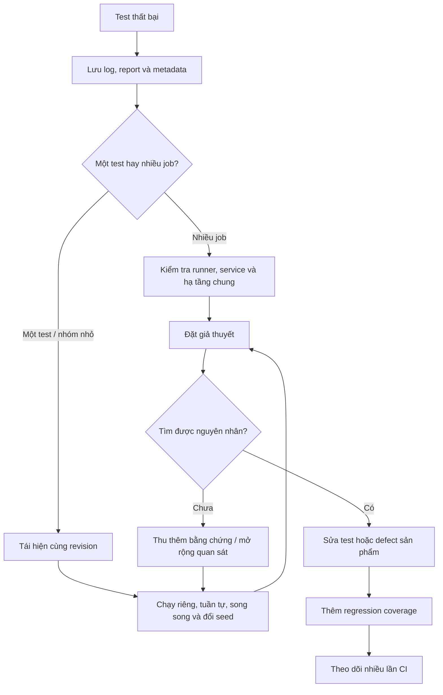

# Nhận diện kiểm thử chập chờn và điều tra nguyên nhân

Một kiểm thử tự động đáng tin cậy phải cho kết quả ổn định khi mã nguồn, dữ liệu đầu vào và môi trường được kiểm soát không thay đổi. Kiểm thử chập chờn (flaky test) là kiểm thử có lúc đạt, lúc thất bại dù nhóm đang kiểm tra cùng một revision và không có thay đổi có chủ đích đối với điều kiện kiểm thử. Kết quả của nó phụ thuộc vào yếu tố không ổn định như thời điểm chạy, thứ tự test, trạng thái dùng chung, mạng, tải máy hoặc dữ liệu bên ngoài.

Flaky test làm giảm niềm tin vào CI. Khi một lần chạy đỏ nhưng lần chạy lại xanh, nhóm phải tốn thời gian xác định đó là lỗi sản phẩm hay lỗi kiểm thử. Nếu thường xuyên bấm rerun cho đến khi xanh, lỗi thật có thể bị che khuất và quality gate dần mất ý nghĩa. Cách xử lý đúng là giữ lại bằng chứng, tìm yếu tố làm kết quả thay đổi, sửa nguyên nhân và chỉ dùng retry có giới hạn như công cụ chẩn đoán.

## 1. Flaky test là gì và vì sao cần xử lý?

Một test được xem là chập chờn khi cùng một điều kiện kiểm thử có thể cho kết quả khác nhau mà không có thay đổi liên quan giải thích được. Ví dụ, test đặt hàng thỉnh thoảng timeout khi chờ thông báo từ message broker; test khác đôi khi thất bại vì hai test cùng ghi vào một bản ghi trong database; hoặc test giao diện kiểm tra một phần tử trước khi trang hoàn tất render.

Không phải mọi lần chạy lại thành công đều chứng minh test bị flaky. Có thể lỗi sản phẩm chỉ xuất hiện theo tải, dữ liệu hoặc lịch chạy nhất định. Một lỗi race condition trong ứng dụng cũng có thể chỉ xuất hiện một số lần; đó là lỗi sản phẩm không ổn định, không phải lý do để gắn nhãn test flaky rồi bỏ qua. Cần phân biệt hai câu hỏi:

- **Hành vi sản phẩm có không xác định không?** Nếu ứng dụng thực sự có race, mất dữ liệu hoặc timeout ngẫu nhiên, đây có thể là defect cần sửa.
- **Phép kiểm tra có không xác định không?** Nếu test phụ thuộc trạng thái cũ, timing quá chặt hoặc dữ liệu dùng chung, test có thể là nguồn gây nhiễu dù sản phẩm hoạt động đúng.

Trong thực tế, hai loại vấn đề có thể cùng tồn tại. Test flaky đôi khi phát hiện một lỗi cạnh tranh thực sự trong hệ thống. Không nên mặc định mọi test thất bại không lặp lại đều là lỗi test.

### 1.1. Dấu hiệu thường gặp

- Cùng commit và cùng job có lần chạy đạt, lần chạy thất bại.
- Test thất bại nhiều hơn khi chạy song song, nhưng đạt khi chạy riêng.
- Kết quả thay đổi theo thứ tự test hoặc khi chạy toàn bộ suite.
- Test timeout trên runner chậm nhưng đạt trên máy local.
- Test phụ thuộc vào thời gian, ngày hiện tại, múi giờ hoặc random seed.
- Test gọi API/dịch vụ bên ngoài và thất bại khi mạng hoặc dịch vụ có biến động.
- Lỗi thường biến mất sau khi rerun mà không có thay đổi mã hay dữ liệu.
- Một test cụ thể làm các test chạy sau thất bại vì để lại trạng thái.

### 1.2. Tác động đến luồng CI/CD

Flaky test tạo ra cả chi phí trực tiếp lẫn rủi ro chất lượng:

| Tác động | Hệ quả |
|---|---|
| False failure | Pull request bị chặn dù thay đổi không gây lỗi; người phát triển mất thời gian rerun |
| False confidence do retry | Pipeline xanh sau retry có thể che lỗi thật hoặc lỗi chỉ xuất hiện theo tải |
| Mất niềm tin vào quality gate | Nhóm bỏ qua cảnh báo, tắt test hoặc giảm yêu cầu kiểm tra |
| Tăng thời gian phản hồi | Job chạy lại, runner bị chiếm dụng và hàng đợi CI dài hơn |
| Khó điều tra sự cố | Log không đủ dữ liệu để tái hiện thứ tự, seed, môi trường và trạng thái ban đầu |
| Tín hiệu đo lường sai | Tỷ lệ pipeline thất bại không còn phản ánh chính xác chất lượng sản phẩm |

CI/CD chỉ hữu ích khi trạng thái xanh có ý nghĩa và trạng thái đỏ có thể hành động. Một suite có nhiều flaky test khiến cả hai tín hiệu đều yếu đi.

## 2. Định lượng mức độ chập chờn

Đừng chỉ ghi nhận “test thỉnh thoảng lỗi”. Hãy thu thập số lần chạy, số lần thất bại, revision, môi trường và cách chạy. Một test chạy 2 lần và thất bại 1 lần có mức độ bất ổn khác test chạy 2.000 lần và thất bại 1 lần.

Một tỷ lệ đơn giản là:

\[
\text{Failure rate} = \frac{\text{số lần test thất bại}}{\text{tổng số lần test được thực thi}}
\]

Với flaky test, cần theo dõi cả số lần chuyển trạng thái đạt/thất bại trên cùng revision hoặc cùng tập đầu vào. Có thể dùng các chỉ số:

- **Flake rate:** tỷ lệ lần thực thi thất bại trong một cửa sổ quan sát đã định nghĩa.
- **Affected runs:** số pipeline run bị ảnh hưởng bởi test.
- **Retry recovery rate:** tỷ lệ test thất bại ban đầu nhưng đạt khi chạy lại; đây là tín hiệu điều tra, không phải tỷ lệ test “đã sửa”.
- **Time lost:** thời gian runner và thời gian chờ của người phát triển bị tiêu tốn bởi rerun.
- **Flake age:** thời gian từ khi phát hiện đến khi xử lý xong.
- **Repeatability by environment:** tỷ lệ lỗi theo runner image, hệ điều hành, loại executor, tải hoặc chế độ song song.

Nên thống nhất mẫu số và cửa sổ đo. Ví dụ, failure rate theo từng lần thực thi có thể khác đáng kể với tỷ lệ pipeline run có ít nhất một test thất bại. Không so sánh hai nhóm khi cách tính khác nhau.

### 2.1. Vì sao chạy lại nhiều lần vẫn có thể bỏ sót lỗi?

Giả sử một test có xác suất thất bại độc lập là \(p\) trong mỗi lần chạy. Xác suất phát hiện ít nhất một lần thất bại sau \(n\) lần chạy là:

\[
P(\text{phát hiện}) = 1 - (1-p)^n
\]

Ví dụ, nếu xác suất thất bại là 5%, chạy 10 lần chỉ có khoảng 40% khả năng quan sát được ít nhất một lần thất bại. Nếu xác suất là 1%, chạy 20 lần chỉ có khoảng 18% khả năng bắt được lỗi. Việc chạy lại một vài lần không chứng minh test ổn định.

Công thức này giả định các lần chạy độc lập và xác suất không đổi. Trong thực tế, lỗi có thể phụ thuộc vào một chuỗi sự kiện, một thời điểm trong ngày hoặc trạng thái runner; khi đó các lần chạy không độc lập. Hãy xem số lần lặp như cách thu thập thêm bằng chứng, không phải chứng nhận tính ổn định.

## 3. Phân biệt flaky test với các dạng lỗi khác

Trước khi điều tra, phân loại tín hiệu ban đầu:

| Hiện tượng | Khả năng cần xem xét | Hướng xác minh |
|---|---|---|
| Cùng revision, test cùng dữ liệu lúc đạt lúc lỗi | Flaky test hoặc defect phụ thuộc timing | Lặp lại có kiểm soát, lưu seed và môi trường |
| Test luôn lỗi sau một commit | Regression sản phẩm hoặc test không còn phù hợp | So sánh diff và kiểm tra hành vi mong đợi |
| Chỉ lỗi trên một runner image | Khác biệt môi trường, toolchain hoặc dependency | So sánh image, runtime, locale, filesystem và quyền |
| Chỉ lỗi khi chạy song song | Tranh chấp tài nguyên, dữ liệu hoặc thứ tự | Chạy tuần tự, tách namespace và kiểm tra shared state |
| Nhiều test cùng lỗi một thời điểm | Hạ tầng CI, service phụ thuộc hoặc sự cố mạng | Kiểm tra job khác, service health, DNS và registry |
| Test luôn timeout khi tải cao | Năng lực hệ thống hoặc ngưỡng timeout không hợp lý | Đo latency và tài nguyên; xác định giới hạn sản phẩm |
| Chỉ lỗi khi test suite chạy sau một test cụ thể | Rò rỉ trạng thái hoặc cleanup thiếu | Cô lập test, đảo thứ tự và chạy test tiền nhiệm riêng |

Đừng tăng timeout hoặc thêm retry trước khi hiểu loại lỗi. Tăng timeout có thể hợp lý nếu ngưỡng cũ thấp hơn thời gian xử lý hợp lệ, nhưng nó không sửa race condition, deadlock hoặc service bị treo.

## 4. Nhóm nguyên nhân phổ biến

### 4.1. Dữ liệu và trạng thái dùng chung

Nhiều test cùng dùng một database, bucket, queue, tài khoản hoặc tên tài nguyên cố định. Khi chạy song song, một test có thể xóa hoặc cập nhật dữ liệu mà test khác đang đọc.

Ví dụ, hai test cùng tạo user có email `test@example.com`. Test chạy trước có thể làm test sau thất bại vì unique constraint. Nếu suite chạy tuần tự theo thứ tự khác, lỗi có thể biến mất.

Biện pháp:

- Tạo dữ liệu riêng cho mỗi test hoặc mỗi test worker bằng ID duy nhất.
- Dùng transaction rollback hoặc database/schema namespace tách biệt khi phù hợp.
- Xóa dữ liệu và tài nguyên sau test, kể cả khi test thất bại.
- Không phụ thuộc dữ liệu còn lại từ lần chạy trước.
- Tránh dùng tài khoản, tên file, port hoặc queue cố định giữa nhiều job.

### 4.2. Thứ tự thực thi và test phụ thuộc nhau

Một test có thể vô tình dựa vào file, biến global, singleton, mock hoặc trạng thái do test trước tạo ra. Khi runner thay đổi thứ tự hoặc phân phối test sang worker khác, test phụ thuộc sẽ thất bại.

Biện pháp:

- Mỗi test tự chuẩn bị trạng thái cần thiết và tự dọn dẹp.
- Không dựa vào thứ tự khai báo hoặc thứ tự chạy của test framework.
- Chạy test riêng lẻ và chạy toàn suite để so sánh.
- Thử đảo thứ tự, randomize order và chạy nhiều worker.
- Giảm trạng thái global; nếu phải dùng, reset rõ ràng trước và sau test.

### 4.3. Race condition và đồng bộ bất đồng bộ

Test gọi API, ghi database hoặc chờ message có thể kiểm tra kết quả trước khi thao tác hoàn tất. Sleep cố định như `sleep(2)` chỉ đoán rằng hệ thống sẽ xong trong hai giây; trên runner chậm, nó vẫn thất bại; trên runner nhanh, nó lãng phí thời gian.

Hãy chờ theo điều kiện có deadline:

```python
import time

deadline = time.monotonic() + 10
while time.monotonic() < deadline:
    if order_is_visible(order_id):
        break
    time.sleep(0.1)
else:
    raise AssertionError(f"Order {order_id} did not become visible in time")
```

Ví dụ này dùng monotonic clock và chờ một điều kiện quan sát được. Trong dự án thực tế, nên dùng polling/wait utility của test framework để có log, interval và timeout rõ ràng. Cần phân biệt chờ eventual consistency hợp lệ với việc che giấu độ trễ vượt SLO.

### 4.4. Thời gian, múi giờ và lịch

Test dựa vào `now()` có thể thất bại khi chạy qua nửa đêm, ngày đầu/cuối tháng, năm nhuận hoặc chuyển đổi daylight saving time. Môi trường local và CI có thể dùng timezone khác nhau.

Biện pháp:

- Inject clock hoặc time provider thay vì gọi trực tiếp system clock ở logic cần test.
- Dùng fixed clock cho unit test; chỉ dùng thời gian thật trong test có chủ đích.
- Lưu timestamp theo UTC khi phù hợp và chuyển timezone ở lớp trình bày.
- Kiểm thử rõ các biên thời gian: trước, đúng lúc và sau deadline.
- Dùng monotonic clock để đo khoảng thời gian, tránh clock bị điều chỉnh làm sai duration.

### 4.5. Randomness và dữ liệu sinh ngẫu nhiên

Random seed có thể làm test tạo dữ liệu khác nhau giữa các lần chạy. Điều này hữu ích để khám phá nhiều trường hợp nhưng gây khó tái hiện nếu seed không được lưu.

Biện pháp:

- Ghi seed vào log khi test dùng random.
- Cho phép truyền seed để tái chạy đúng trường hợp lỗi.
- Dùng property-based testing với seed và shrinking để tìm input nhỏ nhất gây lỗi.
- Giữ generator trong phạm vi test và không chia sẻ mutable random state giữa worker.
- Phân biệt random có kiểm soát với dữ liệu ngẫu nhiên từ dịch vụ bên ngoài.

Ví dụ một test có thể in seed khi bắt đầu:

```python
import os
import random

seed = int(os.environ.get("TEST_SEED", "20261118"))
random.seed(seed)
print(f"TEST_SEED={seed}")
```

Seed cố định giúp tái hiện một lần chạy. Nếu muốn khám phá nhiều seed, CI nên ghi lại seed của lần thất bại và cho phép chạy lại với đúng giá trị đó.

### 4.6. Network và dịch vụ bên ngoài

Test gọi trực tiếp payment gateway, email provider, public API hoặc dịch vụ SaaS phụ thuộc mạng Internet. Kết quả có thể thay đổi do rate limit, DNS, TLS, outage hoặc dữ liệu bên thứ ba.

Biện pháp:

- Unit test dùng fake/mock có hành vi rõ ràng, không gọi mạng thật.
- Integration test dùng service container hoặc môi trường test do nhóm kiểm soát.
- Contract test xác minh hợp đồng API mà không cần chạy toàn bộ hệ thống bên ngoài.
- Test kết nối bên ngoài thật nên có timeout, retry theo semantics an toàn, rate limit và phân loại lỗi.
- Ghi lại endpoint, request ID, status code và thời gian phản hồi; không ghi token hoặc dữ liệu nhạy cảm.

Không mock mọi thứ. Mock quá nhiều có thể khiến test xanh dù tích hợp thật đã hỏng. Hãy chọn test double cho unit test và giữ một số integration/contract test để kiểm tra ranh giới thực.

### 4.7. Tài nguyên và tải runner

CPU, RAM, disk, file descriptor, port, thread và process có thể bị giới hạn. Test chạy nhanh trên máy cá nhân nhưng timeout khi nhiều job dùng chung runner. Một số test tạo thread nhưng không kết thúc, khiến tài nguyên tích tụ.

Biện pháp:

- Thu thập CPU, RAM, disk, thread count và thời gian từng test.
- Giới hạn concurrency theo tài nguyên thực tế.
- Đóng socket, thread, process và file handle trong teardown.
- Tránh dùng port cố định; cấp port động và truyền endpoint vào test.
- Tách test nặng sang runner phù hợp, đồng thời giữ timeout phản ánh giới hạn hợp lý.

### 4.8. Khác biệt môi trường và toolchain

Test có thể phụ thuộc locale, encoding, timezone, hệ điều hành, filesystem case sensitivity, phiên bản JDK/Node/Python, package manager hoặc browser. Runner image `latest` thay đổi theo thời gian cũng có thể làm kết quả đổi.

Biện pháp:

- Ghim phiên bản runtime, toolchain, browser và dependency.
- Khai báo locale/timezone khi test cần giá trị xác định.
- Chạy trên môi trường gần production cho integration test phù hợp.
- Ghi nhận runner image, OS, architecture và phiên bản công cụ trong log.
- Có matrix test cho các nền tảng thực sự được hỗ trợ, không dựa vào một máy local.

### 4.9. Assertion và test design yếu

Test có thể kiểm tra điều kiện quá rộng hoặc quá chặt. Ví dụ, so sánh chuỗi chứa timestamp chính xác, giả định thứ tự của collection không có hợp đồng sắp xếp hoặc kiểm tra nội dung lỗi phụ thuộc locale.

Biện pháp:

- Assert vào hợp đồng và hành vi quan trọng, không vào chi tiết triển khai không ổn định.
- Chỉ kiểm tra thứ tự khi API cam kết thứ tự.
- Dùng tolerance có cơ sở cho số thực hoặc phép đo thời gian.
- Kiểm tra dữ liệu cấu trúc thay vì so sánh toàn bộ log hoặc HTML dễ biến động.
- Tránh assertion phụ thuộc thông báo lỗi nội bộ nếu thông báo không phải API công khai.

## 5. Quy trình điều tra flaky test

Điều tra cần có trình tự để không mất bằng chứng hoặc thay đổi quá nhiều yếu tố cùng lúc.

### Bước 1: Giữ lại lần chạy thất bại

Ghi nhận pipeline URL/ID, commit SHA, branch/PR, job, test name, timestamp, runner image, hệ điều hành, runtime/toolchain, command, timeout, số worker và trạng thái retry. Lưu stdout/stderr, test report, screenshot/video nếu là UI test, log service, seed và artifact liên quan.

Không chỉ lưu log của lần chạy thành công sau đó. Lần thất bại ban đầu thường chứa bằng chứng quan trọng nhất. Nếu hệ thống CI tự xóa workspace, hãy upload report và log ngay cả khi job thất bại.

### Bước 2: Xác định phạm vi ảnh hưởng

Hỏi xem chỉ một test hay nhiều test cùng thất bại. Nếu nhiều job không liên quan cùng lỗi, nghi ngờ hạ tầng hoặc dịch vụ chung. Nếu chỉ một test cụ thể lỗi, xem dữ liệu, thứ tự và timing của test đó. Nếu một nhóm test dùng chung database hoặc container cùng lỗi, điều tra tài nguyên chung trước.

### Bước 3: Tái hiện cùng revision

Checkout đúng commit SHA và dùng cùng toolchain, dependency lockfile, cấu hình, seed và command. Chạy test thất bại riêng lẻ trước, sau đó chạy toàn suite. Nếu local không tái hiện, so sánh môi trường thay vì kết luận test đã ổn định.

### Bước 4: Thay đổi từng yếu tố có kiểm soát

Thử từng biến riêng:

1. Chạy tuần tự thay vì song song.
2. Chạy với số worker khác nhau.
3. Randomize thứ tự test và ghi seed.
4. Chạy test sau một test nghi ngờ để kiểm tra rò rỉ trạng thái.
5. Chạy trong container/runner image giống CI.
6. Giảm tải hoặc tăng tải có kiểm soát để tìm ngưỡng.
7. Thay dịch vụ bên ngoài bằng service container hoặc fake phù hợp để phân biệt lỗi mạng với lỗi logic.

Không thay đổi đồng thời timeout, số worker, dữ liệu và mock vì khi kết quả đổi sẽ không biết yếu tố nào tạo ra khác biệt.

### Bước 5: Hình thành giả thuyết và kiểm tra

Mỗi giả thuyết cần dự đoán được kết quả. Ví dụ: “test này dùng chung email cố định; nếu cấp email duy nhất cho mỗi test worker thì lỗi unique constraint sẽ biến mất”. Sau khi thay đổi, chạy lại cùng điều kiện để kiểm tra giả thuyết. Nếu kết quả không đổi, quay lại bằng chứng và loại bỏ giả thuyết.

### Bước 6: Sửa nguyên nhân và thêm bằng chứng hồi quy

Sửa test hoặc sản phẩm tùy kết luận. Thêm kiểm thử bảo vệ nguyên nhân đã tìm thấy, ví dụ test chạy song song, test với clock giả, test cleanup sau exception hoặc test với message đến trễ. Không chỉ tăng số lần retry để giảm số pipeline đỏ.

### Bước 7: Theo dõi sau sửa

Chạy test qua nhiều lần CI và các chế độ thực thi liên quan. Theo dõi flake rate, retry recovery, thời gian chạy và lỗi mới. Chỉ đóng issue khi có bằng chứng ổn định đủ theo mức rủi ro, không phải sau một lần chạy xanh.



## 6. Bộ dữ liệu cần thu thập khi điều tra

Một test report chỉ nói “expected true but was false” thường chưa đủ. Hãy thiết kế test harness để lưu dữ liệu giúp tái hiện:

| Nhóm dữ liệu | Ví dụ |
|---|---|
| Định danh | Test class/name, suite, shard, worker ID, pipeline run ID |
| Revision | Commit SHA, branch, pull request, phiên bản artifact |
| Môi trường | OS, architecture, runner image, runtime, browser, package manager |
| Điều kiện chạy | Command, flags, timeout, concurrency, retry count |
| Tính ngẫu nhiên | Seed, generated input, property-based shrinking result |
| Thời gian | Timestamp UTC, timezone, duration, deadline và thời điểm timeout |
| Dữ liệu | Test case ID, fixture version, namespace, correlation ID |
| Tích hợp | Endpoint, service version, response status, request ID, queue offset |
| Tài nguyên | CPU/RAM/disk, thread, port, process và container health |
| Bằng chứng | Stdout/stderr, XML/JSON report, screenshot, video, trace và service logs |

Chỉ lưu dữ liệu cần thiết. Redact token, cookie, password, dữ liệu cá nhân và payload nhạy cảm trước khi upload artifact. Log nhiều hơn không có nghĩa là tốt hơn nếu log làm lộ bí mật hoặc quá lớn để tìm kiếm.

## 7. Kỹ thuật làm test ổn định

### 7.1. Cô lập dữ liệu và tài nguyên

Mỗi test nên có namespace riêng cho database row, object key, queue, topic, user, file và port. ID có thể kết hợp pipeline run, worker và test case. Teardown phải chạy ngay cả khi assertion hoặc setup thất bại; dùng fixture/finalizer của framework để quản lý vòng đời.

Với service container, tạo container riêng theo job hoặc theo test suite tùy chi phí. Nếu dùng chung container, dữ liệu phải được cô lập và reset đáng tin cậy. Không để một test xóa toàn bộ database trong khi test khác đang chạy.

### 7.2. Thay sleep bằng chờ điều kiện

Không dùng thời gian chờ cố định để đoán hệ thống đã hoàn tất. Dùng polling có deadline, exponential backoff khi phù hợp và thông báo rõ điều kiện không đạt. Khi timeout, ghi trạng thái cuối cùng và dữ liệu quan sát được để điều tra.

### 7.3. Kiểm soát clock và randomness

Inject clock, random generator và seed từ bên ngoài. Unit test dùng giá trị cố định; integration test chỉ dùng thời gian/random thật khi đó là hành vi cần xác minh. Khi test random thất bại, phải lưu input/seed để tái hiện.

### 7.4. Dọn dẹp và quản lý vòng đời

Đóng connection, thread, process, browser, container và file handle. Tránh cleanup chỉ chạy khi test thành công. Test phải an toàn khi chạy lặp lại và không phụ thuộc vào một lần cleanup từ pipeline trước.

### 7.5. Chọn đúng mức test double

Unit test có thể dùng fake/mock để kiểm tra logic nhanh. Integration test cần xác minh giao tiếp thật giữa các thành phần trong phạm vi kiểm soát. Contract test bảo vệ API giữa producer/consumer. End-to-end test nên tập trung vào luồng quan trọng thay vì mô phỏng mọi trường hợp qua hệ thống đầy đủ.

### 7.6. Ổn định môi trường

Ghim toolchain, dependency và runner image theo chính sách. Khai báo timezone/locale, giới hạn tài nguyên và service dependency rõ ràng. Nếu production hỗ trợ nhiều hệ điều hành hoặc runtime, dùng matrix để kiểm tra những tổ hợp được cam kết, nhưng tránh tạo ma trận không có giá trị sản phẩm.

## 8. Retry, quarantine và quality gate

### 8.1. Retry là công cụ chẩn đoán, không phải cách sửa

Retry có thể giúp xác định lỗi có phụ thuộc timing hoặc hạ tầng hay không. Tuy nhiên, nếu pipeline tự động chuyển xanh khi lần retry đạt, người dùng có thể không biết test đã thất bại. Với test quan trọng, nên giữ trạng thái unstable hoặc thất bại khi test chỉ đạt sau retry, tùy khả năng nền tảng.

Nếu chính sách cho phép retry để giảm gián đoạn tạm thời, cần:

- Giới hạn số lần retry và thời gian chờ.
- Ghi lại lần thất bại ban đầu cùng log/report.
- Đánh dấu rõ test đã được retry và kết quả ban đầu.
- Không retry vô hạn hoặc retry mọi loại lỗi một cách mù quáng.
- Tách retry cho lỗi hạ tầng có thể phục hồi khỏi retry cho assertion thất bại.
- Theo dõi tỷ lệ recovery và có owner xử lý flaky test.

Không retry thao tác có side effect không idempotent mà không có cơ chế chống thực hiện lặp. Ví dụ, retry test thanh toán có thể tạo nhiều giao dịch nếu hệ thống không dùng idempotency key.

### 8.2. Quarantine có thời hạn và có trách nhiệm

Khi một test liên tục gây false failure và chưa thể sửa ngay, có thể tạm quarantine để giữ pipeline chính hoạt động. Quarantine không có nghĩa xóa test hoặc quên lỗi.

Một record quarantine nên có:

- Tên test và liên kết issue chứa bằng chứng.
- Nguyên nhân đã biết hoặc giả thuyết đang điều tra.
- Owner chịu trách nhiệm.
- Ngày bắt đầu, ngày hết hạn hoặc mốc review.
- Nơi test vẫn chạy để tiếp tục thu thập dữ liệu.
- Tiêu chí đưa test trở lại quality gate.

Test quarantine nên chạy trong job riêng có thể quan sát. Nếu bỏ qua hoàn toàn, nhóm sẽ mất dữ liệu để biết lỗi còn tồn tại hay đã tự biến mất. Quarantine lâu ngày cần được xem là nợ kỹ thuật có tác động đến độ tin cậy.

### 8.3. Không làm yếu quality gate bằng `continue-on-error`

Đánh dấu job/test không chặn pipeline có thể hữu ích trong giai đoạn thử nghiệm, nhưng phải công khai trạng thái và owner. Không áp dụng rộng cho toàn bộ suite. Các kiểm tra bảo vệ dữ liệu, bảo mật, thanh toán hoặc hợp đồng API quan trọng cần có chính sách riêng dựa trên rủi ro.

Quality gate có thể phân loại:

| Trạng thái | Ý nghĩa | Hành động |
|---|---|---|
| Passed | Test chạy và đạt | Tiếp tục theo dependency graph |
| Failed | Test chạy và không đạt | Chặn bước phụ thuộc, điều tra lỗi |
| Flaky/unstable | Có kết quả khác nhau giữa lần chạy hoặc chỉ đạt sau retry | Ghi nhận và tạo việc điều tra; áp dụng chính sách đã công bố |
| Quarantined | Test tạm rời gate chính nhưng vẫn được chạy/quan sát riêng | Theo dõi owner và thời hạn |
| Skipped by condition | Test không được chọn theo điều kiện có chủ đích | Ghi rõ lý do và xác minh điều kiện chọn scope |
| Infrastructure failure | Runner hoặc dependency test không sẵn sàng | Xác định có thể retry an toàn và lưu bằng chứng |

Không gộp tất cả trạng thái vào một màu xanh. Cần phân biệt test đã thực thi và đạt với test chưa chạy hoặc chỉ đạt sau retry.

## 9. Ví dụ cấu hình retry có ghi nhận trong Gradle

Gradle có thể dùng plugin Test Retry để chạy lại test thất bại có giới hạn. Ví dụ:

```kotlin
plugins {
    id("org.gradle.test-retry") version "1.6.2"
}

tasks.withType<Test>().configureEach {
    retry {
        maxRetries = 1
        maxFailures = 5
        failOnPassedAfterRetry = true
    }
    testLogging {
        events("failed", "skipped")
        exceptionFormat = org.gradle.api.tasks.testing.logging.TestExceptionFormat.FULL
    }
}
```

Ví dụ minh họa cách dùng retry như tín hiệu phát hiện flaky test: một test đạt sau retry vẫn khiến task thất bại nhờ `failOnPassedAfterRetry = true`. Cần ghim plugin version theo chính sách dự án và xác nhận DSL tương thích với phiên bản Gradle đang dùng. Không nên tăng `maxRetries` lớn để làm giảm số lần pipeline đỏ.

Khi dùng plugin, giữ lại báo cáo test và log của lần chạy đầu cũng như retry. Tùy framework và plugin, report có thể được hợp nhất hoặc ghi ở vị trí riêng; hãy cấu hình upload artifact khi job thất bại để bằng chứng không bị mất.

## 10. Ví dụ điều tra một flaky test bất đồng bộ

Một integration test tạo đơn hàng, sau đó chờ event `OrderCreated` trong queue. Test đôi khi timeout sau 2 giây, nhưng chạy lại thường đạt.

**Quan sát ban đầu:** lỗi xuất hiện nhiều hơn khi suite chạy song song. Log của lần thất bại không cho biết event có đến muộn hay consumer chưa chạy.

**Giả thuyết 1: timeout quá ngắn.** Đo thời gian từ lúc publish đến lúc consumer nhận. Kết quả cho thấy một số lần xử lý mất 2,4 giây khi runner chịu tải. Tăng timeout đơn thuần có thể giảm lỗi nhưng chưa giải quyết khả năng consumer bị treo.

**Giả thuyết 2: test dùng chung queue.** Hai test dùng cùng tên queue và cùng routing key; một test có thể nhận event của test còn lại. Tạo queue/routing key riêng theo test ID giúp loại bỏ tranh chấp dữ liệu.

**Giả thuyết 3: test kiểm tra sai điều kiện đồng bộ.** Test sleep 2 giây rồi đọc database, trong khi event chỉ bảo đảm được xử lý bất đồng bộ. Thay bằng wait/poll có deadline, kiểm tra đúng order ID và lưu correlation ID giúp xác định event nào đang được chờ.

**Sửa và xác minh:** mỗi test dùng ID riêng, chờ điều kiện với deadline phù hợp, ghi thời điểm publish/consume và correlation ID. Chạy test riêng, toàn suite tuần tự và song song nhiều lần trên cùng runner image. Theo dõi retry recovery và flake rate sau khi sửa.

Điểm cần nhớ: một test có thể thất bại vì timing, nhưng tăng timeout chỉ là giải pháp nếu thời gian xử lý đó nằm trong hợp đồng hợp lệ. Nếu độ trễ vượt SLO hoặc consumer bỏ mất event, đó là vấn đề sản phẩm cần được xử lý.

## 11. Tích hợp phát hiện flaky test vào pipeline

Pipeline nên lưu kết quả theo test name và revision để có thể nhận diện test thường xuyên thất bại. Một quy trình tham khảo:

1. Chạy test suite chính với cấu hình ổn định và xuất report dạng máy đọc được.
2. Khi test thất bại, lưu log, report, seed, môi trường và command.
3. Nếu retry được bật, chạy số lần giới hạn và ghi rõ trạng thái ban đầu.
4. Tách test nghi ngờ sang job chẩn đoán có thể chạy lặp, đảo thứ tự hoặc đổi concurrency.
5. Tổng hợp flaky test theo cửa sổ thời gian và tạo issue có owner.
6. Chặn release theo mức rủi ro; không để test bảo vệ hành vi quan trọng bị quarantine vô thời hạn.

Ví dụ workflow GitHub Actions rút gọn để luôn upload test report:

```yaml
name: Test

on:
  pull_request:
  push:
    branches: [main]

permissions:
  contents: read

jobs:
  test:
    runs-on: ubuntu-latest
    steps:
      - uses: actions/checkout@v4

      - name: Set up JDK
        uses: actions/setup-java@v4
        with:
          distribution: temurin
          java-version: '21'

      - name: Run tests
        run: ./gradlew test

      - name: Upload test reports
        if: always()
        uses: actions/upload-artifact@v4
        with:
          name: test-reports
          path: |
            **/build/reports/tests/**
            **/build/test-results/**
          if-no-files-found: warn
```

Ví dụ chỉ minh họa việc lưu báo cáo ngay cả khi test thất bại; nó chưa tự phân loại flaky test hoặc triển khai retry. Trong pipeline nhạy cảm, hãy pin action theo full commit SHA và cập nhật qua pull request có review. Bảo đảm report không chứa secret hoặc dữ liệu người dùng trước khi upload.

## 12. Vai trò của test ở các tầng CI/CD

Flaky test cần được xử lý ở đúng tầng để không làm chậm mọi thay đổi:

| Tầng | Kiểm thử phù hợp | Yêu cầu ổn định |
|---|---|---|
| Local/commit | Unit test, lint, static checks | Nhanh, cô lập, ít phụ thuộc bên ngoài |
| Pull request | Unit, component, contract và integration chọn lọc | Phản hồi nhanh, kết quả lặp lại, log dễ hành động |
| Main branch | Full integration, test song song và kiểm tra tương thích | Phát hiện lỗi tương tác giữa module |
| Pre-release | End-to-end, migration, performance và security test | Môi trường gần production, dữ liệu và cấu hình được kiểm soát |
| Post-deployment | Smoke, synthetic và health checks | Kiểm tra hành vi thực tế với timeout và ngưỡng rõ |

Không nên chuyển mọi test không ổn định sang giai đoạn muộn hơn mà không có lý do. Một unit test flaky vẫn có thể làm giảm tốc độ phát triển; một end-to-end test phụ thuộc dịch vụ ngoài có thể cần được cô lập và chạy theo tầng phù hợp. Mục tiêu là đặt test ở nơi nó cung cấp tín hiệu tốt nhất với chi phí hợp lý.

## 13. Quản lý và ưu tiên nợ flaky test

Không phải mọi flaky test đều có mức độ rủi ro giống nhau. Ưu tiên xử lý theo tần suất, mức độ quan trọng của hành vi được kiểm tra, số pipeline bị ảnh hưởng và khả năng che giấu defect.

| Mức ưu tiên | Tiêu chí gợi ý | Hành động |
|---|---|---|
| P0 | Test bảo vệ dữ liệu, bảo mật, thanh toán hoặc release thường xuyên chập chờn | Điều tra ngay; giữ gate hoặc dùng phương án xác minh thay thế có kiểm soát |
| P1 | Flaky test thường xuyên chặn PR hoặc ảnh hưởng nhiều nhóm | Gán owner và thời hạn sửa gần; bổ sung bằng chứng |
| P2 | Tần suất thấp, phạm vi hẹp, có workaround an toàn | Lập issue, theo dõi metric và xử lý theo kế hoạch |
| P3 | Test không còn bảo vệ hành vi có giá trị hoặc bị trùng lặp | Đánh giá thiết kế lại hoặc loại bỏ có chủ đích sau review |

Dashboard nên cho biết top flaky tests, số pipeline bị ảnh hưởng, retry recovery, tuổi issue và owner. Đừng dùng số lượng test đơn thuần làm thước đo chất lượng; một test có giá trị cao và ổn định có thể hữu ích hơn nhiều test kiểm tra trùng lặp.

## 14. Những cách xử lý dễ gây hại

| Cách làm | Vì sao nguy hiểm | Hướng xử lý tốt hơn |
|---|---|---|
| Rerun liên tục đến khi xanh | Che lỗi và lãng phí runner | Retry giới hạn, giữ kết quả ban đầu và điều tra |
| Tăng timeout cho mọi test | Làm chậm pipeline và che deadlock | Đo latency, đặt deadline theo hợp đồng |
| Sleep cố định dài hơn | Vẫn phụ thuộc timing, thêm thời gian chờ | Polling theo điều kiện và timeout |
| Chạy tuần tự toàn bộ suite mãi mãi | Che tranh chấp song song và tăng thời gian CI | Cô lập tài nguyên, kiểm thử song song có kiểm soát |
| Mock tất cả dịch vụ | Test xanh nhưng tích hợp thật có thể hỏng | Kết hợp unit, contract và integration test |
| Skip test không thời hạn | Mất coverage và không còn owner | Quarantine có issue, owner và hạn review |
| Đánh dấu mọi lỗi là flaky | Có thể bỏ qua defect sản phẩm | Phân loại dựa trên bằng chứng và tái hiện |
| Xóa log/report sau retry thành công | Mất bằng chứng của lần lỗi đầu | Upload artifact ngay cả khi job thất bại |

## 15. Checklist nhận diện và điều tra flaky test

- [ ] Đã xác định test name, commit SHA, pipeline run và command gây lỗi.
- [ ] Đã lưu log/report của lần thất bại đầu tiên trước khi retry.
- [ ] Đã ghi runner image, OS, runtime, dependency, seed, concurrency và timeout.
- [ ] Đã phân biệt test instability với defect sản phẩm và lỗi hạ tầng.
- [ ] Đã kiểm tra dữ liệu dùng chung, thứ tự test, race condition và cleanup.
- [ ] Đã kiểm tra clock, timezone, random seed và nguồn dữ liệu bên ngoài.
- [ ] Đã chạy test riêng lẻ, trong suite, tuần tự và song song để so sánh.
- [ ] Mỗi giả thuyết được kiểm tra bằng cách thay đổi một yếu tố có kiểm soát.
- [ ] Đã sửa nguyên nhân và bổ sung regression test phù hợp.
- [ ] Retry có giới hạn, ghi nhận kết quả ban đầu và không âm thầm biến test flaky thành pass.
- [ ] Quarantine có owner, issue, thời hạn và nơi tiếp tục chạy test.
- [ ] Report và log được lưu an toàn, không làm lộ secret hoặc dữ liệu nhạy cảm.
- [ ] Có metric theo dõi flake rate, retry recovery, thời gian mất và tuổi issue.
- [ ] Quality gate phân biệt passed, failed, flaky, quarantined, skipped và infrastructure failure.

Kiểm thử chập chờn là vấn đề về độ tin cậy của bằng chứng mà CI cung cấp. Muốn xử lý triệt để, cần tái hiện cùng revision, lưu đầy đủ điều kiện chạy, thay đổi từng yếu tố để kiểm tra giả thuyết và sửa đúng nguyên nhân. Retry và quarantine chỉ nên là biện pháp quản lý tạm thời có quan sát, owner và thời hạn. Khi test ổn định, độc lập và có thể giải thích, trạng thái pipeline mới trở thành tín hiệu đáng tin cậy cho quyết định tích hợp và phát hành.
