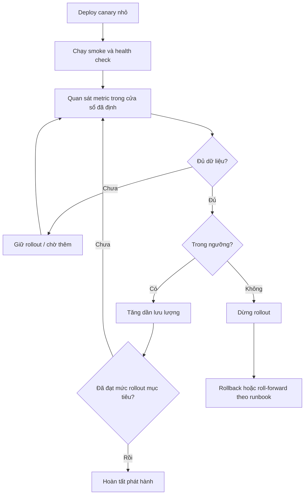
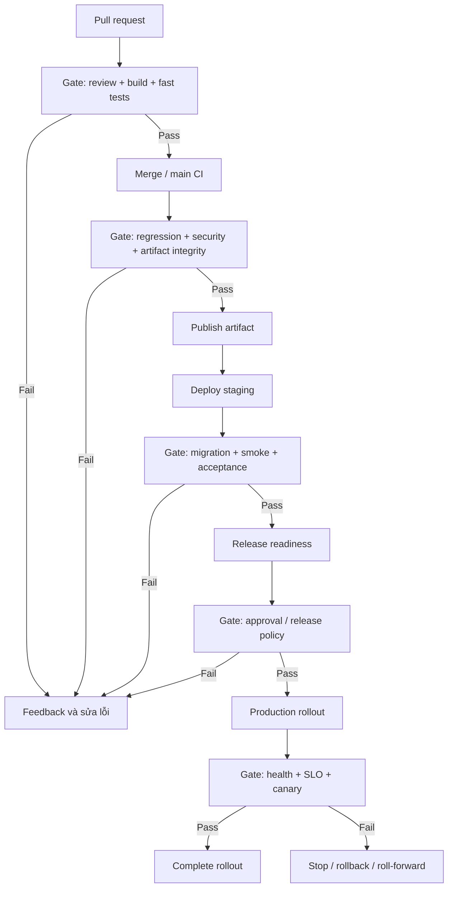

# Xác định điều kiện đạt cho từng giai đoạn pipeline

## 1. Quality gate là gì?

Quality gate (cổng chất lượng) là tập hợp điều kiện được đánh giá tại một điểm trong pipeline để quyết định luồng có được chuyển sang giai đoạn tiếp theo hay không. Gate có thể kiểm tra kết quả build, test, phân tích mã nguồn, bảo mật, tính hợp lệ của artifact, xác minh trên môi trường hoặc sự chấp thuận của người có thẩm quyền.

Một gate không phải là một bài test riêng lẻ. Test, scan, báo cáo và metadata tạo ra bằng chứng; gate áp dụng chính sách lên những bằng chứng đó để đưa ra quyết định. Ví dụ, một pipeline có thể chạy hàng trăm unit test, nhưng gate chỉ đạt khi tất cả test bắt buộc thành công, báo cáo thuộc đúng commit đang kiểm tra và không có kết quả bị thiếu hoặc hết hạn.

Trong CI/CD, gate giúp biến yêu cầu chất lượng thành điều kiện thực thi nhất quán. Thay vì dựa vào việc một người nhớ chạy kiểm thử hoặc xem một báo cáo, pipeline có thể tự động chặn bước hợp nhất, đóng gói, promote hoặc rollout khi điều kiện chưa đạt.

Một gate tốt cần trả lời được bốn câu hỏi:

1. **Đang bảo vệ điều gì?** Chất lượng mã nguồn, hành vi nghiệp vụ, bảo mật, tính toàn vẹn artifact hay độ an toàn của lần triển khai?
2. **Dựa trên bằng chứng nào?** Test report, scan result, checksum, deployment health, approval record hoặc dữ liệu vận hành?
3. **Ngưỡng đạt là gì?** Điều kiện cụ thể, có thể kiểm tra và giải thích được.
4. **Nếu không đạt thì sao?** Dừng, sửa, chạy lại, xin ngoại lệ có kiểm soát hay rollback?

## 2. Phân biệt kiểm tra, ngưỡng và quyết định của gate

Một quy trình chất lượng thường có ba lớp liên kết:

| Lớp | Vai trò | Ví dụ |
|---|---|---|
| Kiểm tra (check) | Thực hiện phép xác minh và tạo kết quả | Chạy unit test, SAST, dependency scan, smoke test |
| Ngưỡng/chính sách (threshold/policy) | Xác định kết quả nào được chấp nhận | Không có test bắt buộc thất bại; không có lỗ hổng Critical chưa xử lý |
| Quyết định (gate decision) | Cho phép hoặc chặn chuyển tiếp | Pass, fail, pending, blocked hoặc waived có thời hạn |

Ví dụ, công cụ kiểm tra bảo mật có thể báo 12 phát hiện. Bản thân con số 12 chưa cho biết có nên chặn phát hành hay không. Chính sách cần xem xét mức độ nghiêm trọng, khả năng khai thác, khả năng tiếp cận từ ứng dụng, phạm vi ảnh hưởng, trạng thái xử lý và quy tắc của tổ chức. Gate sau đó mới đưa ra quyết định.

Không nên đặt gate dựa trên một con số tách rời ngữ cảnh. Tỷ lệ code coverage 85% có thể là mục tiêu phù hợp với một module nhưng không bảo đảm luồng thanh toán quan trọng được kiểm thử. Ngược lại, một module adapter mỏng có thể có coverage thấp hơn nhưng được bảo vệ bởi contract test và integration test. Ngưỡng phải gắn với rủi ro mà gate cần kiểm soát.

## 3. Thiết kế gate bắt đầu từ rủi ro và mục tiêu

Trước khi chọn điều kiện, hãy xác định rủi ro cần ngăn chặn ở giai đoạn đó. Một số câu hỏi hữu ích:

- Nếu lỗi lọt qua gate, hậu quả với người dùng, dữ liệu và vận hành là gì?
- Lỗi có thể được phát hiện bằng kiểm tra tự động nào?
- Bằng chứng có thể được thu thập trước khi pipeline chuyển tiếp không?
- Kiểm tra cần chạy trên mã nguồn, artifact hay môi trường đang hoạt động?
- Ngưỡng nào phản ánh mức chấp nhận rủi ro của sản phẩm?
- Ai sở hữu chính sách và ai có quyền xử lý ngoại lệ?

Ví dụ, với một thay đổi chỉ sửa văn bản giao diện, gate pull request có thể tập trung vào build, lint và kiểm thử liên quan. Với thay đổi phân quyền, gate cần thêm test quyền truy cập, kiểm tra API và phân tích bảo mật. Với migration database, gate trước phát hành phải kiểm tra khả năng tương thích, thời gian chạy, backup/restore và phương án xử lý dữ liệu.

Ma trận dưới đây là cách phân loại định tính để bắt đầu thảo luận:

| Mức rủi ro | Đặc điểm | Cách thiết kế gate |
|---|---|---|
| Thấp | Phạm vi hẹp, dễ hoàn tác, ít ảnh hưởng dữ liệu hoặc bảo mật | Kiểm tra nhanh và tiêu chí cơ bản; giữ phản hồi ngắn |
| Trung bình | Ảnh hưởng một luồng nghiệp vụ hoặc một số thành phần | Thêm test tích hợp/contract và kiểm tra tương thích liên quan |
| Cao | Ảnh hưởng dữ liệu, quyền truy cập, tiền, tính sẵn sàng hoặc nhiều dịch vụ | Kiểm tra chuyên biệt, phê duyệt phù hợp, rollout có quan sát và kế hoạch khôi phục |

Mức rủi ro không nên được quyết định chỉ bằng số dòng thay đổi hoặc tên nhánh. Một thay đổi vài dòng trong logic xác thực có thể có rủi ro cao hơn một refactor lớn nhưng không đổi hành vi.

## 4. Các thành phần của một quality gate có thể kiểm toán

Một gate nên được mô tả như một chính sách có cấu trúc. Những thành phần thường cần có:

| Thành phần | Nội dung cần xác định |
|---|---|
| Định danh | Tên gate, phiên bản chính sách và giai đoạn áp dụng |
| Phạm vi | Repository, service, branch/event, artifact hoặc môi trường chịu gate |
| Bằng chứng đầu vào | Loại báo cáo, nguồn tạo, commit/digest liên quan và thời điểm tạo |
| Điều kiện bắt buộc | Điều kiện phải đạt để gate pass |
| Ngưỡng | Mức tối đa/tối thiểu, severity, thời hạn hoặc khoảng quan sát |
| Xử lý dữ liệu thiếu | Pending, fail hoặc yêu cầu chạy lại khi bằng chứng không có/không hợp lệ |
| Chủ sở hữu | Nhóm chịu trách nhiệm về chính sách và kết quả |
| Ngoại lệ | Người duyệt, lý do, phạm vi, thời hạn và điều kiện bù trừ |
| Bằng chứng quyết định | Kết quả pass/fail/waived, thời gian và liên kết tới báo cáo |

Điều quan trọng là gate phải đánh giá đúng đối tượng. Báo cáo test của commit cũ không thể chứng minh commit mới đạt. Scan của một artifact khác digest không thể chứng minh artifact sắp triển khai an toàn. Approval của một lần release trước không tự động áp dụng cho lần release hiện tại.

## 5. Gate ở giai đoạn pull request

Pull request là điểm phù hợp để kiểm tra những lỗi có thể phát hiện nhanh trước khi thay đổi đi vào nhánh chung. Gate tại đây thường bảo vệ khả năng tích hợp và chất lượng mã nguồn.

Các điều kiện có thể gồm:

- Pull request có mô tả mục đích, liên kết issue hoặc tiêu chí chấp nhận theo quy ước nhóm.
- Mã nguồn được kiểm tra đúng revision dự kiến hợp nhất.
- Formatter check, lint, type check hoặc static analysis bắt buộc đạt.
- Build thành công.
- Unit test và test mục tiêu liên quan đến thay đổi thành công.
- Không có secret bị commit hoặc vi phạm chính sách dependency/license ở mức chặn.
- Review bắt buộc đã được chấp thuận theo quy tắc bảo vệ nhánh.
- Các kiểm tra bắt buộc có kết quả mới nhất, không bị bỏ qua hoặc lấy từ lần chạy cũ.

Gate pull request nên ưu tiên phản hồi nhanh. Những kiểm tra tốn thời gian như full end-to-end, kiểm thử tải lớn hoặc quét động có thể chạy ở giai đoạn sau nếu không cần thiết cho quyết định hợp nhất. Tuy nhiên, không được chuyển kiểm tra rủi ro cao sang sau merge mà không có biện pháp bù phù hợp.

Ví dụ bảng quyết định:

| Điều kiện | Pass khi | Khi không đạt |
|---|---|---|
| Build | Build của revision hiện tại thành công | Chặn merge, cung cấp log |
| Unit test | Tất cả test bắt buộc đạt | Chặn merge; phân tích test fail/flaky |
| Static analysis | Không có finding thuộc nhóm chặn theo policy | Sửa lỗi hoặc xin ngoại lệ đúng quy trình |
| Secret scan | Không phát hiện secret hợp lệ chưa được xử lý | Thu hồi/rotate secret và loại khỏi lịch sử theo quy trình |
| Review | Đủ số lượng và vai trò reviewer theo branch policy | Chờ review hợp lệ |

Review là quyết định của con người dựa trên thay đổi; kết quả CI không thay thế review. Ngược lại, review được chấp thuận cũng không nên bỏ qua các kiểm tra tự động bắt buộc.

## 6. Gate sau khi hợp nhất và khi tạo artifact

Sau merge, pipeline cần xác minh nhánh chính và tạo sản phẩm có thể chuyển giao. Gate ở giai đoạn này thường tập trung vào tính toàn vẹn và khả năng tái lập của build.

Các điều kiện thường gặp:

- Build được tạo từ commit SHA xác định trên nhánh chính.
- Bộ test sau hợp nhất đạt theo phạm vi quy định.
- Artifact được tạo và upload thành công.
- Artifact có version/digest bất biến và metadata build.
- Dependency, license và bảo mật được kiểm tra theo chính sách.
- SBOM hoặc provenance được tạo nếu quy trình yêu cầu.
- Không có artifact cũ hoặc không xác định bị sử dụng nhầm.

Một nguyên tắc quan trọng là gate cần kiểm tra chính artifact sẽ được promote. Nếu pipeline build một JAR, sau đó scan một file khác được tải từ tag có thể thay đổi, kết quả scan không còn chứng minh cho JAR phát hành. Hãy liên kết báo cáo, metadata và quyết định gate với digest của artifact.

Với container, có thể kiểm tra image digest, base image, package vulnerability, cấu hình image và chữ ký. Với package Java, có thể kiểm tra dependency graph, license, metadata và checksum. Tiêu chí cụ thể phụ thuộc loại sản phẩm.

## 7. Gate khi triển khai lên staging hoặc môi trường kiểm thử

Staging giúp xác minh artifact trong môi trường gần với production hơn. Gate ở đây cần xem xét cả chất lượng ứng dụng và điều kiện của môi trường.

Điều kiện có thể gồm:

- Artifact digest đúng với bản đã qua gate trước đó.
- Cấu hình môi trường được tải đúng và secret được cấp theo quyền tối thiểu.
- Migration hoặc thay đổi schema chạy thành công và tương thích với phiên bản đang hoạt động.
- Ứng dụng khởi động và health check đạt.
- Smoke test và integration test trên môi trường thành công.
- Các luồng nghiệp vụ trọng yếu đáp ứng tiêu chí chấp nhận.
- Không có lỗi nghiêm trọng mới trong log hoặc metric quan sát trong khoảng thời gian quy định.
- Môi trường đủ tương đồng để kết quả kiểm thử có ý nghĩa.

Gate staging không nên chỉ kiểm tra trạng thái lệnh deploy. Một lệnh trả về exit code 0 có thể chỉ xác nhận thao tác gửi yêu cầu triển khai thành công; nó không chứng minh ứng dụng đã sẵn sàng nhận lưu lượng hoặc hoạt động đúng.

## 8. Gate trước production

Production là môi trường có hậu quả cao nhất khi phát hành lỗi. Gate trước production thường kết hợp kết quả tự động với điều kiện vận hành và phê duyệt.

Các điều kiện có thể gồm:

- Artifact đã vượt qua các gate trước và digest không thay đổi.
- Test, scan và báo cáo bảo mật bắt buộc còn hiệu lực.
- Migration có kế hoạch, tương thích và đã được xác minh trên môi trường phù hợp.
- Có release note, danh sách thay đổi và liên kết ticket theo chính sách.
- Có kế hoạch rollout, theo dõi, dừng triển khai và rollback/roll-forward.
- Health check, smoke test hoặc canary ở môi trường tiền production đạt.
- Phê duyệt của vai trò có thẩm quyền được ghi nhận nếu chính sách yêu cầu.
- Không có incident hoặc điều kiện vận hành đang cấm phát hành theo release policy.

Phê duyệt thủ công là một phần của kiểm soát thay đổi, không phải bằng chứng kỹ thuật rằng phần mềm hoạt động đúng. Người duyệt cần thấy các bằng chứng liên quan, phạm vi ảnh hưởng, kế hoạch triển khai và cách phục hồi. Một nút Approve không nên làm cho test thất bại hoặc scan thiếu dữ liệu tự động trở thành pass.

Đối với triển khai tự động liên tục, gate production có thể được thực hiện bằng policy thay vì approval từng lần. Điều này chỉ phù hợp khi tiêu chí tự động đủ tin cậy, quyền đã được giới hạn và hệ thống quan sát/rollback đáp ứng yêu cầu rủi ro.

## 9. Gate sau triển khai và trong quá trình rollout

Sau khi đưa phiên bản mới lên production, pipeline cần xác minh ứng dụng hoạt động trong điều kiện thật. Gate sau triển khai có thể quyết định tiếp tục rollout, dừng lại hoặc quay lui.

Các tín hiệu thường dùng:

- Health/readiness check và tỷ lệ instance sẵn sàng.
- Tỷ lệ lỗi HTTP hoặc lỗi nghiệp vụ.
- Latency p50/p95/p99 của endpoint quan trọng.
- Tỷ lệ timeout, retry và lỗi kết nối dependency.
- CPU, memory, thread/connection pool hoặc queue backlog.
- Metric nghiệp vụ như tỷ lệ thanh toán thành công, đơn hàng lỗi hoặc giao dịch bị từ chối bất thường.
- Log và trace có liên quan đến phiên bản mới.

Với canary rollout, có thể so sánh nhóm nhận phiên bản mới với nhóm baseline trong một cửa sổ quan sát. Gate chỉ mở rộng lưu lượng khi các chỉ số nằm trong ngưỡng và dữ liệu đủ để đưa ra kết luận. Nếu traffic quá thấp hoặc metric chưa cập nhật, trạng thái nên là pending/insufficient evidence thay vì tự động pass.

Ví dụ luồng quyết định:



Không nên đặt ngưỡng chỉ dựa trên một metric tổng quát. Một endpoint có thể có latency tốt nhưng tỷ lệ giao dịch thất bại tăng. Cần chọn tín hiệu đại diện cho rủi ro nghiệp vụ và đặt ngưỡng theo baseline, SLO hoặc tiêu chí đã được thống nhất.

## 10. Xác định ngưỡng có ý nghĩa

Ngưỡng là phần dễ bị đặt tùy tiện nhất. Một ngưỡng tốt cần có cơ sở, đo được và phản ánh rủi ro. Một số nhóm điều kiện thường gặp:

| Nhóm | Ví dụ điều kiện | Lưu ý khi đặt ngưỡng |
|---|---|---|
| Build | Build thành công, không có compiler error | Thường là điều kiện bắt buộc, không nên cho phép bỏ qua tùy tiện |
| Test | Không có test bắt buộc thất bại; tỷ lệ test đạt theo policy | Phân biệt test fail thật với test bị skip hoặc không chạy |
| Coverage | Coverage tổng hoặc coverage phần mã mới đạt mục tiêu | Xem cùng chất lượng assertion và rủi ro của module |
| Static analysis | Không có finding mới thuộc severity chặn | Có baseline, phân loại false positive và chủ sở hữu xử lý |
| Security | Không có lỗ hổng vượt ngưỡng rủi ro được phép | Xem exploitability, reachability, exposure và bản vá |
| Dependency/license | Không vi phạm policy về package hoặc license | Cần dữ liệu chính xác và quy trình chấp thuận ngoại lệ |
| Artifact | Digest, metadata và chữ ký hợp lệ | Phải liên kết với đúng artifact dự kiến phát hành |
| Performance | Latency/error rate không vượt ngưỡng so với baseline | Cần tải, dữ liệu và cửa sổ đo đủ đại diện |
| Production health | Tín hiệu vận hành nằm trong SLO/guardrail | Không đánh giá khi dữ liệu thiếu hoặc hệ thống đang có incident |

Không có một con số coverage, số lỗ hổng hoặc latency dùng chung cho mọi dự án. Nên xác định ngưỡng từ baseline hiện tại, mục tiêu cải tiến, yêu cầu nghiệp vụ và mức rủi ro chấp nhận. Nếu chưa có baseline, bắt đầu bằng việc đo, thống nhất phạm vi và đặt ngưỡng từng bước; không giả định một con số tùy ý là chuẩn ngành.

## 11. Dùng baseline và kiểm soát thay đổi mới

Ở codebase lâu năm, việc áp dụng một ngưỡng tuyệt đối cho toàn bộ hệ thống có thể khiến pipeline luôn thất bại vì tồn tại nhiều vấn đề cũ. Một cách chuyển tiếp là tạo baseline đã được review, sau đó gate tập trung vào vấn đề mới hoặc mức suy giảm so với baseline.

Ví dụ:

- Không tăng số finding Critical/High mới so với baseline đã chấp thuận.
- Coverage của phần mã mới không thấp hơn ngưỡng đã thống nhất.
- Không làm tăng tỷ lệ lỗi hoặc latency vượt mức cho phép trong kiểm thử hiệu năng.
- Các lỗ hổng cũ vẫn có owner và thời hạn khắc phục; không được biến baseline thành danh sách miễn trừ vô thời hạn.

Baseline phải có phiên bản, thời điểm tạo, phạm vi và người duyệt. Khi công cụ scan thay đổi hoặc dữ liệu nền được cập nhật, cần đánh giá lại baseline để tránh so sánh hai kết quả không tương đương.

Không nên dùng cách “chỉ chặn finding mới” nếu dữ liệu đầu vào thiếu hoặc scanner không có khả năng phân biệt finding cũ/mới đáng tin cậy. Trong trường hợp đó, cần bổ sung đối chiếu hoặc dùng chính sách chặt hơn cho vùng rủi ro cao.

## 12. Độ mới và tính toàn vẹn của bằng chứng

Gate chỉ đáng tin nếu bằng chứng đúng đối tượng, đủ mới và không bị sửa đổi trái phép. Một số kiểm tra cần xác minh:

- Report gắn với commit SHA hoặc artifact digest đang được đánh giá.
- Report được tạo bởi công cụ/phiên bản được chấp nhận.
- Thời điểm tạo nằm trong khoảng hiệu lực của policy.
- Phạm vi scan/test bao phủ đúng module, môi trường hoặc image cần phát hành.
- Không có job bắt buộc bị skip, cancel hoặc chưa chạy.
- Metadata và artifact được lấy từ nguồn có quyền phù hợp.
- Kết quả không bị thay thế bởi report thủ công hoặc lần chạy khác.

Ví dụ, một scan bảo mật thành công từ tuần trước không thể tự động làm pass artifact vừa build hôm nay nếu dependency hoặc mã nguồn đã thay đổi. Tương tự, smoke test của staging không chứng minh production đã sẵn sàng nếu cấu hình, migration hoặc phiên bản triển khai khác nhau.

Khi bằng chứng bị thiếu, không hợp lệ hoặc hết hạn, gate nên biểu thị trạng thái rõ ràng như pending, blocked hoặc failed theo policy. Không nên mặc định dữ liệu thiếu đồng nghĩa với không có lỗi.

## 13. Phân biệt pass, fail, pending, skipped và waived

Một gate nên có trạng thái đủ rõ để người vận hành hiểu điều gì đã xảy ra:

| Trạng thái | Ý nghĩa | Hành động thường gặp |
|---|---|---|
| Pass | Tất cả điều kiện bắt buộc có bằng chứng hợp lệ và đạt ngưỡng | Cho phép bước tiếp theo |
| Fail | Có bằng chứng cho thấy một hoặc nhiều điều kiện không đạt | Chặn, sửa lỗi và chạy lại |
| Pending | Chưa có đủ bằng chứng hoặc kiểm tra chưa hoàn tất | Chờ kết quả hoặc điều tra job bị kẹt |
| Skipped | Kiểm tra không chạy do điều kiện hoặc cấu hình | Xác minh việc skip có được policy cho phép không |
| Waived | Ngoại lệ được duyệt theo quy trình có giới hạn | Tiếp tục trong phạm vi, thời hạn và điều kiện bù đã duyệt |
| Error/Unknown | Không thể đánh giá do lỗi hệ thống, dữ liệu sai định dạng hoặc nguồn không sẵn sàng | Retry có kiểm soát hoặc chặn theo policy |

Tránh gộp `skipped`, `waived` và `pass` thành cùng một trạng thái xanh. Một test bị skip không chứng minh test đó thành công. Một ngoại lệ được duyệt không có nghĩa rủi ro đã biến mất. Một lỗi kết nối scanner cũng không đồng nghĩa scanner không tìm thấy lỗ hổng.

## 14. Xử lý ngoại lệ và cơ chế waiver

Trong thực tế có thể cần phát hành khẩn cấp khi một điều kiện chưa đạt, ví dụ scanner bị gián đoạn hoặc một finding đã được xác định là false positive. Ngoại lệ phải được quản lý để không biến thành đường vòng thường trực.

Một waiver nên ghi nhận:

- Gate/điều kiện nào được miễn và phạm vi áp dụng cụ thể.
- Artifact digest, commit hoặc release liên quan.
- Lý do và bằng chứng hỗ trợ quyết định.
- Rủi ro còn lại và biện pháp giảm thiểu tạm thời.
- Người yêu cầu và người có thẩm quyền phê duyệt.
- Thời điểm bắt đầu, thời hạn hết hiệu lực và điều kiện thu hồi.
- Ticket/owner và kế hoạch khắc phục nếu vấn đề vẫn cần xử lý.

Không nên cho phép người tạo pull request tự miễn một gate bảo vệ chính thay đổi của họ. Với gate bảo mật hoặc production, người duyệt cần độc lập phù hợp với chính sách tổ chức. Waiver không được tự động áp dụng cho commit, artifact hoặc lần phát hành khác trừ khi phạm vi đó được ghi rõ.

Nếu scanner bị lỗi, nhóm cần phân biệt ngoại lệ cho phép tiếp tục quy trình với kết luận rằng sản phẩm đã an toàn. Có thể dùng kiểm tra thay thế hoặc chờ dịch vụ phục hồi. Nếu rủi ro cao và không có bằng chứng thay thế, chính sách nên chặn phát hành.

## 15. Manual approval và trách nhiệm con người

Manual approval phù hợp với các quyết định cần trách nhiệm nghiệp vụ hoặc vận hành, chẳng hạn phát hành production, migration có tác động lớn hoặc bật tính năng cho toàn bộ người dùng.

Một bước approval hữu ích nên hiển thị:

- Phiên bản, commit và artifact digest dự kiến triển khai.
- Kết quả các gate trước đó và liên kết tới report.
- Phạm vi dịch vụ, môi trường, nhóm người dùng và mức lưu lượng.
- Kế hoạch rollout, cửa sổ triển khai và người trực vận hành.
- Rủi ro đã biết, waiver còn hiệu lực và điều kiện dừng.
- Runbook rollback/roll-forward và trạng thái backup/migration nếu có.

Approval cần được gắn với đúng release và artifact. Nếu artifact thay đổi sau khi duyệt, cần đánh giá lại theo policy. Người duyệt cũng cần biết approval của họ cho phép hành động nào và trong khoảng thời gian nào.

Không nên yêu cầu phê duyệt thủ công cho mọi bước nhỏ nếu các gate tự động đã đủ tin cậy và rủi ro thấp. Quá nhiều approval tạo hàng đợi, làm giảm tốc độ và khiến người duyệt có xu hướng bấm chấp thuận theo thói quen.

## 16. Gate cho migration và thay đổi dữ liệu

Thay đổi database hoặc dữ liệu thường có rủi ro riêng vì rollback ứng dụng không tự động hoàn tác dữ liệu. Gate migration cần xem xét:

- Migration chạy được trên schema đại diện và có thời gian thực thi phù hợp.
- Có tương thích với phiên bản ứng dụng cũ/mới trong giai đoạn rollout hay không.
- Có khóa bảng, table rewrite hoặc downtime tiềm ẩn không.
- Dữ liệu có thể được backup/restore hoặc tái tạo không.
- Migration có idempotent hoặc có cách xác định trạng thái đã chạy không.
- Có bước xác minh số lượng, tính toàn vẹn và quy tắc nghiệp vụ sau migration không.
- Có kế hoạch xử lý nếu ứng dụng mới không tương thích với schema sau migration không.

Với thay đổi lớn, có thể dùng chiến lược expand-and-contract: mở rộng schema tương thích trước, triển khai ứng dụng đọc/ghi theo định dạng chuyển tiếp, di chuyển dữ liệu, xác minh rồi mới loại bỏ cột hoặc cấu trúc cũ ở một lần phát hành sau.

Gate migration nên kiểm tra cả bước chuẩn bị và kết quả thực tế. Chỉ kiểm tra script có cú pháp hợp lệ không đủ để chứng minh migration an toàn trên dữ liệu production.

## 17. Gate bảo mật và dependency

Gate bảo mật cần chuyển kết quả scan thành chính sách có thể hành động. Các loại bằng chứng có thể gồm:

- SAST: phân tích mã nguồn tĩnh.
- SCA/dependency scan: kiểm tra thư viện và thành phần bên thứ ba.
- Secret scan: phát hiện credential bị đưa vào repository hoặc artifact.
- Container/image scan: kiểm tra package và cấu hình image.
- DAST hoặc API security test: kiểm tra ứng dụng đang chạy.
- License policy: kiểm tra điều kiện sử dụng dependency.

Khi đặt ngưỡng, cần cân nhắc severity, exploitability, reachability, exposure, mức đặc quyền, dữ liệu bị ảnh hưởng và khả năng có bản vá. Không phải mọi finding có severity giống nhau đều có mức rủi ro thực tế như nhau. Tuy nhiên, việc giảm mức độ phải dựa trên bằng chứng và được ghi nhận, không chỉ để pipeline xanh.

Một policy có thể quy định không phát hành khi còn lỗ hổng Critical có khả năng khai thác trong thành phần được triển khai; lỗ hổng High cần được xử lý trong SLA hoặc có waiver; finding thấp hơn được ghi nhận và theo dõi. Đây chỉ là ví dụ chính sách. Tổ chức phải xác định ngưỡng và SLA theo môi trường, yêu cầu pháp lý và mức độ rủi ro.

Gate cần xử lý cả trường hợp scanner không chạy, dữ liệu vulnerability database quá cũ hoặc dependency graph không đầy đủ. Kết quả scan rỗng vì không quét được không được coi là sạch.

## 18. Gate sau triển khai: health, SLO và canary

Gate sau triển khai nên dựa trên các chỉ số có ý nghĩa với người dùng. Có thể dùng SLI/SLO hoặc guardrail riêng cho rollout.

Ví dụ một dịch vụ API có thể theo dõi:

| Tín hiệu | Câu hỏi | Hành động khi vượt ngưỡng |
|---|---|---|
| Error rate | Tỷ lệ request lỗi có tăng so với baseline không? | Dừng mở rộng lưu lượng, điều tra hoặc rollback |
| Latency | p95/p99 có vượt mục tiêu của endpoint quan trọng không? | Giữ canary hoặc giảm lưu lượng |
| Availability/readiness | Instance có sẵn sàng và nhận traffic ổn định không? | Dừng rollout nếu không đạt |
| Dependency health | Database, queue hoặc dịch vụ ngoài có lỗi tăng không? | Điều tra tương tác và cân nhắc rollback |
| Business metric | Tỷ lệ thanh toán, tạo đơn hoặc xử lý thành công có giảm không? | Kích hoạt quy trình xử lý nghiệp vụ và phát hành |

Ngưỡng nên được so sánh với baseline trong khoảng thời gian tương đương và đủ dữ liệu. Cần tránh phản ứng quá mức với một spike ngắn không có ý nghĩa, nhưng cũng không nên chờ quá lâu khi có tín hiệu nghiêm trọng. Định nghĩa trước cửa sổ quan sát, số mẫu tối thiểu, điều kiện dừng khẩn cấp và người nhận cảnh báo.

Nếu canary không có đủ lưu lượng để đánh giá, gate nên giữ rollout ở trạng thái chờ hoặc dùng kiểm tra bổ sung. Không nên tự động mở rộng chỉ vì không có cảnh báo.

## 19. Tổ chức gate trong pipeline theo từng giai đoạn

Một pipeline có thể đặt gate tại các điểm chuyển tiếp sau:



Không phải dự án nào cũng cần tách thành đúng số stage này. Một số gate có thể nằm trong job; một số gate do deployment platform hoặc hệ thống policy độc lập thực hiện. Điều quan trọng là các điểm quyết định có owner, bằng chứng và trạng thái rõ.

| Giai đoạn | Mục tiêu gate | Bằng chứng chính | Quyết định |
|---|---|---|---|
| Pull request | Bảo vệ chất lượng thay đổi | Review, build, lint, unit test, scan nhanh | Cho phép merge hay yêu cầu sửa |
| Sau merge | Bảo vệ nhánh chính và đầu ra build | Regression, integration, scan, commit và build metadata | Cho phép publish artifact |
| Package/publish | Bảo vệ tính toàn vẹn sản phẩm | Artifact digest, provenance, SBOM/chữ ký nếu cần | Cho phép lưu và promote |
| Staging | Xác minh trong môi trường đại diện | Deploy record, migration, smoke, acceptance test | Cho phép release readiness |
| Trước production | Kiểm soát thay đổi production | Gate trước đó, release plan, approval/policy | Cho phép bắt đầu rollout |
| Sau triển khai | Xác minh hành vi thực tế | Health, metric, log, trace, canary analysis | Tiếp tục, dừng hoặc khôi phục |

## 20. Ví dụ: thiết kế gate cho dịch vụ xử lý đơn hàng

Giả sử một dịch vụ Java xử lý tạo đơn, tính phí và thanh toán. Nhóm cần phát hành thay đổi thêm quy tắc giảm giá. Một lỗi có thể làm sai tổng tiền hoặc khiến người dùng áp dụng ưu đãi trái phép.

Gate có thể được thiết kế như sau:

| Giai đoạn | Điều kiện cụ thể | Bằng chứng cần lưu |
|---|---|---|
| Pull request | Build, lint, unit test công thức giảm giá, test phân quyền và review đạt | Commit SHA, test report, review record, scan result |
| Sau merge | Integration test với database, contract test API và regression của checkout đạt | Pipeline run ID, test report, dependency scan |
| Artifact | JAR được tạo, checksum và provenance hợp lệ; không có finding bảo mật vượt ngưỡng | Artifact digest, build metadata, SBOM/scan report |
| Staging | Migration tương thích, smoke test, luồng tạo đơn và thanh toán giả lập thành công | Deployment record, migration report, acceptance result |
| Trước production | Có release note, rollout plan, người trực và approval theo chính sách | Approval record, release ID, runbook link |
| Canary | Error rate, latency và tỷ lệ thanh toán thành công nằm trong guardrail đủ thời gian | Metric theo phiên bản, cửa sổ quan sát, quyết định rollout |

Nếu smoke test staging thất bại, gate không cho phép production deploy. Nếu canary cho thấy tỷ lệ thanh toán thất bại tăng, hệ thống dừng mở rộng lưu lượng và kích hoạt runbook. Nếu scanner không có dữ liệu mới, gate bảo mật ở trạng thái blocked/pending theo policy thay vì tự coi là đạt.

Ví dụ này cho thấy gate không phải một cổng duy nhất ở cuối pipeline. Mỗi giai đoạn cần kiểm soát loại rủi ro phù hợp với dữ liệu và quyết định ở giai đoạn đó.

## 21. Ví dụ policy dưới dạng mã

Một policy có thể được mô tả bằng YAML giả định để làm rõ điều kiện:

```yaml
qualityGates:
  pullRequest:
    required:
      - build.success == true
      - unitTests.failed == 0
      - requiredReviews.approved == true
      - secretScan.status == "completed"

  artifact:
    required:
      - artifact.digest != null
      - provenance.sourceCommit == pipeline.commit
      - dependencyScan.status == "completed"
      - security.criticalUnresolved == 0

  staging:
    required:
      - deployedArtifact.digest == artifact.digest
      - smokeTests.failed == 0
      - migration.status == "success"

  production:
    required:
      - releaseApproval.status == "approved"
      - rolloutPlan.exists == true
      - rollbackPlan.exists == true

  postDeploy:
    required:
      - health.status == "healthy"
      - canary.errorRate <= policy.maxErrorRate
      - canary.windowComplete == true
```

Đây là policy minh họa, không phải cú pháp của một engine cụ thể. Trong hệ thống thực, cần xác định kiểu dữ liệu, cách xử lý trường thiếu, cách lấy report, độ mới của dữ liệu và cách liên kết commit/artifact. Biểu thức như `security.criticalUnresolved == 0` chỉ có ý nghĩa nếu scanner hoàn tất và phạm vi scan đầy đủ.

Policy nên được quản lý phiên bản và review như mã nguồn. Khi thay đổi ngưỡng, cần biết gate nào bị ảnh hưởng, áp dụng từ thời điểm nào và có cần đánh giá lại release đang chạy hay không.

## 22. Đo lường hiệu quả của quality gate

Gate cần bảo vệ chất lượng nhưng cũng phải hỗ trợ luồng phát triển. Có thể theo dõi:

- **Gate failure rate:** tỷ lệ lần chạy không đạt theo từng gate và nguyên nhân.
- **False positive rate:** tỷ lệ finding hoặc cảnh báo bị xác định không đúng.
- **Time to feedback:** thời gian từ trigger đến khi có quyết định gate.
- **Time waiting for approval:** thời gian chờ phê duyệt của con người.
- **Waiver frequency:** tần suất và lý do sử dụng ngoại lệ.
- **Escaped defects:** lỗi lọt qua gate và được phát hiện ở giai đoạn sau/production.
- **Rollback/hotfix rate:** tỷ lệ phát hành cần khôi phục hoặc sửa nóng.
- **Evidence freshness/completeness:** tỷ lệ quyết định dựa trên bằng chứng đúng revision, đủ phạm vi và còn hiệu lực.

Không nên tối ưu bằng cách giảm số lần fail hoặc giảm thời gian gate bằng mọi giá. Gate không bao giờ fail có thể là dấu hiệu ngưỡng quá lỏng hoặc kiểm tra không chạy. Gate fail liên tục do test chập chờn có thể khiến nhóm bỏ qua kết quả. Hãy phân loại nguyên nhân và cải thiện chất lượng kiểm tra, ngưỡng và môi trường.

## 23. Những anti-pattern thường gặp

| Anti-pattern | Hệ quả | Cách cải thiện |
|---|---|---|
| Một gate duy nhất ở cuối pipeline | Lỗi được phát hiện muộn, khó xác định giai đoạn gây vấn đề | Đặt gate tại các điểm chuyển tiếp phù hợp |
| Gate chỉ kiểm tra job có màu xanh | Có thể bỏ sót report thiếu, test bị skip hoặc scan sai revision | Kiểm tra bằng chứng, phạm vi và tính mới |
| Dùng một ngưỡng cho mọi module | Không phản ánh rủi ro và đặc tính từng thành phần | Phân loại theo rủi ro, baseline và mục tiêu |
| Dùng coverage làm tiêu chí chất lượng duy nhất | Có thể đạt coverage mà không kiểm tra hành vi quan trọng | Kết hợp assertion, test nghiệp vụ và lỗi lọt qua |
| Approval thay thế kiểm thử | Quyết định con người không chứng minh ứng dụng hoạt động đúng | Approval dựa trên bằng chứng và không bỏ qua gate bắt buộc |
| Dữ liệu thiếu được coi là pass | Scanner lỗi hoặc test chưa chạy vẫn cho phép phát hành | Định nghĩa pending/blocked và xử lý thiếu bằng chứng |
| Waiver không có thời hạn | Ngoại lệ tạm thời trở thành chính sách mặc định | Ghi owner, lý do, phạm vi, hạn và kế hoạch khắc phục |
| Scan report không gắn với artifact | Có thể scan một file nhưng deploy file khác | Liên kết report với commit và artifact digest |
| Canary chỉ quan sát một metric | Không phát hiện suy giảm nghiệp vụ dù health kỹ thuật tốt | Chọn nhiều SLI đại diện và cửa sổ đủ dữ liệu |
| Quá nhiều gate thủ công | Tạo hàng đợi và approval theo thói quen | Tự động hóa quyết định lặp lại, giữ approval cho rủi ro phù hợp |

## 24. Checklist thiết kế quality gate

Trước khi đưa gate vào pipeline, hãy xác minh:

- [ ] Mục tiêu và rủi ro mà gate cần kiểm soát được mô tả rõ.
- [ ] Phạm vi áp dụng và giai đoạn pipeline được xác định.
- [ ] Điều kiện pass/fail có thể đo và giải thích.
- [ ] Ngưỡng dựa trên baseline, yêu cầu nghiệp vụ hoặc chính sách rủi ro.
- [ ] Bằng chứng gắn với đúng commit, artifact digest hoặc môi trường.
- [ ] Nguồn dữ liệu đủ mới, đầy đủ và có thể truy xuất.
- [ ] Trạng thái pending, failed, skipped, error và waived được phân biệt.
- [ ] Hành động khi không đạt và người chịu trách nhiệm đã rõ.
- [ ] Ngoại lệ có người duyệt, lý do, phạm vi, thời hạn và biện pháp bù.
- [ ] Manual approval cung cấp đủ thông tin để quyết định.
- [ ] Gate production có kế hoạch rollout, quan sát và rollback/roll-forward.
- [ ] Policy được quản lý phiên bản, review và lưu lịch sử quyết định.
- [ ] Có chỉ số để theo dõi false positive, thời gian phản hồi và lỗi lọt qua.

## 25. Nguyên tắc thực hành cốt lõi

1. Xem quality gate là quyết định chính sách dựa trên bằng chứng, không phải một bước test đơn lẻ.
2. Đặt gate tại các điểm chuyển tiếp: pull request, sau merge, tạo artifact, staging, production và sau triển khai.
3. Chọn điều kiện theo rủi ro của thay đổi và mục tiêu của từng giai đoạn.
4. Định nghĩa ngưỡng có cơ sở, kiểm tra cả phạm vi và độ mới của bằng chứng.
5. Liên kết mọi report và quyết định với đúng commit, artifact digest và môi trường.
6. Phân biệt pass, fail, pending, skipped, error và waived; không coi dữ liệu thiếu là đạt.
7. Quản lý ngoại lệ có owner, lý do, thời hạn và biện pháp giảm thiểu.
8. Dùng manual approval cho quyết định cần trách nhiệm con người, nhưng không thay thế bằng chứng kỹ thuật.
9. Xác minh sau triển khai bằng health, SLO, metric nghiệp vụ và canary trước khi hoàn tất rollout.
10. Đo hiệu quả gate và cải tiến ngưỡng, chất lượng test cùng thời gian phản hồi.

Quality gate hiệu quả giúp nhóm chuyển từ giai đoạn này sang giai đoạn khác với mức tin cậy có thể giải thích. Khi điều kiện, bằng chứng và cách xử lý ngoại lệ được định nghĩa rõ, pipeline vừa giữ được tốc độ tích hợp vừa kiểm soát được chất lượng, bảo mật và rủi ro phát hành.
