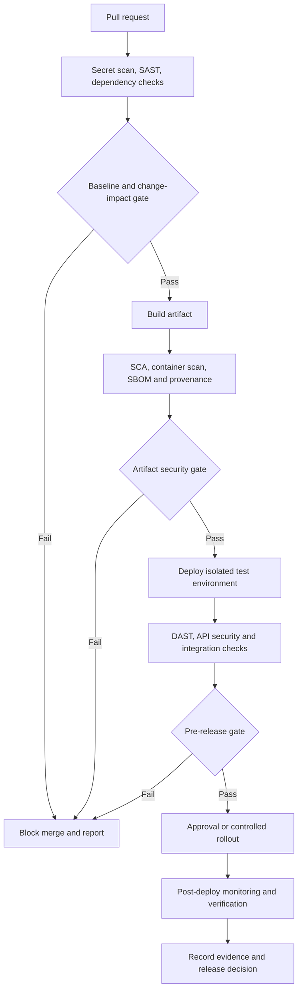

# Đặt kiểm tra bảo mật theo mức độ ảnh hưởng

Một pipeline CI/CD có thể chạy rất nhiều công cụ bảo mật, nhưng chạy càng nhiều công cụ không tự động làm cho bản phát hành an toàn hơn. Nếu mọi cảnh báo đều chặn mọi pull request, nhóm phát triển sẽ phải chờ lâu, khó phân biệt lỗi nghiêm trọng với vấn đề ít ảnh hưởng và dần mất niềm tin vào cổng chất lượng. Nếu chỉ chạy một lượt quét đơn giản trước khi merge, rủi ro quan trọng có thể không được phát hiện cho đến khi artifact đã triển khai.

Cách tiếp cận phù hợp là đặt kiểm tra bảo mật theo **mức độ ảnh hưởng của thay đổi và tài sản bị tác động**. Một thay đổi liên quan đến xác thực, phân quyền, xử lý dữ liệu nhạy cảm hoặc đường đi từ Internet vào hệ thống cần mức kiểm tra khác với thay đổi tài liệu hoặc giao diện tĩnh. Việc phân tầng phải dựa trên bối cảnh, khả năng khai thác, phạm vi ảnh hưởng và độ tin cậy của phát hiện, đồng thời vẫn giữ các kiểm tra nền tảng cho mọi thay đổi.

Bài học này trình bày cách đánh giá rủi ro bảo mật, chọn loại kiểm tra theo tác động, thiết kế quality gate ở các giai đoạn CI/CD, xử lý phát hiện và ngoại lệ, bảo vệ pipeline cũng như theo dõi rủi ro sau triển khai. Mục tiêu là đưa đúng kiểm tra đến đúng thay đổi, chặn rủi ro không thể chấp nhận và giữ bằng chứng đủ để giải thích quyết định phát hành.

## 1. Cổng bảo mật trong luồng CI/CD

Cổng bảo mật (security gate) là tập hợp điều kiện bảo mật phải được đáp ứng trước khi pipeline chuyển sang một giai đoạn tiếp theo. Cổng có thể chặn merge, chặn tạo artifact phát hành, chặn promote hoặc chặn triển khai lên một môi trường cụ thể.

Một luồng tham khảo:

~~~mermaid
flowchart TD
    A["Thay đổi mã nguồn / cấu hình"] --> B["Đánh giá vùng ảnh hưởng"]
    B --> C["Kiểm tra nền tảng trên mọi thay đổi"]
    C --> D["Kiểm tra chuyên sâu theo rủi ro"]
    D --> E{"Có phát hiện vượt ngưỡng?"}
    E -- "Có" --> F["Chặn bước tiếp theo và phân loại"]
    F --> G["Sửa lỗi hoặc xét ngoại lệ có kiểm soát"]
    G --> D
    E -- "Không" --> H["Review và hợp nhất"]
    H --> I["Quét artifact và xác minh nguồn gốc"]
    I --> J{"Artifact đáp ứng chính sách?"}
    J -- "Không" --> F
    J -- "Có" --> K["Triển khai môi trường kiểm thử"]
    K --> L["DAST / API test / kiểm tra cấu hình"]
    L --> M{"Đủ điều kiện phát hành?"}
    M -- "Không" --> F
    M -- "Có" --> N["Phê duyệt và triển khai"]
    N --> O["Theo dõi runtime và xử lý rủi ro"]
~~~

Cổng bảo mật không nhất thiết là một công cụ duy nhất. Nó có thể tổng hợp kết quả từ nhiều nguồn như SAST, SCA, secret scanning, kiểm tra Infrastructure as Code, quét container, DAST, kiểm tra cấu hình triển khai và đánh giá thủ công.

Điều quan trọng là phải xác định trước:

- Tài sản, luồng dữ liệu hoặc môi trường nào đang được bảo vệ?
- Thay đổi có thể tạo ra loại rủi ro nào?
- Kiểm tra nào phù hợp để phát hiện rủi ro đó?
- Mức phát hiện nào được phép tiếp tục?
- Ai chịu trách nhiệm xử lý hoặc chấp thuận ngoại lệ?
- Bằng chứng nào được lưu cùng lần chạy và artifact?

## 2. Đánh giá mức độ ảnh hưởng trước khi chọn kiểm tra

Không nên chọn kiểm tra chỉ dựa vào số lượng file thay đổi hoặc điểm severity của công cụ. Cần hiểu thay đổi tác động đến tài sản nào và có thể mở ra đường khai thác nào.

Có thể đánh giá theo các chiều sau:

| Chiều đánh giá | Câu hỏi cần trả lời | Ví dụ tác động cao |
|---|---|---|
| Giá trị tài sản | Thành phần này bảo vệ hoặc xử lý dữ liệu gì? | Thông tin định danh, dữ liệu tài chính, khóa mã hóa |
| Exposure | Thành phần có thể được truy cập từ đâu? | API public, endpoint Internet, dịch vụ đối tác |
| Quyền và đặc quyền | Thành phần có thể thực hiện hành động nào? | Đăng nhập, cấp quyền, quản trị, thực thi lệnh |
| Khả năng khai thác | Kẻ tấn công cần điều kiện và công sức gì? | Không cần xác thực, khai thác từ xa, có mã khai thác sẵn |
| Blast radius | Nếu bị khai thác, phạm vi ảnh hưởng đến đâu? | Nhiều tenant, toàn bộ tài khoản hoặc hệ thống |
| Khả năng phát hiện | Công cụ có bằng chứng đủ tin cậy không? | Đường gọi có thể tiếp cận trực tiếp đến sink nguy hiểm |
| Khả năng khôi phục | Có thể giới hạn hoặc đảo ngược hậu quả không? | Có thể thu hồi token nhanh hay dữ liệu đã bị lộ không thể thu hồi |

Một cách đánh giá định tính là xếp mức ảnh hưởng thành thấp, trung bình, cao hoặc nghiêm trọng. Mức xếp hạng cần được nhóm thống nhất bằng tiêu chí cụ thể. Không nên chỉ gán nhãn theo cảm tính hoặc để mỗi nhóm tự diễn giải khác nhau.

### 2.1. Phân biệt severity với risk

Severity mô tả mức nghiêm trọng kỹ thuật của một lỗ hổng theo một thang đánh giá. Risk phản ánh khả năng và hậu quả khi lỗ hổng xuất hiện trong bối cảnh hệ thống cụ thể.

Ví dụ, một thư viện có cảnh báo severity cao nhưng chỉ được dùng trong một thành phần build không chạy ở production có thể có mức rủi ro vận hành thấp hơn một lỗi phân quyền severity trung bình trong API công khai đang xử lý dữ liệu nhạy cảm. Ngược lại, một lỗ hổng severity cao trong thư viện có thể trở thành rủi ro cấp bách nếu phiên bản dễ bị khai thác, có đường gọi reachable và thành phần đang exposed.

Khi đánh giá cần kết hợp:

- Severity hoặc CVSS của lỗ hổng nếu có.
- Khả năng khai thác trong thực tế và điều kiện cần thiết.
- Exposure của thành phần bị ảnh hưởng.
- Khả năng tiếp cận đoạn mã hoặc chức năng có lỗ hổng.
- Mức nhạy cảm của dữ liệu và giá trị tài sản.
- Phạm vi ảnh hưởng nếu khai thác thành công.
- Biện pháp giảm thiểu đang có và khả năng phát hiện sự cố.

Các nguồn như thông tin lỗ hổng đã biết bị khai thác hoặc điểm ước lượng xác suất khai thác có thể bổ sung ngữ cảnh. Chúng không thay thế việc đánh giá kiến trúc, cấu hình và mức độ phơi bày của hệ thống.

### 2.2. Đánh giá theo thay đổi, không chỉ theo toàn bộ repository

Trong pull request, nên xác định thay đổi chạm vào vùng nào:

- Xác thực, session, token hoặc phân quyền.
- API public, gateway hoặc endpoint tích hợp.
- Xử lý dữ liệu nhạy cảm, mã hóa hoặc lưu trữ.
- Truy vấn cơ sở dữ liệu, serialization hoặc upload file.
- Hạ tầng, network policy, IAM hoặc secret.
- Dependency, base image hoặc build script.
- Logging, audit và hệ thống giám sát.
- Pipeline, runner hoặc cấu hình phát hành.

Thay đổi ở các vùng này có thể kích hoạt kiểm tra chuyên sâu hơn. Tuy nhiên, một thay đổi nhỏ về dòng mã vẫn có thể ảnh hưởng lớn nếu nó nằm trong thư viện dùng chung hoặc đường xử lý đặc quyền.

### 2.3. Threat modeling cho thay đổi có ảnh hưởng lớn

Threat modeling là hoạt động xác định tài sản, ranh giới tin cậy, tác nhân đe dọa, đường tấn công và biện pháp kiểm soát. Không cần thực hiện một buổi đánh giá dài cho mọi pull request. Có thể dùng câu hỏi ngắn để sàng lọc thay đổi nhạy cảm:

1. Thay đổi nhận dữ liệu hoặc yêu cầu từ nguồn nào?
2. Dữ liệu đi qua ranh giới tin cậy nào?
3. Thành phần thực hiện hành động với quyền gì?
4. Có thể đọc, sửa, xóa hoặc tiết lộ dữ liệu của ai?
5. Nếu đầu vào bị kiểm soát bởi kẻ tấn công, điều gì có thể xảy ra?
6. Kiểm tra tự động nào có thể xác minh giả định bảo mật?
7. Có cần review chuyên môn hoặc kiểm thử thủ công không?

Kết quả threat modeling nên tạo ra các giả định và kiểm tra cụ thể, chẳng hạn yêu cầu kiểm thử phân quyền theo tenant hoặc xác minh rằng endpoint upload không thể ghi file ngoài vùng cho phép.

## 3. Phân tầng kiểm tra theo mức ảnh hưởng

Có thể tổ chức các mức kiểm tra như sau. Đây là mô hình tham khảo; nhóm cần điều chỉnh ngưỡng theo kiến trúc, yêu cầu dữ liệu và chính sách tổ chức.

| Mức ảnh hưởng | Đặc điểm thay đổi | Kiểm tra phù hợp |
|---|---|---|
| Thấp | Tài liệu, nội dung tĩnh hoặc thay đổi không tác động đến luồng dữ liệu và quyền | Secret scanning, kiểm tra dependency nền tảng, lint cấu hình liên quan |
| Trung bình | Logic ứng dụng thông thường, thành phần nội bộ, ít quyền đặc biệt | SAST, SCA, unit/component test có kiểm tra bảo mật, IaC scan nếu có hạ tầng |
| Cao | Xác thực, phân quyền, API public, dữ liệu nhạy cảm, xử lý file hoặc thay đổi network/IAM | SAST chuyên sâu, SCA và reachability, secret scan, IaC/container scan, security-focused tests, review chuyên môn |
| Nghiêm trọng | Ranh giới đặc quyền, hệ thống thanh toán, khóa/credential, multi-tenant isolation hoặc thay đổi có blast radius lớn | Toàn bộ kiểm tra liên quan, DAST/API test, threat modeling, review bảo mật và kiểm thử thủ công có mục tiêu trước phát hành |

Một số kiểm tra nên chạy trên mọi thay đổi vì chi phí thấp và giá trị phòng ngừa cao, chẳng hạn phát hiện secret bị commit hoặc kiểm tra dependency trực tiếp. Những kiểm tra nặng có thể được kích hoạt theo phạm vi thay đổi, trên nhánh chính, trên artifact hoặc trước release.

Không nên để nhãn "thay đổi nhỏ" tự động bỏ qua kiểm tra. Nếu công cụ phân tích ảnh hưởng không xác định được phạm vi, pipeline nên mở rộng kiểm tra hoặc yêu cầu review. Trạng thái "không cần chạy" phải có lý do rõ ràng.

## 4. Chọn đúng loại kiểm tra bảo mật

Mỗi loại công cụ nhìn thấy một phần khác nhau của hệ thống. Cần chọn kiểm tra theo rủi ro cần phát hiện thay vì chạy một công cụ duy nhất rồi coi kết quả là toàn diện.

| Loại kiểm tra | Phát hiện chính | Thời điểm thường phù hợp |
|---|---|---|
| Secret scanning | Token, khóa hoặc thông tin xác thực bị đưa vào source | Pull request và repository |
| SAST | Mẫu lỗi bảo mật trong source code | Pull request, nhánh chính |
| SCA | Dependency có lỗ hổng hoặc license không phù hợp | Pull request, build và release |
| IaC scanning | Cấu hình hạ tầng sai chính sách | Khi thay đổi Terraform, manifest, policy |
| Container scanning | Lỗ hổng trong base image và package của image | Sau build image, trước publish/deploy |
| DAST | Lỗi quan sát được khi ứng dụng đang chạy | Môi trường test/staging |
| API security testing | Xác thực, phân quyền, validation và hành vi API | Pull request có mục tiêu, staging |
| Fuzz testing | Lỗi với đầu vào bất thường hoặc ngẫu nhiên | Theo module, nightly hoặc trước release |
| Penetration testing | Chuỗi khai thác và rủi ro cần đánh giá thủ công | Thay đổi lớn, release quan trọng hoặc theo kế hoạch |
| Runtime security monitoring | Hành vi bất thường trong môi trường chạy | Sau triển khai và liên tục |

### 4.1. Secret scanning

Secret scanning tìm token, private key, mật khẩu hoặc chuỗi có hình dạng giống thông tin xác thực trong source và lịch sử thay đổi. Phát hiện secret thật cần được xử lý như sự cố lộ credential: thu hồi hoặc luân chuyển, xác định phạm vi truy cập và kiểm tra nơi dữ liệu đã được chia sẻ.

Không nên chỉ xóa chuỗi khỏi commit mới rồi coi vấn đề đã kết thúc. Secret có thể còn trong lịch sử Git, log, artifact hoặc cache. Công cụ cần hỗ trợ phát hiện theo ngữ cảnh và nhóm cần có quy trình thu hồi.

### 4.2. SAST

SAST phân tích source hoặc bytecode mà không cần ứng dụng đang chạy. Nó có thể tìm các lỗi như injection, xử lý đầu vào không an toàn, lộ dữ liệu, lỗi xác thực hoặc API nguy hiểm.

Kết quả SAST cần được xem xét theo đường dữ liệu và ngữ cảnh. Một cảnh báo có thể là false positive nếu công cụ không hiểu bước validate hoặc encode ở phía trước. Ngược lại, một kết quả không có cảnh báo không chứng minh code an toàn nếu rule chưa bao phủ loại lỗi hoặc framework đang dùng.

### 4.3. SCA và khả năng tiếp cận dependency

SCA kiểm tra thư viện và thành phần bên thứ ba để phát hiện phiên bản có lỗ hổng, license hoặc rủi ro chuỗi cung ứng. Nên phân biệt dependency trực tiếp và dependency bắc cầu, thành phần runtime và thành phần chỉ dùng lúc build.

Khi đánh giá một lỗ hổng dependency, hãy xem phiên bản thực tế trong artifact, điều kiện khai thác, chức năng bị ảnh hưởng và liệu ứng dụng có gọi đến đoạn mã dễ bị tổn thương hay không. Reachability có thể giúp ưu tiên, nhưng không nên tự động miễn trừ một lỗ hổng chỉ vì phân tích tĩnh không tìm thấy đường gọi.

### 4.4. IaC và container scanning

IaC scan kiểm tra cấu hình hạ tầng trước khi áp dụng, ví dụ quyền IAM quá rộng, storage công khai, network mở hoặc mã hóa chưa bật. Container scan kiểm tra base image và package được đóng gói trong image.

Nên quét đúng phiên bản cấu hình hoặc image sẽ được triển khai. Một lần quét trên Dockerfile không thay thế việc quét image đã build, vì image có thể chứa package được thêm bởi bước build hoặc base image đã thay đổi.

### 4.5. DAST, API test và kiểm thử thủ công

DAST kiểm tra ứng dụng đang chạy từ góc nhìn bên ngoài. Nó phù hợp sau khi có môi trường test hoặc staging ổn định. API security test có thể tập trung vào xác thực, phân quyền, kiểm tra quyền sở hữu tài nguyên, rate limit và validation.

Với thay đổi liên quan đến ranh giới tin cậy hoặc quyền đặc biệt, kiểm thử thủ công có mục tiêu có thể cần thiết. Công cụ tự động không phải lúc nào cũng hiểu được ngữ nghĩa nghiệp vụ, chẳng hạn một người dùng có được phép truy cập bản ghi thuộc tenant khác hay không.

## 5. Đặt kiểm tra ở đúng giai đoạn pipeline

Không phải kiểm tra nào cũng cần chạy ở cùng một thời điểm. Đặt kiểm tra theo giai đoạn giúp phản hồi nhanh ở đầu luồng và có đủ bằng chứng trước khi phát hành.

| Giai đoạn | Kiểm tra nền tảng | Kiểm tra bổ sung theo ảnh hưởng |
|---|---|---|
| Pull request | Secret scan, SAST nhanh, SCA cơ bản, lint cấu hình | Test phân quyền, threat review, IaC scan, SAST sâu |
| Sau merge | SAST/SCA trên trạng thái tích hợp, kiểm tra dependency và build | Integration security tests, kiểm tra module phụ thuộc |
| Sau build artifact | Xác minh metadata, digest và nguồn gốc | Container scan, SBOM, chữ ký, policy kiểm tra package |
| Staging | Health check, cấu hình môi trường và smoke test | DAST, API security test, kiểm thử luồng nhạy cảm |
| Trước production | Xác nhận các gate bắt buộc, approval và artifact đã kiểm tra | Review bảo mật, kiểm thử thủ công, kiểm tra migration/quyền |
| Sau triển khai | Theo dõi lỗi và hành vi runtime | Alert về truy cập bất thường, drift cấu hình, lỗ hổng mới |

Một kiểm tra có thể xuất hiện ở nhiều giai đoạn nhưng với mục đích khác nhau. Ví dụ, SCA trên pull request giúp phát hiện dependency mới được thêm. Quét container sau build xác minh package thực sự có trong image. Kiểm tra lại trước release xác nhận artifact sắp triển khai vẫn đáp ứng chính sách hiện hành.

### 5.1. Pull request: phát hiện sớm và giới hạn thời gian phản hồi

Pull request là nơi phù hợp cho các kiểm tra nhanh và các test liên quan trực tiếp đến thay đổi. Các cổng bắt buộc nên phản hồi đủ nhanh để người phát triển sửa lỗi trong cùng vòng review.

Với thay đổi có ảnh hưởng cao, có thể thêm:

- Test xác thực và phân quyền theo vai trò.
- Kiểm thử truy cập chéo tenant.
- SAST rule hoặc query chuyên sâu cho module nhạy cảm.
- IaC scan khi thay đổi IAM, firewall hoặc storage.
- Review bắt buộc của người sở hữu thành phần bảo mật.

Nếu pull request thay đổi một thư viện dùng chung, cần mở rộng phạm vi kiểm tra sang các thành phần phụ thuộc. Nếu không xác định được phạm vi, hãy chạy bộ test rộng hơn theo chính sách.

### 5.2. Sau merge và trên artifact

Sau merge, pipeline cần xác minh trạng thái tích hợp thực tế. Khi tạo artifact, nên quét chính package hoặc image sẽ được phát hành, gắn kết quả với digest và lưu metadata.

Nếu artifact được build lại sau khi quét, kết quả quét trước đó không còn là bằng chứng đầy đủ cho artifact mới. Quy trình cần bảo đảm cùng một digest được kiểm tra, promote và triển khai.

### 5.3. Staging và trước production

Staging phù hợp cho các kiểm tra cần ứng dụng đang chạy, như DAST, API security test và kiểm tra cấu hình triển khai. Cần dùng dữ liệu thử nghiệm được kiểm soát và credential có phạm vi giới hạn.

Trước production, pipeline phải xác nhận tất cả gate bắt buộc đã đạt, các ngoại lệ còn hiệu lực và artifact digest đúng với bản được duyệt. Nếu có thay đổi cấu hình hoặc dependency sau lần kiểm tra, cần đánh giá xem kết quả cũ còn hợp lệ không.

## 6. Thiết kế ngưỡng pass/fail

Một công cụ bảo mật thường trả về nhiều phát hiện với mức độ và độ tin cậy khác nhau. Quality gate cần chuyển kết quả thành quyết định rõ ràng.

Có thể xác định ngưỡng theo các yếu tố:

- Mức severity hoặc impact.
- Khả năng khai thác và exposure.
- Độ tin cậy của phát hiện.
- Có đường tiếp cận đến chức năng dễ bị tổn thương hay không.
- Thành phần có nằm trong artifact hoặc môi trường phát hành không.
- Có biện pháp giảm thiểu được xác minh hay không.
- Phát hiện mới xuất hiện do thay đổi hiện tại hay đã tồn tại từ trước.

Ví dụ về chính sách định tính:

| Mức phát hiện | Pull request | Trước phát hành |
|---|---|---|
| Nghiêm trọng, có thể khai thác trong thành phần exposed | Chặn merge hoặc yêu cầu xử lý khẩn cấp | Chặn phát hành |
| Cao, ảnh hưởng chức năng nhạy cảm hoặc dữ liệu quan trọng | Chặn hoặc yêu cầu review bảo mật và kế hoạch xử lý rõ | Chặn nếu chưa có biện pháp được phê duyệt |
| Trung bình, có đường khai thác thực tế | Chặn khi liên quan trực tiếp đến thay đổi hoặc chính sách yêu cầu | Phải xử lý hoặc có ngoại lệ có thời hạn |
| Thấp, ít ảnh hưởng hoặc cần điều kiện khó đạt | Ghi nhận và ưu tiên theo chính sách | Theo dõi, xử lý theo thời hạn |
| Thông tin hoặc false positive đã xác minh | Không chặn, lưu lý do phân loại | Không chặn nếu bằng chứng và phạm vi còn hợp lệ |

Bảng trên là khung tham khảo, không phải ngưỡng số áp dụng cho mọi tổ chức. Nhóm cần công bố chính sách rõ ràng, ví dụ mức nào luôn chặn, mức nào yêu cầu người có thẩm quyền xem xét và mức nào chỉ tạo ticket.

### 6.1. Ưu tiên phát hiện mới (delta gating)

Repository lâu năm có thể đã tồn tại nhiều cảnh báo. Nếu bật một gate mới và chặn toàn bộ phát hiện cũ ngay lập tức, nhóm có thể không đủ khả năng xử lý trong một lần.

Một cách triển khai thực tế là:

- Không để phát hiện mới có rủi ro cao đi vào nhánh chính.
- Tạo baseline cho các phát hiện cũ đã được phân loại.
- Theo dõi và giảm dần baseline theo kế hoạch.
- Chặn khi phát hiện cũ tăng severity, trở nên reachable hoặc phạm vi exposure thay đổi.
- Không tự động coi mọi cảnh báo cũ là an toàn.

Delta gating giúp ngăn nợ bảo mật tăng thêm, nhưng cần thời hạn và người sở hữu để xử lý nợ hiện hữu. Nếu không, baseline có thể trở thành danh sách miễn trừ vô thời hạn.

### 6.2. Dùng ngưỡng theo bối cảnh

Không nên chỉ đặt một ngưỡng chung cho mọi module. Một dịch vụ public xử lý thông tin xác thực có thể cần ngưỡng nghiêm ngặt hơn công cụ nội bộ không lưu dữ liệu nhạy cảm. Tuy nhiên, thay đổi trong công cụ nội bộ vẫn có thể ảnh hưởng chuỗi cung ứng hoặc quyền quản trị.

Chính sách theo bối cảnh nên dựa trên phân loại tài sản và exposure đã được nhóm thống nhất, không dựa trên tên dự án hoặc mức độ tiện lợi của đội phát triển.

## 7. Xử lý false positive và ngoại lệ

False positive là phát hiện mà sau khi xem xét, nhóm xác định không phải lỗ hổng trong ngữ cảnh hiện tại. Không nên loại bỏ cảnh báo chỉ vì nó làm pipeline đỏ hoặc vì chưa tái hiện được.

Quy trình phân loại nên ghi nhận:

1. Công cụ, rule và phiên bản scanner.
2. File, component hoặc artifact bị ảnh hưởng.
3. Đường dữ liệu và điều kiện khai thác.
4. Bằng chứng cho thấy phát hiện là đúng, sai hoặc chưa xác định.
5. Người review và thời điểm đánh giá.
6. Phạm vi miễn trừ nếu có, cùng thời hạn xem xét lại.

### 7.1. Ngoại lệ có kiểm soát

Có thể cần ngoại lệ khi chưa thể sửa ngay vì phụ thuộc bên thứ ba, giới hạn tương thích hoặc kế hoạch thay thế thành phần. Ngoại lệ phải có:

- Lý do và phạm vi cụ thể.
- Mức rủi ro còn lại.
- Biện pháp giảm thiểu tạm thời.
- Người chịu trách nhiệm và người phê duyệt.
- Ngày hết hạn hoặc mốc bắt buộc đánh giá lại.
- Liên kết đến ticket hoặc kế hoạch khắc phục.

Không nên dùng wildcard hoặc miễn trừ toàn bộ rule nếu chỉ một đường dẫn hoặc một phiên bản dependency cần ngoại lệ. Không nên để tác giả pull request tự phê duyệt ngoại lệ cho thay đổi do mình tạo ra nếu chính sách yêu cầu người độc lập.

### 7.2. Không dùng retry để che lỗi bảo mật

Retry có thể hữu ích khi scanner gặp lỗi mạng hoặc dịch vụ tạm thời không sẵn sàng. Nhưng nếu scanner không chạy được, trạng thái đó không đồng nghĩa kiểm tra đã đạt.

Cần phân biệt:

- Pass: kiểm tra hoàn thành và không có phát hiện vượt ngưỡng.
- Fail: có phát hiện vượt ngưỡng.
- Error: công cụ hoặc môi trường không thể hoàn thành kiểm tra.
- Skipped: không chạy theo điều kiện có lý do.
- Waived: phát hiện được miễn trừ có phê duyệt và thời hạn.

Với kiểm tra bắt buộc trước phát hành, trạng thái Error hoặc Skipped không được tự động coi là Pass. Chính sách có thể cho phép xử lý khẩn cấp, nhưng phải có quyết định và bằng chứng riêng.

## 8. Kiểm tra chuỗi cung ứng và artifact

Rủi ro bảo mật không chỉ nằm trong source code. Dependency, build tool, base image, runner, workflow và artifact đều có thể bị tác động.

Một quy trình có thể kết hợp:

- SCA trên dependency manifest và lockfile.
- Quét dependency thực tế trong package hoặc image.
- SBOM để ghi nhận thành phần có trong artifact.
- Xác minh digest để bảo đảm nội dung không thay đổi.
- Chữ ký và provenance để xác minh builder cùng nguồn tạo.
- Policy kiểm tra nguồn package và base image được phép.
- Kiểm soát quyền publish và quyền promote artifact.

Artifact cần được quét sau khi build vì đầu ra thực tế có thể khác với những gì nhóm dự đoán từ source. Khi promote qua các môi trường, nên giữ cùng digest để kết quả kiểm tra gắn với đúng nội dung được triển khai.

Nếu có lỗ hổng mới được công bố sau khi artifact đã tạo, release gate có thể cần đánh giá lại artifact đang chuẩn bị phát hành. Một bản quét cũ không đảm bảo artifact vẫn đáp ứng chính sách hiện tại.

## 9. Bảo mật chính pipeline và runner

Pipeline có quyền đọc source, lấy secret, ghi artifact và triển khai. Vì vậy, cấu hình CI/CD và runner cũng nằm trong phạm vi bảo mật cần kiểm tra.

Các kiểm soát quan trọng:

- Giới hạn quyền token theo job và theo repository.
- Không cấp secret production cho PR từ fork hoặc mã chưa được tin cậy.
- Tách runner xử lý PR với runner có quyền publish/deploy.
- Dùng credential ngắn hạn và workload identity khi hỗ trợ.
- Review thay đổi workflow, script build và policy.
- Giới hạn outbound network và quyền truy cập dịch vụ nội bộ.
- Giữ runner được vá lỗi, cô lập và có cleanup sau job.
- Bảo vệ cache và artifact khỏi ghi đè hoặc đầu độc.
- Ghi audit cho thao tác publish, phê duyệt và deploy.

Một thay đổi workflow có thể làm thay đổi cách secret được cấp hoặc job được chạy. Do đó, thay đổi pipeline nhạy cảm cần được review như thay đổi hạ tầng có quyền đặc biệt.

## 10. Ví dụ policy bảo mật theo mức ảnh hưởng

Ví dụ dưới đây mô tả cách tổ chức policy ở mức khái niệm. Đây không phải cú pháp chuẩn của một nền tảng CI/CD hoặc scanner cụ thể:

~~~yaml
security_policy:
  baseline:
    on_every_pull_request:
      - secret_scan
      - dependency_scan
      - fast_sast
    on_release_artifact:
      - artifact_digest
      - container_scan
      - sbom_generation
      - provenance_verification

  impact_profiles:
    low:
      additional_checks: []
      gate: baseline_pass

    medium:
      additional_checks:
        - focused_sast
        - component_security_tests
      gate: no_new_high_risk_findings

    high:
      additional_checks:
        - deep_sast
        - dependency_reachability_review
        - iac_or_container_scan
        - authorization_tests
        - security_owner_review
      gate: high_risk_findings_resolved

    critical:
      additional_checks:
        - threat_model_review
        - dast_or_api_security_tests
        - manual_security_review
        - release_artifact_verification
      gate: explicit_security_approval

  exception:
    requires:
      - documented_reason
      - residual_risk
      - mitigation
      - owner
      - approver
      - expiry_date
~~~

Trong cấu hình thực tế, cần ánh xạ từng kiểm tra và gate sang công cụ, điều kiện, quyền và trạng thái của nền tảng. Không nên dùng một trường impact do người gửi PR tự khai báo làm nguồn duy nhất để quyết định bỏ qua kiểm tra. Có thể kết hợp path ownership, dependency graph, phân loại tài sản và review của người có trách nhiệm.

## 11. Tình huống mẫu: thay đổi API xử lý dữ liệu nhạy cảm

Giả sử một pull request bổ sung endpoint cho phép người dùng tải báo cáo chứa dữ liệu tài khoản.

1. Phân tích thay đổi cho thấy endpoint public, có dữ liệu nhạy cảm và yêu cầu xác thực. Thay đổi được xếp mức ảnh hưởng cao.
2. Pull request chạy secret scan, SAST, SCA và test đơn vị. Bộ kiểm thử bảo mật xác minh người dùng không thể tải báo cáo của tài khoản khác.
3. Vì thay đổi có upload/download và phân quyền, nhóm bổ sung kiểm tra validation, path traversal và kiểm soát quyền theo tenant.
4. Người sở hữu API review threat model ngắn: nguồn dữ liệu, ranh giới tenant, quyền truy cập, log và giới hạn tải.
5. Sau merge, pipeline build artifact, tạo SBOM, quét dependency và xác minh digest.
6. Artifact được triển khai lên staging. DAST hoặc API security test kiểm tra endpoint đang chạy bằng tài khoản và dữ liệu thử nghiệm.
7. Nếu phát hiện lỗi phân quyền nghiêm trọng, pipeline chặn release. Nhóm sửa lỗi và chạy lại kiểm tra trên artifact mới.
8. Nếu các gate đạt, người có thẩm quyền phê duyệt production. Pipeline triển khai đúng artifact đã kiểm tra và xác minh phiên bản.
9. Sau triển khai, nhóm theo dõi lỗi truy cập, request bất thường và các dấu hiệu lộ dữ liệu.

Tình huống này cho thấy cùng một thay đổi cần nhiều lớp kiểm tra: SAST có thể phát hiện lỗi code, test phân quyền xác minh quy tắc nghiệp vụ, DAST kiểm tra hành vi ứng dụng đang chạy và artifact scan xác minh đúng gói sẽ phát hành.

## 12. Điều tra khi security gate thất bại

Khi gate thất bại, không nên chỉ xem tổng số cảnh báo. Hãy xác định phát hiện nào làm pipeline dừng và bằng chứng hỗ trợ quyết định đó.

Quy trình điều tra:

1. Xác định pipeline run, commit SHA, artifact digest và giai đoạn thất bại.
2. Xác định scanner, rule, phiên bản dữ liệu lỗ hổng và cấu hình policy.
3. Đọc vị trí phát hiện, đường dữ liệu và thành phần bị ảnh hưởng.
4. Xác minh artifact hoặc dependency có thực sự chứa thành phần bị cảnh báo.
5. Đánh giá exposure, khả năng khai thác và phạm vi ảnh hưởng.
6. Phân loại thành lỗ hổng thật, false positive, chưa đủ bằng chứng hoặc lỗi scanner.
7. Chọn cách xử lý: sửa mã, nâng dependency, thay cấu hình, giảm exposure hoặc xin ngoại lệ có thời hạn.
8. Chạy lại kiểm tra phù hợp và lưu bằng chứng kết quả.

### Một số tình huống thường gặp

| Hiện tượng | Nguyên nhân có thể | Hướng xử lý |
|---|---|---|
| PR bị chặn bởi cảnh báo cũ | Baseline chưa được quản lý hoặc policy chặn toàn bộ lịch sử | Tách phát hiện mới và cũ, lập kế hoạch giảm nợ |
| SCA báo lỗ hổng nhưng package không có trong artifact | Dependency chỉ dùng ở build/test hoặc bị loại khỏi package | Xác minh dependency tree và nội dung artifact |
| SAST có nhiều false positive | Rule chưa hiểu framework hoặc validation tùy chỉnh | Xác minh đường dữ liệu, tinh chỉnh rule và ghi lý do |
| Scanner không chạy được | Registry, license, mạng hoặc service lỗi | Đánh dấu Error, sửa hạ tầng; không coi là Pass |
| DAST thất bại trên staging | Ứng dụng chưa sẵn sàng, dữ liệu test hoặc xác thực sai | Kiểm tra môi trường, account test và log request |
| Artifact scan khác kết quả source scan | Base image hoặc package được thêm trong build | Quét image/package cuối cùng và đối chiếu digest |
| Ngoại lệ hết hạn nhưng vẫn được áp dụng | Không có owner hoặc cơ chế tự hết hạn | Thu hồi waiver và đưa phát hiện trở lại gate |
| Gate bị bỏ qua trong release khẩn cấp | Quy trình emergency không ghi nhận quyết định | Ghi approver, lý do, rủi ro và kế hoạch hậu kiểm |

## 13. Đo lường hiệu quả của cổng bảo mật

Một security gate tốt vừa giảm rủi ro vừa tạo phản hồi có thể hành động. Nên theo dõi:

| Chỉ số | Ý nghĩa | Cách sử dụng |
|---|---|---|
| Thời gian phản hồi security check | Thời gian từ lúc trigger đến khi có kết quả | Tối ưu scanner và chia kiểm tra theo giai đoạn |
| Tỷ lệ phát hiện mới vượt ngưỡng | Mức rủi ro mới được ngăn trước merge/release | Xác định vùng thay đổi cần kiểm tra sâu |
| Tỷ lệ false positive | Mức cảnh báo không đúng ngữ cảnh | Cải thiện rule và độ tin cậy |
| Thời gian xử lý phát hiện nghiêm trọng | Thời gian từ phát hiện đến khi khắc phục | Đánh giá khả năng phản ứng |
| Số ngoại lệ còn hiệu lực | Nợ rủi ro đang được chấp thuận | Theo dõi owner và ngày hết hạn |
| Tỷ lệ gate Error/Skipped | Mức kiểm tra không hoàn tất | Tìm vấn đề hạ tầng hoặc filter |
| Defect escape / security incident | Rủi ro lọt đến môi trường sau hoặc production | Xác định khoảng trống kiểm tra |
| Tỷ lệ artifact có provenance và digest | Khả năng truy vết nguồn gốc đầu ra | Cải thiện kiểm soát chuỗi cung ứng |

Không nên tối ưu bằng cách giảm số cảnh báo hoặc tăng số lần pipeline pass một cách cơ học. Mục tiêu là giảm rủi ro thật, giảm thời gian xử lý và làm cho quyết định gate có thể giải thích được.

## 14. Lộ trình thực hành

Có thể thực hành trên một repository mẫu theo các bước:

1. **Lập bản đồ tài sản:** xác định API public, dữ liệu nhạy cảm, thành phần đặc quyền, registry và môi trường triển khai.
2. **Phân loại thay đổi:** tạo quy tắc nhận diện vùng xác thực, phân quyền, dữ liệu, dependency, IaC và pipeline.
3. **Thiết lập baseline:** bật secret scan, SAST và SCA cho pull request; phân biệt phát hiện mới với nợ hiện hữu.
4. **Tạo impact profile:** định nghĩa mức thấp, trung bình, cao và nghiêm trọng bằng tiêu chí exposure, exploitability và blast radius.
5. **Gắn kiểm tra chuyên sâu:** thêm authorization test, IaC/container scan, DAST hoặc review thủ công cho vùng có ảnh hưởng cao.
6. **Thiết kế pass/fail:** quy định phát hiện nào chặn merge, publish hoặc deploy; xác định cách xử lý Error và Skipped.
7. **Kiểm tra artifact:** tạo digest, SBOM hoặc provenance theo chính sách, quét đúng artifact được kiểm thử.
8. **Quản lý ngoại lệ:** tạo waiver có owner, approver, biện pháp giảm thiểu và expiry; thử xác nhận waiver hết hạn không còn được áp dụng.
9. **Diễn tập lỗi:** đưa một lỗi bảo mật có kiểm soát vào môi trường test, xác nhận gate phát hiện và dừng đúng giai đoạn.
10. **Đo lường:** theo dõi thời gian phản hồi, false positive, phát hiện mới, ngoại lệ và lỗi lọt.

### Tiêu chí hoàn thành

Người học có thể xem bài thực hành hoàn thành khi chứng minh được:

- Phân biệt severity kỹ thuật với risk trong bối cảnh hệ thống.
- Đánh giá được impact dựa trên tài sản, exposure, exploitability và blast radius.
- Chọn được loại security check phù hợp với từng nhóm thay đổi.
- Đặt được cổng bảo mật ở pull request, artifact, staging và trước production.
- Thiết lập pass/fail và phân biệt Pass, Fail, Error, Skipped, Waived.
- Quản lý baseline và phát hiện mới mà không che giấu nợ bảo mật.
- Quản lý false positive và ngoại lệ có thời hạn.
- Xác minh bảo mật của artifact bằng digest và bằng chứng nguồn gốc.
- Giải thích được cách bảo vệ runner, secret và pipeline.
- Truy vết được quyết định bảo mật đến commit, artifact và lần triển khai.

## Kết luận

Đặt kiểm tra bảo mật theo mức độ ảnh hưởng giúp pipeline tập trung vào rủi ro mà thay đổi có thể tạo ra. Các kiểm tra nền tảng giữ vệ sinh bảo mật cho mọi thay đổi; các kiểm tra chuyên sâu được kích hoạt khi thay đổi tác động đến tài sản nhạy cảm, ranh giới tin cậy hoặc chức năng có đặc quyền. Artifact, staging và production tiếp tục có các cổng riêng để xác minh đúng đầu ra và hành vi thực tế.

Một quality gate đáng tin cậy cần kết hợp severity với bối cảnh, khai báo ngưỡng pass/fail rõ ràng, xử lý minh bạch false positive và ngoại lệ, đồng thời lưu bằng chứng theo commit và artifact. Khi nhóm biết vì sao một thay đổi bị chặn, ai chịu trách nhiệm và điều kiện nào cho phép tiếp tục, bảo mật trở thành một phần có thể vận hành của luồng CI/CD.

# Đặt kiểm tra bảo mật theo mức độ ảnh hưởng

Một thay đổi nhỏ trong giao diện có thể chỉ ảnh hưởng đến cách hiển thị, trong khi một thay đổi vài dòng ở phần xác thực có thể mở quyền truy cập dữ liệu của toàn bộ người dùng. Nếu mọi thay đổi đều phải chạy cùng một bộ kiểm tra bảo mật nặng, pipeline sẽ chậm và nhóm dễ tìm cách bỏ qua các bước kiểm soát. Nếu chỉ chạy một bộ kiểm tra tối thiểu cho mọi thay đổi, những vùng có rủi ro cao có thể không được bảo vệ đủ mức.

Trong CI/CD, **kiểm tra bảo mật cần được lựa chọn theo mức độ ảnh hưởng của thay đổi và tài sản mà thay đổi có thể tác động**. Pipeline nên duy trì một baseline bắt buộc cho mọi thay đổi, sau đó tăng cường kiểm tra khi thay đổi chạm đến dữ liệu nhạy cảm, xác thực, phân quyền, ranh giới mạng, hạ tầng, dependency quan trọng hoặc đường phát hành production.

Mức độ ảnh hưởng không chỉ phụ thuộc vào số dòng mã hay mức nghiêm trọng do công cụ quét báo cáo. Cần xem xét khả năng khai thác, mức phơi bày, quyền mà thành phần sở hữu, độ nhạy cảm của dữ liệu, phạm vi lan truyền và khả năng phục hồi. Các quality gate biến đánh giá này thành điều kiện rõ ràng để tiếp tục, cảnh báo, yêu cầu review hoặc dừng phát hành.

## 1. Vì sao cần đặt kiểm tra bảo mật theo mức độ ảnh hưởng?

Một pipeline CI/CD thường xử lý nhiều loại thay đổi: cập nhật tài liệu, sửa logic nghiệp vụ, nâng version thư viện, thay đổi API, sửa policy IAM, cập nhật Dockerfile hoặc điều chỉnh cấu hình Kubernetes. Những thay đổi này không tạo ra cùng một loại rủi ro.

Ví dụ:

- Sửa chính tả trong tài liệu ít có khả năng ảnh hưởng đến runtime, nhưng vẫn cần bảo vệ quy trình và kiểm tra bí mật nếu file có thể chứa thông tin nhạy cảm.
- Thay đổi thư viện logging có thể lan đến nhiều service, dù bản thân thư viện không xử lý dữ liệu thanh toán.
- Thay đổi logic xác thực hoặc phân quyền có thể làm lộ dữ liệu của nhiều người dùng.
- Thay đổi IAM policy, network policy hoặc pipeline credential có thể mở rộng quyền truy cập vào toàn bộ môi trường.
- Thay đổi image base hoặc dependency có thể đưa mã độc hoặc lỗ hổng vào nhiều artifact.

Nếu áp dụng cùng một mức kiểm tra cho tất cả, nhóm sẽ gặp hai vấn đề. Thay đổi ít rủi ro phải chờ những bước không cần thiết; thay đổi rủi ro cao lại có thể đi qua pipeline mà không có kiểm chứng chuyên sâu.

Chiến lược theo mức ảnh hưởng giúp:

1. Đưa kiểm tra phù hợp đến đúng thay đổi và đúng giai đoạn.
2. Phát hiện vấn đề sớm khi chi phí sửa còn thấp.
3. Dành kiểm tra chuyên sâu và review chuyên môn cho vùng có hậu quả lớn.
4. Giữ thời gian phản hồi hợp lý mà không hạ thấp yêu cầu bảo mật.
5. Tạo bằng chứng có thể truy vết cho quyết định phát hành.

## 2. Phân biệt mức nghiêm trọng của phát hiện và mức ảnh hưởng của thay đổi

Hai khái niệm này liên quan nhưng không đồng nhất.

- **Mức nghiêm trọng của phát hiện (finding severity):** công cụ hoặc chuyên gia đánh giá một vấn đề cụ thể có thể gây hậu quả kỹ thuật đến đâu. Ví dụ, lỗ hổng cho phép thực thi mã từ xa thường nghiêm trọng hơn một thiếu header bảo mật ít tác động.
- **Mức ảnh hưởng của thay đổi (change impact):** phạm vi và hậu quả nếu chính thay đổi đang xét có lỗi hoặc bị khai thác. Một thay đổi có thể ảnh hưởng đến dữ liệu nhạy cảm, nhiều service hoặc quyền quản trị.

Một finding mức High trong thư viện test chỉ dùng ở môi trường phát triển có thể có mức rủi ro thực tế khác với finding cùng mức trong thư viện được đóng gói vào dịch vụ Internet-facing. Ngược lại, một thay đổi IAM có thể chưa tạo finding từ công cụ quét nhưng vẫn có tác động lớn nếu cấu hình sai.

Vì vậy, không nên chỉ lấy một điểm số từ công cụ quét làm quyết định duy nhất. Cần kết hợp severity, khả năng khai thác, đường tiếp cận, quyền yêu cầu, mức phơi bày và tài sản bị ảnh hưởng.

### Những yếu tố cần xem xét

| Yếu tố | Câu hỏi đánh giá | Ví dụ tác động cao |
|---|---|---|
| Độ nhạy cảm của tài sản | Thành phần có xử lý dữ liệu cá nhân, tài chính, bí mật hoặc dữ liệu quan trọng không? | Database chứa thông tin khách hàng hoặc payment credential |
| Mức phơi bày | Thành phần có thể truy cập từ Internet hoặc mạng không tin cậy không? | API công khai, endpoint quản trị |
| Quyền hạn | Thành phần chạy với quyền nào? | Service account có quyền ghi nhiều bucket hoặc quản trị cluster |
| Khả năng khai thác | Có đường khai thác thực tế, exploit đã biết hoặc điều kiện dễ đạt không? | Dependency có lỗ hổng bị khai thác trong thành phần đang bật |
| Phạm vi lan truyền | Thay đổi ảnh hưởng một module hay nhiều service/môi trường? | Shared library, base image hoặc workflow dùng chung |
| Khả năng phát hiện | Có log, alert và tín hiệu đủ để nhận biết hành vi bất thường không? | Endpoint nhạy cảm không có audit log |
| Khả năng phục hồi | Có thể rollback hoặc thu hồi quyền nhanh không? | Migration phá hủy dữ liệu hoặc credential dài hạn bị lộ |

Không nhất thiết phải quy đổi mọi yếu tố thành một công thức số học. Điều quan trọng là tiêu chí được công bố, nhất quán và có thể giải thích khi review.

## 3. Phân loại mức ảnh hưởng để áp dụng chính sách

Một mô hình đơn giản có thể chia thay đổi thành bốn mức. Tổ chức có thể điều chỉnh tên và ngưỡng, nhưng cần định nghĩa rõ điều kiện áp dụng.

| Mức | Mô tả | Ví dụ | Cách xử lý tổng quát |
|---|---|---|---|
| **L0 — Thấp** | Không thay đổi runtime hoặc quyền truy cập; phạm vi hẹp, dễ đảo ngược | Sửa tài liệu, comment, nội dung tĩnh không thực thi | Baseline tự động, review thông thường |
| **L1 — Thông thường** | Thay đổi logic trong một thành phần, không chạm ranh giới nhạy cảm | Sửa thuật toán hiển thị hoặc xử lý dữ liệu không nhạy cảm | Baseline cộng kiểm tra theo loại file/module |
| **L2 — Đáng chú ý** | Thay đổi dependency, API, dữ liệu, tích hợp hoặc cấu hình có thể ảnh hưởng nhiều thành phần | Nâng thư viện runtime, thay schema API, cập nhật container image | Thêm scan và kiểm thử tương thích; review owner liên quan |
| **L3 — Cao/Critical** | Có thể ảnh hưởng dữ liệu nhạy cảm, xác thực, phân quyền, secret, hạ tầng đặc quyền hoặc đường triển khai production | Sửa IAM, authentication, payment flow, network exposure, CI credential | Kiểm tra chuyên sâu, approval theo chính sách và xác minh trước release |

Đây là phân loại theo ảnh hưởng của thay đổi, không phải bảng severity của lỗ hổng. Một thay đổi có thể được nâng mức nếu nó tác động đến nhiều hệ thống hoặc tài sản quan trọng. Nếu thiếu thông tin để đánh giá, không nên tự động gán mức thấp; cần yêu cầu bổ sung ngữ cảnh hoặc dùng mức kiểm tra thận trọng hơn.

### Ví dụ phân loại theo phạm vi

- Sửa CSS của một trang công khai: thường L0 hoặc L1 tùy cách build và nội dung được phục vụ.
- Nâng thư viện parser xử lý file do người dùng tải lên: ít nhất cần xem xét L2 vì đầu vào không tin cậy đi qua dependency đó.
- Thay đổi API trả dữ liệu tài khoản: L2 hoặc L3 tùy dữ liệu, quyền truy cập và số consumer.
- Thay đổi logic kiểm tra quyền sở hữu đơn hàng: L3 vì lỗi có thể cho phép đọc hoặc sửa dữ liệu của người khác.
- Thay đổi role của CI để có quyền ghi production: L3 vì có thể ảnh hưởng toàn bộ chuỗi phát hành.

## 4. Baseline bảo mật cho mọi thay đổi

Phân tầng không có nghĩa một số thay đổi được miễn mọi kiểm tra. Mọi thay đổi cần đi qua một baseline tối thiểu bảo vệ repository và chuỗi cung ứng phần mềm.

Baseline thường gồm:

- Bảo vệ nhánh và review thay đổi theo chính sách repository.
- Secret scanning để phát hiện token, private key hoặc credential bị commit.
- Kiểm tra dependency ở mức cơ bản và phát hiện package không được phép theo policy.
- Static checks hoặc SAST phù hợp với ngôn ngữ và loại mã nguồn.
- Kiểm tra tính hợp lệ của pipeline definition và quyền workflow.
- Xác minh nguồn thay đổi, commit và danh tính pipeline.
- Không cấp secret production cho job từ pull request hoặc nguồn chưa tin cậy.

Một số kiểm tra có thể chỉ áp dụng cho file hoặc thành phần liên quan, nhưng cơ chế bảo vệ credential, review pipeline và policy phát hành phải luôn có hiệu lực. Nếu bộ lọc thay đổi không xác định được phạm vi, pipeline cần fallback thay vì coi như không có thay đổi.

## 5. Các loại kiểm tra bảo mật trong CI/CD

Không có một công cụ duy nhất bao phủ toàn bộ rủi ro. Mỗi loại kiểm tra quan sát một lớp khác nhau của hệ thống.

| Loại kiểm tra | Mục tiêu | Thời điểm thường phù hợp |
|---|---|---|
| SAST (Static Application Security Testing) | Phân tích mã nguồn để tìm mẫu lỗi bảo mật như injection, xử lý dữ liệu không an toàn hoặc lỗi kiểm soát luồng | Pull request và build |
| SCA (Software Composition Analysis) | Phát hiện dependency có lỗ hổng, license hoặc rủi ro nguồn gốc | Pull request, build và định kỳ |
| Secret scanning | Phát hiện bí mật bị đưa vào repository hoặc artifact | Mọi commit, pull request và trước publish |
| IaC scanning | Kiểm tra cấu hình Terraform, Kubernetes, cloud policy và Dockerfile | Khi cấu hình thay đổi và trước deploy |
| Container/image scanning | Kiểm tra package hệ điều hành, thư viện và cấu hình trong image | Sau build và trước khi promote |
| DAST (Dynamic Application Security Testing) | Kiểm tra ứng dụng đang chạy qua giao diện hoặc API | Test environment/staging |
| API security testing | Kiểm tra xác thực, phân quyền, validation, rate limit và xử lý lỗi của API | Pull request theo phạm vi, staging và kiểm tra chuyên sâu |
| Fuzz testing | Đưa đầu vào bất thường hoặc ngẫu nhiên để tìm lỗi xử lý | Component chuyên biệt, nightly hoặc trước release rủi ro cao |
| License/policy check | Xác minh thành phần và cấu hình tuân thủ chính sách tổ chức | Build và trước publish |
| Provenance/signature verification | Xác minh artifact được tạo từ nguồn và pipeline tin cậy | Trước deploy và khi nhận artifact |

### 5.1. SAST

SAST phân tích mã mà không cần ứng dụng chạy. Nó có thể phát hiện việc nối chuỗi không an toàn trong câu SQL, truyền dữ liệu chưa kiểm tra vào lệnh hệ thống, dùng API mật mã yếu hoặc xử lý lỗi không an toàn.

SAST hữu ích khi chạy sớm vì người phát triển có thể sửa ngay trong pull request. Tuy nhiên, kết quả phụ thuộc ngôn ngữ, rule, khả năng phân tích luồng dữ liệu và cấu hình. Một finding cần được xem xét trong ngữ cảnh: dữ liệu có thể đi đến sink hay không, đầu vào có thực sự không tin cậy không và đường code có thể được gọi trong production không.

### 5.2. SCA và quản lý dependency

SCA lập danh sách dependency và đối chiếu với thông tin lỗ hổng, license hoặc policy. Nhóm cần quan tâm dependency trực tiếp và bắc cầu, phiên bản thực sự được đóng gói và khả năng khai thác trong cách sử dụng hiện tại.

Không nên chỉ nhìn số lượng CVE. Cần xác định package có nằm trong artifact production không, module dễ bị ảnh hưởng có được bật không, có đường gọi đến phần mã dễ tổn thương không và có bản vá tương thích hay chưa. Với dependency quan trọng, cần pin version hoặc lockfile, lưu SBOM và theo dõi cập nhật.

### 5.3. Secret scanning

Secret scanning tìm mẫu token, khóa và credential trong thay đổi. Nếu secret thật bị commit, xóa dòng đó trong commit sau không làm secret cũ mất hiệu lực. Cần revoke hoặc rotate credential, kiểm tra log và lịch sử truy cập, rồi xử lý lịch sử Git theo chính sách nếu cần.

Secret scanning nên chạy cả trên diff và theo lịch trên repository. Diff scan phát hiện secret mới nhanh; full scan giúp tìm bí mật cũ hoặc mẫu mới được bổ sung. Kết quả cần tránh hiển thị nguyên giá trị secret trong log.

### 5.4. IaC và cấu hình hạ tầng

IaC scanning kiểm tra các lỗi như storage public ngoài ý muốn, security group mở rộng quá mức, container chạy privileged, thiếu mã hóa hoặc policy IAM rộng. Một thay đổi nhỏ trong Terraform có thể tác động đến nhiều môi trường; vì vậy, cần đánh giá module và stack tiêu thụ.

Kết quả cần kết hợp với plan hoặc diff hạ tầng để hiểu tài nguyên nào sẽ được tạo, sửa hoặc xóa. Với thay đổi quyền và network có ảnh hưởng lớn, cần review của owner nền tảng hoặc bảo mật và có kế hoạch rollback.

### 5.5. DAST và kiểm tra API khi ứng dụng đang chạy

DAST kiểm tra ứng dụng qua bề mặt giao tiếp khi ứng dụng đã khởi động. Nó có thể tìm lỗi cấu hình HTTP, endpoint dễ bị khai thác, kiểm tra đầu vào hoặc hành vi xác thực không như mong đợi.

DAST cần môi trường và tài khoản kiểm thử được kiểm soát. Không chạy payload phá hoại hoặc quét tải lớn lên production nếu chưa có quy trình được phê duyệt. Với API có dữ liệu nhạy cảm, cần kiểm tra cả quyền truy cập ngang hàng (BOLA/IDOR), quyền chức năng, rate limit và xử lý lỗi.

### 5.6. Container, artifact và chuỗi cung ứng

Container scan tìm lỗ hổng trong base image và package đã cài. Nhưng bảo mật artifact còn cần xác minh nguồn gốc: image được build từ commit nào, pipeline nào tạo, dependency nào tham gia và artifact có bị thay đổi sau build không.

SBOM giúp liệt kê thành phần phần mềm; provenance ghi nhận quy trình và nguồn tạo artifact; chữ ký số giúp xác minh tính toàn vẹn và danh tính ký. Những bằng chứng này chỉ có giá trị khi khóa ký được bảo vệ và bên triển khai thực sự kiểm tra chúng.

## 6. Ánh xạ mức ảnh hưởng sang bộ kiểm tra

Sau khi phân loại thay đổi, pipeline chọn tập kiểm tra tương ứng. Bảng sau là một baseline tham khảo:

| Mức ảnh hưởng | Kiểm tra tối thiểu | Kiểm tra tăng cường | Quyết định release |
|---|---|---|---|
| L0 — Thấp | Secret scan, kiểm tra policy repository và pipeline | Kiểm tra tài liệu hoặc file tĩnh liên quan | Theo quy trình thông thường |
| L1 — Thông thường | Baseline, SAST/SCA phù hợp, test của module | Kiểm tra cấu hình hoặc dependency khi thay đổi chạm đến chúng | Quality gate tự động |
| L2 — Đáng chú ý | Baseline, SAST/SCA, secret scan, scan artifact liên quan | Contract/API test, IaC hoặc container scan, review owner và kiểm thử tích hợp | Chỉ promote khi các kiểm tra bắt buộc đạt |
| L3 — Cao/Critical | Tất cả kiểm tra liên quan ở các mức trước | Review bảo mật chuyên môn, kiểm tra phân quyền, DAST/API security, threat review, xác minh provenance và kế hoạch phục hồi | Approval theo chính sách; có thể yêu cầu rollout có giám sát |

Không phải mọi L3 đều cần chạy mọi công cụ. Ví dụ, thay đổi IAM có thể cần policy simulation và review quyền hơn là DAST. Thay đổi API authentication cần test phân quyền, contract và DAST phù hợp. Bộ kiểm tra phải phản ánh loại rủi ro, không phải chỉ tăng số lượng job.

## 7. Đánh giá rủi ro theo loại thay đổi

Một cách thực tế là xây dựng danh mục loại thay đổi và bộ kiểm tra mặc định. Người tạo pull request có thể khai báo phạm vi, nhưng pipeline cần xác minh dựa trên file, metadata và dependency graph để tránh việc tự hạ mức rủi ro.

| Loại thay đổi | Rủi ro chính | Kiểm tra cần ưu tiên |
|---|---|---|
| Authentication/session | Chiếm đoạt tài khoản, bỏ qua xác thực, quản lý token sai | SAST, test xác thực, session lifecycle, DAST/API security, review chuyên môn |
| Authorization/tenant boundary | Truy cập dữ liệu hoặc hành động của tenant khác | Test quyền theo vai trò/tenant, integration và E2E cho luồng quan trọng |
| Payment/financial logic | Giao dịch sai, thu tiền trùng, lộ dữ liệu thanh toán | Unit/integration, contract provider, idempotency, security review và kiểm tra audit |
| Database/schema migration | Mất hoặc lộ dữ liệu, quyền truy cập quá rộng | Migration validation, IaC/DB policy, kiểm tra backup/restore và tương thích phiên bản |
| Dependency/runtime | Lỗ hổng thư viện, package độc hại, license không phù hợp | SCA, lockfile review, SBOM, container scan và kiểm tra nguồn package |
| CI workflow/runner | Lộ secret, chạy mã không tin cậy với quyền cao | Workflow policy, secret exposure review, permission audit và provenance |
| IAM/network/infrastructure | Mở rộng quyền, public resource, đường truy cập ngoài dự kiến | IaC scan, plan review, policy test và approval của owner |
| Public API/event schema | Consumer bị phá vỡ hoặc dữ liệu sai semantics | Contract test, schema validation, authZ test và integration |
| UI tĩnh/tài liệu | Script injection, liên kết hoặc nội dung không an toàn tùy cách render | Secret scan, dependency scan và kiểm tra nội dung phù hợp |

Một thay đổi có thể thuộc nhiều nhóm. Ví dụ, thay đổi API authentication đồng thời chạm API contract và quyền truy cập dữ liệu; pipeline cần hợp nhất các yêu cầu kiểm tra thay vì chọn một nhóm duy nhất.

## 8. Xây dựng quality gate có ngưỡng rõ ràng

Quality gate là tập điều kiện quyết định một thay đổi hoặc artifact có được chuyển sang giai đoạn tiếp theo hay không. Gate tốt phải dựa trên bằng chứng, có trạng thái rõ và có người sở hữu chính sách.

Một gate bảo mật có thể kiểm tra:

- Không có secret mới được xác nhận là thật.
- Không có lỗ hổng vượt ngưỡng severity/risk đã quy định mà chưa được xử lý hoặc miễn trừ hợp lệ.
- Dependency và license đáp ứng policy.
- IaC không tạo cấu hình bị cấm.
- Artifact được scan và có định danh bất biến.
- Provenance và chữ ký hợp lệ nếu policy yêu cầu.
- Các kiểm tra chuyên biệt cho mức ảnh hưởng đã hoàn tất.

### Không dùng severity đơn lẻ làm ngưỡng duy nhất

Ví dụ, policy có thể chặn lỗ hổng Critical có thể khai thác từ Internet ngay cả khi chưa có exploit được quan sát; chặn High trong thành phần xử lý dữ liệu nhạy cảm; còn một finding Medium ở công cụ phát triển có thể được xử lý theo thời hạn. Tuy nhiên, đây chỉ là ví dụ chính sách. Tổ chức cần định nghĩa ngưỡng cụ thể theo tài sản, môi trường và khẩu vị rủi ro.

CVSS là một tín hiệu về mức nghiêm trọng kỹ thuật của lỗ hổng, không phải toàn bộ đánh giá rủi ro của sản phẩm. Cần xem khả năng khai thác, exposure, quyền, dữ liệu và biện pháp giảm thiểu. Một CVE có điểm cao nhưng package không được đóng gói vào runtime có thể có rủi ro thấp hơn trường hợp package dễ bị khai thác qua endpoint công khai.

### Trạng thái gate phải phân biệt rõ

| Trạng thái | Ý nghĩa | Hành động |
|---|---|---|
| `pass` | Tất cả kiểm tra bắt buộc đạt | Cho phép bước tiếp theo |
| `fail` | Có vi phạm policy hoặc kiểm tra bắt buộc thất bại | Dừng luồng và yêu cầu xử lý |
| `warning` | Có vấn đề cần xem xét nhưng chưa chặn theo policy | Ghi nhận owner và thời hạn nếu cần |
| `waived` | Có ngoại lệ được phê duyệt, còn hiệu lực | Cho phép trong phạm vi ngoại lệ và lưu dấu vết |
| `not_applicable` | Kiểm tra không áp dụng theo quy tắc đã xác định | Ghi rõ lý do; không áp dụng cho kiểm tra baseline bắt buộc |
| `unknown/error` | Không đủ dữ liệu hoặc công cụ không chạy được | Fallback hoặc dừng theo mức rủi ro |

Không được coi lỗi scanner, thiếu report hoặc job bị bỏ qua là `pass`. Với kiểm tra bảo mật quan trọng, trạng thái không xác định cần dẫn đến fallback hoặc chặn release cho đến khi có bằng chứng.

## 9. Đặt kiểm tra vào đúng giai đoạn CI/CD

Kiểm tra bảo mật cần xuất hiện xuyên suốt vòng đời phần mềm. Chạy mọi thứ ở cuối pipeline sẽ làm phản hồi chậm và tăng chi phí sửa lỗi.



### 9.1. Trên pull request

Chạy các kiểm tra nhanh và có khả năng chỉ ra lỗi ngay trên diff:

- Secret scanning.
- SAST và kiểm tra cấu hình mã nguồn.
- SCA cho dependency thay đổi và dependency runtime liên quan.
- IaC scanning nếu file hạ tầng thay đổi.
- Review bắt buộc cho file pipeline, policy, authentication hoặc authorization.
- Test bảo mật đơn vị hoặc contract cho vùng nhạy cảm.

Không cấp secret production cho job chạy mã do pull request chưa tin cậy kiểm soát. Nếu cần kiểm tra tích hợp, dùng credential sandbox có quyền hạn và dữ liệu giới hạn.

### 9.2. Sau build artifact

Scan artifact thực tế, không chỉ scan file nguồn. Một số dependency được thêm trong quá trình build hoặc nằm trong base image. Lưu SBOM, digest, kết quả scan và provenance gắn với artifact. Artifact cần được build một lần rồi promote qua các môi trường.

### 9.3. Trên staging hoặc pre-production

Chạy DAST, API security test, kiểm tra cấu hình runtime và xác minh quyền truy cập theo vai trò. Với thay đổi hạ tầng, so sánh trạng thái dự kiến với policy và xác minh không mở rộng quyền ngoài ý muốn.

Môi trường cần đủ giống production ở các ranh giới quan trọng nhưng dùng dữ liệu và credential an toàn. Không chạy test phá hoại trên hệ thống có dữ liệu thật nếu chưa có kế hoạch được phê duyệt.

### 9.4. Trước và trong production rollout

Xác minh artifact digest, chữ ký và nguồn gốc. Với thay đổi rủi ro cao, dùng approval theo chính sách, canary hoặc rollout từng bước. Theo dõi error rate, authentication failure, truy cập bất thường và chỉ số nghiệp vụ. Nếu tín hiệu xấu vượt ngưỡng, dừng rollout hoặc kích hoạt phương án phục hồi.

### 9.5. Sau phát hành

Theo dõi cảnh báo dependency mới, cấu hình drift, secret exposure và lỗ hổng được công bố sau thời điểm build. SCA định kỳ và image scan theo lịch giúp phát hiện rủi ro mới trong artifact đang chạy, ngay cả khi repository không có commit mới.

## 10. Chính sách cho finding, false positive và ngoại lệ

Scanner có thể tạo finding sai hoặc chưa đủ ngữ cảnh. Nếu mọi finding đều chặn pipeline, nhóm dễ mất niềm tin và tạo ngoại lệ tùy tiện. Nếu mọi finding đều được bỏ qua, gate mất ý nghĩa.

### Quy trình xử lý finding

1. Xác định finding có tái hiện được và đúng thành phần hay không.
2. Kiểm tra package hoặc code path có được dùng trong artifact và runtime không.
3. Đánh giá exposure, khả năng khai thác, quyền và dữ liệu liên quan.
4. Xác định bản vá, cấu hình giảm thiểu hoặc cách loại bỏ dependency.
5. Gán owner và thời hạn khắc phục theo mức rủi ro.
6. Chạy lại scan hoặc test xác minh sau khi sửa.

False positive cần có bằng chứng và người xác nhận. Không nên chỉ tạo một dòng ignore vĩnh viễn vì scanner báo sai một lần. Rule suppression nên giới hạn theo finding, file hoặc package cụ thể và có ngày xem xét.

### Ngoại lệ có kiểm soát

Một ngoại lệ có thể cần thiết khi chưa có bản vá, bản vá gây lỗi tương thích hoặc release khẩn cấp cần xử lý sự cố. Ngoại lệ phải ghi rõ:

- Finding và artifact hoặc service bị ảnh hưởng.
- Lý do chưa thể khắc phục ngay.
- Mức rủi ro còn lại và tác động có thể xảy ra.
- Biện pháp bù trừ như tắt endpoint, giới hạn network, giảm quyền hoặc tăng giám sát.
- Người chịu trách nhiệm và người phê duyệt có thẩm quyền.
- Ngày hết hạn và điều kiện phải xem xét lại.
- Cách xác minh khi bản vá được áp dụng.

Ngoại lệ không được biến thành trạng thái pass chung cho mọi phiên bản. Nó chỉ áp dụng đúng finding, artifact, môi trường và thời hạn được duyệt. Hết hạn phải tự động đưa finding trở lại gate hoặc yêu cầu quyết định mới.

## 11. Phân quyền và bảo vệ pipeline security checks

Pipeline là một phần của chuỗi cung ứng phần mềm. Nếu job scan hoặc build có thể bị sửa để bỏ qua policy, toàn bộ quality gate có thể bị vô hiệu hóa.

Các nguyên tắc quan trọng:

- Bảo vệ workflow, script scan, policy và file cấu hình bằng review và ownership phù hợp.
- Pin action, plugin, image và tool theo version hoặc digest đáng tin cậy.
- Tách job đọc mã, job publish artifact và job deploy; không dùng chung quyền rộng cho mọi job.
- Dùng OIDC/workload identity và credential ngắn hạn khi có thể.
- Không cấp secret production cho pull request từ fork hoặc nguồn chưa tin cậy.
- Chạy scanner trong môi trường được quản lý, ghi nhận version rule và database vulnerability.
- Bảo vệ kết quả scan và provenance khỏi bị sửa sau khi tạo.
- Kiểm tra artifact trước deploy thay vì chỉ tin tên tag hoặc trạng thái job trước đó.
- Ghi audit log cho approval, waiver, thay đổi policy và quyền deploy.

Nếu người tạo thay đổi có thể sửa file policy để hạ mức rủi ro của chính thay đổi đó, cần một cơ chế review độc lập hoặc policy được bảo vệ ở repository/branch đáng tin cậy. Phân loại rủi ro có thể được khai báo trong pull request, nhưng quyết định cuối cần dựa trên dữ liệu mà pipeline kiểm tra được.

## 12. Ví dụ chính sách bảo mật dưới dạng mã

Định nghĩa dưới đây là YAML minh họa khái niệm, không phải schema chạy trực tiếp của một công cụ cụ thể:

```yaml
security_policy:
  baseline:
    always:
      - secret_scan
      - pipeline_policy_check
      - dependency_inventory
    untrusted_pull_request:
      production_secrets: deny
      deployment_permissions: deny

  impact_levels:
    L0:
      checks: [secret_scan, repository_policy]
      release: automatic_if_required_checks_pass

    L1:
      checks: [secret_scan, sast, sca, module_tests]
      release: automatic_if_required_checks_pass

    L2:
      checks:
        - secret_scan
        - sast
        - sca
        - artifact_scan
        - relevant_iac_or_api_checks
        - dependency_impact_tests
      review: service_owner
      release: require_all_gates_pass

    L3:
      checks:
        - secret_scan
        - sast
        - sca
        - artifact_scan
        - provenance_verification
        - specialized_security_tests
        - threat_or_security_review
      review:
        - service_owner
        - security_owner
      release: protected_approval_and_observed_rollout

  findings:
    confirmed_secret: block_and_revoke
    critical_exploitable_in_runtime: block
    high_in_sensitive_or_exposed_component: block_until_remediated_or_waived
    other_findings: assign_owner_and_due_date

  unknown_result:
    action: fail_closed_for_production
    pull_request: run_broader_checks

  waiver:
    require_owner: true
    require_approver: true
    require_expiry: true
    require_compensating_controls: true
```

Trong triển khai thật, cần ánh xạ `impact_levels` sang file path, component metadata, dependency graph và loại thay đổi. Các job phải xuất trạng thái máy đọc được để gate tổng hợp. Điều kiện `unknown_result` cần được áp dụng nhất quán khi scanner không chạy, diff thiếu hoặc dependency graph chưa đầy đủ.

## 13. Ví dụ xuyên suốt: thay đổi quyền truy cập API

Giả sử nhóm sửa `orders-api` để bổ sung endpoint cho phép người dùng tải hóa đơn. Endpoint xử lý dữ liệu tài chính và cần kiểm tra quyền sở hữu đơn hàng.

**Đánh giá ảnh hưởng:** thay đổi chạm authentication/authorization, dữ liệu tài chính và API public. Nhóm phân loại L3. Người review xác định các rủi ro như truy cập hóa đơn của người khác, bỏ qua tenant boundary, lộ thông tin qua log hoặc trả file không an toàn.

**Kiểm tra trên pull request:** pipeline chạy secret scan, SAST, SCA và unit test cho policy phân quyền. Integration test xác minh endpoint với token hợp lệ, token hết hạn, user không có quyền và user thuộc tenant khác. Contract test kiểm tra schema response và mã lỗi.

**Kiểm tra artifact:** build image một lần, scan image và dependency runtime, tạo SBOM và provenance. Artifact digest được lưu cùng kết quả kiểm tra. Nếu phát hiện secret thật hoặc lỗ hổng nghiêm trọng có thể khai thác trong runtime, gate chặn promote.

**Kiểm tra staging:** DAST/API security test chạy với tài khoản và dữ liệu tổng hợp. Test xác minh user A không thể truy cập hóa đơn của user B bằng cách thay ID trong URL. Security owner review kết quả và kế hoạch rollout.

**Phát hành:** release cần approval theo chính sách, triển khai canary và theo dõi lỗi 401/403 bất thường, truy cập hóa đơn thất bại, tỷ lệ lỗi server và audit event. Nếu phát hiện truy cập chéo tenant hoặc hành vi bất thường, rollout dừng và nhóm tắt endpoint hoặc quay lại phiên bản ổn định.

**Sau phát hành:** nhóm giữ report, artifact digest, approval và deployment record. Các finding chưa được khắc phục có owner, thời hạn và biện pháp bù trừ. Khi hết hạn waiver, gate yêu cầu đánh giá lại trước lần phát hành tiếp theo.

Ví dụ này cho thấy mức kiểm tra tăng theo tác động của thay đổi. Cùng một pipeline baseline được áp dụng, nhưng thay đổi quyền truy cập cần thêm test phân quyền và review chuyên môn vì hậu quả của lỗi lớn hơn một thay đổi giao diện thông thường.

## 14. Đo lường hiệu quả của security gate

Security gate cần được đánh giá cả về khả năng phát hiện và ảnh hưởng đến tốc độ phát hành.

| Chỉ số | Ý nghĩa | Cách sử dụng |
|---|---|---|
| Time to detect | Thời gian từ lúc đưa lỗ hổng vào đến khi pipeline phát hiện | Đánh giá mức phát hiện sớm |
| Time to remediate | Thời gian từ finding được xác nhận đến khi khắc phục | Theo dõi năng lực xử lý theo mức rủi ro |
| Findings by impact/severity | Số finding theo mức ảnh hưởng và severity | Tìm vùng rủi ro tập trung |
| False positive rate | Tỷ lệ finding bị xác định là sai | Cải thiện rule và cấu hình scanner |
| Gate failure rate | Tỷ lệ pipeline bị chặn bởi security gate | Phân tích policy, lỗi thật và lỗi công cụ |
| Waiver count and age | Số ngoại lệ và thời gian tồn tại | Phát hiện ngoại lệ kéo dài hoặc policy quá rộng |
| Coverage by component | Tỷ lệ service/artifact có kiểm tra cần thiết | Tìm vùng chưa được bảo vệ |
| Secret exposure incidents | Số lần bí mật bị đưa vào repo/log/artifact | Đánh giá hiệu quả secret management |
| Vulnerability recurrence | Lỗ hổng đã xử lý nhưng xuất hiện lại | Kiểm tra dependency policy và nguyên nhân gốc |

Không nên dùng số finding thấp làm mục tiêu duy nhất. Số finding có thể giảm vì scanner bị tắt hoặc phạm vi quét bị thu hẹp. Cần đọc cùng coverage, version công cụ, số artifact được scan, kết quả xác minh và sự cố thực tế.

## 15. Những anti-pattern thường gặp

| Anti-pattern | Hệ quả | Cách cải thiện |
|---|---|---|
| Mọi thay đổi chạy cùng bộ scan nặng | Pipeline chậm và nhóm dễ tìm cách bỏ qua | Dùng baseline và tăng cường theo loại thay đổi/rủi ro |
| Chỉ dựa vào CVSS | Bỏ qua exposure, exploitability và độ nhạy cảm tài sản | Kết hợp severity với bối cảnh runtime và business impact |
| Chỉ scan mã nguồn | Bỏ sót dependency, image và cấu hình triển khai | Scan source, dependency, IaC và artifact phù hợp |
| Chỉ scan ở cuối pipeline | Phản hồi muộn và sửa lỗi tốn kém | Đưa kiểm tra nhanh lên pull request |
| Coi scanner lỗi là pass | Không có bằng chứng nhưng vẫn phát hành | Trả `unknown/error`, fallback hoặc fail closed |
| Tắt finding bằng ignore vĩnh viễn | Lỗ hổng tồn tại không có owner | Waiver có phạm vi, người duyệt và ngày hết hạn |
| Chỉ kiểm tra dependency trực tiếp | Bỏ sót lỗ hổng trong dependency bắc cầu | Quét dependency thực tế trong artifact và lưu SBOM |
| Tin tag artifact mutable | Có thể deploy nội dung khác với nội dung đã scan | Dùng digest bất biến và xác minh chữ ký/provenance |
| Pull request không tin cậy nhận secret production | Có thể làm lộ credential qua workflow | Tách quyền và dùng credential sandbox/ngắn hạn |
| Chỉ chạy DAST mà không có test phân quyền | Bỏ sót truy cập ngang hàng hoặc tenant boundary | Thêm API authorization test theo vai trò và chủ thể |
| Gate không có owner | Finding bị chuyển qua nhiều nhóm mà không ai xử lý | Gán service owner, security owner và SLA khắc phục |
| Chỉ đo số finding | Có thể tối ưu sai bằng cách giảm phạm vi scan | Theo dõi coverage, remediation, waiver và incident cùng nhau |

## 16. Checklist đặt kiểm tra bảo mật theo mức ảnh hưởng

Trước khi đưa policy vào pipeline, nhóm có thể rà soát:

- [ ] Có baseline bảo mật bắt buộc cho mọi thay đổi.
- [ ] Có định nghĩa rõ các mức ảnh hưởng và ví dụ thay đổi tương ứng.
- [ ] Việc phân loại xem xét dữ liệu, exposure, quyền, exploitability, phạm vi lan truyền và khả năng phục hồi.
- [ ] Finding severity được đánh giá cùng bối cảnh sử dụng và runtime.
- [ ] SAST, SCA, secret scan, IaC scan và artifact scan được đặt ở giai đoạn phù hợp.
- [ ] Thay đổi authentication, authorization, payment, schema, IAM và pipeline có kiểm tra chuyên biệt.
- [ ] DAST/API security test chạy trong môi trường được kiểm soát.
- [ ] Artifact có digest bất biến; SBOM, provenance và chữ ký được lưu/xác minh khi policy yêu cầu.
- [ ] Job từ pull request chưa tin cậy không nhận secret production hoặc quyền deploy.
- [ ] Quality gate phân biệt pass, fail, warning, waived, not applicable và unknown.
- [ ] Scanner lỗi hoặc thiếu bằng chứng không bị coi là pass.
- [ ] Finding có owner, mức ưu tiên, thời hạn và cách xác minh khắc phục.
- [ ] Waiver có lý do, người phê duyệt, biện pháp bù trừ và ngày hết hạn.
- [ ] Workflow, scanner, policy và kết quả scan được bảo vệ khỏi thay đổi trái phép.
- [ ] Có approval và rollout có giám sát cho thay đổi ảnh hưởng cao theo chính sách.
- [ ] Theo dõi coverage, thời gian phát hiện/khắc phục, false positive và waiver tồn đọng.

## 17. Kết luận

Đặt kiểm tra bảo mật theo mức độ ảnh hưởng giúp CI/CD tập trung đúng loại bằng chứng vào đúng thay đổi. Một baseline cần bảo vệ mọi commit và pipeline; thay đổi liên quan đến dependency, API, dữ liệu hoặc hạ tầng cần kiểm tra mở rộng; thay đổi ảnh hưởng đến xác thực, phân quyền, secret và production cần review cùng kiểm chứng chuyên sâu hơn.

Một quality gate đáng tin cậy kết hợp mức ảnh hưởng của thay đổi với severity và khả năng khai thác của finding, có ngưỡng rõ ràng, phân biệt trạng thái không xác định, quản lý ngoại lệ có thời hạn và giữ bằng chứng gắn với artifact. Khi policy được thực thi nhất quán từ pull request đến production, nhóm có thể phát hành nhanh với mức bảo vệ tương xứng với rủi ro thực tế.
