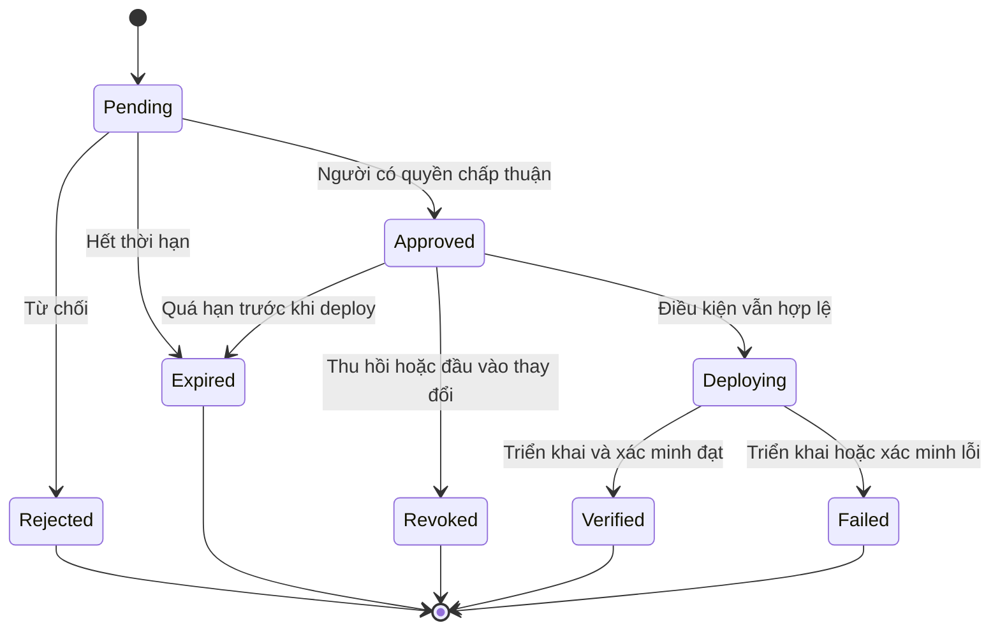

# Thiết kế phê duyệt thủ công dựa trên rủi ro và trách nhiệm

Trong CI/CD, không phải thay đổi nào cũng cần con người bấm nút cho phép triển khai. Một bản sửa lỗi nhỏ, đã qua kiểm thử và chỉ ảnh hưởng môi trường development có thể được phát hành tự động. Một thay đổi schema database, chính sách xác thực, network hoặc cấu hình production có thể ảnh hưởng lớn đến dữ liệu và người dùng, nên cần người có thẩm quyền xem xét trước khi triển khai.

**Phê duyệt thủ công (manual approval)** là một cổng kiểm soát trong quy trình phát hành: pipeline tạm dừng trước một hành động có rủi ro, cung cấp bằng chứng để người có trách nhiệm đánh giá, rồi chỉ tiếp tục khi quyết định được ghi nhận hợp lệ. Cổng này cần dựa trên mức rủi ro và vai trò chịu trách nhiệm, có thời hạn, có bằng chứng và gắn với đúng artifact cùng môi trường đích.

Phê duyệt thủ công không thay thế kiểm thử tự động, review mã nguồn, kiểm tra bảo mật hay giám sát sau triển khai. Nó bổ sung một quyết định có trách nhiệm tại thời điểm tổ chức cần con người chấp nhận rủi ro còn lại hoặc xác nhận điều kiện vận hành đã sẵn sàng.

## 1. Khi nào cần phê duyệt thủ công?

Một cổng phê duyệt có ích khi hành động sắp thực hiện có tác động đáng kể và cần một người hoặc nhóm có thẩm quyền cân nhắc bằng chứng trước khi tiếp tục. Ví dụ:

- Triển khai production cho dịch vụ phục vụ nhiều người dùng hoặc giao dịch quan trọng.
- Thay đổi schema, migration hoặc dữ liệu có thể khó đảo ngược.
- Thay đổi authentication, authorization, encryption, firewall, IAM hoặc network boundary.
- Thay đổi hạ tầng dùng chung, cluster, database, DNS hoặc hệ thống lưu trữ.
- Phát hành có security finding được chấp nhận ngoại lệ.
- Thay đổi có blast radius lớn, ảnh hưởng nhiều service hoặc nhiều tenant.
- Phát hành ngoài khung giờ thông thường hoặc trong thời gian có sự kiện vận hành nhạy cảm.
- Thao tác có khả năng gây gián đoạn, mất dữ liệu hoặc cần phối hợp với nhóm vận hành khác.

Ngược lại, nếu mọi commit đều cần một người bấm nút mà không có thông tin mới để đánh giá, cổng đó chỉ tạo hàng đợi và làm người duyệt quen với việc chấp thuận theo thói quen. Cần tự động hóa các điều kiện có thể kiểm tra bằng máy và dành quyết định của con người cho các trường hợp có rủi ro hoặc trách nhiệm thực sự.

## 2. Phân biệt phê duyệt triển khai với các kiểm soát khác

Một quy trình phát hành có nhiều loại kiểm soát. Chúng có thể liên kết nhưng trả lời các câu hỏi khác nhau:

| Kiểm soát | Câu hỏi | Người hoặc cơ chế chịu trách nhiệm |
|---|---|---|
| Code review | Thay đổi mã có được xem xét và chấp thuận trước khi merge không? | Reviewer/maintainer của repository |
| Automated quality gate | Test, scan, policy và các điều kiện kỹ thuật có đạt không? | Pipeline và công cụ tự động |
| Change approval | Thay đổi có được phép thực hiện theo quy trình quản lý thay đổi không? | Change owner, change manager hoặc hội đồng thay đổi theo chính sách |
| Deployment approval | Có cho phép đưa artifact cụ thể vào environment cụ thể ở thời điểm này không? | Người có quyền phê duyệt môi trường/phát hành |
| Post-deployment verification | Phiên bản đã triển khai có hoạt động đúng và an toàn không? | Pipeline, hệ thống giám sát và người vận hành |

Một pull request đã được review không có nghĩa là production deployment đã được phê duyệt. Tương tự, một người phê duyệt triển khai không nên thay thế việc kiểm tra test hoặc security scan. Các gate tự động phải hoàn tất trước khi yêu cầu người duyệt ra quyết định, trừ khi quy trình ngoại lệ đã được định nghĩa riêng.

## 3. Đánh giá rủi ro trước khi chọn cấp phê duyệt

Không nên chọn số người duyệt chỉ dựa trên tên môi trường. Production thường có yêu cầu nghiêm ngặt hơn, nhưng một thay đổi nhỏ ở production có thể ít rủi ro hơn một migration phá hủy dữ liệu trong môi trường dùng chung. Cần đánh giá bản chất thay đổi và tác động nếu xảy ra lỗi.

Các yếu tố nên xem xét:

| Yếu tố | Câu hỏi đánh giá | Ví dụ rủi ro cao |
|---|---|---|
| Tác động nghiệp vụ | Nếu lỗi xảy ra, quy trình kinh doanh nào bị ảnh hưởng? | Thanh toán, đăng nhập, đặt hàng hoặc xử lý giao dịch dừng hoạt động |
| Phạm vi ảnh hưởng (blast radius) | Bao nhiêu service, người dùng, tenant hoặc vùng triển khai bị tác động? | Thay đổi thư viện dùng chung hoặc cluster phục vụ nhiều sản phẩm |
| Dữ liệu | Có thể mất, sửa sai hoặc lộ dữ liệu không? | Migration xóa cột, thay đổi mã hóa hoặc chuyển đổi dữ liệu lớn |
| Bảo mật | Có thay đổi quyền, ranh giới tin cậy hoặc bề mặt tấn công không? | IAM rộng quyền, thay đổi authentication hoặc mở network ingress |
| Khả năng đảo ngược | Có thể rollback nhanh và an toàn không? | Thay đổi schema không tương thích hoặc thao tác ghi dữ liệu không thể hoàn tác |
| Độ phức tạp | Có nhiều thành phần, bước thủ công hoặc phụ thuộc đồng thời không? | Phát hành nhiều service cần đồng bộ phiên bản |
| Mức độ phơi nhiễm | Dịch vụ có truy cập từ internet hoặc xử lý dữ liệu nhạy cảm không? | API công khai xử lý thông tin cá nhân hoặc dữ liệu tài chính |
| Thời điểm | Có trùng giờ cao điểm, freeze window hoặc sự kiện quan trọng không? | Thay đổi lớn ngay trước kỳ đối soát hoặc chiến dịch bán hàng |
| Bằng chứng | Các test, scan, rehearsal và phương án phục hồi có đầy đủ không? | Không có kết quả migration rehearsal hoặc chưa xác minh rollback |

### Dùng ma trận rủi ro có thể giải thích

Một cách đơn giản là đánh giá **khả năng xảy ra (likelihood)** và **mức độ tác động (impact)** theo thang 1–5, sau đó tham khảo tích của hai giá trị để phân nhóm. Đây là công cụ hỗ trợ thảo luận, không phải phép đo chính xác tuyệt đối.

| Mức | Ví dụ phạm vi điểm tham khảo | Cách xử lý gợi ý |
|---|---:|---|
| Thấp | 1–4 | Tự động nếu các gate bắt buộc đạt; lưu audit event |
| Trung bình | 5–9 | Một reviewer có thẩm quyền xác nhận khi chính sách yêu cầu |
| Cao | 10–15 | Phê duyệt độc lập; có thể cần service owner cùng SRE hoặc security tùy rủi ro |
| Rất cao/critical | 16–25 | Nhiều bên có trách nhiệm, change window, rollout từng bước và phương án phục hồi đã kiểm chứng |

Các khoảng điểm trên chỉ là ví dụ. Tổ chức cần định nghĩa thang đo, ngưỡng và ngoại lệ theo dịch vụ. Một số yếu tố có thể là điều kiện nâng cấp bắt buộc dù tổng điểm thấp: ví dụ thao tác phá hủy dữ liệu, thay đổi quyền quản trị, xử lý dữ liệu được quản lý hoặc security finding nghiêm trọng. Không nên để điểm số thấp che lấp một rủi ro có tính chất đặc biệt.

Nên ghi nhận cả **rủi ro vốn có (inherent risk)** trước biện pháp giảm thiểu và **rủi ro còn lại (residual risk)** sau khi đã có test, canary, backup, approval hoặc rollback. Người duyệt cần hiểu rủi ro còn lại mà họ đang chấp nhận.

## 4. Xác định cấp phê duyệt theo mức rủi ro

Một chính sách mẫu có thể chia như sau:

| Cấp | Ví dụ | Cách phê duyệt |
|---|---|---|
| Tự động | Thay đổi tài liệu, sửa lỗi nhỏ ở service ít tác động, môi trường development | Pipeline tự tiếp tục khi gate tự động đạt; vẫn ghi nhận lần triển khai |
| Một người duyệt | Thay đổi production có phạm vi nhỏ, rollback rõ ràng và đã qua kiểm thử | Service owner hoặc người được ủy quyền xác nhận |
| Phê duyệt độc lập | Thay đổi ảnh hưởng dữ liệu, bảo mật, hạ tầng dùng chung hoặc nhiều service | Người triển khai không tự duyệt; reviewer phù hợp như service owner, SRE hoặc security |
| Nhiều bên/quorum | Thay đổi critical, có tác động liên tổ chức hoặc khó đảo ngược | Cần đủ vai trò bắt buộc hoặc số phiếu theo policy trước khi tiếp tục |

Không phải mọi thay đổi mức cao đều cần tất cả các nhóm phê duyệt. Hãy chọn người theo loại rủi ro: security review cho thay đổi quyền và bề mặt tấn công; database owner cho migration; SRE/operations cho khả năng vận hành; product/business owner cho thời điểm và tác động nghiệp vụ. Nhiều người cùng chức năng không nhất thiết tạo ra nhiều góc nhìn độc lập.

### Tách người thực hiện và người phê duyệt

Với hành động nhạy cảm, nên áp dụng nguyên tắc separation of duties:

- Người tạo hoặc triển khai thay đổi không được tự phê duyệt chính lần triển khai đó khi policy yêu cầu phê duyệt độc lập.
- Người duyệt phải thuộc nhóm được ủy quyền cho environment hoặc loại thay đổi tương ứng.
- Tài khoản service, bot hoặc token triển khai không được giả làm người phê duyệt.
- Với quorum, mỗi người duyệt cần có danh tính riêng; không dùng một tài khoản chung cho cả nhóm.
- Nếu người duyệt cũng là người trực vận hành, policy cần xác định khi nào vai trò kép được chấp nhận và cách ghi nhận xung đột lợi ích.

Code review và deployment approval có thể do các nhóm khác nhau đảm nhiệm. Người duyệt triển khai cần đánh giá readiness và rủi ro phát hành, không chỉ nhìn số lượng người đã approve pull request.

## 5. Phân định trách nhiệm của từng vai trò

Phê duyệt có ý nghĩa khi mỗi vai trò biết mình phải kiểm tra điều gì và chịu trách nhiệm tới đâu.

| Vai trò | Trách nhiệm chính | Bằng chứng hoặc hành động |
|---|---|---|
| Change/request owner | Mô tả mục tiêu, phạm vi và tác động của thay đổi | Ticket, change record, tiêu chí chấp nhận |
| Developer/release owner | Chuẩn bị artifact, test, kế hoạch triển khai và phục hồi | Commit, pipeline, digest, release notes, rollout/rollback plan |
| Service owner | Xác nhận thay đổi phù hợp với hành vi và mức rủi ro của dịch vụ | Đánh giá tác động, dependency, readiness và cửa sổ phát hành |
| SRE/operations | Đánh giá khả năng vận hành, quan sát, capacity và phục hồi | Dashboard, alert, health check, runbook, rollback readiness |
| Security reviewer | Đánh giá finding, quyền truy cập, threat và ngoại lệ bảo mật | Scan report, threat assessment, mitigation hoặc exception record |
| Change approver/manager | Kiểm tra quy trình, lịch và sự phối hợp cần thiết | Change window, conflict check, quyết định và audit trail |
| Release operator | Thực hiện triển khai theo phạm vi đã được duyệt | Deployment ID, log, trạng thái rollout và xác minh |

Trong nhóm nhỏ, một người có thể đảm nhiệm nhiều vai trò nếu chính sách cho phép. Với thay đổi rủi ro cao, cần có ít nhất một góc nhìn độc lập và không để một cá nhân tự đề xuất, tự duyệt rồi tự xác nhận thành công cho hành động nhạy cảm.

## 6. Gói bằng chứng người duyệt cần xem

Một nút Approve không có nhiều giá trị nếu người duyệt phải tự đi tìm thông tin trong hàng chục job. Pipeline nên tạo một **approval summary** ngắn, liên kết tới bằng chứng chi tiết và trả lời được các câu hỏi quan trọng.

Gói bằng chứng tối thiểu nên có:

1. **Thay đổi:** ticket/change ID, repository, commit SHA, PR/MR và mô tả hành vi thay đổi.
2. **Artifact:** tên/version, registry, digest hoặc checksum của đúng gói chuẩn bị triển khai.
3. **Kiểm thử:** trạng thái unit, integration, acceptance và các test bắt buộc; liên kết tới report.
4. **Bảo mật:** kết quả SAST/SCA/DAST, image/IaC scan, finding còn mở và ngoại lệ đã được phê duyệt.
5. **Rủi ro:** mức rủi ro, blast radius, dữ liệu bị ảnh hưởng, phụ thuộc và rủi ro còn lại.
6. **Kế hoạch triển khai:** environment, thời gian, chiến lược rolling/canary/blue-green, thứ tự và người trực.
7. **Xác minh:** health check, smoke test, SLO/metrics cần quan sát và thời gian theo dõi.
8. **Phục hồi:** điều kiện dừng, rollback target, cách khôi phục dữ liệu/cấu hình và người chịu trách nhiệm.
9. **Phê duyệt trước đó:** change window, security exception, người đã review và các điều kiện còn hiệu lực.

Thông tin cần được trình bày theo mức rủi ro. Thay đổi thấp có thể chỉ cần một bản tóm tắt ngắn. Thay đổi critical cần kế hoạch chi tiết, bằng chứng rehearsal và xác nhận các bên phụ thuộc. Người duyệt phải có thể mở log/report và kiểm tra nguồn gốc khi cần.

Không đưa secret, token, private key hoặc dữ liệu cá nhân vào approval summary. Chỉ cung cấp tham chiếu an toàn tới hệ thống lưu trữ có phân quyền.

## 7. Gắn quyết định phê duyệt với artifact và môi trường cụ thể

Một quyết định approve chỉ có ý nghĩa với đúng hành động đã được xem xét. Nếu người duyệt chấp thuận image `sha256:abc...` để triển khai vào `staging`, pipeline không được tự ý dùng image digest khác hoặc chuyển mục tiêu sang `production` mà không áp dụng lại chính sách.

Approval record nên gắn tối thiểu với:

- Change/request ID và pipeline run ID.
- Commit SHA và artifact digest.
- Environment hoặc target resource.
- Phiên bản cấu hình/manifest triển khai.
- Chiến lược rollout và phạm vi instance/traffic.
- Danh tính người duyệt, vai trò và thời điểm.
- Policy version, lý do và điều kiện phê duyệt.
- Thời hạn hiệu lực hoặc điều kiện làm approval hết hiệu lực.

### Approval phải hết hiệu lực khi đầu vào thay đổi

Các tình huống sau thường cần đánh giá hoặc phê duyệt lại:

- Build lại tạo artifact digest mới.
- Commit hoặc release candidate thay đổi.
- Thay đổi environment, cluster, region hoặc tenant mục tiêu.
- Manifest, migration hoặc cấu hình có ảnh hưởng tới rủi ro thay đổi.
- Có security finding mới hoặc một gate bắt buộc chuyển từ pass sang fail.
- Change window hết hạn hoặc điều kiện vận hành không còn đúng.
- Người duyệt thu hồi quyết định trước khi deployment bắt đầu.

Approval nên có thời hạn và được dùng trong một phạm vi triển khai rõ ràng. Nếu một approval có thể được tái sử dụng vô thời hạn, người khác có thể dùng lại quyết định cũ cho artifact hoặc môi trường khác mà người duyệt chưa từng xem xét.

## 8. Vòng đời của một yêu cầu phê duyệt

Một state machine đơn giản giúp pipeline và audit log xử lý nhất quán:



Các trạng thái có ý nghĩa khác nhau:

- **Pending:** đã tạo yêu cầu và đang chờ đúng người hoặc đủ quorum.
- **Approved:** các điều kiện và người duyệt bắt buộc đã chấp thuận.
- **Rejected:** người duyệt từ chối, kèm lý do hoặc yêu cầu thay đổi.
- **Expired:** quá thời hạn hoặc change window không còn hiệu lực.
- **Revoked:** quyết định bị thu hồi hoặc đầu vào đã thay đổi khiến approval cũ không còn hợp lệ.
- **Deploying:** pipeline đã bắt đầu hành động được phê duyệt.
- **Verified:** rollout và các kiểm tra sau triển khai đạt.
- **Failed:** deployment hoặc xác minh không đạt; cần xử lý hoặc phục hồi.

Không nên dùng một trạng thái “approved” để biểu thị cả việc đã được duyệt lẫn đã triển khai thành công. Phê duyệt là quyết định cho phép hành động; kết quả vận hành phải được ghi nhận riêng.

## 9. Quy trình người duyệt ra quyết định

Người duyệt nên thực hiện một chuỗi kiểm tra ngắn, nhất quán:

1. Xác nhận mình có đúng thẩm quyền và không vi phạm quy tắc tự phê duyệt.
2. Đọc mục tiêu, phạm vi, ticket và thời điểm dự kiến triển khai.
3. Kiểm tra commit, artifact digest và environment khớp với yêu cầu.
4. Xem các gate tự động bắt buộc, finding còn mở và ngoại lệ có hiệu lực.
5. Đánh giá blast radius, khả năng phát hiện lỗi và khả năng rollback.
6. Xác nhận người trực, runbook, dashboard và change window sẵn sàng nếu rủi ro yêu cầu.
7. Chọn approve, reject hoặc yêu cầu bổ sung thông tin; ghi lý do khi policy yêu cầu.

Người duyệt không cần đọc mọi dòng log nếu summary và gate đã được thiết kế tốt. Tuy nhiên, phải có khả năng truy cập bằng chứng gốc và không nên chấp thuận chỉ vì pipeline đang xanh hoặc vì người khác đã bấm approve.

### Phê duyệt, từ chối và yêu cầu sửa đổi

- **Approve:** chấp thuận đúng artifact, environment và thời hạn đã nêu.
- **Reject:** từ chối vì rủi ro hoặc điều kiện chưa đáp ứng; ghi lý do để nhóm phát hành biết cần sửa gì.
- **Request changes:** yêu cầu cập nhật kế hoạch, bằng chứng hoặc phạm vi. Sau khi thay đổi, pipeline tạo lại summary và có thể cần yêu cầu approval mới.
- **Defer:** hoãn tới change window khác; approval cũ không tự động có hiệu lực cho thời điểm mới nếu điều kiện vận hành thay đổi.

Không nên cho phép sửa nội dung change request sau khi duyệt mà vẫn giữ nguyên quyết định cũ. Hệ thống cần lưu revision hoặc fingerprint của nội dung được duyệt.

## 10. Ví dụ triển khai phê duyệt trong GitLab CI

GitLab CI có thể tạo manual job cho production deployment. Quyền deploy có thể được giới hạn bằng protected environment và chính sách người được phép triển khai. Tính năng deployment approvals và khả năng cấu hình cụ thể phụ thuộc phiên bản/edition và thiết lập GitLab của tổ chức; cần xác nhận trên nền tảng đang dùng.

Ví dụ tối giản:

```yaml
stages:
  - verify
  - build
  - deploy

verify_release:
  stage: verify
  script:
    - ./ci/run-required-checks.sh

build_release:
  stage: build
  needs:
    - verify_release
  script:
    - ./ci/build-and-publish-by-commit.sh
    - ./ci/write-release-manifest.sh
  artifacts:
    paths:
      - release-manifest.json

deploy_production:
  stage: deploy
  needs:
    - job: build_release
      artifacts: true
  environment:
    name: production
  when: manual
  allow_failure: false
  script:
    - ./ci/verify-approved-release.sh release-manifest.json
    - ./ci/deploy-by-digest.sh release-manifest.json
    - ./ci/verify-production-health.sh
```

Trong ví dụ:

- `verify_release` chạy các kiểm tra bắt buộc trước khi build.
- `build_release` tạo artifact và release manifest chứa commit cùng digest.
- `deploy_production` dừng chờ thao tác thủ công và không được coi là job tùy chọn có thể bỏ qua.
- Script xác minh release manifest và triển khai theo digest để giữ đúng artifact đã build.
- Sau deploy, health verification cung cấp kết quả riêng.

`when: manual` tạo điểm chờ thao tác thủ công; để biến nó thành phê duyệt có trách nhiệm, cần cấu hình quyền triển khai/protected environment, kiểm soát ai được chạy job và lưu danh tính thao tác. Nếu yêu cầu nhiều approver hoặc approval rules, hãy dùng chức năng deployment approval phù hợp của phiên bản GitLab hoặc một hệ thống change management tích hợp. Một nút manual đơn lẻ không tự chứng minh đã có phê duyệt độc lập.

## 11. Ví dụ triển khai phê duyệt trong GitHub Actions

GitHub Actions có thể dùng **environment protection rules** cho environment production. Workflow khai báo job gắn với environment; danh sách required reviewers, giới hạn branch/tag và tùy chọn ngăn người khởi tạo tự duyệt được cấu hình trong phần Settings của repository/environment, không phải chỉ bằng YAML.

```yaml
name: Release

on:
  workflow_dispatch:

jobs:
  verify:
    runs-on: ubuntu-latest
    steps:
      - uses: actions/checkout@v4
      - run: ./ci/run-required-checks.sh
      - run: ./ci/build-and-publish-by-commit.sh

  deploy-production:
    needs: verify
    runs-on: ubuntu-latest
    environment:
      name: production
    steps:
      - uses: actions/checkout@v4
      - run: ./ci/verify-approved-release.sh
      - run: ./ci/deploy-by-digest.sh
      - run: ./ci/verify-production-health.sh
```

Khi environment có required reviewers, job sẽ chờ quyết định theo quy tắc bảo vệ đã cấu hình trước khi được cấp quyền tiếp tục. Cần giới hạn branch/tag được phép triển khai, bật ngăn tự phê duyệt nếu chính sách yêu cầu, và giới hạn secrets ở đúng environment. Tùy gói dịch vụ và loại repository, các tính năng bảo vệ environment có thể khác nhau; hãy kiểm tra cấu hình thực tế.

Workflow minh họa chưa tự tạo release manifest hoặc truyền artifact qua job. Trong triển khai thực tế, cần upload/download artifact từ job verify/build, lưu digest, rồi xác minh cùng digest ở job deploy. Không build lại một image khác sau khi environment approval đã được cấp.

## 12. Phê duyệt khẩn cấp (break-glass)

Có tình huống cần hành động ngay để khôi phục dịch vụ, ví dụ rollback một phiên bản gây lỗi nghiêm trọng hoặc chặn một lỗ hổng đang bị khai thác. Nếu quy trình phê duyệt thông thường gây chậm trễ nguy hiểm, tổ chức có thể thiết kế đường khẩn cấp (break-glass) với quyền và phạm vi rất hẹp.

Break-glass không phải cách bỏ qua mọi kiểm soát. Một thiết kế phù hợp cần:

- Xác định rõ điều kiện được dùng, ví dụ incident severity hoặc nguy cơ mất dữ liệu.
- Chỉ cấp quyền cho nhóm trực/incident commander được chỉ định.
- Dùng credential đặc quyền có thời hạn ngắn, có thể thu hồi và có log riêng.
- Giới hạn hành động ở mục tiêu cần phục hồi, ưu tiên rollback hoặc mitigation đã chuẩn bị.
- Ghi lý do, incident ID, người thực hiện, thời điểm, artifact/configuration và phạm vi tác động.
- Thông báo cho service owner/security/change owner theo quy trình sự cố.
- Yêu cầu hậu kiểm sau hành động: đánh giá rủi ro, kiểm tra log, thu hồi quyền tạm và bổ sung phê duyệt/record còn thiếu.

Không nên dùng break-glass để phát hành tính năng mới hoặc bỏ qua test vì áp lực tiến độ. Nếu buộc phải triển khai một bản vá khẩn cấp, cần chọn các kiểm tra tối thiểu có thể thực hiện an toàn, giới hạn rollout, theo dõi sát và lưu quyết định chấp nhận rủi ro.

## 13. Theo dõi sau phê duyệt và sau triển khai

Approval không kết thúc trách nhiệm của người phát hành. Trước khi bắt đầu, pipeline cần kiểm tra approval còn hiệu lực và các điều kiện không thay đổi. Trong rollout, hệ thống nên theo dõi trạng thái theo từng bước và dừng khi điều kiện an toàn không còn đúng.

Các điều kiện nên giám sát:

- Rollout hoàn tất và số instance/replica sẵn sàng.
- Health check và smoke test đạt.
- Error rate, latency percentile và saturation không vượt ngưỡng.
- Không xuất hiện cảnh báo bảo mật hoặc lỗi nghiệp vụ nghiêm trọng mới.
- Các migration và dependency hoạt động đúng với phiên bản đã triển khai.

Nếu xác minh thất bại, pipeline cần dừng rollout hoặc kích hoạt rollback theo policy. Deployment record phải lưu kết quả, người thực hiện, artifact digest, environment và liên kết tới incident nếu có. Không thay đổi trạng thái approval thành “thành công” chỉ vì người duyệt đã chấp thuận.

## 14. Audit trail và khả năng truy vết quyết định

Một quyết định phê duyệt cần có thể kiểm tra lại sau nhiều tháng. Audit record nên lưu:

| Trường | Nội dung |
|---|---|
| Approval ID | Định danh yêu cầu phê duyệt |
| Change ID | Ticket/change record liên quan |
| Subject | Commit SHA, artifact digest và cấu hình được duyệt |
| Target | Environment, cluster/region và phạm vi triển khai |
| Risk | Mức rủi ro, lý do phân loại và residual risk |
| Decision | Approved, rejected, expired hoặc revoked |
| Approver | Danh tính, nhóm/role và thời điểm quyết định |
| Reason | Lý do, điều kiện hoặc ngoại lệ được chấp nhận |
| Policy | Phiên bản policy và quy tắc được áp dụng |
| Execution | Deployment ID, thời điểm bắt đầu/kết thúc và kết quả |

Log cần có quyền truy cập và thời hạn lưu phù hợp với chính sách tổ chức. Với thay đổi nhạy cảm, nên bảo đảm audit record không thể bị người thực hiện deployment tự ý sửa hoặc xóa. Nếu quyết định được ghi ở hệ thống change management bên ngoài, pipeline cần lưu ID và liên kết để truy ngược.

## 15. Những anti-pattern cần tránh

- **Mọi deployment đều cần một người bấm nút:** tạo hàng đợi, approval fatigue và làm chậm thay đổi rủi ro thấp.
- **Người thực hiện tự duyệt:** làm mất tính độc lập ở các thay đổi cần kiểm soát hai người.
- **Approve chỉ dựa trên màu xanh của pipeline:** bỏ qua blast radius, change window, rollback và rủi ro còn lại.
- **Không gắn approval với digest:** có thể triển khai artifact khác với artifact người duyệt đã xem.
- **Approval không hết hạn:** quyết định cũ có thể bị tái sử dụng khi điều kiện đã thay đổi.
- **Sửa nội dung sau khi duyệt:** người duyệt không còn chấp thuận đúng thay đổi đang được thực hiện.
- **Không lưu lý do từ chối/ngoại lệ:** khó học từ quyết định và khó kiểm toán.
- **Quá nhiều người duyệt không đúng vai trò:** tạo độ trễ mà không tăng chất lượng đánh giá.
- **Dùng tài khoản dùng chung:** không xác định được ai thực sự ra quyết định.
- **Coi manual job là deployment approval đầy đủ:** nút bấm có thể không có giới hạn quyền, separation of duties hoặc audit trail.
- **Bỏ qua xác minh sau deploy:** quyết định được duyệt nhưng không biết hành động thực tế có an toàn hay không.
- **Break-glass không hậu kiểm:** đường khẩn cấp trở thành lối tắt thường xuyên và khó kiểm soát.

## 16. Checklist thiết kế cổng phê duyệt thủ công

Trước khi đưa một cổng phê duyệt vào pipeline, hãy kiểm tra:

1. Rủi ro nào khiến thay đổi cần phê duyệt? Có thể tự động hóa điều kiện nào?
2. Thang rủi ro và ngưỡng nâng cấp có được định nghĩa rõ không?
3. Ai có thẩm quyền duyệt từng loại thay đổi và environment?
4. Người thực hiện có bị ngăn tự phê duyệt khi cần độc lập không?
5. Có đủ separation of duties hoặc quorum cho thay đổi rủi ro cao không?
6. Approval summary có ticket, commit, artifact digest, test, scan, blast radius và rollback plan không?
7. Approval có gắn với environment, configuration revision và thời hạn cụ thể không?
8. Thay đổi artifact, target hoặc finding có làm approval hết hiệu lực không?
9. Có trạng thái pending, approved, rejected, expired, revoked và execution result rõ ràng không?
10. Người duyệt có thể xem bằng chứng gốc và ghi lý do quyết định không?
11. Có quy trình break-glass giới hạn, audit và hậu kiểm không?
12. Sau deploy có health check, metrics, dừng rollout và rollback theo điều kiện không?
13. Audit trail có lưu danh tính, policy version, quyết định và deployment ID không?
14. Cổng phê duyệt có được rà soát định kỳ để tránh approval fatigue và quyền lỗi thời không?

Phê duyệt thủ công có giá trị khi nó đặt đúng người vào đúng thời điểm để đánh giá đúng rủi ro. Khi mức phê duyệt tương xứng với tác động, bằng chứng gắn với artifact bất biến, trách nhiệm được phân định và quyết định được lưu lại, CI/CD có thể tự động hóa phần lớn công việc mà vẫn giữ được sự kiểm soát cần thiết cho những lần phát hành quan trọng.
