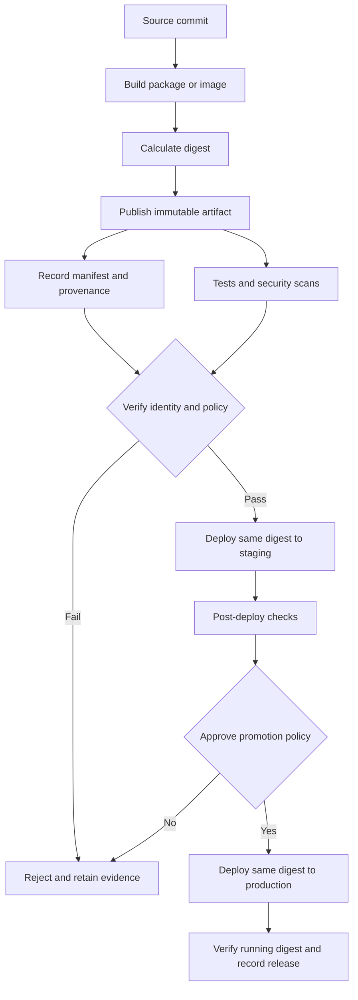

# Định danh artifact bằng phiên bản, checksum hoặc digest

Trong CI/CD, một lần build có thể tạo ra nhiều file: JAR, binary, package, container image, bundle frontend, manifest, báo cáo kiểm thử và Software Bill of Materials (SBOM). Khi pipeline chuyển các đầu ra này qua kiểm thử, staging và production, nhóm cần biết chính xác **artifact nào đã được tạo, kiểm tra và triển khai**. Tên file hoặc tag dễ đọc giúp con người tìm kiếm, nhưng không đủ để chứng minh nội dung bên trong không thay đổi.

Định danh artifact cần kết hợp thông tin phiên bản với định danh nội dung. Phiên bản mô tả ý nghĩa phát hành hoặc lần build; checksum/digest xác định bytes cụ thể; manifest và provenance liên kết artifact với commit, pipeline, toolchain và các bằng chứng kiểm tra. Khi có yêu cầu xác thực nguồn gốc, chữ ký số giúp chứng minh artifact hoặc metadata được tạo bởi danh tính được tin cậy.

Mục tiêu là để pipeline có thể trả lời được các câu hỏi: artifact này thuộc phiên bản nào, được build từ commit nào, có đúng là file đã qua test không, có bị thay đổi khi truyền hoặc lưu trữ không, ai hoặc workflow nào tạo ra nó và production đang chạy đúng digest nào.

## 1. Artifact identity gồm những gì?

Không có một trường đơn lẻ nào mô tả đầy đủ danh tính artifact. Một hồ sơ phát hành thường cần nhiều thành phần:

| Thành phần | Vai trò | Ví dụ |
|---|---|---|
| Tên artifact | Giúp con người nhận biết sản phẩm và loại gói | `order-service` |
| Release version | Thể hiện phiên bản sản phẩm theo chính sách tương thích | `2.4.1` |
| Build identity | Phân biệt các lần build cùng source/version | Pipeline run `1842`, attempt `1` |
| Source revision | Xác định mã nguồn được build | Git commit SHA đầy đủ |
| Checksum/digest | Xác định nội dung bytes | `sha256:...` |
| Artifact location | Cho biết nơi tải artifact | Package registry hoặc OCI registry |
| Platform/variant | Phân biệt kiến trúc hoặc định dạng đầu ra | `linux/amd64`, `linux/arm64` |
| Provenance | Liên kết đầu ra với nguồn và quy trình build | Attestation của workflow đã xác thực |
| Signature | Xác minh danh tính đã ký artifact hoặc metadata | Chữ ký theo policy của tổ chức |

Có thể hình dung identity của một artifact như một bộ thông tin:

```text
Artifact identity
  product       = order-service
  version       = 2.4.1
  build         = run-1842-attempt-1
  source        = git:9f4c...e81a
  location      = registry.example/team/order-service
  digest        = sha256:ab12...89ef
  platform      = linux/amd64
```

Tên, version và build number giúp tìm kiếm. Source SHA giúp truy về mã nguồn. Digest giúp xác định chính xác nội dung. Location cho phép tải. Provenance và signature cung cấp bằng chứng về nguồn tạo. Tùy loại artifact, một số trường có thể không áp dụng, nhưng package triển khai production cần ít nhất một định danh nội dung bất biến và thông tin truy vết đến lần build.

## 2. Phân biệt source version, release version và build identity

Một commit có thể được build nhiều lần. Một release version có thể có nhiều ứng viên trước khi phát hành. Vì vậy, không nên dùng cùng một khái niệm để đại diện cho mã nguồn, ý nghĩa phát hành và lần build.

- **Source revision:** commit SHA hoặc revision bất biến được checkout. Nó xác định trạng thái mã nguồn, không tự xác định toàn bộ môi trường build.
- **Release version:** phiên bản sản phẩm mà người dùng hoặc hệ thống phụ thuộc nhìn thấy, thường theo Semantic Versioning hoặc chính sách riêng.
- **Build identity:** ID của lần chạy CI và lần thử, giúp phân biệt hai lần build từ cùng một commit.
- **Artifact digest:** định danh nội dung được tính từ bytes của artifact sau khi đóng gói hoặc publish.

Ví dụ, commit `9f4c...e81a` có thể được build ở run `1842` để tạo ứng viên `2.4.1-rc.1`, sau đó được build ở run khác sau khi thay đổi toolchain. Hai artifact không được xem là một chỉ vì source SHA giống nhau. Nếu digest khác, nội dung khác; cần giải thích nguyên nhân và gắn build identity riêng.

Một release version chỉ nên được gán cho artifact đã được phê duyệt theo quy trình phát hành. Nếu tổ chức rebuild để sửa lỗi trong quá trình đóng gói, cần tạo build identity mới và áp dụng quy tắc version/release rõ ràng; không ghi đè artifact đã được kiểm thử hoặc phát hành.

## 3. Dùng Semantic Versioning đúng mục đích

Semantic Versioning (SemVer) biểu diễn version theo dạng:

```text
MAJOR.MINOR.PATCH
```

- **MAJOR:** thay đổi không tương thích với hợp đồng hoặc API công khai.
- **MINOR:** thêm chức năng theo cách tương thích ngược.
- **PATCH:** sửa lỗi tương thích ngược.

Ví dụ `2.4.1` có thể là bản sửa lỗi của dòng `2.4`. Quy tắc tăng version phải dựa trên hợp đồng mà sản phẩm cam kết, không dựa đơn thuần vào số lượng commit hoặc lần build.

SemVer còn hỗ trợ pre-release và build metadata:

```text
2.5.0-alpha.1
2.5.0-rc.2
2.5.0+build.1842
2.5.0-rc.2+build.1842
```

Pre-release identifier như `alpha.1` hoặc `rc.2` thể hiện trạng thái chưa phải bản stable. Build metadata sau dấu `+` có thể ghi thông tin build, nhưng theo quy tắc SemVer nó không ảnh hưởng đến thứ tự precedence của version. Vì vậy, `2.5.0+build.1842` và `2.5.0+build.1901` có cùng precedence; build metadata không thay thế digest hoặc ID bất biến.

Không phải mọi artifact đều cần SemVer. Một thư viện có API công khai thường hưởng lợi từ SemVer; image triển khai nội bộ có thể dùng release version cộng commit/build ID. Dù chọn quy ước nào, version phải được định nghĩa và sử dụng nhất quán giữa package metadata, registry tag, release record và hệ thống triển khai.

## 4. Commit SHA và build number không thay thế digest

Commit SHA xác định nội dung Git tree/commit theo thuật toán hash của Git. Nó không trực tiếp xác định bytes của JAR hoặc container image. Kết quả build còn phụ thuộc compiler, build tool, dependency, tham số, hệ điều hành, timestamp và các đầu vào khác.

Build number phân biệt lần chạy, nhưng cũng không chứng minh hai lần chạy tạo ra nội dung giống nhau. Một pipeline có thể chạy lại cùng commit với toolchain khác hoặc dependency được resolve khác. Vì thế:

- Ghi commit SHA để truy vết nguồn.
- Ghi pipeline run ID và attempt để truy vết lần thực thi.
- Tính checksum/digest trên đầu ra thực tế.
- Gắn test report, SBOM, provenance và chữ ký với cùng artifact digest.

Nếu cùng source và đầu vào được kiểm soát tạo ra digest khác nhau, hãy điều tra khác biệt trước khi phát hành. Nếu mục tiêu của dự án là reproducible build bit-for-bit, digest của hai lần build độc lập phải giống nhau theo tiêu chí đã định nghĩa.

## 5. Checksum và digest là gì?

Checksum là giá trị được tính từ nội dung dữ liệu để kiểm tra nội dung có bị thay đổi ngoài dự kiến hay không. Trong CI/CD, checksum mật mã như SHA-256 thường được dùng để định danh file và xác minh tính toàn vẹn.

Digest là giá trị đại diện cho nội dung theo một thuật toán hash. Trong registry container OCI, digest thường được biểu diễn như `sha256:<hexadecimal-value>`. Thuật ngữ checksum và digest đôi khi được dùng gần nghĩa trong giao tiếp thông thường; điều quan trọng là biết thuật toán, dữ liệu đầu vào và định dạng được hash.

Ví dụ minh họa:

```text
Artifact: order-service-2.4.1.jar
Algorithm: SHA-256
Digest:    8a2f...d91c
```

Nếu chỉ một byte trong file thay đổi, digest SHA-256 gần như chắc chắn sẽ thay đổi. SHA-256 phù hợp cho kiểm tra tính toàn vẹn và định danh nội dung trong quy trình phát hành thông thường. Không nên dùng MD5 hoặc SHA-1 cho mục đích bảo mật hiện đại vì chúng có điểm yếu collision đã biết.

Digest không mã hóa dữ liệu, không che giấu nội dung và không chứng minh ai tạo ra file. Nó chỉ là dấu vân tay nội dung theo thuật toán đã chọn.

## 6. Tính toàn vẹn khác với tính xác thực

Đây là khác biệt quan trọng khi thiết kế chuỗi cung ứng phần mềm:

| Cơ chế | Có thể chứng minh | Không tự chứng minh |
|---|---|---|
| SHA-256 checksum | File hiện tại khớp với digest được so sánh | Ai tạo file hoặc file có đáng tin hay không |
| HTTPS/TLS | Kết nối tới endpoint được xác thực theo chứng thư và dữ liệu truyền được bảo vệ trên kết nối | Artifact trong registry được tạo từ source nào |
| Digital signature | Nội dung hoặc metadata được ký bởi khóa/danh tính tương ứng và không bị sửa sau khi ký | Phần mềm an toàn hoặc signer có quyền phê duyệt release nếu policy chưa xác định |
| Provenance/attestation | Mô tả nguồn, builder, quy trình và đầu vào tạo artifact theo mức bằng chứng của hệ thống | Nội dung không có lỗi hoặc mọi claim đều đúng nếu builder không được tin cậy |

Nếu artifact và file checksum được lưu cạnh nhau trong cùng một nơi mà kẻ tấn công có thể ghi đè cả hai, người đó có thể thay file rồi tính checksum mới. So sánh khi đó vẫn pass. Để chống tình huống này, digest kỳ vọng cần được lấy từ nguồn tin cậy hoặc được bảo vệ bằng chữ ký, quyền ghi riêng và audit log.

Một quy trình mạnh thường kết hợp digest với signature và provenance. Consumer xác minh digest của bytes tải về, xác minh chữ ký theo trust policy, rồi kiểm tra provenance có nguồn repository, revision, workflow và builder được phép hay không.

## 7. Tính và xác minh checksum cho file package

Với package dạng file, pipeline có thể tạo checksum sidecar ngay sau khi đóng gói. Ví dụ trên Linux:

```bash
sha256sum build/libs/order-service.jar > build/libs/order-service.jar.sha256

# Kiểm tra lại file theo checksum đã ghi
sha256sum --check build/libs/order-service.jar.sha256
```

Lệnh đầu ghi tên file và digest vào sidecar. Lệnh thứ hai đọc sidecar và tính lại digest để so sánh. File cần kiểm tra phải nằm đúng đường dẫn mà sidecar tham chiếu; nếu di chuyển package, cần cập nhật hoặc tạo lại manifest phù hợp.

Trên Windows PowerShell:

```powershell
$actual = (Get-FileHash -LiteralPath '.\build\libs\order-service.jar' -Algorithm SHA256).Hash.ToLowerInvariant()
$expected = (Get-Content -Raw -LiteralPath '.\build\libs\order-service.jar.sha256').Trim().Split(' ')[0].ToLowerInvariant()

if ($actual -ne $expected) {
    throw 'Artifact SHA-256 does not match the expected checksum.'
}
```

Đoạn PowerShell giả định sidecar có digest ở token đầu tiên. Trong hệ thống thực tế, nên dùng manifest có schema rõ ràng và parser phù hợp thay vì dựa vào định dạng văn bản tùy tiện.

Checksum nên được tạo sau khi artifact hoàn tất và trước khi upload. Sau khi download ở job khác hoặc môi trường khác, consumer tính lại digest và so sánh với giá trị được producer công bố qua metadata có kiểm soát. Không tính checksum trên một file tạm rồi triển khai file khác.

## 8. Định danh container image bằng OCI digest

Container image thường được publish với tag dễ đọc, ví dụ:

```text
registry.example/team/order-service:2.4.1
registry.example/team/order-service:9f4c2e1
```

Tag giúp tìm kiếm, nhưng registry có thể cho phép tag trỏ sang manifest khác. Nếu tag bị cập nhật, cùng một lệnh pull có thể tải nội dung khác ở thời điểm sau. Vì vậy, khi triển khai, nên dùng digest:

```text
registry.example/team/order-service@sha256:ab12...89ef
```

Registry trả về digest của manifest sau khi publish. Pipeline cần lưu chính xác digest đó và truyền image reference theo digest cho các job scan, staging và production.

Với image đa kiến trúc, một manifest list/image index có thể trỏ tới manifest riêng cho từng platform như `linux/amd64` và `linux/arm64`. Digest của index xác định tập manifest nền tảng; runtime có thể chọn manifest con phù hợp với kiến trúc máy. Khi điều tra hoặc yêu cầu triển khai chính xác, cần ghi rõ digest đang dùng là digest của index hay manifest nền tảng, cùng platform tương ứng.

Tag `latest` không nên là định danh release. Tag theo version hoặc commit vẫn hữu ích cho con người, nhưng môi trường triển khai nên nhận digest bất biến đã được kiểm tra.

## 9. Manifest: gom metadata của artifact vào một nơi

Manifest là tài liệu mô tả artifact và các thuộc tính cần thiết để consumer xác minh hoặc sử dụng. Nó không thay thế chính artifact. Một manifest tốt có schema/version, tên, loại, version, source revision, build identity, location, digest và liên kết đến bằng chứng.

Ví dụ manifest JSON:

```json
{
  "schemaVersion": 1,
  "name": "order-service",
  "version": "2.4.1",
  "build": {
    "runId": "1842",
    "runAttempt": 1,
    "builder": "ci://trusted-project/build-workflow"
  },
  "source": {
    "repository": "https://git.example/team/order-service",
    "commit": "9f4c2e1...e81a"
  },
  "artifact": {
    "uri": "registry.example/team/order-service@sha256:ab12...89ef",
    "mediaType": "application/vnd.oci.image.manifest.v1+json",
    "digest": {
      "algorithm": "sha256",
      "value": "ab12...89ef"
    },
    "platform": ["linux/amd64", "linux/arm64"]
  },
  "evidence": {
    "sbom": "oci://registry.example/team/order-service-sbom@sha256:...",
    "provenance": "oci://registry.example/team/order-service-attestation@sha256:..."
  }
}
```

Đây là cấu trúc minh họa, không phải schema bắt buộc của OCI hoặc một công cụ CI cụ thể. Giá trị digest và URI trong ví dụ là placeholder. Manifest thực tế cần được validate bằng schema đã version hóa; các trường không áp dụng có thể được bỏ hoặc biểu diễn theo quy ước đã công bố.

Manifest nên được lưu cạnh artifact hoặc trong release record, có quyền ghi được kiểm soát và có chữ ký nếu nó được dùng làm nguồn quyết định triển khai. Nếu manifest có thể bị thay đổi mà không để lại dấu vết, nó không đủ làm bằng chứng tin cậy.

## 10. Liên kết artifact với SBOM và provenance

SBOM liệt kê thành phần phần mềm có trong artifact, thường gồm package, version và quan hệ dependency. SBOM giúp nhóm kiểm tra dependency, license và xác định các artifact bị ảnh hưởng khi một thư viện có lỗ hổng.

Provenance mô tả artifact được tạo ra như thế nào: source repository và revision, builder identity, workflow, tham số và các dependency/đầu vào quan trọng. Tùy định dạng và hệ thống, provenance có thể được phát hành dưới dạng attestation có chữ ký.

Điểm then chốt là SBOM và provenance phải gắn với đúng artifact digest. Nếu image được build lại, SBOM của image cũ không tự động mô tả image mới dù tên tag giống nhau. Khi quét lỗ hổng, kết quả cần ghi digest được phân tích.

Một release record có thể liên kết:

- Source commit SHA.
- Workflow run ID và attempt.
- Artifact version, URI và digest.
- SBOM và provenance reference.
- Kết quả unit, integration, contract và security scan.
- Signature verification result.
- Môi trường đã deploy và kết quả xác minh sau deploy.

Khi có sự cố, nhóm có thể truy ngược từ image digest trong production đến package, source commit, dependency và lần chạy CI đã tạo ra nó.

## 11. Chữ ký số và xác minh nguồn gốc

Chữ ký số dùng khóa riêng hoặc danh tính được quản lý để ký artifact, checksum, manifest hoặc attestation. Consumer xác minh chữ ký bằng khóa công khai hoặc trust root tương ứng. Với ký dựa trên danh tính workload, hệ thống xác minh issuer và identity của workflow đã ký.

Một policy xác minh cần trả lời:

- Ai hoặc workflow nào được phép ký artifact của repository này?
- Identity nào được chấp nhận: project, repository, workflow path, branch, tag hoặc environment?
- Chữ ký phải gắn với digest nào?
- Có yêu cầu transparency log hoặc attestation không?
- Khi khóa bị thu hồi hoặc identity không còn hợp lệ, xử lý ra sao?
- Ai quản lý trust root và cập nhật policy?

Không chỉ kiểm tra “có chữ ký” là đủ. Chữ ký hợp lệ từ một identity không được phép vẫn phải bị từ chối. Đồng thời, chữ ký chỉ chứng minh nội dung được ký bởi identity tương ứng; nó không chứng minh mã không có lỗi hoặc đã qua mọi quality gate. Điều đó cần được thể hiện trong policy và provenance.

Không lưu private signing key trong repository hoặc artifact. Ưu tiên key management service, hardware-backed key hoặc cơ chế ký keyless/workload identity phù hợp. Quyền ký nên được cấp cho job có nguồn đáng tin cậy sau khi các gate bắt buộc đạt.

## 12. Registry và chính sách bất biến

Artifact registry hoặc package repository là nơi lưu trữ và phân phối artifact theo tên, version hoặc digest. Một registry được quản lý tốt cần có:

- Namespace/project rõ ràng cho từng sản phẩm hoặc nhóm.
- Quyền push, pull, delete và quản trị được tách biệt.
- Chính sách tag/version immutable cho release đã công bố.
- Audit log cho publish, thay đổi metadata và xóa.
- Retention và cleanup theo loại artifact.
- Replication/backup phù hợp với yêu cầu phục hồi.
- TLS và cơ chế xác thực cho client.
- Khả năng tải artifact cũ theo digest để rollback.

Immutable tag ngăn việc tái sử dụng cùng một version tag cho nội dung khác. Tuy nhiên, chính sách này cần được cấu hình ở registry; đặt tên tag theo commit không tự làm tag bất biến. Digest vẫn là định danh nội dung đáng tin cậy hơn.

Không nên cấp quyền ghi registry release cho mọi workflow pull request. Job build từ nhánh không tin cậy có thể chỉ upload artifact tạm trong phạm vi run. Job publish release cần xác minh branch/event, source revision, gate và identity trước khi nhận quyền ghi vào namespace phát hành.

## 13. Build một lần, promote cùng digest qua các môi trường

Nguyên tắc quan trọng trong phát hành là build artifact một lần, sau đó promote đúng artifact đó qua staging và production. Mỗi môi trường có thể dùng cấu hình và secret riêng, nhưng nội dung package hoặc image nên giữ nguyên digest.

Luồng tham khảo:

1. Checkout commit SHA đã xác định.
2. Build package/image và tính digest.
3. Publish vào registry và lấy URI theo digest.
4. Kiểm thử, scan và tạo SBOM/provenance gắn với digest.
5. Staging triển khai chính digest đó và xác minh version đang chạy.
6. Quality gate đánh giá bằng chứng và cho phép promote.
7. Production triển khai cùng digest, sử dụng cấu hình môi trường production.
8. Lưu release record và kết quả post-deploy.



Nếu production job build lại từ source hoặc resolve lại tag, nó có thể tạo nội dung khác với artifact đã test. Khi cần sửa lỗi, tạo build mới với identity mới, chạy lại các gate cần thiết và phát hành theo version policy.

## 14. Xác minh artifact sau khi tải xuống

Consumer không nên giả định file tải về luôn đúng. Sau khi download, cần kiểm tra:

1. Artifact được lấy từ registry hoặc run ID được phép.
2. Tên, version, media type và platform phù hợp với mục tiêu.
3. Digest tính từ bytes tải về khớp với digest kỳ vọng.
4. Chữ ký hợp lệ và identity signer đáp ứng trust policy nếu có yêu cầu.
5. Provenance tham chiếu đúng repository, commit và builder.
6. Các test/security gate gắn với cùng digest đã đạt.
7. Artifact không hết hạn hoặc bị thu hồi theo policy.

Không giải nén hoặc thực thi file từ nguồn chưa được xác minh nếu job có quyền nhạy cảm. Archive có thể chứa đường dẫn bất thường hoặc file được thiết kế để khai thác bước xử lý. Khi giải nén, cần giới hạn thư mục đích và kiểm tra path traversal.

Nếu checksum mismatch, dừng sử dụng artifact, giữ lại metadata và log, kiểm tra nguồn tải, cache, registry replication và quá trình upload/download. Không tự tính checksum mới rồi thay giá trị kỳ vọng để làm pipeline pass; việc đó loại bỏ bằng chứng ban đầu.

## 15. Ví dụ: lưu checksum cho JAR trong pipeline

Ví dụ shell dưới đây minh họa cách build, tính checksum và ghi metadata tối thiểu:

```bash
set -euo pipefail

SOURCE_SHA="$(git rev-parse HEAD)"
BUILD_ID="${CI_PIPELINE_ID:-local}"
VERSION="2.4.1"
PACKAGE="build/libs/order-service.jar"

./gradlew --no-daemon --console=plain clean build
test -s "$PACKAGE"

sha256sum "$PACKAGE" > "$PACKAGE.sha256"

printf 'version=%s\n' "$VERSION" > build/artifact.properties
printf 'source_sha=%s\n' "$SOURCE_SHA" >> build/artifact.properties
printf 'build_id=%s\n' "$BUILD_ID" >> build/artifact.properties
printf 'sha256=%s\n' "$(sha256sum "$PACKAGE" | awk '{print $1}')" >> build/artifact.properties
```

Trong ví dụ, `CI_PIPELINE_ID` là biến tùy nền tảng; khi chạy local sẽ dùng giá trị `local`. Pipeline thực tế nên dùng biến build ID của nền tảng và ghi thêm repository identity, workflow run attempt, toolchain, dependency snapshot và URI registry. File `artifact.properties` là metadata minh họa, không phải chuẩn provenance.

Sau khi upload package và sidecar, job tiêu thụ tải cả hai rồi chạy `sha256sum --check`. Nếu artifact được chuyển qua một trust boundary, checksum và metadata cần được bảo vệ bằng chữ ký hoặc nguồn lưu trữ có quyền ghi riêng.

## 16. Ví dụ: triển khai container theo digest

Giả sử pipeline build image và push lên registry với tag release. Registry trả về digest `sha256:ab12...89ef`. Pipeline ghi image reference:

```text
registry.example/team/order-service@sha256:ab12...89ef
```

Các job tiếp theo dùng chính reference này:

```bash
# Scan đúng image đã publish
scanner image registry.example/team/order-service@sha256:ab12...89ef

# Deploy staging bằng digest
deploy-tool set-image order-service \
  registry.example/team/order-service@sha256:ab12...89ef

# Ghi lại image reference mong đợi trong release record
printf '%s\n' \
  'registry.example/team/order-service@sha256:ab12...89ef' \
  > deployed-image.txt
```

`scanner` và `deploy-tool` là tên lệnh giả định để minh họa. Trong hệ thống thật, dùng cú pháp của scanner và nền tảng triển khai đang vận hành. Bước xác minh sau deploy cần đọc image digest thực tế từ workload hoặc deployment status và so sánh với digest kỳ vọng; chỉ ghi reference vào file chưa chứng minh runtime đã kéo đúng image.

## 17. Versioning và naming convention cho artifact

Tên artifact nên dễ đọc, ổn định và không chứa thông tin nhạy cảm. Một quy ước có thể là:

```text
<product>-<release-version>-<platform>-<build-id>.<extension>

order-service-2.4.1-linux-amd64-1842.tar.gz
order-service-2.4.1-windows-x64-1842.zip
```

Với container image, repository path thể hiện sản phẩm; tag thể hiện version hoặc build; digest xác định nội dung. Với package registry, version thường là một phần của tọa độ package. Không nhồi toàn bộ metadata vào filename vì tên có thể bị giới hạn độ dài hoặc ký tự và khó quản lý.

Quy tắc naming cần trả lời:

- Có phân biệt release stable, prerelease và snapshot không?
- Build từ pull request có được publish vào namespace riêng không?
- Build retry có tạo build ID mới hoặc attempt mới không?
- Nhiều platform/architecture được đặt tên thế nào?
- Artifact có thể bị ghi đè không?
- Version nào được phép deploy production?
- Có quy trình deprecate hoặc thu hồi version không?

Không dùng timestamp đơn lẻ làm version duy nhất. Timestamp dễ đọc nhưng không chứng minh nội dung và có thể gây va chạm khi độ phân giải không đủ hoặc đồng hồ lệch. Có thể đưa timestamp vào metadata để điều tra, nhưng identity cần dựa trên ID của pipeline và digest.

## 18. Retention, promotion và rollback

Artifact cần được lưu đủ lâu để phục vụ triển khai, điều tra và phục hồi. Retention policy nên khác nhau theo loại dữ liệu:

| Loại dữ liệu | Chính sách gợi ý |
|---|---|
| Artifact tạm từ pull request | Lưu ngắn hạn, chỉ phục vụ review/debug |
| Build snapshot | Lưu theo nhu cầu kiểm thử và truy vết; dọn theo tuổi hoặc trạng thái |
| Release candidate | Giữ trong suốt thời gian xác minh và quyết định phát hành |
| Artifact production | Giữ theo thời gian hỗ trợ rollback và yêu cầu kiểm toán |
| SBOM/provenance/signature | Giữ cùng vòng đời artifact hoặc theo chính sách tuân thủ dài hơn |
| Log/test report | Giữ đủ lâu để điều tra và chứng minh gate |

Không xóa artifact production đang được triển khai hoặc còn trong thời gian rollback. Nếu registry replication có độ trễ, cần xác minh digest có sẵn ở vùng triển khai trước khi rollout.

Rollback nên tham chiếu đến digest của release đã biết là tốt, không dùng tag như `previous` nếu tag đó có thể thay đổi. Release record cần cho biết digest trước đó, cấu hình tương ứng và trạng thái database. Nếu migration không tương thích ngược, rollback ứng dụng có thể không đủ; cần kế hoạch roll-forward hoặc phục hồi dữ liệu riêng.

## 19. Bảo mật registry và chuỗi cung ứng artifact

Artifact là đầu vào có thể thực thi trong production, vì vậy registry và quy trình publish là một phần của ranh giới bảo mật.

Các biện pháp cần áp dụng:

- Cấp quyền tối thiểu cho job build, scan, promote và deploy.
- Tách namespace artifact tạm khỏi namespace release.
- Dùng credential ngắn hạn hoặc workload identity khi nền tảng hỗ trợ.
- Bật immutable release/tag policy và audit log.
- Xác minh checksum/digest sau upload và download.
- Ký artifact hoặc attestation bằng identity được phép.
- Xác minh provenance, source repository, commit và builder trước khi deploy.
- Quét dependency, image và SBOM theo policy.
- Giới hạn quyền xóa; có cơ chế bảo vệ artifact đang được triển khai.
- Không đưa secret vào package, manifest công khai hoặc metadata không được bảo vệ.

Một checksum đúng không thay thế scan bảo mật. Một chữ ký hợp lệ cũng không thay thế kiểm thử chức năng. Mỗi bằng chứng trả lời một câu hỏi khác nhau và cần được kết hợp trong quality gate.

## 20. Xử lý tình huống digest không khớp hoặc version bị ghi đè

Khi consumer phát hiện digest không khớp, cần dừng pipeline tại ranh giới xác minh. Các nguyên nhân có thể gồm:

- File bị hỏng trong quá trình upload/download.
- Job tải nhầm artifact từ run hoặc repository khác.
- Tag bị di chuyển và trỏ tới manifest khác.
- Artifact được rebuild nhưng metadata cũ vẫn được sử dụng.
- Registry replication hoặc cache trả về nội dung không như dự kiến.
- Manifest/checksum được cập nhật cùng file bởi một identity không được phép.
- Pipeline tính digest trên file trước khi đóng gói hoặc trên một platform khác.

Quy trình điều tra:

1. Ghi lại expected digest, actual digest, URI, run ID, attempt và thời điểm.
2. Xác định bytes nào đã được hash: package trước upload, file sau download hay registry manifest.
3. Kiểm tra source run và artifact ID để loại trừ tải nhầm.
4. Kiểm tra lịch sử tag/version, quyền push/delete và audit log của registry.
5. Xác minh manifest, signature và provenance.
6. Nếu artifact không còn đáng tin, thu hồi hoặc cách ly nó và tạo build mới từ revision đã xác minh.
7. Chạy lại test và policy gate trên artifact mới; không tái sử dụng bằng chứng gắn với digest cũ.

Không ghi đè release version đã phát hành để “sửa” checksum. Tạo identity mới theo quy tắc versioning và ghi nhận quan hệ giữa bản cũ bị thu hồi với bản thay thế.

## 21. Các anti-pattern thường gặp

| Anti-pattern | Hậu quả | Cách cải thiện |
|---|---|---|
| Chỉ định danh bằng tên file | Hai nội dung khác nhau có thể cùng tên | Lưu version, build ID và digest |
| Dùng `latest` để deploy | Tag có thể trỏ đến nội dung khác | Deploy bằng digest bất biến |
| Dùng commit SHA thay cho artifact digest | Cùng commit có thể tạo nhiều output khác nhau | Ghi cả source SHA và digest |
| Dùng build number làm bằng chứng nội dung | Build ID không xác định bytes | Tính checksum trên artifact thực tế |
| Lưu checksum cạnh artifact mà không bảo vệ | Có thể thay cả file và checksum | Bảo vệ metadata, ký hoặc lấy expected digest từ nguồn tin cậy |
| Dùng MD5/SHA-1 cho mục đích bảo mật | Không đáp ứng yêu cầu collision resistance hiện đại | Dùng SHA-256 hoặc thuật toán được policy chấp nhận |
| Rebuild ở từng môi trường | Artifact đã test có thể khác artifact production | Build một lần, promote cùng digest |
| Ghi đè cùng version/tag | Mất khả năng truy vết và tái lập | Bật immutability, tạo build identity mới |
| Không liên kết SBOM/provenance với digest | Không biết bằng chứng mô tả artifact nào | Gắn mọi attestation với digest |
| Chỉ kiểm tra có chữ ký | Signer không được phép vẫn có thể ký | Xác minh identity và trust policy |
| Xóa artifact quá sớm | Không thể rollback hoặc điều tra | Retention theo vòng đời release |

## 22. Checklist định danh artifact

Trước khi dùng artifact trong pipeline phát hành, hãy xác minh:

- [ ] Artifact có tên và loại rõ ràng.
- [ ] Release version tuân theo quy ước được công bố.
- [ ] Build identity phân biệt run và attempt.
- [ ] Source commit SHA được lưu trong metadata.
- [ ] SHA-256 hoặc digest tương đương được tính trên đầu ra thực tế.
- [ ] Artifact location và media type được ghi rõ.
- [ ] Container image được triển khai theo digest thay vì tag thay đổi.
- [ ] Manifest có schema version và được validate.
- [ ] Checksum được xác minh sau khi tải ở consumer.
- [ ] Expected digest/manifest được bảo vệ khỏi việc sửa đồng thời với artifact.
- [ ] Signature được xác minh theo identity và trust policy nếu áp dụng.
- [ ] Provenance liên kết đúng repository, revision, builder và workflow.
- [ ] SBOM, scan report và test evidence gắn với cùng digest.
- [ ] Staging và production dùng cùng artifact digest.
- [ ] Registry có quyền tối thiểu, audit log và immutable release policy.
- [ ] Retention đủ cho triển khai, rollback và kiểm toán.
- [ ] Rollback tham chiếu đến digest của release đã biết là tốt.
- [ ] Digest mismatch làm pipeline dừng và giữ lại bằng chứng điều tra.

## 23. Kết luận

Định danh artifact cần kết hợp phiên bản có ý nghĩa với định danh nội dung bất biến. Release version giúp hiểu thay đổi tương thích ra sao; build identity phân biệt các lần thực thi; source SHA truy vết mã nguồn; checksum hoặc digest xác định bytes; manifest tập hợp metadata; signature và provenance cung cấp bằng chứng về nguồn tạo.

Trong CI/CD, hãy build một lần, tính digest trên artifact thực tế, publish vào registry có kiểm soát, xác minh digest cùng trust policy trước khi sử dụng và promote cùng digest qua staging đến production. Khi test report, SBOM, provenance và release record đều gắn với cùng artifact identity, nhóm có thể chứng minh chính xác phiên bản nào đã được kiểm tra và đang chạy, đồng thời có cơ sở tin cậy để điều tra hoặc quay lui khi xảy ra sự cố.
