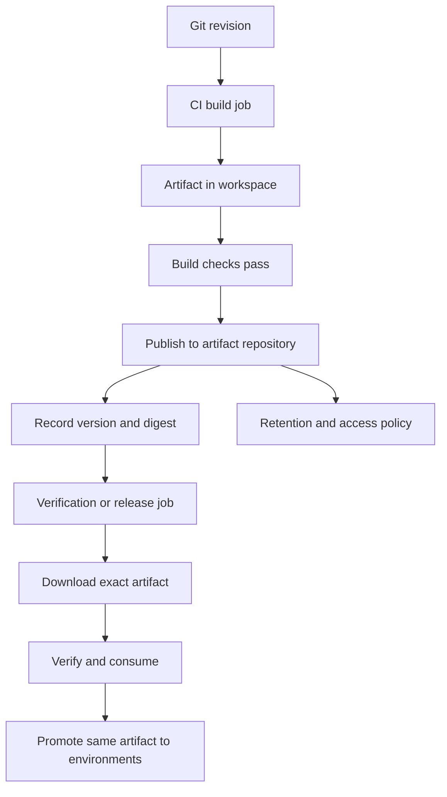

# Lưu artifact trong kho phù hợp thay vì phụ thuộc vùng làm việc CI

Một pipeline có thể build thành công nhưng đầu ra sẽ không còn đáng tin cậy nếu chỉ nằm trong thư mục làm việc tạm của runner. Runner có thể bị hủy sau job, workspace có thể được tạo lại, hoặc job tiếp theo có thể chạy trên máy khác. Khi đó, file build biến mất hoặc không thể xác định chính xác file nào đã được tạo và kiểm thử.

Artifact cần được lưu ở một nơi có vòng đời độc lập với runner. Kho lưu trữ phù hợp giúp các job và pipeline khác nhau tải đúng đầu ra, hỗ trợ phát hành nhiều lần, lưu lịch sử phiên bản, kiểm soát quyền truy cập và truy vết từ artifact về commit đã tạo ra nó.

Nguyên tắc quan trọng là xem artifact như một đầu ra có định danh và vòng đời riêng. Workspace phục vụ một lần thực thi; cache giúp tăng tốc; artifact repository lưu trữ đầu ra cần được chia sẻ, tiêu thụ hoặc phát hành. Khi tách rõ ba vai trò này, CI/CD không phụ thuộc vào trạng thái ngẫu nhiên của máy chạy job và có thể promotion cùng một artifact qua nhiều môi trường.

## 1. Artifact là gì và vì sao cần lưu trữ riêng?

Artifact là đầu ra được tạo từ mã nguồn hoặc một quy trình xử lý có thể được tiêu thụ ở bước sau. Tùy dự án, artifact có thể là:

- JAR, WAR hoặc EAR của ứng dụng Java.
- Thư viện đã đóng gói và publish lên Maven repository.
- File ZIP, TAR hoặc bộ cài đặt.
- Container image lưu trong OCI registry.
- Package như npm, Python wheel, NuGet hoặc package hệ điều hành.
- Binary, static asset hoặc bộ tài liệu được tạo tự động.
- Manifest, SBOM, provenance và báo cáo gắn với một bản build.

Không phải mọi file được tạo trong CI đều là artifact phát hành. Log tạm, file trung gian, cache compiler hoặc thư mục build có thể chỉ phục vụ một job. Nhóm cần xác định đầu ra nào phải được giữ lại, đầu ra nào chỉ dùng để chẩn đoán và đầu ra nào có thể tái tạo bất cứ lúc nào.

Nếu chỉ lưu artifact trong workspace, pipeline có thể gặp các vấn đề:

- Job sau chạy trên runner khác và không thấy file của job trước.
- Runner bị xóa sau khi job kết thúc khiến đầu ra mất hoàn toàn.
- Một lần retry ghi đè hoặc trộn file với lần chạy trước.
- Không thể tải lại đúng artifact của một release cũ.
- Không biết file đang được triển khai có phải file đã qua kiểm thử hay không.
- Không có chính sách quyền truy cập, lưu giữ và xóa dữ liệu rõ ràng.
- Điều tra sự cố khó vì không liên kết được file với commit, pipeline run và kết quả kiểm tra.

Lưu trữ riêng biến đầu ra build thành một đối tượng có thể quản lý xuyên suốt vòng đời phát hành.

## 2. Phân biệt workspace, artifact repository và cache

Ba loại lưu trữ này thường cùng xuất hiện trong CI nhưng phục vụ mục đích khác nhau.

| Thành phần | Mục đích | Vòng đời | Ví dụ |
|---|---|---|---|
| Workspace | Cung cấp thư mục làm việc cho một job | Thường ngắn hạn, có thể bị hủy sau job | Source checkout, thư mục build |
| Artifact repository | Lưu đầu ra có định danh để job, dự án hoặc môi trường khác tiêu thụ | Theo version và chính sách retention | Maven repository, OCI registry, generic package store |
| Cache | Giảm thời gian tải hoặc tính toán lại | Có thể xóa và tạo lại, không phải nguồn chuẩn | Gradle dependency cache, npm cache, compiler cache |

Workspace là nơi job đọc source và tạo file. Nó không phải nơi lưu trữ bền vững. Cache là tối ưu hiệu năng; nếu cache trống, quy trình vẫn phải có thể chạy từ đầu vào chuẩn. Artifact repository là nơi lưu đối tượng cần được chia sẻ hoặc phát hành.

Một file có thể xuất hiện ở cả ba nơi trong các giai đoạn khác nhau. Ví dụ, Gradle tạo JAR trong workspace; CI upload JAR lên artifact repository; một job sau tải JAR đó để kiểm tra; cache Gradle có thể giữ dependency đã tải để lần build tiếp theo nhanh hơn. Các bản sao này có vai trò khác nhau và không nên nhầm lẫn.

Không dùng cache làm kho artifact phát hành. Cache thường có cơ chế eviction, key thay đổi và mức đảm bảo lưu giữ thấp hơn. Nếu một release chỉ tồn tại trong cache, nhóm có thể không tải lại được nó khi cần rollback hoặc điều tra.

## 3. Chọn kho lưu trữ theo loại artifact

Kho lưu trữ nên phù hợp với định dạng và cách tiêu thụ artifact. Một kho generic có thể lưu nhiều loại file, nhưng package registry chuyên dụng thường cung cấp metadata, dependency resolution và cơ chế version phù hợp hơn.

| Loại đầu ra | Kho phù hợp | Cách tiêu thụ |
|---|---|---|
| JAR/WAR/EAR và thư viện Java | Maven repository | Gradle hoặc Maven khai báo dependency theo group, artifact, version |
| npm package | npm registry | Package manager cài theo tên và version |
| Python wheel/sdist | Python package index | pip hoặc công cụ quản lý package |
| NuGet package | NuGet feed | dotnet restore hoặc NuGet client |
| Container image | OCI/Docker registry | Runtime hoặc orchestrator pull image theo tag/digest |
| DEB/RPM hoặc package hệ điều hành | Package repository | Package manager cài theo version |
| ZIP, TAR, binary riêng | Generic artifact/package store | Tải theo version, release ID hoặc digest |
| Báo cáo, SBOM, provenance | Artifact store hoặc hệ thống quản lý evidence | Pipeline, công cụ bảo mật và kiểm toán truy xuất |

Các nền tảng thường cung cấp một hoặc nhiều loại kho: registry tích hợp với hệ thống quản lý mã nguồn, Maven/npm/PyPI feed, OCI registry hoặc kho quản lý artifact chuyên dụng. Tên sản phẩm không quan trọng bằng khả năng đáp ứng hợp đồng sử dụng.

Khi lựa chọn, cần xem xét:

- Có hỗ trợ đúng định dạng và giao thức package manager cần dùng không?
- Có version bất biến hoặc khả năng truy xuất bằng digest không?
- Có phân quyền đọc/ghi riêng theo project, team hoặc môi trường không?
- Có metadata, checksum, signature hoặc provenance không?
- Có hỗ trợ retention, cleanup và immutable release không?
- Có thể nhân bản hoặc phục hồi dữ liệu khi kho gặp sự cố không?
- Có tích hợp xác thực an toàn với CI mà không phải lưu token dài hạn không?
- Có đáp ứng yêu cầu vùng dữ liệu, audit và thời hạn lưu giữ của tổ chức không?

Không nhất thiết dùng một kho duy nhất cho mọi loại artifact. Thư viện Java nên được publish vào Maven repository để dependency resolution hoạt động đúng; container image nên ở OCI registry; báo cáo build hoặc gói nội bộ không theo chuẩn package có thể dùng generic artifact store.

## 4. Thiết kế luồng lưu trữ từ build đến consume

Một luồng cơ bản gồm bốn bước:

1. **Build:** tạo artifact từ một revision đã xác định.
2. **Publish:** upload artifact lên kho phù hợp sau khi các điều kiện build cần thiết đạt.
3. **Verify:** tải artifact từ kho, xác minh định danh và thực hiện các kiểm tra cần thiết.
4. **Consume hoặc promote:** job khác, dự án khác hoặc môi trường triển khai tải đúng artifact để sử dụng.

Sơ đồ:



Publish chỉ nên xảy ra khi artifact đã hoàn tất và các điều kiện bắt buộc của bước build đạt. Không upload một phần file đang được tạo rồi để job sau có thể tải nhầm bản chưa hoàn chỉnh. Nếu một release gồm nhiều file liên quan, cần publish chúng theo một manifest hoặc release bundle để consumer biết tập file nào thuộc cùng một lần phát hành.

Job tiêu thụ nên tải artifact theo version bất biến hoặc digest. Không dựa vào thư mục workspace của job trước hoặc một tên alias có thể trỏ sang bản mới hơn.

## 5. Trao đổi artifact giữa các job và giữa các pipeline

Có hai nhu cầu khác nhau:

**Chuyển file trong cùng một pipeline run.** Một số nền tảng CI cung cấp chức năng upload/download artifact để job build truyền file cho job test hoặc job đóng gói. Đây là cách thuận tiện để trao đổi output trong một lần chạy.

**Lưu và chia sẻ qua nhiều lần chạy hoặc nhiều dự án.** Khi artifact cần được tải ở một workflow khác, một pipeline release khác, một dự án consumer hoặc một môi trường triển khai, nên publish vào artifact repository có vòng đời riêng.

Artifact transfer nội bộ của CI vẫn hữu ích, nhưng không nên mặc định nó là kho phát hành lâu dài. Thời hạn lưu giữ có thể ngắn, quyền truy cập có thể gắn với run, và cách định danh có thể phụ thuộc nền tảng. Với release cần dùng lại hoặc rollback, hãy lưu trong kho được quản lý theo chính sách phát hành.

Ví dụ, pipeline có thể upload JAR để job integration test sử dụng ngay. Khi release được phê duyệt, cùng JAR đó được publish lên Maven hoặc generic repository và gắn với version phát hành. Nếu pipeline cần promotion staging rồi production, nó tải đúng version/digest đã được xác minh thay vì build lại.

## 6. Đặt tên và version artifact có thể truy vết

Một artifact cần có định danh rõ ràng, duy nhất trong phạm vi kho và phù hợp cách tiêu thụ.

Các thành phần thường dùng:

- Tên sản phẩm hoặc module.
- Version sản phẩm.
- Commit SHA hoặc revision.
- Build run ID.
- Target OS/architecture nếu có nhiều biến thể.
- Loại artifact hoặc classifier.
- Digest nội dung.

Ví dụ tên file có thể chứa version release và classifier:

```text
orders-service-2.4.0.jar
orders-service-2.4.0-sources.jar
orders-service-2.4.0-linux-amd64.tar.gz
orders-service-2.4.0-windows-x64.zip
```

Không dùng tên chung như app.jar làm định danh duy nhất trong kho lâu dài nếu file có thể bị ghi đè. Tên thân thiện vẫn có thể dùng ở workspace, nhưng kho cần version hoặc digest để xác định nội dung chính xác.

Với build từ commit chưa phát hành, có thể dùng version snapshot hoặc version phát triển kèm commit SHA và run ID. Với release chính thức, version nên tuân theo quy ước của dự án và được xem là bất biến sau khi publish.

Không nên ghi đè một version release đã được tiêu thụ. Nếu phát hiện lỗi, tạo version mới hoặc bản vá mới, lưu lại quan hệ với bản trước. Việc thay nội dung phía sau cùng một version làm mất khả năng truy vết và có thể khiến hai môi trường tưởng rằng đang chạy cùng phiên bản nhưng thực tế khác binary.

## 7. Phân biệt tag, version và digest

Ba khái niệm thường được dùng cùng nhau nhưng không hoàn toàn giống nhau:

| Định danh | Ý nghĩa | Lưu ý |
|---|---|---|
| Version | Nhãn phiên bản theo quy ước sản phẩm | Có thể bất biến theo chính sách nhưng phải kiểm tra kho có cho ghi đè không |
| Tag | Tên tham chiếu thân thiện tới một đối tượng | Có thể thay đổi để trỏ sang đối tượng khác |
| Digest | Giá trị băm xác định nội dung | Phù hợp để xác minh và tham chiếu chính xác |

Với container image, tag như 2.4.0 hoặc stable giúp người dùng dễ nhận diện, nhưng digest mới xác định nội dung image. Với file JAR hoặc ZIP, SHA-256 có thể được ghi trong metadata hoặc manifest.

Một pipeline release nên lưu cả version dễ đọc và digest. Khi triển khai, dùng digest nếu nền tảng hỗ trợ. Khi hiển thị cho con người, có thể hiển thị version cùng một phần digest để kiểm tra nhanh.

Không nên xem tag latest là bằng chứng về artifact vừa được kiểm tra. Tag có thể thay đổi sau khi verification hoàn tất. Nếu buộc phải dùng alias, hãy resolve alias thành digest trước khi deploy và lưu digest đó vào release record.

## 8. Metadata cần lưu cùng artifact

Artifact chỉ có file và tên có thể chưa đủ để giải thích nguồn gốc. Nên lưu metadata liên kết đầu ra với quy trình tạo ra nó.

Một manifest có thể chứa:

- Tên và version artifact.
- Digest và thuật toán băm.
- Repository và commit SHA.
- Branch hoặc tag nguồn.
- Build run ID và pipeline definition revision.
- Thời điểm build.
- Phiên bản JDK, Gradle/Maven hoặc toolchain liên quan.
- Dependency lock hoặc thông tin dependency cần thiết.
- Target OS/architecture.
- Kết quả test và quality gate tham chiếu.
- SBOM hoặc provenance nếu có.
- Danh tính hệ thống tạo và publish artifact.

Ví dụ manifest JSON khái niệm:

```json
{
  "name": "orders-service",
  "version": "2.4.0",
  "source": {
    "repository": "team/orders-service",
    "commit": "a1b2c3d4e5f6"
  },
  "build": {
    "runId": "ci-1842",
    "toolchain": {
      "java": "21",
      "gradle": "8.x"
    }
  },
  "artifact": {
    "file": "orders-service-2.4.0.jar",
    "digest": {
      "algorithm": "sha256",
      "value": "..."
    }
  }
}
```

Các giá trị trong ví dụ là minh họa. Manifest thực tế nên dùng schema được nhóm thống nhất và có thể được ký hoặc lưu trong hệ thống evidence tin cậy. Không đưa token, password hoặc secret vào metadata.

Metadata nên được lưu cùng release hoặc liên kết bằng định danh bất biến. Nếu metadata chỉ nằm trong log tạm của runner, nó có thể biến mất trước khi nhóm cần điều tra.

## 9. Publish artifact Java vào Maven repository

Với dự án Java, Maven repository phù hợp cho JAR/WAR và thư viện vì Gradle hoặc Maven có thể resolve dependency theo group, artifact và version.

Gradle có plugin Maven Publish để mô tả publication. Ví dụ dưới đây là cấu hình khái niệm:

```kotlin
plugins {
    id("java-library")
    id("maven-publish")
}

group = "com.example.orders"
version = providers.gradleProperty("releaseVersion")
    .orElse("0.0.0-dev")
    .get()

publishing {
    publications {
        create<MavenPublication>("library") {
            from(components["java"])
            artifactId = "orders-domain"
        }
    }

    repositories {
        maven {
            name = "internal"
            url = uri(
                providers.gradleProperty("artifactRepositoryUrl").get()
            )
            credentials {
                username = providers.environmentVariable("REPO_USER").orNull
                password = providers.environmentVariable("REPO_TOKEN").orNull
            }
        }
    }
}
```

Đây là ví dụ cần điều chỉnh theo build thực tế. Không nên đặt URL, user hoặc token nhạy cảm trực tiếp trong file build. URL có thể được truyền qua property hoặc cấu hình môi trường; credential nên lấy từ secret manager hoặc biến được bảo vệ của CI. Với repository hỗ trợ workload identity/OIDC, nên ưu tiên credential ngắn hạn.

CI có thể gọi task publish sau khi build và kiểm tra đạt. Cần xác định repository đích theo loại version: snapshot/development có thể vào kho snapshot, release chính thức vào kho release bất biến. Không cho phép một job PR từ fork có quyền publish package phát hành.

Consumer khai báo repository và dependency theo version. Ví dụ:

```kotlin
repositories {
    maven {
        url = uri("https://packages.example.com/maven/releases")
    }
}

dependencies {
    implementation("com.example.orders:orders-domain:2.4.0")
}
```

URL minh họa cần thay bằng endpoint thực tế. Consumer nên resolve version cụ thể hoặc dùng dependency locking phù hợp. Tránh dùng dynamic version trong quy trình release nếu cần kết quả ổn định.

## 10. Publish container image vào OCI registry

Container image nên được lưu trong OCI registry để các công cụ runtime và orchestrator có thể pull theo repository, tag và digest.

Luồng cơ bản:

1. Build image từ revision đã xác định.
2. Gắn tag có version và commit hoặc build identifier.
3. Push image lên registry.
4. Resolve digest mà registry ghi nhận.
5. Lưu digest vào release metadata.
6. Verification và deployment pull image theo digest.

Ví dụ lệnh minh họa:

```bash
IMAGE="registry.example.com/team/orders-service"
VERSION="2.4.0"

docker build -t "$IMAGE:$VERSION" .
docker push "$IMAGE:$VERSION"
docker inspect --format='{{index .RepoDigests 0}}' "$IMAGE:$VERSION"
```

Các giá trị registry và version chỉ là ví dụ. Cần xác minh digest trả về tương ứng với manifest đã push, đặc biệt khi image đa kiến trúc. Nếu build tạo manifest list, release record nên ghi digest của manifest list và có thể ghi thêm digest từng platform image.

Không nên push cùng tag release với nội dung khác. Nếu push thất bại một phần, cần kiểm tra trạng thái registry trước khi retry và đảm bảo retry không làm tag bất biến trỏ sang nội dung không mong muốn.

## 11. Quyền đọc và ghi kho artifact

Kho artifact là một phần của chuỗi cung ứng phần mềm. Nếu bất kỳ job nào cũng có quyền ghi vào release repository, mã chưa tin cậy có thể thay thế package hoặc image được dùng trong production.

Nên tách quyền theo nhiệm vụ:

- Job build/PR thường chỉ cần quyền đọc dependency.
- Job kiểm tra có thể cần đọc artifact đã publish.
- Job publish snapshot có quyền ghi vào vùng snapshot riêng.
- Job release có quyền ghi vào repository release theo điều kiện và phê duyệt.
- Job deploy chỉ cần đọc artifact cụ thể và quyền triển khai môi trường tương ứng.
- Người quản trị kho có quyền quản lý policy, retention và quyền truy cập nhưng cần audit.

Dùng nguyên tắc quyền tối thiểu. Không dùng một token có quyền đọc/ghi/xóa toàn bộ registry cho mọi workflow. Nếu nền tảng hỗ trợ OIDC hoặc workload identity, có thể cấp credential ngắn hạn gắn với repository, workflow, branch và environment.

Các điểm cần kiểm soát:

- Tách quyền pull và push.
- Hạn chế publish release từ nhánh hoặc tag không tin cậy.
- Không cấp quyền xóa artifact release cho job thông thường.
- Audit thao tác publish, overwrite, delete và thay đổi permission.
- Xác minh danh tính publisher khi tiêu thụ artifact quan trọng.
- Không lưu token trong source, image layer hoặc log.

## 12. Bảo vệ tính toàn vẹn và nguồn gốc

Lưu file trong registry không tự động bảo đảm file đúng hoặc đáng tin. Pipeline cần kiểm tra tính toàn vẹn và nguồn gốc của artifact.

Các biện pháp thường dùng:

**Checksum/digest.** Tính SHA-256 hoặc digest registry để phát hiện nội dung bị thay đổi trong quá trình upload/download.

**Signature.** Ký artifact hoặc metadata bằng danh tính được quản lý. Consumer xác minh signer theo chính sách tin cậy.

**Provenance.** Ghi nhận source revision, builder, workflow và đầu vào tạo artifact.

**SBOM.** Lưu danh sách dependency và thành phần phần mềm để hỗ trợ quản lý lỗ hổng và license.

**Immutable release.** Ngăn ghi đè version release đã phát hành.

Digest giúp xác định nội dung, signature giúp xác minh danh tính ký, provenance giúp hiểu cách tạo ra artifact. Chúng bổ sung cho nhau và không thay thế kiểm thử chức năng.

Nếu artifact được tải từ kho không đáng tin hoặc metadata không có chữ ký, consumer không nên chỉ dựa vào tên file hoặc version. Hãy xác minh nguồn, digest và các bằng chứng theo chính sách của tổ chức.

## 13. Retention và vòng đời artifact

Không phải mọi artifact đều cần được giữ mãi. Lưu giữ không giới hạn làm tăng chi phí và có thể giữ lại dữ liệu không còn cần thiết. Xóa quá sớm lại làm mất khả năng rollback, kiểm toán hoặc tái hiện sự cố.

Nên phân loại:

| Nhóm artifact | Chính sách gợi ý | Lý do |
|---|---|---|
| Pull request build | Giữ ngắn hạn | Phục vụ review và debug trong thời gian PR còn liên quan |
| Snapshot/development | Giữ theo số phiên bản hoặc thời hạn | Tránh tích lũy build thử nghiệm |
| Release chính thức | Giữ theo chính sách sản phẩm và hỗ trợ | Cần rollback, tái triển khai và truy vết |
| Artifact đang được triển khai | Giữ ít nhất trong thời gian môi trường còn tham chiếu | Tránh môi trường trỏ tới file đã bị xóa |
| Log và test report | Theo yêu cầu điều tra và kiểm toán | Cần bằng chứng của lần build/phát hành |
| Cache | Có thể xóa và tạo lại | Không phải nguồn chuẩn |

Retention cần xét các yếu tố:

- Thời gian hỗ trợ từng phiên bản.
- Khả năng rollback về phiên bản trước.
- Thời hạn lưu log và bằng chứng.
- Yêu cầu kiểm toán hoặc hợp đồng.
- Dung lượng và chi phí lưu trữ.
- Tài nguyên nào còn được deployment hoặc consumer tham chiếu.

Cleanup nên tự động theo policy nhưng cần loại trừ release đang được sử dụng hoặc được đánh dấu giữ lại. Trước khi xóa, hệ thống nên xác định artifact có đang được một môi trường hoặc release record tham chiếu không.

## 14. Dọn dẹp an toàn và bảo toàn release

Một job cleanup có quyền xóa nhầm artifact có thể làm gián đoạn rollback hoặc khiến pipeline cũ không còn chạy lại được. Vì vậy, quyền xóa nên tách khỏi quyền publish và deploy.

Một quy trình cleanup an toàn:

1. Xác định nhóm artifact và retention policy tương ứng.
2. Liệt kê các artifact đã hết hạn.
3. Loại trừ version đang được triển khai hoặc được pin trong release.
4. Tôn trọng nhãn keep/hold và yêu cầu lưu giữ.
5. Ghi audit event cho danh sách và kết quả xóa.
6. Kiểm tra báo cáo sau cleanup để phát hiện xóa nhầm.

Không dùng một lệnh xóa rộng theo wildcard mà không kiểm tra phạm vi. Không cho PR workflow tự xóa package trong kho release. Với artifact có nhiều file liên quan, cần bảo đảm cleanup không xóa manifest hoặc metadata trong khi file chính vẫn được tham chiếu.

Nếu cần lưu giữ lâu dài nhưng muốn giảm chi phí, có thể dùng tier lưu trữ lạnh hoặc archive. Cần kiểm tra thời gian khôi phục và chi phí truy xuất để bảo đảm phương án đó phù hợp với mục tiêu phục hồi.

## 15. Tính sẵn sàng, backup và phục hồi

Artifact repository có thể trở thành dependency quan trọng của toàn bộ quá trình phát hành. Nếu kho ngừng hoạt động, pipeline có thể không tải được dependency, không publish release hoặc không triển khai lại phiên bản cũ.

Nhóm cần xem xét:

- Kho có SLA hoặc mức sẵn sàng phù hợp không?
- Có replication giữa vùng hoặc cluster không?
- Metadata và blob được backup cùng nhau không?
- Có thể phục hồi version, digest, permission và metadata không?
- Thời gian restore có đáp ứng nhu cầu phát hành/rollback không?
- Có kiểm tra định kỳ khả năng tải artifact đã lưu không?
- Có phương án mirror dependency bên ngoài nếu registry upstream bị gián đoạn không?

Backup chỉ có ý nghĩa khi có thể restore và xác minh. Một bản backup thiếu metadata hoặc mapping giữa version và blob có thể không đủ để tái sử dụng artifact.

Với release quan trọng, nên kiểm tra định kỳ việc tải lại một artifact cũ, xác minh digest và chạy một smoke test tối thiểu. Điều này xác nhận kho vẫn giữ đúng nội dung và thông tin truy vết.

## 16. Không nhầm artifact với dependency cache

Dependency cache thường lưu các package đã tải để lần build sau không cần tải lại. Artifact repository lưu đầu ra mà dự án muốn phát hành hoặc chia sẻ. Một Maven repository có thể vừa cung cấp dependency vừa nhận package nội bộ, nhưng cache của Gradle hoặc Maven local không phải nơi publish release chính thức.

Ví dụ:

- Gradle cache lưu dependency đã resolve và một số output cache.
- Maven local repository lưu package cục bộ để build trên cùng máy.
- Maven remote repository lưu package nội bộ hoặc release để nhiều consumer dùng.
- OCI registry lưu image để deployment pull.
- CI cache giúp tái sử dụng dữ liệu giữa các job nếu key phù hợp.
- CI artifact transfer chuyển file giữa job trong một pipeline run.

Khi một dự án khác cần sử dụng thư viện, nó nên lấy package từ repository theo version, không truy cập thư mục .gradle hoặc .m2 của runner build. Khi production cần image, nó nên pull từ OCI registry theo digest, không dựa vào image cache tình cờ trên runner.

Nếu cache bị xóa, build có thể chậm hơn nhưng vẫn phải thành công. Nếu artifact release bị xóa, hệ thống có thể không tái triển khai hoặc rollback được. Đó là khác biệt cốt lõi về vòng đời.

## 17. Handoff giữa các job không phụ thuộc cùng runner

Một pipeline có thể chia thành build, test, package, publish và deploy. Các job không nhất thiết chạy trên cùng runner. Vì vậy, file cần truyền qua một cơ chế được hỗ trợ rõ ràng.

Ví dụ workflow khái niệm:

```yaml
jobs:
  build:
    steps:
      - checkout source
      - run build and tests
      - upload artifact to CI artifact storage

  verify:
    needs: [build]
    steps:
      - download artifact from build run
      - verify checksum
      - run consumer tests

  publish:
    needs: [verify]
    steps:
      - publish verified artifact to release repository
      - record immutable version and digest

  deploy:
    needs: [publish]
    steps:
      - download or pull artifact by digest
      - deploy to target environment
```

Tên bước trong ví dụ là mô tả khái niệm, cần thay bằng action của nền tảng CI. Điều quan trọng là mỗi job nhận artifact từ nguồn được khai báo và xác minh đúng revision.

Nếu build và verify là hai job trong cùng run, CI artifact transfer có thể đủ. Nếu release cần tồn tại độc lập với thời hạn lưu artifact của run, publish vào repository chính thức trước khi job hoặc run hết hạn.

## 18. Không build lại khi promotion qua môi trường

Một artifact đã được build và kiểm tra nên được promotion qua development, staging và production bằng cùng định danh nội dung. Nếu mỗi môi trường build lại từ source, dependency, toolchain hoặc thời điểm build có thể làm binary khác nhau.

Luồng nên là:

- Build tạo artifact một lần.
- Publish lưu version và digest.
- Verification kiểm tra đúng artifact đó.
- Staging triển khai cùng digest.
- Production triển khai cùng digest sau khi được phê duyệt.
- Release record ghi nhận digest thực tế ở mỗi môi trường.

Cấu hình môi trường như URL dịch vụ, feature flag và secret nên được cung cấp lúc triển khai. Không chỉnh sửa binary hoặc image để thay cấu hình staging thành production.

Nếu artifact không đạt kiểm tra hoặc cần sửa, tạo artifact mới với version/digest mới và chạy lại quy trình. Không ghi đè nội dung release đã được kiểm tra rồi giữ nguyên bằng chứng cũ.

## 19. Tổ chức repository và quy ước phân vùng

Một kho artifact có thể chứa nhiều dự án, nhánh phát triển và loại phát hành. Cần tổ chức sao cho consumer biết lấy từ đâu và publisher biết ghi vào đâu.

Các cách phân vùng phổ biến:

- Theo team hoặc project.
- Theo ecosystem/package type.
- Theo release, snapshot hoặc development.
- Theo mức độ tin cậy.
- Theo môi trường hoặc vùng triển khai nếu chính sách yêu cầu.

Không nên tạo quá nhiều repository nhỏ nếu chúng chỉ khác tên mà không có chính sách khác nhau. Ngược lại, không nên gom package từ mọi mức tin cậy vào cùng một vùng ghi chung nếu không thể phân quyền và retention rõ ràng.

Ví dụ một cấu trúc logic:

```text
artifact-storage/
├── java-releases/
├── java-snapshots/
├── npm-internal/
├── python-internal/
├── container-images/
├── generic-builds/
└── release-evidence/
```

Đây chỉ là mô hình tổ chức; nền tảng có thể dùng project, namespace, repository, feed hoặc path khác. Hãy ưu tiên cách phân vùng phản ánh quyền và vòng đời thực tế hơn là một cây thư mục quá sâu.

## 20. Kiểm soát dependency upstream và nguồn tải

Artifact repository thường đóng vai trò proxy hoặc mirror cho dependency bên ngoài. Điều này giúp kiểm soát nguồn tải, cache dependency và giảm phụ thuộc vào dịch vụ công cộng.

Khi dùng proxy repository:

- Chỉ cho phép nguồn upstream đã được phê duyệt.
- Ghi nhận version và checksum dependency.
- Có thể chặn hoặc cách ly package vi phạm chính sách.
- Hạn chế việc package nội bộ bị nhầm với package công cộng cùng tên.
- Kiểm soát ai được publish vào namespace nội bộ.
- Tránh cấu hình consumer tải cùng một tọa độ package từ nhiều nguồn không rõ thứ tự ưu tiên.

Dependency confusion có thể xảy ra khi package nội bộ và package công cộng có tên hoặc namespace trùng nhau, khiến package manager lấy nhầm nguồn. Dùng namespace nội bộ, repository routing và quy tắc ưu tiên rõ ràng giúp giảm rủi ro.

Không nên để pipeline release tự động tải một dependency không khóa version từ nguồn không kiểm soát rồi publish sản phẩm mà không ghi nhận đầu vào. Lockfile, dependency verification và proxy repository giúp cải thiện khả năng truy vết.

## 21. Xử lý lỗi publish và retry

Upload artifact có thể thất bại do mạng, timeout, quota hoặc quyền. Retry cần được thiết kế để không tạo ra version mơ hồ hoặc ghi đè nội dung.

Trước khi retry:

- Xác định upload đã hoàn tất hay chưa.
- Kiểm tra version hoặc digest đã tồn tại trong kho.
- Nếu artifact đã tồn tại, so sánh digest và metadata.
- Nếu version đã tồn tại với nội dung khác, dừng và điều tra.
- Dùng upload atomic hoặc staging area nếu kho hỗ trợ.
- Không đánh dấu release thành công khi metadata hoặc manifest chưa hoàn chỉnh.

Một lần publish có thể upload nhiều file. Nếu chỉ một phần thành công, consumer không nên coi release đã sẵn sàng. Có thể dùng manifest hoặc release index được tạo ở bước cuối để đánh dấu tập artifact hoàn chỉnh.

Retry chỉ nên áp dụng cho lỗi tạm thời có khả năng phục hồi. Lỗi permission, version conflict, quota hoặc artifact không hợp lệ cần xử lý nguyên nhân. Không retry vô hạn.

## 22. Tình huống thực tế: rollback nhưng artifact không còn trong workspace

Giả sử một service được deploy từ pipeline. Sau vài ngày, phiên bản mới gây lỗi và nhóm cần quay về bản trước. Runner tạo bản build cũ đã bị hủy, workspace không còn tồn tại. Nếu artifact chỉ nằm ở thư mục build của job, nhóm có thể buộc phải build lại từ commit cũ.

Build lại có thể cho kết quả khác nếu toolchain, dependency hoặc nguồn upstream đã thay đổi. Nó cũng mất thời gian và có thể không tái tạo đúng binary đã chạy trước đó.

Nếu artifact được publish vào repository với version và digest bất biến, nhóm có thể:

1. Xác định release record của phiên bản trước.
2. Lấy đúng artifact hoặc image theo digest.
3. Xác minh checksum/signature theo chính sách.
4. Triển khai lại artifact đó.
5. Ghi nhận rollback và kết quả xác minh.

Đây là lý do artifact release cần vòng đời độc lập với workspace và cần được giữ ít nhất trong khoảng thời gian phiên bản còn có thể phải khôi phục.

## 23. Các anti-pattern thường gặp

| Cách làm chưa tốt | Hệ quả | Cách cải thiện |
|---|---|---|
| Chỉ lưu output trong workspace | Mất file khi runner bị hủy | Publish vào artifact repository |
| Dùng cache làm kho release | Cache bị eviction hoặc key thay đổi | Lưu release trong repository có retention |
| Dùng một tên file chung và ghi đè | Không xác định được binary của từng lần chạy | Version hóa và ghi digest |
| Dùng tag latest để deploy | Có thể lấy nhầm nội dung mới hơn | Deploy theo digest |
| Build lại ở mỗi môi trường | Staging và production có thể khác binary | Build một lần, promotion cùng artifact |
| Mọi job có quyền push/delete | Mã chưa tin cậy có thể thay package | Phân quyền pull/push/delete riêng |
| Publish release từ PR chưa tin cậy | Có thể phát hành artifact chưa được review | Giới hạn trigger và quyền publisher |
| Không lưu metadata | Khó truy vết source và toolchain | Lưu manifest, commit và build run ID |
| Xóa artifact theo wildcard | Có thể xóa version đang triển khai | Retention có kiểm tra tham chiếu và audit |
| Giữ mọi build mãi mãi | Chi phí tăng và dữ liệu thừa | Chính sách retention theo loại artifact |
| Chỉ backup mà không thử restore | Không biết dữ liệu có khôi phục được không | Diễn tập restore và xác minh digest |
| Publish nhiều file nhưng không có manifest | Consumer có thể lấy tập file chưa hoàn chỉnh | Đánh dấu release hoàn tất sau cùng |

## 24. Lộ trình áp dụng trong một dự án

Có thể đưa quản lý artifact vào dự án theo các bước:

1. **Kiểm kê đầu ra:** xác định file nào là artifact phát hành, file nào là report và file nào chỉ là cache.
2. **Chọn kho phù hợp:** Maven/npm/PyPI/OCI hoặc generic store theo định dạng và cách consumer sử dụng.
3. **Định nghĩa version:** quy ước version release, snapshot, commit SHA và build ID.
4. **Thiết lập quyền:** tách pull, push, delete và quyền deploy; cấp credential tối thiểu.
5. **Publish sau khi build đạt:** upload artifact hoàn chỉnh và xác nhận kết quả.
6. **Lưu metadata:** commit, build run, toolchain, digest, SBOM/provenance nếu cần.
7. **Chuyển consumer sang repository:** job sau và dự án khác tải theo version hoặc digest.
8. **Promotion cùng artifact:** không build lại khi chuyển staging và production.
9. **Thiết lập retention:** giữ release đủ lâu, dọn snapshot và build tạm theo policy.
10. **Kiểm tra restore:** tải lại artifact cũ, xác minh và thử triển khai.
11. **Theo dõi vận hành:** quan sát dung lượng, lỗi publish/download, thời gian truy xuất và các lần truy cập bất thường.

Bắt đầu với một loại artifact quan trọng, chẳng hạn JAR hoặc container image, rồi mở rộng sang các package khác. Trước khi chuyển toàn bộ consumer, hãy kiểm tra quyền, version, digest và retention trên một luồng release thử nghiệm.

## 25. Đo hiệu quả quản lý artifact

Một kho artifact tốt giúp giảm phụ thuộc vào runner và rút ngắn thời gian phục hồi. Có thể theo dõi:

- Tỷ lệ release có artifact được lưu trữ và định danh bất biến.
- Tỷ lệ deployment tham chiếu digest thay vì tag thay đổi.
- Thời gian publish và download.
- Tỷ lệ lỗi upload/download do mạng, quyền hoặc quota.
- Dung lượng theo nhóm release, snapshot và build tạm.
- Tỷ lệ artifact có metadata, digest và provenance đầy đủ.
- Thời gian khôi phục một artifact cũ.
- Số lần không thể rollback do artifact bị thiếu hoặc hết hạn.
- Tỷ lệ cleanup xóa đúng đối tượng và không ảnh hưởng release đang dùng.

Không nên tối ưu chi phí bằng cách xóa release còn nằm trong thời hạn hỗ trợ hoặc cần cho rollback. Cũng không nên giữ mọi artifact vô thời hạn mà không phân loại. Retention cần cân bằng chi phí với yêu cầu vận hành và kiểm toán.

## 26. Checklist trước khi đưa artifact vào sử dụng

- [ ] Artifact được lưu ngoài workspace của runner.
- [ ] Kho lưu trữ phù hợp với định dạng và công cụ consumer.
- [ ] Version hoặc định danh artifact là duy nhất theo chính sách.
- [ ] Release chính thức không bị ghi đè.
- [ ] Digest được tính và lưu cùng metadata tin cậy.
- [ ] Có liên kết tới repository, commit và build run.
- [ ] Quyền pull, push và delete được tách theo nhiệm vụ.
- [ ] CI dùng credential ngắn hạn hoặc secret được bảo vệ.
- [ ] Job consumer tải artifact từ kho theo version/digest.
- [ ] Cache không được xem là nguồn chuẩn của release.
- [ ] Promotion staging/production dùng lại cùng artifact.
- [ ] Retention bảo đảm phiên bản đang triển khai vẫn có thể tải.
- [ ] Cleanup loại trừ artifact đang được tham chiếu.
- [ ] Backup và restore được kiểm tra định kỳ.
- [ ] Log và audit đủ để truy vết publish, download và delete.

## Kết luận

Artifact cần có nơi lưu trữ và vòng đời độc lập với workspace của CI. Workspace phục vụ một lần chạy, cache tăng tốc và có thể tạo lại, còn artifact repository giữ đầu ra có định danh để các job, dự án và môi trường khác tiêu thụ.

Khi chọn đúng loại kho, version hóa bất biến, lưu digest và metadata, phân quyền theo nhiệm vụ và thiết lập retention phù hợp, nhóm có thể tải lại đúng binary đã được kiểm tra, promotion cùng artifact qua các môi trường và rollback khi cần. Đây là nền tảng để pipeline không phụ thuộc vào tuổi thọ của runner và để mỗi bản phát hành có thể truy vết trong suốt vòng đời.

