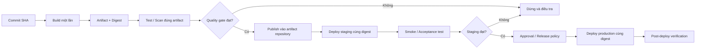
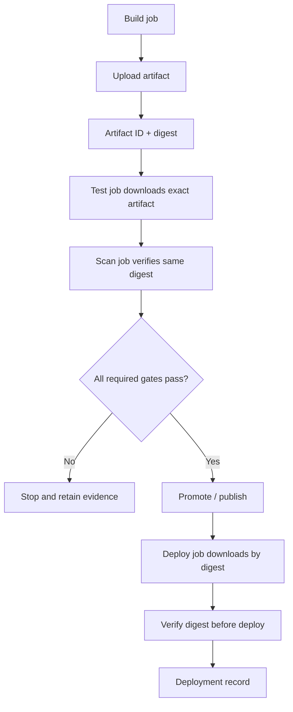
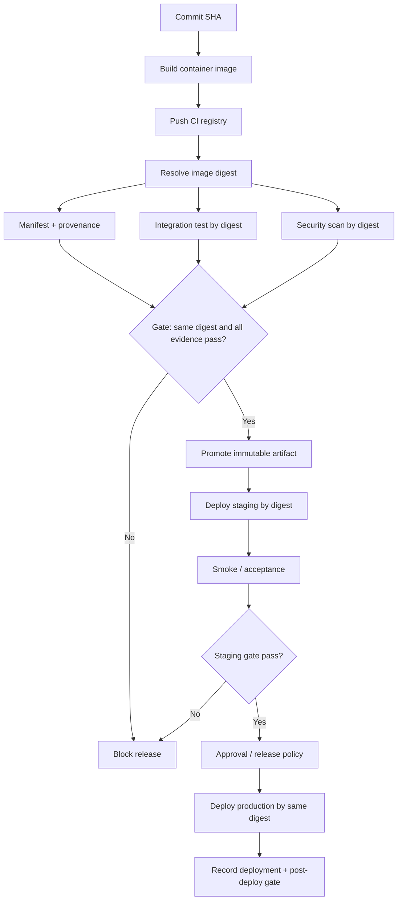

# Bàn giao đúng artifact đã qua kiểm tra cho bước triển khai

## 1. Vì sao phải bàn giao đúng artifact?

Trong CI/CD, build tạo ra một sản phẩm có thể triển khai, thường được gọi là artifact. Artifact có thể là file JAR, package, binary, image container, gói frontend hoặc một tập tin phát hành. Pipeline sau đó chạy kiểm thử, quét bảo mật, lưu artifact vào kho và chuyển artifact qua các môi trường như staging rồi production.

Một lỗi thiết kế phổ biến là kiểm thử một gói nhưng lại triển khai một gói khác. Ví dụ, job CI build `service.jar` và chạy test thành công. Job deploy sau đó checkout lại nhánh `main`, build thêm lần nữa rồi triển khai file mới. Dù cả hai lần build dùng cùng tên nhánh, chúng có thể khác commit, dependency, toolchain, cấu hình hoặc thời điểm lấy dữ liệu. Kết quả test của gói thứ nhất không chứng minh gói thứ hai đã được kiểm tra.

Nguyên lý bàn giao đúng artifact yêu cầu pipeline phải giữ một mối liên hệ có thể xác minh giữa:

- Mã nguồn và revision đã build.
- Lần chạy build và môi trường tạo artifact.
- Artifact cụ thể được tạo ra, định danh bằng version hoặc digest.
- Các bài kiểm tra, scan và quality gate đã chạy trên artifact đó.
- Bản ghi bàn giao và lần triển khai vào từng môi trường.

Mục tiêu là build một lần, xác minh đúng sản phẩm và promote chính sản phẩm đó qua các môi trường. Khi staging đã kiểm thử artifact digest `X`, production cũng phải nhận digest `X`. Cấu hình môi trường có thể khác nhau, nhưng payload ứng dụng phải giữ nguyên theo chính sách phát hành.

## 2. Artifact là gì trong quy trình CI/CD?

Artifact là đầu ra được tạo hoặc thu thập có chủ đích trong pipeline để lưu trữ, kiểm tra, phân phối hoặc triển khai. Không phải mọi file xuất hiện trong workspace đều là artifact phát hành. File tạm, log trung gian và cache có vòng đời cũng như mục đích khác.

| Loại artifact | Ví dụ | Mục đích |
|---|---|---|
| Binary/package | JAR, WAR, ZIP, MSI, DEB, RPM | Cài đặt hoặc chạy ứng dụng |
| Container image | OCI image, Docker image | Triển khai ứng dụng cùng filesystem và runtime dependencies |
| Frontend bundle | JavaScript/CSS bundle, static site archive | Phân phối nội dung web |
| Mobile package | APK, AAB, IPA | Phát hành ứng dụng di động |
| Infrastructure package | Helm chart, Terraform module, deployment bundle | Triển khai hoặc cấu hình hạ tầng |
| Test/quality evidence | Test report, coverage report, scan report | Chứng minh các kiểm tra đã thực hiện |
| Release metadata | Manifest, SBOM, provenance, chữ ký, checksum | Định danh, truy vết và xác minh sản phẩm |

Một số file như SBOM và test report không phải payload chạy trực tiếp, nhưng là artifact hỗ trợ quyết định phát hành và cần được liên kết với đúng payload. Pipeline nên phân loại rõ artifact nào được triển khai, artifact nào là bằng chứng, artifact nào chỉ phục vụ debug.

## 3. Phân biệt artifact, workspace, cache và source revision

Các thành phần này thường nằm gần nhau trong pipeline nhưng không thể thay thế nhau:

| Thành phần | Bản chất | Có thể dùng làm đầu vào triển khai? |
|---|---|---|
| Source revision | Mã nguồn được xác định bằng commit hoặc revision | Thường là đầu vào để build, không phải gói triển khai cuối cùng |
| Workspace | Thư mục làm việc tạm của job | Không nên; cần publish artifact có định danh |
| Cache | Dữ liệu có thể tạo lại để tăng tốc | Không; cache không phải nguồn chân lý của release |
| Artifact | Sản phẩm đầu ra được lưu và định danh | Có, sau khi được xác minh và đáp ứng policy |
| Deployment record | Bản ghi cho biết artifact nào đã được triển khai ở đâu và khi nào | Là bằng chứng vận hành, không phải payload |

Ví dụ, `build/libs/order-service.jar` trong workspace chỉ là file đầu ra tạm. Sau khi pipeline upload file đó vào artifact repository, tính checksum và lưu metadata, nó trở thành artifact được quản lý. Job deploy cần tải đúng artifact theo ID hoặc digest từ kho lưu trữ, không lấy file tùy ý còn sót trên runner.

Cache có thể giúp build nhanh hơn nhưng có thể bị eviction hoặc thay đổi. Workspace có thể bị xóa sau job. Artifact phát hành cần vòng đời, quyền truy cập và retention rõ ràng hơn vì các môi trường sẽ dùng lại nó.

## 4. Định danh artifact bằng version và digest

Để bàn giao chính xác, artifact cần một định danh. Có hai cách thường dùng:

- **Version/tag dễ đọc:** ví dụ `order-service:2.4.1`, `build-1042` hoặc `release-2026.11.18`.
- **Digest/checksum nội dung:** ví dụ SHA-256 của file JAR hoặc digest OCI của container image.

Version giúp con người nhận biết bản phát hành. Digest xác định nội dung cụ thể. Tag có thể bị di chuyển hoặc ghi đè nếu registry cho phép; vì vậy tag một mình không đủ để chứng minh nội dung đã tải về giống nội dung đã kiểm tra.

Ví dụ với file JAR:

```bash
sha256sum order-service.jar
```

Ví dụ với container image:

```text
registry.example.com/platform/order-service@sha256:<digest>
```

Trong bước deploy, ưu tiên tham chiếu digest bất biến. Có thể hiển thị tag/version cho con người, nhưng hệ thống nên lưu digest thực tế đã được triển khai. Với artifact dạng file, checksum cần được lưu trong metadata hoặc manifest được bảo vệ; với OCI image, digest của manifest/index là định danh nội dung phù hợp.

Nếu một registry copy image sang nơi khác, cần xác minh digest ở đích. Khi registry hoặc công cụ trung gian viết lại manifest hay chuyển đổi định dạng, digest có thể thay đổi dù các layer giống nhau. Không giả định copy luôn giữ digest; hãy kiểm tra nội dung và ghi nhận quan hệ giữa artifact nguồn và bản sao.

## 5. Nguyên tắc build một lần, promote nhiều môi trường

Build một lần (build once) nghĩa là tạo artifact từ revision đã xác định một lần cho một quy trình phát hành. Promote nhiều môi trường (promote through environments) nghĩa là chuyển cùng artifact đó qua các môi trường, ví dụ development, staging và production.



Quy trình này tránh việc staging chạy một file nhưng production lại chạy file build mới. Nó cũng giúp điều tra dễ hơn: nếu production gặp lỗi, nhóm có thể tra cứu chính xác artifact digest, commit và báo cáo kiểm thử tương ứng.

Build lại ở mỗi môi trường có thể tạo ra khác biệt do:

- Dependency hoặc package repository đã thay đổi.
- Toolchain, builder image hoặc runner được cập nhật.
- Biến môi trường hoặc build profile khác nhau.
- Tài nguyên ngoài được tải tại thời điểm build.
- Timestamp, random seed hoặc thứ tự đóng gói thay đổi.
- Một commit/branch đã tiến lên revision mới.

Nếu artifact thực sự cần biến đổi theo môi trường, cần xem lại thiết kế. Thông thường, cấu hình endpoint, feature flag và secret nên được cung cấp lúc triển khai. Nếu cần tạo một package khác vì ràng buộc kỹ thuật, phải xem đó là artifact mới, chạy lại kiểm tra phù hợp và ghi quan hệ với artifact nguồn.

## 6. Kiểm tra đúng artifact, không chỉ kiểm tra mã nguồn

Test trên source code và test trên artifact có mục tiêu khác nhau. Unit test thường chạy trong quá trình build để kiểm tra logic. Sau khi đóng gói, cần bảo đảm gói được tạo đúng, có thể tải, cài đặt và chạy trong môi trường mục tiêu.

Một số kiểm tra trên artifact:

- Artifact tồn tại, đúng định dạng, kích thước hợp lý và có digest.
- Package chứa đúng file, module, resource và metadata cần thiết.
- Container image có entrypoint, user, port và cấu hình dự kiến.
- Dependency thực tế trong package đáp ứng policy và không chứa thành phần ngoài dự kiến.
- Scan bảo mật được thực hiện trên đúng artifact hoặc image digest.
- Artifact có thể được tải về từ registry bằng identity triển khai.
- Smoke test hoặc integration test chạy trên chính artifact được tải từ repository.
- Chữ ký và provenance hợp lệ nếu quy trình yêu cầu.

Ví dụ, pipeline có thể build JAR, upload vào repository, sau đó job integration tải JAR bằng artifact ID và chạy cùng database test. Việc này xác minh sản phẩm đã publish có thể được tiêu thụ bởi bước sau, đồng thời giảm rủi ro test một file trong workspace rồi publish nhầm file khác.

Với container, nên scan image theo digest sau khi image đã được push vào registry. Scan source code không thay thế scan package/image vì dependency hoặc file có thể được thêm trong quá trình đóng gói.

## 7. Artifact repository và registry

Artifact repository là nơi lưu trữ và phân phối các artifact có quản lý. Tùy hệ sinh thái, có thể dùng Maven repository, package registry, OCI registry, object storage hoặc nền tảng quản lý artifact chuyên dụng.

Một repository phù hợp cần hỗ trợ các khả năng theo nhu cầu:

- Lưu artifact với định danh ổn định và metadata.
- Kiểm soát quyền upload, download, overwrite và delete.
- Hỗ trợ version/tag và digest/checksum.
- Lưu provenance, SBOM, chữ ký và test report hoặc liên kết tới chúng.
- Có retention, replication, backup và cơ chế khôi phục.
- Ghi audit log về ai hoặc identity nào publish, tải, xóa hay promote artifact.
- Phân tách repository phát triển, staging và release nếu cần.
- Có chính sách chống ghi đè phiên bản đã phát hành.

Không nên dùng thư mục workspace của runner hoặc một shared drive không có quyền và lịch sử rõ ràng làm kho release chính thức. Nếu kho lưu trữ không bảo đảm tính bất biến, cần bổ sung chính sách write-once, versioning, quyền xóa hạn chế hoặc lưu digest độc lập.

## 8. Publish artifact có kiểm soát

Publish là bước đưa artifact từ workspace vào kho lưu trữ để các job hoặc hệ thống khác sử dụng. Trước khi publish, pipeline nên xác định:

- Artifact nào được phép upload và đường dẫn nguồn chính xác.
- Artifact được tạo từ commit/run nào.
- Tên, version, digest và metadata nào được gắn.
- Điều kiện quality gate nào phải đạt trước publish.
- Identity nào có quyền upload và repository đích nào được phép.
- Có cho phép overwrite version/tag hay không.
- Cần lưu thêm test report, SBOM, provenance hoặc chữ ký nào.

Một pattern an toàn là tách job Build/Test khỏi job Publish. Job Build/Test tạo và xác minh artifact; job Publish chỉ nhận artifact đã được upload/chuyển giao từ job trước và có quyền ghi registry theo nhu cầu. Tách quyền giúp job chạy mã nguồn không tin cậy không mặc nhiên có credential publish release.

Không nên publish artifact release từ mọi pull request. PR có thể tạo artifact phục vụ kiểm thử nội bộ trong repository riêng hoặc namespace tạm, nhưng artifact đó cần được đánh dấu rõ là chưa đủ điều kiện phát hành và không được nhầm với release chính thức.

## 9. Manifest bàn giao artifact

Manifest là tài liệu máy đọc được mô tả artifact và các thông tin cần thiết để xác minh/bàn giao. Một manifest tối thiểu có thể ghi:

| Trường | Ý nghĩa |
|---|---|
| Artifact name | Tên sản phẩm |
| Version | Phiên bản hiển thị |
| Digest | Định danh nội dung bất biến |
| Source revision | Commit SHA đã build |
| Pipeline run | ID lần chạy tạo artifact |
| Repository location | Vị trí tải artifact |
| Build metadata | Toolchain, builder image, tham số build không nhạy cảm |
| Test/scan evidence | Liên kết và trạng thái các kiểm tra |
| Provenance/SBOM | Thông tin nguồn gốc và thành phần phần mềm |
| Created at | Thời điểm tạo artifact |

Ví dụ manifest YAML:

```yaml
artifact:
  name: order-service
  version: "2.4.1"
  type: container-image
  reference: "registry.example.com/platform/order-service@sha256:<digest>"
  digest: "sha256:<digest>"
source:
  repository: "https://example.com/platform/order-service.git"
  commit: "8d3f2a1c..."
build:
  pipelineRun: "ci-1042"
  builderImage: "registry.example.com/ci/java-builder@sha256:<builder-digest>"
evidence:
  unitTests: "passed"
  integrationTests: "passed"
  securityScan: "passed"
  provenance: "oci://registry.example.com/attestations/order-service"
```

Đây là schema minh họa, không phải chuẩn bắt buộc. Trong hệ thống thực tế, cần định nghĩa kiểu dữ liệu, nguồn tạo và cách xác minh từng trường. Không ghi secret, token hoặc credential vào manifest. Link report nên trỏ tới dữ liệu được bảo vệ quyền truy cập và có thể liên kết với digest.

## 10. Bàn giao artifact giữa các job

Trong pipeline nhiều job, job deploy có thể chạy trên runner khác với job build. Vì vậy, không nên giả định file trong workspace build tự xuất hiện ở job deploy.

Luồng bàn giao điển hình:

1. Job Build tạo artifact và tính digest.
2. Job Build upload artifact vào kho hoặc cơ chế artifact của pipeline.
3. Pipeline lưu artifact ID/reference và metadata như output.
4. Job Test/Scan tải đúng artifact theo ID/digest và tạo bằng chứng.
5. Job Publish hoặc Promote xác nhận gate rồi đưa artifact vào repository phát hành.
6. Job Deploy tải artifact bằng định danh bất biến và kiểm tra digest trước khi triển khai.



Artifact ID có thể là ID nội bộ của pipeline, URL bất biến hoặc tọa độ package. Dù cơ chế nào, job sau cần xác minh rằng nội dung tải về có digest đã được gate chấp thuận. Không dùng tên file đơn thuần làm bằng chứng.

## 11. Promotion và phân tách môi trường

Promotion là chuyển artifact đã đạt điều kiện từ một trạng thái hoặc repository sang trạng thái/môi trường tiếp theo. Có thể dùng một registry chung với repository/tag riêng, hoặc nhiều registry theo môi trường.

| Mô hình | Cách hoạt động | Điểm cần kiểm soát |
|---|---|---|
| Một repository, nhiều environment | Artifact giữ nguyên reference; deployment record chỉ ra môi trường | Quyền deploy, digest và cấu hình môi trường |
| Một registry, repository/channel theo giai đoạn | Promote bằng cách thêm metadata/tag hoặc đổi trạng thái | Tránh tag có thể ghi đè; giữ digest và lịch sử |
| Registry riêng theo môi trường | Copy/promote artifact sang registry staging rồi production | Xác minh digest sau copy, audit và quyền publish |
| Release repository bất biến | Artifact chỉ được đưa vào vùng release sau khi gate đạt | Chính sách write-once, retention và phê duyệt |

Promotion không nên chạy build lại. Nếu cần sao chép artifact giữa registry, hãy xác minh digest ở nguồn và đích. Với OCI image, việc copy có thể giữ nguyên manifest digest nếu nội dung manifest và blob không đổi; nếu công cụ chuyển đổi media type hoặc viết lại manifest, digest có thể khác. Khi digest khác, cần xác minh nội dung theo quy trình tương ứng và ghi lại quan hệ copy, không tự động coi hai reference là cùng artifact.

## 12. Tách cấu hình môi trường khỏi artifact

Artifact nên chứa phần mềm có thể chạy ở nhiều môi trường. Những giá trị thay đổi theo môi trường thường được cung cấp lúc triển khai:

- Endpoint của database, message broker và dịch vụ phụ thuộc.
- Feature flag và cấu hình nghiệp vụ được quản lý.
- Số replica, CPU/memory limit và thông số runtime.
- Secret, certificate và credential.
- Tên namespace, domain hoặc ingress.
- Chính sách logging, tracing và telemetry.

Secret cần được lấy từ secret manager hoặc cơ chế cấp credential an toàn tại thời điểm triển khai. Không đóng gói password production vào JAR, container image hoặc manifest. Cấu hình không nhạy cảm có thể được version control và liên kết với release, nhưng cần ghi rõ phiên bản cấu hình đã dùng.

Nếu ứng dụng cần cấu hình compile-time, hãy xác định rõ đó là một đầu vào build. Khi thay đổi cấu hình compile-time tạo ra binary khác, cần tạo artifact mới, kiểm tra lại và không coi đó là cùng artifact chỉ vì source commit giống nhau.

## 13. Bảo vệ tính toàn vẹn và nguồn gốc artifact

Artifact có thể bị thay thế sau khi publish, bị tải từ nhầm repository hoặc được tạo bởi pipeline không đáng tin cậy. Các biện pháp thường dùng:

- Tính digest ngay sau khi tạo và xác minh lại sau khi upload/download.
- Bật immutable version hoặc chính sách cấm overwrite release.
- Giới hạn quyền publish, delete và promote theo identity.
- Dùng chữ ký số để xác minh nguồn phát hành khi yêu cầu.
- Tạo provenance/attestation liên kết subject digest với source revision, builder và quy trình.
- Lưu SBOM để biết thành phần phần mềm nằm trong artifact.
- Scan artifact theo digest và lưu kết quả cùng release record.
- Bật audit log và retention phù hợp.

Checksum chứng minh nội dung tải về khớp với checksum đã biết, nhưng không tự chứng minh ai tạo artifact hoặc artifact có an toàn hay không. Chữ ký số giúp xác minh signer và tính toàn vẹn theo trust store; provenance mô tả cách artifact được tạo; SBOM mô tả thành phần. Các bằng chứng này bổ trợ nhau.

## 14. Kiểm soát quyền truy cập khi bàn giao

Các job trong pipeline không cần cùng một mức quyền:

| Job | Quyền thường cần | Quyền không nên cấp mặc định |
|---|---|---|
| Build | Đọc source/dependency, ghi workspace và upload artifact tạm | Deploy production, xóa release, quản trị registry |
| Test/Scan | Đọc artifact và ghi report | Ghi đè artifact release hoặc cấp quyền production |
| Publish | Đọc artifact đã qua gate, ghi repository đích | Quyền sửa source hoặc quyền deploy không liên quan |
| Promote | Đọc artifact nguồn, cập nhật trạng thái/repository đích | Build lại hoặc thay đổi payload mà không tạo artifact mới |
| Deploy staging | Đọc artifact, lấy credential staging và cập nhật staging | Credential production |
| Deploy production | Đọc artifact được phê duyệt, credential production theo policy | Quyền publish tùy ý artifact mới hoặc sửa provenance |

Dùng identity riêng cho từng job hoặc từng môi trường nếu nền tảng hỗ trợ. Token nên có thời hạn ngắn và quyền tối thiểu. Pull request từ fork không được nhận credential publish/release hoặc deploy production. Không ghi secret vào log hoặc manifest.

## 15. Retention, cleanup và khả năng tái triển khai

Artifact release cần được giữ đủ lâu để hỗ trợ rollback, điều tra và tái triển khai. Retention cần phân biệt:

- Artifact tạm của pull request.
- Artifact build nội bộ.
- Artifact đã qua gate và được promote.
- Artifact release production.
- Test report, scan report, SBOM, provenance và deployment record.

Chính sách có thể quy định thời gian lưu, dung lượng, replication, backup và điều kiện xóa. Không nên xóa artifact đang được production sử dụng hoặc cần cho rollback. Nếu một phiên bản không còn được hỗ trợ, việc xóa cần theo chính sách release và kiểm tra phụ thuộc.

Để có thể tái triển khai, cần giữ artifact hoặc bảo đảm registry có thể cung cấp lại đúng digest. Chỉ lưu tên tag không đủ nếu tag có thể bị ghi đè. Deployment record cần ghi reference và digest thực tế.

Artifact không nên bị sửa trực tiếp sau khi phát hành. Nếu phát hiện lỗi trong gói, tạo artifact mới từ revision hoặc quy trình sửa đổi được xác định, chạy lại các kiểm tra cần thiết và phát hành version mới. Việc thay nội dung dưới cùng version làm mất khả năng truy vết và có thể khiến các môi trường chạy những nội dung khác nhau dù tên giống nhau.

## 16. Xử lý lỗi trong quá trình bàn giao

Một số tình huống cần được xử lý rõ:

| Tình huống | Hành động phù hợp |
|---|---|
| Upload artifact thất bại | Không chuyển sang deploy; retry có kiểm soát và xác minh kho lưu trữ |
| Digest sau download không khớp | Dừng triển khai, cô lập artifact và điều tra nguồn/đường truyền |
| Thiếu test report hoặc provenance | Gate ở trạng thái blocked/pending theo policy; tạo lại bằng chứng từ đúng artifact |
| Artifact không tồn tại hoặc đã hết retention | Không build lại âm thầm trong job deploy; khôi phục artifact đúng từ backup hoặc tạo release mới có kiểm tra |
| Tag trỏ tới digest khác | Dừng promotion/deploy, xác minh lịch sử tag và dùng digest đã được duyệt |
| Copy registry làm thay đổi digest | Xác minh payload/manifest theo quy trình, ghi quan hệ nguồn-đích và đánh giá có cần scan lại |
| Artifact staging khác artifact production | Dừng phát hành, đối chiếu deployment record và digest trước khi tiếp tục |
| Registry không khả dụng | Giữ trạng thái release; không lấy file từ nguồn không được phê duyệt để thay thế |

Retry phù hợp với lỗi tạm thời như timeout khi upload. Retry không khắc phục được lỗi digest không khớp hoặc provenance sai. Những trường hợp đó cần dừng và điều tra.

## 17. Ví dụ xuyên suốt: bàn giao container image cho dịch vụ Java

Giả sử nhóm phát triển `order-service`, build thành container image và triển khai lên Kubernetes.

1. Pull request được hợp nhất sau khi review và CI đạt. Pipeline ghi nhận commit SHA.
2. Job Build dùng builder image đã pin, tạo container image và push vào registry CI với tag theo run ID.
3. Pipeline lấy digest của image từ registry và lưu manifest gồm repository, commit, run ID, builder và digest.
4. Job Test tải image theo digest, khởi chạy trong môi trường integration và chạy test. Job Security Scan quét đúng digest đó.
5. Gate chỉ pass khi test/scan bắt buộc đạt và bằng chứng liên kết với cùng digest.
6. Artifact được promote vào release repository hoặc đánh dấu release bằng metadata bất biến.
7. Job Deploy Staging lấy image theo digest, triển khai cùng cấu hình staging và chạy smoke/acceptance test.
8. Sau approval hoặc policy release, job Deploy Production dùng đúng digest đã chạy ở staging.
9. Hệ thống lưu deployment record gồm môi trường, cluster, namespace, release ID, image digest, thời gian và người/identity thực hiện.
10. Nếu post-deploy gate thất bại, rollout dừng và runbook khôi phục về digest ổn định trước đó.



Trong ví dụ này, staging và production có thể dùng ConfigMap/Secret, replica count và endpoint khác nhau. Image digest giữ nguyên. Nếu phải build image mới sau staging vì thay đổi cấu hình được nhúng vào image, đó là artifact mới và phải được kiểm tra lại.

## 18. Đo lường chất lượng bàn giao artifact

Một quy trình bàn giao tốt cần đo được tính toàn vẹn và hiệu quả:

- **Artifact traceability:** tỷ lệ artifact release có commit SHA, pipeline run và digest đầy đủ.
- **Digest verification rate:** tỷ lệ lần tải/promote/deploy xác minh digest thành công.
- **Artifact promotion consistency:** tỷ lệ môi trường chạy cùng digest đã được phê duyệt.
- **Build-to-deploy lead time:** thời gian từ build thành công đến triển khai.
- **Artifact retention availability:** khả năng tải lại artifact lịch sử trong thời gian cần thiết.
- **Deployment provenance completeness:** tỷ lệ deployment record có đầy đủ artifact, môi trường và identity.
- **Artifact mismatch incidents:** số sự cố do deploy nhầm version hoặc artifact khác bản đã test.

Không nên chỉ tối ưu thời gian publish hoặc số lần cache hit mà bỏ qua xác minh digest. Một pipeline nhanh nhưng không thể chứng minh staging và production chạy cùng payload sẽ làm giảm độ tin cậy của release.

## 19. Những anti-pattern thường gặp

| Anti-pattern | Hệ quả | Cách cải thiện |
|---|---|---|
| Build lại trong job deploy | Artifact deploy có thể khác artifact đã test | Tải artifact đã publish theo ID/digest |
| Dùng tag mutable làm định danh duy nhất | Tag có thể trỏ tới nội dung mới | Deploy theo digest, lưu tag để hiển thị |
| Test file trong workspace nhưng publish file khác | Bằng chứng không áp dụng cho sản phẩm phát hành | Test đúng artifact đã upload và tải lại |
| Dùng shared folder giữa các job | Job có thể đọc file cũ hoặc bị ghi đè | Dùng artifact store và output rõ ràng |
| Scan source nhưng không scan artifact | Thành phần thêm khi đóng gói có thể bị bỏ sót | Scan đúng package/image digest |
| Copy registry mà không xác minh đích | Artifact có thể bị viết lại hoặc copy nhầm | Xác minh digest/manifest ở đích |
| Cho mọi job quyền publish và delete | Tăng nguy cơ thay thế hoặc xóa release | Tách identity, quyền tối thiểu và audit |
| Đưa secret vào image/manifest | Secret tồn tại lâu và có thể bị phân phối | Cấp secret lúc triển khai từ secret manager |
| Xóa artifact release quá sớm | Không thể rollback hoặc tái triển khai | Retention theo vòng đời release và nhu cầu vận hành |

## 20. Checklist bàn giao artifact

Trước khi cho phép triển khai, hãy xác minh:

- [ ] Artifact được tạo từ commit/revision xác định.
- [ ] Artifact có version và digest bất biến.
- [ ] Artifact được lưu trong repository/registry có quyền và retention rõ.
- [ ] Test, scan và quality gate gắn với đúng artifact digest.
- [ ] Provenance, SBOM và chữ ký được tạo/xác minh khi policy yêu cầu.
- [ ] Job deploy tải artifact từ kho được phê duyệt, không lấy file ngẫu nhiên từ workspace.
- [ ] Digest được xác minh lại sau download hoặc promotion.
- [ ] Staging và production dùng cùng digest đã được phê duyệt.
- [ ] Cấu hình môi trường và secret được cấp lúc triển khai, không nhúng vào payload.
- [ ] Quyền build, test, publish, promote và deploy được tách theo nhiệm vụ.
- [ ] Artifact cũ và deployment record được lưu đủ để rollback/tái triển khai.
- [ ] Khi digest hoặc bằng chứng không khớp, pipeline dừng và báo lỗi rõ ràng.

## 21. Nguyên tắc thực hành cốt lõi

1. Xem artifact là sản phẩm đầu ra có định danh và vòng đời riêng, tách khỏi workspace và cache.
2. Build từ revision xác định, tạo artifact một lần và tính digest ngay sau khi tạo.
3. Kiểm thử, scan và đánh giá chính artifact sẽ được triển khai.
4. Lưu artifact cùng metadata, provenance, SBOM, checksum và bằng chứng gate theo chính sách.
5. Publish vào repository có quyền, audit, retention và chính sách chống overwrite.
6. Bàn giao giữa job bằng artifact ID/reference và xác minh digest, không dựa vào tên file.
7. Promote cùng artifact qua staging và production; chỉ thay đổi cấu hình môi trường lúc triển khai.
8. Tách quyền build, test, publish, promote và deploy; không cấp credential production cho job không cần.
9. Lưu deployment record trỏ tới digest thực tế và giữ artifact đủ lâu để rollback hoặc tái triển khai.
10. Dừng phát hành khi artifact, digest hoặc bằng chứng không khớp; không tự build lại để che lấp lỗi bàn giao.

Bàn giao đúng artifact biến pipeline thành một chuỗi phát hành có thể kiểm chứng: từ commit đến build, từ build đến bằng chứng, từ bằng chứng đến promotion và từ promotion đến deployment. Khi mỗi bước sử dụng cùng một định danh nội dung, nhóm có thể chứng minh sản phẩm đang chạy chính là sản phẩm đã được kiểm tra và phê duyệt.
