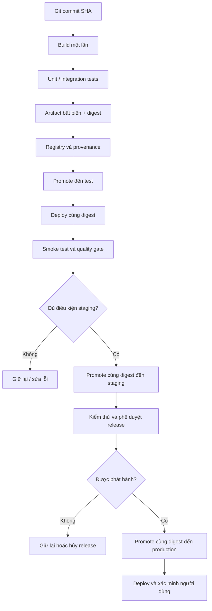

# Phân biệt promotion artifact với dựng lại cho môi trường tiếp theo

Một pipeline đáng tin cậy cần bảo đảm phiên bản được kiểm thử ở môi trường trước chính là phiên bản được đưa đến môi trường sau. Sau khi mã nguồn đã được build và tạo artifact, quy trình phát hành nên **promote cùng artifact bất biến** qua development, test, staging và production. Nếu mỗi môi trường tự build lại từ cùng commit, đầu ra có thể khác nhau do dependency, toolchain, base image, tham số build hoặc trạng thái bên ngoài đã thay đổi.

Promotion artifact là việc chuyển một artifact đã được tạo và xác minh sang trạng thái, môi trường hoặc kênh phát hành tiếp theo mà không thay đổi nội dung của artifact. Rebuild là thực hiện lại quá trình build từ source và các đầu vào để tạo ra một artifact mới. Hai hoạt động có mục đích khác nhau: promotion giữ nguyên bằng chứng đã kiểm thử; rebuild tạo đầu ra mới và vì vậy cần định danh, xác minh và kiểm thử lại như một phiên bản mới.

## 1. Mô hình build once, promote many

Một luồng CI/CD có thể chia thành hai nhóm hoạt động:

- **Build và verify:** checkout revision xác định, cài dependency theo lockfile, chạy kiểm tra, đóng gói và xuất artifact. Artifact được nhận diện bằng version/digest, kèm metadata về nguồn tạo ra.
- **Promotion và deploy:** lấy đúng artifact đã lưu, xác minh chữ ký/provenance/chính sách, cấp cấu hình và secret của môi trường đích, triển khai rồi kiểm tra kết quả. Khi đủ điều kiện, cùng artifact được promote tiếp.



Ví dụ, commit `a1b2c3d` tạo container image có digest `sha256:...`. Image đó được triển khai lên môi trường test, staging rồi production. Mỗi môi trường có thể dùng endpoint, database, feature flag và secret khác nhau, nhưng image digest vẫn giữ nguyên. Điều này cho phép nhóm chứng minh production đang chạy đúng artifact đã vượt qua các kiểm tra trước phát hành.

## 2. Promotion và rebuild khác nhau ở đâu?

| Tiêu chí | Promotion artifact | Rebuild cho môi trường tiếp theo |
|---|---|---|
| Đầu vào chính | Artifact đã tồn tại và được định danh | Source revision cùng đầu vào build |
| Đầu ra | Cùng nội dung artifact, có thể thay đổi trạng thái/kênh/metadata phát hành | Artifact mới, có digest hoặc checksum mới nếu nội dung khác |
| Bằng chứng kiểm thử | Có thể dùng lại bằng chứng của đúng artifact đã kiểm tra, cộng kiểm tra môi trường đích | Cần xác minh lại artifact mới; kết quả test của artifact trước không tự động áp dụng |
| Dependency/toolchain | Không cần resolve và build lại ứng dụng | Có thể resolve dependency, plugin, toolchain và base image lại |
| Khả năng truy vết | Nối trực tiếp cùng digest qua các môi trường | Phải nối từng lần build với source, đầu vào và kết quả riêng |
| Rủi ro sai khác | Thấp hơn nếu artifact và metadata được giữ bất biến | Cao hơn vì đầu vào hoặc môi trường build có thể thay đổi |
| Trường hợp dùng | Quy trình release thông thường | Khi cần tạo biến thể thật sự khác, sửa lỗi, cập nhật dependency hoặc build target khác |

Promotion không có nghĩa chỉ đổi một tag rồi mặc định mọi thứ đã an toàn. Hệ thống vẫn phải xác minh artifact, quyền truy cập, cấu hình đích, approvals và trạng thái triển khai. Rebuild cũng không phải lúc nào sai: đôi khi phải tạo binary cho kiến trúc khác, cập nhật bản vá bảo mật hoặc thay đổi compile-time. Khi rebuild, đầu ra mới phải được coi là artifact mới và đi qua các cổng cần thiết.

## 3. Vì sao rebuild ở mỗi môi trường làm giảm độ tin cậy?

Giả sử pipeline build cùng commit ba lần: một lần cho test, một lần cho staging và một lần cho production. Dù source SHA giống nhau, các đầu vào sau vẫn có thể thay đổi:

- Dependency range được resolve lại và nhận phiên bản khác.
- Repository package hoặc container registry trả về nội dung mới dưới cùng một tag.
- Runner image, JDK, Node.js, compiler hoặc build plugin đã được cập nhật.
- Build script tải file từ URL không pin version hoặc không xác minh checksum.
- Thời gian build, timestamp, random seed hoặc dữ liệu sinh tự động làm thay đổi output.
- Biến môi trường, build profile hoặc tham số compile khác nhau giữa môi trường.
- Cache cũ, trạng thái workspace hoặc công cụ trên runner làm thay đổi đầu ra.

Khi production lỗi, nhóm không thể chắc chắn rằng artifact production giống artifact staging đã kiểm thử. Việc so sánh commit SHA là chưa đủ; phải so sánh artifact digest hoặc checksum.

Rebuild cũng tạo ra khoảng trống kiểm toán: test report gắn với build run A, nhưng production chạy output từ build run C. Nếu không có bằng chứng rằng A và C tạo ra cùng nội dung, không thể dùng kết quả test của A để khẳng định C đã được kiểm tra.

## 4. Artifact phải có định danh bất biến

### 4.1. Tag và digest không có cùng ý nghĩa

Tag là tên dễ đọc, ví dụ `orders:1.8.0`, `orders:release-2026-11` hoặc `orders:staging`. Tag thường có thể được di chuyển để trỏ sang nội dung khác. Digest được tính từ nội dung manifest hoặc blob theo định dạng registry và là định danh nội dung.

Với OCI container image, dạng tham chiếu theo digest thường như sau:

```text
registry.example.com/orders@sha256:0123456789abcdef...
```

Tag giúp con người tìm phiên bản; digest xác định chính xác nội dung. Pipeline nên lưu digest do registry trả về sau khi push và dùng digest đó trong các bước deploy. Không dựa vào `latest` hoặc tag môi trường có thể bị ghi đè để xác định artifact đã kiểm thử.

### 4.2. Artifact bất biến trong registry

Artifact repository hoặc container registry cần có chính sách ngăn ghi đè phiên bản đã phát hành. Với package version, bật immutability hoặc quy tắc không tái sử dụng version. Với container, có thể hạn chế quyền push tag release, dùng tag theo commit và triển khai theo digest.

Nếu artifact được copy sang registry khác trong quá trình promotion, hãy xác minh digest ở registry đích bằng với digest nguồn. Việc copy cùng nội dung manifest và layer thường giữ nguyên digest, nhưng một số thao tác đóng gói lại, chuyển đổi hoặc nén lại có thể tạo nội dung khác. Nếu digest thay đổi, phải xem đó là artifact khác và xác minh lại. Đồng thời bảo đảm chữ ký, SBOM và attestation liên quan cũng được chuyển hoặc tham chiếu đúng.

### 4.3. Version, checksum và metadata

Artifact nên có metadata đủ để trả lời:

- Được build từ repository và commit SHA nào?
- Build run/workflow nào tạo ra nó?
- Phiên bản toolchain, dependency lockfile và tham số build là gì?
- Test, scan và quality gates nào đã chạy, kết quả ra sao?
- Artifact được lưu ở registry nào, version và digest nào?
- Ai hoặc workload nào đã tạo, ký và promote artifact?

Không nên chỉ dựa vào tên file hoặc tag. Với package không có digest registry, lưu checksum mạnh như SHA-256 cùng metadata và xác minh lại sau khi tải. Metadata nên được gắn với artifact hoặc lưu trong hệ thống có liên kết bất biến.

## 5. Phân biệt artifact, cấu hình môi trường và secret

Lý do phổ biến khiến nhóm build lại cho mỗi môi trường là vì staging và production có cấu hình khác nhau. Tuy nhiên, phần lớn cấu hình vận hành nên được cung cấp ở thời điểm triển khai hoặc runtime thay vì biên dịch vào artifact.

| Thành phần | Ví dụ | Cách quản lý phù hợp |
|---|---|---|
| Artifact | JAR, binary, frontend bundle, OCI image | Build một lần, định danh bằng version/digest, lưu trong registry |
| Cấu hình môi trường | API endpoint, database host, log level, feature flags | Configuration store, deployment manifest hoặc runtime config có version |
| Secret | Password, API token, private key, certificate | Secret manager hoặc cơ chế secret của nền tảng, quyền tối thiểu |
| Thông tin triển khai | Namespace, replica count, traffic policy, rollout strategy | Deployment configuration/IaC được review và truy vết |
| Metadata release | Commit, artifact digest, approval, thời điểm và người triển khai | Release record/audit log |

Ví dụ cùng một image có thể nhận `DATABASE_URL` khác nhau ở staging và production. Giá trị thật được cấp qua secret manager; file deployment chỉ tham chiếu tên secret hoặc version, không chứa plaintext. Cấu hình cần có version hoặc fingerprint để biết môi trường đã chạy với cấu hình nào.

### 5.1. Không nhúng secret vào artifact

Không đưa production password, token hoặc private key vào Docker build argument, image layer, JAR resource, frontend bundle hoặc file cấu hình được đóng gói. Secret có thể bị lưu trong layer lịch sử ngay cả khi đã xóa ở layer sau. Frontend bundle cũng không thể giữ bí mật vì dữ liệu được gửi đến trình duyệt.

Nếu ứng dụng cần secret khi khởi động, hãy lấy từ secret manager hoặc nền tảng runtime. Cấp credential theo workload identity khi hỗ trợ; giới hạn phạm vi, thời hạn và quyền. Log không được in giá trị bí mật.

### 5.2. Cấu hình có thể thay đổi mà không rebuild

Ưu tiên externalize các giá trị có thể khác nhau theo môi trường: endpoint, giới hạn tài nguyên, log level, feature flag, tên queue và tham số tích hợp. Cấu hình phải được kiểm tra schema, review và gắn version. Nếu thay đổi cấu hình ảnh hưởng hành vi đáng kể, chạy lại smoke test hoặc integration check trên môi trường đích.

Không phải mọi giá trị đều có thể chuyển sang runtime. Một số frontend cần public API base URL tại thời điểm build nếu bundle không hỗ trợ runtime configuration; native binary có thể cần target-specific compilation. Trong trường hợp đó, hãy xác định rõ artifact là biến thể riêng và không tuyên bố rằng cùng một digest đã được promote qua tất cả môi trường.

## 6. Quy trình promotion có kiểm soát

Một quy trình thực tế có thể gồm các bước sau.

### Bước 1: Build và kiểm tra trên revision xác định

Pipeline checkout commit SHA, dùng dependency lockfile và toolchain đã ghim, chạy lint/test/scan cần thiết rồi tạo artifact. Ghi lại commit, build run, dependency metadata và cấu hình build. Không build từ một nhánh trôi nổi mà không ghi lại revision thực tế.

### Bước 2: Đưa artifact vào registry

Push artifact lên registry có kiểm soát quyền. Lấy digest/checksum từ registry hoặc tính sau khi tải lại. Gắn metadata về nguồn build, SBOM và provenance nếu hệ thống hỗ trợ. Artifact release không được ghi đè.

### Bước 3: Xác minh trước khi triển khai

Kiểm tra digest, chữ ký, provenance, policy, lỗ hổng và nguồn phát hành. Chỉ chấp nhận artifact được tạo bởi workflow/builder được tin cậy và từ revision đáp ứng chính sách. Job deploy không nên tự build lại.

### Bước 4: Deploy vào môi trường đầu tiên

Triển khai đúng digest vào môi trường test hoặc development. Cấp cấu hình và secret của môi trường đó. Lưu release record gồm digest, config version, deployment identity, thời điểm và kết quả.

### Bước 5: Xác minh và quyết định promotion

Chạy smoke test, integration test, synthetic check và kiểm tra metrics phù hợp. Nếu không đạt, dừng promotion, giữ bằng chứng và điều tra. Nếu đạt, đánh dấu artifact đủ điều kiện cho môi trường tiếp theo.

### Bước 6: Promote cùng digest qua staging và production

Promotion tiếp theo tham chiếu cùng digest. Có thể cần approval hoặc quality gate riêng cho production. Sau triển khai, xác minh runtime thực tế đang chạy digest dự kiến và hành vi người dùng đáp ứng tiêu chí.

### Bước 7: Ghi nhận lịch sử phát hành

Ghi lại artifact digest, commit, cấu hình, môi trường, người/workflow triển khai, approval, kết quả kiểm tra và thời điểm. Lịch sử này hỗ trợ điều tra, kiểm toán và rollback.

## 7. Ví dụ: cùng một container image qua ba môi trường

Giả sử service `orders` được build từ commit `a1b2c3d`. Pipeline tạo image và push lên registry:

```bash
IMAGE=registry.example.com/orders
VERSION=1.8.0
COMMIT_SHA=a1b2c3d

docker build -t "$IMAGE:$VERSION" -t "$IMAGE:$COMMIT_SHA" .
docker push "$IMAGE:$VERSION"
docker push "$IMAGE:$COMMIT_SHA"
```

Đoạn lệnh minh họa việc gắn tag version và commit. Trong pipeline production, nên lấy digest từ kết quả push của build tool, lưu thành output của job và dùng digest đó cho mọi lần deploy. Không dùng tag như nguồn định danh cuối cùng vì tag có thể bị di chuyển.

Ví dụ manifest triển khai có thể tham chiếu digest:

```yaml
apiVersion: apps/v1
kind: Deployment
metadata:
  name: orders
spec:
  template:
    spec:
      containers:
        - name: orders
          image: registry.example.com/orders@sha256:0123456789abcdef...
          env:
            - name: APP_ENV
              value: staging
            - name: DATABASE_URL
              valueFrom:
                secretKeyRef:
                  name: orders-db
                  key: url
```

Digest trong ví dụ là placeholder. `APP_ENV` có thể khác ở production; `DATABASE_URL` được lấy từ Secret của môi trường. Khi promote, thay đổi môi trường đích và tham chiếu secret/config phù hợp, giữ nguyên image digest.

| Môi trường | Artifact | Cấu hình/secret | Kiểm tra chính |
|---|---|---|---|
| Test | `orders@sha256:...` | Database test, endpoint giả lập | Unit/integration/smoke tests |
| Staging | Cùng `orders@sha256:...` | Database staging, tích hợp gần production | Regression, contract, synthetic checks |
| Production | Cùng `orders@sha256:...` | Database production, secret production | Health, canary metrics, smoke test và hành vi người dùng |

Nếu mỗi môi trường chạy một image được build riêng, cần giải thích vì sao và ghi nhận mỗi image digest là artifact độc lập. Chỉ cùng tag hoặc cùng commit không chứng minh chúng giống nhau.

## 8. Ví dụ pipeline: build một lần, deploy nhiều lần

Đoạn GitHub Actions dưới đây minh họa mô hình: job build xuất digest; job deploy staging và production nhận digest đó. Cú pháp và action cần điều chỉnh theo registry, nền tảng deploy và chính sách quyền thực tế.

```yaml
name: Release orders

on:
  push:
    tags: ['v*']

permissions:
  contents: read

jobs:
  build:
    runs-on: ubuntu-latest
    permissions:
      contents: read
      packages: write
    outputs:
      digest: ${{ steps.image.outputs.digest }}
    steps:
      - uses: actions/checkout@v4

      - name: Build and push image
        id: image
        uses: docker/build-push-action@v6
        with:
          context: .
          push: true
          tags: ghcr.io/example/orders:${{ github.sha }}

  deploy_staging:
    needs: build
    runs-on: ubuntu-latest
    permissions:
      contents: read
      packages: read
    environment: staging
    steps:
      - name: Deploy exact digest
        env:
          IMAGE_DIGEST: ${{ needs.build.outputs.digest }}
        run: ./deploy.sh staging "ghcr.io/example/orders@$IMAGE_DIGEST"

      - name: Verify staging
        run: ./smoke-test.sh staging

  deploy_production:
    needs: [build, deploy_staging]
    runs-on: ubuntu-latest
    permissions:
      contents: read
      packages: read
    environment: production
    steps:
      - name: Deploy exact digest
        env:
          IMAGE_DIGEST: ${{ needs.build.outputs.digest }}
        run: ./deploy.sh production "ghcr.io/example/orders@$IMAGE_DIGEST"

      - name: Verify production
        run: ./smoke-test.sh production
```

Đây là ví dụ cấu trúc, chưa phải workflow production hoàn chỉnh. Cần bổ sung login registry an toàn, pin action theo full commit SHA theo chính sách, xác minh digest/provenance trước deploy, cấp quyền `packages: write` chỉ cho job build nếu có thể, và giới hạn quyền deploy theo environment. Script `deploy.sh` phải nhận image theo digest và không tự build. Production environment nên có approval/checks phù hợp.

Điểm quan trọng là output `digest` từ job build được truyền qua các job deploy. Job staging và production không chạy lệnh build; chúng triển khai cùng nội dung đã được tạo. Nếu staging verification thất bại, dependency graph ngăn production job tiếp tục.

## 9. Promotion giữa registry hoặc tài khoản khác nhau

Một số tổ chức dùng registry riêng cho development, staging và production hoặc tách tài khoản cloud theo môi trường. Khi đó promotion có thể bao gồm copy artifact từ registry nguồn sang registry đích.

Quy trình copy cần:

- Đọc artifact theo digest từ registry nguồn.
- Xác minh chữ ký, provenance và policy trước khi copy.
- Copy đầy đủ manifest và layer, tránh build lại hoặc chuyển đổi nội dung.
- Xác minh digest sau copy ở registry đích.
- Chuyển hoặc liên kết chữ ký, SBOM và attestation tương ứng.
- Ghi lại danh tính, thời điểm, nguồn và đích promotion.

Nếu registry đích không hỗ trợ giữ nguyên manifest hoặc digest thay đổi do định dạng chuyển đổi, hãy coi đầu ra là artifact mới. Cần ghi nhận quan hệ nguồn-đích và chạy các kiểm tra cần thiết trước khi deploy.

Không dùng quyền push production registry cho mọi pipeline pull request. Chỉ job phát hành đáng tin cậy mới cần quyền ghi; job deploy nên có quyền đọc artifact và quyền triển khai tối thiểu.

## 10. Quality gates và phê duyệt gắn với artifact nào?

Một cổng chất lượng chỉ có giá trị nếu biết nó đánh giá artifact cụ thể nào. Kết quả test của commit hoặc build run không tự động áp dụng cho mọi artifact được tạo từ cùng source.

Bằng chứng nên gắn với một hoặc nhiều định danh:

- Commit SHA và repository.
- Build run ID, workflow revision và builder identity.
- Artifact name/version và digest.
- SBOM, provenance, chữ ký và kết quả scan.
- Môi trường đã triển khai và cấu hình version/fingerprint.
- Bộ test, kết quả, thời điểm và phạm vi kiểm tra.
- Approval, người phê duyệt và chính sách được áp dụng.

Nếu artifact digest thay đổi sau một bước đóng gói, nén, ký hoặc copy, cần xác định thao tác đó có làm thay đổi nội dung artifact hay chỉ thêm metadata bên ngoài. Bằng chứng phải gắn với đúng đối tượng. Ví dụ, ký một OCI image có thể tạo signature/attestation tham chiếu digest mà không sửa image; nhưng nếu rebuild image sau khi test, digest mới không được thừa hưởng kết quả test cũ.

Các cổng có thể được đặt ở nhiều giai đoạn:

| Giai đoạn | Điều kiện ví dụ |
|---|---|
| Trước publish | Build/test đạt, dependency và license policy đạt |
| Sau publish | Digest tồn tại, provenance/chữ ký hợp lệ, artifact không bị thay thế |
| Trước staging | Artifact đúng nguồn, test và scan đạt |
| Sau staging | Smoke/regression/synthetic test đạt, metrics trong ngưỡng |
| Trước production | Approval và change policy đạt, cấu hình đích hợp lệ |
| Sau production | Runtime chạy đúng digest, health và chỉ số người dùng đạt |

## 11. Khi nào thực sự cần rebuild?

Build một lần không có nghĩa chỉ có thể tạo một artifact cho mọi nền tảng. Một số trường hợp cần artifact khác nhau:

### 11.1. Kiến trúc hoặc hệ điều hành khác

Binary native cho `linux/amd64` và `linux/arm64` có thể cần compile riêng. Có thể tạo OCI multi-platform image manifest trỏ đến các image theo kiến trúc; mỗi image con có digest riêng, còn manifest list/index có digest tổng. Promotion phải giữ nguyên index và các image con đã kiểm tra.

### 11.2. Compile-time feature hoặc native dependency

Một số sản phẩm cần bật/tắt module khi compile, liên kết thư viện native hoặc tạo bundle phụ thuộc nền tảng. Khi không thể chuyển lựa chọn sang runtime, cần tạo biến thể có tên và digest riêng, lưu build parameters và kiểm thử từng biến thể.

### 11.3. Cập nhật bảo mật hoặc sửa lỗi

Nếu phát hiện dependency hoặc base image có lỗ hổng sau khi artifact đã được tạo, rebuild có thể cần thiết để đưa bản vá vào. Đây là artifact mới, không phải promotion của artifact cũ. Cần chạy lại test, scan và xác minh provenance, sau đó phát hành version/digest mới.

### 11.4. Artifact phụ thuộc môi trường build đặc thù

Một số quy trình ký, đóng gói hoặc cấp chứng chỉ tạo ra output khác nhau theo target. Ưu tiên tách bước ký/phát hành thành metadata hoặc thao tác hậu build không sửa payload khi có thể. Nếu output thật sự thay đổi theo môi trường, quản lý mỗi output như biến thể riêng.

### 11.5. Quy tắc khi phải tạo nhiều biến thể

- Định nghĩa rõ target (OS, architecture, runtime, feature set) và build parameters.
- Ghim toolchain, dependency và base image cho từng target.
- Gắn commit SHA, build run, digest và provenance riêng cho mỗi biến thể.
- Chạy test phù hợp trên từng target; không suy rộng kết quả từ biến thể khác nếu không có bằng chứng.
- Promote từng biến thể đã xác minh qua môi trường mà nó phục vụ.
- Không gắn cùng một version/tag mơ hồ cho các nội dung khác nhau mà không có metadata phân biệt.

## 12. Database migration và tương thích giữa các phiên bản

Promote cùng artifact giúp giữ nguyên ứng dụng, nhưng không tự bảo đảm dữ liệu và schema tương thích. Một deployment có thể thất bại nếu migration production đã chạy nhưng rollback đưa ứng dụng cũ trở lại.

Với thay đổi schema, ưu tiên chiến lược expand-and-contract:

1. **Expand:** thêm cột/bảng/index mới theo cách phiên bản cũ vẫn hoạt động.
2. **Deploy:** đưa artifact mới có thể đọc/ghi cấu trúc cũ và mới.
3. **Migrate:** chuyển dữ liệu theo batch có thể quan sát và tiếp tục an toàn.
4. **Switch:** chuyển ứng dụng sang cấu trúc mới và xác minh hành vi.
5. **Contract:** chỉ xóa cấu trúc cũ sau khi không còn phiên bản hoặc consumer nào cần nó.

Migration nên có version, log, kiểm tra trước/sau và kế hoạch phục hồi. Không chạy migration phá hủy trong bước build. Nếu migration có side effect không thể rollback, cần kế hoạch roll-forward hoặc phục hồi dữ liệu riêng.

## 13. Rollback và phục hồi bằng artifact đã promote

Khi production có lỗi, rollback thường là triển khai lại digest của artifact trước đó đã được xác minh. Cách này nhanh và có thể truy vết nếu registry giữ artifact cùng metadata.

Trước khi rollback, kiểm tra:

- Artifact cũ còn trong registry và chữ ký/provenance còn xác minh được.
- Cấu hình runtime hiện tại có tương thích với phiên bản cũ không.
- Database schema và dữ liệu đã thay đổi theo cách nào.
- Message/event đã phát ra có được phiên bản cũ hiểu không.
- Feature flag hoặc routing có thể chuyển về trạng thái an toàn không.
- Việc rollback có cần approval hoặc thông báo theo chính sách không.

Rollback không phải lúc nào cũng là giải pháp đúng. Nếu dữ liệu đã biến đổi không tương thích, có thể cần roll-forward bằng artifact sửa lỗi mới. Nếu lỗi chỉ nằm ở cấu hình hoặc feature flag, có thể khôi phục cấu hình mà không thay đổi artifact. Ghi lại digest trước và sau, thời điểm, lý do và kết quả xác minh.

## 14. Những anti-pattern thường gặp

| Anti-pattern | Rủi ro | Cách làm tốt hơn |
|---|---|---|
| Build riêng cho test, staging và production | Mỗi môi trường có thể nhận nội dung khác | Build một lần, promote cùng digest |
| Dùng `latest` để deploy | Tag có thể trỏ đến nội dung mới | Deploy bằng digest hoặc version bất biến |
| Build arg chứa production secret | Secret có thể nằm trong layer/log/cache | Lấy secret ở runtime từ secret manager |
| Gắn cùng version cho nhiều nội dung khác nhau | Không biết artifact nào đang chạy | Mỗi artifact có digest và release identity riêng |
| Test staging nhưng deploy artifact vừa build lại | Bằng chứng test không áp dụng cho output mới | Deploy đúng digest đã test |
| Copy registry mà không kiểm tra digest | Artifact đích có thể khác nguồn | So sánh digest và xác minh metadata |
| Cập nhật config production không có version | Khó tái hiện trạng thái phát hành | Version hóa config và lưu fingerprint |
| Rebuild để đổi endpoint môi trường | Tăng rủi ro sai khác và làm lộ config trong bundle | Externalize runtime configuration khi có thể |
| Rollback app mà không kiểm tra schema | Phiên bản cũ có thể không đọc được dữ liệu mới | Dùng migration tương thích và kế hoạch phục hồi |

## 15. Checklist thiết kế promotion pipeline

- [ ] Build gắn với commit SHA và toolchain/dependency đã kiểm soát.
- [ ] Artifact được tạo một lần cho mỗi target và lưu trong registry tin cậy.
- [ ] Mỗi artifact có version và digest/checksum; không dựa vào tag mutable.
- [ ] Metadata/provenance liên kết artifact với source, workflow, builder và đầu vào build.
- [ ] Artifact đã publish không bị ghi đè; quyền push được giới hạn.
- [ ] Các môi trường nhận cùng digest nếu mục tiêu là promote cùng một artifact.
- [ ] Cấu hình môi trường và secret được cấp ngoài artifact, có version và quyền phù hợp.
- [ ] Job deploy xác minh digest/chữ ký/policy và không tự build lại.
- [ ] Test, scan, approval và release record gắn với đúng artifact digest.
- [ ] Nếu copy giữa registry, digest đích được xác minh và metadata liên quan được giữ lại.
- [ ] Nếu cần rebuild/biến thể, mỗi đầu ra được định danh và kiểm thử như artifact riêng.
- [ ] Migration dữ liệu có chiến lược tương thích, rollback hoặc roll-forward.
- [ ] Rollback có thể triển khai lại artifact trước đó và xác minh runtime thực tế.
- [ ] Sau deploy, kiểm tra runtime digest, health, metrics và hành vi người dùng.

Promotion artifact giúp nối liền bằng chứng từ build đến production: cùng một nội dung đã được tạo, kiểm thử, xác minh và triển khai qua các môi trường. Rebuild tạo ra một đầu ra mới nên phải có danh tính và bằng chứng riêng. Khi artifact bất biến, cấu hình được quản lý ngoài artifact và mỗi lần promotion đều có kiểm tra, nhóm có thể phát hành có truy vết, giảm sai khác giữa môi trường và phục hồi nhanh hơn khi xảy ra sự cố.
