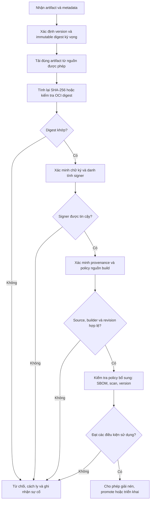

# Kiểm tra tính toàn vẹn trước khi sử dụng artifact

Artifact là đầu ra đã được đóng gói từ một lần build: JAR, ZIP, binary, container image, package hoặc một tập file triển khai. Sau khi được tạo, artifact có thể đi qua nhiều bước lưu trữ, tải xuống, sao chép, quét bảo mật, phê duyệt và triển khai. Mỗi lần chuyển giao đều có nguy cơ làm nội dung bị thay đổi, bị thay thế hoặc bị gắn nhầm với một phiên bản khác.

Vì vậy, trước khi giải nén, thực thi, đưa vào registry hoặc triển khai artifact, pipeline cần xác minh rằng nội dung nhận được đúng là nội dung đã được chấp thuận. Việc xác minh cần trả lời ba câu hỏi khác nhau:

- **Tính toàn vẹn:** các byte nhận được có giống với nội dung được kỳ vọng không?
- **Tính xác thực:** ai hoặc hệ thống nào đã xác nhận artifact này?
- **Nguồn gốc (provenance):** artifact được tạo từ mã nguồn, quy trình build, công cụ và dependency nào?

Checksum giúp nhận diện nội dung và phát hiện thay đổi. Chữ ký số giúp xác minh người hoặc hệ thống sở hữu khóa đã ký nội dung. Provenance cung cấp bằng chứng về quá trình tạo artifact. Những cơ chế này bổ sung cho nhau; một checksum hợp lệ tự nó không chứng minh artifact an toàn hoặc được build từ đúng commit.

## 1. Vì sao phải xác minh trước khi sử dụng?

Artifact thường được xem là đầu ra ổn định của CI/CD, nhưng nó vẫn có thể bị thay đổi sau khi build thành công. Một số tình huống có thể xảy ra:

- File bị lỗi trong quá trình upload, download hoặc sao chép giữa các hệ thống.
- Một người hoặc job có quyền ghi thay thế artifact bằng file khác nhưng giữ nguyên tên và version.
- Registry hoặc mirror trả về package có nội dung khác với package đã được kiểm tra trước đó.
- Tag container như `latest` hoặc `1.4` được cập nhật để trỏ tới image khác sau khi staging đã kiểm thử.
- Artifact từ pull request không tin cậy được chuyển nhầm sang job phát hành có quyền cao.
- Một cache chứa artifact cũ hoặc đã bị đầu độc được dùng lại trong luồng phát hành.
- File được tải từ nguồn không rõ ràng nhưng có tên giống artifact chính thức.
- Artifact đúng checksum nhưng được tạo bởi một workflow hoặc builder không được tổ chức chấp thuận.

Nếu pipeline chỉ kiểm tra build xanh rồi sử dụng file theo tên, hệ thống có thể triển khai nội dung khác với nội dung đã kiểm thử. Điều này phá vỡ khả năng truy vết và khiến việc điều tra sự cố rất khó khăn.

### Rủi ro cần phân biệt

| Rủi ro | Ví dụ | Bằng chứng cần có |
|---|---|---|
| Hỏng dữ liệu | File ZIP bị lỗi khi truyền | Digest tính lại khớp digest đã tin cậy |
| Thay thế artifact | JAR khác được upload với cùng tên | Chữ ký hợp lệ hoặc digest từ manifest được bảo vệ |
| Giả mạo người phát hành | Kẻ khác tạo file và tự tạo checksum | Chữ ký xác minh theo trust root và danh tính được phép |
| Sai nguồn build | Artifact được ký nhưng build từ fork hoặc commit không được duyệt | Provenance có source repository, revision và builder identity đúng |
| Sai đối tượng triển khai | Staging kiểm thử digest A nhưng production lấy tag trỏ tới digest B | Deployment manifest pin đúng digest đã xác minh |
| Replay phiên bản cũ | Artifact hợp lệ nhưng đã bị thu hồi hoặc không còn được phép phát hành | Version policy, release state và kiểm tra thu hồi |

Kiểm tra tính toàn vẹn phải gắn với đúng đối tượng sẽ được sử dụng. Nếu pipeline xác minh một file rồi bước sau tải lại file theo tên hoặc tag có thể thay đổi, bằng chứng trước đó không còn bảo đảm cho file mới.

## 2. Phân biệt checksum, chữ ký số và provenance

Ba loại bằng chứng thường được dùng cùng nhau nhưng giải quyết các câu hỏi khác nhau.

| Cơ chế | Nó chứng minh điều gì? | Nó không tự chứng minh điều gì? |
|---|---|---|
| Hash/digest như SHA-256 | Định danh nội dung byte; phát hiện nội dung khác với digest tham chiếu | Ai tạo file, nguồn build hoặc file có an toàn không |
| Checksum sidecar như `.sha256` | Cho phép người nhận tính lại và so sánh digest | Tính xác thực nếu file checksum được tải từ cùng nguồn không đáng tin |
| Chữ ký số | Nội dung hoặc digest đã được ký bởi khóa tương ứng; chữ ký không bị sửa | Mã nguồn, workflow và dependency nào tạo ra nội dung nếu không có provenance |
| Provenance/attestation | Ghi nhận nguồn, builder, quy trình và các thuộc tính của lần build | Artifact an toàn tuyệt đối hoặc không có lỗ hổng |
| SBOM | Liệt kê thành phần phần mềm được khai báo trong artifact | SBOM đúng với artifact nếu không được liên kết và xác minh bằng digest |

### Hash và digest

Hash là kết quả của hàm băm áp dụng lên nội dung file. SHA-256 tạo ra digest 256 bit, thường biểu diễn bằng 64 ký tự hexadecimal. Chỉ cần một byte thay đổi thì digest gần như chắc chắn sẽ khác.

Ví dụ trên Linux:

```bash
sha256sum application.jar
```

Trên PowerShell:

```powershell
Get-FileHash .\application.jar -Algorithm SHA256
```

Digest nên được gắn với một định danh artifact rõ ràng: tên, version, repository, commit hoặc immutable reference. Với container image, digest thường có dạng `sha256:<64-hex-characters>`.

Hash không phải bí mật và không phải chữ ký. Bất kỳ ai thay file đều có thể tính hash mới. Nếu attacker có thể thay cả artifact và file `.sha256`, phép so sánh vẫn có thể thành công. Vì vậy, digest tham chiếu phải đến từ một nguồn tin cậy độc lập hoặc được bảo vệ bằng chữ ký số.

### Chữ ký số

Chữ ký số được tạo bằng private key và xác minh bằng public key hoặc cơ chế danh tính tin cậy. Khi chữ ký hợp lệ, người nhận có bằng chứng rằng nội dung đã được ký bởi bên sở hữu private key tương ứng và không bị thay đổi kể từ khi ký.

Khóa công khai phải được phân phối và bảo vệ qua một trust root đã được tổ chức chấp thuận. Nếu attacker có thể thay cả artifact, chữ ký và public key mà người nhận sử dụng, việc xác minh không còn ý nghĩa. Không tải public key từ cùng một vị trí không tin cậy rồi tự coi đó là khóa chính thức.

### Provenance và attestation

Provenance mô tả nguồn và quy trình tạo artifact. Một bản provenance hữu ích thường ghi nhận:

- Source repository và revision/commit SHA.
- Builder identity và workflow đã thực thi.
- Thời điểm hoặc khoảng thời gian build.
- Tham số build và các dependency đầu vào quan trọng.
- Digest của artifact được tạo.
- Các bước hoặc predicate mô tả cách artifact được tạo.

Attestation là một phát biểu có cấu trúc về artifact, thường được ký bởi builder hoặc hệ thống phát hành. Người nhận cần xác minh chữ ký của attestation, sau đó đánh giá nội dung predicate theo policy. Chữ ký hợp lệ chỉ cho biết attestation đến từ danh tính được xác minh; nó chưa tự khẳng định mọi claim trong đó đáp ứng chính sách phát hành.

## 3. Luồng xác minh trước khi sử dụng artifact

Một luồng an toàn nên xác minh từ định danh tới nội dung, danh tính và nguồn build trước khi cho phép artifact đi tiếp.



Các bước có thể được thực hiện bởi nhiều job hoặc hệ thống khác nhau. Điều quan trọng là kết quả xác minh phải gắn với đúng digest sẽ được sử dụng ở bước kế tiếp.

### Trình tự thực hiện

1. **Xác định artifact cần dùng:** lấy repository, package, version, commit và digest từ release manifest hoặc nguồn điều phối được bảo vệ.
2. **Tải artifact:** chỉ tải từ registry hoặc storage được cho phép; ghi lại immutable identifier và thông tin lần tải.
3. **Kiểm tra digest:** tính lại hash hoặc lấy digest của manifest OCI và so sánh với giá trị tham chiếu đáng tin cậy.
4. **Xác minh chữ ký:** kiểm tra chữ ký artifact hoặc image bằng public key, certificate chain hoặc identity provider đã được chấp thuận.
5. **Xác minh provenance:** kiểm tra source repository, commit, builder, workflow, tham số và subject digest.
6. **Đánh giá policy:** kiểm tra version, trạng thái thu hồi, SBOM, kết quả scan và các cổng chất lượng liên quan.
7. **Sử dụng đúng đối tượng đã xác minh:** giải nén, triển khai hoặc promote chính file/digest đã qua kiểm tra.

Nếu bất kỳ điều kiện bắt buộc nào không đạt, pipeline phải dừng và giữ lại bằng chứng chẩn đoán. Không nên tự động bỏ qua lỗi chữ ký hoặc digest chỉ để giải phóng hàng chờ phát hành.

## 4. Kiểm tra checksum cho file artifact

### Tạo checksum manifest

Sau khi build thành công, job phát hành có thể tạo file checksum cạnh artifact:

```bash
sha256sum application.jar > application.jar.sha256
```

File `.sha256` có thể được lưu cùng artifact để người nhận kiểm tra lỗi truyền tải. Tuy nhiên, nếu artifact và sidecar được tải từ cùng một vùng lưu trữ mà attacker có thể thay cả hai, checksum không xác thực được nguồn phát hành.

Để kiểm tra:

```bash
sha256sum --check application.jar.sha256
```

Kết quả `OK` cho biết digest tính lại khớp với nội dung được ghi trong sidecar. Người vận hành vẫn cần xác minh sidecar đến từ release manifest hoặc nguồn có chữ ký hợp lệ.

### So sánh với digest tham chiếu đáng tin cậy

Nếu digest được cung cấp qua một manifest đã được ký hoặc một kênh phát hành có kiểm soát, có thể tính lại rồi so sánh trực tiếp:

```bash
EXPECTED_SHA256="<digest-from-verified-release-manifest>"
ACTUAL_SHA256="$(sha256sum application.jar | awk '{print $1}')"

test "$ACTUAL_SHA256" = "$EXPECTED_SHA256"
```

Giá trị placeholder phải được thay bằng digest thực tế lấy từ manifest đã xác minh. Không lấy digest kỳ vọng từ một file không tin cậy nằm cạnh artifact rồi coi kết quả so sánh là bằng chứng xác thực.

Trên PowerShell:

```powershell
$expectedSha256 = "<digest-from-verified-release-manifest>"
$actualSha256 = (Get-FileHash .\application.jar -Algorithm SHA256).Hash.ToLowerInvariant()

if ($actualSha256 -ne $expectedSha256.ToLowerInvariant()) {
    throw "Artifact SHA-256 mismatch"
}
```

Khi so sánh, chuẩn hóa chữ hoa/chữ thường và loại bỏ khoảng trắng không cần thiết ở lớp đọc manifest. Không được tự cắt bớt digest hoặc so sánh một phần chuỗi.

### Kiểm tra nhiều file bằng manifest

Một release có thể gồm JAR, ZIP, migration bundle, SBOM và file cấu hình. Manifest checksum giúp xác minh từng file:

```text
<sha256-jar>  application.jar
<sha256-zip>  application-distribution.zip
<sha256-sbom> sbom.spdx.json
```

Trên Linux:

```bash
sha256sum --check SHA256SUMS
```

Manifest phải mô tả đúng tập file được phát hành. Nếu một file bị thiếu hoặc thừa so với policy, pipeline cần phát hiện thay vì chỉ xác minh các file tình cờ có mặt. Với release quan trọng, hãy ký cả manifest để ràng buộc danh sách file và digest với danh tính phát hành.

## 5. Xác minh chữ ký cho file nhị phân

Chữ ký có thể được tạo bằng GPG, minisign, cosign hoặc hệ thống ký nội bộ. Dù dùng công cụ nào, policy phải xác định public key/certificate nào được tin cậy, danh tính signer nào được phép và loại artifact nào được ký.

### Ví dụ dùng GPG detached signature

Người phát hành ký file:

```bash
gpg --armor --detach-sign --output application.jar.asc application.jar
```

Người nhận xác minh bằng public key đã được cài từ trust store đáng tin cậy:

```bash
gpg --verify application.jar.asc application.jar
```

Lệnh trả về thành công khi chữ ký hợp lệ với khóa tương ứng. Cần tiếp tục xác minh fingerprint của public key có đúng khóa phát hành đã được tổ chức phê duyệt hay không. Một chữ ký hợp lệ từ một khóa không được tin cậy vẫn không đáp ứng policy.

### Ví dụ dùng Cosign để ký blob

Với luồng key-based, người phát hành ký artifact:

```bash
cosign sign-blob --key cosign.key --output-signature application.jar.sig application.jar
```

Người nhận xác minh bằng public key được phân phối qua kênh tin cậy:

```bash
cosign verify-blob --key cosign.pub --signature application.jar.sig application.jar
```

Private key phải được lưu trong secret manager hoặc hệ thống ký chuyên dụng, không commit vào repository hay đưa vào artifact. Trong hệ thống hỗ trợ keyless signing, có thể dùng danh tính workload và certificate ngắn hạn; khi xác minh, phải ràng buộc đúng OIDC issuer và signer identity theo policy.

Chữ ký blob xác nhận file đã được ký bởi khóa/danh tính tương ứng. Nếu cần biết artifact được build từ commit nào và workflow nào, hãy kiểm tra thêm provenance attestation.

## 6. Xác minh container image bằng digest

Với container image, tag như `service:latest`, `service:1.2` hoặc `service:release` có thể được di chuyển để trỏ tới image khác. Khi triển khai, nên dùng immutable digest:

```text
registry.example.com/team/service@sha256:<image-digest>
```

Luồng build có thể push image rồi lấy digest do registry trả về. Release manifest lưu digest này. Các môi trường staging và production dùng cùng digest để bảo đảm đang chạy cùng nội dung image.

### Kiểm tra digest

Có thể dùng công cụ registry hoặc container tooling để inspect manifest và so sánh digest. Ví dụ với Docker:

```bash
docker buildx imagetools inspect registry.example.com/team/service:1.2.0
```

Sau khi xác định digest đã được chấp thuận, pull bằng reference có digest:

```bash
docker pull registry.example.com/team/service@sha256:<image-digest>
```

Không dùng tag di động làm căn cứ duy nhất cho quyết định phát hành. Nếu cần giữ tag dễ đọc, có thể lưu cả tag và digest, nhưng bước triển khai phải pin digest.

### Xác minh chữ ký image bằng Cosign

Với public key đã được phân phối tin cậy:

```bash
cosign verify --key cosign.pub registry.example.com/team/service@sha256:<image-digest>
```

Với keyless signing, cấu hình verify phải kiểm tra certificate identity và OIDC issuer phù hợp với workflow phát hành. Không dùng điều kiện identity quá rộng như chấp nhận mọi workflow trong một tổ chức nếu policy chỉ cho phép một repository và một workflow cụ thể.

Xác minh chữ ký trên đúng digest được triển khai. Xác minh tag rồi sau đó deploy tag có thể tạo ra khoảng trống thời gian: tag có thể đổi sau lúc xác minh.

## 7. Kiểm tra provenance và danh tính builder

Một artifact có chữ ký hợp lệ vẫn có thể được tạo từ nguồn sai hoặc workflow không được phép. Provenance giúp ràng buộc artifact với quy trình tạo ra nó.

Các claim quan trọng cần đánh giá:

| Thuộc tính | Điều kiện policy ví dụ |
|---|---|
| Subject digest | Digest trong attestation phải khớp artifact đang sử dụng |
| Source repository | Phải là repository chính thức, không phải fork |
| Source revision | Commit phải thuộc nhánh hoặc tag phát hành được chấp thuận |
| Builder identity | Phải là CI builder hoặc workflow đã được tổ chức tin cậy |
| Workflow path/ref | Phải là workflow phát hành được quản lý và review |
| Build parameters | Không có tham số không được phép làm thay đổi artifact |
| Dependencies | Thành phần đầu vào phải có nguồn và phiên bản được kiểm soát |
| Build type | Phải khớp quy trình build đã được policy cho phép |

### Ví dụ kiểm tra SLSA provenance bằng Cosign

Với image có attestation SLSA provenance và public key đã được tin cậy:

```bash
cosign verify-attestation --key cosign.pub --type slsaprovenance registry.example.com/team/service@sha256:<image-digest>
```

Lệnh xác minh chữ ký attestation và loại predicate được yêu cầu. Sau đó, policy engine hoặc bước kiểm tra tiếp theo cần đọc predicate để xác nhận source repository, revision, builder identity và subject digest đáp ứng yêu cầu. Chỉ thấy thông báo attestation hợp lệ không có nghĩa mọi trường trong provenance đã được kiểm tra theo policy của tổ chức.

Nếu dùng keyless signing, xác minh attestation phải giới hạn identity và issuer. Trust policy cần được lưu trong repository hoặc hệ thống policy có kiểm soát phiên bản để reviewer có thể xem thay đổi.

### Kiểm tra SBOM gắn với đúng artifact

SBOM liệt kê dependency hoặc thành phần được xác định trong phần mềm. Khi dùng SBOM làm đầu vào cho scan hoặc quyết định phát hành, cần xác minh:

- SBOM được tạo cho đúng artifact digest.
- SBOM đến từ builder hoặc hệ thống được chấp thuận.
- Định dạng và phiên bản schema được hỗ trợ.
- Kết quả scan gắn với cùng digest, không phải tag có thể thay đổi.
- SBOM được cập nhật khi artifact được build lại hoặc nội dung thay đổi.

Một SBOM hợp lệ nhưng thuộc artifact khác không cung cấp bằng chứng cho file đang chuẩn bị triển khai.

## 8. Đặt bước xác minh ở đúng điểm trong CI/CD

Kiểm tra một lần ở đầu pipeline là chưa đủ nếu artifact được sao chép qua registry, mirror hoặc hệ thống khác trước khi sử dụng. Nên xác minh tại ranh giới tin cậy nơi artifact được nhận hoặc sắp thực hiện hành động quan trọng.

| Điểm trong luồng | Điều cần xác minh | Hành động khi không đạt |
|---|---|---|
| Sau build | Digest, test result và metadata của đầu ra | Không publish artifact |
| Trước upload/publish | Manifest và chữ ký phát hành | Dừng publish, giữ log |
| Sau download từ registry | Digest thực tế và chữ ký | Cách ly file hoặc image |
| Trước scan/SBOM | Định danh artifact được scan | Không chấp nhận báo cáo gắn với digest khác |
| Trước promote staging | Chữ ký, provenance và release policy | Không promote |
| Trước production deploy | Digest đã được staging xác minh, approval và trạng thái phát hành | Chặn deploy |
| Trên admission/runtime | Image digest và policy chữ ký/provenance | Từ chối workload không hợp lệ |

Với luồng promote, staging và production nên dùng cùng một digest. Nếu pipeline build lại khi promote, đó là artifact mới và phải được kiểm tra, ký, scan và phê duyệt lại theo policy.

## 9. Ví dụ pipeline xác minh JAR trước khi triển khai

Ví dụ dưới đây minh họa job tải artifact đã được phát hành, xác minh checksum và chữ ký trước khi cho phép bước deploy chạy. Public key `release.pub` được quản lý trong repository bảo vệ và review như trust configuration; signature được phát hành cùng artifact.

```yaml
name: Verify and deploy artifact

on:
  workflow_dispatch:
    inputs:
      release_id:
        description: Approved release identifier
        required: true
        type: string

permissions:
  contents: read
  actions: read

jobs:
  verify-and-deploy:
    runs-on: ubuntu-latest
    environment: production
    steps:
      - name: Checkout trusted verification policy
        uses: actions/checkout@v4
        with:
          ref: main

      - name: Download release files
        env:
          RELEASE_ID: ${{ inputs.release_id }}
        run: ./scripts/download-release.sh "$RELEASE_ID"

      - name: Verify checksum manifest signature
        run: cosign verify-blob --key .github/keys/release.pub --signature release/SHA256SUMS.sig release/SHA256SUMS

      - name: Verify checksums
        run: cd release && sha256sum --check SHA256SUMS

      - name: Verify artifact signature
        run: |
          cosign verify-blob --key .github/keys/release.pub --signature release/application.jar.sig release/application.jar

      - name: Deploy artifact
        run: ./scripts/deploy.sh release/application.jar
```

Đây là khung minh họa, cần hoàn thiện trước khi dùng thật:

- `download-release.sh` phải tải theo release ID bất biến và kiểm tra repository nguồn được phép. Input được truyền qua biến môi trường để tránh nội suy trực tiếp dữ liệu người dùng vào shell command.
- `SHA256SUMS` được xác minh chữ ký trước khi dùng. Nếu chỉ tải sidecar cùng nơi với JAR mà không xác minh chữ ký, nó chỉ giúp phát hiện lỗi truyền tải.
- Public key phải được phân phối qua repository/policy được bảo vệ hoặc trust store độc lập. Thay đổi key phải có quy trình review và luân chuyển khóa.
- Workflow cần xác minh provenance nếu policy yêu cầu nguồn build, commit và builder cụ thể.
- Việc xác minh và deploy diễn ra trong cùng job/workspace để dùng đúng file đã kiểm tra. Nếu tách thành nhiều job, phải truyền artifact theo cơ chế handoff có định danh và xác minh lại digest/chữ ký ở job deploy.
- `environment: production` chỉ tạo cổng phê duyệt khi environment đã được cấu hình protection rule tương ứng. Cần cài Cosign với phiên bản được quản lý và giới hạn ref chạy workflow theo chính sách phát hành.
- Ví dụ chưa khai báo đầy đủ quyền tải artifact theo API của từng nền tảng và danh tính triển khai. Hãy điều chỉnh theo hệ thống release thực tế.

Một cách triển khai tốt hơn là đóng gói bước xác minh thành reusable workflow hoặc action nội bộ, trả về digest đã xác minh và buộc job deploy sử dụng đúng digest đó. Không truyền một tên file có thể được thay thế rồi giả định nó vẫn là file đã kiểm tra.

## 10. Giữ nguyên định danh qua các môi trường

Một lỗi phổ biến là staging kiểm thử `service:1.5.0`, nhưng khi triển khai production, pipeline pull lại tag đó. Nếu tag đã bị di chuyển, production có thể nhận image khác.

Release manifest nên lưu các định danh bất biến:

```json
{
  "release": "1.5.0",
  "sourceCommit": "<full-commit-sha>",
  "artifact": {
    "uri": "registry.example.com/team/service",
    "digest": "sha256:<64-hex-characters>"
  },
  "verification": {
    "signature": "verified",
    "provenance": "verified",
    "sbomDigest": "sha256:<64-hex-characters>"
  }
}
```

Manifest này chỉ là ví dụ cấu trúc. Trong hệ thống thực, các trạng thái `verified` phải được tạo từ kết quả xác minh thực tế và manifest cần được ký hoặc lưu trong hệ thống phát hành có kiểm soát.

Luồng promote nên hoạt động như sau:

1. Build và tạo artifact.
2. Tính digest, ký artifact và tạo provenance.
3. Xác minh chữ ký, provenance và policy.
4. Đưa đúng digest vào staging.
5. Chạy smoke test và kiểm thử trên staging.
6. Phê duyệt release dựa trên digest đó.
7. Triển khai production bằng chính digest đã được staging xác minh.

Nếu có bất kỳ thay đổi nào làm digest đổi, release phải được coi là artifact mới. Cần chạy lại các kiểm tra liên quan và tạo bằng chứng mới.

## 11. Xử lý khi xác minh thất bại

Không nên tự động retry vô hạn hoặc tự bỏ qua xác minh khi checksum, chữ ký hay provenance không đạt. Trước tiên cần phân loại lỗi:

| Loại lỗi | Nguyên nhân có thể | Hành động |
|---|---|---|
| Digest không khớp | File hỏng, sai version, bị thay thế hoặc manifest sai | Dừng sử dụng, tải lại từ nguồn được phép, so sánh digest và cách ly nếu tái diễn |
| Không tìm thấy chữ ký | Bước ký chưa chạy, file signature bị thiếu hoặc sai artifact | Không deploy; kiểm tra release process và liên kết subject |
| Chữ ký không hợp lệ | File bị đổi, signature sai hoặc public key không đúng | Dừng luồng, kiểm tra trust root và nguồn artifact |
| Signer không được phép | Artifact được ký bởi tài khoản/workflow khác policy | Từ chối, kiểm tra source workflow và quyền ký |
| Provenance không khớp | Sai repository, commit, builder hoặc subject digest | Từ chối; xác minh lại nguồn build và release metadata |
| Attestation thiếu | Builder không tạo provenance hoặc bước lưu thất bại | Chuyển sang trạng thái chưa đủ bằng chứng, không tự coi là đạt |
| SBOM sai digest | SBOM thuộc artifact khác hoặc đã cũ | Tạo/lấy SBOM đúng digest và chạy lại scan |
| Phiên bản bị thu hồi | Artifact hợp lệ về mật mã nhưng không còn được phép sử dụng | Chặn promote/deploy và chọn release được chấp thuận khác |

Khi nghi ngờ artifact bị thay thế, giữ lại digest, URI, thời điểm tải, registry response, run ID và log xác minh. Không ghi private key, token hoặc dữ liệu xác thực vào log. Cách ly artifact để điều tra và thu hồi quyền ghi hoặc credential nếu phát hiện dấu hiệu xâm nhập.

### Fail closed và ngoại lệ

Với các cổng bắt buộc, trạng thái không xác định, thiếu bằng chứng hoặc công cụ xác minh lỗi phải được xem là chưa đạt. Nếu tổ chức có quy trình break-glass, ngoại lệ phải có người phê duyệt, lý do, phạm vi, thời hạn và bằng chứng hậu kiểm. Không biến ngoại lệ thành cấu hình mặc định.

## 12. Bảo vệ trust root và vòng đời khóa

Chữ ký chỉ đáng tin khi hệ thống xác minh có thể xác định đúng public key hoặc identity được phép. Trust root cần được quản lý riêng với artifact và có quy trình cập nhật.

Các nguyên tắc cơ bản:

- Private key được lưu trong HSM, KMS hoặc secret manager có kiểm soát; giới hạn ai và job nào được ký.
- Không cấp quyền ký cho job chạy mã pull request không tin cậy.
- Public key hoặc certificate policy được phân phối qua kênh độc lập, có review và lịch sử thay đổi.
- Ràng buộc signer identity theo repository, workflow, ref, environment hoặc builder cụ thể.
- Có quy trình luân chuyển khóa, hết hạn certificate, thu hồi khóa và xử lý khi khóa bị lộ.
- Lưu bằng chứng chữ ký và attestation theo thời hạn cần thiết để điều tra và tái xác minh.

Với keyless signing, trust policy cần xác minh certificate chain, OIDC issuer và identity claims. Certificate hợp lệ nhưng được cấp cho workflow không thuộc phạm vi phát hành vẫn phải bị từ chối.

## 13. Những cách làm dễ tạo cảm giác an toàn giả

| Cách làm | Vì sao chưa đủ | Cách cải thiện |
|---|---|---|
| Chỉ kiểm tra tên file và version | Nội dung có thể bị thay nhưng tên giữ nguyên | Pin digest và xác minh chữ ký |
| Tải JAR và `.sha256` từ cùng nguồn không tin cậy | Attacker có thể thay cả hai | Xác minh manifest/chữ ký từ trust root độc lập |
| Dùng tag container làm định danh triển khai | Tag có thể được di chuyển | Triển khai bằng `image@sha256:...` |
| Chấp nhận mọi chữ ký hợp lệ | Khóa lạ cũng có thể ký file | Ràng buộc signer identity và trust policy |
| Chỉ xác minh chữ ký mà bỏ provenance | File được ký có thể đến từ fork hoặc workflow sai | Kiểm tra source, revision và builder claims |
| Xác minh image tag rồi deploy tag | Nội dung có thể đổi giữa hai thời điểm | Xác minh và deploy cùng digest |
| Scan một version nhưng deploy version khác | Báo cáo không đại diện artifact thực tế | Gắn kết quả scan với digest |
| Tự động chấp nhận checksum mới | Có thể hợp thức hóa dependency hoặc artifact bị thay | Review nguồn và lý do thay đổi checksum |
| Bỏ qua lỗi verify để phát hành khẩn cấp | Mất bằng chứng về nội dung đang chạy | Dùng break-glass có phê duyệt và hậu kiểm |
| Chỉ xác minh ở job build | Artifact có thể đổi sau khi upload hoặc mirror | Xác minh lại tại ranh giới nhận và trước sử dụng |

## 14. Checklist trước khi sử dụng artifact

Trước khi giải nén, thực thi, promote hoặc triển khai, hãy kiểm tra:

- [ ] Artifact có repository, version và immutable identifier rõ ràng.
- [ ] Digest kỳ vọng đến từ manifest hoặc nguồn đã được xác minh.
- [ ] Digest được tính lại trên đúng file sẽ sử dụng và khớp hoàn toàn.
- [ ] Sidecar checksum không bị coi là bằng chứng xác thực nếu nó chỉ đến từ cùng nguồn không tin cậy.
- [ ] Chữ ký artifact/image được xác minh bằng public key hoặc certificate chain thuộc trust root đã chấp thuận.
- [ ] Signer identity và OIDC issuer đáp ứng policy của repository, workflow, ref và environment.
- [ ] Provenance attestation có chữ ký hợp lệ và subject digest khớp artifact.
- [ ] Source repository, commit, builder và build workflow đúng với release được duyệt.
- [ ] SBOM và kết quả scan gắn với cùng digest.
- [ ] Version hoặc digest chưa bị thu hồi và còn được phép sử dụng.
- [ ] Artifact được triển khai bằng đúng digest đã qua kiểm tra; không resolve lại tag di động.
- [ ] Các bước verify thất bại đều chặn luồng theo chính sách.
- [ ] Log lưu run ID, digest, signer và kết quả policy mà không làm lộ secret.
- [ ] Trust root, khóa ký và quyền ký có quy trình bảo vệ, luân chuyển và thu hồi.
- [ ] Ngoại lệ có người phê duyệt, phạm vi, thời hạn và hậu kiểm.

Kiểm tra tính toàn vẹn trước khi sử dụng là một cổng bảo vệ xuyên suốt vòng đời artifact. Digest xác nhận nội dung, chữ ký xác nhận danh tính ký, provenance cho biết nguồn và quy trình build. Khi các bằng chứng này được liên kết với cùng một immutable artifact và được kiểm tra ở đúng ranh giới sử dụng, nhóm có thể triển khai chính nội dung đã được kiểm thử, phê duyệt và truy vết.
