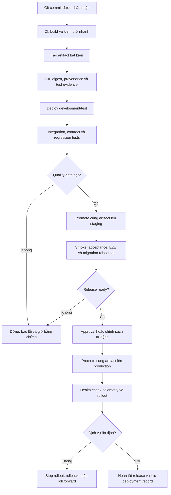
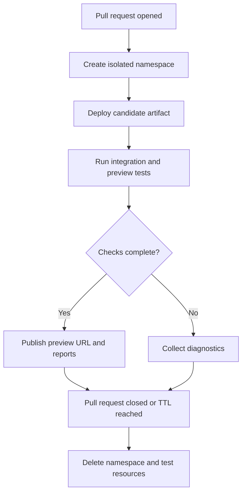

# Tổ chức môi trường phát triển, kiểm thử, tiền sản xuất và sản xuất

Một ứng dụng có thể chạy tốt trên máy của nhà phát triển nhưng thất bại khi đưa lên production. Nguyên nhân không nhất thiết nằm ở mã nguồn: phiên bản runtime có thể khác, biến môi trường bị thiếu, database dùng schema khác, dịch vụ phụ thuộc không sẵn sàng, quyền truy cập không giống nhau hoặc cấu hình mạng thay đổi giữa các nơi.

Trong CI/CD, các môi trường phát triển (development), kiểm thử (test/QA), tiền sản xuất (staging/pre-production) và sản xuất (production) tạo thành những điểm kiểm chứng khác nhau trên đường đưa phần mềm đến người dùng. Mỗi môi trường có mục đích, mức độ cô lập, dữ liệu, quyền truy cập và tiêu chí sẵn sàng riêng. Chúng cần được tổ chức đủ nhất quán để kết quả kiểm thử có ý nghĩa, đồng thời đủ tách biệt để thử nghiệm không gây ảnh hưởng đến người dùng thật.

Nguyên tắc quan trọng là **build artifact một lần rồi promote cùng artifact qua các môi trường**, còn cấu hình và bí mật được cung cấp theo môi trường thông qua cơ chế được kiểm soát. Nhờ vậy, phiên bản được kiểm thử ở staging chính là nội dung sẽ được triển khai lên production; sự khác nhau giữa môi trường nằm ở cấu hình, dữ liệu và hạ tầng đã được khai báo, không phải ở một bản build khác không có bằng chứng.

## 1. Vì sao cần nhiều môi trường?

Mỗi môi trường trả lời một nhóm câu hỏi khác nhau trong vòng đời phần mềm:

- Development: nhà phát triển có thể xây dựng và thử thay đổi nhanh không?
- Test/QA: hành vi của thay đổi có đáp ứng yêu cầu và không phá vỡ chức năng hiện có không?
- Staging/pre-production: artifact, cấu hình và quy trình triển khai có hoạt động gần giống production không?
- Production: phiên bản có phục vụ người dùng an toàn, ổn định và đáp ứng mục tiêu vận hành không?

Nếu chỉ có một môi trường dùng chung, các hoạt động phát triển, kiểm thử và vận hành có thể ghi đè trạng thái của nhau. Một migration thử nghiệm có thể làm hỏng dữ liệu của nhóm khác; một test tự động có thể gửi email thật; một bản build mới có thể thay đổi hành vi mà người dùng đang sử dụng.

Ngược lại, nếu tạo quá nhiều môi trường mà không có quy tắc quản lý, tổ chức sẽ phải duy trì nhiều bản cấu hình, credential và hạ tầng. Các môi trường dần lệch nhau, chi phí tăng và không ai biết môi trường nào phản ánh trạng thái chuẩn.

Mục tiêu không phải tạo càng nhiều môi trường càng tốt. Hãy chọn số lượng môi trường đủ để kiểm chứng rủi ro của sản phẩm, phân định rõ mục đích và tự động hóa việc tạo, cấu hình, cập nhật cũng như thu hồi chúng.

## 2. Vai trò của từng môi trường

### 2.1. Development

Development là nơi nhà phát triển tích hợp và kiểm tra thay đổi trong quá trình làm việc. Môi trường có thể chạy trên máy cá nhân, container, namespace dùng chung hoặc môi trường tạm theo nhánh.

Đặc điểm thường gặp:

- Ưu tiên tốc độ phản hồi và khả năng thử nghiệm.
- Có thể dùng dữ liệu tổng hợp, service giả lập hoặc dependency cục bộ.
- Cho phép debug và quan sát chi tiết hơn production.
- Có thể thay đổi thường xuyên, được tạo lại khi cần.
- Không nên chứa secret production hoặc dữ liệu người dùng thật.

Development không cần giống production về quy mô, nhưng cần tương thích ở những phần ảnh hưởng đến logic: phiên bản ngôn ngữ, runtime, dependency, cách đóng gói và cấu trúc cấu hình. Nếu local dùng PostgreSQL nhưng test lại dùng một database khác có semantics khác biệt, một số lỗi chỉ xuất hiện ở giai đoạn muộn.

### 2.2. Test hoặc QA

Test/QA xác minh thay đổi trong một môi trường có kiểm soát. Môi trường này có thể dùng để chạy integration test, contract test, regression test, acceptance test và kiểm thử thủ công.

Đặc điểm:

- Phiên bản artifact và cấu hình phải được ghi nhận.
- Dữ liệu kiểm thử có thể tái tạo và được cô lập theo test suite hoặc pipeline run.
- Dependency cần có trạng thái ổn định, có health check và cách reset.
- Có thể chạy nhiều test song song nếu namespace và dữ liệu được cô lập.
- Các thao tác gửi email, thanh toán, SMS hoặc webhook nên trỏ đến sandbox hoặc sink kiểm thử.

Test/QA thường cần khả năng tạo lại trạng thái ban đầu. Nếu kết quả test phụ thuộc dữ liệu cũ hoặc thứ tự chạy, môi trường sẽ tạo ra flaky test và giảm niềm tin vào pipeline.

### 2.3. Staging hoặc pre-production

Staging mô phỏng cách ứng dụng sẽ được triển khai và vận hành trong production. Đây là nơi kiểm tra release candidate với cấu hình, quy trình deploy, topology mạng và các dependency gần với thực tế.

Staging thường dùng để:

- Xác minh artifact bất biến được triển khai đúng cách.
- Chạy smoke test, acceptance test và một số luồng end-to-end quan trọng.
- Diễn tập database migration, rollback hoặc roll forward.
- Kiểm tra quyền, certificate, secret integration và kết nối dịch vụ.
- Đánh giá health check, logging, metrics, tracing và alert.
- Thử chiến lược rolling, blue-green hoặc canary trong điều kiện gần production.

Staging cần đủ tương đồng với production ở các yếu tố có thể làm thay đổi hành vi, nhưng không nhất thiết có cùng quy mô hoặc dữ liệu. Có thể dùng dữ liệu tổng hợp hoặc đã ẩn danh, tài khoản sandbox và giới hạn tài nguyên phù hợp.

### 2.4. Production

Production là môi trường phục vụ người dùng và xử lý dữ liệu thật. Mọi thay đổi tại đây cần đi qua quy trình có truy vết, quyền hạn phù hợp và khả năng phục hồi.

Đặc điểm:

- Quyền truy cập được giới hạn và audit.
- Secret, certificate và danh tính workload được quản lý tập trung.
- Cấu hình, hạ tầng và phiên bản đang chạy có thể truy ngược.
- Triển khai có health check, telemetry và ngưỡng dừng rollout.
- Có backup, kế hoạch khôi phục và phương án xử lý migration.
- Thay đổi có tác động cao cần approval hoặc guardrail theo chính sách.

Không dùng production làm môi trường thử nghiệm thông thường. Nếu cần xác minh hành vi thật, ưu tiên canary, synthetic monitoring hoặc thử nghiệm có phạm vi và dữ liệu được kiểm soát.

### Bảng so sánh tổng quan

| Tiêu chí | Development | Test/QA | Staging/Pre-production | Production |
|---|---|---|---|---|
| Mục tiêu | Phát triển và debug | Xác minh chức năng | Xác minh release và vận hành | Phục vụ người dùng |
| Tần suất thay đổi | Rất thường xuyên | Theo pipeline hoặc test cycle | Theo release candidate | Theo quy trình phát hành |
| Dữ liệu | Tổng hợp hoặc cá nhân hóa | Fixture và dữ liệu test | Tổng hợp/ẩn danh gần thực tế | Dữ liệu thật được bảo vệ |
| Quyền truy cập | Nhóm phát triển | Nhóm QA và pipeline | Nhóm release/operations | Hạn chế, audit và least privilege |
| Dependency | Có thể giả lập một phần | Ổn định, có thể reset | Gần production | Dịch vụ thật |
| Kiểm tra tiêu biểu | Unit, debug, local integration | Integration, contract, regression | Smoke, acceptance, E2E, migration rehearsal | Health, SLO, synthetic, telemetry |
| Mức cô lập | Theo máy/nhánh | Theo team/run | Theo release hoặc hệ thống | Theo vùng tin cậy và dữ liệu thật |

## 3. Luồng promote artifact qua các môi trường

Luồng phát hành đáng tin cậy cần phân biệt build với deploy. Build tạo artifact từ mã nguồn và dependency đã xác định. Deploy đưa artifact đó vào một môi trường với cấu hình phù hợp.



Artifact cần có version bất biến hoặc digest, ví dụ container image được tham chiếu bằng SHA-256 digest. Không build lại ở staging hoặc production chỉ vì cần một cấu hình khác. Nếu build lại, pipeline có thể tạo nội dung khác do dependency, thời điểm tải package hoặc công cụ build thay đổi.

Một deployment record nên nối được:

- Repository và commit SHA.
- Pipeline run ID và công cụ build.
- Artifact name, version và digest.
- Test report, scan result, SBOM và provenance.
- Môi trường, cấu hình revision và deployment ID.
- Người hoặc policy phê duyệt.
- Kết quả xác minh sau deploy.

Nhờ vậy, khi production có sự cố, nhóm có thể xác định chính xác artifact và cấu hình nào đang chạy.

## 4. Giữ môi trường nhất quán mà vẫn tách biệt

Môi trường không cần giống nhau tuyệt đối. Development có thể ít instance hơn production; staging có thể dùng database nhỏ hơn; test có thể dùng service giả lập. Điều cần nhất quán là các yếu tố có thể làm thay đổi hành vi của ứng dụng.

### Những yếu tố nên giữ tương đồng

- Phiên bản ngôn ngữ, runtime và hệ điều hành/container base image.
- Phiên bản dependency, driver và giao thức.
- Cách đóng gói và entrypoint của ứng dụng.
- Cấu trúc API, event schema và database schema.
- Cơ chế authentication, authorization và TLS.
- Cách nạp cấu hình, secret và feature flag.
- Health check, logging, metrics và tracing.
- Quy trình migration và triển khai.

### Những yếu tố có thể khác theo môi trường

- Số lượng instance, CPU, memory và autoscaling limit.
- URL, hostname, account và endpoint của dependency.
- Mức log và sampling rate.
- Kích thước dữ liệu hoặc số lượng test fixture.
- Feature flag và nhóm người dùng được bật tính năng.
- Quyền truy cập của con người và service account.
- Quota, rate limit và lịch bảo trì.

Các khác biệt cần được khai báo rõ và có lý do. Nếu staging dùng một phiên bản database cũ hơn production hoặc không bật TLS trong khi production bắt buộc TLS, kết quả kiểm tra staging có thể không phản ánh lỗi thực tế.

## 5. Tách cấu hình khỏi artifact

Artifact nên chứa mã ứng dụng và thành phần cần thiết để chạy, còn giá trị phụ thuộc môi trường được cung cấp khi deploy hoặc runtime.

Ví dụ, cùng một image `orders-api@sha256:...` có thể được triển khai ở test, staging và production. Mỗi nơi nhận:

- Database endpoint tương ứng.
- URL của inventory hoặc payment service.
- Mức log và tracing.
- Giới hạn timeout, connection pool và tài nguyên.
- Feature flag.
- Secret và certificate phù hợp.

Không nên tạo ba image khác nhau chỉ để nhúng ba file cấu hình môi trường. Cách đó làm mất tính chất build-once-promote và khó chứng minh production đang chạy nội dung đã được kiểm thử.

### 5.1. Các nguồn cấu hình phổ biến

| Nguồn | Phù hợp với | Lưu ý |
|---|---|---|
| Environment variables | Giá trị runtime đơn giản, endpoint, feature switch | Tránh truyền secret qua log hoặc command line |
| Config file được mount | Cấu hình có cấu trúc hoặc nhiều giá trị liên quan | Quản lý version và quyền đọc |
| Config service | Cấu hình cần cập nhật tập trung hoặc có audit | Cần kiểm soát availability và cache |
| Secret manager | Password, token, private key, certificate | Cấp quyền tối thiểu và credential ngắn hạn |
| Platform manifest | Replica, resource limit, health probe, network | Quản lý bằng mã và review thay đổi |

### 5.2. Ví dụ cấu hình theo môi trường

Ví dụ dưới đây là cấu hình minh họa không chứa secret:

```yaml
application:
  name: orders-api
  port: 8080

runtime:
  log_level: INFO
  request_timeout_ms: 2500

dependencies:
  inventory_url: ${INVENTORY_SERVICE_URL}
  database_url: ${DATABASE_URL}

features:
  new_order_flow: false
```

`DATABASE_URL` có thể là endpoint hoặc connection string không chứa password. Credential database nên được lấy riêng từ secret manager hoặc workload identity. Cấu hình theo môi trường cần được kiểm tra schema và giá trị bắt buộc trước khi ứng dụng nhận traffic.

## 6. Quản lý bí mật theo môi trường

Secret production không nên được sao chép sang development hoặc test. Mỗi môi trường nên có credential riêng, quyền tối thiểu và vòng đời phù hợp.

Các nguyên tắc:

- Dùng secret manager hoặc cơ chế workload identity thay vì lưu password trong repository.
- Cấp credential ngắn hạn cho job CI khi có thể.
- Tách danh tính deploy staging và production.
- Không dùng chung database password hoặc cloud key giữa các môi trường.
- Giới hạn ai có thể đọc secret; log truy cập cần có audit.
- Xoay vòng token và certificate theo chính sách.
- Không ghi secret vào image, artifact, cache hoặc test report.
- Kiểm tra ứng dụng không in secret khi cấu hình sai hoặc kết nối thất bại.

Pull request từ nguồn chưa tin cậy không được nhận secret production. Nếu cần integration test, hãy dùng sandbox credential có quyền giới hạn và dữ liệu tổng hợp.

## 7. Quản lý dữ liệu giữa các môi trường

Dữ liệu là một trong những nguyên nhân khiến môi trường lệch nhau và tạo rủi ro bảo mật. Production thường chứa dữ liệu thật; test và staging cần dữ liệu đủ đại diện để kiểm chứng hành vi nhưng không được làm lộ thông tin người dùng.

### 7.1. Development và test

Ưu tiên dữ liệu tổng hợp, fixture hoặc factory tạo dữ liệu. Dữ liệu cần có thể tái tạo, định danh riêng theo test run và được dọn sau khi dùng. Test không nên phụ thuộc vào trạng thái tồn tại từ lần chạy trước.

### 7.2. Staging

Staging có thể cần dữ liệu gần với phân bố production để kiểm tra hiệu năng, quy tắc nghiệp vụ hoặc migration. Nếu sử dụng bản sao dữ liệu, cần ẩn danh hoặc biến đổi dữ liệu nhạy cảm, kiểm soát quyền và thời hạn lưu.

### 7.3. Production

Production sử dụng dữ liệu thật và cần chính sách backup, retention, encryption, access control và audit. Không dùng thao tác cleanup của test để tác động đến dữ liệu production. Migration phải có kế hoạch tương thích, xác minh và phục hồi.

### 7.4. Không đồng bộ dữ liệu production một cách tùy tiện

Sao chép database production sang staging có thể đưa thông tin cá nhân, token, email, địa chỉ hoặc dữ liệu tài chính vào môi trường có ít kiểm soát hơn. Nếu cần dữ liệu đại diện, nên tạo pipeline làm sạch và ẩn danh, ghi lại nguồn, kiểm tra kết quả và tự động hết hạn bản sao.

## 8. Tách biệt mạng và quyền truy cập

Mỗi môi trường nên có ranh giới mạng và danh tính phù hợp với mức độ tin cậy.

| Môi trường | Mạng và truy cập thường phù hợp |
|---|---|
| Development | Có thể truy cập qua VPN hoặc mạng nội bộ; không mở database ra Internet; credential cá nhân hoặc dev identity có quyền giới hạn |
| Test/QA | Network sandbox; chỉ cho phép runner và service test truy cập dependency cần thiết; tài khoản tự động có quyền hẹp |
| Staging | Topology gần production; ingress có kiểm soát; giới hạn truy cập theo nhóm release/QA; dùng sandbox endpoint |
| Production | Network segmentation, private endpoint khi phù hợp, least privilege, audit và quy trình truy cập khẩn cấp |

Không nên để runner test có quyền truy cập trực tiếp mọi database hoặc cluster chỉ vì thuận tiện. Tách danh tính và network policy giúp giới hạn thiệt hại nếu job hoặc dependency bị xâm nhập.

## 9. Quản lý hạ tầng và cấu hình môi trường bằng mã

Infrastructure as Code (IaC) và Configuration as Code giúp mô tả trạng thái mong muốn của môi trường trong repository. Nhóm có thể review thay đổi, kiểm tra policy, tái tạo môi trường và so sánh trạng thái thực tế với khai báo.

Những thành phần có thể quản lý bằng mã:

- Network, subnet, route, firewall và security group.
- Compute, container cluster, namespace và autoscaling.
- Database instance, backup policy và parameter.
- IAM role, service account và permission.
- Secret reference và policy truy cập secret.
- DNS, certificate và ingress.
- Monitoring, alert, log routing và dashboard.
- Deployment manifest, resource limit và health probe.

Ví dụ cấu trúc repository:

```text
deploy/
  modules/
    application/
    database/
    networking/
  environments/
    dev/
    test/
    staging/
    production/
  policies/
  pipelines/
```

Module dùng chung giúp các môi trường có cấu trúc nhất quán; phần cấu hình riêng chỉ chứa các giá trị khác biệt đã được review. Không nên sao chép toàn bộ manifest rồi chỉnh tay ở từng folder vì các bản sao sẽ dần lệch nhau.

### 9.1. Review thay đổi hạ tầng

Pipeline có thể chạy format, validate, lint, policy check và tạo plan trước khi apply. Với production, plan cần được review theo quyền hạn và phải tương ứng với revision sẽ được áp dụng. State của IaC cần được lưu ở backend phù hợp, có locking và kiểm soát truy cập; không đưa state nhạy cảm vào artifact công khai.

### 9.2. Tránh chỉnh sửa thủ công làm drift

Drift là sự khác biệt giữa trạng thái thực tế và trạng thái được khai báo. Nếu ai đó sửa security group trực tiếp trên cloud console, lần deploy sau có thể ghi đè thay đổi hoặc không phát hiện cấu hình ngoài dự kiến.

Khi cần xử lý khẩn cấp bằng thao tác trực tiếp, phải ghi nhận lý do, người thực hiện và thay đổi; sau đó cập nhật lại mã nguồn chuẩn hoặc đưa môi trường về trạng thái mong muốn. Nên có kiểm tra drift định kỳ và cảnh báo với thay đổi có tác động cao.

## 10. Cấu hình database và migration giữa các môi trường

Database thường khác nhau về dung lượng, dữ liệu và cấu hình vận hành, nhưng schema và quy trình migration cần được quản lý nhất quán.

Một migration an toàn cần xem xét:

- Có tương thích với phiên bản ứng dụng đang chạy không?
- Có khóa bảng hoặc gây gián đoạn kéo dài không?
- Có cần backfill dữ liệu theo lô không?
- Có thể chạy lại an toàn không?
- Có backup hoặc phương án phục hồi dữ liệu không?
- Rollback ứng dụng có hoạt động khi schema mới đã được áp dụng không?

Mẫu expand–migrate–contract thường giúp triển khai không gián đoạn:

1. **Expand:** thêm cột hoặc cấu trúc mới theo cách vẫn tương thích với ứng dụng cũ.
2. **Migrate:** triển khai ứng dụng có thể đọc/ghi cấu trúc mới, chuyển dữ liệu theo lô và xác minh.
3. **Contract:** xóa cấu trúc cũ sau khi không còn phiên bản hoặc consumer phụ thuộc và cửa sổ rollback đã kết thúc.

Staging nên diễn tập migration với dữ liệu có quy mô đại diện, đo thời gian và kiểm tra lock. Production cần có kế hoạch quan sát và khôi phục phù hợp. Không giả định rollback image có thể đảo ngược một migration phá hủy dữ liệu.

## 11. Tổ chức môi trường tạm theo nhánh hoặc pull request

Với hệ thống lớn, môi trường development hoặc test dùng chung có thể trở thành nút thắt. Ephemeral environment cho phép tạo một môi trường riêng theo pull request hoặc pipeline run.

Ví dụ:



Ephemeral environment có lợi ích:

- Các nhánh không ghi đè trạng thái của nhau.
- QA hoặc người review có thể xem phiên bản của đúng pull request.
- Test tích hợp chạy với cấu hình gần môi trường thật.
- Môi trường được tạo và xóa bằng pipeline, giảm thao tác thủ công.

Nhưng cần kiểm soát chi phí và tài nguyên tồn đọng. Mỗi môi trường phải có owner, run ID, giới hạn tài nguyên, TTL, dữ liệu riêng và cơ chế cleanup khi pull request bị đóng hoặc pipeline bị hủy.

Không nên dùng ephemeral environment thay thế staging cho mọi kiểm tra release. Staging vẫn cần xác minh luồng triển khai và cấu hình đại diện cho production.

## 12. Promotion, approval và quyền triển khai

Promotion là đưa cùng một artifact đã được kiểm chứng sang môi trường tiếp theo. Mỗi lần promotion cần điều kiện rõ ràng và dấu vết.

Ví dụ chính sách:

| Chuyển môi trường | Điều kiện thường gặp |
|---|---|
| Development → Test | Build thành công, unit test và kiểm tra nhanh đạt |
| Test → Staging | Integration/contract test đạt, artifact có digest và scan report |
| Staging → Production | Smoke/acceptance/E2E đạt, migration và rollback plan sẵn sàng, approval nếu policy yêu cầu |
| Production rollout → hoàn tất | Health check và telemetry đạt ngưỡng, deployment record được lưu |

Approval cần dựa trên bằng chứng: commit, artifact digest, test report, scan result, release note, thay đổi cấu hình và kế hoạch phục hồi. Approval không nên là nút bấm hình thức không có ngữ cảnh.

Quyền triển khai cần tách theo môi trường. Job deploy test không cần quyền ghi production; job production chỉ nhận quyền khi đến bước cần thiết. Ưu tiên OIDC/workload identity và credential ngắn hạn thay cho khóa dài hạn được lưu trong biến pipeline.

## 13. Cấu hình ứng dụng và feature flag

Feature flag cho phép tách việc triển khai mã khỏi thời điểm bật tính năng. Một phiên bản có thể được deploy lên production nhưng tính năng mới chỉ bật cho nhân viên nội bộ, một nhóm nhỏ hoặc một tỷ lệ người dùng.

Feature flag hữu ích khi:

- Cần rollout theo nhóm người dùng.
- Cần tắt nhanh tính năng gây lỗi mà không phải deploy lại toàn bộ ứng dụng.
- Muốn kiểm tra hành vi trên production với phạm vi ảnh hưởng nhỏ.
- Muốn triển khai backend và frontend theo các bước tương thích.

Tuy nhiên, flag cũng tạo thêm trạng thái cấu hình. Mỗi flag cần owner, mục đích, thời hạn xem xét, quyền thay đổi và kế hoạch xóa. Không nên để flag cũ tồn tại vô thời hạn hoặc cho phép mọi môi trường tự ý có trạng thái khác nhau mà không có dấu vết.

Với cấu hình có tác động bảo mật, như bật endpoint quản trị hoặc thay đổi quyền, cần quality gate và audit riêng; không nên coi mọi feature flag đều là công tắc vô hại.

## 14. Kiểm tra môi trường trước khi nhận traffic

Một deployment thành công về mặt công cụ chưa có nghĩa ứng dụng đã sẵn sàng phục vụ người dùng. Cần xác minh trạng thái sau deploy.

Các kiểm tra thường dùng:

- **Startup/readiness probe:** tiến trình đã khởi động và sẵn sàng nhận traffic.
- **Liveness check:** tiến trình còn hoạt động và không bị kẹt theo tiêu chí của ứng dụng.
- **Smoke test:** một số thao tác cơ bản qua API hoặc giao diện.
- **Dependency check:** database, cache, message broker và dịch vụ cần thiết có thể kết nối.
- **Configuration validation:** biến bắt buộc, schema config, certificate và secret reference hợp lệ.
- **Security verification:** quyền service account, network exposure và policy runtime đáp ứng yêu cầu.
- **Telemetry:** error rate, latency, saturation và chỉ số nghiệp vụ không vượt ngưỡng.

Không nên để readiness chỉ kiểm tra process còn sống nếu ứng dụng chưa kết nối được dependency thiết yếu. Ngược lại, liveness không nên phụ thuộc mọi dịch vụ bên ngoài vì một dependency chập chờn có thể khiến orchestrator liên tục restart ứng dụng.

## 15. Quản lý khác biệt và drift giữa các môi trường

Một số khác biệt là có chủ đích, ví dụ production có nhiều replica hơn test. Một số khác biệt là drift không mong muốn, ví dụ staging thiếu một biến bắt buộc hoặc chạy phiên bản TLS khác production.

Nên quản lý khác biệt theo ba nhóm:

1. **Khác biệt được khai báo:** cấu hình riêng theo môi trường có owner và lý do.
2. **Khác biệt được sinh tự động:** endpoint, secret reference hoặc resource ID do platform cấp và được lưu trong deployment record.
3. **Khác biệt không mong muốn:** chỉnh sửa thủ công, phiên bản lệch hoặc cấu hình thiếu so với mã nguồn chuẩn.

Các cách giảm drift:

- Dùng module IaC và template cấu hình chung.
- Quản lý phiên bản runtime và dependency bằng lockfile hoặc image digest.
- Validate cấu hình theo schema trước deploy.
- So sánh trạng thái thực tế với trạng thái khai báo.
- Giới hạn chỉnh sửa trực tiếp trên môi trường.
- Ghi lại config revision trong deployment record.
- Kiểm tra staging và production theo cùng bộ policy quan trọng.

## 16. Ví dụ cấu trúc pipeline cho bốn môi trường

Đoạn YAML sau minh họa cách tổ chức promotion. Đây là cấu trúc khái niệm, cần chuyển sang cú pháp cụ thể của nền tảng CI/CD đang dùng:

```yaml
pipeline:
  trigger:
    - pull_request
    - merge_to_main
    - release_tag

  build:
    steps:
      - checkout_revision
      - lint_and_unit_tests
      - build_application
      - create_immutable_artifact
      - publish_artifact_and_provenance

  deploy_test:
    needs: [build]
    environment: test
    artifact: build.artifact_digest
    steps:
      - load_test_configuration
      - deploy_same_artifact
      - run_integration_and_contract_tests

  deploy_staging:
    needs: [deploy_test]
    condition: required_tests_pass
    environment: staging
    artifact: build.artifact_digest
    steps:
      - load_staging_configuration
      - deploy_same_artifact
      - run_smoke_acceptance_and_e2e
      - rehearse_migration_and_recovery

  deploy_production:
    needs: [deploy_staging]
    condition: release_ready
    environment: production
    approval: production_release_policy
    artifact: build.artifact_digest
    steps:
      - verify_artifact_signature_and_digest
      - load_production_configuration
      - deploy_with_canary
      - verify_health_and_telemetry
```

Trong thiết kế thực tế, `environment` cần gắn với cơ chế bảo vệ môi trường, secret scope và quyền deploy của nền tảng. `artifact_digest` phải được truyền như một giá trị bất biến. Nếu job staging hoặc production build lại mã nguồn, luồng promotion đã mất tính nhất quán.

## 17. Ví dụ xuyên suốt: phát hành thay đổi cho orders-api

Giả sử nhóm thêm chức năng kiểm tra tồn kho trước khi xác nhận đơn hàng.

**Development:** nhà phát triển chạy service trong container với database cục bộ và inventory mock. Unit test kiểm tra quy tắc số lượng; cấu hình local không chứa credential production.

**Test/QA:** pipeline tạo database schema riêng, triển khai artifact ứng viên và chạy integration test với PostgreSQL cùng contract test giữa `orders-api` và `inventory-api`. QA kiểm tra trường hợp tồn kho đủ, thiếu và timeout. Test data được tạo theo pipeline run và dọn sau khi report được upload.

**Staging:** cùng artifact digest được promote lên staging. Cấu hình kết nối sandbox inventory và payment, bật telemetry gần production. Nhóm chạy smoke test, E2E cho luồng đặt hàng và diễn tập migration. Người phụ trách xác minh release note, dashboard và kế hoạch rollback.

**Production:** pipeline kiểm tra digest và provenance, nạp secret production qua workload identity, rồi triển khai canary. Feature flag giữ tính năng mới ở trạng thái tắt hoặc chỉ bật cho nhóm nhỏ. Nhóm theo dõi error rate, latency, tỷ lệ đơn hàng được xác nhận và lỗi kiểm tra tồn kho.

**Hoàn tất hoặc phục hồi:** nếu các chỉ số ổn định, rollout tăng dần traffic và bật tính năng theo chính sách. Nếu lỗi tăng, nhóm dừng rollout, tắt flag hoặc quay lại artifact ổn định. Nếu migration đã thay đổi schema, cần xác minh tương thích trước khi rollback ứng dụng.

Vì cùng một artifact đi qua test, staging và production, nhóm có thể tập trung điều tra khác biệt ở cấu hình, quyền, dữ liệu hoặc hạ tầng thay vì nghi ngờ mã nguồn đã bị build lại.

## 18. Anti-pattern thường gặp

| Anti-pattern | Hệ quả | Cách cải thiện |
|---|---|---|
| Build riêng cho từng môi trường | Artifact có thể khác nhau dù cùng commit | Build một lần, promote cùng digest |
| Staging khác production quá nhiều | Lỗi cấu hình chỉ xuất hiện sau release | Giữ tương đồng ở runtime, network, auth và dependency quan trọng |
| Dùng dữ liệu production trong test không kiểm soát | Lộ dữ liệu cá nhân và tài chính | Dùng dữ liệu tổng hợp hoặc ẩn danh, giới hạn retention |
| Chia sẻ secret giữa các môi trường | Một credential bị lộ có thể ảnh hưởng nhiều nơi | Tách secret và danh tính theo môi trường |
| Cho runner test quyền truy cập production | Mã không tin cậy có thể tác động dữ liệu thật | Tách credential, network và quyền deploy |
| Chỉnh cấu hình trực tiếp trên console | Drift và mất dấu vết | Quản lý bằng mã, audit và đồng bộ lại nguồn chuẩn |
| Dùng staging như production thật | Test có thể gửi email/thanh toán hoặc thay đổi dữ liệu thật | Dùng sandbox và dữ liệu an toàn |
| Không có TTL cho môi trường tạm | Tài nguyên và chi phí tích tụ | Gắn owner, run ID, TTL và cleanup |
| Dùng approval hình thức | Người duyệt không có bằng chứng để đánh giá | Hiển thị digest, test report, scan và recovery plan |
| Không xác minh sau deploy | Deployment thành công nhưng ứng dụng không phục vụ được | Health check, smoke test và telemetry |
| Feature flag không có owner | Trạng thái cấu hình phức tạp và khó truy vết | Gán owner, expiry và kế hoạch dọn flag |
| Rollback chỉ dựa vào image cũ | Migration hoặc dữ liệu có thể không tương thích | Thiết kế migration tương thích và diễn tập phục hồi |

## 19. Checklist tổ chức môi trường CI/CD

Trước khi xem luồng môi trường là sẵn sàng, nhóm có thể rà soát:

- [ ] Mỗi môi trường có mục đích, owner và nhóm người dùng rõ ràng.
- [ ] Development, test, staging và production có ranh giới quyền truy cập phù hợp.
- [ ] Runtime, dependency, cách đóng gói và cấu trúc cấu hình đủ tương đồng ở các điểm quan trọng.
- [ ] Artifact được build một lần, có version/digest bất biến và promote qua các môi trường.
- [ ] Cấu hình môi trường được tách khỏi artifact và quản lý theo version.
- [ ] Secret và workload identity được tách theo môi trường, có quyền tối thiểu và audit.
- [ ] Test/QA dùng dữ liệu tổng hợp hoặc đã ẩn danh, có cơ chế reset và cleanup.
- [ ] Staging đủ gần production để xác minh deploy, migration, auth, network và telemetry.
- [ ] Production có backup, monitoring, rollout guardrail và phương án phục hồi.
- [ ] Hạ tầng và cấu hình được quản lý bằng mã, có review và drift detection.
- [ ] Database migration có kế hoạch tương thích với các phiên bản chạy song song.
- [ ] Môi trường tạm có owner, run ID, resource limit và TTL.
- [ ] Approval dựa trên test report, scan result, artifact digest và recovery plan.
- [ ] Deployment record lưu commit, artifact, config revision, approval và kết quả sau deploy.
- [ ] Có smoke test, health check và telemetry xác minh trước khi hoàn tất rollout.
- [ ] Feature flag có owner, mục đích, quyền thay đổi và thời hạn xem xét.

## 20. Kết luận

Development, test, staging và production là những môi trường có mục tiêu và mức độ tin cậy khác nhau trên cùng một luồng phân phối phần mềm. Development tối ưu tốc độ thử nghiệm; test/QA xác minh hành vi; staging kiểm chứng release trong điều kiện gần production; production phục vụ người dùng với yêu cầu cao về bảo mật, ổn định và khả năng phục hồi.

Một hệ thống CI/CD tốt giữ các môi trường nhất quán ở những yếu tố ảnh hưởng hành vi, tách cấu hình và secret theo môi trường, quản lý dữ liệu an toàn và promote cùng artifact bất biến. Khi hạ tầng được quản lý bằng mã, drift được phát hiện, quyền deploy được giới hạn và mỗi lần triển khai đều có xác minh cùng dấu vết, nhóm có thể đưa thay đổi qua các môi trường một cách có kiểm soát và dự đoán được.
