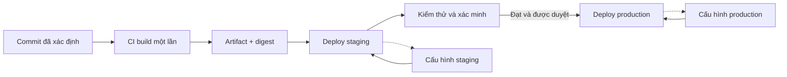
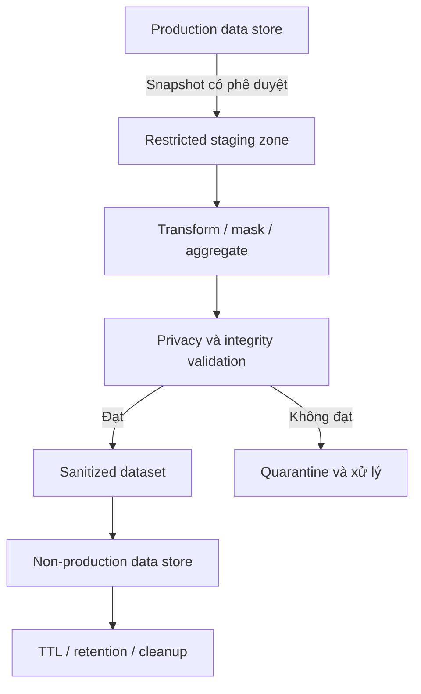

# Giữ tương đồng cần thiết mà không sao chép dữ liệu nhạy cảm

Một lỗi chỉ xuất hiện ở production nhưng không tái hiện được trên staging thường khiến nhóm phải hỏi: hai môi trường khác nhau ở đâu? Khác phiên bản runtime, cấu hình, network, database, feature flag hay dữ liệu? Nếu staging quá khác production, kết quả kiểm thử khó dự đoán hành vi thật. Nhưng sao chép nguyên dữ liệu production sang môi trường phát triển hoặc kiểm thử lại tạo rủi ro lộ thông tin cá nhân, bí mật kinh doanh và thông tin xác thực.

Mục tiêu của quản lý môi trường là **giữ tương đồng ở những yếu tố ảnh hưởng đến hành vi hệ thống, đồng thời giới hạn dữ liệu và quyền truy cập theo đúng nhu cầu của từng môi trường**. Tương đồng không có nghĩa mọi thứ phải giống hệt nhau. Ứng dụng nên dùng cùng artifact đã được kiểm thử; runtime, schema, topology và chính sách cần đủ gần để kết quả có ý nghĩa; còn endpoint, secret, dữ liệu và quyền truy cập phải được tách riêng theo môi trường.

## 1. Hiểu đúng về environment parity

**Environment parity** là mức độ tương đồng có chủ đích giữa các môi trường như development, test, staging và production. Nó giúp giảm các lỗi chỉ xuất hiện do khác biệt môi trường, chẳng hạn thư viện hệ thống, phiên bản database, cách định tuyến request hoặc giới hạn tài nguyên.

Parity không yêu cầu staging phải có cùng quy mô, dữ liệu thật hay quyền truy cập như production. Thay vào đó, cần xác định những đặc tính có ảnh hưởng tới kết quả kiểm thử và tái tạo chúng ở mức phù hợp.

| Thành phần | Nên giữ tương đồng ở điểm nào? | Có thể khác theo môi trường ở điểm nào? |
|---|---|---|
| Ứng dụng | Cùng artifact digest, cùng phiên bản code | Số replica hoặc mức rollout |
| Runtime/toolchain | Phiên bản runtime, thư viện nền và kiến trúc tương thích | Quy mô tài nguyên hoặc profile debug được kiểm soát |
| Cấu hình ứng dụng | Cùng schema, kiểu dữ liệu, quy tắc mặc định và cách nạp cấu hình | URL, endpoint, feature flag, giới hạn theo năng lực môi trường |
| Database | Cùng engine/major version, schema và migration | Dung lượng, dataset, tài khoản và dữ liệu |
| Network/topology | Luồng kết nối, TLS, service discovery và policy quan trọng | Vùng mạng, hostname, số node, giới hạn lưu lượng |
| Queue/cache/search | Cùng loại dịch vụ, semantics và phiên bản tương thích | Kích thước cluster, TTL hoặc capacity theo tải |
| Bảo mật | Cùng mô hình xác thực, phân quyền và nguyên tắc tối thiểu | Danh tính, secret, role và phạm vi quyền riêng biệt |
| Quan sát | Cùng loại log, metric, trace và health check | Sampling rate, retention và mức chi tiết theo môi trường |
| Dữ liệu | Cùng cấu trúc, quan hệ, phân bố và các trường hợp biên cần kiểm thử | Dùng dữ liệu synthetic hoặc đã biến đổi thay cho dữ liệu nhạy cảm thật |

Một môi trường có thể có ít replica hơn production nhưng vẫn dùng cùng image, schema và chính sách retry. Điều này thường có giá trị hơn việc tạo một staging rất lớn nhưng chạy phiên bản ứng dụng hoặc database khác.

## 2. Xác định điều gì cần giống và điều gì cần tách biệt

Trước khi xây dựng staging, hãy xác định mục đích của từng môi trường và các khác biệt có thể chấp nhận. Ví dụ:

- **Development:** ưu tiên phản hồi nhanh, dễ reset, có thể bật debug và dùng dữ liệu nhỏ.
- **Test/QA:** ưu tiên trạng thái ổn định, dữ liệu kiểm thử xác định và khả năng chạy lặp lại.
- **Staging:** mô phỏng gần production về runtime, schema, network flow, observability và cách triển khai.
- **Production:** tối ưu tính sẵn sàng, bảo mật, capacity, vận hành và bảo vệ dữ liệu thật.

Một cách thực tế là lập danh sách các yếu tố ảnh hưởng tới hành vi và xếp mức độ quan trọng:

| Mức tương đồng | Thành phần | Lý do |
|---|---|---|
| Bắt buộc | Artifact digest, schema/migration, runtime major version, serialization/protocol, auth flow | Khác biệt có thể làm thay đổi trực tiếp hành vi hoặc khả năng tương thích |
| Cao | Database engine, queue/cache semantics, TLS, network policy, timeout/retry | Có thể tạo lỗi tích hợp, lỗi tải hoặc lỗi bảo mật |
| Theo mục tiêu kiểm thử | CPU/RAM, replica count, data volume, cache size, rate limit | Cần gần production cho benchmark; có thể giảm ở test chức năng |
| Cố ý khác biệt | Endpoint, secret, tài khoản, dữ liệu, quyền và vùng triển khai | Phải tách biệt để bảo vệ hệ thống và dữ liệu thật |

Không nên đánh giá parity chỉ bằng việc so sánh hai file cấu hình. Cần kiểm tra cả trạng thái thực tế: image đang chạy, phiên bản dịch vụ phụ thuộc, schema database, network route, policy và dữ liệu test đang được nạp.

## 3. Dùng cùng artifact qua các môi trường

Một nguyên tắc cốt lõi của CI/CD là **build một lần, quảng bá cùng artifact qua các môi trường**. Pipeline tạo artifact từ commit đã xác định, chạy kiểm thử trên artifact đó, sau đó triển khai cùng nội dung lên staging và production. Khi chuyển môi trường, chỉ các cấu hình và secret được cấp theo đích triển khai thay đổi.

Ví dụ với container image:

```text
registry.example.com/team/orders@sha256:abc123...
```

Staging và production nên tham chiếu cùng digest này. Không build lại image riêng cho production chỉ để thay URL database hoặc bật/tắt một tính năng. Những giá trị đó nên được nạp qua cấu hình ngoài artifact.



Nếu staging và production chạy hai digest khác nhau, kết quả staging không còn chứng minh được artifact production đã được kiểm thử. Nếu bắt buộc phải tạo biến thể theo nền tảng, hãy xác định rõ artifact cho từng nền tảng, kiểm thử từng biến thể và ghi provenance tương ứng.

## 4. Quản lý cấu hình theo môi trường

Cấu hình quyết định ứng dụng kết nối tới đâu, dùng giới hạn nào và bật hành vi nào. Cần tách cấu hình khỏi mã nguồn và đóng gói, nhưng vẫn quản lý chúng bằng phiên bản và quy tắc rõ ràng.

Các nhóm cấu hình thường gặp:

- Endpoint và service discovery: URL database, queue, cache, API bên ngoài.
- Hành vi ứng dụng: timeout, retry, batch size, feature flag, rate limit.
- Tài nguyên: connection pool, worker count, memory limit, concurrency.
- Bảo mật: issuer, audience, certificate reference, policy và role.
- Quan sát: log level, metrics endpoint, trace sampling và alert routing.

Nên có một cấu hình mặc định an toàn và các lớp override theo môi trường. Các giá trị bắt buộc cần được kiểm tra khi khởi động; nếu thiếu hoặc sai định dạng, ứng dụng nên dừng với thông báo rõ ràng thay vì tự dùng một endpoint mặc định nguy hiểm.

Ví dụ file mẫu `.env.example` chỉ chứa tên biến và giá trị giả:

```dotenv
APP_ENV=staging
LOG_LEVEL=INFO
DATABASE_URL=postgresql://app:<password>@db.example.invalid:5432/orders
REDIS_URL=redis://cache.example.invalid:6379/0
PAYMENT_API_BASE_URL=https://sandbox-payments.example.invalid
PAYMENT_API_TOKEN=<injected-at-runtime>
FEATURE_NEW_CHECKOUT=false
```

Không commit file `.env` thật, token, password, private key hoặc certificate có khóa riêng. File mẫu giúp lập trình viên biết cấu trúc cấu hình mà không tiết lộ giá trị thật.

### Ví dụ ConfigMap và Secret reference trong Kubernetes

```yaml
apiVersion: v1
kind: ConfigMap
metadata:
  name: orders-config
  namespace: staging
data:
  APP_ENV: "staging"
  LOG_LEVEL: "INFO"
  FEATURE_NEW_CHECKOUT: "false"
  PAYMENT_API_BASE_URL: "https://sandbox-payments.example.invalid"
---
apiVersion: apps/v1
kind: Deployment
metadata:
  name: orders
  namespace: staging
spec:
  replicas: 2
  selector:
    matchLabels:
      app: orders
  template:
    metadata:
      labels:
        app: orders
    spec:
      containers:
        - name: orders
          image: registry.example.com/team/orders@sha256:abc123...
          envFrom:
            - configMapRef:
                name: orders-config
          env:
            - name: PAYMENT_API_TOKEN
              valueFrom:
                secretKeyRef:
                  name: orders-payment-token
                  key: token
```

ConfigMap chứa cấu hình không bí mật. Secret reference chỉ ra tên Secret đã được cấp trong namespace staging; giá trị token không xuất hiện trong manifest. Với production, dùng namespace, Secret và danh tính workload riêng. Kubernetes Secret mặc định được lưu trong API object và không tự động bảo đảm mã hóa tại rest trong mọi cấu hình; cần bật encryption at rest, RBAC chặt chẽ và cân nhắc external secret manager hoặc workload identity.

## 5. Không sao chép secret và quyền production sang non-production

Môi trường non-production thường có nhiều người truy cập hơn, nhiều pipeline thử nghiệm hơn và vòng đời dữ liệu ngắn hơn. Nếu dùng chung credential production, một job thử nghiệm hoặc tài khoản developer bị xâm nhập có thể trở thành đường truy cập production.

Các nguyên tắc cần áp dụng:

- Mỗi môi trường dùng danh tính ứng dụng, service account, database user và token riêng.
- Cấp quyền tối thiểu theo service và hành động; tránh dùng tài khoản quản trị chung.
- Ưu tiên workload identity hoặc credential ngắn hạn thay cho key tĩnh dài hạn.
- Lấy secret lúc runtime từ secret manager; không nhúng secret vào image, source, log hoặc artifact.
- Không dùng lại private key ký release hoặc credential deploy production ở staging.
- Tách network và IAM boundary; runner non-production không có đường truy cập trực tiếp tới tài nguyên production.
- Luân chuyển credential khi hết hạn hoặc có dấu hiệu bị lộ; thu hồi ngay khi không còn cần thiết.
- Audit việc đọc secret và hành động đặc quyền.

Không nên copy secret production sang staging ngay cả khi staging cần mô phỏng tích hợp. Hãy dùng sandbox account, mock service hoặc credential thử nghiệm có phạm vi giới hạn.

## 6. Giữ dữ liệu kiểm thử có giá trị mà không mang dữ liệu nhạy cảm

Để kiểm thử có ý nghĩa, dữ liệu cần giữ được những đặc tính quan trọng như cấu trúc, quan hệ, phân bố và các trường hợp biên. Điều đó không có nghĩa cần giữ nguyên tên, số điện thoại, email, địa chỉ, mã định danh hoặc nội dung giao dịch của người thật.

Có ba hướng thường dùng:

| Cách tạo dữ liệu | Mô tả | Khi phù hợp |
|---|---|---|
| Synthetic data | Tạo dữ liệu mới từ schema, quy tắc nghiệp vụ và phân bố mong muốn | Unit, integration, performance, demo và test lặp lại |
| Masked/transformed data | Biến đổi dữ liệu nguồn để giảm khả năng nhận diện nhưng vẫn giữ một số đặc tính | Khi cần mô phỏng cấu trúc hoặc phân bố thực tế khó tổng hợp |
| Anonymized/aggregated data | Loại bỏ hoặc tổng hợp thông tin nhận diện theo quy trình đánh giá rủi ro | Phân tích xu hướng, kiểm thử thống kê và báo cáo |

Các thuật ngữ này không tự bảo đảm dữ liệu an toàn. Một bộ dữ liệu đã bỏ tên vẫn có thể nhận diện được người nếu còn ngày sinh chính xác, mã bưu chính, địa điểm, thời gian giao dịch hoặc tổ hợp thuộc tính hiếm. Cần đánh giá khả năng tái nhận diện trong bối cảnh dữ liệu và người có thể truy cập.

### Synthetic data: tạo dữ liệu mới theo quy tắc

Synthetic data được sinh từ schema và quy tắc nghiệp vụ thay vì lấy trực tiếp bản ghi người thật. Bộ dữ liệu tốt nên bao gồm:

- Bản ghi hợp lệ theo quan hệ khóa ngoại và constraint.
- Các trạng thái nghiệp vụ khác nhau: mới, đang xử lý, hoàn tất, thất bại, bị hủy.
- Giá trị biên: rỗng, tối thiểu, tối đa, ký tự Unicode, số lớn, thời gian biên.
- Phân bố gần với tải dự kiến: kích thước đơn hàng, số item, số giao dịch theo thời gian.
- Trường hợp hiếm nhưng quan trọng: retry, duplicate, race condition, dữ liệu đến sai thứ tự.
- Seed cố định cho bộ test cần tái lập, nhưng không dùng seed cố định để sinh secret bảo mật.

Ví dụ Python giả định dùng Faker để tạo dữ liệu kiểm thử giả:

```python
from faker import Faker
import random

seed = 7319
fake = Faker("vi_VN")
fake.seed_instance(seed)
rng = random.Random(seed)

customers = []
for customer_id in range(1, 101):
    customers.append({
        "id": customer_id,
        "name": fake.name(),
        "email": f"customer-{customer_id}@example.test",
        "tier": rng.choice(["standard", "silver", "gold"]),
    })
```

Đây là dữ liệu tổng hợp phục vụ ví dụ; domain `.test` dành cho kiểm thử. Trong dự án thật, cần tạo quan hệ nhất quán giữa customer, order, payment và inventory, đồng thời bảo đảm không vô tình sinh ra địa chỉ hoặc thông tin liên hệ có thể được dùng để liên lạc với người thật.

### Masking, tokenization và pseudonymization

Nếu cần dữ liệu có hình dạng gần thực tế, có thể biến đổi trường nhạy cảm:

- Thay tên, email, số điện thoại và địa chỉ bằng giá trị giả theo format hợp lệ.
- Thay mã khách hàng bằng token ổn định để giữ quan hệ giữa nhiều bảng.
- Làm tròn hoặc tổng hợp ngày giờ và vị trí để giảm khả năng nhận diện.
- Loại bỏ free-text có thể chứa thông tin cá nhân hoặc bí mật.
- Thay số tài khoản, mã giao dịch và dữ liệu thanh toán bằng giá trị sandbox.

Phân biệt:

- **Masking** là thuật ngữ chung cho việc che hoặc thay đổi trường dữ liệu.
- **Pseudonymization** thay định danh trực tiếp bằng mã giả nhưng có thể còn khả năng liên kết lại, đặc biệt nếu giữ bảng mapping hoặc khóa.
- **Tokenization** thay giá trị bằng token; hệ thống giữ token vault hoặc cơ chế mapping riêng để giải mã khi được phép.
- **Anonymization** hướng tới việc không thể nhận diện lại cá nhân bằng phương tiện hợp lý trong bối cảnh sử dụng. Đây là mục tiêu cần đánh giá, không chỉ là một phép xóa cột.

Nếu bảng mapping hoặc khóa giải mã còn tồn tại, dữ liệu thường vẫn là pseudonymized chứ chưa thể coi là anonymous. Bảng mapping phải được lưu tách biệt, mã hóa và giới hạn quyền; tốt hơn là không đưa nó vào môi trường non-production.

## 7. Giữ tính toàn vẹn và phân bố của dữ liệu sau biến đổi

Một quy trình masking kém có thể làm dữ liệu không còn dùng được. Ví dụ, đổi customer ID độc lập ở từng bảng sẽ phá vỡ foreign key; đổi ngày tạo đơn hàng nhưng không đổi ngày thanh toán có thể tạo thứ tự thời gian vô lý; thay tất cả giá trị thành một chuỗi duy nhất làm mất tính đa dạng và gây sai lệch hiệu năng.

Sau khi sinh hoặc biến đổi dữ liệu, cần kiểm tra:

1. **Referential integrity:** khóa ngoại và quan hệ giữa các bảng vẫn hợp lệ.
2. **Uniqueness:** trường cần duy nhất vẫn duy nhất sau khi thay thế.
3. **Domain constraints:** enum, format, range, checksum và quy tắc nghiệp vụ vẫn đúng.
4. **Distribution:** phân bố số lượng, độ dài, trạng thái và tần suất gần mục tiêu kiểm thử.
5. **Temporal consistency:** thứ tự thời gian và quan hệ giữa các sự kiện hợp lý.
6. **Edge cases:** vẫn có dữ liệu rỗng, dữ liệu lớn, lỗi, duplicate hoặc trạng thái hiếm theo kịch bản.
7. **Privacy checks:** không còn secret, identifier trực tiếp hoặc free-text nhạy cảm ngoài chính sách.

Với dữ liệu quan hệ, nên tạo mapping ổn định trong cùng một lần sinh dữ liệu để một customer được thay bằng cùng một synthetic ID ở tất cả bảng liên quan. Mapping này chỉ cần tồn tại trong quá trình biến đổi và phải được hủy nếu không cần giữ.

## 8. Quy trình làm mới dữ liệu an toàn

Nếu cần dùng snapshot từ production để mô phỏng dữ liệu phức tạp, quy trình phải được thiết kế như một luồng xử lý dữ liệu nhạy cảm riêng. Không nên dump database production rồi upload thẳng vào staging.



Quy trình tham khảo:

1. Xác định mục đích, trường dữ liệu và phạm vi tối thiểu cần dùng.
2. Phê duyệt snapshot theo chính sách dữ liệu; ghi nhận người yêu cầu và người cho phép.
3. Tạo snapshot trong vùng hạn chế có mã hóa, quyền truy cập hẹp và audit log.
4. Chạy transform bằng công cụ có phiên bản và quy tắc đã review.
5. Kiểm tra privacy, referential integrity, format, distribution và dữ liệu còn sót.
6. Chỉ xuất sanitized dataset sau khi validation đạt; xóa hoặc hết hạn snapshot thô theo quy trình.
7. Nạp dataset vào môi trường non-production bằng danh tính riêng.
8. Đặt retention/TTL, lịch refresh và quy trình cleanup.
9. Lưu metadata về nguồn, thời điểm, phiên bản transform và kết quả kiểm tra; không lưu bản ghi nhạy cảm trong log.

Nếu transform hoặc validation thất bại, dữ liệu phải ở trạng thái quarantine; không được đưa một phần snapshot chưa được xác minh vào staging. Bản sao thô phải được bảo vệ trong toàn bộ thời gian tồn tại và không được giữ lại vô thời hạn chỉ vì tiện cho lần refresh sau.

## 9. Giữ tương đồng về tải mà không cần dữ liệu thật

Kiểm thử hiệu năng thường cần dữ liệu đủ lớn và có phân bố gần production. Có thể tạo synthetic dataset theo thống kê đã tổng hợp:

- Số lượng bản ghi theo bảng và tỷ lệ quan hệ.
- Phân bố kích thước đơn hàng, số item, trạng thái và tuổi dữ liệu.
- Tỷ lệ truy vấn đọc/ghi, cache hit và mức độ tập trung vào một số khóa.
- Phân bố thời điểm tạo giao dịch và các đợt tăng tải.
- Các trường hợp dữ liệu lớn, hiếm hoặc có độ lệch cao.

Không nhất thiết dùng bản ghi thật để mô phỏng skew hoặc hot key. Có thể tạo synthetic key với phân bố Zipf hoặc một số nhóm có tần suất truy cập cao, miễn là bộ test phản ánh đúng giả định cần đánh giá. Ghi lại seed và generator version để so sánh các lần benchmark.

Đối với test chức năng, dataset nhỏ nhưng bao phủ quy tắc nghiệp vụ và edge case thường hiệu quả hơn một bản sao dữ liệu lớn. Đối với performance, cần dataset có kích thước và phân bố phù hợp với mục tiêu đo. Đối với security, cần tài khoản giả lập theo role, dữ liệu nhạy cảm giả và các trường hợp quyền truy cập sai.

## 10. Kiểm soát drift giữa cấu hình mong muốn và trạng thái thực tế

**Configuration drift** xảy ra khi trạng thái thực tế của môi trường khác với cấu hình được quản lý. Ví dụ, một kỹ sư sửa ConfigMap trực tiếp trên cluster, nâng database minor version ngoài quy trình hoặc thêm một biến môi trường thủ công để khắc phục sự cố nhưng quên cập nhật mã cấu hình.

Drift khiến staging không còn đại diện cho cấu hình đã được review. Nó cũng làm việc tái tạo sự cố khó khăn vì repository không phản ánh trạng thái thực tế.

Các biện pháp kiểm soát:

- Quản lý cấu hình hạ tầng và ứng dụng bằng IaC hoặc cấu hình có version.
- Review thay đổi cấu hình qua pull request và pipeline tương tự mã nguồn.
- Dùng policy để hạn chế sửa trực tiếp tài nguyên đã được quản lý.
- Định kỳ so sánh desired state với actual state và cảnh báo drift.
- Lưu revision cấu hình cùng deployment record.
- Nếu cần sửa khẩn cấp trực tiếp, ghi nhận change/incident và đưa thay đổi về repository sau đó.
- Tránh để mỗi môi trường có một bộ manifest được chỉnh tay và không có quan hệ nguồn gốc.

Ví dụ với Terraform, `plan` giúp xem khác biệt giữa cấu hình mong muốn và trạng thái được provider quan sát. Cần quản lý state an toàn, khóa state khi thao tác đồng thời và bảo vệ output vì plan/state có thể chứa dữ liệu nhạy cảm. Không đưa state hoặc plan đầy đủ vào artifact công khai.

## 11. Ví dụ tổ chức cấu hình staging và production

Một cấu trúc repository có thể tách phần chung và phần override theo môi trường:

```text
deploy/
  base/
    deployment.yaml
    service.yaml
    configmap.yaml
  overlays/
    staging/
      kustomization.yaml
      config-patch.yaml
    production/
      kustomization.yaml
      config-patch.yaml
```

Phần `base` chứa cấu trúc workload, health check và các cấu hình chung. Overlay chỉ thay các giá trị thực sự khác như endpoint, replica count, resource request/limit hoặc feature flag. Secret được tham chiếu từ hệ thống quản lý riêng, không lưu trực tiếp trong overlay.

Ví dụ Kustomize staging overlay:

```yaml
apiVersion: kustomize.config.k8s.io/v1beta1
kind: Kustomization
namespace: staging
resources:
  - ../../base
images:
  - name: registry.example.com/team/orders
    digest: sha256:abc123...
patches:
  - path: config-patch.yaml
```

Production overlay có thể dùng cùng image digest nhưng namespace, endpoint và resource sizing riêng. Tránh copy toàn bộ base thành hai bộ YAML độc lập vì chúng sẽ dần lệch nhau. Cần có kiểm tra rendered manifest trong CI để xác nhận các giá trị bắt buộc và ngăn cấu hình production vô tình trỏ tới database hoặc payment sandbox, cũng như ngăn staging trỏ tới production.

## 12. Các kiểm tra tự động giúp duy trì parity an toàn

Pipeline có thể thực hiện một số kiểm tra trước khi triển khai:

- Xác nhận staging và production dùng cùng artifact digest cho cùng một release candidate.
- So sánh runtime, database engine/version và schema migration level.
- Validate cấu hình theo schema; kiểm tra biến bắt buộc và giá trị không hợp lệ.
- Quét manifest để phát hiện endpoint production trong staging hoặc endpoint sandbox trong production.
- Kiểm tra không có secret literal trong repository, artifact và rendered manifest.
- Kiểm tra IAM/RBAC, network policy và service account theo môi trường.
- Xác minh dataset được gắn nhãn, có nguồn gốc, transform version và TTL.
- Kiểm tra privacy/integrity report trước khi nạp dữ liệu mới.
- Phát hiện drift và yêu cầu xử lý trước release khi drift ảnh hưởng tới hành vi.

Ví dụ script kiểm tra endpoint theo môi trường ở mức đơn giản:

```bash
#!/usr/bin/env bash
set -Eeuo pipefail

case "$APP_ENV" in
  staging)
    [[ "$PAYMENT_API_BASE_URL" == *"sandbox"* ]] || {
      echo "Staging must use the payment sandbox endpoint" >&2
      exit 1
    }
    ;;
  production)
    [[ "$PAYMENT_API_BASE_URL" != *"sandbox"* ]] || {
      echo "Production cannot use the payment sandbox endpoint" >&2
      exit 1
    }
    ;;
  *)
    echo "Unknown APP_ENV: $APP_ENV" >&2
    exit 2
    ;;
esac
```

Đây là ví dụ minh họa, không phải kiểm tra đầy đủ cho mọi URL. Trong hệ thống thật, nên parse URL và so sánh hostname/allowlist chính xác, đồng thời validate cấu hình bằng schema. Không in giá trị secret trong thông báo lỗi.

## 13. Anti-pattern thường gặp

- **Sao chép toàn bộ production database sang staging:** tăng rủi ro lộ dữ liệu và mở rộng phạm vi truy cập.
- **Chỉ xóa tên và email:** vẫn có thể tái nhận diện qua ngày sinh, địa chỉ, thời gian hoặc tổ hợp thuộc tính.
- **Dùng chung secret giữa các môi trường:** sự cố ở non-production có thể mở đường vào production.
- **Build riêng cho từng môi trường:** staging và production có thể chạy các byte khác nhau.
- **Mỗi môi trường có cấu hình chỉnh tay:** tạo drift và khó truy vết.
- **Chỉ giữ cấu hình chung mà không kiểm tra override:** giá trị quan trọng có thể vô tình trỏ sai endpoint hoặc bật sai feature flag.
- **Synthetic data không giữ quan hệ:** test lỗi do dữ liệu không hợp lệ thay vì do logic ứng dụng.
- **Masking không kiểm tra sau biến đổi:** dữ liệu vẫn còn secret, identifier hoặc free-text nhạy cảm.
- **Giữ snapshot thô vô thời hạn:** tăng thời gian và phạm vi rủi ro.
- **Dùng dữ liệu nhỏ cho mọi loại test:** không tái hiện được hiệu năng hoặc phân bố production.
- **Dùng production-like data mà không có mục đích cụ thể:** thu thập nhiều dữ liệu hơn nhu cầu kiểm thử.
- **Không gắn dataset với phiên bản generator:** không thể tái tạo chính xác kết quả kiểm thử.

## 14. Checklist thiết kế môi trường tương đồng và an toàn

Trước khi đưa một môi trường vào pipeline, hãy kiểm tra:

1. Đã xác định những thành phần nào phải tương đồng để kết quả kiểm thử có ý nghĩa chưa?
2. Các môi trường có triển khai cùng artifact digest cho cùng release candidate không?
3. Runtime, database engine, schema, protocol và dependency có phiên bản tương thích không?
4. Cấu hình chung và override theo môi trường có được quản lý bằng version và review không?
5. Endpoint, feature flag, resource limit và network route có được validate theo môi trường không?
6. Secret, service account, database user và quyền IAM/RBAC có tách riêng không?
7. Runner non-production có bị giới hạn khỏi tài nguyên production không?
8. Dữ liệu test là synthetic, masked hoặc transformed theo mục đích và có đánh giá tái nhận diện không?
9. Referential integrity, distribution và edge cases có được kiểm tra sau khi tạo/biến đổi dữ liệu không?
10. Snapshot nguồn có vùng xử lý hạn chế, mã hóa, audit và quy trình xóa không?
11. Dataset non-production có TTL, chủ sở hữu và lịch refresh/cleanup không?
12. Có kiểm tra configuration drift và lưu revision cấu hình cùng deployment không?
13. Có log/report chứng minh nguồn gốc artifact, cấu hình và dataset mà không làm lộ dữ liệu nhạy cảm không?
14. Khi phát hiện drift hoặc dữ liệu không đạt kiểm tra privacy, pipeline có dừng trước khi triển khai/nạp dữ liệu không?

Giữ môi trường tương đồng là giữ những đặc tính làm thay đổi hành vi của phần mềm: artifact, runtime, schema, topology, giao thức và cách cấu hình. Bảo vệ dữ liệu là giới hạn những gì được đưa vào từng môi trường, ai được truy cập và dữ liệu tồn tại bao lâu. Khi hai mục tiêu này được thiết kế cùng nhau, staging có thể phản ánh đủ sát production để kiểm thử đáng tin cậy mà không cần mang nguyên dữ liệu và quyền production sang nơi khác.
