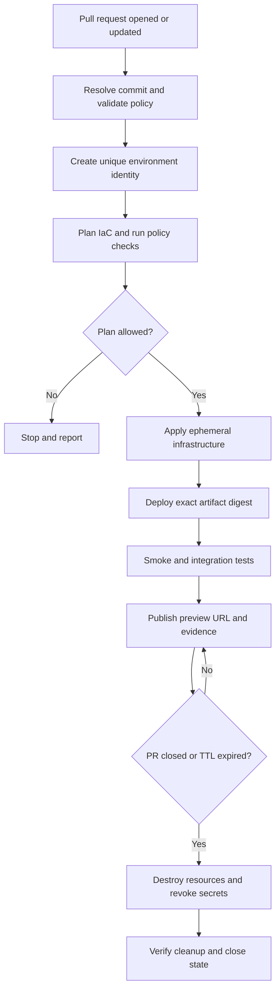

# Giới thiệu hạ tầng bằng mã và môi trường tạm thời

Pipeline CI/CD không chỉ tạo package và chạy test. Để kiểm tra một thay đổi gần với cách nó sẽ vận hành khi phát hành, nhóm thường cần database, message broker, network, service phụ thuộc, cấu hình và quyền truy cập phù hợp. Nếu mỗi lần kiểm thử phải nhờ người tạo tài nguyên thủ công, môi trường dễ lệch nhau, thời gian chờ kéo dài và tài nguyên cũ có thể bị bỏ quên.

Infrastructure as Code (IaC) mô tả hạ tầng bằng các file có thể review, version control, kiểm tra và áp dụng tự động. Kết hợp IaC với môi trường tạm thời (*ephemeral environment* hoặc *preview environment*), pipeline có thể tạo một môi trường riêng cho pull request hoặc một lần thử nghiệm, triển khai đúng artifact cần kiểm tra, chạy test rồi thu hồi tài nguyên khi hoàn tất.

Mục tiêu không phải tạo một bản sao production cho mọi thay đổi bằng mọi giá. Mục tiêu là mô tả hạ tầng có thể tái lập, kiểm soát khác biệt giữa các môi trường, cô lập rủi ro, rút ngắn thời gian phản hồi và quản lý vòng đời tài nguyên từ lúc tạo đến lúc xóa.

## 1. Infrastructure as Code là gì?

Infrastructure as Code là cách quản lý tài nguyên hạ tầng bằng định nghĩa có thể lưu trong repository và xử lý bằng công cụ tự động. Thay vì đăng nhập vào console rồi tạo từng resource bằng thao tác thủ công, nhóm mô tả trạng thái mong muốn như network, subnet, database, bucket, cluster, service account, policy hoặc deployment.

Một định nghĩa IaC thường cho biết:

- Tài nguyên nào cần tồn tại và quan hệ phụ thuộc giữa chúng.
- Thuộc tính nào có thể cấu hình theo môi trường.
- Phiên bản provider, module hoặc công cụ nào được sử dụng.
- Quyền và danh tính nào được phép tạo, đọc, sửa hoặc xóa tài nguyên.
- Trạng thái thực tế được đối chiếu với trạng thái mong muốn ra sao.
- Cách kiểm tra, áp dụng, cập nhật và thu hồi hạ tầng.

IaC biến thay đổi hạ tầng thành thay đổi có thể review. Pull request có thể cho thấy subnet, quyền IAM, firewall rule hoặc cấu hình database nào sẽ thay đổi trước khi áp dụng. Lịch sử Git cung cấp thông tin ai đề xuất thay đổi và thay đổi nào được chấp nhận.

IaC không tự động làm hạ tầng an toàn hoặc đúng. Một file cấu hình có thể mô tả quyền quá rộng, database mở public hoặc resource có chi phí cao. Cần kết hợp review, kiểm tra cú pháp, policy-as-code, plan review, quyền tối thiểu và xác minh sau khi apply.

## 2. Vì sao nên mô tả hạ tầng bằng mã?

Quản lý hạ tầng thủ công tạo ra nhiều trạng thái khó nhìn thấy: một security group được chỉnh trực tiếp, một biến môi trường chỉ tồn tại trên máy chủ, một database có cấu hình khác tài liệu hoặc một tài nguyên không rõ ai sở hữu. Những khác biệt này làm cho staging và production khó tương thích, đồng thời khiến việc tái tạo môi trường khi có sự cố mất nhiều thời gian.

IaC đem lại một số lợi ích:

- **Có lịch sử thay đổi:** cấu hình hạ tầng được review và lưu cùng lịch sử Git.
- **Có thể tái lập:** cùng một định nghĩa và đầu vào có thể tạo ra môi trường theo quy ước đã xác định.
- **Có thể kiểm tra trước:** công cụ plan hoặc diff cho biết thay đổi dự kiến trước khi áp dụng.
- **Giảm thao tác lặp:** pipeline có thể tạo môi trường test hoặc preview theo yêu cầu.
- **Dễ phát hiện drift:** so sánh cấu hình khai báo với trạng thái thực tế giúp tìm thay đổi ngoài quy trình.
- **Có thể áp dụng policy:** kiểm tra region, network exposure, encryption, tagging, quyền và giới hạn chi phí.
- **Hỗ trợ thu hồi:** tài nguyên tạm có thể được dọn theo một vòng đời đã định nghĩa.

Lợi ích chỉ xuất hiện khi nhóm quản lý cả mã IaC, state, credential, module, provider, policy và quy trình vận hành. Một repository có file Terraform nhưng mọi người vẫn sửa console trực tiếp mà không cập nhật mã sẽ nhanh chóng mất độ tin cậy.

## 3. Mô hình khai báo và trạng thái mong muốn

Nhiều công cụ IaC hoạt động theo mô hình khai báo (*declarative*): người viết mô tả trạng thái mong muốn; công cụ xác định các thao tác cần thực hiện để đưa hạ tầng thực tế về trạng thái đó. Ví dụ, khai báo một database có phiên bản engine, kích thước, encryption và network placement. Khi cấu hình thay đổi, công cụ tạo kế hoạch cập nhật tương ứng.

Một số công cụ hoặc script có tính mệnh lệnh (*imperative*): người viết chỉ định từng bước tạo, cập nhật hoặc xóa. Hai cách có thể kết hợp, nhưng cần biết bước nào quản lý trạng thái và bước nào chỉ thực hiện một hành động.

Với IaC khai báo, nên chú ý:

- Mô tả trạng thái cuối cùng thay vì chỉ ghi các thao tác một lần.
- Đặt tên resource ổn định và có quy ước ownership.
- Khai báo dependency để công cụ biết thứ tự tạo và xóa.
- Không đưa giá trị bí mật trực tiếp vào file cấu hình hoặc output plan.
- Dùng module để tái sử dụng mẫu đã được kiểm soát.
- Review mọi thay đổi có thể thay thế hoặc xóa resource.

Khi apply, công cụ có thể cập nhật nhiều tài nguyên. Một thay đổi nhỏ trong định nghĩa đôi khi dẫn đến replacement hoặc destroy/create do thuộc tính không thể cập nhật tại chỗ. Vì vậy, cần đọc plan, hiểu tác động dữ liệu và có phương án phục hồi trước khi áp dụng.

## 4. Công cụ IaC và phạm vi sử dụng

Không có một công cụ phù hợp cho mọi lớp hạ tầng. Nhóm nên chọn theo nền tảng, kỹ năng, yêu cầu state, khả năng kiểm tra và hệ sinh thái hiện có.

| Nhóm công cụ | Ví dụ | Phạm vi thường dùng |
|---|---|---|
| Cloud/resource provisioning | Terraform, OpenTofu, Pulumi, CloudFormation, Bicep | Network, database, storage, compute, IAM và dịch vụ cloud |
| Configuration management | Ansible, Puppet, Chef | Cấu hình máy chủ, package, service và hệ điều hành |
| Container orchestration manifests | Kubernetes YAML, Helm, Kustomize | Namespace, workload, service, ingress, policy và cấu hình cluster |
| Platform templates | AWS CDK, Azure templates, Crossplane compositions | Tạo abstraction hoặc API nội bộ cho hạ tầng |
| Policy as Code | OPA/Conftest, Sentinel, Checkov và các scanner tương tự | Kiểm tra cấu hình, quyền, network, encryption và chuẩn tổ chức |

Một hệ thống có thể dùng nhiều công cụ ở các lớp khác nhau. Ví dụ Terraform tạo cluster và network, Helm triển khai ứng dụng, Ansible cấu hình một số máy chủ cũ, còn policy engine kiểm tra manifest. Cần xác định rõ công cụ nào sở hữu từng resource để tránh hai hệ thống cùng quản lý một đối tượng.

## 5. Tổ chức repository IaC

Repository nên phản ánh ranh giới sở hữu, vòng đời và mức độ chia sẻ của hạ tầng. Có thể tách module dùng chung khỏi cấu hình từng môi trường:

```text
infrastructure/
├── modules/
│   ├── network/
│   ├── application-service/
│   └── database/
├── environments/
│   ├── dev/
│   │   ├── main.tf
│   │   └── terraform.tfvars
│   ├── staging/
│   │   ├── main.tf
│   │   └── terraform.tfvars
│   └── production/
│       ├── main.tf
│       └── terraform.tfvars
├── policies/
│   └── network.rego
└── README.md
```

Đây là một cách tổ chức minh họa. Repository nhỏ có thể đặt cấu hình trong một thư mục; hệ thống lớn có thể tách repository theo domain hoặc team. Điều quan trọng là module được version hóa, cấu hình môi trường có chủ sở hữu và mỗi state có ranh giới rõ.

Không nên để một root module duy nhất quản lý tất cả tài nguyên của mọi môi trường nếu quyền, vòng đời và blast radius khác nhau. Tách state và quyền theo môi trường giúp giảm khả năng một pipeline dev vô tình tác động production.

## 6. Ví dụ khai báo hạ tầng bằng Terraform

Terraform là một công cụ IaC phổ biến, dùng HCL để mô tả resource, provider, variable và output. Ví dụ đơn giản:

```hcl
terraform {
  required_version = ">= 1.8.0, < 2.0.0"

  required_providers {
    examplecloud = {
      source  = "example/examplecloud"
      version = "~> 3.2"
    }
  }
}

variable "environment" {
  type        = string
  description = "Environment name for this deployment."
}

variable "instance_size" {
  type        = string
  description = "Approved compute size for this environment."
}

resource "examplecloud_instance" "app" {
  name          = "order-service-${var.environment}"
  instance_size = var.instance_size

  tags = {
    service     = "order-service"
    environment = var.environment
    managed_by  = "terraform"
  }
}

output "instance_id" {
  value = examplecloud_instance.app.id
}
```

Provider `example/examplecloud` và resource `examplecloud_instance` là tên giả định để minh họa cấu trúc HCL, không phải provider cloud có thật. Trong repository thực tế, cần dùng provider chính thức hoặc đã được tổ chức phê duyệt, ghim phiên bản tương thích và commit lock file `.terraform.lock.hcl`.

Biến môi trường chỉ nhận những giá trị được policy cho phép. Không nên để pull request có thể truyền tùy ý `instance_size`, region hoặc public network flag rồi tạo tài nguyên không kiểm soát. Có thể dùng validation block và policy-as-code để giới hạn giá trị hợp lệ.

## 7. Module và tái sử dụng mẫu hạ tầng

Module đóng gói một nhóm resource cùng giao diện đầu vào/đầu ra. Ví dụ module database có thể nhận environment, engine version, subnet group, encryption setting và retention; trả về endpoint và resource identifier.

Module hữu ích khi:

- Nhiều service cần cùng một mẫu network hoặc database.
- Nhóm muốn chuẩn hóa encryption, tagging, logging và backup.
- Có thể cập nhật một mẫu dùng chung qua version và review.
- Cần áp dụng policy thống nhất thay vì copy/paste cấu hình.

Module quá tổng quát có thể tạo nhiều biến khó hiểu. Hãy cung cấp interface nhỏ, giá trị mặc định an toàn và validation. Thay đổi module dùng chung cần kiểm tra các consumer vì một thay đổi có thể ảnh hưởng nhiều môi trường.

Module từ nguồn ngoài cần được ghim version hoặc commit reference. Không trỏ module production đến nhánh thay đổi như `main` mà không có quy trình cập nhật. Terraform lock file `.terraform.lock.hcl` ghi nhận lựa chọn provider; module cần được ghim riêng bằng version hoặc source reference cụ thể.

## 8. Plan, review và apply

Quy trình IaC an toàn thường tách việc tạo kế hoạch khỏi việc áp dụng thay đổi:

1. **Format và validate:** kiểm tra cú pháp, định dạng và cấu trúc.
2. **Static/policy checks:** phát hiện resource nguy hiểm, quyền quá rộng, thiếu encryption hoặc cấu hình sai chuẩn.
3. **Plan:** đọc state và trạng thái provider để tính các thay đổi dự kiến.
4. **Review:** người có trách nhiệm xem resource được tạo, cập nhật, thay thế hoặc xóa.
5. **Apply:** áp dụng kế hoạch đã được chấp nhận với danh tính và quyền phù hợp.
6. **Verify:** kiểm tra resource thực tế, kết nối, policy và trạng thái dịch vụ.
7. **Record:** lưu commit, plan/apply run, state identity, người phê duyệt và kết quả.

Với Terraform, các lệnh thường dùng:

```bash
terraform fmt -check -recursive
terraform init -lockfile=readonly
terraform validate
terraform plan -out=tfplan
terraform show tfplan
terraform apply tfplan
```

`terraform init` tải provider/module theo cấu hình và lock file; `-lockfile=readonly` yêu cầu không tự cập nhật lock file trong lần chạy này. `plan -out` tạo saved plan để apply đúng kế hoạch đã review. Saved plan có thể chứa dữ liệu nhạy cảm, vì vậy không upload lên artifact công khai hoặc lưu trong log; cần giới hạn quyền đọc và thời gian lưu.

Plan chỉ phản ánh trạng thái được đọc tại thời điểm tạo. Nếu state hoặc hạ tầng thay đổi trước khi apply, công cụ có thể từ chối hoặc cần tạo plan mới. Không nên review một plan rồi chạy `terraform apply` không tham chiếu plan đó nếu mục tiêu là áp dụng đúng thay đổi đã duyệt.

## 9. State và ranh giới quản lý tài nguyên

Terraform state ánh xạ resource trong cấu hình với đối tượng thực tế mà provider quản lý. State thường chứa identifier, metadata và có thể cả giá trị nhạy cảm. Nó là dữ liệu quan trọng của hệ thống IaC.

State cần được quản lý bằng backend phù hợp, có:

- Quyền đọc/ghi giới hạn theo môi trường và nhóm sở hữu.
- Mã hóa khi lưu trữ và truyền tải.
- Locking để ngăn nhiều apply đồng thời trên cùng state.
- Versioning hoặc backup để phục hồi khi state bị hỏng.
- Audit log và quy trình truy cập khẩn cấp.
- Phân tách state giữa dev, staging, production và từng preview environment.

Không commit state thật vào Git nếu nó có thể chứa secret hoặc thông tin hạ tầng nhạy cảm. Không chỉnh sửa state bằng tay trừ khi thực hiện quy trình repair có kiểm soát, backup và review. State bị mất hoặc lệch có thể khiến công cụ muốn tạo lại resource đang tồn tại hoặc bỏ quản lý một resource quan trọng.

Terraform workspace có thể giúp tạo nhiều state cùng một cấu hình trong một số mô hình, nhưng workspace không phải ranh giới bảo mật mạnh. Với môi trường có quyền, vòng đời hoặc dữ liệu khác nhau, nên dùng backend key/root module/quyền truy cập tách biệt. Không dựa vào tên workspace để ngăn pipeline dev truy cập state production.

## 10. Phát hiện configuration drift

Configuration drift xảy ra khi hạ tầng thực tế khác với định nghĩa IaC hoặc state mong đợi. Drift có thể do người vận hành sửa console, một automation khác thay đổi resource, cập nhật ngoài kế hoạch hoặc một lần apply thất bại giữa chừng.

Drift có thể dẫn đến:

- Firewall hoặc IAM policy rộng hơn cấu hình được review.
- Instance size hoặc database setting khác môi trường chuẩn.
- Resource bị xóa hoặc thay đổi thủ công khiến ứng dụng lỗi.
- Pipeline plan đề xuất thay đổi lớn ngoài dự kiến.
- Khó tái tạo môi trường vì mã không còn mô tả trạng thái thật.

Nhóm nên chạy `plan` định kỳ (với hành vi refresh theo cấu hình mặc định phù hợp) hoặc dùng cơ chế drift detection chuyên dụng của nền tảng. Khi phát hiện drift, cần xác định thay đổi có chủ ý hay không. Nếu hợp lệ, cập nhật IaC qua pull request; nếu không, khôi phục trạng thái theo quy trình. Không tự động apply mọi plan phát hiện drift trên production mà không xem xét tác động.

Drift detection cũng có thể được kích hoạt khi mở pull request hoặc trước release. Kết quả cần phân biệt drift ngoài dự kiến với thay đổi được quản lý bởi hệ thống khác để tránh hai controller liên tục ghi đè nhau.

## 11. Môi trường là gì và vì sao cần phân biệt?

Môi trường là một tập hợp tài nguyên, cấu hình, dữ liệu, quyền và endpoint mà ứng dụng sử dụng trong một giai đoạn hoặc mục đích cụ thể. Các tên thường gặp:

| Môi trường | Mục đích | Đặc điểm |
|---|---|---|
| Local/development | Phát triển và debug | Nhanh, dễ reset, dữ liệu tổng hợp |
| Test/CI | Chạy test tự động | Có thể tạo mới cho từng job hoặc test suite |
| Integration | Kiểm tra nhiều service | Có dependency dùng chung hoặc được dựng theo phiên bản |
| Staging | Diễn tập phát hành và kiểm chứng trước production | Tương đồng production ở các yếu tố quan trọng |
| Production | Phục vụ người dùng thật | Quyền chặt, dữ liệu thật, giám sát và thay đổi có kiểm soát |
| Preview/ephemeral | Xem trước một thay đổi hoặc pull request | Có vòng đời ngắn, định danh riêng và tự động dọn |

Không nhất thiết mọi tổ chức cần tất cả môi trường. Một service nhỏ có thể chỉ cần local, CI, staging và production. Hệ thống microservices lớn có thể cần integration environment hoặc preview theo nhóm service. Cần chọn theo rủi ro và chi phí vận hành.

## 12. Cấu hình theo môi trường

Cùng một artifact nên có thể chạy ở nhiều môi trường bằng cách nhận cấu hình phù hợp khi deploy hoặc khi khởi động. Những giá trị thay đổi theo môi trường thường gồm endpoint, database connection, feature flag, resource limit, log level, domain, queue name và chính sách scaling.

Nên phân loại:

- **Cấu hình không nhạy cảm:** có thể lưu trong repository nếu dùng chung và được review.
- **Cấu hình môi trường:** lưu theo environment hoặc hệ thống quản lý cấu hình có version và validation.
- **Secret:** password, token, private key, certificate private material; lấy từ secret manager hoặc workload identity.
- **Build-time input:** giá trị làm thay đổi bytes artifact; phải được ghi nhận trong build metadata.
- **Deploy-time input:** cấu hình thay đổi hành vi runtime nhưng không thay đổi artifact; cần lưu trong deployment record.

Không nhúng endpoint production, credential hoặc dữ liệu môi trường vào JAR/container image nếu có thể truyền khi deploy. Nếu cùng artifact được build lại riêng cho staging và production, nhóm khó chứng minh hai môi trường đang chạy cùng một nội dung.

Cấu hình nên có schema và kiểm tra trước deploy. Ví dụ `APP_ENV` chỉ nhận `dev`, `staging` hoặc `production`; URL phải đúng scheme/host được cho phép; timeout phải nằm trong khoảng hợp lệ. Giá trị mặc định cần an toàn và không được âm thầm trỏ sang production.

## 13. Ephemeral environment là gì?

Ephemeral environment là môi trường được tạo tự động cho một thay đổi, pull request, branch hoặc lần thử nghiệm, sau đó được thu hồi khi không còn cần thiết. Nó có thể gồm namespace Kubernetes, service, database tạm, queue, DNS record, ingress và cấu hình quan sát.

Ví dụ, khi mở pull request `#184`, pipeline tạo môi trường:

```text
https://pr-184.preview.example.test
```

Môi trường này chạy artifact được build từ commit của pull request, dùng database hoặc schema riêng, rồi chạy integration/E2E test. Reviewer có thể mở URL để xem thay đổi. Khi pull request được merge hoặc đóng, pipeline dọn resource và state liên quan.

Ephemeral environment phù hợp khi:

- Nhiều pull request cần kiểm tra song song mà không ghi đè môi trường chung.
- Thay đổi UI hoặc API cần reviewer xem trước.
- Cần kiểm tra tích hợp trên một tập dependency cụ thể.
- Muốn tạo môi trường thử nghiệm có cấu hình gần production nhưng dữ liệu riêng.
- Muốn giảm nhu cầu duy trì nhiều môi trường cố định.

Không phải mọi test đều cần một môi trường đầy đủ. Unit test vẫn nên chạy nhanh trong job; preview environment chỉ nên tạo khi lợi ích của kiểm tra tích hợp hoặc review trực quan xứng đáng với chi phí.

## 14. Kiến trúc vòng đời của preview environment

Một preview environment cần có vòng đời xác định, từ trigger đến cleanup:

1. Nhận sự kiện pull request hoặc yêu cầu preview.
2. Resolve commit SHA và tạo định danh môi trường duy nhất.
3. Kiểm tra quyền, policy, quota và đầu vào cấu hình.
4. Tạo hạ tầng bằng module IaC đã được phê duyệt.
5. Cấp cấu hình và secret tạm thời theo môi trường.
6. Deploy đúng artifact digest của commit.
7. Chạy smoke, integration, contract hoặc E2E test cần thiết.
8. Công bố URL và kết quả cho reviewer qua giao diện pipeline.
9. Theo dõi TTL, trạng thái PR và thời gian tồn tại.
10. Cleanup resource, state, DNS, secret và dữ liệu tạm khi hết vòng đời.



Mỗi môi trường cần owner, source PR, commit SHA, created-at, expires-at và resource ID. Metadata này giúp biết resource nào được phép cleanup và điều tra khi môi trường bị bỏ quên.

## 15. Định danh và cô lập môi trường tạm thời

Tên môi trường cần duy nhất, ổn định trong suốt vòng đời PR và không vượt giới hạn tên resource của nền tảng. Có thể dùng PR number cộng repository/project slug hoặc một ID đã chuẩn hóa:

```text
environment_id = preview-order-service-pr-184
namespace      = preview-pr-184
dns_name       = pr-184.preview.example.test
state_key      = preview/order-service/pr-184.tfstate
```

Các giá trị trên là ví dụ. Không đưa branch name thô vào tên resource vì branch có thể chứa ký tự không hợp lệ, quá dài hoặc trùng sau khi chuẩn hóa. PR number có thể tái sử dụng trong một số hệ thống hoặc repository; khi cần phân biệt vòng đời, thêm repository ID hoặc generation/run ID.

Cô lập cần xét nhiều lớp:

- **Compute:** namespace, pod, VM hoặc service riêng.
- **Network:** ingress, egress, network policy và DNS riêng.
- **Data:** database/schema/bucket/queue riêng hoặc namespace dữ liệu riêng.
- **Identity:** service account và credential giới hạn theo môi trường.
- **Secrets:** secret riêng, ngắn hạn và có thể thu hồi.
- **State:** IaC state riêng để cleanup một preview không tác động preview khác.
- **Quota:** giới hạn CPU, memory, storage, IP, connection và số môi trường đồng thời.

Namespace riêng trong Kubernetes không tự động cô lập mọi thứ. Cluster-level resource, node, network, ingress controller, storage class và quyền cluster-admin có thể vẫn được chia sẻ. Với dữ liệu nhạy cảm hoặc workload không tin cậy, cần đánh giá ranh giới cluster/account riêng thay vì chỉ dựa vào namespace.

## 16. Dùng lại module IaC cho môi trường tạm thời

Preview environment nên dùng cùng module hạ tầng đã được kiểm tra, với input nhỏ hơn hoặc cấu hình tiết kiệm hơn. Ví dụ module service có thể nhận:

```hcl
variable "environment_id" {
  type = string
}

variable "replica_count" {
  type    = number
  default = 1
}

variable "ttl_hours" {
  type    = number
  default = 24
}

resource "examplecloud_service" "preview" {
  name           = var.environment_id
  replica_count  = var.replica_count
  deletion_after = var.ttl_hours

  tags = {
    environment_type = "ephemeral"
    environment_id   = var.environment_id
    managed_by       = "terraform"
  }
}
```

Resource và thuộc tính `examplecloud_service` trong ví dụ là giả định, không phải cú pháp provider thật. Trong triển khai thực tế, TTL thường do controller, scheduler hoặc automation cleanup quản lý; không phải provider nào cũng hỗ trợ `deletion_after`.

Không tạo một bản IaC riêng hoàn toàn cho preview nếu có thể mở rộng module dùng chung bằng input được kiểm soát. Nếu preview dùng cấu hình khác staging ở các điểm ảnh hưởng hành vi, hãy ghi rõ khác biệt để reviewer hiểu giới hạn của kết quả.

## 17. Terraform state cho từng preview environment

Mỗi preview environment cần state riêng hoặc một cơ chế ownership tương đương. Nếu nhiều PR cùng dùng một state, một job cleanup có thể xóa resource của PR khác hoặc plan có thể sửa nhầm môi trường.

Một state key có thể dựa trên repository và PR ID:

```text
preview/order-service/pr-184.tfstate
preview/order-service/pr-185.tfstate
preview/payment-service/pr-184.tfstate
```

Backend phải hỗ trợ locking và quyền truy cập phù hợp. Job tạo môi trường chỉ được ghi state của chính preview đó. Job cleanup cần xác minh environment ID, owner và state key trước khi destroy.

Không dùng Terraform workspace như ranh giới bảo mật duy nhất. Workspaces chia sẻ cùng cấu hình/backend và có thể dùng chung credential; chúng không tự cấp IAM policy riêng hoặc bảo vệ state khỏi job có quyền rộng. Khi preview cần quyền hẹp, tách backend key, project/account hoặc identity theo thiết kế bảo mật.

State là dữ liệu nhạy cảm. Không upload state vào artifact công khai hoặc in nội dung state trong log. Backend cần encryption, access control, versioning và audit. Khi môi trường đã bị destroy, có thể lưu metadata tối thiểu phục vụ audit theo chính sách rồi xóa state theo vòng đời đã định nghĩa.

## 18. Cleanup: phần bắt buộc của thiết kế ephemeral

Một môi trường tạm chỉ thực sự tạm thời khi cleanup được thiết kế ngay từ đầu. Nếu pipeline chỉ có bước create mà không có destroy đáng tin cậy, tài nguyên sẽ tích lũy, gây chi phí và tăng bề mặt tấn công.

Cleanup nên được kích hoạt bởi nhiều điều kiện:

- Pull request được merge hoặc đóng.
- Branch preview bị xóa theo chính sách.
- TTL hết hạn.
- Người sở hữu yêu cầu dọn thủ công.
- Một job kiểm kê định kỳ phát hiện resource quá hạn hoặc orphan.

Quy trình cleanup:

1. Xác minh environment ID, repository, PR và owner.
2. Chặn traffic mới hoặc đưa preview về trạng thái không nhận request.
3. Thu hồi token, credential và secret tạm.
4. Xóa workload, service, database/schema, queue, bucket, ingress và DNS record thuộc môi trường.
5. Xác minh resource đã biến mất hoặc ghi nhận lý do không thể xóa.
6. Lưu metadata/audit cần thiết rồi đóng state theo chính sách.
7. Báo cáo resource còn sót và tạo ticket hoặc cảnh báo cho owner.

Cleanup cần idempotent: chạy lại không gây lỗi nguy hiểm hoặc xóa resource khác. Nếu một bước thất bại, job cần giữ đủ metadata để retry và tiếp tục dọn phần còn lại. Không xóa state trước khi chắc chắn resource đã được xử lý, vì mất state có thể làm resource trở thành orphan khó quản lý.

Không nên dùng một lệnh destroy rộng trên project hoặc cluster chỉ dựa vào PR number. Hãy giới hạn scope bằng state riêng, resource tag/label và quyền được cấp cho đúng môi trường.

## 19. TTL, orphan detection và quản lý chi phí

TTL (time to live) là thời hạn tối đa một môi trường tạm được phép tồn tại nếu không có gia hạn hợp lệ. TTL giúp dọn các môi trường bị bỏ quên khi webhook cleanup không chạy hoặc pull request bị bỏ dở.

Mỗi resource nên có metadata như:

```text
managed_by       = iac
environment_type = ephemeral
environment_id   = preview-order-service-pr-184
repository       = team/order-service
pull_request     = 184
owner            = team-orders
created_at       = 2026-11-18T08:00:00Z
expires_at       = 2026-11-19T08:00:00Z
```

Giá trị chỉ minh họa. Nền tảng có thể áp dụng tag, label hoặc resource metadata khác nhau. Cleanup controller cần dùng metadata đã xác thực, không xóa resource chỉ vì tên có chứa `preview`.

Chi phí preview có thể tăng nhanh khi nhiều PR chạy song song. Nhóm nên đặt:

- Số preview tối đa theo repository/team.
- CPU, memory, storage và replica limit.
- TTL mặc định và cơ chế gia hạn có giới hạn.
- Auto-suspend khi không có traffic nếu nền tảng hỗ trợ.
- Giới hạn database, log retention và dung lượng artifact.
- Budget alert hoặc quota cho account/project preview.
- Báo cáo resource quá hạn và chi phí theo owner.

Orphan detection định kỳ so sánh danh sách resource có tag ephemeral với danh sách PR/run còn hiệu lực. Resource thiếu owner, quá TTL hoặc không có state liên kết cần được cách ly và xử lý theo quy trình. Không tự động xóa resource không rõ nguồn gốc nếu nó có thể là tài nguyên dùng chung hoặc production.

## 20. Quản lý database và test data trong preview

Database thường là thành phần khó nhất của preview environment vì cần cân bằng chi phí, tốc độ tạo, tính cô lập và mức độ đại diện. Có thể chọn:

| Cách tổ chức | Ưu điểm | Rủi ro/cân nhắc |
|---|---|---|
| Database riêng cho mỗi preview | Cô lập dữ liệu và migration tốt | Tạo chậm, tốn chi phí và quota |
| Schema riêng trên database dùng chung | Tạo nhanh, chia sẻ hạ tầng | Cần quản lý schema name, quyền và cleanup chính xác |
| Database ephemeral trong container | Phù hợp integration test ngắn | Dữ liệu không tồn tại lâu, cần image và storage phù hợp |
| Database snapshot/clone | Dữ liệu và cấu trúc gần môi trường chuẩn | Cần kiểm soát chi phí, quyền và ẩn danh dữ liệu |

Không sao chép dữ liệu cá nhân hoặc bí mật production nguyên trạng vào preview. Dùng dữ liệu tổng hợp, dữ liệu đã ẩn danh hoặc snapshot đã được phê duyệt. Secret kết nối database cần riêng cho từng preview, quyền tối thiểu và thời hạn ngắn.

Migration phải tương thích với vòng đời preview. Khi PR cập nhật commit mới, pipeline cần biết có phải cập nhật schema hiện tại, reset database hay tạo môi trường mới. Không để hai job cùng apply migration trên một database dùng chung mà không có lock hoặc quy tắc tuần tự hóa.

## 21. DNS, ingress và truy cập preview

Preview thường cần URL để reviewer hoặc test runner truy cập. Một quy ước DNS có thể dùng wildcard domain và định danh PR:

```text
pr-184.preview.example.test
pr-185.preview.example.test
```

Hạ tầng cần kiểm soát DNS record, certificate, ingress routing và xác thực. Wildcard certificate có thể giảm số lần cấp chứng thư nhưng phải bảo vệ private key và giới hạn phạm vi domain. DNS record cũ cần được dọn khi preview hết hạn.

Preview không nên mặc định public. Có thể yêu cầu SSO, short-lived access token, IP allowlist hoặc reverse proxy có xác thực. Nếu test automation cần truy cập, cấp credential riêng cho test runner và thu hồi sau khi hoàn tất.

Không đưa secret vào URL query string vì URL thường xuất hiện trong browser history, proxy log và telemetry. Không dùng URL khó đoán như biện pháp xác thực duy nhất.

## 22. Bảo mật pipeline tạo hạ tầng

Pipeline IaC có quyền tạo network, IAM, database và compute; một workflow bị chiếm quyền có thể gây tác động lớn. Vì vậy, quyền của job cần phân tách theo nhiệm vụ:

- Job lint/validate không cần credential cloud.
- Job plan có quyền đọc state và đọc metadata provider ở mức cần thiết; không cần quyền apply.
- Job apply chỉ chạy từ branch/event đáng tin cậy và dùng identity riêng cho environment đích.
- Job preview chỉ có quyền trong project/account hoặc namespace preview.
- Job cleanup chỉ được xóa resource thuộc environment ID/state mà nó sở hữu.
- Job production cần environment protection, approval hoặc policy theo yêu cầu tổ chức.

Ưu tiên workload identity hoặc OIDC để cấp credential ngắn hạn thay vì lưu access key dài hạn trong repository. Trust policy phải giới hạn repository, workflow, branch/tag và environment được phép nhận token. Không để workflow pull request từ fork nhận quyền tạo resource production.

Plan file và state có thể chứa secret, endpoint nội bộ, ID tài nguyên hoặc cấu hình nhạy cảm. Hạn chế quyền đọc, không in nội dung nhạy cảm ra log và đặt retention ngắn. Không upload plan/state lên artifact có thể truy cập công khai.

## 23. Policy as Code cho hạ tầng

Policy as Code cho phép kiểm tra cấu hình hạ tầng bằng quy tắc tự động trước khi apply. Các policy thường gặp:

- Database production phải bật encryption và backup.
- Storage không được public nếu không có ngoại lệ được duyệt.
- Security group không được mở cổng quản trị cho toàn Internet.
- Resource production phải có owner, service và environment tag.
- Preview chỉ được tạo trong region/account được cho phép.
- Instance size, replica và storage phải nằm trong quota.
- IAM policy không được cấp wildcard action/resource ngoài phạm vi.
- Container image và module phải đến từ registry/source được phê duyệt.
- Log và audit cần được bật cho resource có yêu cầu.

Policy cần phân biệt lỗi chặn và cảnh báo. Một rule quá rộng có thể làm pipeline khó sử dụng; rule quá lỏng không bảo vệ được tài nguyên. Ngoại lệ nên có owner, lý do, phạm vi, ngày hết hạn và bằng chứng review.

Policy nên được kiểm tra trong pull request bằng input plan hoặc manifest. Nếu plan có dữ liệu nhạy cảm, chỉ job tin cậy được đọc và xử lý; report cần loại bỏ giá trị bí mật trước khi hiển thị.

## 24. Tách hạ tầng dùng chung và hạ tầng theo preview

Một preview environment thường không cần tạo lại mọi thứ. Một số thành phần có thể dùng chung như cluster, ingress controller, artifact registry, observability backend hoặc network nền. Thành phần khác cần riêng như namespace, service, database/schema, queue và secret.

Khi dùng chung, cần xác định:

- Resource nào là shared và ai sở hữu?
- Preview được phép tạo/xóa những resource con nào?
- Có quota để một preview không chiếm hết capacity không?
- Network policy có ngăn preview truy cập nhầm preview khác không?
- Secret và data có được tách biệt không?
- Cleanup có xóa nhầm shared resource không?
- Cluster hoặc account dùng chung có đáp ứng trust boundary cho mã PR không?

Nếu code từ contributor bên ngoài có thể chạy trong preview, cần giả định code đó không đáng tin. Môi trường chia sẻ cluster với workload nhạy cảm phải có ranh giới bảo mật đủ mạnh hoặc dùng account/cluster riêng cho workload không tin cậy.

## 25. Ví dụ pipeline tạo preview environment

Một workflow minh họa có thể gồm các job validate, plan, apply, deploy, test và cleanup. Cú pháp thực tế phụ thuộc nền tảng CI và cloud provider; ví dụ dưới đây thể hiện luồng và điều kiện quan trọng:

```yaml
name: Preview environment

on:
  pull_request:
    types: [opened, synchronize, reopened, closed]

permissions:
  contents: read

jobs:
  validate:
    if: github.event.action != 'closed'
    runs-on: ubuntu-latest
    steps:
      - uses: actions/checkout@v4
      - uses: hashicorp/setup-terraform@v3
        with:
          terraform_version: 1.8.5
      - run: terraform fmt -check -recursive
        working-directory: infrastructure/preview
      - run: terraform init -backend=false -lockfile=readonly
        working-directory: infrastructure/preview
      - run: terraform validate
        working-directory: infrastructure/preview

  plan:
    needs: validate
    if: >-
      github.event.action != 'closed' &&
      github.event.pull_request.head.repo.full_name == github.repository
    runs-on: ubuntu-latest
    permissions:
      contents: read
      id-token: write
    steps:
      - uses: actions/checkout@v4
      - name: Create a remote preview plan
        id: plan
        run: ./scripts/preview-plan.sh "${{ github.event.pull_request.number }}" >> "$GITHUB_OUTPUT"
    outputs:
      plan_id: ${{ steps.plan.outputs.plan_id }}

  apply-and-deploy:
    needs: plan
    if: >-
      github.event.action != 'closed' &&
      github.event.pull_request.head.repo.full_name == github.repository
    environment: preview
    runs-on: ubuntu-latest
    permissions:
      contents: read
      id-token: write
    steps:
      - uses: actions/checkout@v4
      - name: Apply the reviewed remote plan
        env:
          PLAN_ID: ${{ needs.plan.outputs.plan_id }}
          PR_NUMBER: ${{ github.event.pull_request.number }}
        run: ./scripts/preview-apply.sh "$PR_NUMBER" "$PLAN_ID"
      - name: Deploy the pull request artifact
        run: ./scripts/preview-deploy.sh "${{ github.event.pull_request.number }}" "${{ github.event.pull_request.head.sha }}"
      - name: Run smoke tests
        run: ./scripts/preview-smoke-test.sh "${{ github.event.pull_request.number }}"

  cleanup:
    if: github.event.action == 'closed'
    runs-on: ubuntu-latest
    permissions:
      contents: read
      id-token: write
    steps:
      - uses: actions/checkout@v4
        with:
          ref: ${{ github.event.pull_request.base.sha }}
      - name: Destroy only this preview environment
        run: ./scripts/preview-destroy.sh "${{ github.event.pull_request.number }}"
```

Các script trong ví dụ là entry point giả định của repository. `preview-plan.sh` cần trả về `plan_id=<id>` của một remote plan đã lưu; `preview-apply.sh` phải áp dụng đúng plan ID đó, không tự tạo một plan mới. Remote plan store cần có quyền đọc/ghi giới hạn và retention ngắn vì plan có thể chứa dữ liệu nhạy cảm. Nếu dùng saved plan file thay cho remote run, cần mã hóa và chuyển file qua kênh artifact riêng tư có quyền truy cập chặt.

Job có quyền OIDC chỉ chạy cho pull request từ cùng repository trong ví dụ. Đây vẫn chưa phải ranh giới tin cậy đầy đủ: workflow thực tế nên dùng reusable workflow được bảo vệ ở nhánh tin cậy, giới hạn OIDC trust policy theo repository/workflow/environment, bảo vệ thay đổi workflow bằng review và cấu hình environment protection. Khi pull request đến từ fork, chỉ chạy validate không có credential; việc tạo preview cần một quy trình đặc biệt được người có thẩm quyền xác nhận theo policy. Job cleanup checkout `base.sha` để chạy script từ mã nguồn của nhánh đích, không thực thi script do pull request đóng góp.

Workflow rút gọn trên cũng chưa thể hiện TTL controller hoặc orphan cleanup. Hai cơ chế này cần được triển khai bổ sung vì sự kiện `closed` có thể không được xử lý nếu workflow bị hủy hoặc nền tảng gặp sự cố.

## 26. Xử lý pull request cập nhật liên tục và concurrency

Một pull request có thể được push nhiều lần trong khi preview cũ vẫn đang được tạo. Nếu hai pipeline cùng apply vào một state hoặc cùng deploy vào một namespace, kết quả có thể bị ghi đè hoặc lẫn phiên bản.

Nhóm cần:

- Dùng environment ID ổn định theo PR và repository.
- Ghi commit SHA của lần deploy hiện tại vào metadata.
- Serialize thao tác apply/destroy trên cùng state.
- Quy định job mới chờ hay thay thế job cũ.
- Trước khi publish URL hoặc đánh dấu preview sẵn sàng, xác minh runtime đang chạy đúng commit/artifact digest mới nhất được chấp nhận.
- Ngăn cleanup của run cũ xóa môi trường do run mới quản lý.
- Dùng generation hoặc deployment ID để phân biệt vòng đời khi cần.

Ví dụ, run A triển khai commit `C1`, sau đó run B triển khai `C2`. Nếu cleanup cuối của A chạy muộn và destroy state chung, preview của B có thể bị xóa. Cleanup phải xác minh owner/generation hoặc dùng lock để chỉ xóa tài nguyên thuộc đúng vòng đời.

## 27. Quan sát và kiểm tra môi trường tạm

Preview environment cần đủ khả năng quan sát để xác định test thất bại do ứng dụng, hạ tầng hay dependency. Nên gắn environment ID, PR number, commit SHA và artifact digest vào log, metric, trace và deployment record.

Các kiểm tra hữu ích:

- Resource được tạo đủ và đạt trạng thái ready.
- DNS/ingress trỏ đến đúng service.
- TLS certificate hợp lệ và quyền truy cập hoạt động.
- Ứng dụng chạy đúng artifact digest.
- Database migration và seed data hoàn tất.
- Health/readiness endpoint thành công.
- Smoke hoặc E2E test hoàn tất với dữ liệu riêng.
- Resource usage nằm trong quota.
- Cleanup có thể tìm và xác minh toàn bộ resource theo environment ID.

Không nên giữ log hoặc dữ liệu debug vô thời hạn. TTL cho preview nên áp dụng cả cho log, database snapshot, secret và artifact tạm nếu chúng không cần tồn tại sau khi môi trường kết thúc.

## 28. Các lỗi thường gặp khi dùng IaC và ephemeral environment

| Lỗi | Hậu quả | Cách xử lý |
|---|---|---|
| Sửa hạ tầng thủ công nhưng không cập nhật IaC | Drift và môi trường khó tái lập | Đưa thay đổi về pull request và chạy drift detection |
| Apply trực tiếp từ mọi pull request | Mã không tin cậy có thể tạo resource hoặc chiếm quyền | Tách validate/plan khỏi apply; giới hạn identity và trust boundary |
| Dùng chung state cho nhiều preview | Cleanup hoặc apply có thể tác động nhầm môi trường | State riêng theo repository/PR hoặc ownership ID |
| Dùng workspace như ranh giới bảo mật | Job có thể truy cập state khác bằng cùng credential | Tách backend, quyền và account/project khi cần |
| Không có TTL | Resource và chi phí tích lũy | TTL controller, orphan scan và budget alert |
| Cleanup xóa state trước resource | Resource bị orphan và khó quản lý | Destroy có xác minh rồi mới đóng state theo quy trình |
| Cleanup dựa vào tên resource | Có thể xóa nhầm shared hoặc production resource | Xác minh tag, owner, state và environment ID |
| Chỉ dùng namespace để cô lập | Cluster-level resource hoặc quyền vẫn được chia sẻ | Network policy, RBAC, quota và cluster/account boundary phù hợp |
| Dùng dữ liệu production trong preview | Rò rỉ dữ liệu và quyền truy cập quá mức | Dữ liệu tổng hợp hoặc đã ẩn danh |
| Rebuild artifact trong preview và production | Không chắc cùng một nội dung đã được kiểm thử | Deploy theo digest đã tạo và lưu |
| Không xử lý PR push đồng thời | Preview có thể chạy sai commit hoặc bị cleanup nhầm | Concurrency lock, generation ID và commit verification |
| Plan không được review | Thay đổi phá hủy có thể được apply tự động | Hiển thị plan summary, policy gate và approval theo rủi ro |

Một lỗi khác là tạo môi trường tạm quá giống production nhưng không kiểm soát chi phí và quyền. Preview nên mô phỏng những yếu tố cần kiểm tra, với dữ liệu, credential và blast radius được giới hạn.

## 29. Checklist thiết kế IaC và preview environment

Trước khi đưa quy trình vào sử dụng, hãy xác minh:

- [ ] Hạ tầng được mô tả bằng mã và lưu trong repository có review.
- [ ] Provider, module và công cụ IaC được ghim phiên bản; lock file được quản lý.
- [ ] Module có interface rõ, validation và giá trị mặc định an toàn.
- [ ] Plan được tạo và review trước apply; thay đổi destroy/replace được nhận diện.
- [ ] State ở backend được mã hóa, có locking, versioning và quyền tối thiểu.
- [ ] State được tách theo môi trường và ranh giới ownership phù hợp.
- [ ] Drift detection có lịch và quy trình xử lý rõ.
- [ ] Cấu hình môi trường tách khỏi artifact; secret được lấy từ nguồn quản lý phù hợp.
- [ ] Preview có environment ID duy nhất gắn với repository, PR và commit.
- [ ] Compute, network, data, identity, secret và state được cô lập theo rủi ro.
- [ ] Môi trường tạm dùng module IaC đã được kiểm soát.
- [ ] Database và test data riêng, không sao chép dữ liệu production chưa ẩn danh.
- [ ] DNS, ingress và URL preview có xác thực phù hợp.
- [ ] Pipeline chỉ apply bằng identity có quyền đúng phạm vi.
- [ ] Concurrency giữa create, update và destroy được kiểm soát.
- [ ] Có cleanup khi PR đóng và TTL fallback khi event cleanup không chạy.
- [ ] Cleanup idempotent, có xác minh và không xóa resource dùng chung.
- [ ] Có orphan detection, quota, budget alert và ownership metadata.
- [ ] Log/metric/trace gắn environment ID, commit và artifact digest.
- [ ] Có cách xác minh preview đang chạy đúng artifact và trạng thái hạ tầng.

## 30. Kết luận

Infrastructure as Code đưa hạ tầng vào quy trình review, kiểm tra và truy vết như mã nguồn. Plan/apply có kiểm soát, state được bảo vệ, module được version hóa, policy-as-code và drift detection giúp duy trì trạng thái hạ tầng có thể giải thích. Ephemeral environment mở rộng khả năng đó bằng cách tạo môi trường riêng theo pull request hoặc lần thử, triển khai artifact cụ thể và thu hồi tài nguyên theo vòng đời.

Để mô hình hoạt động bền vững, cần thiết kế đồng thời quyền, state, dữ liệu, DNS, quota, TTL và cleanup. Mỗi môi trường tạm phải có định danh, owner, commit/artifact identity và thời hạn; mỗi thao tác apply/destroy phải giới hạn đúng phạm vi. Khi đó, nhóm có thể kiểm tra thay đổi trong môi trường gần với thực tế, giảm xung đột giữa các pull request và giữ chi phí cùng rủi ro trong giới hạn đã định.
