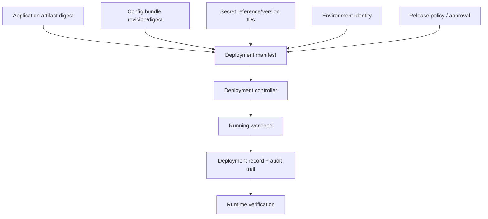
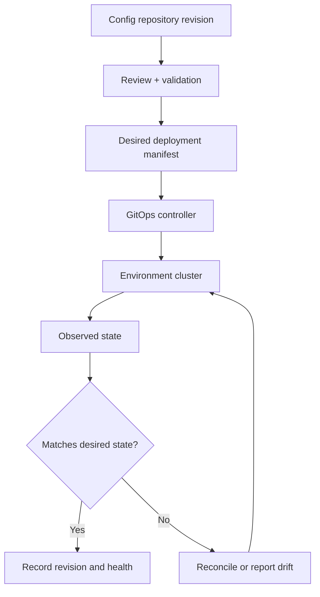

# Liên kết bản triển khai với đúng phiên bản cấu hình

## 1. Vì sao phải quản lý phiên bản cấu hình?

Một ứng dụng không chỉ được quyết định bởi mã nguồn và artifact. Khi chạy, ứng dụng còn nhận cấu hình như endpoint dịch vụ, feature flag, giới hạn timeout, số kết nối, mức log, tên queue, tham số nghiệp vụ và thông tin xác thực. Cùng một artifact có thể hoạt động khác nhau ở development, staging và production vì mỗi môi trường có cấu hình riêng.

Nếu nhóm chỉ ghi nhận phiên bản ứng dụng mà không ghi nhận cấu hình đã dùng, lịch sử triển khai sẽ thiếu một phần quan trọng. Khi xảy ra sự cố, câu hỏi “production đang chạy phiên bản nào?” chưa đủ. Cần biết chính xác artifact nào, cấu hình nào, secret version nào và chính sách rollout nào đã được áp dụng.

Ví dụ, `order-service` phiên bản `2.4.1` chạy bình thường ở staging nhưng lỗi ở production. Hai môi trường dùng cùng image digest, tuy nhiên production có `payment.timeout=2s` trong khi staging dùng `5s`. Nếu deployment record chỉ lưu image digest, nhóm không thể tái dựng đầy đủ trạng thái production lúc sự cố.

Liên kết bản triển khai với đúng phiên bản cấu hình giúp:

- Biết chính xác cấu hình hiệu lực tại một thời điểm.
- Tái tạo hoặc điều tra một lần triển khai cũ.
- Phát hiện cấu hình thay đổi ngoài quy trình (configuration drift).
- Đảm bảo staging và production được so sánh trên cùng artifact, đồng thời ghi rõ khác biệt cấu hình có chủ đích.
- Rollback ứng dụng và cấu hình theo một kế hoạch tương thích.
- Kiểm toán ai thay đổi cấu hình, ai phê duyệt và thay đổi có hiệu lực ở đâu.

Nguyên tắc là mỗi deployment record phải liên kết được ít nhất ba định danh: artifact đã triển khai, revision/bundle cấu hình đã áp dụng và môi trường đích. Nếu cấu hình chứa secret, cần ghi nhận định danh hoặc phiên bản secret theo cách an toàn, không lưu giá trị bí mật vào metadata.

## 2. Phân biệt artifact, cấu hình và secret

Ba loại đầu vào này có vòng đời và yêu cầu bảo vệ khác nhau:

| Thành phần | Nội dung | Ví dụ | Cách quản lý |
|---|---|---|---|
| Artifact ứng dụng | Payload đã build và kiểm tra | JAR, container image, frontend bundle | Version/digest bất biến trong artifact repository |
| Cấu hình môi trường | Giá trị điều khiển hành vi theo môi trường | Endpoint, timeout, replica, feature flag | File cấu hình có phiên bản, config repository hoặc config service |
| Secret | Giá trị nhạy cảm dùng để xác thực hoặc bảo vệ dữ liệu | Password, API token, private key, certificate | Secret manager, quyền tối thiểu và rotation |

Không nên nhúng mọi cấu hình vào artifact. Endpoint và timeout thường thay đổi theo môi trường, nên được cung cấp khi triển khai hoặc lúc ứng dụng khởi động. Secret không nên được đóng gói vào image, JAR, source repository hoặc deployment manifest ở dạng rõ.

Một số giá trị là build-time configuration, ví dụ public asset path hoặc feature compile-time. Khi thay đổi chúng làm thay đổi binary, chúng phải được xem là đầu vào build và tạo artifact mới. Các giá trị runtime configuration có thể thay đổi mà không build lại, nhưng mỗi thay đổi vẫn cần phiên bản, kiểm soát và bằng chứng triển khai.

## 3. Mô hình liên kết một deployment

Một lần triển khai nên có manifest hoặc record mô tả đầy đủ những thành phần đã được áp dụng. Có thể hình dung như sau:



Manifest liên kết artifact, cấu hình, secret reference, môi trường và quyết định phát hành. Deployment controller sử dụng manifest để áp dụng trạng thái mong muốn. Sau khi triển khai, hệ thống lưu lại trạng thái thực tế và kết quả xác minh.

Một manifest có thể chứa:

- Tên dịch vụ và môi trường đích.
- Artifact reference và digest bất biến.
- Config bundle revision hoặc digest.
- Phiên bản schema cấu hình mà ứng dụng hỗ trợ.
- Secret manager path và version ID, không có giá trị secret.
- Phiên bản deployment template/chart/manifests.
- Release ID, pipeline run ID và commit nguồn.
- Người hoặc identity phê duyệt, thời điểm và policy version.
- Kết quả triển khai, health check và rollout.

Manifest cần được tạo từ nguồn đáng tin cậy và lưu cùng release record. Không nên để một job triển khai tùy ý sửa manifest sau khi đã qua gate mà không tạo revision mới và đánh giá lại.

## 4. Phiên bản hóa cấu hình

Cấu hình cần một định danh có thể tham chiếu lại. Tùy cách tổ chức, định danh có thể là:

- Git commit SHA của repository cấu hình.
- Tag release bất biến của config bundle.
- Version của package hoặc chart chứa cấu hình.
- Digest của file/bundle đã chuẩn hóa.
- Revision ID do config service cấp.
- Version ID của từng secret trong secret manager.

Tên môi trường như `production` hoặc tên nhánh như `main` không phải định danh phiên bản cấu hình. Chúng mô tả đích hoặc luồng phát triển, nhưng nội dung có thể thay đổi theo thời gian.

Ví dụ, thay vì chỉ ghi `config=production`, deployment record nên ghi `configRevision=7f21c9...` hoặc `configDigest=sha256:...`. Khi điều tra, nhóm có thể lấy đúng nội dung revision đó và so sánh với phiên bản trước.

Các quy tắc phiên bản hóa:

1. Mỗi thay đổi cấu hình có revision mới; không sửa nội dung dưới cùng một revision đã phát hành.
2. Bản cấu hình được triển khai phải có định danh bất biến hoặc có thể truy xuất tới nội dung bất biến.
3. Cấu hình đang hoạt động cần được liên kết với deployment record.
4. Rollback phải trỏ tới revision đã biết, không dựa vào “giá trị trước đó” không được lưu.
5. Thay đổi cấu trúc hoặc ý nghĩa của key cần quản lý schema/version và kiểm tra tương thích.

## 5. Tách cấu hình dùng chung và cấu hình riêng môi trường

Một số cấu hình có thể dùng chung cho nhiều môi trường, ví dụ tên feature, định dạng log hoặc mặc định không nhạy cảm. Các giá trị như endpoint, kích thước tài nguyên, giới hạn timeout và secret thường khác nhau theo môi trường.

Một cấu trúc repository minh họa:

```text
config/
  common/
    application.yaml
    logging.yaml
  development/
    application.yaml
  staging/
    application.yaml
  production/
    application.yaml
  schema/
    application-config.schema.json
```

Đây chỉ là một cách tổ chức. Một nhóm có thể dùng repository riêng, Helm values, Kustomize overlays, hệ thống configuration service hoặc công cụ quản lý cấu hình khác. Điều quan trọng là xác định rõ thứ tự hợp nhất cấu hình và nguồn nào có quyền ghi đè.

Khi nhiều lớp cấu hình được hợp nhất, cần ghi nhận phiên bản của tất cả lớp có ảnh hưởng. Ví dụ, cấu hình hiệu lực có thể là kết quả của `common` + `production` + một override do release. Chỉ ghi revision của file `production` sẽ chưa đủ nếu file `common` cũng thay đổi.

Không nên tạo quá nhiều lớp override. Nếu cùng một key được định nghĩa ở nhiều nơi, người vận hành cần biết giá trị cuối cùng đến từ đâu. Có thể tạo một bản cấu hình đã render/resolve, loại bỏ secret, tính digest và lưu như bằng chứng của deployment.

## 6. Xác định cấu hình hiệu lực sau khi hợp nhất

Một deployment có thể nhận cấu hình từ nhiều nguồn:

- Giá trị mặc định trong ứng dụng.
- File cấu hình đóng gói trong artifact.
- ConfigMap hoặc file cấu hình được mount.
- Biến môi trường do nền tảng cấp.
- Tham số dòng lệnh.
- Configuration service hoặc feature flag service.
- Secret manager.

Thứ tự ưu tiên khác nhau tùy framework và nền tảng. Nếu không tài liệu hóa, nhóm có thể xem một file trong Git và nghĩ đó là cấu hình đang chạy, trong khi biến môi trường hoặc config service đã ghi đè giá trị.

Để biết cấu hình hiệu lực:

1. Xác định mọi nguồn cấu hình mà ứng dụng đọc.
2. Tài liệu hóa thứ tự ưu tiên/merge theo runtime và framework.
3. Xác thực cấu hình cuối cùng trước khi rollout.
4. Ghi nhận nguồn, revision và giá trị không nhạy cảm sau khi resolve.
5. Không ghi secret value; chỉ ghi secret reference/version hoặc metadata an toàn.
6. Có endpoint/command chẩn đoán được bảo vệ để xem cấu hình hiệu lực khi vận hành, nếu ứng dụng cần khả năng đó.

Ví dụ, một dịch vụ Java dùng Spring Boot có thể nhận cấu hình từ file `application.yaml`, profile `application-prod.yaml`, biến môi trường và command-line arguments. Cần kiểm tra precedence theo phiên bản framework đang dùng. Không nên mặc định file trong repository là nguồn có ưu tiên cao nhất.

## 7. Kiểm tra schema và tính hợp lệ của cấu hình

Một revision có thể được quản lý tốt nhưng vẫn chứa giá trị sai. Vì vậy, trước khi triển khai cần kiểm tra cả cấu trúc và ý nghĩa của cấu hình.

Các lớp validation có thể gồm:

- **Syntax validation:** YAML/JSON/TOML hợp lệ, không có lỗi cú pháp.
- **Schema validation:** key, kiểu dữ liệu, enum, required field và cấu trúc lồng nhau đúng schema.
- **Semantic validation:** giá trị có ý nghĩa, ví dụ timeout dương, min replica không vượt max replica.
- **Environment validation:** endpoint, namespace, region và resource target thuộc môi trường dự kiến.
- **Compatibility validation:** phiên bản ứng dụng hỗ trợ schema/config revision này.
- **Security validation:** không có secret rõ, quyền file phù hợp và không bật debug không được phép ở production.
- **Policy validation:** cấu hình tuân thủ giới hạn tổ chức như TLS bắt buộc, logging và network policy.

Ví dụ JSON Schema đơn giản:

```json
{
  "type": "object",
  "required": ["payment", "logging"],
  "properties": {
    "payment": {
      "type": "object",
      "required": ["timeoutSeconds"],
      "properties": {
        "timeoutSeconds": {
          "type": "integer",
          "minimum": 1,
          "maximum": 30
        }
      }
    },
    "logging": {
      "type": "object",
      "properties": {
        "level": {
          "type": "string",
          "enum": ["INFO", "WARN", "ERROR"]
        }
      }
    }
  }
}
```

Schema này minh họa việc giới hạn kiểu và miền giá trị. Hệ thống thực tế cần schema đầy đủ, công cụ validate và quy tắc xử lý trường không biết. Với cấu hình production, nên tránh để key sai chính tả bị âm thầm bỏ qua nếu framework có thể bật strict validation.

## 8. Liên kết secret mà không lưu secret value

Secret có vòng đời riêng và có thể được rotation độc lập với artifact/cấu hình. Deployment record cần cho biết workload đã nhận secret nào và version nào, nhưng tuyệt đối không lưu nội dung secret.

Một record an toàn có thể lưu:

- Secret manager/provider và path, ví dụ `kv/prod/payment-api`.
- Version ID hoặc immutable revision do secret manager cấp.
- Identity/workload được phép đọc secret.
- Thời điểm cấp hoặc refresh credential.
- Trạng thái rotation và thời điểm hết hạn nếu phù hợp.

Không ghi password, token, private key hoặc nội dung certificate private vào manifest, log, Git hay artifact. Không đưa giá trị secret vào hash metadata nếu hash đó có thể bị dùng để dò đoán giá trị bí mật có entropy thấp. Hãy dùng version ID hoặc reference an toàn do secret manager cung cấp.

Nếu ứng dụng tham chiếu một alias như `current` hoặc `latest`, alias có thể trỏ tới secret version khác mà không thay đổi deployment manifest. Điều này có thể cần thiết cho rotation nhanh, nhưng làm giảm khả năng tái dựng trạng thái chính xác. Cần chọn rõ chiến lược:

- **Pin version:** workload nhận một version ID cụ thể; dễ truy vết và rollback nhưng cần cập nhật tham chiếu khi rotation.
- **Alias động:** workload đọc alias được cập nhật; rotation nhanh hơn nhưng phải ghi nhận version thực tế đã được cấp ở runtime.

Với cả hai cách, cần có quy trình rotation, thời gian overlap giữa credential cũ/mới và xác minh ứng dụng đã nhận credential mới. Không nên ghi giá trị secret vào deployment record để chứng minh version.

## 9. Cấu hình dưới dạng mã và quy trình thay đổi

Configuration as Code (CaC) là cách quản lý cấu hình bằng file có phiên bản, review và quy trình triển khai tương tự mã nguồn. Cách làm này giúp biết ai thay đổi, thay đổi gì và cấu hình đã được áp dụng ở môi trường nào.

Một quy trình thay đổi cấu hình có thể gồm:

1. Tạo pull request thay đổi file cấu hình hoặc schema.
2. Chạy syntax/schema/semantic validation.
3. Review tác động theo môi trường và mức độ rủi ro.
4. Tạo config bundle/revision bất biến sau khi merge.
5. Kiểm tra compatibility với phiên bản ứng dụng dự kiến.
6. Triển khai vào môi trường thử nghiệm và xác minh.
7. Promote revision đã kiểm tra tới môi trường tiếp theo theo policy.
8. Ghi deployment record và quan sát runtime.

Không nên chỉnh trực tiếp cấu hình production bằng thao tác tay rồi quên cập nhật repository. Nếu có emergency change, cần ghi nhận thay đổi ngay sau đó, tạo revision tương ứng và xác minh trạng thái thực tế. Nếu cấu hình runtime được thay đổi qua giao diện config service, cần có audit log và cơ chế export/reconcile về nguồn quản lý chuẩn.

## 10. GitOps và trạng thái cấu hình mong muốn

Trong mô hình GitOps, Git hoặc một nguồn khai báo có phiên bản đóng vai trò nguồn trạng thái mong muốn. Controller quan sát thay đổi và reconcile trạng thái thực tế của môi trường để đưa nó về trạng thái đã khai báo.



GitOps giúp thay đổi cấu hình có lịch sử, review và có thể tự động áp dụng. Tuy nhiên, không phải mọi cấu hình đều phù hợp để lưu trực tiếp trong Git. Secret cần được mã hóa hoặc tham chiếu qua secret manager; không commit secret rõ. Một số giá trị động như autoscaling hoặc dữ liệu runtime có thể do controller khác quản lý và cần được phân biệt với cấu hình do nhóm phát hành sở hữu.

Khi dùng GitOps, cần biết controller đã đồng bộ revision nào và trạng thái reconcile có thành công không. Việc commit cấu hình vào Git không chứng minh môi trường đã áp dụng thành công. Deployment record nên ghi desired revision, observed revision, thời gian reconcile và trạng thái health.

## 11. Phát hiện configuration drift

Configuration drift là khác biệt giữa cấu hình được phê duyệt/khai báo và cấu hình thực tế đang chạy. Drift có thể xuất hiện do thao tác tay, controller không đồng bộ, biến môi trường bị sửa, config service thay đổi hoặc một phần rollout chưa cập nhật.

Một số dạng drift:

- Replica count hoặc resource limit khác file cấu hình đã duyệt.
- Endpoint production bị thay đổi thủ công.
- Một instance đang chạy secret version cũ trong khi các instance khác đã rotation.
- Một nhóm pod dùng config bundle revision mới, nhóm còn lại dùng revision cũ.
- ConfigMap được cập nhật nhưng ứng dụng không reload, khiến runtime vẫn giữ giá trị trước.
- Một môi trường có override không được lưu trong repository.

Các cách kiểm soát:

- Định kỳ so sánh desired state và observed state.
- Ghi config revision/digest trên workload hoặc deployment metadata.
- Thu thập cấu hình hiệu lực đã loại bỏ secret và so sánh với manifest dự kiến.
- Cảnh báo khi có thay đổi ngoài pipeline hoặc ngoài controller được phép.
- Xác định chính sách drift: tự reconcile, cảnh báo, chặn rollout mới hay yêu cầu phê duyệt.
- Lưu audit log của thay đổi runtime và danh tính thực hiện.

Không phải mọi khác biệt đều là drift xấu. Một số giá trị như số replica do autoscaler điều chỉnh theo tải là trạng thái động được thiết kế. Cần phân biệt biến động hợp lệ do controller với thay đổi ngoài chính sách.

## 12. Liên kết phiên bản ứng dụng với schema cấu hình

Ứng dụng và cấu hình cần có hợp đồng tương thích. Một cấu hình hợp lệ về cú pháp vẫn có thể làm ứng dụng lỗi nếu phiên bản ứng dụng không hiểu key hoặc giá trị mới.

Nên xác định:

- Phiên bản schema cấu hình.
- Phiên bản ứng dụng tối thiểu/tối đa hỗ trợ schema đó nếu cần.
- Key bắt buộc, key tùy chọn và giá trị mặc định.
- Cách xử lý key cũ đã deprecated.
- Quy tắc khi gặp key không biết hoặc kiểu dữ liệu sai.
- Migration/config transformation giữa các schema.

Ví dụ, ứng dụng `2.x` đọc `payment.timeoutSeconds`, trong khi bản `3.x` đổi tên thành `payment.requestTimeout`. Nếu cấu hình được cập nhật trước khi mọi instance ứng dụng hỗ trợ key mới, rollout có thể tạo trạng thái không tương thích.

Một quy trình an toàn:

1. Phát hành ứng dụng có thể đọc cả key cũ và mới.
2. Cập nhật cấu hình để thêm key mới, vẫn giữ key cũ trong giai đoạn chuyển tiếp.
3. Rollout và xác minh mọi instance đọc đúng giá trị.
4. Sau khi không còn instance cũ, loại bỏ key cũ trong một revision cấu hình riêng.

Đây là cách áp dụng tư duy expand-and-contract cho cấu hình. Không nên đổi tên hoặc xóa key cùng lúc với rollout ứng dụng nếu hai phiên bản có thể cùng tồn tại.

## 13. Thay đổi cấu hình động và reload runtime

Một số ứng dụng có thể nhận cấu hình mới mà không cần restart, thông qua file reload, API hoặc configuration service. Điều này giúp thay đổi nhanh, nhưng làm phức tạp việc xác định trạng thái hiệu lực.

Khi hỗ trợ dynamic config, cần:

- Xác định key nào được phép reload và key nào cần restart.
- Xác minh schema và policy trước khi công bố revision mới.
- Ghi nhận revision mà mỗi instance đã nạp thành công.
- Có cơ chế rollout theo nhóm hoặc phần trăm instance nếu thay đổi có rủi ro.
- Xác định hành vi khi một instance không tải được cấu hình mới.
- Có cách quay lại revision trước và xác minh đã áp dụng.
- Theo dõi số instance đang chạy revision khác nhau.

Một config service trả về thành công không có nghĩa mọi instance đã nạp cấu hình. Nếu một nhóm instance đang giữ revision cũ, deployment record cần thể hiện trạng thái chưa đồng nhất. Với key nhạy cảm hoặc ảnh hưởng bảo mật, cần xác minh cả việc reload và hành vi sau reload.

## 14. Kết hợp rollback ứng dụng và rollback cấu hình

Rollback không chỉ là đưa image về phiên bản cũ. Ứng dụng cũ có thể không tương thích với cấu hình mới, và cấu hình cũ có thể không tương thích với schema dữ liệu hoặc secret đã rotation.

Trước khi rollback, cần biết:

- Artifact hiện tại và artifact trước đó.
- Config revision hiện tại và revision trước đó.
- Schema cấu hình mà mỗi artifact hỗ trợ.
- Secret version nào còn hiệu lực và ứng dụng cũ có thể sử dụng không.
- Migration dữ liệu có thể đảo ngược hay cần roll-forward.
- Có thay đổi runtime nào không thể tự động hoàn tác không.

Một release record nên giữ cặp tương thích đã được xác minh, ví dụ:

| Release | Artifact | Config revision | Secret reference/version | Trạng thái |
|---|---|---|---|---|
| R-104 | `order-service@sha256:aaa...` | `cfg-31` | `payment-api:v8` | Ổn định trước đó |
| R-105 | `order-service@sha256:bbb...` | `cfg-32` | `payment-api:v9` | Bản mới |

Nếu R-105 gặp lỗi, không mặc định chỉ đổi artifact về `aaa...`. Cần xác minh `cfg-31` còn tương thích, `payment-api:v8` còn hiệu lực và dữ liệu đã thay đổi có thể được xử lý. Nếu secret cũ đã bị thu hồi vì lý do bảo mật, rollback về version đó có thể không an toàn; có thể cần cấu hình tương thích mới với artifact cũ hoặc roll-forward.

Rollback nên được kiểm thử trước với các tổ hợp artifact/config có thể xảy ra. Đặc biệt, migration database và secret rotation có thể làm phương án rollback phức tạp hơn thay đổi mã nguồn.

## 15. Ví dụ manifest triển khai có liên kết cấu hình

Một deployment manifest minh họa:

```yaml
apiVersion: delivery.example/v1
kind: DeploymentRelease
metadata:
  name: order-service-production
spec:
  environment: production
  application:
    image: "registry.example.com/order-service@sha256:<image-digest>"
    version: "2.4.1"
  configuration:
    bundle: "config://order-service/production/revisions/32"
    digest: "sha256:<config-digest>"
    schemaVersion: "3"
  secrets:
    - name: payment-api
      reference: "secret://production/payment-api"
      version: "9"
  release:
    id: "R-105"
    sourceCommit: "8d3f2a1c..."
    pipelineRun: "ci-1042"
```

Đây là schema minh họa. Các trường `image`, `bundle`, `digest`, `schemaVersion` và secret reference cần được xác thực bằng công cụ triển khai thực tế. Không đưa secret value vào manifest. Nếu secret manager sử dụng alias động thay vì version ID, deployment record cần có cách ghi nhận version thực tế mà workload đã nhận.

Khi triển khai, controller cần xác minh artifact digest, lấy đúng config revision, kiểm tra schema compatibility và cấp secret theo identity. Sau đó, hệ thống lưu observed state để biết mỗi instance đã nhận cấu hình nào.

## 16. Ví dụ với Kubernetes ConfigMap và Secret

Kubernetes ConfigMap có thể chứa cấu hình không nhạy cảm; Secret dùng cho dữ liệu nhạy cảm. Hai đối tượng này có thể được gắn vào Pod qua biến môi trường hoặc volume.

Ví dụ ConfigMap có nhãn revision:

```yaml
apiVersion: v1
kind: ConfigMap
metadata:
  name: order-service-config-r32
  namespace: production
  labels:
    app: order-service
    config-revision: "32"
data:
  application.yaml: |
    payment:
      timeoutSeconds: 5
    logging:
      level: INFO
```

Deployment có thể tham chiếu ConfigMap theo tên revision cụ thể:

```yaml
apiVersion: apps/v1
kind: Deployment
metadata:
  name: order-service
  namespace: production
spec:
  template:
    metadata:
      annotations:
        config-revision: "32"
    spec:
      containers:
        - name: app
          image: "registry.example.com/order-service@sha256:<image-digest>"
          volumeMounts:
            - name: app-config
              mountPath: /etc/order-service
              readOnly: true
      volumes:
        - name: app-config
          configMap:
            name: order-service-config-r32
```

Đây là ví dụ minh họa. Việc đổi tên ConfigMap theo revision tạo tham chiếu rõ ràng và giúp rollout Pod mới khi template thay đổi. Nếu dùng tên cố định và cập nhật nội dung tại chỗ, cần hiểu cách ứng dụng nhận thay đổi: volume có thể được cập nhật sau một khoảng trễ, nhưng biến môi trường không tự thay đổi trong process đang chạy. Nhiều ứng dụng cần restart hoặc reload chủ động.

Kubernetes Secret không mặc nhiên được mã hóa an toàn trong mọi cấu hình cluster. Cần bật encryption at rest phù hợp, RBAC chặt, hạn chế quyền đọc và cân nhắc tích hợp secret manager/external secrets. Không commit dữ liệu Secret dạng base64 rồi coi đó là mã hóa; base64 chỉ là encoding.

## 17. Quản lý thay đổi khẩn cấp và cấu hình ngoài quy trình

Trong sự cố production, nhóm có thể cần thay đổi timeout, feature flag hoặc endpoint nhanh chóng. Thao tác khẩn cấp có thể hợp lý, nhưng nếu không được ghi nhận thì trạng thái Git và runtime sẽ lệch nhau.

Quy trình emergency change nên:

1. Ghi rõ incident, người yêu cầu, lý do và phạm vi thay đổi.
2. Xác định giá trị trước/sau hoặc revision trước/sau mà không ghi secret.
3. Dùng quyền khẩn cấp có kiểm soát và audit log.
4. Xác minh thay đổi có hiệu quả và không tạo tác động ngoài dự kiến.
5. Sau khi ổn định, đưa thay đổi về repository/config service thành revision chính thức.
6. Chạy validation và review hậu kiểm theo chính sách.
7. Xác nhận desired state và observed state đã đồng bộ.

Không nên để thay đổi khẩn cấp tồn tại vô thời hạn chỉ trong giao diện runtime. Một thay đổi chưa được đưa vào nguồn quản lý chuẩn có thể bị mất khi controller reconcile hoặc khi môi trường được tạo lại.

## 18. Theo dõi và kiểm toán lịch sử cấu hình

Một hệ thống quản lý cấu hình nên trả lời được:

- Cấu hình nào đang có hiệu lực ở từng môi trường?
- Revision nào đã được triển khai và vào thời điểm nào?
- Ai tạo, review, phê duyệt và áp dụng thay đổi?
- Artifact nào đã chạy cùng revision cấu hình đó?
- Secret reference/version nào đã được cấp cho workload?
- Có instance nào đang chạy cấu hình cũ hoặc chưa reload không?
- Cấu hình runtime có khác desired state không?
- Khi rollback, hệ thống đã khôi phục artifact/config/secret nào?

Deployment record nên liên kết release ID, artifact digest, config revision/digest, secret version references, environment, pipeline run, approval và kết quả health. Audit log cần có identity và thời gian. Dữ liệu nhạy cảm phải được loại bỏ hoặc che trước khi lưu.

Với dynamic configuration, có thể ghi nhận revision trên mỗi instance và tổng hợp tỷ lệ rollout. Với GitOps, ghi desired revision và observed revision. Với config service, lưu version được service cấp và sự kiện client xác nhận đã nạp.

## 19. Những sai lầm thường gặp

| Sai lầm | Hệ quả | Cách cải thiện |
|---|---|---|
| Chỉ lưu phiên bản ứng dụng | Không tái dựng được trạng thái runtime | Liên kết artifact với config revision và secret references |
| Chỉ ghi tên môi trường như `production` | Không biết nội dung cấu hình cụ thể | Lưu revision/digest bất biến |
| Sửa config tại chỗ dưới cùng version | Mất lịch sử và không thể xác định nội dung cũ | Mỗi thay đổi tạo revision mới |
| Không ghi thứ tự ưu tiên nguồn config | Giá trị hiệu lực khác file được review | Tài liệu hóa precedence và ghi cấu hình đã resolve an toàn |
| Commit secret vào config repository | Lộ credential và kéo dài thời gian tồn tại | Dùng secret manager và chỉ lưu reference/version |
| Dùng alias secret động nhưng không ghi version thực tế | Không tái dựng được credential đã cấp | Pin version hoặc ghi version thực tế do provider trả về |
| Rollback artifact mà không xét config | Ứng dụng cũ có thể không đọc được config mới | Kiểm tra cặp artifact/config và tương thích secret/schema |
| Coi commit GitOps là deploy thành công | Controller có thể chưa reconcile hoặc rollout lỗi | Ghi observed revision và trạng thái runtime |
| Chỉ kiểm tra file cấu hình, không kiểm tra hiệu lực | Env var/config service có thể ghi đè giá trị | Validate cấu hình sau khi resolve và kiểm tra runtime |
| Emergency change không cập nhật nguồn chuẩn | Drift tái xuất hiện hoặc bị ghi đè | Ghi revision hậu kiểm và reconcile desired state |

## 20. Checklist liên kết deployment với cấu hình

Trước khi phát hành, hãy xác minh:

- [ ] Artifact có version/digest bất biến và được liên kết với release ID.
- [ ] Config bundle/revision có định danh cụ thể, không chỉ là tên môi trường hoặc nhánh di động.
- [ ] Các lớp cấu hình được hợp nhất có thứ tự ưu tiên rõ ràng.
- [ ] Cấu hình hiệu lực đã được validate theo syntax, schema, semantic và policy.
- [ ] Phiên bản schema cấu hình tương thích với phiên bản ứng dụng.
- [ ] Secret được cấp qua secret manager; manifest chỉ lưu reference/version an toàn.
- [ ] Nếu dùng alias secret động, có cách ghi nhận version thực tế được cấp.
- [ ] Deployment manifest liên kết artifact, config, môi trường, release và pipeline run.
- [ ] Staging và production dùng đúng artifact; khác biệt cấu hình được khai báo có chủ đích.
- [ ] Rollback đã xét cả artifact, config revision, schema và secret rotation.
- [ ] Desired state và observed state được so sánh để phát hiện drift.
- [ ] Deployment record và audit log lưu đủ dữ liệu nhưng không chứa secret value.
- [ ] Emergency change có quy trình hậu kiểm và đồng bộ về nguồn quản lý chuẩn.

## 21. Nguyên tắc thực hành cốt lõi

1. Xem cấu hình là một đầu vào phát hành có phiên bản, ngang hàng với artifact về mặt truy vết.
2. Gắn mỗi deployment với artifact digest, config revision/digest, môi trường và release ID.
3. Tách artifact, cấu hình runtime và secret theo vòng đời và quyền truy cập.
4. Dùng revision bất biến; không sửa nội dung dưới cùng một version đã triển khai.
5. Ghi nhận cấu hình hiệu lực sau khi hợp nhất mọi nguồn, đồng thời loại bỏ secret khỏi metadata.
6. Validate schema, ý nghĩa, policy và tương thích ứng dụng trước rollout.
7. Dùng Configuration as Code/GitOps hoặc cơ chế audit tương đương để kiểm soát thay đổi và phát hiện drift.
8. Quản lý secret bằng reference/version an toàn và quy trình rotation có thể truy vết.
9. Kiểm tra tương thích giữa artifact, config schema và secret khi rollback.
10. Lưu deployment record để tái dựng chính xác trạng thái ứng dụng và cấu hình đã chạy.

Khi mỗi lần triển khai được liên kết với đúng artifact và đúng revision cấu hình, nhóm có thể giải thích trạng thái của từng môi trường, phát hiện thay đổi ngoài quy trình và phục hồi có kiểm soát. Đây là điều kiện quan trọng để quy trình CI/CD có thể truy vết từ commit đến cấu hình runtime và hành vi thực tế của ứng dụng.
