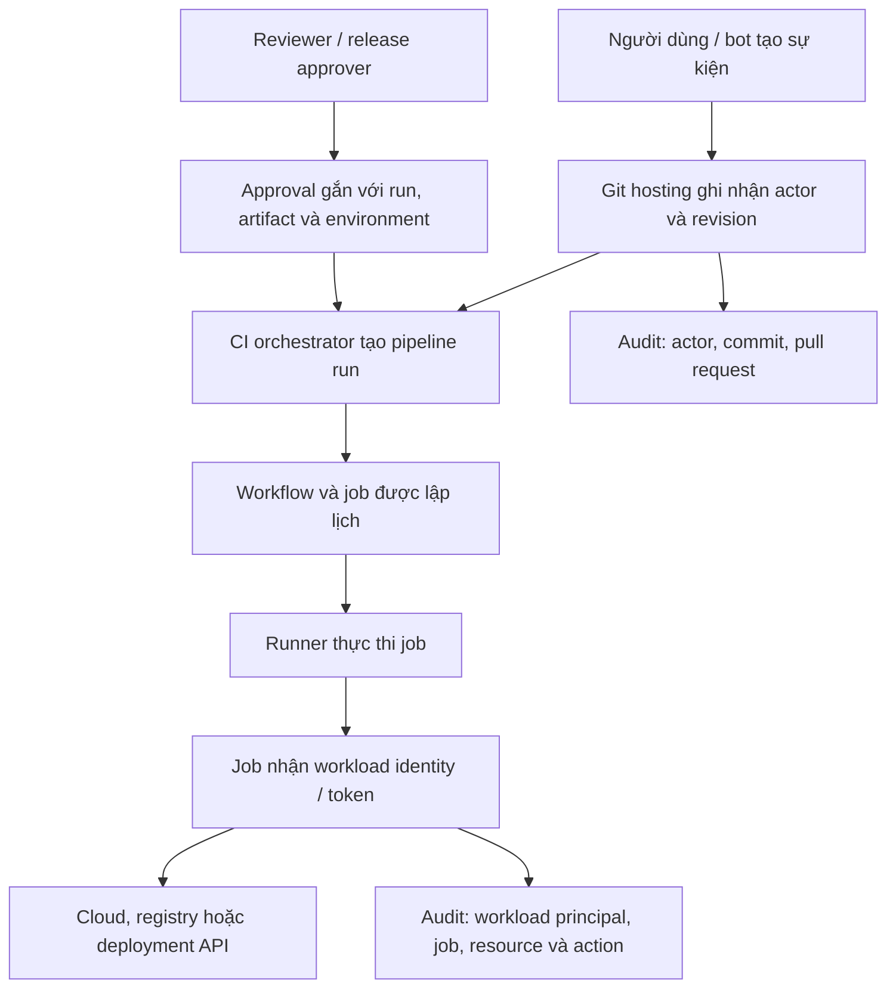
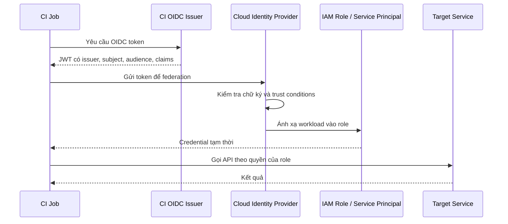

# Phân biệt danh tính người dùng với danh tính pipeline

Trong CI/CD, một người có thể khởi chạy pipeline, nhưng pipeline không nên tự động kế thừa toàn bộ quyền của người đó. Người dùng và pipeline là hai chủ thể khác nhau: người dùng là danh tính con người thực hiện thao tác và chịu trách nhiệm; pipeline là workload tự động cần danh tính riêng để đọc source, lấy dependency, ghi artifact hoặc triển khai đến môi trường đích.

Phân biệt hai loại danh tính giúp trả lời chính xác các câu hỏi: ai yêu cầu phát hành, workflow nào thực thi, job nào truy cập tài nguyên, credential nào được cấp và hành động nào đã xảy ra. Nếu dùng chung tài khoản cá nhân hoặc một token quyền rộng cho mọi job, audit trail khó xác định tác nhân thật và một pipeline bị xâm nhập có thể dùng quyền vượt xa nhiệm vụ của nó.

## 1. Hai loại danh tính và hai trách nhiệm khác nhau

**Danh tính người dùng (human/user identity)** đại diện cho một cá nhân đăng nhập vào Git hosting, hệ thống CI/CD, cloud console hoặc công cụ quản trị. Danh tính này thường gắn với tài khoản tổ chức, nhóm, vai trò, MFA, quy trình phê duyệt và vòng đời nhân sự.

**Danh tính pipeline (pipeline/workload identity)** đại diện cho một tiến trình tự động hoặc workload cụ thể. Nó có thể là service principal, service account, managed identity, workload identity federation principal hoặc token ngắn hạn được cấp cho một job. Danh tính này cần quyền vừa đủ để thực hiện tác vụ đã định nghĩa.

| Tiêu chí | Danh tính người dùng | Danh tính pipeline/workload |
|---|---|---|
| Chủ thể | Con người | Workflow, job hoặc workload tự động |
| Mục đích | Review, cấu hình, phê duyệt, khởi chạy, điều tra | Checkout, build, test, publish, deploy, đọc/ghi tài nguyên |
| Xác thực | SSO, mật khẩu, MFA, passkey, chứng thư người dùng | OIDC federation, service principal, service account, token hoặc credential của workload |
| Vòng đời | Onboarding, thay đổi vai trò, nghỉ việc, khóa tài khoản | Tạo theo workload, giới hạn phạm vi và thời hạn; thu hồi khi workflow/job không còn cần |
| Quyền điển hình | Developer, reviewer, release approver, administrator | Read repository, publish package, deploy một environment hoặc gọi một API cụ thể |
| Bằng chứng | User ID, nhóm, approval và hành động tương tác | Workflow/run/job ID, workload principal, claims và tài nguyên đã truy cập |
| Rủi ro chính | Chiếm đoạt tài khoản, lạm quyền, phê duyệt sai | Token bị lộ, workflow bị sửa, runner bị xâm nhập, trust policy quá rộng |

Danh tính người dùng trả lời “ai đã yêu cầu hoặc phê duyệt?”. Danh tính pipeline trả lời “workload nào thực sự gọi API hoặc thay đổi tài nguyên?”. Audit tốt cần giữ cả hai mối liên hệ, không gộp chúng thành một tài khoản chung.

## 2. Không nhầm người khởi chạy với danh tính thực thi

Một pipeline run có thể được kích hoạt bởi nhiều nguồn:

- Developer push commit hoặc mở pull request.
- Reviewer merge pull request.
- Release manager bấm nút chạy thủ công.
- Lịch định kỳ khởi chạy dependency scan hoặc backup.
- Bot tạo pull request cập nhật dependency.
- Webhook từ hệ thống khác kích hoạt workflow.

Người khởi chạy là actor tạo ra sự kiện hoặc yêu cầu chạy. Pipeline thường thực thi dưới workload identity được nền tảng cấp cho workflow/job, hoặc dưới credential mà cấu hình pipeline yêu cầu. Việc người dùng có quyền deploy không có nghĩa pipeline nên mượn access token cá nhân của người đó.

Ví dụ: một release manager có quyền phê duyệt production. Người này xác nhận release trong giao diện CI/CD. Sau approval, job deploy sử dụng workload identity đã được giới hạn vào production environment để gọi API triển khai. Log cần ghi cả người phê duyệt lẫn principal của job deploy. Người phê duyệt không phải là tài khoản đã trực tiếp gọi Kubernetes API.



Một pipeline run có thể dùng nhiều danh tính trong các bước khác nhau. Ví dụ job test chỉ cần token đọc source; job publish cần quyền ghi package registry; job deploy staging cần quyền cập nhật staging; job deploy production cần một principal khác và approval riêng. Không nên dùng một credential toàn quyền cho tất cả job chỉ vì chúng thuộc cùng workflow.

## 3. Các lớp danh tính trong một luồng CI/CD

Để phân quyền đúng, cần tách các chủ thể sau:

1. **Người dùng/actor:** người tạo commit, mở PR, merge, bấm chạy hoặc phê duyệt.
2. **Git hosting identity:** tài khoản hoặc bot có quyền trên repository và branch policy.
3. **CI workflow identity:** định nghĩa workflow, repository, ref, event và run đang thực thi.
4. **Runner/agent identity:** máy hoặc agent kết nối đến nền tảng CI, nhận và chạy job.
5. **Job/workload identity:** token hoặc principal mà job dùng khi gọi registry, cloud API hay dịch vụ khác.
6. **Target service identity:** danh tính của service hoặc workload sau khi triển khai, dùng để truy cập database, queue và API lúc runtime.

Các lớp có liên quan nhưng không tự động đồng nhất. Runner có thể chạy dưới tài khoản hệ điều hành riêng; job có thể nhận OIDC token; ứng dụng sau deploy lại dùng managed identity của chính nó. Nếu một job lấy được credential máy runner hoặc instance metadata không được bảo vệ, ranh giới giữa runner identity và workload identity có thể bị phá vỡ.

### 3.1. Runner identity không phải user identity

Runner/agent là môi trường thực thi. Self-hosted runner có thể được cài trên VM, máy vật lý hoặc Kubernetes. Nó thường có danh tính để đăng ký/kết nối với CI controller, nhưng danh tính đó không nên được dùng làm quyền truy cập mặc định vào mọi hệ thống đích.

Nếu nhiều job không đáng tin cùng chạy trên một runner lâu dài, job sau có thể đọc file, process, workspace hoặc credential còn sót từ job trước. Vì vậy cần:

- Dùng runner tạm thời hoặc làm sạch workspace sau mỗi job khi phù hợp.
- Tách runner pool theo mức độ tin cậy và loại workload.
- Không chạy pull request từ fork trên runner có quyền truy cập mạng nội bộ hoặc secret production.
- Giới hạn quyền hệ điều hành và quyền truy cập cloud của máy runner.
- Bảo vệ registration token, runner group và quyền quản trị runner.
- Không lưu access token cá nhân trong profile, home directory hoặc biến toàn cục của runner.

### 3.2. Job identity có phạm vi nhỏ hơn workflow

Workflow có thể chứa nhiều job với mức độ tin cậy khác nhau. Job kiểm tra PR có thể chạy mã do contributor bên ngoài cung cấp; job publish hoặc deploy chạy sau merge trên nhánh được bảo vệ. Nếu nền tảng cho phép, hãy cấp token và permission theo job, không cấp quyền rộng ở cấp workflow.

Một job chỉ cần đọc source không nên có quyền ghi package. Job publish artifact không nhất thiết cần quyền deploy production. Job deploy staging không cần quyền sửa production. Tách quyền giúp giảm thiệt hại nếu một action, script hoặc dependency trong job bị xâm nhập.

## 4. Xác thực và phân quyền là hai việc khác nhau

**Authentication (xác thực)** xác minh chủ thể là ai. **Authorization (phân quyền)** quyết định chủ thể đó được làm gì trên tài nguyên nào.

Ví dụ, OIDC token có chữ ký hợp lệ có thể chứng minh token được phát hành cho một workload từ một issuer cụ thể. Điều đó chưa có nghĩa workload được phép xóa bucket hoặc deploy production. Trust policy và IAM role ở hệ thống đích mới quyết định principal đó được cấp quyền gì.

Một mô hình kiểm soát nên trả lời:

- Chủ thể là user, bot, runner hay job?
- Token/credential được cấp bởi issuer nào và có thể xác minh bằng cách nào?
- Tài nguyên đích là repository, registry, cloud account, cluster hay environment nào?
- Action được phép là read, write, publish, deploy hay administer?
- Quyền có giới hạn theo repository, branch, workflow, environment, audience và thời hạn không?
- Ai có thể thay đổi trust policy hoặc cấp quyền cho workload?

Không dùng tên hiển thị như `deploy-bot` làm bằng chứng duy nhất. Cần định danh ổn định của principal, issuer, subject, audience và resource scope.

## 5. Credential truyền thống và rủi ro của secret dài hạn

Pipeline truyền thống thường lưu credential trong secret store của CI:

- Personal access token (PAT) của một developer.
- Service account username/password.
- Cloud access key/secret key.
- SSH private key để truy cập máy hoặc Git server.
- Kubernetes bearer token hoặc kubeconfig.
- Registry password hoặc API token.

Credential có thể cần thiết với hệ thống cũ chưa hỗ trợ federation, nhưng chúng tạo ra vòng đời phải quản lý: sinh, lưu, phân phối, rotate, thu hồi và điều tra khi lộ. Token dài hạn có thể tiếp tục hoạt động sau khi người tạo đã rời nhóm hoặc workflow không còn được dùng.

Các rủi ro phổ biến:

- PAT cá nhân có quyền rộng được lưu trong CI và dùng bởi nhiều pipeline.
- Cùng một access key được chia sẻ giữa staging và production.
- Secret được truyền qua command line, log, artifact hoặc file build.
- Runner bị xâm nhập và đọc được secret trong environment/process.
- Credential không có expiry hoặc không có owner rõ ràng.
- Secret bị rotate nhưng pipeline cũ vẫn giữ bản sao hoặc cache.
- Pull request không đáng tin kích hoạt job có quyền đọc secret.

Nếu buộc phải dùng secret dài hạn, tạo principal riêng cho workload, cấp quyền tối thiểu, đặt expiry/rotation, lưu trong secret manager, giới hạn nơi được sử dụng và theo dõi audit. Không dùng tài khoản cá nhân để thay thế service identity.

## 6. Workload identity federation và OIDC

Workload identity federation cho phép pipeline chứng minh danh tính với nhà cung cấp cloud hoặc dịch vụ đích bằng token ngắn hạn, thường dựa trên OpenID Connect (OIDC). Thay vì lưu cloud access key dài hạn trong CI, job yêu cầu token từ identity provider của nền tảng CI. Hệ thống đích xác minh issuer, chữ ký, audience và claims rồi trao credential tạm thời theo trust policy.

Luồng khái quát:

1. Job được nền tảng CI xác thực và chạy trong context cụ thể.
2. Job yêu cầu OIDC token từ issuer mà nền tảng cung cấp.
3. Token chứa claims như issuer, subject, audience, repository/project, ref, workflow hoặc environment tùy nền tảng.
4. Cloud identity provider kiểm tra token và trust policy.
5. Nếu khớp, hệ thống cấp credential ngắn hạn cho role/service principal được chỉ định.
6. Job dùng credential tạm thời để thực hiện action được cấp quyền.
7. Credential hết hạn; lần chạy sau phải xác thực lại.



OIDC giảm nhu cầu lưu secret dài hạn nhưng không tự động làm pipeline an toàn. Nếu trust policy chấp nhận mọi repository, mọi branch hoặc mọi workflow từ issuer, kẻ tấn công có thể sửa workflow để nhận credential. Phải ràng buộc claims cụ thể và quyền của role.

## 7. Claims và trust policy cần giới hạn như thế nào?

Một OIDC token thường có các claim quan trọng:

| Claim | Ý nghĩa khái quát | Cách dùng trong trust policy |
|---|---|---|
| `iss` | Issuer phát hành token | Chỉ chấp nhận issuer tin cậy và đúng tenant/instance |
| `sub` | Subject đại diện workload hoặc context | Ràng buộc repository/project, branch, environment hoặc workflow theo nền tảng |
| `aud` | Audience, bên nhận dự kiến của token | Chỉ chấp nhận audience dành cho federation endpoint/role cần dùng |
| `repository` / project claims | Repository hoặc project nguồn | Giới hạn đúng project được phép |
| `ref` / branch claims | Git ref đang chạy | Giới hạn nhánh/tag được bảo vệ |
| `workflow` / job claims | Workflow hoặc context thực thi | Giới hạn workflow tin cậy nếu issuer cung cấp claim phù hợp |
| `environment` | Environment gắn với job | Chỉ cấp quyền deploy khi job dùng environment được bảo vệ |

Tên claim, format của `sub`, khả năng tùy biến subject và claim được phát hành khác nhau giữa GitHub, GitLab, Azure DevOps và các hệ thống khác. Không sao chép trust policy từ nền tảng này sang nền tảng khác mà không kiểm tra token thật và tài liệu issuer.

Một trust policy tốt thường ràng buộc tối thiểu:

- Issuer chính xác.
- Audience chính xác.
- Repository/project cụ thể.
- Branch hoặc tag được bảo vệ.
- Workflow hoặc environment phù hợp nếu nền tảng hỗ trợ.
- Role chỉ có quyền cần thiết trên tài nguyên đích.

Không chỉ kiểm tra `sub` có chứa tên repository. Hãy tránh wildcard rộng như `repo:*` hoặc mọi branch nếu workload chỉ cần deploy từ `main` hoặc release tag. Với production, có thể yêu cầu cả protected environment và approval trước khi job được cấp token.

## 8. Ví dụ workload identity trên các nền tảng CI/CD

### 8.1. GitHub Actions

GitHub Actions có thể yêu cầu OIDC token bằng permission `id-token: write`. Permission này cho phép job lấy token từ OIDC provider; nó không tự cấp quyền ghi vào cloud. Quyền thực tế phụ thuộc trust relationship và IAM role ở phía nhà cung cấp đích.

```yaml
name: Deploy production

on:
  push:
    branches: [main]

permissions:
  contents: read

jobs:
  deploy:
    runs-on: ubuntu-latest
    environment: production
    permissions:
      contents: read
      id-token: write
    steps:
      - uses: actions/checkout@v4

      - name: Exchange OIDC token for short-lived cloud credentials
        run: ./scripts/federated-login-and-deploy.sh
```

Ví dụ mô tả vị trí lấy token và gọi script tích hợp. Script cần dùng SDK/CLI của cloud để trao đổi token theo giao thức của nhà cung cấp, sau đó chỉ deploy artifact đã được xác minh. Trong production, pin action theo full commit SHA theo chính sách; cấu hình environment protection và trust policy chỉ nhận repository/ref/workflow được phép.

`GITHUB_TOKEN` là token riêng do GitHub cấp cho workflow để truy cập GitHub API/repository trong phạm vi permission được cấu hình. Nó không phải OIDC token và cũng không phải credential cloud phổ quát. Hãy giới hạn `permissions` và cấp token theo job.

### 8.2. GitLab CI/CD

GitLab hỗ trợ job ID token với `id_tokens`. Job có thể yêu cầu token cho audience cụ thể, sau đó trao đổi với cloud identity provider hoặc dịch vụ hỗ trợ OIDC.

```yaml
deploy_production:
  stage: deploy
  id_tokens:
    CLOUD_ID_TOKEN:
      aud: https://identity.example.com
  script:
    - ./scripts/federated-login-and-deploy.sh
  rules:
    - if: '$CI_COMMIT_BRANCH == "main"'
```

Audience phải khớp với cấu hình phía nhận. Trust policy nên giới hạn issuer của GitLab instance, project path/ID, ref và protected environment theo claim mà phiên bản GitLab đang phát hành. Không dùng `CI_JOB_TOKEN` như thể nó tương đương OIDC: đây là token job có phạm vi riêng cho một số thao tác GitLab/API và package/container registry.

### 8.3. Azure Pipelines

Azure Pipelines có thể dùng service connection với workload identity federation để xác thực đến Azure mà không cần lưu client secret dài hạn. Pipeline tham chiếu service connection đã được cấu hình trust với tổ chức/project/pipeline phù hợp. Cần giới hạn authorization của service connection, scope role assignment và environment checks.

Không nên cấp quyền sử dụng service connection production cho mọi pipeline trong project. Một pipeline khác có thể sửa YAML để gọi cùng connection nếu authorization quá rộng.

### 8.4. Jenkins

Jenkins thường dùng Credentials Store, plugin cloud và các cơ chế token federation tùy cấu hình. Có thể dùng OIDC integration hoặc plugin hỗ trợ workload identity nếu môi trường Jenkins và cloud provider đáp ứng. Nếu dùng credential tĩnh, lưu trong Credentials Store, bind vào đúng stage/job và không in giá trị.

Shared Library hoặc plugin có thể thực thi logic với quyền của Jenkins agent/controller. Vì vậy, kiểm soát ai được sửa Jenkinsfile, Shared Library, plugin và credential binding là một phần của kiểm soát danh tính pipeline.

## 9. Phân quyền theo nguyên tắc least privilege

Least privilege có nghĩa mỗi chủ thể chỉ nhận quyền tối thiểu cần cho nhiệm vụ, trong phạm vi tài nguyên và thời gian phù hợp.

Ví dụ ma trận quyền:

| Workload/job | Repository | Artifact registry | Staging | Production |
|---|---|---|---|---|
| PR validation | Read source | Không ghi | Không truy cập | Không truy cập |
| Build/test trên main | Read source | Publish artifact được phép | Không triển khai | Không truy cập |
| Deploy staging | Read artifact | Read | Deploy staging | Không truy cập |
| Deploy production | Read artifact | Read | Không cần quyền ghi | Deploy production theo approval |
| Scheduled dependency scan | Read source và dependency metadata | Có thể read package | Không triển khai | Không truy cập |

Ma trận là ví dụ; quyền thật cần theo kiến trúc và nền tảng. Một số job cần đọc package registry để restore dependency, nhưng không cần quyền publish. Một số deployment job cần cập nhật manifest repository, nhưng nên tách quyền đó khỏi quyền truy cập cluster nếu có thể.

### 9.1. Tách principal theo môi trường

Dùng principal riêng cho staging và production giúp giới hạn phạm vi ảnh hưởng. Nếu staging credential bị lộ, nó không nên có khả năng deploy production hoặc đọc production secret. Trust policy cũng nên khác nhau: staging có thể nhận từ nhiều nhánh thử nghiệm; production chỉ nhận từ nhánh/tag được bảo vệ và workflow release tin cậy.

### 9.2. Tách quyền read và write

Job restore dependency thường cần read. Job publish package cần write vào một namespace cụ thể. Job deploy cần quyền thay đổi workload hoặc release trong một cluster/namespace. Không cấp `admin` chỉ để tránh xử lý permission chi tiết.

### 9.3. Quyền quản trị trust policy

Người có thể sửa trust policy, role assignment, runner group hoặc environment protection thực chất có thể thay đổi ai được phép deploy. Hãy bảo vệ các cấu hình này bằng review, approval, audit và separation of duties. Không để pipeline tự sửa policy cấp quyền cho chính nó mà không có kiểm soát độc lập.

## 10. Danh tính người dùng trong review và approval

Review và approval là quyết định của con người. Pipeline có thể tự động kiểm tra điều kiện, nhưng không nên giả mạo approval bằng một bot hoặc service account dùng chung để tạo cảm giác đã có người chịu trách nhiệm.

Phân biệt:

- **Code review:** người có chuyên môn đánh giá diff và thiết kế.
- **Merge authorization:** chính sách quyết định ai được hợp nhất vào nhánh bảo vệ.
- **Release approval:** người có thẩm quyền chấp nhận phát hành một version/artifact cụ thể.
- **Deployment approval:** người có quyền cho phép thay đổi một environment cụ thể.
- **Automated gate:** hệ thống kiểm tra test, scan, policy và điều kiện kỹ thuật.

Approval nên gắn với release request có định danh: commit, artifact digest, environment, config version, phạm vi thay đổi và bằng chứng kiểm tra. Nếu artifact hoặc nội dung release thay đổi sau approval, cần đánh giá lại và yêu cầu approval mới khi chính sách quy định.

Không dùng tài khoản pipeline để tự approve chính pipeline của nó. Nếu cần bot phê duyệt policy-based, phải phân biệt rõ quyết định tự động của policy engine với approval của con người và lưu danh tính riêng.

## 11. Audit trail: nối actor với workload principal

Một bản ghi audit hữu ích cần nối được chuỗi:

1. Ai tạo commit hoặc yêu cầu chạy?
2. Sự kiện nào kích hoạt pipeline?
3. Repository, ref, commit SHA và pull request nào được xử lý?
4. Workflow revision và run/job ID nào thực thi?
5. Runner/agent nào chạy job?
6. Workload principal nào được cấp token?
7. Principal gọi API nào, trên tài nguyên nào, với action gì?
8. Ai phê duyệt release/deployment và phê duyệt đối tượng nào?
9. Artifact digest và environment/config version nào đã được triển khai?

| Sự kiện | Trường cần lưu |
|---|---|
| Git event | Actor ID, repository/project, branch/ref, commit SHA, PR/MR ID, event type |
| Pipeline run | Workflow name/revision, run ID, job ID, start/end time, conclusion |
| Runner | Runner/agent ID, pool, image/OS, workload trust level |
| Token/federation | Issuer, subject, audience, principal/role, token issue/expiry time; không lưu token plaintext |
| Resource action | Cloud account/project, resource ID, API/action, result, request/correlation ID |
| Approval | Approver ID, policy, artifact digest, environment, decision, timestamp |
| Deployment | Artifact digest, config version/fingerprint, target environment, rollout result |

Đồng bộ thời gian và dùng correlation ID giúp nối log giữa Git hosting, CI platform, cloud audit log và deployment controller. Không ghi token, private key hoặc secret vào audit. Chỉ lưu claims và định danh cần thiết để điều tra.

## 12. Các anti-pattern về danh tính

| Anti-pattern | Rủi ro | Cách xử lý |
|---|---|---|
| Dùng PAT cá nhân trong pipeline | Phụ thuộc vòng đời người dùng, quyền rộng và khó audit | Dùng workload identity hoặc service principal riêng |
| Một service account cho mọi môi trường | Staging có thể truy cập production | Tách principal và role theo environment |
| Một token toàn quyền cho mọi job | Job test có thể publish/deploy | Cấp permission theo job và nhiệm vụ |
| Tin rằng người bấm Run là principal thực thi | Audit sai tác nhân gọi API | Ghi actor và workload principal riêng |
| Trust OIDC cho mọi branch/repository | Workflow không tin cậy có thể nhận role | Ràng buộc issuer, audience, subject, ref và environment |
| Đưa secret vào command line hoặc log | Credential có thể bị lưu trong process/log | Dùng secret binding an toàn và tránh echo |
| Chạy PR fork trên runner production | Mã không tin cậy có thể lấy credential hoặc truy cập mạng nội bộ | Dùng runner cô lập và không cấp secret |
| Credential không có expiry/owner | Khó thu hồi và tồn tại sau khi không cần | Đặt owner, TTL, rotation và review định kỳ |
| Bot tự approve thay người | Mất trách nhiệm và separation of duties | Phân biệt automated policy decision với human approval |

## 13. Khi nào vẫn cần service account hoặc secret tĩnh?

Không phải hệ thống đích nào cũng hỗ trợ OIDC federation. Một số thiết bị, registry cũ hoặc dịch vụ nội bộ chỉ hỗ trợ API key, username/password hoặc SSH key. Trong trường hợp đó, có thể dùng service account riêng cho workload với các biện pháp:

- Chủ sở hữu là nhóm/platform team, không phải một cá nhân.
- Quyền giới hạn theo API, repository, namespace hoặc environment.
- Secret được lưu trong secret manager của CI hoặc vault chuyên dụng.
- Có expiry/rotation, quy trình thu hồi và cảnh báo sắp hết hạn.
- Chỉ job cần dùng mới được bind secret; không expose cho fork/untrusted code.
- Không ghi secret vào artifact, cache, workspace dùng chung hoặc log.
- Có audit cho lần đọc secret và action được thực hiện bằng credential đó.
- Kiểm tra định kỳ xem workload còn cần credential hay có thể chuyển sang federation.

Nếu credential bị nghi lộ, thu hồi hoặc rotate ngay theo quy trình, xác định phạm vi sử dụng từ audit log, kiểm tra artifact/log/cache liên quan và cấp credential mới với scope phù hợp. Xóa secret khỏi file hiện tại không làm mất bản sao trong Git history hoặc log đã lưu.

## 14. Quy trình thiết kế danh tính pipeline

### Bước 1: Liệt kê tài nguyên và hành động

Ghi rõ pipeline cần truy cập repository, package registry, cloud account, cluster, database, deployment API hay dịch vụ bên ngoài nào. Với mỗi tài nguyên, phân biệt read, write, publish, deploy và administer.

### Bước 2: Xác định principal phù hợp

Chọn workload identity cho job hoặc nhóm job có cùng mức tin cậy. Tránh dùng danh tính người dùng. Tách principal theo môi trường và tác vụ nếu phạm vi quyền khác nhau.

### Bước 3: Chọn cơ chế xác thực

Ưu tiên federation/token ngắn hạn nếu nền tảng hỗ trợ. Nếu cần secret tĩnh, tạo service account riêng, lưu an toàn và đặt vòng đời rotation.

### Bước 4: Ràng buộc trust policy

Giới hạn issuer, audience, repository/project, ref, workflow và environment theo claim thực tế. Kiểm tra cả trường hợp PR từ fork, branch feature, tag release, schedule và manual run.

### Bước 5: Cấp quyền tối thiểu

Tạo role chỉ có quyền trên tài nguyên cần thiết. Tách read/write và staging/production. Không cấp quyền quản trị cho job thông thường.

### Bước 6: Bảo vệ workflow và runner

Yêu cầu review với file pipeline, action/plugin dùng chung và cấu hình trust. Cô lập runner theo mức tin cậy, làm sạch workspace và giới hạn network access.

### Bước 7: Ghi nhận và giám sát

Liên kết actor, workflow run, job principal, API action, artifact digest và approval. Cảnh báo khi principal lạ, branch không mong muốn hoặc job bất thường truy cập tài nguyên nhạy cảm.

### Bước 8: Kiểm tra vòng đời và thu hồi

Review principal, role, secret và trust policy định kỳ. Xóa quyền không còn dùng, rotate credential tĩnh và thu hồi danh tính workload khi repository, runner hoặc workflow bị ngừng.

## 15. Ví dụ thực tế: release manager phê duyệt, pipeline triển khai

Một nhóm phát hành service `orders` lên production. Luồng đúng có thể như sau:

1. Developer commit thay đổi và mở pull request. Git hosting ghi nhận user ID, commit SHA và PR ID.
2. CI chạy unit/integration tests bằng job identity chỉ có quyền đọc source và lấy dependency. Mã PR không có quyền đọc production secret.
3. Reviewer xác nhận diff và merge. Audit ghi reviewer/approver theo tài khoản cá nhân.
4. Release pipeline build artifact từ commit đã merge, publish image và lưu digest cùng provenance.
5. Job staging lấy workload identity staging, đọc image theo digest và deploy. Smoke test xác minh hành vi.
6. Release manager dùng tài khoản cá nhân có MFA để phê duyệt release gắn với digest, environment production và bằng chứng staging.
7. Job production nhận OIDC token từ CI. Trust policy chỉ chấp nhận repository, nhánh `main`, workflow release và environment `production` đã bảo vệ.
8. Cloud identity provider cấp credential ngắn hạn cho role chỉ được cập nhật deployment của service `orders` trong production namespace.
9. Deployment controller chạy đúng image digest. Pipeline xác minh runtime digest, health, metrics và luồng người dùng.
10. Audit nối actor đã phê duyệt với workload principal thực hiện deployment, cùng run ID, digest và request ID.

Nếu job staging bị xâm nhập, principal staging không có quyền production. Nếu developer rời tổ chức, thu hồi user identity của người đó không làm pipeline release phụ thuộc vào PAT cá nhân; workload identity vẫn có vòng đời và owner riêng. Nếu workflow bị thay đổi, branch protection và trust policy hạn chế khả năng nhận credential production.

## 16. Checklist review danh tính và quyền pipeline

- [ ] Người tạo sự kiện, reviewer và approver được ghi nhận bằng user identity riêng.
- [ ] Pipeline/job dùng workload identity thay vì mượn PAT hoặc access token cá nhân.
- [ ] Runner identity, job identity và runtime service identity được phân biệt.
- [ ] Mỗi job chỉ có quyền cần cho nhiệm vụ; read/write được tách khi phù hợp.
- [ ] Principal staging và production được tách biệt.
- [ ] OIDC trust policy giới hạn issuer, audience, repository/project, ref, workflow và environment phù hợp.
- [ ] Permission lấy OIDC token không bị hiểu nhầm là quyền truy cập tài nguyên đích.
- [ ] Token/credential có thời hạn ngắn; secret tĩnh có owner, rotation và quy trình thu hồi.
- [ ] Pull request từ fork hoặc mã không tin cậy không nhận production secret hay chạy trên runner nhạy cảm.
- [ ] Workflow, Shared Library, action, plugin và runner configuration được bảo vệ bằng review.
- [ ] Approval gắn với artifact digest, environment và release request cụ thể.
- [ ] Audit nối actor, workflow run, job principal, API action và deployment result.
- [ ] Không có secret plaintext trong source, log, artifact, cache hoặc workspace dùng chung.
- [ ] Có quy trình xử lý khi user, runner, workload token hoặc credential bị xâm nhập.
- [ ] Principal và trust policy được review định kỳ, thu hồi khi không còn nhu cầu.

Danh tính người dùng và danh tính pipeline phục vụ hai vai trò khác nhau trong cùng một quy trình phát hành. Người dùng tạo thay đổi, review và chịu trách nhiệm cho quyết định; workload identity thực hiện thao tác tự động với quyền giới hạn. Khi tách rõ actor, runner, job principal và service runtime, áp dụng federation hoặc credential ngắn hạn, kiểm soát trust policy và giữ audit trail đầy đủ, CI/CD có thể tự động hóa mạnh mà vẫn truy vết được ai yêu cầu và workload nào đã thực hiện từng hành động.
