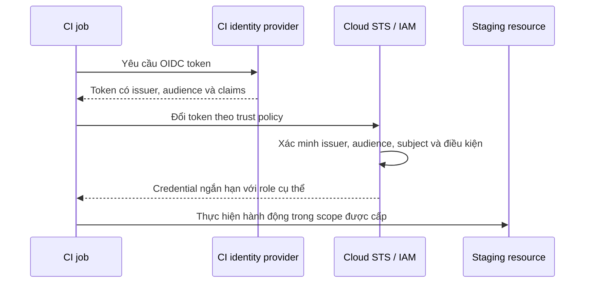

# Cấp quyền tối thiểu theo công việc và môi trường

Pipeline CI/CD thường thực hiện nhiều loại hành động: đọc mã nguồn, tải dependency, chạy test, ghi artifact, quét bảo mật, triển khai staging và cập nhật production. Nếu mọi job dùng chung một credential có quyền quản trị rộng, một bước build bị xâm nhập hoặc một script độc hại có thể sử dụng quyền đó để đọc secret, thay đổi hạ tầng hoặc phát hành phần mềm ngoài ý muốn.

**Least privilege (quyền tối thiểu)** là nguyên tắc chỉ cấp cho một danh tính những quyền cần thiết để hoàn thành công việc cụ thể, trên đúng tài nguyên, trong đúng phạm vi và khoảng thời gian cần thiết. Trong CI/CD, điều này có nghĩa job kiểm thử chỉ cần quyền đọc source và dependency; job publish cần quyền ghi vào một repository artifact xác định; job deploy staging chỉ được cập nhật staging; còn quyền production phải được giới hạn chặt và có kiểm soát riêng.

Mục tiêu không chỉ là giảm số lượng secret. Cần thiết kế danh tính, quyền, thời hạn credential và ranh giới giữa các môi trường để khi một job gặp sự cố, phạm vi ảnh hưởng được giới hạn và hành động có thể truy vết.

## 1. Phân biệt xác thực và ủy quyền

Hai câu hỏi nền tảng cần được giải quyết riêng:

- **Authentication (xác thực):** hệ thống đang tương tác với ai hoặc với danh tính nào? Ví dụ job CI chạy dưới service account ci-test.
- **Authorization (ủy quyền):** danh tính đó được phép thực hiện hành động nào trên tài nguyên nào? Ví dụ ci-test chỉ được đọc package từ registry và không được publish hoặc xóa package.

Một credential hợp lệ chứng minh danh tính nhưng không nên mặc nhiên trao quyền rộng. Sau khi xác thực, hệ thống cần áp dụng policy để quyết định hành động được phép.

Một quyền có thể được mô tả bằng các thành phần:

| Thành phần | Câu hỏi | Ví dụ |
|---|---|---|
| Principal/identity | Ai đang yêu cầu? | Workflow job, service account, workload identity |
| Action | Được làm gì? | Read, write, deploy, delete, approve |
| Resource | Được tác động lên đâu? | Một artifact repository hoặc một Kubernetes namespace |
| Scope/condition | Trong điều kiện nào? | Chỉ staging, chỉ một repository, chỉ nhánh chính |
| Duration | Quyền tồn tại bao lâu? | Token ngắn hạn trong thời gian job chạy |

Một policy rõ ràng cần giới hạn cả action và resource. Quyền write trên toàn bộ cloud account có phạm vi lớn hơn nhiều so với quyền cập nhật một deployment trong namespace staging.

## 2. Vì sao mỗi job nên có danh tính riêng?

Một pipeline có thể gồm nhiều job với nhu cầu khác nhau. Nếu dùng một credential chung, quyền của job yếu nhất cũng có thể trở thành đường truy cập đến mọi tài nguyên mà credential đó được phép dùng.

Ví dụ một pipeline dịch vụ Java:

| Job | Công việc | Quyền phù hợp |
|---|---|---|
| Checkout và unit test | Đọc source, tải dependency, chạy test | Read repository và package/dependency registry |
| Static/security scan | Đọc source và gửi kết quả scan | Read source, upload report vào dự án tương ứng |
| Build và publish | Tạo image và ghi image vào một registry/repository | Read dependency, write đúng repository artifact |
| Deploy staging | Cập nhật dịch vụ staging | Deploy vào namespace hoặc account staging |
| Deploy production | Cập nhật dịch vụ production | Quyền deploy production có scope hẹp, credential ngắn hạn và approval phù hợp |
| Cleanup | Xóa artifact hết hạn theo policy | Delete chỉ trong repository được quản lý, có audit và điều kiện bảo vệ |

Các job không cần chia sẻ cùng một token. Mỗi job nên nhận danh tính và credential phù hợp ngay trước khi thực hiện hành động. Khi job kết thúc, credential ngắn hạn hết hiệu lực hoặc bị thu hồi.

Tách job cũng giúp kiểm soát luồng dữ liệu. Một job build không cần nhận production secret chỉ vì một job deploy ở bước sau cần nó. Artifact có thể chuyển giữa các job; quyền truy cập production không cần đi cùng artifact.

## 3. Scope quyền theo resource, action và môi trường

Least privilege cần cụ thể hơn việc tạo các role mang tên developer, ci hoặc admin. Hãy xác định tài nguyên và thao tác thực tế.

Ví dụ với container registry:

- Job test chỉ được pull image base và dependency.
- Job publish chỉ được push vào repository team-a/orders-service.
- Job deploy chỉ được pull digest đã được phê duyệt.
- Job cleanup chỉ được xóa artifact hết hạn trong repository được giao và không được xóa digest đang được triển khai.

Ví dụ với Kubernetes:

- Job staging chỉ được cập nhật Deployment, đọc trạng thái rollout trong namespace staging-orders.
- Job production chỉ được cập nhật các resource cần thiết trong namespace production-orders.
- Job ứng dụng không được cấp quyền cluster-admin hoặc đọc Secret của mọi namespace.

Không cấp quyền rộng ở cấp account hoặc cluster nếu công việc chỉ cần một namespace, repository hoặc resource cụ thể. Với quyền đọc, cũng cần giới hạn: đọc mọi secret trong production có thể gây tác hại lớn dù job không có quyền ghi.

### Tách danh tính theo môi trường

Development, staging và production có mức độ tin cậy khác nhau. Nên sử dụng principal, role hoặc workload identity riêng:

- ci-development truy cập tài nguyên phát triển.
- ci-staging-deploy chỉ triển khai staging.
- ci-production-deploy chỉ có quyền triển khai production theo policy.

Không dùng một cloud access key hoặc Kubernetes token chung cho cả ba môi trường. Nếu credential staging bị lộ, nó không nên mở đường sang production.

## 4. Ưu tiên credential ngắn hạn và workload identity

Credential dài hạn như access key hoặc token lưu trong repository/CI variable có thể tồn tại lâu sau khi người tạo quên thu hồi. Nếu bị lộ trong log, dependency, runner hoặc cấu hình, kẻ tấn công có nhiều thời gian để sử dụng.

Khi nền tảng hỗ trợ, ưu tiên:

- **Workload identity:** job nhận danh tính dựa trên môi trường thực thi được nền tảng xác minh.
- **OIDC federation:** CI phát hành identity token có claim về repository, branch, workflow hoặc environment; cloud provider xác minh token và cấp quyền tạm thời.
- **Short-lived credential:** access token có thời hạn ngắn, được cấp cho đúng job và tự hết hiệu lực.
- **Credential rotation/revocation:** có khả năng thu hồi khi job hoặc runner bị nghi ngờ xâm nhập.

Luồng OIDC tổng quát:



Trust policy phải kiểm tra claim cụ thể, không chỉ tin mọi token từ một issuer. Ví dụ, role deploy production chỉ nên chấp nhận token từ repository được chỉ định, workflow deploy được phê duyệt, branch/tag hoặc protected environment phù hợp và audience đúng. Nếu subject quá rộng như mọi repository trong một tổ chức, bất kỳ workflow nào thỏa điều kiện đó có thể tìm cách nhận role.

OIDC không tự động tạo least privilege. Quyền cuối cùng vẫn do trust policy, role policy và resource policy quyết định. Cần kiểm tra cả claim mà CI phát hành lẫn điều kiện mà cloud provider xác minh.

## 5. Ví dụ giới hạn quyền token trong GitHub Actions

GitHub Actions hỗ trợ khai báo quyền của GITHUB_TOKEN bằng permissions. Khi khai báo quyền, chỉ cấp các scope cần dùng:

```yaml
name: verify

on:
  pull_request:

permissions:
  contents: read

jobs:
  test:
    runs-on: ubuntu-24.04
    permissions:
      contents: read
    steps:
      - uses: actions/checkout@<FULL_COMMIT_SHA>
      - name: Run tests
        run: ./gradlew test
```

FULL_COMMIT_SHA là placeholder cần thay bằng SHA đầy đủ đã xác minh. Job test chỉ cần đọc repository nên không cần quyền ghi contents, tạo release hoặc quản trị workflow. Với job upload kết quả hoặc publish package, hãy thêm đúng scope cần thiết ở chính job đó.

Ví dụ job cần ghi package có thể có quyền riêng:

```yaml
jobs:
  publish:
    needs: test
    permissions:
      contents: read
      packages: write
    steps:
      - uses: actions/checkout@<FULL_COMMIT_SHA>
      - name: Publish package
        run: ./gradlew publish
```

Đoạn này minh họa phạm vi token; cấu hình xác thực registry và repository đích cần bổ sung theo hệ thống thực tế. Không nên cấp packages: write cho mọi job chỉ vì một job publish cần quyền đó.

Nếu workflow dùng OIDC, cần cấp id-token: write cho đúng job cần lấy token, kết hợp trust policy giới hạn repository, workflow và environment. id-token: write cho phép job yêu cầu OIDC token; nó không đồng nghĩa job đã có quyền truy cập cloud resource nếu chưa có federation và role policy phù hợp.

## 6. Cấp quyền production bằng protected environment

Production thường cần ranh giới kiểm soát cao hơn staging. Một cách tổ chức là tạo protected environment trong nền tảng CI:

- Chỉ branch hoặc tag được bảo vệ mới được deploy.
- Yêu cầu reviewer hoặc người có thẩm quyền phê duyệt trước khi job bắt đầu.
- Chỉ cung cấp production secret sau khi environment policy được thỏa mãn.
- Dùng concurrency control để tránh hai lần deploy production xung đột.
- Ghi nhận người phê duyệt, commit, artifact digest và kết quả triển khai.

Ví dụ cấu trúc GitHub Actions:

```yaml
jobs:
  deploy_production:
    environment: production
    permissions:
      contents: read
      id-token: write
    steps:
      - name: Obtain short-lived deployment identity
        run: ./scripts/request-deploy-identity.sh
      - name: Deploy approved artifact
        run: ./scripts/deploy-by-digest.sh
```

Các script trên là tên minh họa, không phải lệnh có sẵn. Environment production cần được cấu hình protection rules, reviewer, branch restrictions và secret access trong nền tảng. Job chỉ nên chạy sau khi artifact đã qua quality gates và được xác định bằng digest.

Approval không thay thế authorization. Người phê duyệt cho phép quy trình tiếp tục; IAM role vẫn phải giới hạn chính xác resource và action mà job có thể thực hiện.

## 7. Không cấp secret production cho mã không tin cậy

Pull request từ fork hoặc branch không được bảo vệ có thể chứa mã do người ngoài kiểm soát. Build script, test, package lifecycle hook và action trong pipeline đều có thể thực thi mã. Nếu job đó nhận production secret hoặc token có quyền ghi, mã độc có thể gửi credential ra ngoài.

Một số nguyên tắc:

- Không cấp production secret cho workflow chạy trên pull request từ fork.
- Tách validation job không đặc quyền khỏi job deploy có quyền cao.
- Không chạy script do pull request thay đổi trong một context có secret production.
- Hạn chế quyền của GITHUB_TOKEN hoặc token tương đương ở mức read-only cho workflow kiểm tra.
- Review và pin action bên ngoài; action chạy trong job có thể truy cập token và dữ liệu mà job được cấp.
- Dùng protected branch, environment và approval cho đường phát hành.
- Cẩn trọng với cơ chế workflow chạy sau khi pull request được merge hoặc sự kiện có quyền cao; bảo đảm checkout đúng revision đã được tin cậy.

Không phải mọi pull request đều độc hại, nhưng pipeline phải coi mã chưa được tin cậy là có khả năng thực thi tùy ý. Ranh giới quyền được thiết kế để một test hoặc build thất bại không thể biến thành quyền truy cập production.

## 8. Quản lý secret theo job và vòng đời

Secret là dữ liệu xác thực như password, API key, private key hoặc token. Cần lưu trong secret manager hoặc cơ chế bảo mật của CI, không commit vào Git, Docker image, artifact, log hoặc cache.

Khi job cần secret:

1. Xác định hành động và tài nguyên thật sự cần credential.
2. Chọn principal/role có scope nhỏ nhất.
3. Cấp secret hoặc credential ngay trước bước sử dụng.
4. Truyền qua secret store hoặc environment của đúng step/job; không đưa vào command line nếu có nguy cơ lộ qua process listing.
5. Tránh in giá trị, bật debug chứa secret hoặc ghi toàn bộ environment.
6. Thu hồi hoặc để credential hết hạn sau khi hoàn tất.
7. Theo dõi truy cập và xoay vòng khi có nghi ngờ lộ lọt.

Không nên đặt một nhóm secret chung ở cấp organization nếu chỉ một repository hoặc một environment cần dùng. Scope secret theo repository/environment và giới hạn người có quyền sửa workflow, vì người có thể thay đổi workflow chạy trong context có secret có thể có khả năng lấy secret đó.

## 9. Danh tính runtime của ứng dụng khác danh tính deploy

Một nhầm lẫn phổ biến là dùng cùng credential cho pipeline triển khai và ứng dụng đang chạy. Hai danh tính có nhiệm vụ khác nhau:

- **Deployment identity** cần quyền cập nhật resource, rollout hoặc cấu hình cần thiết.
- **Runtime identity** cần quyền để ứng dụng truy cập database, object storage, message broker hoặc dịch vụ khác khi đang chạy.

Ứng dụng không nên kế thừa quyền của deployment job. Ví dụ, job deploy có thể cần quyền cập nhật Kubernetes Deployment, còn pod chỉ cần đọc một secret cụ thể và ghi vào một bucket riêng. Nếu pod bị xâm nhập, quyền của nó phải không cho phép thay đổi deployment hoặc đọc dữ liệu của dịch vụ khác.

Trên Kubernetes, ưu tiên ServiceAccount riêng cho workload và Role/RoleBinding giới hạn trong namespace. Tránh gắn cluster-admin cho service account của ứng dụng. Nếu workload chạy trên cloud, có thể dùng workload identity của nền tảng để pod nhận quyền cloud theo service account đã ánh xạ, thay vì lưu access key trong Kubernetes Secret.

## 10. Ví dụ ma trận quyền theo công việc và môi trường

Ma trận giúp review nhanh quyền nào đang được cấp vượt quá nhu cầu:

| Danh tính | Development | Staging | Production |
|---|---|---|---|
| CI test | Đọc source/dependency, chạy test | Không cần quyền deploy | Không có quyền |
| Artifact publisher | Ghi repository artifact được giao | Không cần quyền thay đổi runtime | Không có quyền deploy |
| Staging deployer | Có thể đọc artifact | Deploy đúng namespace staging | Không có quyền |
| Production deployer | Không cần quyền | Không cần quyền | Deploy resource được chỉ định sau approval |
| Application runtime | Truy cập dịch vụ dev cần thiết | Truy cập dịch vụ staging cần thiết | Truy cập dữ liệu production đúng phạm vi |
| Cleanup service | Xóa artifact tạm đủ điều kiện | Xóa artifact staging đủ điều kiện | Không xóa artifact đang chạy hoặc rollback candidate |

Ma trận chỉ là điểm bắt đầu. Với hệ thống thực tế, bổ sung tên principal, resource ARN/namespace/repository, action cụ thể, điều kiện branch/environment và thời hạn credential. Kiểm tra quyền thực tế bằng policy simulator, audit log hoặc thử nghiệm trong môi trường an toàn nếu nền tảng hỗ trợ.

## 11. Theo dõi, audit và rà soát quyền

Quyền tối thiểu cần được duy trì trong suốt vòng đời dự án. Quyền từng hợp lý có thể trở nên dư thừa khi pipeline đổi cách hoạt động hoặc một dịch vụ ngừng sử dụng.

Nên lưu và rà soát:

- Principal nào đã yêu cầu credential và job/workflow nào tạo ra yêu cầu.
- Repository, branch, commit và environment liên quan.
- Role/policy được cấp và resource/action đã thực hiện.
- Thời điểm cấp, thời hạn và thời điểm thu hồi credential.
- Người phê duyệt deployment hoặc exception.
- Thay đổi policy, secret scope và trust relationship.

Định kỳ kiểm tra role không còn dùng, token dài hạn, wildcard resource, quyền admin và secret được chia sẻ quá rộng. Xóa quyền không còn cần thiết; thay credential bị lộ; giữ audit record theo chính sách của tổ chức.

Một cảnh báo hữu ích có thể phát hiện job test cố gọi API deploy, job staging truy cập production resource hoặc một principal sử dụng quyền delete ngoài lịch cleanup. Việc theo dõi cần dựa trên log của CI và hệ thống đích, vì log pipeline đơn lẻ không thể hiện đầy đủ mọi hành động được thực hiện bằng credential.

## 12. Những sai lầm thường gặp

| Sai lầm | Hệ quả | Cách điều chỉnh |
|---|---|---|
| Dùng một access key cho toàn pipeline | Mọi job có cùng quyền rộng | Tách principal và credential theo job |
| Dùng chung role staging và production | Sự cố staging có thể ảnh hưởng production | Tách role, account/project hoặc namespace |
| Dùng credential dài hạn lưu trong CI | Tăng thời gian khai thác nếu bị lộ | Dùng OIDC/workload identity và token ngắn hạn |
| Cấp write cho token test | Mã test có thể thay đổi repository hoặc package | Chỉ cấp read và thêm quyền ở job cần ghi |
| Cấp cluster-admin cho deploy/app | Phạm vi ảnh hưởng rất lớn | Dùng Role/RoleBinding và resource scope cụ thể |
| Đưa secret vào image hoặc artifact | Secret tồn tại lâu và lan qua nhiều môi trường | Cấp secret lúc runtime từ secret manager |
| Cấp production secret cho fork PR | Mã không tin cậy có thể lấy credential | Tách validation khỏi deploy và dùng protected environment |
| Tin OIDC token mà không giới hạn claims | Workflow ngoài ý muốn có thể nhận role | Kiểm tra issuer, audience, subject và điều kiện cụ thể |
| Không rà soát quyền cũ | Quyền dư thừa tích tụ theo thời gian | Audit định kỳ và thu hồi quyền không còn dùng |

## 13. Checklist thiết kế least privilege cho CI/CD

- [ ] Mỗi job có danh tính phù hợp với công việc và không dùng chung credential rộng.
- [ ] Policy xác định principal, action, resource, scope và thời hạn.
- [ ] Tách quyền đọc source, publish artifact, deploy staging, deploy production và cleanup.
- [ ] Tách role và secret theo môi trường; staging không thể dùng credential production.
- [ ] Ưu tiên OIDC/workload identity và credential ngắn hạn.
- [ ] Trust policy kiểm tra issuer, audience, subject, repository, workflow và environment phù hợp.
- [ ] Token CI chỉ có scope cần thiết; quyền ghi chỉ cấp cho job cần ghi.
- [ ] Production deployment có protected environment, approval và audit.
- [ ] Workflow từ fork hoặc mã chưa tin cậy không nhận secret/quyền cao.
- [ ] Runtime identity của ứng dụng tách khỏi deployment identity.
- [ ] Secret được lấy đúng lúc, không ghi vào log/image/artifact/cache.
- [ ] Có audit log, rà soát role và quy trình thu hồi/rotation.

Cấp quyền tối thiểu theo công việc và môi trường giúp giới hạn phạm vi ảnh hưởng khi một job, runner hoặc dependency bị xâm nhập. Khi danh tính được tách theo nhiệm vụ, quyền được ràng buộc với resource cụ thể và credential chỉ tồn tại trong thời gian cần thiết, CI/CD có thể tự động hóa phát hành mà vẫn giữ được khả năng kiểm soát và truy vết.
