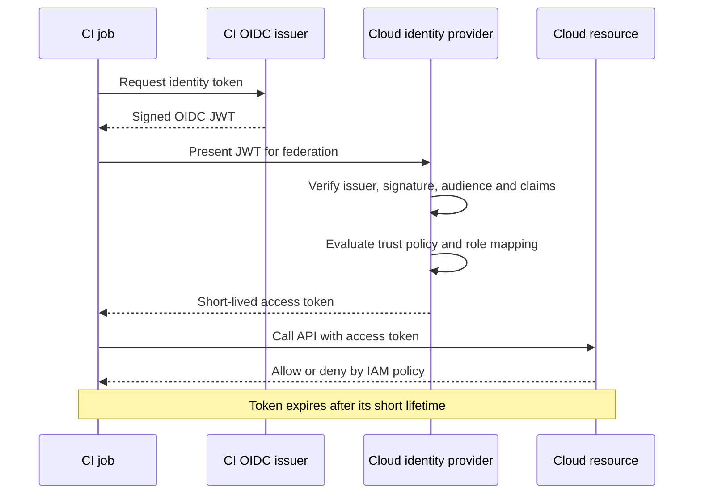
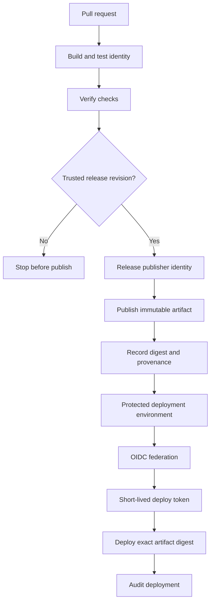

# Dùng thông tin xác thực ngắn hạn khi nền tảng hỗ trợ

Một pipeline CI/CD thường cần truy cập các tài nguyên bên ngoài repository: tải dependency riêng tư, đẩy package lên artifact registry, đọc secret từ secret manager, tạo image hoặc triển khai ứng dụng lên cloud. Cách làm truyền thống là tạo một access key hoặc service account password, lưu nó thành secret của CI rồi dùng lại trong nhiều lần chạy.

Cách này hoạt động nhưng tạo ra một bí mật dài hạn phải được lưu, phân phối, bảo vệ và xoay vòng. Nếu token bị lộ trong log, runner, cache hoặc một job chưa tin cậy, người khác có thể sử dụng nó cho đến khi token bị thu hồi hoặc hết hạn. Khi nhiều repository và pipeline dùng chung một credential, việc xác định nguồn sử dụng và giới hạn phạm vi ảnh hưởng cũng khó hơn.

Khi nền tảng hỗ trợ, nên dùng danh tính workload và thông tin xác thực ngắn hạn. CI chứng minh danh tính của job với nhà cung cấp tài nguyên bằng một cơ chế liên kết danh tính, thường dựa trên OpenID Connect (OIDC) hoặc federation. Nhà cung cấp xác minh danh tính và điều kiện tin cậy, sau đó cấp token có thời hạn ngắn và quyền giới hạn cho job. Pipeline không cần giữ một access key dài hạn trong cấu hình.

Mục tiêu là để mỗi workload nhận đúng quyền trong đúng thời gian cần thiết, có thể truy vết về repository, workflow, branch hoặc environment, và tự hết hiệu lực sau khi công việc hoàn tất.

## 1. Thông tin xác thực dài hạn và ngắn hạn

Thông tin xác thực là dữ liệu hoặc bằng chứng được dùng để chứng minh danh tính hay quyền truy cập. Ví dụ gồm password, API key, access token, certificate, private key hoặc token được cấp thông qua federation.

**Thông tin xác thực dài hạn** thường tồn tại nhiều ngày, nhiều tháng hoặc cho đến khi người quản trị chủ động xoay vòng hay thu hồi. Ví dụ là access key tĩnh của service account được lưu trong CI secret store.

**Thông tin xác thực ngắn hạn** có thời hạn hiệu lực ngắn và được cấp cho một phiên làm việc hoặc một workload cụ thể. Khi hết hạn, token không còn dùng được. Job có thể yêu cầu token mới bằng cách chứng minh lại danh tính theo chính sách.

| Tiêu chí | Credential dài hạn | Credential ngắn hạn |
|---|---|---|
| Vòng đời | Tồn tại cho đến khi xoay vòng hoặc thu hồi | Hết hạn tự động sau khoảng thời gian được cấp |
| Lưu trữ | Thường phải giữ secret trong CI hoặc secret manager | Có thể chỉ giữ token tạm trong runtime của job |
| Phạm vi | Dễ bị cấp rộng và dùng chung | Có thể cấp riêng theo workload, job hoặc environment |
| Rủi ro khi lộ | Có thể bị lạm dụng trong thời gian dài | Cửa sổ lạm dụng thường ngắn hơn, nhưng vẫn nguy hiểm khi token còn hiệu lực |
| Vận hành | Cần quy trình xoay vòng và cập nhật nơi sử dụng | Cần cấu hình federation, trust policy và xử lý token expiry |
| Truy vết | Có thể khó biết pipeline nào dùng credential chung | Có thể gắn danh tính với repository, workflow và run |

Ngắn hạn không có nghĩa là an toàn tuyệt đối. Nếu token còn hiệu lực bị lấy cắp, kẻ khác vẫn có thể dùng nó trong phạm vi quyền được cấp cho đến khi token hết hạn hoặc bị thu hồi. Vì vậy, cần kết hợp thời hạn ngắn với quyền tối thiểu, runner cô lập, kiểm soát trigger, bảo vệ log và audit.

## 2. Phân biệt danh tính, xác thực và phân quyền

Ba khái niệm này liên quan nhưng trả lời các câu hỏi khác nhau:

- **Danh tính (identity):** ai hoặc workload nào đang yêu cầu truy cập?
- **Xác thực (authentication):** bằng chứng nào cho thấy danh tính đó là thật?
- **Phân quyền (authorization):** danh tính đã xác thực được phép làm gì trên tài nguyên nào?

Một pipeline có thể được xác thực thành công nhưng vẫn không được phép triển khai production. Ví dụ, cloud nhận ra job đến từ repository đúng, nhưng trust policy chỉ cho phép job đọc artifact chứ không cho phép thay đổi cluster.

Cần tách rõ danh tính người dùng và danh tính workload. Developer đăng nhập vào cloud để làm việc tương tác là một principal người dùng. CI runner chạy test hoặc deploy là một workload principal. Không nên dùng personal access token của một nhân viên để đại diện cho pipeline vì quyền và vòng đời của người đó không tương ứng với vòng đời của job.

Một mô hình tốt cấp danh tính riêng cho từng mục đích: build, publish artifact, đọc secret test và deploy production. Các danh tính này có quyền và điều kiện tin cậy khác nhau.

## 3. Workload identity là gì?

Workload identity là danh tính được gán cho một tiến trình tự động như CI job, service, pod hoặc ứng dụng chạy nền. Danh tính này cho phép workload truy cập tài nguyên mà không cần nhúng một bí mật dài hạn vào mã nguồn hoặc cấu hình.

Trong CI/CD, workload identity thường được hình thành từ thông tin mà nền tảng CI biết về job đang chạy:

- Repository hoặc project.
- Workflow hoặc pipeline definition.
- Branch, tag hoặc commit.
- Loại sự kiện kích hoạt, ví dụ push, pull request hoặc release.
- Environment đang triển khai.
- Run ID, job ID hoặc workflow identity.
- Tổ chức hoặc namespace sở hữu repository.

Nhà cung cấp tài nguyên có thể dùng các thuộc tính này để quyết định workload nào được phép nhận một role hoặc service account. Ví dụ, job từ nhánh main trong repository đã xác định có thể được phép publish package; chỉ job gắn với environment production và vượt qua approval mới được phép triển khai production.

Danh tính workload nên có phạm vi rõ ràng và không chia sẻ giữa các dự án không liên quan. Nếu nhiều pipeline cùng dùng một service account có quyền rộng, việc giới hạn tác động khi một pipeline bị xâm nhập sẽ khó hơn.

## 4. OIDC và federation hoạt động như thế nào?

OpenID Connect là một lớp định danh dựa trên OAuth 2.0. Trong CI/CD, nền tảng có thể phát hành một ID token cho job sau khi job yêu cầu. Token thường là JWT chứa các claim mô tả issuer, audience, subject và các thuộc tính của workload.

Federation cho phép một hệ thống tin cậy danh tính do hệ thống khác phát hành mà không cần tạo và lưu một password dùng chung giữa hai bên. Nhà cung cấp cloud hoặc dịch vụ đích cấu hình trust với issuer của nền tảng CI, rồi kiểm tra token trước khi cấp credential phù hợp.

Luồng khái quát:



Các bước chính:

1. CI job yêu cầu ID token từ OIDC issuer của nền tảng.
2. Issuer tạo token có chữ ký và các claim phản ánh ngữ cảnh job.
3. Job gửi token đó tới dịch vụ federation của cloud hoặc nhà cung cấp tài nguyên.
4. Bên nhận kiểm tra chữ ký, issuer, audience, thời hạn và các claim theo trust policy.
5. Nếu hợp lệ, bên nhận ánh xạ danh tính sang role hoặc service account.
6. Job nhận access token ngắn hạn để gọi API.
7. Token hết hạn theo thời gian được cấp; job không thể tiếp tục sử dụng token cũ sau thời điểm đó.

OIDC ID token và access token không phải cùng một loại token. ID token chứng minh danh tính với relying party có audience phù hợp. Access token được dùng để truy cập API theo scope hoặc quyền được cấp. Không gửi ID token cho một API chỉ vì nó là JWT; cần thực hiện đúng token exchange hoặc cơ chế federation mà nhà cung cấp hỗ trợ.

## 5. Các claim quan trọng trong OIDC token

JWT chứa các claim. Trust policy cần kiểm tra những claim phù hợp để xác định job nào được tin cậy.

| Claim | Ý nghĩa | Cách sử dụng |
|---|---|---|
| iss | Issuer phát hành token | Chỉ tin issuer đã cấu hình |
| aud | Audience mà token hướng tới | Giới hạn token cho đúng relying party hoặc dịch vụ |
| sub | Subject, thường đại diện danh tính workload theo quy ước issuer | Ràng buộc repository, branch, environment hoặc context |
| exp | Thời điểm token hết hạn | Từ chối token quá hạn |
| iat | Thời điểm token được phát hành | Kiểm tra token mới và hỗ trợ điều tra |
| nbf | Thời điểm token bắt đầu có hiệu lực nếu được sử dụng | Không chấp nhận token trước thời điểm này |
| repository/project | Thuộc tính repository hoặc project nếu issuer cung cấp | Giới hạn đúng nguồn mã |
| ref/branch | Nhánh hoặc ref kích hoạt job | Giới hạn nhánh release hoặc nhánh được bảo vệ |
| workflow/environment | Ngữ cảnh workflow hoặc environment nếu issuer cung cấp | Giới hạn đúng pipeline và môi trường |

Tên claim cụ thể phụ thuộc nền tảng. Không được giả định mọi issuer đều phát hành cùng một bộ claim hoặc cùng định dạng subject. Hãy xem tài liệu của nền tảng CI và cấu hình relying party để biết claim nào thực sự có mặt.

Một policy tốt không chỉ kiểm tra repository. Nếu chỉ tin mọi job trong một repository, job chạy từ pull request không đáng tin hoặc workflow thử nghiệm có thể nhận quyền giống release pipeline. Nên kết hợp repository với branch/ref, event, workflow identity và environment khi các claim này có sẵn.

## 6. Audience và subject phải được giới hạn chính xác

**Audience** xác định token được phát hành cho bên nhận nào. Nếu token được cấp với audience quá rộng hoặc relying party không kiểm tra audience, token có thể bị dùng sai ngữ cảnh.

**Subject** xác định principal mà token đại diện. Tùy nền tảng, subject có thể chứa repository, branch, tag hoặc environment. Trust policy nên so khớp subject theo giá trị chính xác hoặc pattern hẹp đã được kiểm tra.

Ví dụ, policy cho phép một repository bất kỳ có thể quá rộng. Policy chỉ cho phép repository cụ thể và nhánh release đã bảo vệ sẽ giảm phạm vi. Với deploy production, có thể yêu cầu environment production đã được khai báo và phê duyệt trong CI.

Không nên dùng wildcard rộng cho subject nếu không hiểu tất cả giá trị có thể khớp. Một pattern như mọi branch trong tổ chức có thể vô tình bao gồm nhánh thử nghiệm hoặc nhánh do người đóng góp bên ngoài tạo.

Cần kiểm tra các trường hợp sau:

- Repository bị fork có được xem là cùng danh tính không?
- Pull request từ fork phát hành subject nào?
- Job chạy từ tag release có subject khác job chạy từ branch không?
- Reusable workflow hoặc workflow gọi lại có claim identity riêng không?
- Environment claim có xuất hiện chỉ khi job khai báo environment không?
- Claim có thay đổi khi đổi tên repository, organization hoặc workflow không?

Thay đổi tên hoặc cấu trúc pipeline có thể làm trust policy không còn khớp. Hãy quản lý policy cùng quy trình thay đổi và kiểm tra sau mỗi lần chỉnh sửa.

## 7. Trust policy quyết định workload nào được nhận quyền

Trust policy là quy tắc ở phía nhà cung cấp tài nguyên xác định issuer và claim nào được phép liên kết với một role hoặc service account.

Một policy thường cần xác định:

- Issuer chính xác.
- Audience được chấp nhận.
- Repository hoặc project được phép.
- Branch, tag hoặc ref được phép.
- Event hoặc loại workflow được phép.
- Environment hoặc deployment context cần có.
- Role/service account mà workload được ánh xạ tới.
- Thời hạn và giới hạn credential được cấp.

Trust policy phải được cấu hình ở phía relying party, không chỉ dựa vào điều kiện trong YAML của CI. Nếu chỉ có một bước CI tên "deploy-production" nhưng role phía cloud tin mọi token từ repository, bất kỳ workflow nào có thể lấy token đều có khả năng thử sử dụng role đó.

Ví dụ policy khái niệm:

```yaml
federated_identity:
  issuer: "https://ci.example.com"
  audience: "cloud-deploy"
  subject:
    repository: "team/orders-service"
    ref: "refs/heads/main"
    environment: "production"

role:
  name: "orders-production-deployer"
  permissions:
    - deployment.update
    - deployment.read
  resource_scope:
    - "cluster/orders-production"
```

Đây là mô hình trung lập, không phải cú pháp policy dùng trực tiếp cho AWS, Azure, Google Cloud hoặc một nền tảng cụ thể. Mỗi nhà cung cấp có cấu trúc trust condition, role binding và claim mapping riêng.

Không cấp quyền quản trị toàn tài khoản chỉ vì job cần cập nhật một deployment. Trust policy quyết định ai được nhận role; IAM policy của role tiếp tục giới hạn hành động và tài nguyên.

## 8. Tách danh tính theo công việc trong pipeline

Một pipeline có nhiều giai đoạn và không phải giai đoạn nào cũng cần cùng quyền.

| Công việc | Danh tính nên dùng | Quyền điển hình |
|---|---|---|
| Build và unit test | Build workload | Đọc dependency và ghi output trong workspace |
| Đọc dependency riêng tư | Dependency reader | Pull package từ namespace cần thiết |
| Publish snapshot | Snapshot publisher | Push vào vùng snapshot của dự án |
| Publish release | Release publisher | Push release sau khi thỏa điều kiện |
| Đọc secret kiểm thử | Test workload | Đọc đúng secret test |
| Deploy staging | Staging deployer | Cập nhật tài nguyên staging |
| Deploy production | Production deployer | Cập nhật tài nguyên production theo approval |

Nếu tất cả job dùng chung một role có quyền đọc, ghi, xóa artifact và deploy production, một lỗi ở unit test hoặc PR workflow có thể gây tác động lớn hơn nhiều so với công việc nó cần thực hiện.

Nên cấp danh tính theo nhiệm vụ và giới hạn quyền theo tài nguyên. Nếu nền tảng hỗ trợ token riêng cho từng job, ưu tiên phạm vi job. Nếu chỉ cấp token ở mức workflow, cần giảm số job có thể truy cập và tránh truyền token qua output hoặc artifact.

Một job chỉ đọc dependency không nên nhận quyền publish. Job publish snapshot không nên có quyền deploy production. Job deploy staging không nên có quyền cập nhật cluster production.

## 9. Ví dụ: CI lấy danh tính qua OIDC thay cho access key tĩnh

Một số nền tảng CI cho phép job yêu cầu OIDC token thông qua permission hoặc capability riêng. Ví dụ YAML dưới đây minh họa cách một workflow GitHub Actions bật quyền lấy token và giới hạn trigger:

```yaml
name: Deploy staging

on:
  push:
    branches: [main]

permissions:
  contents: read
  id-token: write

jobs:
  deploy:
    runs-on: ubuntu-latest
    environment: staging
    steps:
      - name: Checkout
        uses: actions/checkout@v4

      - name: Authenticate with cloud using OIDC
        uses: cloud-provider/login@v1
        with:
          audience: cloud-deploy
          role: orders-staging-deployer

      - name: Deploy
        run: ./scripts/deploy-staging.sh
```

Các action và input của nhà cung cấp trong ví dụ là placeholder minh họa. Cần thay bằng action chính thức, phiên bản đã được tổ chức phê duyệt và cấu hình federation thực tế. Trong môi trường production, nên pin action bên thứ ba theo commit SHA đã kiểm tra thay vì chỉ dựa vào tag có thể thay đổi.

Điểm đáng chú ý:

- Job chỉ nhận quyền id-token khi cần federation.
- Trigger được giới hạn ở nhánh main.
- Environment staging có thể áp dụng protection rule riêng.
- Cloud role chỉ cho phép thao tác trên staging.
- Không có access key tĩnh được lưu trong repository secret cho luồng này.

Permission id-token: write chỉ cho phép job yêu cầu token từ issuer; nó không tự cấp quyền cloud. Quyền truy cập thực tế vẫn phụ thuộc trust policy và IAM policy ở phía cloud.

## 10. Ví dụ trust theo environment cho production

Deploy production thường cần điều kiện mạnh hơn deploy staging. Có thể yêu cầu job gắn với environment production và environment đó có approval, reviewer hoặc giới hạn branch theo chính sách tổ chức.

Ví dụ khái niệm:

```yaml
jobs:
  deploy-production:
    environment: production
    permissions:
      contents: read
      id-token: write
    steps:
      - name: Obtain federated identity
        run: request short-lived cloud credentials

      - name: Deploy verified artifact
        run: deploy artifact by immutable digest
```

Bước approval trong CI và trust policy của cloud cần bổ sung cho nhau. Approval giúp kiểm soát việc job có được chạy trong environment hay không; trust policy xác minh token thực sự mang identity và claims được phép. Không nên chỉ dựa vào tên job hoặc một biến môi trường do workflow tự đặt.

Khi nền tảng hỗ trợ, subject hoặc claim nên gắn với environment đã bảo vệ. Nếu claim không có hoặc không thể phân biệt environment, cần dùng một điều kiện khác đáng tin cậy hoặc thiết kế lại workflow để relying party có thể xác minh ngữ cảnh.

## 11. Token lifetime, refresh và thời điểm sử dụng

Token ngắn hạn giảm thời gian lạm dụng khi bị lộ. Tuy nhiên, thời hạn cần đủ để hoàn thành công việc dự kiến và không nên kéo dài không cần thiết.

Một số nguyên tắc:

- Chỉ yêu cầu token ngay trước khi gọi dịch vụ cần quyền.
- Không lấy token quá sớm ở đầu workflow rồi giữ qua nhiều job.
- Dùng access token có thời hạn ngắn nhất mà quy trình có thể vận hành ổn định.
- Nếu công việc kéo dài, dùng cơ chế refresh hoặc federation lại theo chính sách thay vì lưu token dài hạn.
- Không ghi token vào artifact, cache hoặc log.
- Xóa biến và file credential tạm khi job kết thúc nếu công cụ không tự dọn.
- Không truyền token qua output giữa các job nếu job sau có thể tự xác thực bằng danh tính riêng.

Token có thể hết hạn giữa một tác vụ dài. Client cần xử lý lỗi hết hạn bằng cách lấy credential mới qua federation và retry an toàn nếu API hỗ trợ. Không nên tự động retry một thao tác có tác dụng phụ mà không biết thao tác trước đã hoàn tất hay chưa.

Đồng hồ hệ thống sai có thể làm token bị từ chối vì exp, nbf hoặc iat. Runner cần đồng bộ thời gian. Khi điều tra lỗi token, kiểm tra thời gian và claim mà không in toàn bộ token vào log.

## 12. Lấy secret từ secret manager bằng workload identity

Federation không chỉ dùng để truy cập cloud resource trực tiếp. Workload identity có thể giúp pipeline xác thực với secret manager rồi lấy đúng secret cần thiết.

Luồng ví dụ:

1. CI job lấy OIDC token từ issuer.
2. Secret manager xác minh issuer, audience và claim.
3. Secret manager ánh xạ job sang policy đọc một nhóm secret.
4. Job nhận secret cần dùng, có thể theo dạng lease hoặc secret có thời hạn.
5. Job sử dụng secret trong tiến trình cần thiết và tránh ghi nó ra log.
6. Lease hoặc credential hết hạn; job kết thúc và quyền truy cập không còn được giữ lâu dài.

Cần phân biệt token dùng để xác thực với secret ứng dụng được lấy sau đó. Dùng OIDC không tự làm mọi secret trong secret manager trở thành ngắn hạn. Nếu secret manager trả về database password dài hạn, pipeline vẫn đang sử dụng một bí mật dài hạn. Có thể cân nhắc dynamic secret hoặc credential tạm nếu hệ thống đích hỗ trợ.

Chỉ đọc đúng secret cần thiết. Job build không nên đọc production database password; job test chỉ nên đọc credential test; deployer có thể cần quyền cập nhật môi trường nhưng không cần đọc secret nghiệp vụ của ứng dụng.

## 13. Khi nền tảng không hỗ trợ federation

Không phải mọi CI, registry hoặc dịch vụ đều hỗ trợ OIDC/workload identity. Khi không có federation, có thể cần credential tĩnh trong giai đoạn chuyển tiếp.

Nếu phải dùng credential dài hạn:

- Tạo service account riêng cho từng dự án hoặc mục đích.
- Cấp quyền tối thiểu và giới hạn tài nguyên.
- Lưu secret trong secret store được bảo vệ của nền tảng CI.
- Không lưu secret trong source, file cấu hình đã commit, image hoặc artifact.
- Không in secret vào log hoặc truyền trong tham số command line nếu có thể tránh.
- Xoay vòng theo lịch và sau sự cố nghi ngờ lộ.
- Theo dõi ngày tạo, owner, nơi sử dụng và ngày hết hạn.
- Thu hồi credential cũ sau khi chuyển sang credential mới.
- Tách credential của staging và production.
- Chỉ cấp cho workflow và environment đáng tin cậy.

Có thể giảm rủi ro bằng cách dùng token có thời hạn ngắn do secret manager hoặc hệ thống trung gian cấp, ngay cả khi dịch vụ đích chưa hỗ trợ federation trực tiếp. Một broker nội bộ có thể xác minh danh tính workload rồi cấp credential ngắn hạn theo chính sách, nếu kiến trúc và năng lực vận hành cho phép.

Không nên tạo một access key dùng chung cho toàn tổ chức chỉ vì một số hệ thống cũ chưa hỗ trợ federation. Giữ phạm vi nhỏ để việc thu hồi hoặc xoay vòng không làm gián đoạn các dự án khác.

## 14. Bảo vệ OIDC token và access token trong CI

OIDC token có thể được yêu cầu bởi job có quyền phù hợp. Nếu mã chưa tin cậy được chạy trong cùng job hoặc có thể đọc process environment, nó có thể lấy token và sử dụng token đó trong thời gian còn hiệu lực.

Các biện pháp:

- Không cấp id-token permission cho job không cần federation.
- Tách workflow kiểm tra PR chưa tin cậy khỏi workflow publish/deploy.
- Không chạy script từ pull request chưa review trong job có quyền production.
- Dùng runner tạm thời cho mã chưa tin cậy và tránh tái sử dụng filesystem giữa các job có mức tin cậy khác nhau.
- Không lưu token trong workspace hoặc artifact.
- Hạn chế quyền đọc process, environment và filesystem giữa các tiến trình.
- Không bật shell tracing hoặc debug logging khi xử lý token.
- Giới hạn network egress của job nếu có thể.
- Pin và review action, plugin hoặc reusable workflow có quyền lấy token.
- Kiểm tra kỹ workflow được gọi lại và quyền mà nó nhận.

Đặc biệt chú ý các trigger chạy với ngữ cảnh đặc quyền nhưng checkout mã từ pull request chưa tin cậy. Một workflow có quyền ghi hoặc token OIDC có thể bị lợi dụng nếu thực thi script do người ngoài kiểm soát. Hãy tách phần kiểm tra mã chưa tin cậy khỏi bước cần quyền cao, hoặc yêu cầu approval và thực thi trên revision đã được review.

## 15. Trust policy không thay thế IAM policy

Federation trả lời câu hỏi workload nào được nhận một role. IAM policy hoặc access policy của role trả lời role đó được làm gì.

Ví dụ, trust policy có thể chỉ cho phép job từ repository orders-service, nhánh main và environment staging nhận role orders-staging-deployer. IAM policy của role tiếp tục chỉ cho phép cập nhật deployment của service đó trong namespace staging.

Nếu trust policy quá rộng, nhiều workload có thể nhận role. Nếu IAM policy quá rộng, một workload được tin cậy vẫn có thể làm nhiều việc hơn yêu cầu. Cả hai lớp đều cần giới hạn.

Một cấu hình nên được đánh giá theo hai hướng:

- **Ai có thể nhận danh tính?** Kiểm tra issuer, audience, subject, repository, branch, workflow và environment.
- **Danh tính đó có thể làm gì?** Kiểm tra action, resource, condition, region, namespace và giới hạn dữ liệu.

Không dùng quyền quản trị tổng thể chỉ để tránh phải tìm permission cụ thể. Nếu một API cần thêm quyền, hãy bổ sung đúng action và resource sau khi xác định lý do.

## 16. Danh tính cho từng hệ thống và từng môi trường

Một dự án thường có nhiều đích truy cập: artifact registry, cloud account, Kubernetes cluster, secret manager, database và API bên ngoài. Mỗi hệ thống nên có trust relationship và quyền riêng.

Ví dụ:

| Đích truy cập | Danh tính | Phạm vi |
|---|---|---|
| Maven repository | Java package publisher | Push group/package của dự án |
| OCI registry | Image publisher | Push image repository cụ thể |
| Secret manager test | Test workload | Đọc secret có prefix test |
| Kubernetes staging | Staging deployer | Cập nhật namespace staging |
| Kubernetes production | Production deployer | Cập nhật namespace production sau approval |
| Cloud storage | Build artifact writer | Ghi bucket hoặc prefix output của build |

Không nên dùng cùng một cloud role cho tất cả môi trường chỉ để đơn giản hóa cấu hình. Staging và production có mức ảnh hưởng khác nhau. Danh tính riêng giúp thu hồi quyền production mà không làm hỏng pipeline test.

Nếu một workflow cần nhiều dịch vụ, có thể federation nhiều lần với audience hoặc role khác nhau. Hãy chỉ lấy token khi đến bước cần dùng và không truyền credential của một dịch vụ sang job khác.

## 17. Audit và khả năng truy vết

Một lợi ích lớn của workload identity là log phía nhà cung cấp có thể ghi nhận principal hoặc role được sử dụng. Khi kết hợp với claim và metadata của CI, nhóm có thể truy vết thao tác về đúng run.

Nên lưu hoặc liên kết:

- Repository và project.
- Workflow/pipeline và revision của file cấu hình.
- Run ID, job ID và trigger event.
- Branch, tag hoặc environment.
- Subject và issuer đã được xác thực.
- Role/service account được ánh xạ.
- Tài nguyên và API đã truy cập.
- Thời điểm cấp token, thời điểm sử dụng và kết quả.
- Artifact digest hoặc deployment revision liên quan.

Không ghi nguyên JWT hoặc access token vào log chỉ để phục vụ truy vết. Thay vào đó, ghi các claim không nhạy cảm cần thiết hoặc identifier của principal, run và role theo chính sách logging.

Audit cần giúp trả lời: job nào đã publish package, job nào đã đọc secret, ai đã deploy production và thao tác đó thuộc run nào? Nếu mọi pipeline dùng một credential chung, việc trả lời có thể đòi hỏi đối chiếu nhiều nguồn log và vẫn không xác định được chính xác workload.

## 18. Thu hồi, hết hạn và phản ứng khi token bị lộ

Credential ngắn hạn tự hết hạn, nhưng khi token bị lộ cần đánh giá liệu có thể thu hồi sớm hay không. Một số hệ thống hỗ trợ revoke session, disable role, cập nhật trust policy hoặc chặn issuer/subject. Cơ chế cụ thể tùy nhà cung cấp.

Quy trình phản ứng nên gồm:

1. Xác định token hoặc principal, role và tài nguyên có thể bị ảnh hưởng.
2. Thu hồi hoặc vô hiệu hóa credential/session nếu nền tảng hỗ trợ.
3. Tạm thời thu hẹp trust policy hoặc quyền role nếu cần.
4. Dừng workflow hoặc runner có dấu hiệu bị xâm nhập.
5. Kiểm tra audit log để xác định API và tài nguyên đã được truy cập.
6. Xoay vòng mọi secret dài hạn có thể đã bị đọc bởi workload.
7. Khôi phục trust policy an toàn sau khi xử lý nguyên nhân.
8. Ghi lại incident và cải thiện giới hạn quyền hoặc cách ly runner.

Không giả định việc xóa token khỏi log làm token mất hiệu lực. Nếu token còn hạn, cần xử lý như một credential đã lộ. Với secret dài hạn bị đọc, phải xoay vòng hoặc thu hồi ngay theo quy trình của hệ thống sở hữu secret.

## 19. Những lỗi thường gặp khi cấu hình federation

| Lỗi | Biểu hiện | Hướng kiểm tra |
|---|---|---|
| Issuer không khớp | Relying party từ chối token | So sánh issuer URL chính xác và cấu hình trust |
| Audience sai | Token hợp lệ nhưng không được chấp nhận | Kiểm tra aud mà job yêu cầu và relying party mong đợi |
| Subject quá rộng | Workload không mong muốn có thể nhận role | Thu hẹp subject theo repository, ref và environment |
| Subject quá hẹp hoặc sai format | Job hợp lệ không nhận được credential | Xem claim thực tế do issuer phát hành |
| Token hết hạn | API trả lỗi authentication | Kiểm tra exp, thời gian job và cơ chế refresh |
| Đồng hồ runner lệch | Token bị xem là chưa có hiệu lực hoặc đã hết hạn | Đồng bộ thời gian runner |
| Role thiếu quyền | Xác thực thành công nhưng API bị deny | Kiểm tra IAM policy và resource scope |
| Job không có quyền lấy OIDC token | CI không cấp được ID token | Cấp capability đúng cho job cần dùng |
| Reusable workflow thay đổi claim | Trust policy không còn khớp | Xem subject/claim thực tế và cập nhật có review |
| Fork PR được cấp quyền release | Ranh giới tin cậy bị phá vỡ | Tách workflow, trigger và trust condition |
| Dùng ID token trực tiếp gọi API | API từ chối hoặc nhận sai audience | Dùng token exchange đúng cơ chế |
| Log lộ token | Token còn hiệu lực có thể bị dùng lại | Dừng job, thu hồi nếu có thể và điều tra |

Khi debug, có thể kiểm tra metadata hoặc claim không nhạy cảm bằng công cụ an toàn. Không dán JWT đầy đủ vào website giải mã công khai hoặc gửi token lên công cụ không được phê duyệt. JWT có thể chứa thông tin nhận dạng và là credential có thể sử dụng trong thời hạn hiệu lực.

## 20. Ví dụ luồng publish artifact và deploy tách quyền

Một pipeline Java có thể chia thành ba danh tính:

- Build job chỉ cần đọc dependency và tạo JAR.
- Publish job nhận role chỉ được push vào Maven release repository sau khi test và approval đạt.
- Deploy job nhận role riêng để triển khai digest đã được xác minh vào môi trường đích.

Luồng khái niệm:



Build identity không có quyền publish release. Release publisher không có quyền deploy production. Deployment identity không có quyền ghi đè artifact. Việc tách quyền làm cho mỗi bước chỉ có thể thực hiện hành động cần thiết.

Nếu pipeline thất bại sau khi publish nhưng trước deploy, artifact vẫn có thể được giữ lại và xác minh. Khi job deploy chạy lại, nó tải đúng digest đã ghi nhận và lấy credential mới qua federation.

## 21. Kế hoạch chuyển từ secret tĩnh sang credential ngắn hạn

Không cần thay đổi mọi pipeline trong một lần. Có thể chuyển theo từng đích truy cập:

1. **Kiểm kê credential hiện tại:** xác định secret nào được dùng bởi workflow, repository, môi trường và API nào.
2. **Xác định issuer và khả năng hỗ trợ:** kiểm tra CI, cloud, registry hoặc secret manager có hỗ trợ OIDC/workload identity không.
3. **Tạo trust provider:** cấu hình issuer, audience và claim mapping ở phía dịch vụ đích.
4. **Tạo role chuyên biệt:** cấp đúng action và resource cho một nhiệm vụ.
5. **Thử trên staging:** dùng branch và environment có kiểm soát để xác nhận federation hoạt động.
6. **Kiểm tra audit:** bảo đảm log nhận diện đúng repository, workflow, run và role.
7. **Chuyển workflow:** bỏ credential tĩnh khỏi job sau khi luồng ngắn hạn đã hoạt động.
8. **Thu hồi credential cũ:** chỉ sau khi xác nhận không còn consumer nào phụ thuộc.
9. **Mở rộng theo nhóm:** chuyển các registry, secret manager và môi trường khác.
10. **Rà soát định kỳ:** kiểm tra trust condition, quyền role, token lifetime và danh tính không còn sử dụng.

Không xóa secret tĩnh trước khi biết mọi consumer đã chuyển đổi. Nhưng cũng không giữ credential cũ hoạt động vô thời hạn sau khi migration hoàn tất. Ghi nhận owner, deadline và trạng thái của từng credential trong quá trình chuyển đổi.

## 22. Checklist thiết kế thông tin xác thực ngắn hạn

- [ ] Xác định workload và tài nguyên mà nó cần truy cập.
- [ ] Dùng danh tính workload riêng, không dùng personal token của nhân viên.
- [ ] Nền tảng CI và dịch vụ đích có trust relationship rõ ràng.
- [ ] Issuer được xác minh chính xác.
- [ ] Audience được giới hạn cho đúng relying party.
- [ ] Subject/claim giới hạn repository, branch, workflow hoặc environment cần thiết.
- [ ] Trust policy và IAM policy đều áp dụng quyền tối thiểu.
- [ ] Token chỉ được yêu cầu ở job và thời điểm cần thiết.
- [ ] Access token có thời hạn ngắn phù hợp với công việc.
- [ ] Job dài có cơ chế lấy credential mới an toàn.
- [ ] Workflow từ fork hoặc PR chưa tin cậy không nhận quyền release/production.
- [ ] Runner và workspace được cô lập theo mức tin cậy.
- [ ] Token không xuất hiện trong log, artifact, cache hoặc output giữa job.
- [ ] Có audit log liên kết principal với pipeline run.
- [ ] Có quy trình xử lý token bị lộ và credential dài hạn còn sót.
- [ ] Credential tĩnh fallback có owner, scope, expiry và lịch xoay vòng.

## Kết luận

Thông tin xác thực ngắn hạn giúp CI/CD truy cập tài nguyên mà không phải duy trì một access key dài hạn trong cấu hình pipeline. Với OIDC và federation, job chứng minh danh tính qua issuer đáng tin, relying party kiểm tra audience và claim, rồi cấp access token ngắn hạn gắn với role có quyền giới hạn.

Hiệu quả phụ thuộc vào trust policy và IAM policy được thiết kế đúng. Hãy giới hạn repository, branch, workflow và environment được tin cậy; tách danh tính theo nhiệm vụ; bảo vệ token trong runner; ghi audit và thu hồi credential cũ sau khi chuyển đổi. Nếu nền tảng chưa hỗ trợ federation, dùng secret store và credential tĩnh có phạm vi nhỏ, thời hạn rõ và quy trình xoay vòng cho đến khi có thể chuyển sang cơ chế ngắn hạn.

