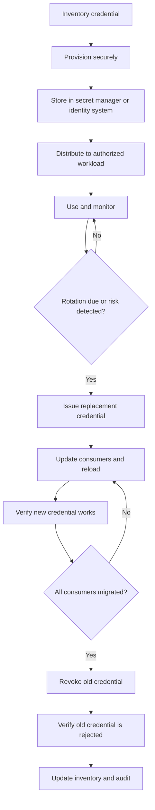
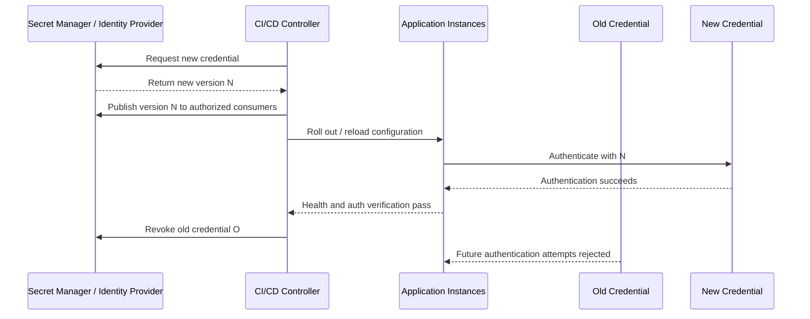
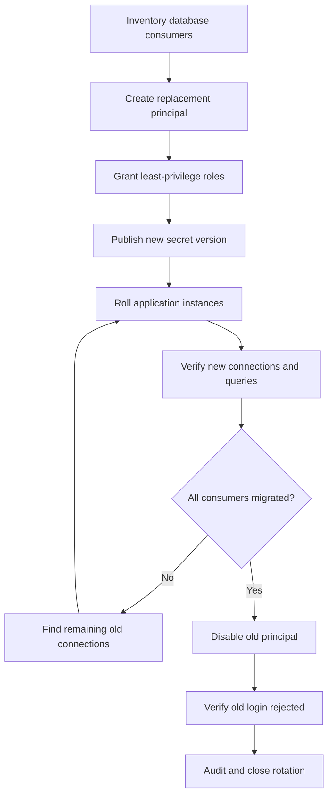
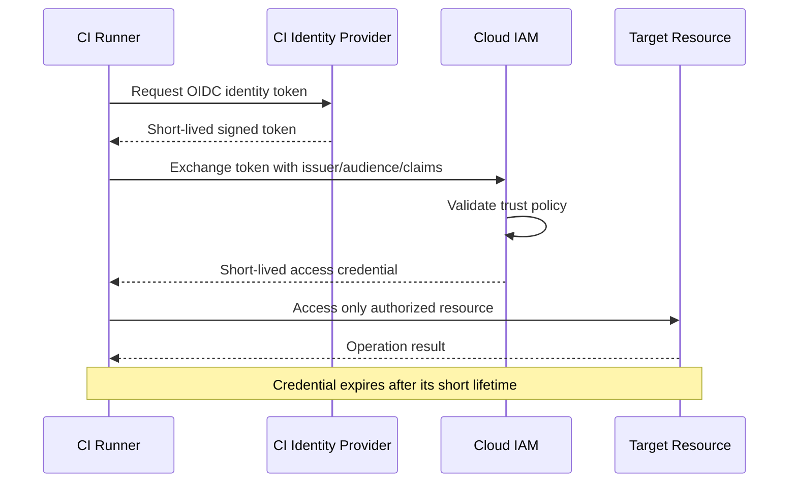

# Luân chuyển, thu hồi và kiểm chứng thông tin xác thực

Một token bị lộ trong log CI, một mật khẩu database tồn tại nhiều năm hoặc một certificate hết hạn có thể làm gián đoạn cả quy trình phát hành. Trong CI/CD, thông tin xác thực thường xuất hiện ở nhiều nơi: runner, secret manager, registry, cloud account, cluster, database, API bên ngoài và ứng dụng đang chạy. Chỉ thay giá trị trong một biến pipeline chưa đủ để bảo đảm credential cũ đã hết hiệu lực hoặc mọi thành phần đã sử dụng credential mới.

**Luân chuyển (rotation), thu hồi (revocation) và kiểm chứng (verification) là ba hoạt động liên kết trong vòng đời thông tin xác thực.** Rotation thay credential hiện tại bằng credential mới theo một quy trình có kiểm soát. Revocation làm credential không còn được chấp nhận khi hết hạn, không còn cần thiết hoặc có dấu hiệu bị lộ. Verification xác nhận các workload, job và dịch vụ thực sự đã chuyển sang credential mới, credential cũ đã mất hiệu lực và hoạt động vẫn bình thường.

Một quy trình trưởng thành cần biết credential nào tồn tại, ai sở hữu, được dùng ở đâu, quyền hạn ra sao, khi nào phải thay, cách chuyển đổi không gián đoạn và cách xử lý khẩn cấp khi bị xâm phạm. Mục tiêu là giảm thời gian credential có thể bị lạm dụng, giới hạn phạm vi ảnh hưởng và duy trì khả năng truy vết trong suốt quá trình phát hành.

## 1. Phân biệt rotation, revocation và verification

Ba hoạt động thường được thực hiện cùng nhau nhưng giải quyết các vấn đề khác nhau.

| Hoạt động | Mục tiêu | Ví dụ |
|---|---|---|
| Rotation | Thay credential đang dùng bằng credential mới, cập nhật consumer và chuyển traffic/quyền sang credential mới | Tạo database password mới, cập nhật secret version, rollout ứng dụng rồi vô hiệu password cũ |
| Revocation | Làm credential không còn được chấp nhận hoặc không còn khả năng truy cập | Thu hồi token bị lộ, disable access key, revoke certificate hoặc xóa quyền của service account |
| Verification | Xác nhận thay đổi có hiệu lực và không còn đường dùng credential cũ | Kiểm tra login bằng credential mới thành công, credential cũ bị từ chối, workload mới đã reload secret |

Rotation không đồng nghĩa revocation. Trong một số hệ thống, hai credential có thể cùng hợp lệ trong một khoảng chuyển tiếp để tránh gián đoạn. Khi tất cả consumer đã chuyển sang credential mới, credential cũ mới được thu hồi. Nếu credential cũ đã bị lộ, khoảng chuyển tiếp cần được rút ngắn hoặc bỏ qua theo kế hoạch containment.

Verification cũng không chỉ là kiểm tra secret manager đã lưu version mới. Ứng dụng có thể giữ credential cũ trong memory, connection pool, file cấu hình hoặc biến môi trường của process đang chạy. Cần kiểm chứng từ phía nơi thực sự sử dụng credential.

## 2. Vòng đời của thông tin xác thực

Một credential cần có vòng đời rõ ràng từ lúc được tạo đến khi bị thu hồi và xử lý dấu vết liên quan.

1. **Inventory:** ghi nhận loại credential, owner, mục đích, consumer, quyền và môi trường.
2. **Provision:** tạo credential từ nguồn tin cậy, ưu tiên cơ chế tự động và giá trị ngẫu nhiên đủ mạnh.
3. **Store:** lưu trong secret manager hoặc hệ thống quản lý danh tính có kiểm soát truy cập.
4. **Distribute:** cấp credential cho workload đúng thời điểm, đúng phạm vi và theo nguyên tắc least privilege.
5. **Use and monitor:** theo dõi lần sử dụng, nguồn truy cập, quyền và dấu hiệu bất thường.
6. **Rotate:** phát hành credential mới, chuyển consumer và xác minh hoạt động.
7. **Revoke:** vô hiệu credential cũ hoặc credential bị xâm phạm.
8. **Retire and audit:** xóa bản sao không còn cần, lưu audit evidence và cập nhật inventory.



Nếu credential bị nghi ngờ đã lộ, quy trình không nhất thiết chờ đến lịch rotation. Hãy chuyển sang xử lý sự cố: cô lập, revoke hoặc disable nhanh theo khả năng hệ thống, phát hành credential thay thế, điều tra dấu vết và xác minh không còn truy cập trái phép.

## 3. Xây dựng inventory credential

Không thể luân chuyển an toàn một credential nếu không biết nó được sử dụng ở đâu. Inventory là cơ sở để xác định phạm vi cập nhật và tránh bỏ sót consumer.

Mỗi bản ghi nên có các thông tin:

| Trường | Ý nghĩa |
|---|---|
| Credential ID | Định danh không chứa giá trị bí mật |
| Loại | API token, database password, cloud key, SSH key, certificate, signing key... |
| Owner | Nhóm hoặc service chịu trách nhiệm |
| Consumer | Job, runner, ứng dụng hoặc dịch vụ sử dụng |
| Environment | Development, test, staging hoặc production |
| Scope/permissions | Quyền và tài nguyên có thể truy cập |
| Source of truth | Secret manager, identity provider, KMS hoặc hệ thống cấp phát |
| Created/expiry/last rotated | Thời điểm tạo, hết hạn và luân chuyển gần nhất |
| Rotation method | Tự động, dual credential, rolling update hoặc quy trình thủ công có kiểm soát |
| Revocation method | Disable key, revoke token, xóa role, revoke certificate... |
| Evidence | Lịch sử thay đổi, lần sử dụng cuối, xác minh và audit event |

Không ghi giá trị secret thật vào inventory. Chỉ lưu tên tham chiếu, version, fingerprint hoặc ID do hệ thống cấp. Inventory có thể được tạo một phần tự động từ secret manager, cloud IAM, certificate inventory và deployment metadata, nhưng cần owner xác nhận các consumer thực tế.

### Phát hiện credential không có owner

Credential không có owner hoặc không có lần sử dụng được giải thích là rủi ro. Có thể đó là khóa cũ còn quyền truy cập, credential của nhân viên đã rời nhóm hoặc key được tạo thủ công ngoài quy trình. Nên gắn cảnh báo và thời hạn xác minh; chỉ revoke sau khi đánh giá consumer và tác động để tránh làm gián đoạn dịch vụ đang phụ thuộc.

## 4. Chọn chiến lược rotation theo loại credential

Không có một quy trình rotation duy nhất phù hợp cho mọi loại thông tin xác thực. Cách chuyển đổi phụ thuộc hệ thống cấp phát, khả năng hỗ trợ nhiều credential cùng lúc, cache, session và cách workload nạp lại giá trị.

| Loại credential | Cách rotation thường dùng | Điểm cần kiểm chứng |
|---|---|---|
| API token | Tạo token mới, cập nhật consumer, xác minh, revoke token cũ | Scope, audience, expiry, consumer đã reload |
| Database password | Tạo principal/password mới hoặc cơ chế dual password, cập nhật connection, drain pool, revoke cũ | Tất cả instance dùng credential mới, connection cũ đã đóng |
| Cloud access key | Tạo key mới hoặc chuyển sang workload identity, rollout consumer rồi disable key cũ | Audit log không còn lần dùng key cũ, quyền mới đúng scope |
| OAuth client secret | Tạo secret thứ hai nếu provider hỗ trợ, cập nhật client và xác minh token flow | Tất cả client instance đã đổi, secret cũ bị vô hiệu |
| SSH key | Thêm public key mới vào authorized location, chuyển client, xóa key cũ | Không còn automation hoặc người dùng cần key cũ |
| TLS certificate | Cấp certificate mới, phân phối chain, reload endpoint, revoke certificate cũ khi cần | Chain, hostname, expiry, client trust và endpoint thực tế |
| JWT signing key | Phát hành key mới, công bố public key, ký token mới, giữ public key cũ đến khi token cũ hết hạn | `kid`, JWKS cache, token lifetime và consumer validation |
| Encryption key | Dùng key version mới cho dữ liệu ghi mới, re-encrypt dữ liệu cũ theo kế hoạch | Khả năng decrypt dữ liệu cũ, backup và key version mapping |
| CI runner credential | Ưu tiên OIDC/credential ngắn hạn; nếu dùng key tĩnh thì cấp mới và cập nhật runner | Runner image, secret scope, job đang chạy và audit |

Credential có khả năng cấp phát ngắn hạn theo workload identity thường giảm nhu cầu rotation thủ công. Thay vì giữ một access key dài hạn trong CI, pipeline có thể đổi token OIDC lấy credential ngắn hạn, giới hạn theo repository, branch, environment hoặc service account.

## 5. Thiết kế rotation không gián đoạn

Với dịch vụ đang hoạt động, thay credential ngay lập tức có thể khiến các instance chưa cập nhật mất kết nối. Chiến lược thường dùng là tạo khoảng chuyển tiếp có kiểm soát.

### Mẫu dual credential

Nếu hệ thống hỗ trợ nhiều credential đồng thời, có thể thực hiện:

1. Tạo credential mới với quyền tương đương hoặc hẹp hơn credential cũ.
2. Lưu credential mới trong secret manager dưới version mới.
3. Cập nhật consumer theo từng nhóm hoặc rolling deployment.
4. Kiểm tra các consumer mới đã xác thực thành công.
5. Theo dõi audit log để phát hiện consumer còn dùng credential cũ.
6. Thu hồi credential cũ sau khi mọi consumer cần thiết đã chuyển đổi.
7. Kiểm tra credential cũ bị từ chối và cập nhật inventory.



Dual credential chỉ phù hợp khi hệ thống cấp phát cho phép hai credential cùng hợp lệ. Không tự giả định database, OAuth provider hoặc API bên ngoài hỗ trợ điều này. Nếu chỉ cho phép một credential, cần cơ chế chuyển đổi khác như tạo principal thứ hai, maintenance window hoặc chuyển qua workload identity.

### Mẫu rolling rotation

Với nhiều instance, có thể thay lần lượt từng nhóm:

- Cập nhật secret version.
- Restart hoặc reload một nhóm instance.
- Kiểm tra kết nối và health.
- Tiếp tục nhóm tiếp theo.
- Sau khi toàn bộ instance đã chuyển, revoke credential cũ.

Trong thời gian chuyển tiếp, cả hai credential có thể còn hiệu lực. Khoảng thời gian này cần ngắn, có giám sát và có thời hạn kết thúc rõ ràng. Không giữ credential cũ vô thời hạn chỉ vì chưa xác định được một consumer ít hoạt động.

## 6. Luân chuyển database credential

Database credential thường khó rotation hơn API token vì connection pool giữ kết nối lâu dài. Đổi password trong secret manager không tự làm các kết nối hiện tại chuyển sang password mới.

### Quy trình khuyến nghị

1. Xác định toàn bộ ứng dụng, migration job, reporting job và operator đang dùng principal cần đổi.
2. Kiểm tra database có hỗ trợ nhiều principal hoặc nhiều password đồng thời không.
3. Tạo principal mới với quyền tối thiểu cần thiết; nếu phù hợp, cấp role tương đương bằng cách kế thừa role thay vì sao chép quyền tùy tiện.
4. Cập nhật secret manager và cấu hình tham chiếu cho workload.
5. Rolling restart hoặc reload connection pool để tạo kết nối mới bằng credential mới.
6. Kiểm tra query, transaction, migration và health check qua các instance.
7. Theo dõi audit log và connection metadata để tìm kết nối còn dùng principal cũ.
8. Disable hoặc thu hồi principal cũ khi đã xác nhận không còn consumer hợp lệ.
9. Kiểm tra một kết nối mới bằng credential cũ bị từ chối và một kết nối bằng credential mới thành công.

Nếu database chỉ cho phép đổi password trên cùng một principal, việc đổi có thể làm kết nối mới bằng password cũ thất bại ngay. Cần lên kế hoạch cập nhật đồng bộ, hiểu cách connection pool xử lý kết nối hiện tại và chọn thời điểm có thể rollback hoặc khôi phục. Một số nền tảng hỗ trợ dual password hoặc secret rotation tích hợp; cần xác minh hành vi cụ thể trước khi áp dụng.

### Ví dụ thứ tự triển khai



Không xóa principal cũ chỉ vì một deployment đã thành công. Cần kiểm tra các job chạy theo lịch, batch process, migration runner hoặc consumer ít hoạt động có thể chỉ kết nối sau nhiều giờ hoặc nhiều ngày.

## 7. Luân chuyển API token và OAuth client secret

API token thường được lưu ở ứng dụng, runner hoặc integration. Cần biết token thuộc identity nào, scope nào, audience nào và consumer nào đang dùng.

Quy trình rotation:

- Tạo token mới cho đúng identity và scope tối thiểu.
- Cập nhật secret reference hoặc version trong secret manager.
- Triển khai/reload tất cả consumer.
- Kiểm tra request mới được xác thực bằng token mới.
- Theo dõi log để xác định token cũ còn được sử dụng không.
- Revoke token cũ và xác minh request bằng token cũ bị từ chối.

Với OAuth client secret, cần xem authorization server có hỗ trợ nhiều secret cho cùng client hay không. Nếu có, dùng khoảng overlap ngắn. Nếu không, cần phối hợp thời điểm thay đổi và rollout client để tránh tất cả instance đồng thời dùng secret đã hết hiệu lực.

Token nên có expiry phù hợp, scope hẹp và audience rõ ràng. Không nên dùng một token quản trị cho nhiều pipeline hoặc service vì khó xác định consumer nào cần thu hồi khi có sự cố.

## 8. Luân chuyển SSH key và certificate

### 8.1. SSH key

SSH key automation có thể được dùng để truy cập Git server, máy triển khai hoặc máy chủ quản trị. Rotation an toàn thường gồm:

1. Tạo key pair mới trong môi trường được bảo vệ.
2. Đăng ký public key mới vào đúng account hoặc host cần truy cập.
3. Cập nhật secret store hoặc agent của pipeline để dùng private key mới.
4. Kiểm tra kết nối từ runner và xác minh danh tính được ánh xạ đúng.
5. Xóa public key cũ khỏi authorized location.
6. Kiểm tra key cũ không còn được chấp nhận.

Private key không được đưa vào repository hoặc artifact. Nếu key cũ bị lộ, cần thu hồi ngay ở tất cả host hoặc account liên quan và kiểm tra log đăng nhập, không chờ đến khi rollout key mới hoàn tất nếu nguy cơ đang diễn ra.

### 8.2. TLS certificate

Certificate có thời hạn và chuỗi tin cậy. Rotation cần chú ý thời gian phát hành, phân phối, reload endpoint, cache và client trust.

- Cấp certificate mới với SAN, key usage, issuer và thời hạn phù hợp.
- Phân phối certificate cùng private key qua kênh bảo mật.
- Cài certificate mới trên load balancer, ingress hoặc service.
- Reload hoặc rolling restart để endpoint bắt đầu phục vụ certificate mới.
- Kiểm tra từ góc nhìn client: hostname, chain, expiry và protocol.
- Theo dõi endpoint còn phục vụ certificate cũ hay không.
- Thu hồi certificate cũ khi cần hoặc theo chính sách CA.

Không chỉ kiểm tra file certificate trên disk. Một process có thể vẫn giữ certificate cũ trong memory hoặc load balancer khác chưa được cập nhật. Cần kiểm tra từng endpoint thực tế và các vùng triển khai.

### 8.3. Certificate revocation

Revoke certificate có thể được thực hiện qua CRL hoặc OCSP tùy CA và hệ sinh thái. Không phải mọi client đều kiểm tra revocation giống nhau hoặc ngay lập tức. Khi xử lý certificate bị lộ, cần thay certificate, cập nhật trust và kiểm tra cách client xác minh trạng thái thu hồi. Nếu private key bị xâm phạm, thay certificate mà vẫn dùng lại private key cũ không giải quyết được vấn đề.

## 9. Luân chuyển JWT signing key và encryption key

Signing key và encryption key có tác động rộng vì chúng có thể được dùng bởi nhiều service và tồn tại trong token hoặc dữ liệu đã lưu.

### 9.1. JWT signing key

Khi thay khóa ký JWT bất đối xứng, quy trình thường gồm:

1. Tạo key pair mới trong KMS hoặc hệ thống quản lý khóa.
2. Công bố public key mới qua JWKS hoặc cơ chế phân phối đáng tin cậy.
3. Chờ verifier nhận public key mới và cập nhật cache.
4. Chuyển issuer sang ký token mới bằng key mới và gắn `kid` phù hợp.
5. Theo dõi verifier chấp nhận token mới.
6. Giữ public key cũ trong thời gian token cũ còn hiệu lực và có thể được gửi đến verifier.
7. Sau cửa sổ token cũ và cache đã hết, loại public key cũ khỏi JWKS theo chính sách.

Nếu key cũ bị xâm phạm, cần đánh giá việc vô hiệu token đã ký bằng key đó. Chỉ xóa public key khỏi JWKS có thể không đủ nếu verifier cache key hoặc bỏ qua kiểm tra. Có thể cần denylist `kid`, thu hồi session, rút ngắn token lifetime hoặc buộc người dùng xác thực lại.

### 9.2. Encryption key

Encryption key có vòng đời phức tạp hơn vì dữ liệu cũ có thể vẫn được mã hóa bằng version trước. Một chiến lược thường dùng:

- Dùng key version mới cho dữ liệu ghi mới.
- Giữ key cũ ở chế độ decrypt-only trong thời gian chuyển tiếp.
- Re-encrypt dữ liệu cũ theo lô nếu policy yêu cầu.
- Xác minh dữ liệu mới và cũ đều đọc được trong giai đoạn chuyển đổi.
- Chỉ disable/destroy key cũ khi đã xác nhận không còn dữ liệu, backup hoặc bản sao cần decrypt bằng key đó.

Không thu hồi hoặc xóa encryption key cũ quá sớm. Nếu dữ liệu backup còn phụ thuộc key đó, việc mất key có thể khiến dữ liệu không thể phục hồi. Ngược lại, nếu key bị lộ, cần cân nhắc re-encryption và kiểm soát bản sao dữ liệu theo kế hoạch sự cố.

## 10. Credential cho CI/CD: ưu tiên danh tính workload

CI/CD thường cần truy cập cloud, container registry, package repository và môi trường triển khai. Một access key tĩnh có quyền rộng đặt trong biến pipeline là mục tiêu hấp dẫn nếu runner hoặc workflow bị xâm nhập.

### Workload identity và OIDC

Với OIDC federation, runner nhận identity token từ nền tảng CI. Cloud hoặc dịch vụ đích xác minh issuer, audience và claims rồi cấp credential ngắn hạn cho job.



Trust policy cần ràng buộc đủ chặt, ví dụ repository, branch, tag, workflow, environment hoặc subject claim. Không chỉ tin issuer chung nếu nhiều repository hoặc workflow khác nhau cùng dùng issuer đó.

Lợi ích:

- Giảm hoặc loại bỏ secret dài hạn trong CI.
- Credential tự hết hạn sau job hoặc sau thời gian ngắn.
- Quyền có thể giới hạn theo workload và môi trường.
- Audit log có thể gắn thao tác với identity của job.

OIDC không tự động bảo đảm an toàn nếu trust policy quá rộng. Nếu workflow không tin cậy có thể lấy identity token đáp ứng điều kiện, nó vẫn có thể nhận quyền. Cần bảo vệ workflow, branch và environment cùng với IAM policy.

### Khi vẫn phải dùng credential tĩnh

Một số hệ thống cũ hoặc dịch vụ bên ngoài chưa hỗ trợ workload identity. Khi đó:

- Tạo credential riêng cho từng integration hoặc môi trường.
- Giới hạn scope, IP, resource và thao tác được phép nếu dịch vụ hỗ trợ.
- Lưu trong secret manager, không lưu trong mã nguồn.
- Đặt expiry và lịch rotation.
- Không chia sẻ credential giữa nhiều repository hoặc team.
- Theo dõi last-used, audit log và cảnh báo credential không hoạt động.
- Có runbook revoke khẩn cấp và người sở hữu.

## 11. Thu hồi credential khi bị lộ hoặc nghi ngờ bị xâm phạm

Khi secret xuất hiện trong repository, log, artifact, ticket hoặc chat, cần coi đó là sự cố tiềm tàng. Xóa nội dung hiển thị không làm credential mất hiệu lực. Bản sao có thể còn trong Git history, log lưu trữ, cache, artifact hoặc bản tải xuống.

### Quy trình containment

1. Xác định loại credential, owner, scope, thời điểm và nơi xuất hiện.
2. Đánh giá credential có thể bị truy cập bởi ai và còn hiệu lực không.
3. Revoke/disable credential bị lộ hoặc giới hạn quyền ngay theo mức khẩn cấp.
4. Nếu cần duy trì dịch vụ, cấp credential mới và chuyển consumer theo quy trình ưu tiên.
5. Kiểm tra audit log để tìm lần sử dụng bất thường, nguồn IP, resource và hành động đã thực hiện.
6. Rotate các credential khác có thể bị lộ cùng đường truy cập hoặc cùng quyền.
7. Xử lý bản sao trong repository, log, artifact và cache theo chính sách.
8. Xác minh credential cũ bị từ chối và các workload hợp lệ đã hoạt động bằng credential mới.
9. Ghi nhận sự cố, nguyên nhân và hành động ngăn tái diễn.

### Xóa secret khỏi Git history không thay thế revoke

Nếu secret được commit, cần revoke hoặc rotate trước. Sau đó mới đánh giá việc rewrite Git history và xóa bản sao ở fork, clone, cache hoặc artifact. History rewrite có thể ảnh hưởng commit SHA, pull request và clone đang tồn tại; cần phối hợp theo quy trình repository. Dù history đã được làm sạch, credential cũ vẫn phải được xem là đã lộ.

### Khi nào cần thu hồi ngay?

- Credential được xác nhận xuất hiện công khai hoặc trong nơi người không có quyền có thể đọc.
- Có dấu hiệu đăng nhập hoặc truy cập bất thường.
- Nhân sự hoặc workload không còn được phép sử dụng credential.
- Private key bị thất lạc hoặc nghi ngờ bị sao chép.
- Credential có quyền rộng và không thể xác định phạm vi lộ.

Với credential có tác động rất lớn, ưu tiên containment trước rồi khôi phục dịch vụ theo kế hoạch. Không kéo dài việc thu hồi chỉ để giữ một quy trình rotation không gián đoạn nếu nguy cơ lạm dụng đang cao.

## 12. Kiểm chứng sau rotation và revocation

Một quy trình chỉ được xem là hoàn tất khi có bằng chứng ở cả phía credential provider và phía consumer.

### Kiểm chứng credential mới

- Secret manager trả đúng version mới cho workload được phép.
- Ứng dụng hoặc runner đã reload/restart và không còn giữ giá trị cũ.
- Một thao tác thực tế có quyền giới hạn thành công bằng credential mới.
- Các instance, region, runner pool và job theo lịch đều đã chuyển.
- Audit log ghi nhận identity hoặc key mới được sử dụng.
- Health check và chức năng nghiệp vụ vẫn đạt.

### Kiểm chứng credential cũ

- Provider đã disable/revoke key hoặc identity cũ.
- Một lần xác thực thử bằng credential cũ bị từ chối trong môi trường kiểm tra an toàn.
- Không còn request hợp lệ dùng credential cũ sau cửa sổ chuyển tiếp.
- Không còn secret version cũ được tham chiếu bởi deployment đang hoạt động.
- Không còn process, cache hoặc runner cần credential cũ.

Không nên thử credential bị lộ bằng cách đưa giá trị thật vào command line, shell history hoặc log. Có thể dùng môi trường kiểm thử hoặc công cụ quản trị provider để kiểm tra trạng thái revoked mà không làm lộ lại secret.

### Kiểm chứng từ xa

Một số credential được cache ở nhiều lớp: process, sidecar, proxy, connection pool, agent hoặc service mesh. Kiểm tra secret manager đã cập nhật không chứng minh mọi lớp đã nhận version mới. Cần kiểm tra endpoint thực tế, deployment revision, kết nối mới và log truy cập.

## 13. Lịch rotation và thời hạn credential

Lịch rotation nên dựa trên loại credential, mức quyền, khả năng cấp phát ngắn hạn, yêu cầu tuân thủ và nguy cơ. Không nên chọn một chu kỳ cố định cho mọi secret.

| Loại | Cách giảm rủi ro ưu tiên | Chính sách thời hạn cần xem xét |
|---|---|---|
| Workload token | Token ngắn hạn tự động cấp theo job | Thời hạn chỉ đủ cho tác vụ và có audience/scope hẹp |
| API key tĩnh | Thay bằng OAuth/OIDC nếu có; nếu không thì rotation định kỳ | Chu kỳ theo mức quyền, exposure và khả năng rotate |
| Database credential | Principal riêng theo service, secret manager và tự động rotation | Cân bằng lịch rotation với connection lifecycle |
| SSH automation key | Ưu tiên certificate/short-lived SSH certificate | Thời hạn ngắn và inventory host/account rõ |
| TLS certificate | Tự động cấp và gia hạn trước expiry | Theo chính sách CA và khả năng reload endpoint |
| Signing key | Quản lý bằng KMS/HSM, key version và overlap có kiểm soát | Theo threat model, thuật toán và token/data lifetime |
| Encryption key | Versioning, decrypt-only key cũ và re-encryption plan | Phụ thuộc retention dữ liệu và backup |

Ngoài lịch, cần trigger rotation khi có sự kiện: nhân sự rời tổ chức, thay đổi quyền, runner bị xâm nhập, secret bị commit, vendor thay đổi hoặc phát hiện hoạt động bất thường.

## 14. Quản lý cache, session và kết nối tồn tại lâu

Một lý do khiến rotation thất bại là consumer không hỏi lại credential provider sau khi secret được cập nhật.

Các nơi cần kiểm tra:

- Environment variable được nạp khi process khởi động.
- File config được mount nhưng ứng dụng không theo dõi thay đổi.
- Connection pool giữ kết nối đã xác thực trước đó.
- OAuth access token được cache trong memory hoặc disk.
- JWKS client cache public key cũ.
- Sidecar hoặc proxy giữ certificate và credential riêng.
- Runner service giữ token ngoài thời gian của job.
- Cron job hoặc worker ít chạy chỉ lấy secret khi bắt đầu tác vụ.

Mỗi loại cache cần chính sách refresh, TTL và cách invalidate. Khi rotation, có thể cần rolling restart, reload signal, drain connection pool hoặc chờ token cũ hết hạn. Không nên xóa secret version cũ trước khi biết các consumer đã ngừng đọc nó.

Với JWT, thời gian giữ public key cũ cần tính đến thời hạn token và cache verifier. Với database, cần phân biệt kết nối đang mở với lần xác thực mới: credential cũ có thể vẫn duy trì session hiện tại nhưng không được chấp nhận cho connection mới. Việc kiểm chứng phải bao gồm cả hai trường hợp.

## 15. Bảo vệ secret trong log, artifact và pipeline

Rotation xử lý credential theo thời gian; ngăn rò rỉ cần được tích hợp vào cách pipeline sử dụng secret.

- Không echo secret hoặc bật debug logging cho lệnh có thể in credential.
- Tránh truyền secret trực tiếp qua argument vì có thể xuất hiện trong process list hoặc log.
- Ưu tiên file tạm có quyền đọc hạn chế hoặc secret mount được nền tảng hỗ trợ.
- Masking log là lớp giảm rủi ro, không phải bảo đảm; encoding hoặc cắt chuỗi có thể vượt qua masking.
- Không upload toàn bộ workspace nếu chưa lọc secret và dữ liệu nhạy cảm.
- Không đưa credential vào Docker build argument hoặc image layer nếu có thể tránh.
- Không chia sẻ cache chứa credential giữa repository hoặc trust boundary khác nhau.
- Xóa file credential tạm và thu hồi session sau job.
- Chạy secret scanning trên diff và định kỳ trên repository.

Nếu secret bị in ra log, cần xác định log có được lưu, sao chép hoặc gửi đến hệ thống bên ngoài nào. Revoke credential trước, sau đó xử lý bản ghi log theo retention và incident policy.

## 16. Ví dụ luồng rotation tự động trong CI/CD

Đoạn YAML sau mô tả một quy trình khái niệm. Đây không phải cú pháp trực tiếp của một nền tảng CI/CD cụ thể:

```yaml
credential_rotation:
  trigger:
    - scheduled_rotation_due
    - security_incident
    - manual_approved_request

  jobs:
    inventory:
      steps:
        - resolve_credential_owner
        - list_authorized_consumers
        - inspect_current_version_and_expiry

    issue_replacement:
      needs: [inventory]
      steps:
        - create_replacement_credential
        - assign_least_privilege_scope
        - store_new_secret_version

    migrate_consumers:
      needs: [issue_replacement]
      steps:
        - update_secret_reference
        - roll_or_reload_consumers
        - verify_new_authentication
        - inspect_consumer_coverage

    revoke_previous:
      needs: [migrate_consumers]
      condition: all_required_consumers_verified
      approval: rotation_policy
      steps:
        - revoke_previous_credential
        - verify_previous_credential_rejected

    close_rotation:
      needs: [revoke_previous]
      steps:
        - update_credential_inventory
        - publish_audit_evidence
        - alert_on_remaining_old_usage
```

Trong hệ thống thật, job tạo và thu hồi credential cần dùng identity có quyền hẹp. Không lưu giá trị secret trong output của pipeline hoặc report. Job migration phải có cơ chế rollback cấu hình nếu credential mới không hoạt động, nhưng không được tự động bật lại credential cũ đã bị xác nhận xâm phạm.

Với sự cố lộ secret, trigger `security_incident` có thể bỏ qua overlap dài và thực hiện revoke/disable khẩn cấp. Khi đó mục tiêu ưu tiên là ngăn truy cập trái phép; khôi phục workload được thực hiện bằng credential thay thế và kế hoạch sự cố.

## 17. Ví dụ xuyên suốt: luân chuyển credential của orders-api

Giả sử `orders-api` dùng database principal `orders_app_old` để truy cập PostgreSQL production. Credential này sắp đến hạn rotation. Có sáu replica của service, hai worker xử lý đơn hàng và một job migration chạy theo lịch.

**Bước 1 — Inventory:** nhóm xác định tất cả consumer, owner, quyền hiện tại và lần sử dụng gần nhất. Migration job được ghi nhận vì nó chỉ chạy khi release có thay đổi schema.

**Bước 2 — Provision:** tạo principal `orders_app_next` với role cần thiết cho service. Không cấp quyền quản trị database. Secret được lưu dưới version mới trong secret manager.

**Bước 3 — Migrate:** cập nhật secret reference, rolling restart các replica và worker theo từng nhóm. Mỗi instance mở connection mới bằng principal mới; health check và truy vấn nghiệp vụ được xác minh.

**Bước 4 — Coverage:** audit log cho thấy các instance và worker đã dùng principal mới. Nhóm kiểm tra job migration và tác vụ theo lịch, xác nhận chúng cũng tham chiếu secret mới. Connection pool cũ được drain.

**Bước 5 — Revoke:** disable principal cũ sau khi owner xác nhận không còn consumer hợp lệ. Một kết nối kiểm tra bằng principal cũ bị từ chối; kết nối bằng principal mới vẫn thành công.

**Bước 6 — Audit:** inventory ghi version mới, thời điểm rotation, người phê duyệt, danh sách consumer và bằng chứng kiểm chứng. Secret cũ được đánh dấu revoked; các bản sao local không còn cần thiết được dọn.

Nếu ở bước 3 một replica không thể xác thực bằng principal mới, pipeline dừng rollout và giữ lại bằng chứng. Với rotation định kỳ, có thể giữ credential cũ hoạt động trong khoảng khắc phục ngắn nếu policy cho phép. Với credential đã bị lộ, cần đánh giá mức khẩn cấp và không kéo dài overlap chỉ để giữ availability.

## 18. Đo lường hiệu quả quản lý credential

Một quy trình rotation cần được đo bằng độ bao phủ, tốc độ xử lý và bằng chứng thu hồi.

| Chỉ số | Ý nghĩa | Câu hỏi cần trả lời |
|---|---|---|
| Inventory coverage | Tỷ lệ credential có owner, consumer và expiry rõ | Có credential không rõ mục đích hoặc chủ sở hữu không? |
| Rotation compliance | Tỷ lệ credential được rotate theo policy | Có secret quá hạn hoặc bị bỏ quên không? |
| Time to revoke | Thời gian từ phát hiện lộ đến khi credential mất hiệu lực | Hệ thống có thể containment đủ nhanh không? |
| Consumer migration coverage | Tỷ lệ workload đã chuyển sang version mới | Có job theo lịch hoặc instance ít hoạt động chưa chuyển không? |
| Old credential usage | Số lần credential cũ còn được sử dụng sau cutover | Có consumer bị bỏ sót không? |
| Rotation failure rate | Tỷ lệ rotation không hoàn tất hoặc gây gián đoạn | Vấn đề nằm ở secret distribution, reload hay permission? |
| Short-lived credential adoption | Tỷ lệ workload dùng credential ngắn hạn | Có thể giảm secret tĩnh ở đâu? |
| Expired/revoked credential attempts | Số lần sử dụng credential đã hết hạn hoặc bị revoke | Có consumer cũ hoặc hoạt động bất thường không? |

Không nên đặt mục tiêu chỉ là số lần rotate. Rotation quá thường xuyên nhưng không có inventory hoặc verification có thể tạo thêm lỗi mà không giảm rủi ro. Hãy tập trung vào credential có owner, quyền phù hợp, thời hạn rõ, consumer đã chuyển và credential cũ thực sự mất hiệu lực.

## 19. Những anti-pattern thường gặp

| Anti-pattern | Hệ quả | Cách cải thiện |
|---|---|---|
| Đổi secret trong secret manager rồi coi như xong | Process và connection pool vẫn dùng credential cũ | Reload/rollout consumer và xác minh từ phía workload |
| Thu hồi key cũ trước khi biết consumer | Gây outage cho job hoặc service chưa chuyển | Inventory, overlap có thời hạn và kiểm tra consumer coverage |
| Giữ hai key cùng hợp lệ vô thời hạn | Credential cũ vẫn có thể bị lạm dụng | Đặt deadline revoke và cảnh báo old-key usage |
| Xóa secret khỏi Git nhưng không revoke | Credential cũ vẫn còn hiệu lực | Revoke/rotate trước, sau đó xử lý history và bản sao |
| Dùng một key cho nhiều service | Khó xác định phạm vi ảnh hưởng và thu hồi | Credential riêng theo service, môi trường và mục đích |
| Credential có quyền quá rộng | Một lần lộ có thể ảnh hưởng nhiều tài nguyên | Least privilege và scope hẹp |
| Dùng access key dài hạn cho CI | Tăng rủi ro khi runner/workflow bị xâm nhập | OIDC/workload identity và credential ngắn hạn |
| Chỉ kiểm tra secret version mới | Không biết mọi instance đã reload chưa | Kiểm tra deployment revision, auth log và chức năng thực tế |
| Revoke encryption key quá sớm | Mất khả năng giải mã dữ liệu hoặc backup cũ | Versioning, decrypt-only và re-encryption plan |
| Xóa public signing key ngay sau khi đổi | Token còn hạn không xác minh được | Tính token lifetime, JWKS cache và overlap phù hợp |
| Coi file đã xóa là credential đã thu hồi | Token hoặc key phía provider vẫn hoạt động | Disable/revoke ở hệ thống cấp phát và xác minh bị từ chối |
| Không kiểm tra credential cũ bị từ chối | Không có bằng chứng revocation có hiệu lực | Thực hiện negative verification an toàn và xem audit log |

## 20. Checklist luân chuyển, thu hồi và kiểm chứng

Trước khi đóng một rotation, nhóm có thể rà soát:

- [ ] Credential có owner, mục đích, consumer, environment và scope rõ ràng.
- [ ] Loại credential và khả năng rotation của provider đã được xác minh.
- [ ] Credential mới được tạo từ nguồn tin cậy và có quyền tối thiểu.
- [ ] Secret mới được lưu trong secret manager, không đưa vào source, log hoặc artifact.
- [ ] Có kế hoạch dual credential, rolling update hoặc maintenance window phù hợp.
- [ ] Tất cả consumer, kể cả job theo lịch và worker ít hoạt động, đã được liệt kê.
- [ ] Ứng dụng, runner, sidecar và connection pool đã reload credential mới.
- [ ] Có kiểm tra thực tế bằng credential mới và health/function verification.
- [ ] Audit log không còn consumer hợp lệ dùng credential cũ sau thời điểm cutover.
- [ ] Credential cũ đã được revoke/disable ở provider, không chỉ xóa khỏi file.
- [ ] Đã xác minh credential cũ bị từ chối bằng cách an toàn.
- [ ] Token, session, cache, connection và certificate có vòng đời phù hợp.
- [ ] Encryption/signing key có kế hoạch xử lý dữ liệu hoặc token tồn tại từ version cũ.
- [ ] Khi credential bị lộ, đã containment, điều tra log và xử lý các bản sao liên quan.
- [ ] Inventory, owner, expiry, version và audit evidence đã được cập nhật.
- [ ] Có cảnh báo cho credential quá hạn, không owner hoặc còn được sử dụng ngoài dự kiến.

## 21. Kết luận

Luân chuyển, thu hồi và kiểm chứng thông tin xác thực là một quy trình vòng đời, không phải thao tác thay một chuỗi trong biến môi trường. Nhóm cần biết credential nằm ở đâu, ai sử dụng, quyền hạn nào được cấp, cách phát hành phiên bản mới, cách chuyển toàn bộ consumer và thời điểm credential cũ mất hiệu lực.

Một quy trình an toàn kết hợp inventory đầy đủ, least privilege, credential ngắn hạn, rotation phù hợp từng loại, chuyển đổi có kiểm soát, revocation thật ở hệ thống cấp phát và verification từ phía workload. Khi có dấu hiệu lộ secret, containment cần được ưu tiên; sau đó nhóm điều tra audit log, xử lý bản sao, khôi phục bằng credential mới và cải thiện nguyên nhân gốc. Những bước này giúp CI/CD duy trì khả năng phát hành trong khi giảm nguy cơ credential cũ tiếp tục bị lạm dụng.
