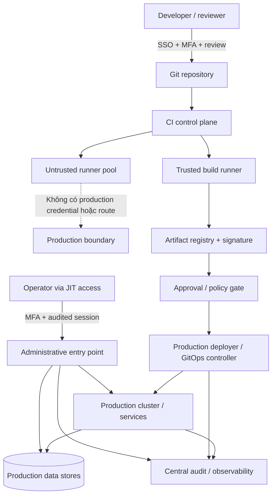
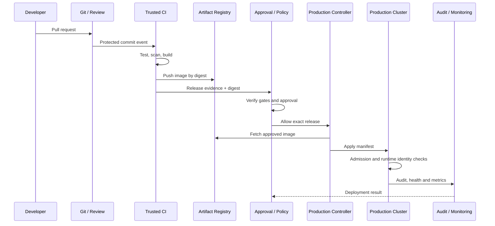

# Xác định ranh giới truy cập vào môi trường sản xuất

Môi trường production chứa phiên bản ứng dụng đang phục vụ người dùng, dữ liệu thật và các tài nguyên có ảnh hưởng trực tiếp tới hoạt động kinh doanh. Vì vậy, câu hỏi bảo mật không chỉ là “ai có mật khẩu production?” mà còn là: **danh tính nào được phép đi vào ranh giới production, từ đâu, để thực hiện hành động gì, trên tài nguyên nào, trong khoảng thời gian bao lâu và bằng bằng chứng nào?**

Ranh giới truy cập production (production access boundary) là tập hợp các quy tắc về danh tính, quyền, network, runner, workload, secret và kiểm soát triển khai nhằm giới hạn đường đi từ bên ngoài vào tài nguyên production. Một ranh giới tốt bảo đảm người dùng, pipeline và ứng dụng chỉ nhận quyền tối thiểu cần thiết; thay đổi được thực hiện qua con đường có kiểm soát; và mọi hành động quan trọng đều có thể truy vết.

## 1. Xác định những gì nằm trong ranh giới production

Production không chỉ là một máy chủ hoặc một cluster. Phạm vi cần bảo vệ có thể gồm:

- Tài khoản cloud, subscription/project, resource group và các dịch vụ quản trị.
- VPC/VNet, subnet, firewall, load balancer, private endpoint và DNS.
- Kubernetes cluster, namespace, node, control plane và admission policy.
- Database, object storage, message broker, cache, search và hệ thống backup.
- Secret manager, KMS/HSM, certificate authority và khóa ký artifact.
- Container registry, package repository và kho lưu trữ release.
- Control plane CI/CD, GitOps controller, runner có quyền deploy và hệ thống quản lý cấu hình.
- Log, metric, trace, audit event và hệ thống cảnh báo.

Một tài nguyên nằm ngoài subnet production vẫn có thể thuộc ranh giới tin cậy nếu nó giữ credential, có quyền điều khiển cluster hoặc có thể thay đổi artifact sẽ được production chạy. Ví dụ, runner có quyền lấy production secret hoặc registry có quyền ghi image phát hành là một phần của chuỗi bảo vệ production.

### Các vùng tin cậy thường gặp

| Vùng | Ví dụ | Mức tin cậy và quyền điển hình |
|---|---|---|
| Developer endpoint | Laptop, máy làm việc cá nhân | Không có quyền quản trị production thường trực; truy cập qua SSO/MFA và cơ chế được kiểm soát |
| Source/control plane | Git repository, CI/CD control plane, approval system | Có thể khởi tạo quy trình; chỉ workflow và nhánh được bảo vệ mới được yêu cầu hành động production |
| Untrusted execution | Runner xử lý pull request từ fork hoặc mã chưa review | Không có production secret, credential deploy hoặc đường mạng trực tiếp vào production |
| Trusted build/release | Runner build từ revision được bảo vệ, signing service, artifact registry | Được tạo và ký artifact theo policy; quyền ghi được giới hạn theo repository/project |
| Production deployment plane | GitOps controller hoặc deployer có quyền giới hạn | Chỉ áp dụng release đã được xác minh vào đúng namespace/resource được giao |
| Production runtime/data plane | Workload, database và dịch vụ phục vụ người dùng | Chỉ nhận kết nối từ workload và operator được phép |
| Administrative plane | Bastion, privileged access management, cloud/Kubernetes admin | Quyền đặc biệt, cấp theo thời hạn và có audit |



Sơ đồ minh họa các đường truy cập chính. Mỗi tổ chức có thể dùng kiến trúc khác nhau, nhưng cần biết chính xác những thành phần nào có thể thay đổi production, đọc dữ liệu production hoặc cấp quyền cho thành phần khác.

## 2. Xây dựng ranh giới theo danh tính và quyền

Network segmentation có ích nhưng không đủ. Một kết nối đến từ subnet nội bộ không mặc nhiên đáng tin. Mọi yêu cầu truy cập quan trọng nên được xác thực danh tính và đánh giá quyền theo tài nguyên, hành động và ngữ cảnh.

### Phân loại principal

Principal là danh tính thực hiện hành động. Trong production thường có các nhóm:

- **Human identity:** developer, SRE, DBA, security reviewer, incident commander.
- **CI/CD identity:** workflow, runner, release automation và deploy job.
- **Workload identity:** service account hoặc identity của ứng dụng khi gọi database, queue hay cloud API.
- **Platform identity:** GitOps controller, operator, monitoring agent, backup service.
- **External/vendor identity:** nhà cung cấp hoặc hệ thống tích hợp được cấp quyền có giới hạn.

Không nên dùng một tài khoản chung cho nhiều người hoặc nhiều pipeline. Khi dùng chung danh tính, log khó xác định ai hoặc workflow nào đã thực hiện hành động, đồng thời việc thu hồi quyền có thể ảnh hưởng nhiều hệ thống không liên quan.

### Áp dụng least privilege

Quyền nên được giới hạn theo bốn chiều:

1. **Principal:** đúng người, service account hoặc workload identity.
2. **Action:** chỉ hành động cần thiết, ví dụ đọc log, cập nhật deployment hoặc gọi một API cụ thể.
3. **Resource:** chỉ đúng account, project, cluster, namespace, database hoặc secret.
4. **Context/time:** chỉ từ workflow, branch, environment, thiết bị hoặc khoảng thời gian được phép.

Ví dụ, một job deploy orders service chỉ cần cập nhật workload trong namespace `orders-production`. Job đó không cần quyền quản trị toàn cluster, đọc secret của mọi namespace hoặc truy cập database trực tiếp. Một người trực vận hành cần xem log có thể được cấp quyền đọc log và xem trạng thái workload mà không cần quyền sửa deployment.

### RBAC và ABAC

- **RBAC (Role-Based Access Control):** gán quyền qua vai trò, chẳng hạn `production-viewer`, `service-deployer` hoặc `database-operator`.
- **ABAC (Attribute-Based Access Control):** quyết định dựa trên thuộc tính như service, environment, owner, branch protection, ticket, device posture hoặc thời gian.

RBAC dễ quản lý vai trò chuẩn; ABAC hữu ích khi quyền cần phụ thuộc vào ngữ cảnh. Có thể kết hợp cả hai. Dù dùng mô hình nào, mặc định nên từ chối (default deny) và chỉ mở quyền khi có nhu cầu được xác định.

## 3. Tách quyền con người khỏi quyền tự động hóa

Người vận hành và pipeline có mục đích khác nhau. Người vận hành có thể cần điều tra, xem log hoặc xử lý incident; pipeline cần quyền thực hiện một tập thao tác triển khai xác định. Không nên cấp cho pipeline quyền tương đương tài khoản admin của con người.

| Vai trò | Quyền phù hợp | Quyền nên tránh cấp mặc định |
|---|---|---|
| Developer | Đọc trạng thái, log đã cho phép, mở PR và yêu cầu release | Sửa trực tiếp production hoặc đọc secret production |
| Reviewer/approver | Xem bằng chứng, chấp thuận/từ chối đúng phạm vi | Tự động có quyền triển khai hoặc đọc mọi secret |
| CI build job | Checkout source, tải dependency, tạo artifact và report | Truy cập database production hoặc cluster production |
| Release signer | Ký artifact/provenance theo policy | Quyền sửa source hoặc tự triển khai mọi service |
| Deployment controller | Áp dụng manifest/image đã xác minh vào resource được giao | Quyền quản trị cloud/cluster không giới hạn |
| SRE/operator | Quan sát, restart hoặc điều chỉnh service theo vai trò và quy trình | Dùng tài khoản admin chung, quyền thường trực không cần thiết |
| DBA | Thực hiện thao tác database được phê duyệt | Truy cập rộng vào secret và ứng dụng không liên quan |

Một người có thể giữ nhiều vai trò trong nhóm nhỏ, nhưng các hành động rủi ro cao cần separation of duties và audit độc lập theo policy.

## 4. Bảo vệ đường đi từ Git tới production

Pipeline là một đường truy cập quan trọng vào production. Nếu người dùng có thể sửa workflow, chạy mã tùy ý trên runner có production secret hoặc thay artifact sau khi phê duyệt, ranh giới production có thể bị vượt qua dù cluster đã được khóa network.

Một luồng phát hành an toàn nên kiểm soát:

- **Repository:** bảo vệ branch/tag phát hành, yêu cầu review, hạn chế force-push và quản lý quyền thay đổi workflow.
- **Workflow definition:** review file pipeline như mã nguồn có đặc quyền; hạn chế action/plugin bên thứ ba và pin phiên bản đáng tin cậy.
- **Trigger:** kiểm tra sự kiện, branch, tag, repository và actor; không cấp quyền production cho mọi pull request.
- **Runner selection:** tách runner untrusted khỏi runner trusted/release; kiểm soát tag, group và quyền đăng ký runner.
- **Artifact:** build từ commit đã xác định, lưu digest, provenance, SBOM và chữ ký khi policy yêu cầu.
- **Approval:** phê duyệt đúng digest, environment, cấu hình và thời hạn.
- **Deployment:** chỉ triển khai artifact đã xác minh bằng danh tính giới hạn quyền.
- **Verification:** kiểm tra rollout, health, metrics và ghi deployment record.

### Không cấp production secret cho pull request không tin cậy

Pull request từ fork hoặc nhánh chưa được review có thể sửa script và workflow để đọc biến môi trường, in secret ra log hoặc gửi dữ liệu ra ngoài. Vì vậy:

- Job kiểm tra PR chỉ nhận token read-only và quyền tối thiểu.
- Không gắn production environment hoặc production secret vào workflow PR.
- Không chạy mã PR chưa tin cậy trên self-hosted runner có mạng nội bộ hoặc credential nhạy cảm.
- Dùng runner ephemeral và workspace sạch cho workload không tin cậy.
- Tách pool runner build/release đã bảo vệ khỏi pool chạy mã tùy ý.
- Review thay đổi trong workflow, script deploy và policy trước khi merge.

Một runner có tag `production` không tự tạo ra bảo mật. Cần giới hạn ai có thể yêu cầu job dùng runner đó, workflow nào được chạy, secret nào được cấp và network nào runner có thể truy cập.

### Dùng danh tính workload thay cho khóa tĩnh

Nếu nền tảng cloud và CI hỗ trợ federation/OIDC, workflow có thể nhận token danh tính ngắn hạn rồi đổi token đó lấy quyền tạm thời ở cloud. Trust policy cần kiểm tra issuer, audience và các claim phù hợp như repository, organization/project, branch/tag, workflow hoặc environment.

Ví dụ GitHub Actions ở mức workflow:

```yaml
name: Deploy production

on:
  workflow_dispatch:

permissions:
  contents: read
  id-token: write

jobs:
  deploy:
    runs-on: ubuntu-latest
    environment: production
    steps:
      - uses: actions/checkout@v4
      - name: Obtain short-lived cloud identity
        run: ./ci/exchange-oidc-token.sh
      - name: Deploy approved artifact
        run: ./ci/deploy-by-digest.sh
```

`id-token: write` chỉ cho phép job yêu cầu OIDC token; nó không tự cấp quyền cloud. Quyền thực tế được quyết định bởi trust relationship và IAM role ở phía cloud. Trust policy nên giới hạn chính xác repository, workflow và environment được phép, không chấp nhận mọi token cùng issuer. Trong thực tế, cần cấu hình environment protection, required reviewers, branch restrictions và pin action theo policy của tổ chức.

Với GitLab CI hoặc nền tảng khác, nguyên tắc tương tự là dùng ID token với audience và claim được ràng buộc; kiểm tra tài liệu nền tảng để cấu hình trust policy chính xác.

## 5. Chọn mô hình triển khai phù hợp với ranh giới production

Có hai mô hình phổ biến:

| Mô hình | Đường truy cập | Điểm cần kiểm soát |
|---|---|---|
| Push-based deployment | CI runner kết nối tới production API/cluster và đẩy thay đổi | Runner có đường mạng và credential deploy; cần cô lập runner, short-lived identity, allowlist và audit |
| Pull-based/GitOps | CI cập nhật release manifest trong repository/registry; controller bên trong production lấy thay đổi và áp dụng | Controller có quyền trong cluster; cần bảo vệ nguồn manifest, chữ ký/provenance, policy và quyền sửa repository |

Với push-based, runner phải truy cập endpoint production. Hãy đặt runner trong vùng deploy riêng, giới hạn egress tới đúng API, dùng identity ngắn hạn và quyền theo namespace/service. Không dùng runner chung xử lý PR để triển khai production.

Với pull-based, production không cần mở đường inbound từ mọi runner. GitOps controller trong cluster chủ động lấy desired state từ nguồn đã được bảo vệ. Cách này giảm bề mặt truy cập trực tiếp, nhưng repository cấu hình và controller trở thành thành phần đặc quyền cần bảo vệ nghiêm ngặt. Nếu kẻ tấn công sửa được manifest hoặc quyền controller quá rộng, họ vẫn có thể thay đổi production.

Dù chọn mô hình nào, cần triển khai theo digest bất biến, xác minh chữ ký/provenance theo policy và lưu lại commit cấu hình cùng deployment revision.

## 6. Phân đoạn network và giới hạn đường kết nối

Network boundary giới hạn nơi kết nối có thể bắt đầu và dịch vụ nào có thể được gọi. Tuy nhiên, không nên coi network nội bộ là vùng tin cậy tuyệt đối; mỗi kết nối quan trọng vẫn cần xác thực và phân quyền.

Các lớp kiểm soát thường gồm:

- Tách VPC/VNet, account/project hoặc subnet theo môi trường và mức tin cậy.
- Đặt database, cache và control plane trên private network; không công khai endpoint quản trị nếu không cần.
- Dùng firewall/security group/network policy theo allowlist nguồn, đích và port.
- Giới hạn egress của runner và workload; không cho phép truy cập internet hoặc mạng nội bộ không cần thiết.
- Dùng private endpoint/service endpoint khi nền tảng hỗ trợ.
- Dùng TLS cho kết nối; cân nhắc mTLS cho service-to-service có yêu cầu danh tính hai chiều.
- Tách luồng quản trị khỏi luồng dữ liệu phục vụ người dùng.
- Ghi log kết nối bị từ chối và cảnh báo hành vi bất thường.

Ví dụ, runner build có thể cần truy cập Git và package registry nhưng không cần truy cập database production. Deployer có thể cần gọi Kubernetes API hoặc deployment controller nhưng không cần kết nối trực tiếp tới database. Workload orders chỉ cần kết nối tới database orders và một số dependency được định nghĩa.

### NetworkPolicy trong Kubernetes

Ví dụ sau minh họa chính sách ingress chỉ cho phép pod có label `app: gateway` kết nối tới pod `app: orders` trên TCP 8080:

```yaml
apiVersion: networking.k8s.io/v1
kind: NetworkPolicy
metadata:
  name: orders-ingress
  namespace: production
spec:
  podSelector:
    matchLabels:
      app: orders
  policyTypes:
    - Ingress
  ingress:
    - from:
        - podSelector:
            matchLabels:
              app: gateway
      ports:
        - protocol: TCP
          port: 8080
```

NetworkPolicy cần network plugin hỗ trợ. Chính sách này chỉ minh họa ingress; cần thiết kế egress, DNS, health check và các dependency khác theo sơ đồ luồng thực tế. Pod selector ở ví dụ áp dụng trong cùng namespace; nếu nguồn ở namespace khác, dùng `namespaceSelector` và `podSelector` phù hợp. Không áp dụng policy chặn mặc định khi chưa kiểm kê luồng cần thiết, vì có thể làm gián đoạn dịch vụ.

## 7. Giới hạn quyền trong Kubernetes production

Trong Kubernetes, cần phân biệt quyền của con người, CI deployer, GitOps controller và workload service account. Không dùng `cluster-admin` cho job triển khai ứng dụng thông thường.

Ví dụ tạo service account và Role chỉ cho phép quản lý Deployment trong namespace `production-orders`:

```yaml
apiVersion: v1
kind: ServiceAccount
metadata:
  name: orders-deployer
  namespace: production-orders
automountServiceAccountToken: false
---
apiVersion: rbac.authorization.k8s.io/v1
kind: Role
metadata:
  name: orders-deployment-writer
  namespace: production-orders
rules:
  - apiGroups: ["apps"]
    resources: ["deployments"]
    verbs: ["get", "list", "watch", "create", "update", "patch"]
  - apiGroups: [""]
    resources: ["pods"]
    verbs: ["get", "list", "watch"]
---
apiVersion: rbac.authorization.k8s.io/v1
kind: RoleBinding
metadata:
  name: orders-deployer-binding
  namespace: production-orders
subjects:
  - kind: ServiceAccount
    name: orders-deployer
    namespace: production-orders
roleRef:
  apiGroup: rbac.authorization.k8s.io
  kind: Role
  name: orders-deployment-writer
```

Role này chỉ minh họa phạm vi quyền ở một namespace; hệ thống thực tế có thể cần quyền đọc ReplicaSet, Job hoặc tài nguyên phụ trợ tùy công cụ deploy. Hãy bổ sung đúng resource cần thiết sau khi quan sát hành vi công cụ. Không cấp quyền đọc `secrets` nếu deployer không cần; quyền tạo Pod hoặc sửa Deployment cũng có thể gián tiếp cho phép truy cập secret được mount bởi workload, nên cần đánh giá kỹ quyền tạo/sửa workload.

Với workload chạy trong cluster:

- Tạo service account riêng cho từng ứng dụng hoặc nhóm quyền.
- Tắt tự động mount token nếu workload không gọi Kubernetes API.
- Nếu cần API, dùng token ngắn hạn và RBAC chỉ đọc/ghi tài nguyên cần thiết.
- Áp dụng Pod Security Standards hoặc admission policy để hạn chế privileged container, hostPath và quyền Linux dư thừa.
- Giới hạn image registry, image digest, signature và provenance theo policy.
- Dùng NetworkPolicy để giới hạn kết nối giữa namespace và service.

## 8. Bảo vệ secret và khóa trong production

Secret là một phần của ranh giới truy cập vì ai đọc được secret có thể kế thừa quyền mà secret đại diện. Một database password có thể cho phép đọc hoặc sửa dữ liệu; cloud key có thể cho phép tạo tài nguyên; signing key có thể làm artifact giả trông như được tin cậy.

Các nguyên tắc chính:

- Lưu secret trong secret manager hoặc hệ thống được thiết kế cho dữ liệu bí mật, không lưu trong Git, image hoặc pipeline log.
- Cấp secret theo danh tính và resource scope; workload chỉ đọc secret mà nó cần.
- Ưu tiên short-lived credentials, workload identity và dynamic database credentials.
- Tách secret theo môi trường và service; không tái sử dụng production credential ở staging.
- Dùng KMS/HSM hoặc dịch vụ quản lý khóa phù hợp cho encryption/signing key.
- Luân chuyển secret có quy trình, kiểm tra ứng dụng đã nhận giá trị mới và thu hồi giá trị cũ.
- Audit secret access và cảnh báo truy cập bất thường.
- Không truyền secret qua command-line argument, URL, exception message hoặc artifact.

### Quyền đọc secret không đồng nghĩa quyền deploy

Tách vai trò secret reader, deployer và operator khi có thể. Ví dụ, pipeline có thể yêu cầu một credential ngắn hạn để gọi deployment API mà không được đọc database password. Workload runtime nhận database credential qua identity của chính nó. Developer xem log nhưng không có quyền đọc secret production.

Nếu một công cụ buộc phải đọc secret để triển khai, giới hạn secret đó vào một job, một environment và một thời gian ngắn; không đưa secret vào biến toàn cục dùng chung cho toàn bộ pipeline.

## 9. Cổng policy trước khi workload vào production

Ranh giới production nên được bảo vệ ở nhiều điểm, không chỉ ở bước approve:

1. **Source policy:** branch/tag bảo vệ, review bắt buộc và quyền sửa workflow.
2. **Build policy:** build từ commit xác định, runner tin cậy, dependency được kiểm soát.
3. **Artifact policy:** digest, signature, provenance, SBOM và scan đạt điều kiện.
4. **Approval policy:** đúng người, đúng vai trò, đúng artifact và environment; quyết định còn hiệu lực.
5. **Deployment policy:** danh tính deployer có quyền tối thiểu; manifest được validate.
6. **Admission policy:** cluster chỉ nhận workload đáp ứng yêu cầu về image, signature, privilege, namespace và resource.
7. **Runtime policy:** workload chỉ truy cập dependency và secret được cấp.
8. **Detection policy:** audit, metrics, log và alert phát hiện hành vi bất thường.

Ví dụ, admission controller có thể từ chối image dùng tag mutable, image không đến từ registry được phép, container chạy privileged hoặc Pod sử dụng service account không được chấp thuận. Công cụ policy có thể là Kyverno, OPA Gatekeeper hoặc cơ chế admission của nền tảng. Policy cần có chế độ đánh giá, thử nghiệm và rollout trước khi enforce trên toàn production.

## 10. Truy cập vận hành của con người

Không phải mọi thao tác production đều nên được thực hiện bằng pipeline. SRE hoặc operator có thể cần điều tra incident, đọc log, kiểm tra trạng thái hoặc thực hiện hành động khẩn cấp. Đường truy cập của con người cần được thiết kế riêng và kiểm soát chặt.

Một mô hình phù hợp thường có:

- SSO tập trung và MFA chống phishing cho tài khoản có quyền cao.
- Nhóm quyền theo vai trò và service ownership.
- Just-in-time (JIT) hoặc Privileged Identity Management (PIM): chỉ cấp quyền đặc biệt khi có yêu cầu, lý do và thời hạn.
- Device posture hoặc điều kiện thiết bị được quản lý khi chính sách yêu cầu.
- Bastion/session broker hoặc cơ chế zero-trust access thay cho mở SSH/RDP trực tiếp từ internet.
- Session recording hoặc command/audit logging cho thao tác nhạy cảm theo policy.
- Quyền read-only mặc định; quyền ghi hoặc admin được nâng tạm thời.
- Quy trình thu hồi quyền khi đổi vai trò, nghỉ việc hoặc hết nhiệm vụ.

Không chia sẻ tài khoản admin giữa các thành viên. Tài khoản cá nhân giúp gắn hành động với danh tính và hỗ trợ điều tra. Tài khoản break-glass cần được bảo vệ riêng, giám sát và kiểm tra định kỳ.

### Just-in-time access

Ví dụ một operator cần truy cập production database để điều tra incident:

1. Tạo yêu cầu gắn với incident/ticket, nêu resource và hành động cần thực hiện.
2. Người có thẩm quyền phê duyệt phạm vi và thời gian.
3. Hệ thống cấp role tạm thời hoặc credential ngắn hạn.
4. Operator truy cập qua kênh được quản lý; thao tác được ghi audit.
5. Khi hết thời gian, quyền tự động thu hồi.
6. Hệ thống lưu kết quả và lý do; nếu cần kéo dài, phải đánh giá lại.

JIT giảm quyền thường trực nhưng không thay thế việc giới hạn hành động. Một role admin toàn account dù chỉ cấp trong 15 phút vẫn có phạm vi rất lớn; hãy tạo role hẹp nhất có thể.

## 11. Break-glass cho tình huống khẩn cấp

Break-glass là đường truy cập đặc biệt dùng khi quy trình thông thường không đáp ứng được tình huống khẩn cấp, ví dụ khôi phục dịch vụ, ngăn mất dữ liệu hoặc xử lý sự cố bảo mật đang diễn ra.

Một thiết kế an toàn cần:

- Định nghĩa điều kiện kích hoạt và vai trò được phép sử dụng.
- Dùng danh tính/credential riêng, bảo vệ bằng MFA mạnh và lưu trữ an toàn.
- Giới hạn quyền, resource và thời hạn; tránh quyền không giới hạn nếu có thể.
- Tạo cảnh báo ngay khi tài khoản hoặc quyền break-glass được sử dụng.
- Ghi incident ID, người thực hiện, lý do, thời điểm và hành động.
- Thu hồi quyền/credential tạm sau khi xử lý.
- Hậu kiểm độc lập, rà soát log và cập nhật quy trình để giảm nhu cầu sử dụng lại.

Không nên dùng break-glass cho công việc thường ngày hoặc để tránh chờ approval. Nếu có thể, hành động khẩn cấp nên ưu tiên runbook đã kiểm chứng như rollback về digest ổn định, scale một service hoặc chặn một luồng mạng cụ thể.

## 12. Ghi nhận và giám sát mọi đường truy cập

Ranh giới chỉ có thể được kiểm chứng khi tổ chức biết ai đã truy cập, truy cập từ đâu, sử dụng quyền gì và đã thay đổi tài nguyên nào.

Các sự kiện cần ghi nhận:

- Đăng nhập, MFA, thay đổi nhóm và nâng quyền.
- Cấp, đọc, rotate và thu hồi secret.
- Runner registration, thay đổi runner group, cấu hình executor và truy cập credential.
- Workflow run, approval decision, artifact digest và deployment ID.
- Kubernetes API audit, cloud control-plane activity và thay đổi network policy.
- Database administrative action và truy cập dữ liệu nhạy cảm theo khả năng hệ thống.
- Break-glass activation, session và hậu kiểm.
- Policy denial, admission rejection và kết nối network bất thường.

Log cần được gửi tới nơi tập trung có quyền ghi/đọc tách biệt, retention phù hợp và khả năng chống sửa đổi. Không ghi giá trị secret hoặc payload nhạy cảm vào log. Cần đồng bộ thời gian để nối sự kiện giữa CI, cloud, cluster, secret manager và hệ thống ứng dụng.

### Tín hiệu cảnh báo quan trọng

- Developer hoặc runner non-production cố truy cập production API/database.
- Token được dùng từ repository, branch, audience hoặc network không được phép.
- Một principal đột nhiên đọc nhiều secret hoặc nhiều namespace.
- Thay đổi IAM/RBAC, network policy, admission policy hoặc protected environment ngoài quy trình.
- Deploy artifact không có provenance/chữ ký hợp lệ hoặc digest không khớp approval.
- Sử dụng quyền admin hoặc break-glass ngoài incident đã khai báo.
- Runner production xuất hiện từ máy/nhóm không được quản lý.
- Workload tạo kết nối outbound tới endpoint không nằm trong allowlist.

## 13. Ví dụ luồng triển khai production có ranh giới rõ ràng

Giả sử dịch vụ `orders` chạy trên Kubernetes. Một luồng có thể được tổ chức như sau:

1. Developer mở PR; CI chạy trên runner untrusted, không có production secret và không có route tới cluster production.
2. Reviewer phê duyệt mã; branch protection cho phép merge vào `main`.
3. Trusted build runner checkout commit đã merge, chạy test/scan và tạo container image.
4. Signing/provenance step tạo bằng chứng cho artifact digest; image được đẩy vào registry chỉ release pipeline có quyền ghi.
5. Release summary liên kết ticket, commit, digest, SBOM, scan result, migration và rollback plan.
6. Người có quyền phê duyệt environment production chấp thuận đúng digest và cấu hình.
7. GitOps controller trong production lấy manifest đã review và áp dụng image digest vào namespace `production-orders`; hoặc deployer chuyên dụng thực hiện thao tác với quyền giới hạn.
8. Admission policy xác minh registry, digest/signature và security context của workload.
9. Workload dùng service account riêng và workload identity để truy cập đúng secret/database.
10. Health check, smoke test, metrics và audit record xác nhận kết quả; nếu không đạt, rollout dừng hoặc rollback theo policy.



Điểm quan trọng là mỗi giai đoạn có danh tính riêng và quyền riêng. PR runner không có quyền production; trusted build tạo artifact nhưng không cần quyền database; approver ra quyết định nhưng không nhất thiết tự deploy; controller chỉ áp dụng workload đã được cho phép.

## 14. Những anti-pattern cần tránh

- **Một credential admin dùng cho mọi pipeline:** tăng blast radius và khó xác định nguồn hành động.
- **Runner PR dùng chung với runner production:** mã chưa tin cậy có thể tiếp cận secret hoặc network nội bộ.
- **Production API mở cho mọi runner:** network boundary không phản ánh mức tin cậy của job.
- **Dùng IP allowlist thay cho xác thực:** địa chỉ nguồn không chứng minh danh tính hoặc ý định.
- **Cấp `cluster-admin` cho deploy job:** một lỗi workflow có thể ảnh hưởng toàn cluster.
- **Cho workload dùng default service account quyền rộng:** compromise một pod có thể mở rộng sang tài nguyên khác.
- **Lưu cloud key dài hạn trong CI variables:** credential có thể bị lộ và khó giới hạn theo lần chạy.
- **Dùng chung secret giữa staging và production:** sự cố non-production có thể lan sang production.
- **Dựa vào manual approval nhưng không khóa artifact:** có thể triển khai nội dung khác với nội dung đã duyệt.
- **Không kiểm soát workflow/action bên thứ ba:** một thay đổi dependency có thể thực thi mã với quyền production.
- **Mở SSH/RDP trực tiếp từ internet:** tăng bề mặt tấn công quản trị.
- **Không ghi audit event hoặc lưu log cùng quyền với người thực hiện:** khó phát hiện và điều tra hành vi trái phép.
- **Dùng break-glass thường xuyên:** biến ngoại lệ thành đường vận hành chính và làm suy yếu kiểm soát.

## 15. Checklist xác định ranh giới truy cập production

Khi thiết kế hoặc rà soát production boundary, hãy kiểm tra:

1. Đã liệt kê đầy đủ tài nguyên, control plane, runner, registry, secret store và hệ thống quản trị thuộc phạm vi production chưa?
2. Có phân biệt danh tính con người, CI/CD, workload và platform không?
3. Mỗi principal chỉ có quyền trên đúng resource, action, environment và thời gian cần thiết không?
4. Có tách runner untrusted khỏi runner trusted/release và ngăn PR nhận production secret không?
5. Workflow phát hành có branch protection, review và kiểm soát dependency/action không?
6. CI dùng workload identity/OIDC hoặc credential ngắn hạn với trust claim giới hạn không?
7. Artifact có digest, provenance/chữ ký và được triển khai đúng nội dung đã kiểm tra/phê duyệt không?
8. Production access dùng private network, allowlist, TLS và network policy theo luồng cần thiết không?
9. Deployer/GitOps controller có quyền giới hạn theo namespace/service thay vì cluster-admin không?
10. Workload có service account riêng, secret riêng và workload identity theo nguyên tắc tối thiểu không?
11. Có admission policy kiểm tra image, signature, privilege và cấu hình trước khi chạy không?
12. Human operator dùng SSO/MFA, JIT/PIM, quyền read-only mặc định và session audit không?
13. Break-glass có điều kiện, cảnh báo, thời hạn, thu hồi và hậu kiểm không?
14. Secret access, IAM/RBAC change, deployment, network denial và administrative action có audit tập trung không?
15. Có cảnh báo khi principal hoặc runner ngoài phạm vi cố truy cập production không?
16. Có diễn tập thu hồi credential, xử lý runner bị xâm nhập và phục hồi sau deployment sai không?

Ranh giới production vững chắc không dựa vào một firewall, một nút approve hay một tài khoản admin được bảo vệ. Nó là sự kết hợp giữa danh tính xác thực, quyền tối thiểu, network segmentation, runner tin cậy, artifact được xác minh, secret có phạm vi, policy ở thời điểm triển khai và audit liên tục. Khi từng đường đi vào production được xác định và kiểm soát, tổ chức có thể tự động hóa phát hành mà vẫn giới hạn được ai hoặc thành phần nào có thể tác động tới hệ thống đang phục vụ người dùng.
