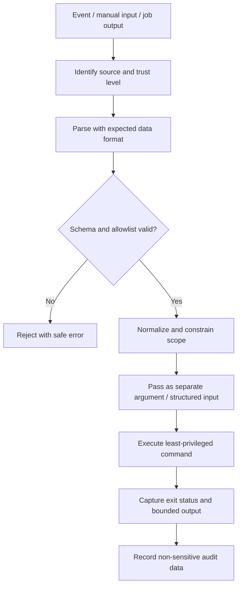

# Kiểm tra mã hoặc tham số đầu vào trước khi đưa vào lệnh shell

## 1. Vì sao đầu vào của pipeline cần được kiểm tra?

Pipeline CI/CD thường nhận dữ liệu từ nhiều nguồn: tên branch, tag, commit message, tiêu đề pull request, tham số chạy thủ công, webhook payload, tên package, đường dẫn file, output của job trước hoặc metadata lấy từ registry. Những dữ liệu này có thể được dùng để chọn môi trường, đặt tên artifact, tạo đường dẫn, dựng câu lệnh build hoặc gọi script triển khai.

Rủi ro xuất hiện khi pipeline xem dữ liệu đó như một phần của mã lệnh. Nếu một giá trị do người dùng hoặc hệ thống bên ngoài kiểm soát được ghép trực tiếp vào chuỗi shell, ký tự đặc biệt có thể thay đổi cách shell phân tích câu lệnh. Hậu quả có thể là chạy thêm lệnh ngoài dự kiến, đọc file nhạy cảm, làm sai artifact, xóa dữ liệu hoặc sử dụng quyền của runner để truy cập hệ thống khác.

Ví dụ, một job muốn in tiêu đề pull request và viết:

```yaml
steps:
  - name: Print pull request title
    run: echo "${{ github.event.pull_request.title }}"
```

Nếu tiêu đề được chèn trực tiếp vào phần script trước khi shell thực thi, một giá trị chứa cú pháp shell có thể làm thay đổi nội dung lệnh. Đây là dạng injection do trộn dữ liệu với mã.

Nguyên tắc cốt lõi là **giữ dữ liệu ở dạng dữ liệu trong toàn bộ đường đi từ nguồn đầu vào đến chương trình được gọi**. Hãy xác định nguồn, kiểm tra miền giá trị, truyền tham số theo cấu trúc và giới hạn quyền của job. Quoting giúp tránh một số cách shell diễn giải dữ liệu, nhưng không thay thế validation, phân quyền và thiết kế luồng dữ liệu an toàn.

## 2. Những nguồn đầu vào thường gặp trong CI/CD

Không chỉ input được khai báo trong form mới là dữ liệu không tin cậy. Bất kỳ giá trị nào có thể bị người gửi sự kiện, contributor, dependency hoặc hệ thống bên ngoài tác động đều cần được xem xét.

| Nguồn | Ví dụ | Rủi ro khi dùng trực tiếp |
|---|---|---|
| Git metadata | Branch name, tag, commit message, author name/email | Shell injection, option injection, tên file hoặc tag không hợp lệ |
| Pull request | Title, body, label, branch head, tên người đóng góp | Nội dung do contributor kiểm soát bị chèn vào script hoặc log command |
| Manual dispatch | Input môi trường, version, module, đường dẫn | Chọn nhầm môi trường, gọi lệnh ngoài phạm vi, path traversal |
| Webhook/API | JSON field, URL, repository name, event type | Dữ liệu sai schema, payload giả mạo hoặc chuỗi lệnh được dựng từ payload |
| File trong repository | Filename, generated manifest, config value | Tên file đặc biệt, symlink, đường dẫn thoát khỏi workspace |
| Output của job khác | Version string, artifact path, status, generated variable | Output bị thao túng hoặc sai định dạng được tin cậy ở job sau |
| Dependency/tool output | Package metadata, compiler output, script result | Dữ liệu bên ngoài được diễn giải lại thành lệnh hoặc biểu thức |
| Artifact/registry | Image tag, package coordinate, digest, download URL | Tải nhầm nguồn, option injection hoặc gọi endpoint không được phép |

Một giá trị có vẻ nội bộ vẫn có thể không đáng tin. Ví dụ, branch name đến từ Git nhưng contributor có thể chọn tên branch. Output từ job trước không mặc nhiên an toàn nếu job đó chạy mã từ pull request không đáng tin. Hãy phân loại theo khả năng kiểm soát thực tế và ranh giới tin cậy, không dựa vào nơi dữ liệu xuất hiện.

## 3. Hiểu shell injection

Shell injection xảy ra khi dữ liệu được ghép vào câu lệnh rồi shell diễn giải một phần dữ liệu đó như cú pháp. Các ký tự có ý nghĩa đặc biệt tùy shell có thể gồm dấu chấm phẩy, pipe, dấu nháy, dấu đô la, backtick, dấu ngoặc, dấu xuống dòng, toán tử chuyển hướng và ký tự wildcard.

Ví dụ nguy hiểm:

```bash
BRANCH_NAME="$INPUT_BRANCH"
sh -c "git checkout $BRANCH_NAME"
```

`sh -c` yêu cầu shell phân tích một chuỗi mới. Nếu `INPUT_BRANCH` chứa cú pháp shell, dữ liệu có thể trở thành một phần của chương trình được thực thi. Việc gán biến trước đó không loại bỏ rủi ro vì giá trị vẫn được ghép vào chuỗi đưa cho shell thứ hai.

Shell thường phân tích cú pháp lệnh trước khi thực hiện expansion; dữ liệu được expand từ một biến không tự động được phân tích lại như cú pháp shell trong cùng lần parse. Tuy nhiên, nếu kết quả được đưa vào `eval`, `sh -c`, `bash -c` hoặc một shell khác, nó sẽ được parse lại. Ngoài ra, expansion không được quote có thể gây word splitting và pathname expansion, làm một giá trị thành nhiều đối số hoặc khớp file ngoài dự kiến.

Không phải mọi ký tự lạ đều là shell injection. Một chuỗi có thể không tạo lệnh thứ hai nhưng vẫn gây option injection, path traversal hoặc chọn nhầm tài nguyên. Vì vậy, cần hiểu loại rủi ro cụ thể thay vì chỉ tìm dấu chấm phẩy.

## 4. Tránh ghép dữ liệu trực tiếp vào chuỗi lệnh

Không dựng một câu lệnh shell bằng cách nối chuỗi từ input. Tránh các mẫu sau:

```bash
# Không an toàn: ghép input vào chuỗi lệnh
eval "deploy-tool --environment $TARGET_ENV --version $RELEASE_VERSION"

# Không an toàn: tạo shell mới để phân tích chuỗi đã ghép
bash -c "deploy-tool --environment '$TARGET_ENV'"

# Không an toàn: input có thể làm thay đổi cấu trúc lệnh
    sh -c "printf '%s\n' $PULL_REQUEST_TITLE"
```

`eval` đặc biệt nguy hiểm vì yêu cầu shell diễn giải lại dữ liệu như mã. `bash -c` và `sh -c` cũng tạo một lần phân tích shell mới. Nếu không có nhu cầu thực sự chạy một script shell được kiểm soát, không dùng các cơ chế này để truyền tham số.

Thay vào đó, gọi chương trình trực tiếp và truyền mỗi tham số như một đối số riêng. Ví dụ Bash:

```bash
deploy-tool --environment "$TARGET_ENV" --version "$RELEASE_VERSION"
```

Trong cách viết này, shell truyền các giá trị đã mở rộng thành đối số riêng; nó không ghép chúng thành câu lệnh mới để parse lại. Tuy nhiên, vẫn cần kiểm tra `TARGET_ENV` và `RELEASE_VERSION` theo miền hợp lệ, vì chương trình đích có thể có cách diễn giải riêng đối với tham số.

## 5. Quoting đúng cách trong Bash

Trong Bash, đặt biến trong dấu nháy kép khi dùng làm một đối số:

```bash
printf '%s\n' "$RELEASE_VERSION"
mkdir -p -- "$OUTPUT_DIR"
```

Dấu nháy kép ngăn word splitting và pathname expansion đối với giá trị biến. Dùng `printf` thay cho `echo` khi cần in dữ liệu tùy ý, vì cách xử lý option hoặc escape của `echo` có thể khác nhau giữa các shell.

Một số điểm cần nhớ:

- `"$VALUE"` giữ giá trị thành một đối số, kể cả khi có khoảng trắng hoặc ký tự wildcard.
- `$VALUE` không quote có thể bị tách thành nhiều đối số và mở rộng wildcard.
- `'$VALUE'` là chuỗi literal trong shell, không mở rộng biến.
- Dấu nháy kép không làm cho mọi giá trị trở nên hợp lệ với chương trình đích; option injection vẫn có thể xảy ra.
- Không cố tự viết hàm escape shell bằng cách thay thế vài ký tự. Hãy truyền đối số có cấu trúc thay vì tạo script từ dữ liệu.

Ví dụ hàm log an toàn:

```bash
log_value() {
  printf 'Input value: %s\n' "$1"
}

log_value "$PULL_REQUEST_TITLE"
```

Giá trị được truyền như một đối số và in như dữ liệu. Cần lưu ý nội dung log vẫn có thể chứa thông tin nhạy cảm hoặc ký tự điều khiển gây nhầm lẫn trong log viewer; với dữ liệu không tin cậy, nên giới hạn độ dài và chuẩn hóa ký tự hiển thị nếu cần.

## 6. Dùng array để xây dựng danh sách đối số

Khi một lệnh có các tham số tùy chọn, dùng Bash array thay vì ghép chúng thành một chuỗi:

```bash
args=(--environment "$TARGET_ENV" --version "$RELEASE_VERSION")

if [ "$DRY_RUN" = "true" ]; then
  args+=(--dry-run)
fi

deploy-tool "${args[@]}"
```

`${args[@]}` truyền mỗi phần tử thành một đối số riêng. Ngược lại, nếu lưu toàn bộ tham số trong một chuỗi rồi dùng `eval` hoặc `sh -c`, shell có thể phân tích lại nội dung và gây injection.

Array cũng giúp phân biệt option với giá trị. Không nên dùng một biến như `EXTRA_ARGS` chứa chuỗi tùy ý rồi đưa vào lệnh. Nếu cần cho phép tùy chọn, khai báo từng input có tên, kiểu và tập giá trị được phép, sau đó thêm phần tử tương ứng vào array.

## 7. Kiểm tra input theo allowlist

Validation tốt nhất bắt đầu bằng việc xác định miền giá trị hợp lệ. Allowlist (danh sách cho phép) thường an toàn và dễ kiểm toán hơn blocklist (danh sách ký tự cấm).

Ví dụ, nếu pipeline chỉ triển khai vào ba môi trường, hãy chỉ cho phép đúng ba tên đó:

```bash
case "$TARGET_ENV" in
  development|staging|production)
    ;;
  *)
    printf 'Invalid target environment\n' >&2
    exit 2
    ;;
esac
```

Nếu dùng blocklist kiểu “cấm dấu chấm phẩy và dấu đô la”, vẫn có thể bỏ sót cú pháp shell khác, ký tự xuống dòng hoặc cách diễn giải đặc thù của công cụ. Allowlist xác định trước input có ý nghĩa gì và từ chối phần còn lại.

Các kiểu validation phổ biến:

| Loại input | Ví dụ kiểm tra |
|---|---|
| Enum | Chỉ nhận `development`, `staging`, `production` |
| Số nguyên | Kiểm tra cú pháp số và giới hạn min/max |
| Version | Dùng parser SemVer hoặc quy tắc version đã công bố |
| Git ref | Kiểm tra bằng quy tắc Git và xác minh ref tồn tại trong repository được phép |
| Repository | So khớp với danh sách repository được phép, không chỉ kiểm tra chuỗi có dạng URL |
| URL | Chỉ cho phép scheme, host, port và path đã được phê duyệt |
| Filename/path | Giới hạn trong workspace hoặc thư mục cho phép sau khi chuẩn hóa đường dẫn |
| Boolean | Chỉ nhận giá trị rõ ràng như `true` hoặc `false` |
| Feature/operation | Chọn từ danh sách hành động được định nghĩa sẵn |

Validation phải xảy ra trước khi dùng input để tạo đường dẫn, gọi lệnh, chọn credential hoặc truy cập mạng. Khi giá trị không hợp lệ, dừng với thông báo rõ ràng nhưng không in secret.

## 8. Xác thực số, version và Git reference

Input có cấu trúc nên được parse bằng công cụ phù hợp, không chỉ kiểm tra một biểu thức regex quá rộng.

Ví dụ kiểm tra số nguyên trong Bash:

```bash
if [[ ! "$REPLICA_COUNT" =~ ^[0-9]+$ ]]; then
  printf 'Replica count must be an integer\n' >&2
  exit 2
fi

if (( REPLICA_COUNT < 1 || REPLICA_COUNT > 20 )); then
  printf 'Replica count must be between 1 and 20\n' >&2
  exit 2
fi
```

Ví dụ kiểm tra Git ref tồn tại:

```bash
if ! git check-ref-format --branch "$BRANCH_NAME" >/dev/null 2>&1; then
  printf 'Invalid branch name\n' >&2
  exit 2
fi

git show-ref --verify --quiet "refs/heads/$BRANCH_NAME" ||
  git show-ref --verify --quiet "refs/remotes/origin/$BRANCH_NAME" || {
    printf 'Branch does not exist in the expected repository\n' >&2
    exit 2
  }
```

Ví dụ trên giả định repository đã fetch các ref cần kiểm tra. Với tag, commit SHA hoặc ref từ remote, cần xác minh đúng namespace và nguồn. Một chuỗi hợp lệ về cú pháp Git chưa chắc là ref được phép triển khai.

Với version, ưu tiên parser SemVer hoặc thư viện version của hệ sinh thái. Regex đơn giản có thể nhận chuỗi không tuân thủ quy tắc so sánh version hoặc bỏ sót pre-release/build metadata. Sau khi parse, vẫn cần kiểm tra version có artifact tương ứng trong registry được phép.

## 9. Ngăn option injection

Option injection xảy ra khi giá trị dữ liệu bắt đầu bằng dấu gạch ngang và chương trình đích diễn giải nó thành một option. Điều này có thể xảy ra ngay cả khi đã quote biến.

Ví dụ:

```bash
rm "$USER_PROVIDED_FILE"
```

Nếu giá trị bắt đầu bằng `-`, chương trình có thể coi nó là option. Với các công cụ hỗ trợ, dùng `--` để kết thúc phần option:

```bash
rm -- "$USER_PROVIDED_FILE"
grep -- "$SEARCH_TEXT" "$INPUT_FILE"
git checkout -- "$PATH_IN_REPOSITORY"
```

Ý nghĩa của `--` phụ thuộc chương trình; không phải mọi command đều hỗ trợ. Kiểm tra tài liệu lệnh trước khi dựa vào nó. Với tham số có lựa chọn cố định, validation allowlist vẫn là lớp bảo vệ chính.

Đối với công cụ có cú pháp subcommand hoặc URL, cần xác thực loại input theo hợp đồng của công cụ. Không đưa chuỗi tùy ý vào vị trí có thể chọn plugin, executable, config file hoặc endpoint.

## 10. Bảo vệ đường dẫn và tên file

Một input có thể không chứa cú pháp shell nhưng vẫn nguy hiểm khi được dùng làm đường dẫn. Path traversal sử dụng thành phần như `../` hoặc đường dẫn tuyệt đối để thoát khỏi thư mục dự kiến. Symlink cũng có thể khiến một đường dẫn tưởng như nằm trong workspace trỏ sang vị trí khác.

Không nên làm như sau:

```bash
rm -rf "$WORKSPACE/$INPUT_PATH"
```

Chỉ quote biến không ngăn `../` hoặc symlink. Trước khi thao tác file:

1. Xác định thư mục gốc được phép.
2. Từ chối đường dẫn tuyệt đối nếu input chỉ được phép là đường dẫn tương đối.
3. Chuẩn hóa đường dẫn và xác minh nó vẫn nằm dưới thư mục gốc.
4. Xem xét symlink và file type; không đi theo symlink không tin cậy khi xóa/ghi.
5. Chỉ thao tác trong workspace riêng của job.
6. Dùng API filesystem có khả năng giới hạn theo directory handle nếu viết chương trình có rủi ro cao.

Ví dụ kiểm tra đường dẫn tương đối trong Bash/Linux có thể dùng `realpath`:

```bash
ROOT="$(realpath -e -- "$WORKSPACE")"
TARGET="$(realpath -m -- "$ROOT/$INPUT_PATH")"

case "$TARGET" in
  "$ROOT"/*)
    ;;
  *)
    printf 'Path escapes the allowed workspace\n' >&2
    exit 2
    ;;
esac
```

Đây là minh họa cho môi trường có GNU `realpath`; hành vi và option có thể khác trên hệ điều hành khác. `realpath -m` chuẩn hóa cả đường dẫn đích chưa tồn tại, nhưng kiểm tra chuỗi sau chuẩn hóa không tự xử lý mọi race condition hoặc symlink được thay đổi đồng thời. Với thao tác xóa nguy hiểm, ưu tiên API an toàn theo thư mục gốc, thư mục tạm do job sở hữu và không cho process không tin cậy sửa cấu trúc đường dẫn trong lúc cleanup.

## 11. Tránh biểu thức nội suy trực tiếp trong file pipeline

Một số nền tảng xử lý biểu thức của pipeline trước khi tạo script shell. Nếu giá trị từ event được chèn trực tiếp vào khối `run`, nó có thể thay đổi script trước khi shell chạy.

Ví dụ GitHub Actions không an toàn:

```yaml
steps:
  - name: Print title
    run: printf '%s\n' "${{ github.event.pull_request.title }}"
```

Cách an toàn hơn là đưa giá trị vào biến môi trường, sau đó dùng biến như dữ liệu:

```yaml
steps:
  - name: Print title
    env:
      PR_TITLE: ${{ github.event.pull_request.title }}
    run: printf '%s\n' "$PR_TITLE"
```

Trong ví dụ thứ hai, nội dung title được truyền qua environment thay vì được chèn vào phần mã shell. Shell không phân tích lại giá trị expansion như cú pháp trong cùng lần parse; việc quote giúp giữ nó thành một đối số. Nếu cần dùng title để tạo tên file, tag hoặc tham số của tool, vẫn phải kiểm tra theo miền hợp lệ của mục đích đó.

Nguyên tắc tương tự áp dụng cho các nền tảng khác: không nội suy dữ liệu event vào source code của shell, PowerShell hoặc script. Dùng input/output có cấu trúc hoặc environment variable được truyền riêng. Hãy kiểm tra cú pháp và semantics cụ thể của nền tảng đang sử dụng.

## 12. Truyền dữ liệu nhiều dòng và delimiter an toàn

Một số pipeline dùng file đặc biệt để truyền output giữa step hoặc job. Nếu ghi dữ liệu tùy ý vào file theo cú pháp `NAME=value`, nội dung nhiều dòng hoặc chứa delimiter có thể làm sai cấu trúc file và tạo thêm biến ngoài dự kiến.

Không nên tự nối chuỗi như sau khi `VALUE` đến từ nguồn không tin cậy:

```bash
printf 'RESULT=%s\n' "$VALUE" >> "$CI_OUTPUT_FILE"
```

Nếu `VALUE` có newline, nó có thể tạo thêm dòng hoặc trường mới theo cú pháp file output. Hãy dùng cơ chế output có cấu trúc do nền tảng cung cấp, delimiter ngẫu nhiên/được kiểm soát theo hướng dẫn của nền tảng, hoặc lưu dữ liệu vào file riêng rồi truyền artifact ID/path đã xác minh.

Với dữ liệu JSON, dùng serializer thay vì tự ghép JSON bằng chuỗi. Với dữ liệu YAML, dùng thư viện YAML và schema validation. Với dữ liệu nhiều dòng, không tự tạo delimiter cố định nếu input có thể chứa cùng delimiter.

Không nên truyền mã lệnh qua output để job sau thực thi. Output nên là dữ liệu có schema, ví dụ `artifact_digest`, `release_version` hoặc `test_status`, và job tiêu thụ phải xác minh giá trị trước khi sử dụng.

## 13. PowerShell và các shell khác

Quoting và cách truyền đối số khác nhau giữa Bash, PowerShell, `cmd.exe` và shell của từng runner. Không thể lấy quy tắc escape của Bash áp dụng nguyên xi cho PowerShell.

Với PowerShell, tránh dựng chuỗi rồi gọi `Invoke-Expression`:

```powershell
# Không an toàn: phân tích lại chuỗi thành mã PowerShell
$command = "deploy-tool --environment $TargetEnvironment"
Invoke-Expression $command
```

Gọi executable bằng call operator và truyền đối số riêng:

```powershell
$arguments = @(
    '--environment', $TargetEnvironment,
    '--version', $ReleaseVersion
)

& deploy-tool @arguments
if ($LASTEXITCODE -ne 0) {
    throw "Deployment command failed with exit code $LASTEXITCODE"
}
```

Cách truyền tham số cho native executable còn phụ thuộc phiên bản PowerShell và cơ chế native argument passing. Với PowerShell 5.1 trên Windows, cần kiểm tra cách serialize đối số khi giá trị chứa dấu nháy hoặc ký tự đặc biệt; dùng API/process invocation có kiểm soát khi cần truyền dữ liệu phức tạp. Dù dùng shell nào, vẫn phải validate enum, version, path và quyền trước khi gọi lệnh.

Không dùng `cmd /c`, `Invoke-Expression`, `Start-Process` với một chuỗi command line tự ghép hoặc một shell con nếu không cần. Mỗi lần tạo parser mới đều có thể mở thêm ranh giới injection.

## 14. Xử lý URL, repository và endpoint

Pipeline đôi khi tải script, package hoặc artifact từ URL do input cung cấp. Quoting không ngăn một URL hợp lệ về cú pháp nhưng trỏ tới host không được phép, endpoint nội bộ hoặc scheme nguy hiểm.

Các kiểm tra nên có:

- Chỉ cho phép scheme cần thiết, thường là HTTPS.
- Allowlist host/registry/repository được phép.
- Giới hạn port và path theo mục đích.
- Không theo redirect sang host ngoài allowlist nếu công cụ hỗ trợ kiểm soát redirect.
- Xác minh checksum hoặc chữ ký của file tải về.
- Tránh tải và thực thi script trực tiếp từ URL mutable như `latest` hoặc nhánh di động.
- Không để input PR chọn endpoint có thể truy cập metadata service hoặc mạng nội bộ nhạy cảm.

Ví dụ, nếu pipeline chỉ cần tải image từ `registry.example.com`, hãy xác thực registry host trước khi gọi container tool. Sau khi pull, dùng digest đã được xác minh thay vì chỉ dựa trên tag.

Nếu dùng `curl` hoặc `wget`, truyền URL như một đối số được quote và kiểm tra kết quả. `--` có thể được dùng để kết thúc options nếu phiên bản công cụ hỗ trợ. Không ghép URL thành lệnh shell hoặc pipe trực tiếp script tải về vào `sh` khi chưa xác minh nguồn và nội dung.

## 15. Secret và dữ liệu nhạy cảm trong lệnh shell

Ngay cả khi lệnh không bị injection, tham số có thể chứa secret. Truyền token trực tiếp trên command line có thể làm lộ qua process listing, log debug, shell trace hoặc thông tin chẩn đoán của runner.

Thực hành nên áp dụng:

- Lấy secret từ secret manager hoặc secret store của nền tảng, đúng thời điểm và đúng job cần dùng.
- Ưu tiên credential ngắn hạn và quyền tối thiểu.
- Dùng cơ chế stdin, file descriptor, file tạm với quyền hạn chế hoặc biến môi trường theo khuyến nghị của tool; mỗi cách đều cần đánh giá khả năng lộ trong process/environment.
- Không bật `set -x` hoặc shell tracing khi lệnh có thể chứa secret.
- Không in toàn bộ environment hoặc command line trong log.
- Không đưa secret vào cache key, artifact, output hoặc deployment manifest.
- Che log là lớp bổ sung; không thay thế việc tránh đưa secret vào log.
- Thu hồi/rotate credential nếu nghi ngờ đã bị in hoặc lưu ngoài ý muốn.

Ví dụ dùng biến môi trường cho công cụ hỗ trợ đọc token từ environment:

```bash
set +x
(
  token="$REGISTRY_TOKEN_FROM_SECRET_STORE"
  unset REGISTRY_TOKEN_FROM_SECRET_STORE
  printf '%s' "$token" | registry-client login --token-stdin
  unset token
)
```

Ví dụ này chỉ phù hợp nếu `registry-client` hỗ trợ đọc token từ stdin. Không phải công cụ nào cũng có option đó. Nếu tool chỉ hỗ trợ token qua argument, hãy dùng credential helper hoặc cơ chế xác thực chính thức của tool thay vì giả định shell có thể che command line. Tránh ghi giá trị token vào file output hoặc log.

## 16. Đầu vào không tin cậy và quyền của job

Validation không thay thế isolation. Một script có thể không bị shell injection nhưng vẫn thực thi mã tùy ý từ repository. Pull request từ fork có thể thay đổi build script, test script, Dockerfile và cả file pipeline.

Đối với workflow chạy mã không tin cậy:

- Không cấp secret production, token ghi registry hoặc quyền deploy.
- Dùng runner ephemeral hoặc pool riêng không chứa dữ liệu nhạy cảm.
- Giới hạn network, filesystem mount, process, CPU, memory và thời gian chạy.
- Chỉ cấp quyền đọc repository hoặc artifact cần thiết.
- Tách job kiểm tra PR khỏi job publish/release có quyền cao.
- Không dùng output từ job không tin cậy làm lệnh hoặc policy mà không xác minh.
- Nếu cần artifact từ PR, đánh dấu rõ là artifact thử nghiệm và không tự động promote.

Một job trusted không nên lấy output từ job untrusted rồi dùng để chọn executable, credential, môi trường hoặc đường dẫn tùy ý. Hãy kiểm tra schema, nguồn tạo và giá trị được phép. Với quyết định nhạy cảm như production deploy, nguồn dữ liệu và identity cần đến từ hệ thống được bảo vệ.

## 17. Luồng xử lý input an toàn

Một luồng tốt giữ rõ ranh giới giữa dữ liệu đầu vào, validation, quyết định và thực thi:



Các bước cần giữ:

1. Xác định ai có thể kiểm soát input và nó đi qua những job nào.
2. Parse theo định dạng dự kiến; từ chối dữ liệu sai schema.
3. Kiểm tra allowlist, giới hạn độ dài và miền giá trị.
4. Chuẩn hóa giá trị theo mục đích, ví dụ chuyển version về dạng chuẩn hoặc resolve path trong workspace.
5. Truyền dữ liệu bằng đối số riêng, environment hoặc API có cấu trúc.
6. Chạy command với quyền tối thiểu và timeout.
7. Kiểm tra exit code, giới hạn log và không lộ secret.
8. Ghi lại nguồn, giá trị không nhạy cảm đã chuẩn hóa và kết quả để truy vết.

Không phải mọi input đều cần được ghi nguyên văn. Tiêu đề pull request hoặc payload webhook có thể chứa dữ liệu cá nhân, nội dung không phù hợp hoặc chuỗi gây nhầm lẫn trong log. Chỉ lưu trường cần thiết và giới hạn độ dài.

## 18. Ví dụ hoàn chỉnh: chọn môi trường và triển khai an toàn

Giả sử pipeline nhận hai input thủ công: môi trường đích và phiên bản release. Chỉ `staging` và `production` được phép; version phải theo định dạng SemVer cơ bản; deploy tool được gọi trực tiếp bằng các đối số riêng.

```bash
#!/usr/bin/env bash
set -euo pipefail

TARGET_ENV="${INPUT_TARGET_ENV:?Target environment is required}"
RELEASE_VERSION="${INPUT_RELEASE_VERSION:?Release version is required}"

case "$TARGET_ENV" in
  staging|production) ;;
  *)
    printf 'Unsupported deployment environment\n' >&2
    exit 2
    ;;
esac

if [[ ! "$RELEASE_VERSION" =~ ^[0-9]+\.[0-9]+\.[0-9]+$ ]]; then
  printf 'Release version must use numeric major.minor.patch\n' >&2
  exit 2
fi

ARTIFACT_REF="registry.example.com/order-service:$RELEASE_VERSION"

if ! registry-client artifact exists --reference "$ARTIFACT_REF"; then
  printf 'Requested artifact was not found\n' >&2
  exit 3
fi

deploy_args=(
  --environment "$TARGET_ENV"
  --artifact "$ARTIFACT_REF"
)

if [ "$TARGET_ENV" = "production" ]; then
  deploy_args+=(--require-approval)
fi

deploy-tool "${deploy_args[@]}"
```

Đây là ví dụ minh họa và giả định các công cụ có giao diện tương ứng. Regex chỉ nhận version dạng `major.minor.patch` không có prerelease/build metadata; nếu dự án dùng đầy đủ SemVer, nên dùng parser chuyên dụng. `registry-client artifact exists` chỉ xác minh artifact tồn tại; trong quy trình thật, cần lấy digest, kiểm tra provenance và quality gate trước khi triển khai. Production approval phải được thực thi bởi nền tảng hoặc policy có bảo vệ, không chỉ bởi một cờ do người gọi tự truyền.

Ví dụ cho thấy ba lớp riêng biệt: input được allowlist/parse; artifact được tra cứu trong registry được phép; command nhận các đối số riêng. Quyền của job vẫn cần được giới hạn theo môi trường.

## 19. Kiểm thử và review các lệnh có sử dụng input

Khi review pipeline hoặc script, hãy tìm mọi nơi input đi vào lệnh. Có thể dùng các trường hợp thử nghiệm sau trong môi trường sandbox không có secret:

- Giá trị có khoảng trắng: `release candidate`.
- Giá trị bắt đầu bằng dấu gạch ngang: `--help` hoặc `-rf`.
- Giá trị có dấu nháy đơn/kép.
- Giá trị có ký tự wildcard như `*` hoặc `?`.
- Giá trị có dấu chấm phẩy, pipe, `$()` hoặc backtick.
- Giá trị có newline hoặc ký tự điều khiển.
- Đường dẫn chứa `../`, đường dẫn tuyệt đối hoặc symlink.
- URL có host/port/scheme ngoài allowlist.
- Version quá dài, sai cú pháp hoặc không tồn tại.

Mục tiêu là xác minh dữ liệu được truyền như một giá trị duy nhất, bị từ chối nếu ngoài miền hợp lệ và không làm thay đổi cấu trúc lệnh. Không chạy payload thử nghiệm trên runner có quyền production hoặc có secret thật.

Các công cụ static analysis và secret scanning có thể phát hiện một số mẫu nguy hiểm, nhưng không hiểu đầy đủ ngữ cảnh của mọi shell và command. Review thủ công vẫn cần kiểm tra cách input được truyền, quyền job và hành vi của executable đích.

## 20. Xử lý khi phát hiện injection hoặc input bị thao túng

Nếu nghi ngờ input đã làm thay đổi lệnh hoặc truy cập ngoài dự kiến:

1. Dừng job hoặc pipeline bị ảnh hưởng; không tiếp tục publish hoặc deploy artifact.
2. Xác định nguồn input, event, commit, run ID và runner đã thực thi.
3. Kiểm tra log, process, file thay đổi và network access trong phạm vi được phép; bảo toàn bằng chứng cần thiết.
4. Thu hồi hoặc rotate secret/token mà job có thể truy cập nếu có khả năng bị lộ.
5. Xác định artifact, cache, output và môi trường có thể đã bị ảnh hưởng.
6. Cô lập runner nếu nghi ngờ còn process hoặc trạng thái bị can thiệp; tái tạo runner từ image đáng tin cậy.
7. Sửa cách truyền input, validation và quyền của job; thêm test hồi quy cho trường hợp gây lỗi.
8. Đánh giá các lần chạy tương tự và ghi lại phạm vi ảnh hưởng.

Không chỉ xóa log hoặc đổi tên biến để xử lý. Cần xác định liệu lệnh ngoài dự kiến đã chạy, credential có thể bị truy cập và artifact đã được tạo/publish từ trạng thái nào.

## 21. Những anti-pattern thường gặp

| Anti-pattern | Hệ quả | Cách cải thiện |
|---|---|---|
| Nội suy event data trực tiếp vào `run:` | Dữ liệu có thể trở thành cú pháp script | Truyền qua environment/input có cấu trúc rồi quote khi dùng |
| Dùng `eval` hoặc `sh -c` với input | Shell parse lại dữ liệu như mã | Gọi executable trực tiếp và truyền argument riêng |
| Chỉ quote mà không validate | Giá trị vẫn có thể chọn option, path hoặc tài nguyên ngoài ý muốn | Allowlist theo miền và dùng `--` khi tool hỗ trợ |
| Dùng blocklist ký tự | Dễ bỏ sót cú pháp hoặc cách diễn giải khác | Xác định schema và allowlist giá trị hợp lệ |
| Ghép `EXTRA_ARGS` thành một chuỗi | Không kiểm soát được số lượng và ranh giới đối số | Khai báo input riêng và dùng array |
| Dùng input làm path rồi `rm -rf` | Path traversal hoặc symlink có thể xóa dữ liệu ngoài workspace | Resolve/validate path, giới hạn root và dùng workspace riêng |
| Ghi dữ liệu nhiều dòng vào output file bằng `NAME=value` | Newline/delimiter có thể tạo output ngoài dự kiến | Dùng cơ chế output có cấu trúc hoặc file/artifact riêng |
| Ghi toàn bộ environment/command vào log | Có thể làm lộ secret | Allowlist log, tắt tracing và dùng secret manager |
| Cho PR không tin cậy quyền deploy/publish | Mã tùy ý có thể sử dụng quyền cao của runner | Tách job, runner pool và quyền theo trust domain |
| Tin output từ job trước mà không xác minh | Dữ liệu bị thao túng có thể điều khiển job nhạy cảm | Kiểm tra nguồn, schema, digest và allowlist trước khi dùng |

## 22. Checklist review input trước khi đưa vào shell

Trước khi merge một pipeline hoặc script, hãy kiểm tra:

- [ ] Nguồn và mức độ tin cậy của từng input đã được xác định.
- [ ] Input được parse theo schema/kiểu dữ liệu dự kiến.
- [ ] Enum, version, số, URL và path có allowlist/giới hạn phù hợp.
- [ ] Không ghép input trực tiếp vào chuỗi shell.
- [ ] Không dùng `eval`, `sh -c` hoặc `Invoke-Expression` với dữ liệu động.
- [ ] Biến được quote và truyền thành đối số riêng; Bash dùng array khi cần danh sách động.
- [ ] Dùng `--` để kết thúc options khi executable hỗ trợ.
- [ ] Path được chuẩn hóa và giới hạn trong workspace/thư mục cho phép; symlink được xem xét.
- [ ] Biểu thức pipeline không nội suy event data trực tiếp vào source code shell.
- [ ] Output nhiều dòng được truyền bằng cơ chế có cấu trúc, không tự nối delimiter cố định.
- [ ] Secret không xuất hiện trong argument, log, cache, artifact hoặc output không cần thiết.
- [ ] Job có quyền tối thiểu, timeout và runner isolation phù hợp nguồn input.
- [ ] Có test với khoảng trắng, dấu nháy, option prefix, ký tự shell, newline và path traversal.
- [ ] Khi input sai, pipeline từ chối an toàn và không thực hiện một phần thao tác nhạy cảm.

## 23. Nguyên tắc thực hành cốt lõi

1. Xem mọi dữ liệu có thể bị người gửi sự kiện, contributor hoặc hệ thống ngoài kiểm soát là không tin cậy cho đến khi được xác minh.
2. Giữ ranh giới giữa dữ liệu và mã; không nội suy dữ liệu tùy ý vào script shell.
3. Tránh `eval`, shell con và chuỗi lệnh động; gọi executable trực tiếp với từng đối số riêng.
4. Dùng quoting đúng shell, Bash array và cơ chế truyền dữ liệu có cấu trúc.
5. Kiểm tra theo allowlist, schema, miền giá trị và mục đích sử dụng trước khi gọi lệnh.
6. Phòng option injection, path traversal, symlink và URL ngoài allowlist ngoài việc phòng shell metacharacters.
7. Không truyền secret qua command line hoặc log; dùng secret store và credential ngắn hạn.
8. Cách ly job chạy mã không tin cậy và không cấp quyền publish/deploy nhạy cảm.
9. Kiểm thử input biên trong sandbox và ghi nhận kết quả không chứa dữ liệu nhạy cảm.
10. Khi có dấu hiệu injection, dừng luồng phát hành, điều tra runner/credential/artifact và khắc phục nguyên nhân gốc.

Kiểm tra đầu vào trước khi đưa vào lệnh shell là một phần thiết yếu của bảo mật pipeline. Khi dữ liệu được xác thực theo miền hợp lệ, truyền qua ranh giới có cấu trúc và thực thi trong job có quyền tối thiểu, pipeline giảm đáng kể nguy cơ biến một giá trị do bên ngoài cung cấp thành lệnh ngoài dự kiến.
