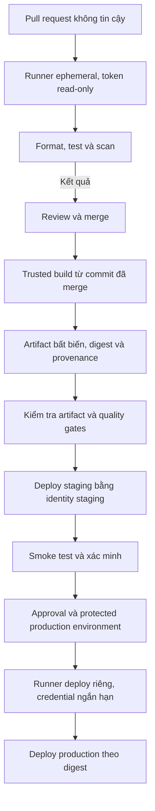

# Cách ly mã không tin cậy với runner và thông tin xác thực đặc quyền

Pipeline CI/CD không chỉ chạy những lệnh do nhóm vận hành viết. Trong lúc build và kiểm thử, nó có thể thực thi build script, test, plugin, package lifecycle hook, Dockerfile và action từ bên ngoài. Một pull request từ fork hoặc một dependency bị xâm nhập có thể đưa mã tùy ý vào những bước này. Nếu mã đó chạy trên runner có quyền truy cập production secret, cloud credential hoặc mạng nội bộ, một lần kiểm thử có thể trở thành đường xâm nhập hệ thống.

Nguyên tắc bảo mật cốt lõi là **cách ly mã không tin cậy khỏi runner, credential và tài nguyên đặc quyền**. Mã cần được kiểm tra có thể chạy trong môi trường giới hạn quyền, còn các hành động có khả năng thay đổi artifact phát hành hoặc production phải diễn ra trong job và môi trường có mức tin cậy cao hơn, với danh tính và quyền riêng.

Trong CI/CD, ranh giới này cần được thiết kế xuyên suốt từ Git event, workflow, runner, token, secret, network, cache đến artifact. Chỉ ẩn secret khỏi giao diện log hoặc yêu cầu approval ở cuối pipeline là chưa đủ nếu mã không tin cậy đã có cơ hội đọc credential từ trước.

## 1. Xác định mã nào không được tin cậy

Không nên đánh giá mức tin cậy chỉ dựa vào việc mã đã nằm trong cùng repository. Mức tin cậy phụ thuộc nguồn thay đổi, quyền review và khả năng kiểm soát nội dung được thực thi.

Các nguồn thường cần xem là không tin cậy hoặc có mức tin cậy thấp:

- Pull request từ fork hoặc contributor bên ngoài.
- Branch chưa được bảo vệ, commit chưa qua review hoặc workflow do contributor sửa.
- Build script, test, plugin, package hook hoặc Dockerfile vừa được thay đổi.
- Action, reusable workflow, dependency hoặc tool tải từ nguồn bên ngoài.
- Artifact và cache được tạo bởi job chạy mã không tin cậy.
- Dữ liệu đầu vào từ issue, pull request title, branch name, commit message hoặc webhook có thể bị người dùng kiểm soát.

Một thay đổi tưởng như chỉ sửa test vẫn có thể thêm lệnh gửi dữ liệu ra mạng. Một dependency mới có thể thực thi mã trong quá trình cài đặt. Vì vậy, khi job chạy mã từ pull request, hãy giả định mã đó có thể thực thi lệnh tùy ý với toàn bộ quyền và dữ liệu mà job nhìn thấy.

## 2. Hiểu tài sản cần bảo vệ và đường tấn công

Những tài sản quan trọng trong pipeline gồm:

| Tài sản | Ví dụ | Hậu quả nếu bị truy cập trái phép |
|---|---|---|
| Credential | Cloud key, registry token, deploy token, SSH key | Truy cập hệ thống hoặc phát hành trái phép |
| Secret | Password database, API key, signing key | Lộ dữ liệu, giả mạo hoặc chiếm quyền |
| Runner host | Workspace, process, filesystem, Docker socket | Di chuyển ngang, đọc dữ liệu job khác hoặc duy trì mã độc |
| Mạng nội bộ | Metadata endpoint, control plane, production database | Truy cập tài nguyên không được phép |
| Cache | Dependency/build cache dùng chung | Đầu độc đầu vào của job đáng tin cậy |
| Artifact | Package, image, release bundle | Đưa mã độc vào chuỗi phát hành |
| Workflow và policy | CI YAML, reusable workflow, deployment rule | Thay đổi điều kiện kiểm tra hoặc quyền thực thi |

Một cuộc tấn công có thể bắt đầu từ pull request, chạy mã trong job, đọc token hoặc dữ liệu trên runner, rồi gửi chúng ra ngoài hoặc sửa artifact được dùng ở bước sau. Cách phòng vệ cần chặn nhiều mắt xích: giảm quyền token, không cấp secret cho job không tin cậy, cô lập runner, giới hạn network và xác minh artifact trước khi promote.

## 3. Cô lập runner theo mức độ tin cậy

Runner là nơi mã build và test thực sự được thực thi. Nếu nhiều job không cùng mức tin cậy dùng chung máy, một job có thể để lại process, file, credential hoặc thay đổi hệ thống ảnh hưởng đến job tiếp theo.

### Ưu tiên runner dùng một lần cho mã không tin cậy

Với pull request từ fork hoặc nguồn không tin cậy, nên dùng runner ephemeral: tạo môi trường mới cho job, chỉ cấp tài nguyên cần thiết, sau đó hủy máy hoặc môi trường thực thi. Không tái sử dụng workspace hay filesystem có thể ghi giữa các job có mức tin cậy khác nhau.

Hosted runner thường cung cấp môi trường mới cho mỗi job. Với self-hosted runner, cần chủ động thiết kế vòng đời một lần chạy: provision từ image chuẩn, đăng ký runner tạm thời, chạy đúng một job rồi hủy VM hoặc instance. Chỉ xóa thư mục checkout không đủ nếu process, service, credential cache hoặc thay đổi hệ thống vẫn tồn tại.

### Tách runner pool theo trust level

Có thể chia runner thành các nhóm:

- **Untrusted/PR runner:** chỉ chạy kiểm tra pull request, không có production secret, không có quyền ghi artifact phát hành và không truy cập mạng production.
- **Trusted build runner:** chạy từ commit đã được merge vào branch bảo vệ, tạo artifact và bằng chứng build theo policy.
- **Deployment runner:** chỉ chạy job triển khai được phê duyệt, có quyền truy cập đúng môi trường đích và dùng credential ngắn hạn.

Runner group cần giới hạn repository hoặc workflow được phép sử dụng. Không để mọi repository có thể tùy ý chọn runner đặc quyền. Nếu nền tảng hỗ trợ label hoặc group, label chỉ là cơ chế chọn runner; policy phía quản trị vẫn phải giới hạn ai được dùng nhóm đó.

### Container không tự động là ranh giới cách ly đủ mạnh

Container giúp đóng gói user space và giảm khác biệt môi trường, nhưng container thông thường vẫn chia sẻ kernel host. Nếu chạy mã thù địch, cấu hình container quá quyền, mount host filesystem hoặc Docker socket có thể mở đường thoát container hoặc kiểm soát host.

Với mã không tin cậy:

- Tránh privileged container và không mount Docker socket của host.
- Không mount thư mục chứa credential hoặc dữ liệu của job khác.
- Chạy bằng user không đặc quyền khi có thể.
- Giới hạn CPU, memory, process count và thời gian chạy.
- Dùng VM hoặc sandbox mạnh hơn nếu threat model yêu cầu ranh giới kernel.
- Hủy môi trường sau job thay vì chỉ dọn workspace.

## 4. Không cấp credential đặc quyền cho job chạy mã không tin cậy

Runner sạch không đủ nếu job vẫn được cấp token có quyền cao. Cần thiết kế quyền theo từng job:

- Pull request validation chỉ nhận token read-only để checkout source và đọc dependency cần thiết.
- Job test không nhận cloud credential, production secret hoặc quyền publish.
- Job build chỉ có quyền ghi vào repository artifact riêng nếu thực sự cần publish.
- Job deploy staging dùng principal staging và không thể truy cập production.
- Job deploy production nhận credential ngắn hạn sau khi điều kiện branch, workflow và approval được thỏa mãn.

Không đặt secret ở cấp organization hoặc repository rồi để mọi workflow đều có thể tham chiếu. Phạm vi secret nên được giới hạn theo repository, environment và job. Người có quyền sửa workflow chạy trong context có secret cũng cần được xem là có khả năng truy cập secret đó.

### Giới hạn token của CI

Ví dụ GitHub Actions cho pull request chỉ cần đọc repository:

```yaml
name: validate-untrusted-change

on:
  pull_request:

permissions:
  contents: read

jobs:
  validate:
    runs-on: ubuntu-24.04
    permissions:
      contents: read
    steps:
      - name: Checkout pull request revision
        uses: actions/checkout@<FULL_COMMIT_SHA>
      - name: Run checks
        run: ./gradlew --no-daemon clean test
```

<FULL_COMMIT_SHA> là placeholder, cần thay bằng commit SHA đầy đủ đã xác minh của action. Job này không khai báo production secret, không cấp packages write và không cấp id-token write. Trong thực tế, chỉ bật các tùy chọn checkout như submodules hoặc LFS khi repository cần.

Quyền read-only của GITHUB_TOKEN giúp giảm khả năng thay đổi repository, nhưng không ngăn mã gửi dữ liệu mà nó đọc được ra mạng. Vì vậy vẫn cần runner isolation, network control và không đưa secret khác vào job.

## 5. Phân biệt workflow kiểm tra pull request và workflow có quyền cao

Một thiết kế dễ kiểm soát là tách hai luồng:

1. **PR validation:** chạy trên mã chưa được tin cậy, dùng runner riêng, token read-only, không secret và không quyền deploy.
2. **Trusted build/release:** chạy trên commit đã được merge vào branch bảo vệ hoặc release tag được kiểm soát; tạo artifact mới, lưu provenance và thực hiện các cổng chất lượng.

Không lấy artifact do pull request không tin cậy tạo ra rồi đưa thẳng vào production chỉ vì một workflow đặc quyền đã tải artifact đó. Artifact có thể chứa mã đã bị sửa, binary thay thế hoặc dữ liệu đầu vào bị đầu độc.

### Cẩn trọng với pull_request_target

Trong GitHub Actions, pull_request_target chạy workflow trong ngữ cảnh repository đích và có thể có quyền/token hoặc secret của repository đích theo cấu hình. Đây là sự kiện nhạy cảm. Không checkout và thực thi mã head của pull request không tin cậy trong job này, không chạy build script từ pull request và không dùng dữ liệu do contributor kiểm soát trực tiếp trong shell command.

Nếu chỉ cần gắn label, phản hồi hoặc thao tác metadata của pull request, hãy dùng workflow tối thiểu, không checkout mã không tin cậy và chỉ cấp permission cần thiết cho thao tác đó. Nếu cần build/test mã pull request, dùng pull_request với job không có secret và quyền thấp.

Workflow chạy theo sự kiện workflow_run cũng cần được xem xét cẩn thận. Workflow được kích hoạt sau một workflow khác có thể chạy trong context có quyền cao hơn. Không mặc nhiên tin artifact, cache hoặc dữ liệu được tạo bởi workflow trước nếu workflow đó có thể chạy mã không tin cậy. Phải xác minh nguồn, revision, digest và provenance trước khi dùng.

## 6. Tách job build với job deploy đặc quyền

Job build/test và job deploy có mục đích khác nhau. Không nên để toàn bộ pipeline chạy trên một runner có quyền production chỉ vì bước cuối cần deploy.

Luồng tham khảo:



Luồng này giữ cho mã pull request chạy trong môi trường không có quyền đặc quyền. Sau khi thay đổi được review và merge, trusted build tạo artifact mới từ revision đã chấp nhận. Job deploy chỉ nhận artifact đã định danh và credential đúng môi trường.

Ví dụ job production trong GitHub Actions:

```yaml
jobs:
  deploy_production:
    if: github.ref == 'refs/heads/main'
    environment: production
    runs-on: [self-hosted, production-deploy]
    permissions:
      contents: read
      id-token: write
    steps:
      - name: Verify release artifact
        run: ./scripts/verify-approved-digest.sh
      - name: Deploy
        run: ./scripts/deploy-by-digest.sh
```

Đây là cấu trúc minh họa; cần cấu hình protected environment, required reviewers, branch restrictions, runner group và OIDC trust policy ở nền tảng. Hai script là placeholder của dự án. Job phải lấy digest đã được phê duyệt từ release metadata, xác minh chữ ký/provenance nếu chính sách yêu cầu và triển khai đúng digest đó.

id-token: write chỉ cho phép job yêu cầu OIDC token. Cloud provider chỉ cấp credential khi trust policy xác minh đúng issuer, audience, subject, repository, workflow và environment. Role nhận được vẫn phải giới hạn resource và action cụ thể.

## 7. Bảo vệ cache và artifact khỏi poisoning

Cache và artifact là đường truyền dữ liệu giữa các lần chạy hoặc giữa các job. Nếu job không tin cậy có thể ghi dữ liệu mà job phát hành tin tưởng sẽ sử dụng, kẻ tấn công có thể đầu độc đầu vào của pipeline.

### Cache poisoning

Cache có thể chứa dependency đã tải, build output hoặc dữ liệu trung gian. Nếu pull request không tin cậy ghi cache dùng chung với branch chính, job đáng tin cậy có thể khôi phục dữ liệu đã bị sửa.

Biện pháp:

- Tách cache namespace hoặc key theo repository, branch và trust level.
- Không cho PR không tin cậy ghi cache mà release workflow tin tưởng.
- Không cache secret, credential hoặc thư mục chứa token.
- Khóa cache theo lockfile, toolchain và các đầu vào có ảnh hưởng.
- Cẩn trọng với restore key dạng prefix quá rộng có thể khôi phục cache từ nguồn không cùng mức tin cậy.
- Khi nghi ngờ poisoning, vô hiệu hóa cache liên quan và build lại từ đầu vào đã xác minh.

### Artifact poisoning

Artifact do PR tạo ra không mặc nhiên đáng tin để phát hành. Đối với release, nên build từ commit đã merge hoặc revision phát hành đã được phê duyệt. Lưu digest, commit SHA, pipeline run, test report và provenance. Job deploy cần xác minh rằng artifact được lấy đúng từ trusted build và digest khớp release record.

Không dùng tên artifact dễ đoán làm bằng chứng nguồn gốc. Tên file có thể bị trùng hoặc thay thế; digest và metadata có chữ ký mới giúp xác minh nội dung và nguồn tạo.

## 8. Giới hạn network của runner

Mã không tin cậy có thể tìm cách gửi dữ liệu ra ngoài hoặc truy cập dịch vụ nội bộ. Cách ly filesystem và token cần được kết hợp với network policy:

- Chỉ cho phép outbound tới Git host, dependency registry, dịch vụ test và endpoint cần thiết.
- Chặn truy cập tới production network từ runner PR.
- Chặn hoặc kiểm soát truy cập cloud metadata endpoint để mã không thể lấy instance credential ngoài dự kiến.
- Không để runner không tin cậy truy cập Kubernetes API, database nội bộ hoặc control plane.
- Hạn chế inbound connection và không dùng runner làm điểm nhảy vào mạng riêng.
- Ghi log DNS/proxy/firewall theo chính sách để điều tra truy cập bất thường.

Nếu dependency cần truy cập Internet, có thể dùng egress proxy hoặc mirror nội bộ đã kiểm soát. Allowlist cần được duy trì theo nhu cầu thực tế; mở outbound toàn bộ làm giảm hiệu quả của network isolation.

## 9. Tránh injection qua dữ liệu pull request

Branch name, title, commit message, label và nội dung issue đều có thể do người dùng kiểm soát. Nếu ghép trực tiếp các giá trị đó vào shell script, ký tự đặc biệt có thể làm thay đổi câu lệnh.

Ví dụ không an toàn:

```yaml
steps:
  - name: Print pull request title
    run: echo "${{ github.event.pull_request.title }}"
```

Giá trị do contributor kiểm soát được chèn trực tiếp vào script shell. Cách an toàn hơn là truyền dữ liệu qua environment và trích dẫn như một biến:

```yaml
steps:
  - name: Print pull request title
    env:
      PR_TITLE: ${{ github.event.pull_request.title }}
    run: printf '%s\n' "$PR_TITLE"
```

Ví dụ này giảm nguy cơ shell injection do nội suy trực tiếp vào script. Vẫn cần xử lý dữ liệu theo ngữ cảnh khi đưa vào SQL, HTML, JSON hoặc lệnh khác; quoting shell không tự bảo vệ mọi sink. Không dùng dữ liệu pull request để tạo tên lệnh, đường dẫn hoặc expression đặc quyền nếu chưa xác thực và chuẩn hóa.

## 10. Bảo vệ self-hosted runner

Self-hosted runner có thể cần thiết khi build yêu cầu phần cứng, mạng riêng hoặc công cụ đặc thù. Tuy nhiên, runner tự quản lý cũng làm tăng trách nhiệm bảo mật:

- Dùng máy hoặc VM chuyên biệt, không đặt runner trên máy làm việc cá nhân hay máy chủ có dữ liệu nhạy cảm không liên quan.
- Không chạy job không tin cậy trên runner lâu dài có quyền truy cập mạng nội bộ.
- Ưu tiên ephemeral runner và hủy instance sau mỗi job.
- Tách runner group cho PR, build tin cậy và deploy; giới hạn repository/workflow được phép sử dụng.
- Cập nhật OS, runner software, container runtime và công cụ; theo dõi lỗ hổng.
- Không lưu cloud key, SSH key hoặc secret lâu dài trên filesystem runner.
- Giới hạn quyền hệ điều hành của runner service và tách user chạy job.
- Xóa hoặc tái tạo instance khi có dấu hiệu compromise thay vì chỉ xóa workspace.
- Giám sát đăng ký runner mới, runner offline bất thường và job chạy ngoài lịch.

Nếu runner cần truy cập tài nguyên nội bộ, hãy tạo network segment riêng với firewall chỉ mở đúng endpoint. Không dùng runner làm cầu nối tổng quát giữa Internet và production.

## 11. Approval là một lớp kiểm soát, không phải cách ly

Required reviewer hoặc manual approval giúp kiểm soát thời điểm deploy, nhưng không thể thu hồi dữ liệu mà mã đã đọc trước đó. Nếu job đã nhận production secret trước approval, mã độc có thể lấy secret ngay cả khi người vận hành chưa nhấn approve.

Vì vậy:

- Chỉ cấp production credential sau khi protected environment đã cho phép job tiếp tục.
- Dùng identity ngắn hạn được cấp tại thời điểm deploy.
- Tách job validation khỏi job có quyền cao.
- Kiểm tra artifact và provenance trước khi deploy.
- Ghi nhận reviewer, commit, digest và environment trong audit record.

Approval nên là một điều kiện bổ sung cho authorization và isolation. Nó không thay thế việc giới hạn quyền của runner hoặc token.

## 12. Xử lý khi nghi ngờ runner hoặc pipeline bị xâm nhập

Khi phát hiện mã không tin cậy có thể đã truy cập runner hoặc credential:

1. Dừng job và vô hiệu hóa runner/runner group liên quan.
2. Thu hồi token, credential và session có khả năng bị lộ; xoay vòng secret cần thiết.
3. Cách ly runner để thu thập bằng chứng theo quy trình ứng phó sự cố; không tái sử dụng máy chưa được xác minh.
4. Kiểm tra audit log của cloud, registry, Git host, Kubernetes và dịch vụ đích.
5. Xác định artifact, cache, image hoặc release được tạo trong khoảng thời gian bị ảnh hưởng.
6. Đánh dấu artifact nghi vấn là quarantined/revoked; không promote hoặc deploy.
7. Xóa cache bị ảnh hưởng và build lại từ commit cùng dependency đã xác minh trên runner sạch.
8. Sửa trust policy, permission, network rule hoặc workflow đã tạo ra đường truy cập.

Không chỉ xóa log hoặc reset workspace rồi tiếp tục chạy. Nếu runner có thể bị chiếm quyền, cần xem xét toàn bộ máy và credential mà nó từng nhìn thấy.

## 13. Những sai lầm thường gặp

| Sai lầm | Hệ quả | Cách điều chỉnh |
|---|---|---|
| Chạy fork PR trên self-hosted runner có quyền nội bộ | Mã tùy ý có thể truy cập mạng và dữ liệu nội bộ | Dùng runner ephemeral riêng, không có đường vào production |
| Dùng container nhưng mount Docker socket | Job có thể kiểm soát container engine/host | Không mount socket; dùng VM hoặc builder cô lập |
| Cấp secret cho mọi job | Mã test hoặc dependency có thể lấy credential | Tách job và chỉ cấp credential cho bước cần |
| Dùng pull_request_target để build mã PR | Mã không tin cậy có thể chạy trong context đặc quyền | Dùng pull_request read-only cho validation |
| Tin artifact do PR tạo | Artifact poisoning có thể đi vào release | Build lại từ commit tin cậy và xác minh digest/provenance |
| Chia sẻ cache giữa PR và release | Cache poisoning làm thay đổi đầu vào trusted build | Tách cache theo trust boundary |
| Chỉ yêu cầu approval cuối pipeline | Secret có thể đã bị đọc trước approval | Chỉ cấp credential sau protected environment |
| Cho runner PR truy cập cloud metadata | Có thể lấy credential của instance | Chặn metadata hoặc dùng runner không có instance role |
| Dùng chung runner persistent cho nhiều trust level | Mã hoặc file còn sót có thể ảnh hưởng job sau | Dùng one-job runner và hủy sau khi chạy |

## 14. Checklist cách ly mã không tin cậy

- [ ] Phân loại nguồn mã và workflow theo trust level.
- [ ] Pull request/fork chạy với token read-only, không có production secret và không có quyền publish/deploy.
- [ ] Mã không tin cậy chạy trên runner ephemeral hoặc sandbox phù hợp; không chia sẻ workspace với job đặc quyền.
- [ ] Runner PR không truy cập production network, cloud metadata hoặc control plane.
- [ ] Không mount Docker socket, host filesystem nhạy cảm hoặc credential vào job không tin cậy.
- [ ] Tách runner group, identity và credential cho validation, trusted build và deployment.
- [ ] Không dùng pull_request_target để checkout/thực thi mã head không tin cậy.
- [ ] Cache và artifact từ PR không được mặc nhiên tin cậy trong release workflow.
- [ ] Artifact release được build từ revision đã chấp nhận, có digest và provenance để xác minh.
- [ ] OIDC trust policy giới hạn issuer, audience, subject, repository, workflow và environment.
- [ ] Production credential chỉ được cấp sau protected environment/approval và chỉ tồn tại ngắn hạn.
- [ ] Dữ liệu do người dùng kiểm soát được truyền và xử lý an toàn, tránh shell injection.
- [ ] Có quy trình thu hồi credential, cách ly runner, quarantine artifact và làm sạch cache khi có sự cố.

Cách ly mã không tin cậy là một thiết kế xuyên suốt pipeline. Khi PR validation không có quyền đặc quyền, runner được dùng một lần, network và cache được giới hạn, còn build/release/deploy chạy trong các job có danh tính riêng, một thay đổi độc hại khó có thể vượt từ bước kiểm tra sang hệ thống production. Các ranh giới này cần được xác minh bằng policy và audit log thường xuyên, không chỉ dựa vào cấu hình mặc định.
