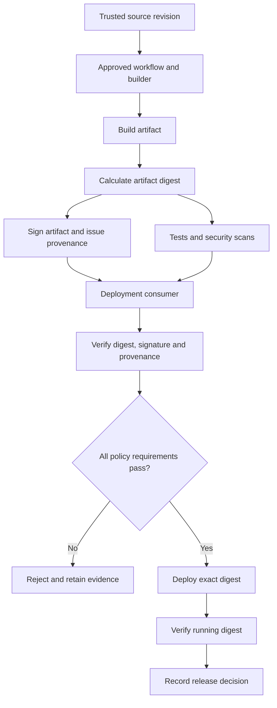

# Xác minh artifact và bằng chứng build trước khi triển khai

Một pipeline báo xanh chưa đủ để chứng minh package chuẩn bị đưa lên production là package đã được build và kiểm tra đúng cách. Artifact có thể bị lấy nhầm từ lần chạy khác, bị thay đổi sau khi kiểm thử, được tạo bởi workflow không đáng tin cậy hoặc không còn liên kết rõ ràng với commit nguồn. Nếu bước deploy chỉ nhận một tên tag hoặc đường dẫn file rồi chạy, hệ thống đang dựa vào niềm tin ngầm thay vì bằng chứng.

Trước khi triển khai, pipeline cần xác minh cả **nội dung artifact** và **nguồn gốc cùng quá trình tạo artifact**. Digest xác định bytes; chữ ký xác thực identity đã ký; provenance/attestation mô tả builder, source và quy trình; test/security evidence cho biết những kiểm tra nào đã đạt; policy quyết định các bằng chứng đó có đủ điều kiện phát hành hay không. Tất cả phải gắn với cùng artifact digest.

Đây là một phần của bảo mật chuỗi cung ứng phần mềm (*software supply chain security*). Mục tiêu là chỉ cho phép artifact đáp ứng chính sách được đưa vào môi trường tiếp theo, đồng thời lưu đủ bằng chứng để truy vết từ production về repository, commit, workflow và lần build đã tạo ra nó.

## 1. Vì sao cần xác minh trước deploy?

Pipeline thường có nhiều job và nhiều ranh giới lưu chuyển dữ liệu: build runner tạo package, artifact store lưu file, scanner tải package để phân tích, registry publish image, staging triển khai image và production promote phiên bản đã duyệt. Mỗi ranh giới đều có thể phát sinh sai lệch.

Các tình huống thường gặp:

- Job deploy tải artifact có tên giống nhau nhưng thuộc một workflow run khác.
- Tag container được di chuyển sau khi test, khiến deploy tải image mới.
- Artifact bị thay thế trong registry hoặc trên đường truyền.
- Workflow từ pull request không đáng tin tạo file rồi chuyển sang job có quyền production.
- Image được build lại sau khi scan, nên kết quả scan không còn mô tả image đang deploy.
- Chữ ký hợp lệ nhưng được tạo bởi identity không được phép phát hành service đó.
- Provenance có source commit đúng nhưng builder hoặc workflow không nằm trong danh sách tin cậy.
- Test report thuộc commit khác hoặc artifact khác nhưng vẫn được tổng hợp thành gate xanh.
- Artifact không có SBOM hoặc có SBOM cũ, khiến nhóm không biết dependency thực tế.

Xác minh trước deploy tạo ra một điểm kiểm soát rõ ràng: consumer chỉ nhận artifact khi có thể chứng minh artifact đó là đúng đối tượng, đến từ nguồn được phép và có đầy đủ bằng chứng theo policy.

## 2. Phân biệt artifact, digest và bằng chứng build

Ba khái niệm cần được phân biệt:

| Thành phần | Câu hỏi được trả lời | Ví dụ |
|---|---|---|
| Artifact | File hoặc image nào sẽ được triển khai? | JAR, ZIP, OCI image |
| Digest | Nội dung bytes chính xác là gì? | `sha256:ab12...89ef` |
| Build provenance | Artifact được tạo từ đâu và bằng quy trình nào? | Repository, commit, builder, workflow, build invocation |
| Signature | Identity nào đã ký artifact hoặc attestation? | Workload identity của workflow phát hành |
| Test/security evidence | Những kiểm tra nào đã chạy trên artifact nào? | Test report, scan result, policy evaluation |
| Deployment record | Artifact digest nào đã được triển khai ở môi trường nào? | `staging`, image digest, thời điểm và kết quả verify |

Digest là định danh nội dung, không phải bằng chứng nguồn gốc. Provenance mô tả nguồn tạo, nhưng consumer vẫn cần xác minh chữ ký và policy. Chữ ký xác thực signer và nội dung được ký, nhưng không tự chứng minh artifact an toàn. Test report cho biết kết quả một lần kiểm tra, nhưng chỉ có giá trị nếu được liên kết với đúng digest và được phát hành bởi test system đáng tin.

Một quyết định deploy đáng tin cậy cần kết hợp các thành phần này thay vì dựa vào một nhãn `2.4.1`, `latest`, tên file hoặc trạng thái xanh của một job bất kỳ.

## 3. Chuỗi tin cậy từ source đến production

Chuỗi tin cậy bắt đầu từ repository và kết thúc ở runtime. Mỗi bước phải giữ lại định danh của bước trước:

1. **Source:** xác định repository, event, ref và commit SHA được phép build.
2. **Builder:** xác định workflow, runner/builder identity và cấu hình build được tin cậy.
3. **Build:** tạo artifact và ghi nhận đầu vào, dependency cùng tham số quan trọng.
4. **Attestation:** phát hành provenance gắn với digest của artifact.
5. **Verification:** kiểm tra digest, chữ ký, identity, provenance và policy.
6. **Testing/scanning:** kiểm tra đúng artifact digest, phát hành kết quả có thể xác minh.
7. **Promotion:** chuyển cùng digest qua staging và production.
8. **Runtime verification:** xác nhận môi trường đang chạy đúng digest đã được duyệt.
9. **Audit:** lưu quyết định, bằng chứng, người phê duyệt và deployment record.



Nếu bất kỳ bước nào làm thay đổi artifact bytes, digest mới phải được tính và bằng chứng cũ không còn tự động áp dụng. Không được scan một image rồi rebuild image khác để deploy với cùng tag mà không chạy lại xác minh.

## 4. Xác định đúng source revision

Provenance cần chỉ ra chính xác mã nguồn đã tạo ra artifact. Repository URL hoặc branch name chưa đủ vì branch là tham chiếu có thể thay đổi. Nên ghi:

- Repository identity, bao gồm host/organization/project và định danh ổn định nếu nền tảng cung cấp.
- Event type đã kích hoạt build.
- Ref tại thời điểm trigger.
- Commit SHA đầy đủ đã checkout.
- Với pull request: head SHA, base SHA và merge-result SHA nếu pipeline kiểm tra merge result.
- Workflow path/ID và run ID/attempt.
- Submodule revision hoặc source dependency quan trọng nếu có.

Runner cần xác minh revision thực tế sau checkout, ví dụ bằng `git rev-parse HEAD`. Không để một bước build tự chuyển sang `main` hoặc tải source mới nhất sau khi event đã xác định commit. Nếu build từ merge result của pull request, provenance phải mô tả cả head và base để người đọc hiểu revision được kiểm tra.

Với release tag, cần resolve tag đến commit SHA và áp dụng chính sách bảo vệ tag. Tên `v2.4.1` là metadata phát hành; source SHA mới xác định commit đã build.

## 5. Builder identity và workflow identity

Builder là hệ thống thực hiện quá trình build. Nó có thể là runner do nền tảng CI cung cấp, build service chuyên dụng hoặc một builder được tổ chức quản lý. Provenance cần xác định builder đủ rõ để consumer phân biệt workflow được tin cậy với workflow tùy ý.

Các thuộc tính cần kiểm tra có thể gồm:

- Tổ chức/project/repository sở hữu workflow.
- Workflow file hoặc workflow ID được phép tạo release.
- Ref hoặc branch được phép chạy build phát hành.
- Identity của runner/builder và môi trường thực thi.
- Phiên bản build tool, container base image và plugin quan trọng.
- Cách builder nhận credential và quyền publish.
- Workflow run ID, attempt và thời điểm build.

Không nên tin provenance chỉ vì nó ghi `builder: trusted`. Claim đó phải được xác thực bằng chữ ký/attestation và đối chiếu với trust policy của consumer. Tên workflow có thể bị giả mạo trong một file JSON do chính artifact cung cấp; bằng chứng phải được ký bởi identity được xác thực độc lập.

## 6. Provenance và attestation

Provenance là thông tin mô tả nguồn và quy trình tạo artifact. Attestation là một tuyên bố có cấu trúc về một subject, thường được ký hoặc phát hành qua hệ thống có thể xác minh. Trong chuỗi cung ứng phần mềm, attestation có thể chứa provenance, SBOM hoặc kết quả kiểm tra.

Một provenance hữu ích thường mô tả:

| Nhóm thông tin | Nội dung cần có |
|---|---|
| Subject | Artifact name và digest được attestation mô tả |
| Builder | Identity của hệ thống tạo artifact |
| Build definition | Workflow, build type và cấu hình thực thi |
| Invocation | Run ID, tham số và thông tin lần chạy |
| Source materials | Repository, commit SHA và các source input |
| Dependencies/materials | Dependency hoặc đầu vào ảnh hưởng đến build khi được ghi nhận |
| Metadata | Thời gian, phiên bản schema và thông tin truy vết |

SLSA provenance là một ví dụ về mô hình provenance trong bảo mật chuỗi cung ứng. In-toto Statement là một dạng cấu trúc attestation có subject và predicate. Khi áp dụng một định dạng cụ thể, cần xác định phiên bản schema và mức đảm bảo mà builder cung cấp; không nên giả định mọi file JSON mang tên provenance đều có cùng mức tin cậy.

Attestation phải tham chiếu digest của artifact. Nếu một attestation mô tả tag có thể di chuyển mà không khóa digest, consumer không thể chắc chắn nội dung đang tải là nội dung đã được mô tả.

## 7. Chữ ký và xác minh identity của signer

Chữ ký số cho phép consumer xác minh rằng nội dung được ký không bị sửa sau khi ký và chữ ký được tạo bởi khóa hoặc identity tương ứng. Trong CI hiện đại, có thể dùng khóa quản lý tập trung hoặc workload identity/keyless signing dựa trên OIDC.

Khi xác minh, cần kiểm tra ít nhất:

1. Chữ ký có hợp lệ trên đúng digest hoặc attestation payload không?
2. Certificate/key có được phát hành từ trust root hoặc issuer được chấp nhận không?
3. Identity signer có khớp repository, workflow, branch/tag và environment policy không?
4. Certificate hoặc credential có nằm trong thời hạn và trạng thái hợp lệ theo policy không?
5. Attestation có subject digest trùng với artifact chuẩn bị deploy không?

Chỉ kiểm tra chữ ký tồn tại là chưa đủ. Một workflow từ repository không được phép cũng có thể tạo chữ ký hợp lệ bằng identity của chính nó. Consumer cần xác minh *ai đã ký* và *identity đó có quyền ký artifact của dịch vụ này hay không*.

Private signing key không được đặt trong source, artifact hoặc log. Ưu tiên workload identity và quyền ngắn hạn; nếu cần khóa dài hạn, lưu trong KMS/HSM hoặc hệ thống quản lý khóa có kiểm soát, audit và quy trình rotation.

## 8. Phân biệt checksum, signature và provenance

Các cơ chế này giải quyết các câu hỏi khác nhau:

| Cơ chế | Mục đích | Giới hạn |
|---|---|---|
| SHA-256 digest | Xác định nội dung bytes | Không xác thực nguồn tạo |
| Digital signature | Xác minh nội dung/attestation do identity tương ứng ký | Không chứng minh signer được phép phát hành nếu thiếu trust policy |
| Provenance | Mô tả source, builder và quá trình tạo | Claim cần chữ ký và policy để trở thành bằng chứng tin cậy |
| SBOM | Liệt kê thành phần phần mềm trong artifact | Không chứng minh artifact đã qua test hoặc an toàn |
| Test report | Ghi kết quả test | Cần xác minh nguồn phát hành và liên kết digest |
| Deployment record | Ghi artifact đã triển khai và kết quả | Cần được tạo từ hệ thống deploy/runtime đáng tin |

Ví dụ, SHA-256 khớp chỉ chứng minh file tải về giống file mà digest tham chiếu. Nếu attacker thay cả file và checksum trong cùng một nơi có quyền ghi, phép so sánh vẫn có thể pass. Chữ ký hoặc nguồn digest độc lập giúp bảo vệ giá trị kỳ vọng. Provenance tiếp tục trả lời file đó được tạo từ commit và builder nào.

## 9. Xác minh SBOM trước khi triển khai

Software Bill of Materials (SBOM) liệt kê package, library và thành phần có trong artifact. SBOM có thể được phát hành theo SPDX hoặc CycloneDX. Nó hỗ trợ inventory dependency, license review và đối chiếu lỗ hổng đã biết.

Consumer cần kiểm tra:

- SBOM được tạo cho đúng artifact digest.
- Định dạng và phiên bản schema được hỗ trợ.
- SBOM được phát hành bởi builder hoặc scanner identity được tin cậy.
- Các thành phần có tên/version/package URL đủ để đối chiếu vulnerability database.
- Các license hoặc package bị cấm được xử lý theo policy.
- SBOM không quá cũ so với artifact đang triển khai.

SBOM không phải chứng nhận an toàn. Một SBOM đầy đủ vẫn có thể liệt kê dependency chứa lỗ hổng. Một scanner có thể không nhận diện được mọi thành phần hoặc vulnerability. Vì vậy, cần kết hợp SBOM với vulnerability scan và chính sách chấp nhận rủi ro.

Nếu image được build lại hoặc thay đổi layer, cần tạo SBOM mới gắn với digest mới. Không tái sử dụng SBOM chỉ vì image tag hoặc release version không đổi.

## 10. Xác minh test và security evidence

Build provenance chứng minh nguồn gốc và quy trình tạo; nó không tự chứng minh unit test, integration test hoặc security scan đã đạt. Nếu quyết định deploy phụ thuộc vào các gate này, pipeline cần phát hành evidence riêng hoặc một attestation tổng hợp được ký.

Mỗi test/security evidence nên ghi:

- Artifact subject digest được kiểm tra.
- Test suite hoặc scanner và phiên bản công cụ.
- Policy/rule set hoặc test suite version.
- Thời điểm chạy và workflow run identity.
- Kết quả rõ ràng: pass, fail, skipped, inconclusive hoặc waived.
- Tóm tắt phát hiện và liên kết report chi tiết có kiểm soát quyền.
- Identity phát hành evidence và chữ ký nếu policy yêu cầu.

Không dùng trạng thái xanh của pipeline run làm bằng chứng duy nhất nếu run đó chứa job tùy chọn, job bị skip hoặc job có `continue-on-error`. Quality gate phải phân biệt kết quả bắt buộc và advisory. Một test bị skip không mặc nhiên được xem là pass.

Nếu scanner phân tích image theo tag, cần xác nhận scanner resolve tag thành digest nào và ghi digest đó trong report. Nếu pipeline build lại sau scan, evidence phải bị coi là không áp dụng cho artifact mới.

## 11. Trust policy: quy định artifact nào được phép deploy

Trust policy mô tả các điều kiện mà artifact phải đáp ứng trước khi consumer chấp nhận. Policy nên được quản lý bằng mã, review và version hóa như một phần của quy trình phát hành.

Một policy cho service production có thể yêu cầu:

- Repository phải thuộc tổ chức và project được phép.
- Source revision phải thuộc branch/tag phát hành được bảo vệ.
- Builder identity phải khớp workflow release đã phê duyệt.
- Provenance phải dùng schema và predicate type được hỗ trợ.
- Subject digest trong attestation phải bằng digest được deploy.
- Signature phải hợp lệ và signer identity phải nằm trong allowlist.
- SBOM phải có và vượt qua policy dependency/license.
- Test, integration, contract và security gates bắt buộc phải pass.
- Artifact không được build từ workflow pull request không tin cậy.
- Artifact phải nằm trong registry/namespace được phép.
- Không có trạng thái revoked hoặc policy exception đã hết hạn.

Policy cần phân biệt điều kiện bắt buộc với điều kiện tùy chọn. Với production, thiếu bằng chứng quan trọng thường phải fail closed: từ chối deploy cho đến khi có bằng chứng hợp lệ hoặc ngoại lệ được phê duyệt theo quy trình. Không được tự động bỏ qua xác minh khi attestation server tạm thời không truy cập được.

Ngoại lệ cần ghi người phê duyệt, lý do, artifact digest, phạm vi môi trường, thời hạn và rủi ro được chấp nhận. Không dùng ngoại lệ vĩnh viễn hoặc wildcard policy để xử lý một lỗi cụ thể.

## 12. Consumer phải tự xác minh

Producer có trách nhiệm tạo artifact và bằng chứng; consumer có trách nhiệm xác minh trước khi sử dụng. Không nên giả định producer đã kiểm tra mọi điều kiện mà consumer yêu cầu. Ví dụ staging có thể chấp nhận build từ branch thử nghiệm, còn production chỉ chấp nhận build từ workflow release và branch được bảo vệ.

Consumer-side verification nên thực hiện theo thứ tự:

1. Resolve artifact reference thành digest bất biến.
2. Tải đúng artifact theo digest hoặc artifact ID cụ thể.
3. Tính lại digest trên nội dung nhận được và so sánh.
4. Lấy signature và attestations từ nguồn tin cậy.
5. Xác minh chữ ký, issuer và signer identity.
6. Parse provenance, kiểm tra schema, subject và source materials.
7. Đối chiếu builder/workflow/ref với trust policy.
8. Lấy SBOM và test/security evidence cho cùng digest.
9. Đánh giá policy và ghi quyết định.
10. Chỉ deploy digest đã được xác minh; ghi deployment record.

Việc xác minh nên diễn ra ở ranh giới deploy hoặc promotion, kể cả khi một job scan trước đó đã chạy. Consumer cần tự kiểm tra dữ liệu mà nó sẽ dùng, tránh phụ thuộc vào tên file hoặc kết quả trong bộ nhớ của job khác.

## 13. Ví dụ xác minh container image bằng Cosign

Cosign là một công cụ trong hệ sinh thái Sigstore, hỗ trợ ký và xác minh container image cùng attestation. Ví dụ dưới đây minh họa ý tưởng xác minh image theo digest và identity được phép:

```bash
IMAGE="registry.example/team/order-service@sha256:ab12...89ef"

cosign verify \
  --certificate-identity="https://github.com/acme/order-service/.github/workflows/release.yml@refs/heads/main" \
  --certificate-oidc-issuer="https://token.actions.githubusercontent.com" \
  "$IMAGE"

cosign verify-attestation \
  --type slsaprovenance \
  --certificate-identity="https://github.com/acme/order-service/.github/workflows/release.yml@refs/heads/main" \
  --certificate-oidc-issuer="https://token.actions.githubusercontent.com" \
  "$IMAGE"
```

Các giá trị registry, digest, repository và workflow trong ví dụ là placeholder. Cú pháp và predicate type cần khớp phiên bản Cosign, định dạng attestation và cách nền tảng phát hành certificate. Identity string chính xác phụ thuộc workflow và issuer; cần lấy từ cấu hình OIDC thực tế, không copy nguyên ví dụ vào production.

Hai lệnh trên minh họa xác minh chữ ký image và attestation. Một quy trình production còn phải đọc predicate, kiểm tra source commit, builder, workflow, subject digest và đánh giá trust policy. Lệnh verify thành công không tự thực hiện toàn bộ chính sách nghiệp vụ của tổ chức.

## 14. Ví dụ cấu trúc provenance

Một attestation dạng in-toto Statement có thể có cấu trúc khái niệm như sau:

```json
{
  "_type": "https://in-toto.io/Statement/v1",
  "subject": [
    {
      "name": "registry.example/team/order-service",
      "digest": {
        "sha256": "ab12...89ef"
      }
    }
  ],
  "predicateType": "https://slsa.dev/provenance/v1",
  "predicate": {
    "buildDefinition": {
      "buildType": "https://ci.example/builders/gradle-container/v1",
      "externalParameters": {
        "repository": "https://github.com/acme/order-service",
        "ref": "refs/heads/main"
      },
      "internalParameters": {},
      "resolvedDependencies": [
        {
          "uri": "git+https://github.com/acme/order-service",
          "digest": {
            "gitCommit": "9f4c...e81a"
          }
        }
      ]
    },
    "runDetails": {
      "builder": {
        "id": "https://ci.example/builders/release"
      },
      "metadata": {
        "invocationId": "run-1842-attempt-1",
        "startedOn": "2026-11-18T08:00:00Z",
        "finishedOn": "2026-11-18T08:04:00Z",
        "completeness": {
          "parameters": true,
          "environment": true,
          "materials": true
        }
      }
    }
  }
}
```

Đây là ví dụ rút gọn để minh họa quan hệ giữa subject digest, source dependency và builder. Một attestation SLSA thực tế phải tuân thủ schema/predicate version tương ứng; không dùng JSON minh họa này như file phát hành hợp lệ mà không validate. Giá trị `...` là placeholder và phải được thay bằng digest/commit thực.

Consumer phải xác minh chữ ký bao quanh attestation trước khi tin nội dung JSON. Sau đó mới kiểm tra predicate type, schema version, subject digest, source repository, commit, build type và builder identity.

## 15. Xây dựng deploy gate trong CI/CD

Một deploy gate nên gom kết quả xác minh vào một quyết định duy nhất và có thể audit. Ví dụ logic ở mức khái niệm:

```text
function authorizeDeployment(artifact, targetEnvironment):
    digest = resolveImmutableDigest(artifact)
    require(digest.algorithm == "sha256")

    downloaded = fetchByDigest(artifact.location, digest)
    require(sha256(downloaded) == digest.value)

    signature = fetchSignature(digest)
    require(verifySignature(signature, trustedIssuers))
    require(identityAllowed(signature.identity, targetEnvironment))

    provenance = fetchAndVerifyProvenance(digest)
    require(provenance.subjectDigest == digest)
    require(provenance.repository in allowedRepositories)
    require(provenance.commit is a full immutable revision)
    require(provenance.builder in trustedBuilders)
    require(provenance.workflow in allowedWorkflows)

    evidence = fetchEvidence(digest)
    require(evidence.requiredTests == "passed")
    require(evidence.securityPolicy == "passed")
    require(evidence.sbom is valid and policyCompliant)

    return DeploymentAuthorization(digest, evidence, policyVersion)
```

Đây là pseudocode mô tả quyết định; các hàm cần được triển khai bằng verifier, registry API và policy engine của tổ chức. Không nên parse JSON rồi tự tin vào các trường `verified: true` do chính producer ghi mà không xác minh chữ ký và nguồn phát hành.

Kết quả gate nên chứa artifact digest, target environment, policy version, bằng chứng đã kiểm tra, thời điểm, kết quả và lý do từ chối. Nếu policy thay đổi, có thể biết release cũ đã được duyệt theo bộ quy tắc nào.

## 16. Phân biệt xác minh ở build time và deploy time

Một số kiểm tra có thể chạy khi build, nhưng deploy consumer vẫn phải xác minh artifact trước khi dùng.

| Thời điểm | Kiểm tra | Mục tiêu |
|---|---|---|
| Source/PR | Review workflow, lint, static analysis, secret scan | Giảm nguy cơ đưa thay đổi không tin cậy vào builder |
| Build | Ghi source revision, toolchain, dependency và tạo provenance | Tạo bằng chứng về nguồn và quá trình build |
| Publish | Tính digest, ký artifact/attestation, áp dụng registry policy | Bảo vệ danh tính nội dung và nguồn phát hành |
| Test/scan | Chạy test và scanner trên digest đã publish | Kiểm tra đúng artifact sẽ được promote |
| Deploy | Xác minh digest, chữ ký, provenance và evidence | Chặn artifact không đáp ứng trust policy |
| Runtime | Xác minh digest đang chạy và theo dõi trạng thái | Phát hiện sai lệch sau triển khai |

Build-time validation có thể fail sớm và tiết kiệm chi phí. Deploy-time verification là ranh giới cuối cùng trước khi cấp quyền đưa artifact vào môi trường nhạy cảm. Không nên bỏ bước deploy-time chỉ vì build workflow đã có một job tên `verify`.

## 17. Tách workflow build không tin cậy khỏi workflow phát hành

Pull request từ fork hoặc branch không được bảo vệ có thể thay đổi source code, script build và workflow. Nếu job đó có quyền ký release, ghi registry production hoặc nhận secret deploy, mã không tin cậy có thể chiếm quyền.

Một thiết kế an toàn thường tách:

- **Untrusted validation:** checkout và chạy test trên mã PR với token chỉ đọc, không có secret production và không có quyền publish release.
- **Trusted build/release:** chạy trên branch/tag được bảo vệ hoặc workflow được quản lý độc lập, với builder identity và quyền publish riêng.
- **Verification/consumer:** xác minh artifact và attestation theo policy, không thực thi script lấy từ artifact chưa xác minh.
- **Deployment:** chỉ nhận digest đã qua gate, dùng identity theo environment và có approval theo mức rủi ro.

Trên GitHub Actions, cần đặc biệt cẩn trọng với `pull_request_target`: event này chạy trong ngữ cảnh base repository và có thể có quyền cao hơn. Không checkout rồi thực thi mã từ head không đáng tin trong workflow có secret hoặc token đặc quyền. `workflow_run` có thể tạo ranh giới quyền giữa workflow, nhưng artifact từ upstream vẫn là dữ liệu chưa tin cậy cho đến khi được xác minh.

Workflow release cần được bảo vệ như code có quyền cao: review thay đổi workflow, pin action theo commit SHA theo policy, giới hạn permissions, bảo vệ environment và kiểm soát identity OIDC.

## 18. Bảo vệ runner và môi trường build

Provenance chỉ đáng tin khi builder và môi trường tạo ra nó được bảo vệ. Runner dùng chung có thể giữ lại workspace, credential hoặc process từ job trước. Mã build không tin cậy có thể đọc file còn sót hoặc can thiệp vào job chạy sau.

Các biện pháp quan trọng:

- Ưu tiên runner tạm thời cho job xử lý mã không tin cậy.
- Dọn workspace, process, container và credential sau mỗi job.
- Không chạy job untrusted và job release đặc quyền trên cùng runner bền vững nếu không có ranh giới cô lập đủ mạnh.
- Giới hạn network egress của builder; chỉ cho truy cập dependency và registry cần thiết.
- Pin build image, toolchain và action/plugin theo chính sách.
- Không tải script từ URL thay đổi rồi thực thi mà không xác minh nội dung.
- Tách quyền đọc source, publish artifact, ký và deploy theo job.
- Ghi nhận builder identity và cấu hình môi trường trong provenance.
- Cập nhật runner image có kiểm soát và theo dõi lỗ hổng.

Self-hosted runner có thể cần thiết cho network nội bộ hoặc phần cứng đặc thù, nhưng phải được coi là hạ tầng có quyền nhạy cảm. Chỉ cho workflow tin cậy sử dụng runner có quyền truy cập production; phân nhóm runner theo trust level và giới hạn repository được phép gọi.

## 19. Bảo vệ artifact store và registry

Artifact store/registry là một phần của trust boundary. Consumer cần chắc chắn artifact được tải từ namespace đúng và không bị thay đổi sau khi publish.

Nên áp dụng:

- Quyền push/pull/delete tách biệt; job build không được xóa release đã phát hành.
- Namespace riêng cho artifact tạm, snapshot và release.
- Immutable release tags hoặc version policy ngăn ghi đè.
- Digest-based retrieval cho mọi bước scan và deploy.
- Audit log cho publish, tag update, delete và permission change.
- TLS, credential ngắn hạn và secret management phù hợp.
- Retention đủ cho rollback, điều tra và yêu cầu kiểm toán.
- Replication có kiểm tra digest ở vùng triển khai.
- Quy trình quarantine/revoke artifact bị phát hiện có vấn đề.

Không dùng `latest`, `stable` hoặc tag mutable làm bằng chứng rằng nội dung đã được kiểm thử. Tag có thể hỗ trợ con người, còn deployment reference nên dùng digest đã được xác minh.

## 20. Xử lý test report và evidence bị thiếu

Một deploy gate cần phân biệt các trạng thái thay vì gom tất cả thành pass/fail đơn giản:

| Trạng thái | Ý nghĩa | Xử lý gợi ý |
|---|---|---|
| Passed | Kiểm tra đã chạy và đạt | Có thể tiếp tục nếu các gate khác đạt |
| Failed | Kiểm tra đã chạy và phát hiện lỗi | Chặn deploy theo policy |
| Skipped | Không chạy | Chỉ chấp nhận nếu policy xác định rõ không áp dụng |
| Cancelled | Job bị hủy | Không xem là pass; cần chạy lại hoặc quyết định theo policy |
| Timed out | Không hoàn tất trong thời gian cho phép | Chặn gate bắt buộc và điều tra nguyên nhân |
| Inconclusive | Scanner/test không đưa ra kết quả chắc chắn | Xử lý theo policy; không tự chuyển thành pass |
| Waived | Có ngoại lệ được phê duyệt | Kiểm tra approver, lý do, phạm vi và expiry |
| Missing | Không tìm thấy evidence | Fail closed với gate bắt buộc |

Report phải có subject digest và identity của producer. Nếu chỉ lưu một file `test-results.xml` mà không biết nó thuộc run hoặc artifact nào, consumer không thể dùng nó làm bằng chứng phát hành.

Không tái sử dụng report cũ cho artifact mới. Nếu scanner chạy lại trên cùng digest với database vulnerability mới hơn, cần ghi thời điểm và version/rule set để hiểu kết quả. Một số policy yêu cầu scan lại trước production nếu evidence quá cũ hoặc threat intelligence đã thay đổi đáng kể.

## 21. Policy theo môi trường và mức rủi ro

Không phải mọi môi trường cần cùng một mức xác minh. Development có thể chấp nhận build từ branch thử nghiệm trong namespace cô lập; production cần source, builder, signer và evidence chặt hơn.

Ví dụ:

| Điều kiện | Development | Staging | Production |
|---|---|---|---|
| Source | Branch/PR được phép | Nhánh tích hợp hoặc release candidate | Protected branch hoặc signed release tag |
| Builder | Builder CI đã đăng ký | Trusted CI builder | Builder identity được allowlist chặt |
| Signature | Khuyến nghị hoặc bắt buộc theo dữ liệu | Bắt buộc theo policy | Bắt buộc |
| Provenance | Tối thiểu source và builder | Đầy đủ source/workflow/materials | Đầy đủ và policy-verified |
| Tests | Unit/component liên quan | Integration/contract/E2E cần thiết | Evidence bắt buộc của release |
| Security | Scan cơ bản | Scan theo release policy | Scan theo ngưỡng production |
| Approval | Có thể tự động | Review theo rủi ro | Environment approval hoặc change control khi yêu cầu |
| Artifact reference | Digest | Digest | Digest đã được promote |

Bảng là gợi ý, không phải chuẩn chung. Mức xác minh phải phản ánh độ nhạy dữ liệu, mức ảnh hưởng và khả năng phục hồi. Dù môi trường nào, cần giữ digest để biết chính xác nội dung đang chạy.

## 22. Promotion: không rebuild sau khi xác minh

Sau khi artifact được kiểm thử và xác minh, staging và production nên nhận cùng digest. Promotion là thay đổi trạng thái phát hành hoặc quyền sử dụng artifact, không phải build lại từ source.

Một luồng đúng:

1. Build artifact và publish digest `D`.
2. Ký artifact `D` và phát hành provenance `P(D)`.
3. Chạy tests/scans trên `D`; lưu evidence `E(D)`.
4. Deploy `D` lên staging.
5. Xác minh runtime staging đang chạy `D` và các post-deploy check đạt.
6. Đánh giá policy trên `P(D)` và `E(D)`.
7. Promote chính `D` lên production.
8. Xác minh runtime production đang chạy `D`.

Nếu cần rebuild do thay đổi source, toolchain hoặc cấu hình build, kết quả là artifact mới với digest mới. Phải phát hành provenance và chạy lại các kiểm tra cần thiết. Không gắn evidence của `D1` vào `D2` chỉ vì hai artifact dùng chung release version.

## 23. Runtime verification sau deploy

Deploy tool trả exit code 0 chỉ chứng minh thao tác triển khai được chấp nhận theo API của nền tảng. Nó không tự chứng minh workload đã pull đúng image, rollout hoàn tất hoặc traffic đang đi đến phiên bản mới.

Sau deploy, nên xác minh:

- Image/package digest thực tế trong deployment spec hoặc runtime metadata.
- Pod/task/instance đã sẵn sàng và không còn replica sai version theo chính sách rollout.
- Health/readiness endpoint và smoke test đạt.
- Error rate, latency, saturation và log/trace không vượt ngưỡng.
- Feature flag và cấu hình môi trường đúng với deployment record.
- Rollout không bị dừng giữa chừng hoặc để lại hỗn hợp version ngoài dự kiến.

Nếu runtime digest khác digest được duyệt, dừng rollout và điều tra. Có thể do tag mutable, registry mirror, manifest platform, deployment controller hoặc pipeline truyền sai reference. Ghi lại expected digest và actual digest trong release record.

## 24. Thu hồi và xử lý artifact không còn đáng tin

Artifact có thể bị phát hiện chứa dependency nguy hiểm, được build từ workflow bị xâm phạm hoặc có provenance sai sau khi đã publish. Tổ chức cần quy trình quarantine/revoke:

1. Xác định digest và các release/environment đang sử dụng.
2. Đánh dấu artifact không còn được phép promote; cập nhật policy hoặc registry metadata có audit.
3. Chặn deploy mới và dừng rollout đang chờ.
4. Đánh giá ảnh hưởng đến production và chọn rollback/roll-forward.
5. Tạo artifact thay thế từ source/builder đã xác minh.
6. Chạy lại test, scan, signature và provenance verification.
7. Lưu incident record, quan hệ giữa digest bị thu hồi và digest thay thế.

Xóa tag không đủ để thu hồi artifact nếu workload đã pull image hoặc có thể truy cập digest. Cần policy deploy kiểm tra trạng thái revoke và có thể cần registry denylist, admission policy hoặc hệ thống release authorization.

## 25. Audit trail và bằng chứng cho quyết định deploy

Mỗi quyết định deploy nên có một record bất biến hoặc có audit phù hợp, bao gồm:

- Artifact URI, version và digest.
- Source repository, commit SHA và event.
- Builder/workflow identity, run ID và attempt.
- Signature verification result và signer identity.
- Provenance/attestation reference cùng schema/predicate version.
- SBOM reference và kết quả policy.
- Test/security evidence reference, trạng thái và thời điểm.
- Trust policy version đã áp dụng.
- Target environment, approver hoặc automation identity.
- Expected và actual runtime digest sau deploy.
- Kết quả rollout, smoke test và hành động rollback nếu có.

Audit trail giúp trả lời artifact nào đã chạy, vì sao được cho phép, ai hoặc workflow nào quyết định và bằng chứng nào được xem xét. Chỉ lưu link đến report có thể không đủ nếu report bị xóa hoặc thay đổi; cần retention và integrity policy phù hợp.

## 26. Những anti-pattern thường gặp

| Anti-pattern | Rủi ro | Cách xử lý |
|---|---|---|
| Deploy theo tag mutable | Tag có thể trỏ sang nội dung khác | Resolve và deploy theo digest |
| Tin tên file hoặc release version | Không xác định được bytes chính xác | Kiểm tra digest trên artifact thực tế |
| Tin provenance chưa xác minh chữ ký | Attacker có thể tự tạo claim giả | Xác minh signer/issuer và trust policy |
| Chỉ kiểm tra chữ ký có tồn tại | Signer có thể không được phép | Allowlist identity theo repo/workflow/environment |
| Không kiểm tra subject digest | Attestation có thể mô tả artifact khác | So sánh subject digest với digest đang deploy |
| Dùng test report của run khác | Gate xanh không áp dụng cho artifact hiện tại | Gắn evidence với run và digest cụ thể |
| Scan image theo tag rồi deploy tag | Image có thể thay đổi giữa scan và deploy | Scan và deploy cùng digest |
| Build lại sau khi test | Bằng chứng không còn mô tả output mới | Build once, promote same digest |
| Coi SBOM là chứng nhận an toàn | SBOM chỉ là inventory | Kết hợp vulnerability/license policy |
| Cho PR không tin cậy quyền ký/publish | Có thể phát hành artifact giả hoặc lấy secret | Tách untrusted validation và trusted release |
| Bỏ qua evidence khi service tạm lỗi | Artifact chưa được xác minh vẫn có thể deploy | Fail closed hoặc waiver có thời hạn |
| Không xác minh runtime sau deploy | Có thể chạy sai digest dù deploy job xanh | Đọc actual digest và kiểm tra health |

## 27. Checklist xác minh artifact trước deploy

Trước khi cho phép artifact đi vào staging hoặc production, hãy kiểm tra:

- [ ] Artifact được tham chiếu bằng digest bất biến.
- [ ] Digest tính lại từ bytes tải về khớp với digest kỳ vọng.
- [ ] Artifact đến từ registry/namespace hoặc workflow run được phép.
- [ ] Source repository và commit SHA được xác định rõ.
- [ ] Pull request có head/base/merge SHA phù hợp với mục tiêu test.
- [ ] Builder và workflow identity thuộc trust policy.
- [ ] Provenance có schema/predicate được hỗ trợ và chữ ký hợp lệ.
- [ ] Subject digest trong provenance trùng digest artifact.
- [ ] Signer identity, issuer và trust root được xác minh.
- [ ] SBOM mô tả đúng digest và vượt qua policy dependency/license.
- [ ] Test report và security evidence thuộc cùng digest.
- [ ] Các gate bắt buộc đều pass; skipped, missing, timeout và inconclusive được xử lý rõ.
- [ ] Artifact không bị revoke và evidence còn phù hợp theo freshness policy.
- [ ] Artifact không được rebuild hoặc thay đổi sau khi kiểm tra.
- [ ] Promotion staging/production dùng cùng digest.
- [ ] Deploy job có quyền tối thiểu và không thực thi script từ artifact chưa xác minh.
- [ ] Runtime sau deploy được kiểm tra actual digest và health.
- [ ] Quyết định deploy cùng bằng chứng và policy version được lưu lại.
- [ ] Có quy trình quarantine/revoke và rollback khi phát hiện artifact không còn đáng tin.

## 28. Kết luận

Xác minh artifact trước deploy là bước kiểm soát giữa quá trình tạo phần mềm và môi trường chạy thật. Digest xác định nội dung; signature xác minh signer; provenance liên kết artifact với source và builder; SBOM mô tả dependency; test/security evidence chứng minh các kiểm tra đã chạy; trust policy kết hợp chúng thành quyết định cho phép hoặc từ chối phát hành.

Consumer phải tự xác minh các bằng chứng trên đúng artifact digest mà nó sẽ triển khai. Pipeline nên tách workflow không tin cậy khỏi workflow phát hành, bảo vệ builder và registry, fail closed khi thiếu bằng chứng bắt buộc, promote cùng digest qua các môi trường và xác minh runtime sau deploy. Khi mọi quyết định đều gắn với digest, identity và audit trail, nhóm có thể giải thích rõ vì sao một artifact được đưa vào production và truy vết chính xác khi cần điều tra hoặc thu hồi.
