# Phân tách quyền phê duyệt, xuất bản và triển khai khi cần

Trong một quy trình CI/CD, ba hành động thường xuất hiện gần nhau nhưng có ý nghĩa và rủi ro khác nhau: **phê duyệt (approve)** một thay đổi hoặc một lần phát hành, **xuất bản (publish)** artifact/release để người hoặc hệ thống khác có thể sử dụng, và **triển khai (deploy)** artifact vào một môi trường đang chạy. Nếu một tài khoản hoặc một job có thể tự thực hiện cả ba hành động mà không có kiểm soát độc lập, một lỗi cấu hình hoặc một pipeline bị chiếm quyền có thể đưa mã chưa được kiểm tra ra ngoài hoặc vào production.

Phân tách quyền giúp giới hạn tác động của từng danh tính và tạo ra các điểm kiểm soát độc lập. Người phê duyệt quyết định một hành động cụ thể có được phép tiếp tục không; publisher đưa đúng artifact đã được xác minh vào kho phát hành; deployer đưa đúng artifact đó tới đúng môi trường với quyền tối thiểu. Các vai trò có thể được gộp trong thay đổi rủi ro thấp, nhưng cần tách khi phạm vi ảnh hưởng, độ nhạy cảm hoặc yêu cầu kiểm toán đòi hỏi.

## 1. Phân biệt approve, publish và deploy

| Hành động | Câu hỏi được trả lời | Đầu vào chính | Đầu ra hoặc tác động |
|---|---|---|---|
| Approve | Có cho phép thực hiện hành động đã nêu với rủi ro và bằng chứng hiện tại không? | Change/release request, commit, artifact digest, kết quả test/scan, environment, kế hoạch phục hồi | Quyết định có danh tính, thời điểm, phạm vi và lý do |
| Publish | Có đưa artifact/release đã xác minh vào kho hoặc kênh phân phối được chỉ định không? | Artifact, digest, provenance, chữ ký, SBOM, metadata và quyền phát hành | Artifact có thể được tải hoặc tiêu thụ qua registry/package repository/release channel |
| Deploy | Có kích hoạt artifact cụ thể trên runtime/environment đích không? | Artifact digest, manifest/config revision, target environment, deployment policy | Workload hoặc phiên bản đang chạy thay đổi; tạo deployment record |

Ví dụ, một thư viện Java có thể được build và kiểm thử trong CI, sau đó publish lên package registry để các dự án khác tải về. Hành động publish không đồng nghĩa với việc triển khai thư viện đó lên production. Với một dịch vụ container, publish là đẩy image lên registry; deploy là cập nhật workload trong Kubernetes để chạy image theo digest.

Phê duyệt cũng cần xác định đối tượng được duyệt. Approve pull request cho phép merge mã; approve publish cho phép phát hành package; approve deployment cho phép đưa artifact vào một môi trường. Một quyết định không tự động thay thế các quyết định còn lại nếu policy yêu cầu chúng độc lập.

## 2. Vì sao cần phân tách quyền?

Nếu cùng một danh tính có quyền sửa pipeline, tạo artifact, publish package, tự approve và deploy production, một thay đổi độc hại hoặc một credential bị lộ có thể vượt qua mọi lớp kiểm soát trong cùng một luồng. Phân tách quyền giảm khả năng một lỗi đơn lẻ trở thành sự cố toàn hệ thống.

Các mục tiêu chính:

- **Giảm blast radius:** publisher không thể tự sửa workload production; deployer không thể thay thế package đã phát hành.
- **Ngăn tự phê duyệt:** người hoặc workflow tạo thay đổi không tự xác nhận hành động rủi ro cao nếu policy yêu cầu độc lập.
- **Bảo vệ chuỗi cung ứng:** chỉ artifact có nguồn gốc, digest và bằng chứng phù hợp mới được publish hoặc deploy.
- **Giảm quyền thường trực:** mỗi job chỉ nhận credential cần thiết trong thời gian thực hiện.
- **Tăng khả năng kiểm toán:** log thể hiện ai đã duyệt, danh tính nào publish và danh tính nào deploy.
- **Tạo điểm dừng có chủ đích:** release có thể được kiểm tra trước khi công khai hoặc trước khi đi vào production.

```mermaid
flowchart LR
    SRC[Source change] --> V[Verify: tests / scans]
    V --> B[Build artifact]
    B --> E[Evidence: digest / provenance / SBOM]
    E --> PA[Publish approval, when required]
    PA --> PUB[Publisher identity]
    PUB --> REG[Release registry]
    REG --> DA[Deployment approval, when required]
    DA --> DEP[Deployer identity]
    DEP --> ENV[Target environment]
    ENV --> OBS[Post-deploy verification]
```



Sơ đồ thể hiện ba quyền có thể được tách thành các bước và danh tính khác nhau. Với release nội bộ ít rủi ro, một số bước có thể tự động hoặc cùng do một workflow điều phối. Điều quan trọng là quyết định, quyền ghi artifact và quyền thay đổi runtime vẫn được xác định rõ.

## 3. Khi nào nên gộp và khi nào nên tách?

Không phải mọi dự án đều cần ba nhóm người hoặc ba hệ thống riêng. Mức tách biệt nên tương xứng với rủi ro, tác động và yêu cầu tuân thủ.

| Tình huống | Cách tổ chức phù hợp |
|---|---|
| Build thử nghiệm trong nhánh cá nhân, không chia sẻ ra ngoài | Tự động build; không cần publish release hoặc production approval |
| Publish snapshot nội bộ cho nhóm phát triển nhỏ | CI có thể tự publish sau test; quyền ghi giới hạn vào snapshot repository |
| Publish package dùng chung cho nhiều nhóm | Tách quyền publish khỏi quyền sửa source; yêu cầu kiểm tra provenance, version và policy |
| Phát hành thư viện hoặc image công khai | Có release approval độc lập, publisher chuyên biệt, chữ ký và audit |
| Deploy staging tự động từ nhánh chính | Có thể tự động nếu artifact và môi trường được giới hạn; deploy identity chỉ có quyền staging |
| Deploy production cho service thông thường | Deployment approval theo policy, deployer riêng hoặc protected environment |
| Migration dữ liệu, thay đổi IAM/network hoặc release có blast radius lớn | Tách người tạo, approver và operator; có change window, rehearsal và rollback/restore plan |
| Hotfix/incident khẩn cấp | Dùng break-glass có phạm vi hẹp, log và hậu kiểm thay vì bỏ mọi kiểm soát |

Một nhóm nhỏ vẫn có thể áp dụng nguyên tắc separation of duties bằng danh tính máy và policy: workflow build không có quyền deploy; job publish dùng token riêng; environment production yêu cầu người được ủy quyền approve. Sự tách biệt không nhất thiết đòi hỏi nhiều phòng ban, nhưng phải tránh một principal có thể tự thay đổi và tự xác nhận hành động nhạy cảm.

## 4. Xác định vai trò và quyền của từng danh tính

Nên phân biệt người dùng (human identity) với danh tính tự động hóa (workload/service identity). Không dùng một token chung cho toàn bộ pipeline.

| Vai trò/danh tính | Quyền nên có | Quyền không nên có mặc định |
|---|---|---|
| Developer/author | Push nhánh cá nhân, tạo PR, xem kết quả CI | Publish release chính thức hoặc deploy production trực tiếp |
| Code reviewer | Review và approve thay đổi mã theo branch policy | Dùng credential publish/deploy chỉ vì có quyền review |
| Release approver | Xem bằng chứng và approve đúng release candidate | Sửa artifact, tự publish hoặc tự deploy bằng cùng quyết định |
| Build job identity | Đọc source/dependency và tạo artifact | Ghi release registry công khai hoặc sửa production runtime |
| Signing identity | Ký artifact/provenance đã đáp ứng policy | Thay source, tự approve hoặc deploy workload |
| Publisher identity | Ghi package/image vào đúng repository hoặc release channel | Sửa source, đọc secret runtime hoặc truy cập cluster production |
| Deployment approver | Cho phép artifact cụ thể vào environment cụ thể | Tự cấp credential deploy hoặc thay digest sau khi duyệt |
| Deployer/GitOps identity | Đọc artifact và thay đổi đúng workload/resource được giao | Ghi đè release registry, publish package hoặc quản trị toàn cluster |
| Runtime workload identity | Truy cập dependency/secret cần cho ứng dụng | Publish artifact hoặc triển khai phiên bản khác |

Quyền cần được giới hạn theo principal, action, resource và context. Ví dụ publisher có thể `write` vào `registry.example.com/team/orders/releases` nhưng chỉ `read` ở repository khác; deployer có thể `read` image và `patch` Deployment trong namespace `orders-production`, không có quyền `push` image.

## 5. Thiết kế ranh giới tin cậy giữa các giai đoạn

Một pipeline an toàn nên chia theo những ranh giới có ý nghĩa:

### Build và verify

Build job lấy mã tại commit cụ thể, dùng dependency/toolchain đã xác định và tạo artifact. Test, scan, SBOM và provenance được gắn với commit hoặc artifact tương ứng. Job này thường chỉ cần quyền đọc source và ghi vào vùng lưu trữ tạm hoặc artifact store của pipeline.

### Sign và attest

Signing service hoặc job được ủy quyền ký digest/provenance theo policy. Khóa ký nên được bảo vệ riêng, tốt nhất qua KMS/HSM hoặc workload identity, không lưu thành file lâu dài trong repository. Không cấp quyền sử dụng khóa ký cho mọi job chạy mã từ pull request không tin cậy.

### Publish

Publisher kiểm tra artifact, digest, bằng chứng và release metadata trước khi ghi vào release registry hoặc kênh phân phối. Nó chỉ cần quyền ghi vào đúng repository/package namespace. Nếu publish ra public registry, cần kiểm tra tên package, version, license, metadata, chữ ký và nội dung trước khi công khai.

### Deploy

Deployer lấy artifact đã publish bằng digest và áp dụng vào environment đã được cho phép. Deployer cần quyền đọc registry và quyền cập nhật workload đích. Nó không cần quyền ghi image mới vào registry hoặc đọc mọi secret của ứng dụng.

### Verify sau deploy

Health check, smoke test, metrics và deployment record xác nhận kết quả. Quyền quan sát có thể tách khỏi quyền thay đổi runtime. Nếu verification thất bại, quy trình dừng rollout hoặc kích hoạt rollback theo policy.

## 6. Gắn approval với đúng artifact, hành động và mục tiêu

Một quyết định phê duyệt chỉ có giá trị với những gì người duyệt đã xem. Approval record cần gắn với:

- Change/release ID và pipeline run ID.
- Repository và commit SHA.
- Artifact name/version và digest bất biến.
- Provenance, chữ ký, SBOM và kết quả test/scan liên quan.
- Hành động được duyệt: publish, deploy, promote hay migration.
- Target: package repository, release channel, environment, cluster/namespace hoặc service.
- Configuration/manifest revision và chiến lược rollout.
- Người duyệt, vai trò, thời điểm, lý do và thời hạn hiệu lực.

Nếu artifact digest thay đổi, environment thay đổi hoặc nội dung manifest có ảnh hưởng tới rủi ro thay đổi, approval cũ cần hết hiệu lực hoặc được đánh giá lại. Không nên cho phép pipeline thay image tag hoặc package version sau khi approve mà vẫn giữ quyết định cũ.

### Phân biệt phê duyệt publish và deploy

Một thư viện được duyệt để publish lên package registry chưa chắc được phép deploy vào mọi production service. Ngược lại, một image đã được approve để deploy vào staging không tự động được phép đưa vào production. Mỗi approval phải ghi rõ hành động và phạm vi.

Nếu tổ chức dùng cùng một release approval cho cả publish và deploy, policy cần nêu rõ điều đó, các environment được bao phủ và các điều kiện không đổi. Với môi trường production hoặc package công khai, thường nên có gate riêng hoặc ít nhất một điều kiện bổ sung.

## 7. Xuất bản artifact an toàn

Publisher là một principal có khả năng đưa nội dung vào nơi người khác tin cậy và tải về. Quyền này có thể tạo rủi ro chuỗi cung ứng tương tự quyền triển khai: một package giả mạo hoặc image bị thay thế có thể ảnh hưởng nhiều hệ thống downstream.

Trước khi publish, nên xác minh:

1. Artifact được tạo từ commit/revision đã xác định và pipeline được tin cậy.
2. Các test bắt buộc và quality gate đạt.
3. Digest tính từ nội dung hiện tại khớp với digest trong release manifest.
4. Provenance/attestation và chữ ký hợp lệ theo trust policy nếu được yêu cầu.
5. SBOM và kết quả quét bảo mật gắn với đúng digest.
6. Package name, version, repository và release channel đúng mục tiêu.
7. Không chứa secret, file debug hoặc dữ liệu không được phép công bố.
8. Version đã tồn tại được xử lý theo chính sách immutable/overwrite của registry.

### Dùng repository trung gian và release repository

Một mô hình hữu ích là build vào vùng candidate/quarantine, chạy kiểm tra, rồi promote artifact đã xác minh sang release repository. Việc promote cần giữ nguyên nội dung artifact và ghi lại quan hệ giữa candidate và release. Với OCI image, có thể copy manifest/layers và xác minh digest sau copy; nếu công cụ hoặc quy trình thay đổi nội dung, digest có thể thay đổi và cần xử lý như artifact mới.

Không dùng tag mutable như `latest` làm bằng chứng duy nhất cho artifact đã được duyệt. Dùng version/tag để tìm kiếm, nhưng lưu digest và triển khai theo digest. Nếu registry cho phép overwrite cùng version, cần policy ngăn ghi đè hoặc audit nghiêm ngặt.

### Publisher không cần quyền deploy

Publisher chỉ cần ghi vào registry/package namespace được giao. Nó không cần kubeconfig production, cloud admin role hoặc quyền đọc database secret. Nếu publish và deploy dùng chung một job vì giới hạn nền tảng, cần cân nhắc tách credential và giới hạn thời gian sử dụng; không dùng một token có quyền ghi registry lẫn sửa production khi không cần.

## 8. Triển khai an toàn sau khi publish

Deployment nên lấy artifact đã publish và xác minh lại digest/signature/provenance trước khi thay đổi runtime. Deployer chỉ nhận target đã được cho phép và cấu hình đã review.

Các kiểm soát quan trọng:

- Chỉ workflow/branch/tag được bảo vệ mới được yêu cầu production deployment.
- Environment protection hoặc manual approval áp dụng theo mức rủi ro.
- Dùng workload identity/OIDC hoặc credential ngắn hạn.
- Deployer chỉ có quyền cần thiết trên namespace/service/resource đích.
- Không cho deployer ghi đè artifact trong release registry.
- Dùng rollout strategy có kiểm soát: rolling, canary hoặc blue-green tùy dịch vụ.
- Xác minh health, smoke test và metrics trước khi mở rộng rollout.
- Lưu deployment ID, artifact digest, config revision, actor và kết quả.
- Có rollback target đã biết và giữ artifact cũ trong thời hạn phù hợp.

Nếu dùng GitOps, quyền ghi repository manifest production cũng là quyền triển khai gián tiếp. Cần bảo vệ branch, review và policy của repository đó; GitOps controller chỉ nên có quyền reconcile đúng namespace/resource được giao.

## 9. Ví dụ phân quyền trong GitLab CI

Ví dụ dưới đây tách verify/build, publish và deploy thành các job riêng. Script là wrapper do dự án cung cấp; cần điều chỉnh tên registry, token scope, artifact path và chính sách protected environment theo cấu hình GitLab thực tế.

```yaml
stages:
  - verify
  - build
  - publish
  - deploy

verify:
  stage: verify
  image: eclipse-temurin:21-jdk
  script:
    - ./gradlew test --no-daemon
    - ./ci/run-security-checks.sh

build_candidate:
  stage: build
  needs:
    - verify
  script:
    - ./ci/build-image.sh
    - ./ci/write-release-manifest.sh
  artifacts:
    paths:
      - release-manifest.json

publish_release:
  stage: publish
  needs:
    - job: build_candidate
      artifacts: true
  environment:
    name: release-publish
  rules:
    - if: '$CI_COMMIT_TAG'
  script:
    - ./ci/verify-candidate.sh release-manifest.json
    - ./ci/publish-by-digest.sh release-manifest.json
  artifacts:
    paths:
      - release-manifest.json

deploy_production:
  stage: deploy
  needs:
    - job: publish_release
  environment:
    name: production
  when: manual
  allow_failure: false
  resource_group: production-orders
  script:
    - ./ci/verify-release-digest.sh release-manifest.json
    - ./ci/deploy-by-digest.sh release-manifest.json
    - ./ci/verify-production-health.sh
```

Trong ví dụ:

- `verify` không có credential publish hoặc deploy.
- `build_candidate` tạo artifact và manifest, nhưng chưa có quyền ghi release repository.
- `publish_release` chỉ chạy với tag release và dùng credential được scope cho registry đích. Protected environment `release-publish` có thể giới hạn người được phép chạy job nếu cấu hình GitLab hỗ trợ.
- `deploy_production` là job riêng, chờ thao tác thủ công và gắn với protected environment `production`. `resource_group` giúp tránh hai deployment cùng thay đổi một target đồng thời.
- Deployer cần quyền đọc image và cập nhật workload, không cần quyền ghi image mới.

Đây là skeleton minh họa. Trong GitLab, biến CI/CD có thể được bảo vệ theo branch/tag và environment scope; protected environments/deployment approvals phụ thuộc phiên bản và cấu hình. Cần dùng token riêng cho publisher và deployer, không cấp một token chung cho cả pipeline. Cũng cần bảo đảm manifest được truyền qua `needs`/artifact hoặc registry một cách đúng đắn; ví dụ cần điều chỉnh đường dẫn khi deploy job không nhận artifact trực tiếp.

## 10. Ví dụ phân quyền trong GitHub Actions

GitHub Actions có thể tách job bằng `permissions` và environment. Job publish nhận `packages: write`; job deploy nhận quyền cần thiết để lấy artifact và yêu cầu OIDC token. Required reviewers và branch restrictions được cấu hình trong Environment settings.

```yaml
name: Release

on:
  push:
    tags:
      - 'v*'

permissions:
  contents: read

jobs:
  verify-build:
    runs-on: ubuntu-latest
    permissions:
      contents: read
    steps:
      - uses: actions/checkout@v4
      - name: Verify source
        run: ./ci/run-required-checks.sh
      - name: Build candidate
        run: ./ci/build-candidate.sh
      - name: Upload candidate
        uses: actions/upload-artifact@v4
        with:
          name: release-candidate
          path: |
            dist/
            release-manifest.json

  publish:
    needs: verify-build
    runs-on: ubuntu-latest
    environment: release-publish
    permissions:
      contents: read
      packages: write
    steps:
      - uses: actions/download-artifact@v4
        with:
          name: release-candidate
          path: .
      - name: Verify and publish
        run: ./ci/verify-and-publish.sh dist/ release-manifest.json
      - name: Pass release manifest to deploy job
        uses: actions/upload-artifact@v4
        with:
          name: approved-release-manifest
          path: release-manifest.json

  deploy-production:
    needs: publish
    runs-on: ubuntu-latest
    environment: production
    permissions:
      contents: read
      id-token: write
      packages: read
    steps:
      - uses: actions/checkout@v4
      - name: Download approved release manifest
        uses: actions/download-artifact@v4
        with:
          name: approved-release-manifest
          path: .release
      - name: Verify approved digest
        run: ./ci/verify-release-digest.sh .release/release-manifest.json
      - name: Deploy
        run: ./ci/deploy-by-digest.sh .release/release-manifest.json
      - name: Verify runtime
        run: ./ci/verify-production-health.sh
```

Ý nghĩa của cấu hình:

- Job `verify-build` chỉ đọc source và tạo candidate; không có quyền ghi package hoặc OIDC token.
- Job `publish` được cấp `packages: write` trong phạm vi job và environment `release-publish`; chỉ job này có quyền publish.
- Job `deploy-production` được bảo vệ bởi environment `production`, có thể yêu cầu reviewer theo cấu hình repository. Nó chỉ có `packages: read` và `id-token: write` để lấy identity triển khai ngắn hạn.
- Không job nào tự động nhận mọi quyền chỉ vì workflow được kích hoạt từ tag.

Ví dụ là khung cấu trúc. Script cần truyền và xác minh cùng digest từ build đến publish rồi deploy; không được build lại một image khác ở job deploy. Với GitHub Actions, `environment` chỉ tạo approval gate khi protection rules đã được cấu hình trong repository settings. `id-token: write` không tự cấp quyền cloud; trust policy của cloud phải giới hạn repository, workflow và environment. Trong hệ thống thật, nên pin action theo commit SHA theo policy supply-chain và chỉ cấp quyền thật sự cần.

## 11. Kiểm soát thay đổi quyền và credential

Phân tách job mà vẫn dùng cùng một credential có toàn quyền thì không tạo ra ranh giới thực. Cần thiết kế credential theo vai trò:

| Credential | Chủ thể sử dụng | Scope gợi ý | Thời hạn |
|---|---|---|---|
| Source read token | Verify/build job | Read đúng repository | Theo thời hạn job hoặc token ngắn hạn |
| Candidate write token | Build job nếu cần upload vùng candidate | Write đúng candidate repository | Ngắn hạn |
| Release publish identity | Publisher | Write đúng package/image repository hoặc release channel | Chỉ trong publish job |
| Signing identity | Signing service/job | Sign artifact/provenance theo policy, không có quyền deploy | Cấp qua KMS/HSM hoặc federation |
| Deployment identity | Deployer/GitOps controller | Read artifact và update đúng target resource | Ngắn hạn hoặc workload identity |
| Runtime identity | Ứng dụng | Đọc secret và gọi dependency của chính service | Theo vòng đời workload, rotate tự động |

Ưu tiên OIDC/workload identity hoặc credential tạm thời thay cho access key dài hạn. Trust policy phải ràng buộc issuer, audience và claim như repository, branch/tag, workflow hoặc environment. Không dùng một token `admin` làm phương án dự phòng cho mọi job.

Nếu token bị lộ, cần có khả năng thu hồi riêng từng principal mà không phải xoay mọi credential trong hệ thống. Đây là một lợi ích quan trọng của việc tách identity theo publish và deploy.

## 12. Xử lý retry, rollback và tình huống khẩn cấp

Các hành động publish và deploy có side effect nên cần được thiết kế idempotent hoặc có cơ chế chống thực thi trùng.

- **Publish retry:** nếu upload bị gián đoạn, kiểm tra package/version đã tồn tại và digest có khớp trước khi retry. Không ghi đè version đã phát hành bằng nội dung khác.
- **Deploy retry:** kiểm tra trạng thái hiện tại và deployment revision trước khi áp dụng lại. Dùng digest bất biến và cơ chế lock/concurrency cho cùng target.
- **Rollback:** deployer có thể được phép quay lại digest ổn định đã lưu; quyền rollback không nhất thiết cần quyền publish artifact mới.
- **Emergency release:** dùng quy trình break-glass giới hạn, ghi incident/change ID, người phê duyệt hoặc người chỉ huy, thời hạn và hậu kiểm.
- **Approval expiry:** nếu artifact, target hoặc cấu hình thay đổi, yêu cầu phê duyệt lại thay vì tái sử dụng approval cũ.

Không nên để publisher có quyền sửa runtime chỉ để hỗ trợ rollback. Cũng không nên để deployer tự publish package thay thế khi release registry gặp lỗi; hãy giữ rõ vai trò và luồng phục hồi.

## 13. Audit trail và bằng chứng cho từng hành động

Một release record nên nối được ba hành động nhưng vẫn giữ từng quyết định riêng:

| Sự kiện | Dữ liệu cần lưu |
|---|---|
| Approval | Approval ID, người duyệt, vai trò, hành động được duyệt, digest, target, thời điểm, lý do và policy version |
| Publish | Publisher identity, package/repository, version/tag, digest, provenance/signature, pipeline run và thời điểm |
| Deploy | Deployer identity, environment/resource, digest, config revision, deployment ID, rollout strategy và kết quả |
| Verification | Health/smoke result, metrics window, incident link và người xác nhận nếu cần |
| Rollback | Digest trước/sau, lý do, actor, deployment ID liên quan và kết quả xác minh |

Log nên được gửi tới hệ thống tập trung có quyền ghi và đọc tách biệt. Người có quyền publish hoặc deploy không nên tự sửa/xóa audit record của hành động mình thực hiện. Không ghi secret hoặc token vào log; dùng ID tham chiếu và metadata an toàn.

## 14. Anti-pattern thường gặp

- **Một job có quyền build, publish và deploy:** một lỗi trong script có thể tác động toàn chuỗi.
- **Approver có thể tự publish/deploy bằng cùng danh tính:** quyết định không độc lập và khó kiểm toán.
- **Publisher có quyền quản trị cluster:** quyền ghi package bị mở rộng thành quyền thay đổi production.
- **Deployer có quyền ghi release registry:** deploy job có thể thay nội dung được tin cậy.
- **Dùng tag mutable thay digest:** artifact sau approval có thể không còn là artifact đã xem xét.
- **Publish public package từ mọi branch:** mã thử nghiệm hoặc dependency không được duyệt có thể trở thành release công khai.
- **Coi merge approval là deployment approval:** hai quyết định có mục tiêu và phạm vi khác nhau.
- **Một token toàn quyền được dùng ở mọi job:** phân tách stage trên YAML nhưng không phân tách quyền thật.
- **Không kiểm tra package/version đã tồn tại:** retry có thể ghi đè release cũ.
- **Không lưu ai publish và ai deploy:** khó xác định trách nhiệm khi artifact sai hoặc production lỗi.
- **Dùng manual job nhưng không giới hạn người chạy:** có nút bấm nhưng không có kiểm soát thẩm quyền.
- **Build lại ở bước deploy:** production có thể chạy artifact khác với artifact đã test và publish.

## 15. Checklist thiết kế quyền approve, publish và deploy

Khi rà soát pipeline, hãy kiểm tra:

1. Đã định nghĩa rõ hành động approve, publish và deploy khác nhau ở đâu chưa?
2. Mỗi hành động có principal/identity riêng hoặc policy tách quyền tương đương không?
3. Người tạo thay đổi có bị ngăn tự approve hành động rủi ro cao không?
4. Build/verify job có tránh được quyền publish và deploy không?
5. Publisher chỉ có quyền ghi đúng registry, package namespace hoặc release channel không?
6. Deployer chỉ có quyền đọc artifact và cập nhật đúng environment/resource không?
7. Signing identity có được bảo vệ riêng và chỉ ký artifact đáp ứng policy không?
8. Approval có gắn với commit, artifact digest, hành động, target và thời hạn không?
9. Thay đổi digest, target hoặc config có làm approval hết hiệu lực không?
10. Artifact được publish có provenance, SBOM, signature và kết quả kiểm tra cần thiết không?
11. Deployment có dùng đúng digest đã publish và được phê duyệt không?
12. Credential có ngắn hạn, scope hẹp, tách biệt và có thể thu hồi độc lập không?
13. Có protected environment/branch, runner isolation và giới hạn workflow trigger không?
14. Retry/publish/deploy có idempotency hoặc chống thực thi trùng không?
15. Có rollback về digest ổn định và quy trình break-glass có hậu kiểm không?
16. Audit trail có ghi riêng approver, publisher, deployer, artifact và deployment result không?

Phân tách quyền không nhằm tạo thêm bước thủ công cho mọi lần phát hành. Mục tiêu là đặt quyền ở đúng nơi: người có thẩm quyền quyết định, publisher phát hành đúng artifact và deployer chỉ thay đổi đúng môi trường. Khi mức tách biệt tương xứng với rủi ro và mỗi hành động có danh tính, bằng chứng cùng phạm vi rõ ràng, CI/CD vừa tự động hóa được công việc lặp lại vừa hạn chế khả năng một lỗi hoặc credential bị lộ vượt qua toàn bộ chuỗi phát hành.
