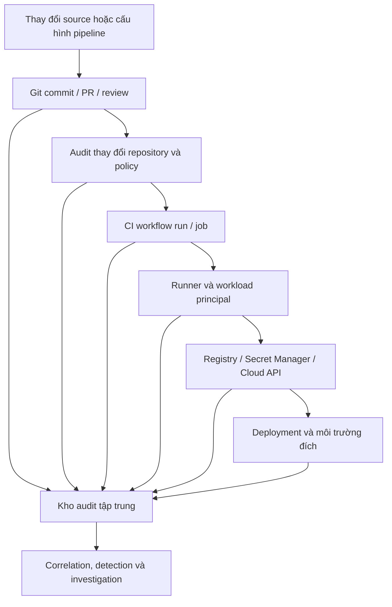

# Ghi nhận hoạt động thay đổi pipeline và sử dụng quyền

Pipeline CI/CD có thể đọc source code, lấy dependency, tạo artifact, truy cập secret và thay đổi môi trường chạy production. Vì vậy, bảo mật pipeline không chỉ phụ thuộc vào việc cấu hình quyền đúng; nhóm còn phải biết ai đã thay đổi cấu hình, thay đổi nào đã được phê duyệt, job nào thực sự sử dụng quyền và tài nguyên nào đã bị tác động.

Ghi nhận hoạt động (audit logging) tạo ra bằng chứng có thể truy vết về thay đổi và hành động. Một commit cho biết nội dung file pipeline đã thay đổi; audit event của Git hosting có thể cho biết ai thay đổi branch protection hoặc quyền repository; CI control plane cho biết workflow run nào thực thi; cloud audit log cho biết workload principal nào gọi API; deployment system cho biết artifact digest nào đã được đưa lên môi trường. Không một nguồn log riêng lẻ nào thường trả lời đầy đủ toàn bộ chuỗi này.

Mục tiêu là nối được ba câu hỏi: **ai thay đổi khả năng của pipeline, pipeline/job nào đã dùng quyền nào, và hành động đó tác động đến tài nguyên nào**. Khi dữ liệu được chuẩn hóa, bảo vệ khỏi sửa/xóa trái phép và có cảnh báo theo rủi ro, nhóm có thể phát hiện lạm quyền, điều tra sự cố và chứng minh quy trình phát hành đã được kiểm soát.

## 1. Audit pipeline cần ghi nhận điều gì?

Audit pipeline nên bao phủ cả thay đổi cấu hình lẫn hoạt động lúc chạy. Hai nhóm này liên quan nhưng khác nhau:

- **Configuration/change audit:** ai sửa workflow, quyền token, runner, secret reference, environment protection, service connection, trust policy hoặc branch rule; nội dung trước/sau và approval nào liên quan.
- **Execution/access audit:** pipeline run/job nào chạy, principal nào được cấp token, quyền nào được sử dụng, API/tài nguyên nào bị truy cập, artifact nào được publish và deployment nào được thực hiện.

Ví dụ, một pull request thay đổi `permissions` của workflow từ chỉ đọc source sang quyền ghi package là bằng chứng về thay đổi cấu hình. Khi job thực sự publish package, registry audit log mới cho biết principal nào ghi package nào và thời điểm nào. Cả hai sự kiện đều cần thiết để đánh giá hành động có đúng mục đích hay không.



### 1.1. Thay đổi nào cần được theo dõi?

Ít nhất cần theo dõi:

- File workflow/pipeline như `.github/workflows/**`, `.gitlab-ci.yml`, `Jenkinsfile`, `azure-pipelines.yml`, `.circleci/**` và script triển khai.
- Reusable workflow, action, orb, Jenkins Shared Library, plugin, template và task được pipeline gọi.
- `permissions`, token scope, service connection, cloud role, OIDC trust policy và credential binding.
- Secret được tạo, cập nhật, rotate, xóa hoặc thay đổi quyền truy cập; chỉ ghi metadata cần thiết, không ghi giá trị secret.
- Runner/agent được đăng ký, gỡ bỏ, đổi label, đổi group, thay image hoặc thay cấu hình network.
- Branch protection, ruleset, CODEOWNERS, required status checks, webhook và repository settings.
- Environment protection, deployment approval, concurrency, điều kiện release và policy gate.
- Registry policy, artifact retention, immutability, quyền push/pull/delete và thay đổi tag.
- IAM role assignment, permission policy, service account, managed identity và quyền quản trị liên quan.

Một thay đổi tưởng như nhỏ, chẳng hạn bỏ một required check hoặc thêm quyền `write`, có thể làm thay đổi toàn bộ ranh giới bảo mật của pipeline. Vì vậy cần phân loại thay đổi theo tác động, không chỉ theo số dòng diff.

### 1.2. Hành động nào cần được theo dõi khi pipeline chạy?

Ghi nhận các sự kiện như:

- Pipeline được kích hoạt bởi push, pull request, tag, lịch, bot hay thao tác thủ công.
- Người hoặc bot khởi chạy, hủy, retry, approve hoặc rerun workflow.
- Workflow revision, commit SHA, run ID, job ID và runner/agent thực thi.
- Token được yêu cầu, principal được federation, role được assume và thời hạn credential.
- Secret reference/version nào được workload truy cập, bởi principal nào và từ job nào.
- Registry ghi/đọc/xóa artifact nào; digest, package version và repository đích.
- Cloud, Kubernetes hoặc deployment API nào được gọi; action, resource, kết quả và request ID.
- Artifact digest, cấu hình môi trường và release nào đã được triển khai.
- Audit pipeline bị tắt, thay đổi retention, export hoặc truy cập bởi người quản trị.

Không phải nền tảng nào cũng cung cấp mọi event ở cùng một mức chi tiết. Cần xác định nguồn dữ liệu thực tế, thời gian lưu, gói dịch vụ và giới hạn API của từng hệ thống.

## 2. Phân biệt audit log, pipeline log và application log

Ba loại log này phục vụ các câu hỏi khác nhau:

| Loại dữ liệu | Ghi nhận | Trả lời câu hỏi |
|---|---|---|
| Audit log của nền tảng | Thay đổi setting, quyền, policy, user, runner, approval và hành động quản trị | Ai đã thay đổi cấu hình hoặc thực hiện hành động quản trị? |
| Pipeline/job log | Lệnh chạy, step, output, trạng thái test, lỗi và thời gian thực thi | Job đã làm gì trong quá trình chạy? |
| Cloud/resource audit log | API call, principal, action, resource, source IP/request context và kết quả | Workload nào đã truy cập hoặc thay đổi tài nguyên đích? |
| Deployment/release record | Artifact digest, environment, rollout, approval và trạng thái | Phiên bản nào đã được triển khai ở đâu và khi nào? |
| Application/operational log | Hành vi ứng dụng, request, lỗi nghiệp vụ và runtime events | Ứng dụng hoạt động như thế nào sau triển khai? |

Pipeline log có thể bị sửa hoặc không được gửi đi nếu runner bị xâm nhập. Cloud audit log thường được ghi ở hệ thống đích độc lập với runner, vì vậy là bằng chứng quan trọng để xác minh API call thật. Audit log của Git hosting có thể cho biết thay đổi repository settings nhưng không nhất thiết ghi mọi lệnh shell trong job. Cần kết hợp các nguồn.

### 2.1. Audit không thay thế observability

Metrics, traces và application logs giúp hiểu sức khỏe và hiệu năng hệ thống. Audit log tập trung vào chủ thể, hành động, tài nguyên và thời điểm. Ví dụ, metric cho biết tỷ lệ lỗi deployment tăng; trace chỉ ra request timeout; audit log xác định principal nào vừa cập nhật deployment hoặc thay đổi policy. Cả ba bổ sung cho nhau.

## 3. Nguồn sự kiện và cách nối bằng chứng

Một chuỗi audit hoàn chỉnh thường lấy dữ liệu từ nhiều hệ thống:

| Nguồn | Sự kiện cần thu thập | Định danh liên kết |
|---|---|---|
| Git hosting | Commit, PR/MR, review, merge, branch rule, repository setting, webhook | Repository/project, commit SHA, PR/MR ID, actor ID |
| CI control plane | Workflow run, job, trigger, rerun, cancel, approval, workflow revision | Run ID, job ID, workflow path/revision, event ID |
| Runner/agent | Registration, image, label, pool, start/stop, network/security posture | Runner ID, agent ID, machine/container ID |
| Identity provider/IAM | Token federation, role assumption, policy change, service principal update | Issuer, subject, audience, principal/role ID, session ID |
| Secret manager | Secret create/update/delete, access attempt, version read, policy change | Secret reference, version, principal, request ID |
| Artifact registry | Push, pull, delete, tag change, retention/immutability change | Repository, package/version, digest, principal |
| Cloud/platform API | API call, resource change, permission change, denied request | Account/project, resource ID, action, request ID |
| Deployment platform | Approval, rollout, rollback, environment/config update | Release ID, environment, artifact digest, deployment ID |
| SIEM/audit storage | Ingest, query, export, retention change, access to audit data | Event ID, source, storage object, reader identity |

### 3.1. Dùng correlation ID và định danh bất biến

Không nên nối sự kiện chỉ bằng tên hiển thị như `deploy-prod` hoặc `release-123`. Những tên này có thể trùng hoặc thay đổi. Ưu tiên các định danh ổn định:

- Commit SHA và repository ID.
- Pull request/merge request ID.
- Workflow run ID, job ID và workflow revision.
- Runner/agent ID.
- OIDC issuer, subject, audience và cloud principal/session ID.
- Artifact digest, package version và registry repository.
- Deployment/release ID, environment ID và resource ID.
- Request ID/correlation ID do dịch vụ đích trả về.

Nếu một nền tảng không tự truyền run ID sang cloud audit log, pipeline có thể truyền correlation metadata vào session name, deployment annotation hoặc request tag nếu dịch vụ hỗ trợ. Metadata này không thay thế principal do hệ thống xác thực cấp; nó chỉ giúp liên kết sự kiện. Không đưa secret hoặc dữ liệu cá nhân không cần thiết vào tag.

### 3.2. Chuẩn hóa thời gian

Các hệ thống có thể dùng timezone và độ chính xác timestamp khác nhau. Hãy lưu thời gian chuẩn UTC, giữ timestamp gốc nếu cần, đồng bộ đồng hồ runner/agent và hệ thống tự quản lý bằng cơ chế time synchronization phù hợp. Khi điều tra, phân biệt thời điểm sự kiện xảy ra, thời điểm nguồn ghi log và thời điểm SIEM nhận được log; độ trễ ingest có thể làm thứ tự hiển thị khác thứ tự thực tế.

## 4. Thiết kế cấu trúc audit event

Audit event nên có schema ổn định, dễ tìm kiếm và không phụ thuộc cách trình bày của một nền tảng. Một record có thể gồm:

| Trường | Mục đích |
|---|---|
| `event_id` | Định danh duy nhất của event |
| `event_time` | Thời điểm sự kiện xảy ra theo UTC |
| `ingest_time` | Thời điểm hệ thống audit nhận event |
| `event_type` | Loại hành động: permission_changed, workflow_run, secret_accessed, deployment_created... |
| `actor` | User/bot đã khởi tạo hoặc yêu cầu hành động |
| `workload` | Repository, workflow, run, job, runner và principal thực thi |
| `target` | Tài nguyên bị truy cập hoặc thay đổi |
| `action` | Hành động cụ thể và kết quả |
| `change` | Giá trị trước/sau hoặc diff tham chiếu nếu là thay đổi cấu hình |
| `authorization` | Role, scope, policy revision và quyết định allow/deny |
| `correlation` | Commit, PR, run, session, request, artifact digest và deployment ID |
| `source` | Hệ thống phát sinh event, tenant/account/project và event ID gốc |
| `integrity` | Chữ ký, checksum hoặc metadata chứng minh nguồn và tính toàn vẹn nếu có |

Ví dụ một record đã được chuẩn hóa (dữ liệu minh họa):

```json
{
  "event_id": "evt-7f21",
  "event_time": "2026-11-18T08:30:12Z",
  "ingest_time": "2026-11-18T08:30:14Z",
  "event_type": "pipeline.permission_changed",
  "actor": {
    "type": "user",
    "id": "user-184",
    "display_name": "release-admin"
  },
  "target": {
    "type": "repository_workflow",
    "id": "repo-42/.github/workflows/release.yml"
  },
  "action": {
    "name": "update_workflow_file",
    "result": "success"
  },
  "change": {
    "field": "permissions.packages",
    "before": "read",
    "after": "write",
    "commit_sha": "a1b2c3d"
  },
  "correlation": {
    "pull_request": "PR-318",
    "review_id": "review-91"
  },
  "source": {
    "system": "git-hosting",
    "event_id": "source-evt-551"
  }
}
```

Record ví dụ không chứa token hay secret. Với hệ thống thật, nên giữ ID gốc và schema của nguồn để có thể đối chiếu, tránh chỉ lưu bản diễn giải đã chuẩn hóa rồi bỏ mất bằng chứng gốc.

## 5. Theo dõi thay đổi cấu hình pipeline

### 5.1. Quản lý pipeline dưới dạng mã

Workflow, Jenkinsfile, template và script triển khai nên nằm trong hệ thống phiên bản để có diff, commit history, review và rollback. Thay đổi phải đi qua pull request/merge request, required checks và code owner phù hợp. Với file nhạy cảm như workflow release, trust policy hoặc deployment script, có thể yêu cầu reviewer thuộc nhóm platform/security.

Audit record nên liên kết:

- Actor tạo commit và actor mở PR.
- Commit SHA, branch/ref và danh sách file thay đổi.
- Reviewer, approval, conversation resolution và merge actor.
- Kết quả required checks và workflow revision được chạy.
- Commit cuối cùng được merge, kể cả khi merge queue hoặc merge commit tạo revision tổng hợp.
- Pipeline run nào sử dụng cấu hình mới.

Một commit history cho biết thay đổi đã được lưu trong Git; audit log của Git hosting giúp ghi nhận các hành động quản trị như thay đổi branch protection, quyền repository hoặc webhook. Hai nguồn bổ sung nhau.

### 5.2. Bảo vệ thay đổi có tác động cao

Các thay đổi sau nên được xếp vào nhóm rủi ro cao:

- Thêm `write`, `admin` hoặc quyền deploy vào token/job.
- Bỏ required status check, CODEOWNERS hoặc approval rule.
- Thay trigger để chạy trên sự kiện có context quyền cao hơn.
- Thay runner label/pool sang self-hosted runner có quyền mạng nội bộ.
- Thay action, orb, plugin hoặc reusable workflow sang nguồn/revision không được tin cậy.
- Tắt secret masking, environment protection, audit export hoặc log retention.
- Mở rộng OIDC trust policy, IAM role hoặc service connection.
- Cho phép workflow từ branch/fork không tin cậy dùng secret.

Với thay đổi có tác động lớn, yêu cầu review độc lập, approval từ owner phù hợp và kiểm tra diff trước/sau. Không để người sửa policy đồng thời là người duy nhất phê duyệt thay đổi của chính mình nếu quy trình yêu cầu separation of duties.

### 5.3. Ghi nhận thay đổi quyền và cấu hình hiệu lực

Chỉ lưu diff file YAML là chưa đủ. Quyền thực tế còn chịu ảnh hưởng của repository settings, organization policy, cloud IAM, environment protection, runner group và service connection. Cần lưu snapshot hoặc revision của cấu hình hiệu lực tại thời điểm job chạy, trong phạm vi nền tảng cung cấp.

Ví dụ, workflow khai báo `contents: read`, nhưng organization policy hoặc token scope có thể bổ sung/hạn chế hành vi theo cơ chế riêng. Một job dùng service connection có thể nhận quyền từ role assignment ở cloud. Audit phải ghi được cả cấu hình pipeline và policy phía đích, không chỉ một dòng YAML.

## 6. Theo dõi việc sử dụng quyền thực tế

Quyền được cấu hình cho biết job *có thể* làm gì; audit log của tài nguyên đích cho biết principal *đã làm* gì. Hai thông tin này nên được so sánh.

Ví dụ một job có quyền `packages: write` nhưng không bao giờ publish package. Điều đó có thể cho thấy quyền đang rộng hơn nhu cầu. Ngược lại, một job chỉ được dự kiến đọc artifact nhưng cloud audit log ghi nhận hành động delete hoặc IAM policy change là dấu hiệu cần điều tra.

### 6.1. Ghi nhận permission snapshot

Ở thời điểm job bắt đầu, nếu nền tảng hỗ trợ, ghi nhận:

- Token permission/scope được cấp cho job.
- Repository/project, ref, event và workflow revision.
- OIDC claims cần thiết: issuer, subject, audience và context liên quan; không lưu raw bearer token.
- Cloud role/service principal được assume và policy revision.
- Service connection, environment và runner group được dùng.
- Thời điểm cấp và hết hạn của credential tạm thời.

Snapshot giúp điều tra quyền có hiệu lực ở thời điểm chạy, kể cả khi policy đã thay đổi sau đó.

### 6.2. Ghi nhận hành động trên tài nguyên đích

Thu thập audit log từ registry, secret manager, cloud control plane, Kubernetes audit, database hoặc deployment service. Tập trung vào action có tác động như:

- Đọc/ghi/xóa artifact hoặc thay đổi tag.
- Đọc secret, tạo secret version, đổi policy hoặc export secret.
- Tạo/sửa/xóa IAM role, binding, service account hoặc trust relationship.
- Tạo/sửa/xóa cluster resource, deployment, namespace, network rule hoặc storage policy.
- Tắt logging, thay retention, xóa log hoặc thay quyền đọc audit store.
- Truy cập tài nguyên ngoài project/environment dự kiến.

Không phải mọi lần đọc package hoặc gọi API đều có rủi ro cao. Cần kết hợp principal, resource, action, thời điểm và bối cảnh run để giảm cảnh báo sai.

### 6.3. Đối chiếu quyền được cấp với quyền đã dùng

Có thể lập bảng theo job:

| Job | Quyền được cấp | Hành động quan sát được | Đánh giá |
|---|---|---|---|
| PR validation | Read source, read dependency | Checkout và tải dependency | Phù hợp |
| Unit test | Read source, read test services | Đọc test database, không có write production | Phù hợp nếu dữ liệu được cô lập |
| Publish artifact | Read source, write một registry namespace | Push image và metadata | Phù hợp nếu digest và nguồn được xác minh |
| Deploy staging | Read artifact, update staging namespace | Pull digest và rollout staging | Phù hợp |
| Deploy production | Read artifact, update production deployment | Rollout production sau approval | Cần đối chiếu actor, approval và release ID |

Nếu quyền được cấp rộng hơn đáng kể so với hành động quan sát, giảm scope. Nếu hành động vượt ngoài nhiệm vụ, xem xét token bị lộ, workflow bị sửa hoặc trust policy sai.

## 7. Ghi nhận việc truy cập secret mà không làm lộ secret

Audit secret manager nên ghi ai hoặc workload principal đã yêu cầu secret nào, version nào, từ ứng dụng/job nào, thời điểm và kết quả allow/deny. Không ghi giá trị secret, private key, token hoặc nội dung nhạy cảm vào log.

Các trường hữu ích:

- Secret reference/path và version ID.
- Principal, workload, job/run ID và environment.
- Action: read, create, update, rotate, delete, change policy.
- Kết quả và request/correlation ID.
- Approval hoặc policy liên quan nếu có.
- Nguồn truy cập như account, project, network zone hoặc runner pool khi hệ thống cung cấp.

Một lần truy cập secret có thể hợp lệ, nhưng đọc production secret từ job pull request hoặc runner không thuộc pool tin cậy là tín hiệu bất thường. Cảnh báo nên xét cả loại secret, principal, ref, event, environment và thời điểm.

## 8. Bảo vệ audit log khỏi sửa đổi và xóa

Nếu người có quyền thay đổi pipeline cũng có thể xóa log chứng minh hành động của họ, audit không còn đáng tin. Do đó, log nên được gửi đến hệ thống lưu trữ độc lập với runner và quyền quản trị pipeline.

### 8.1. Tập trung log ở miền quản trị riêng

- Gửi event từ Git hosting, CI, IAM, secret manager, registry và cloud đến audit sink/SIEM tập trung.
- Dùng tài khoản hoặc project lưu trữ riêng, tách khỏi tài khoản chạy workload.
- Runner chỉ có quyền gửi log theo kênh được kiểm soát; không có quyền sửa hoặc xóa log đã ingest.
- Giới hạn người đọc audit log theo vai trò; truy cập và export log cũng cần được audit.
- Lưu bản gốc hoặc event ID gốc để đối chiếu với dữ liệu đã chuẩn hóa.

### 8.2. Append-only và retention

Khi yêu cầu kiểm toán hoặc điều tra cao, dùng immutable/WORM storage, object lock hoặc cơ chế retention lock phù hợp. Quyền thay đổi retention và xóa dữ liệu phải tách khỏi người vận hành pipeline. Đặt retention theo yêu cầu pháp lý, hợp đồng, chính sách tổ chức và chi phí; không giữ vô thời hạn nếu không có cơ sở.

### 8.3. Tính toàn vẹn và phát hiện thiếu log

Có thể dùng chữ ký, checksum, hash chain, signed checkpoint hoặc cơ chế integrity của nền tảng lưu trữ để phát hiện log bị thay đổi. Những cơ chế này không tự chứng minh nội dung event là đúng nếu nguồn ban đầu đã bị xâm nhập; chúng chủ yếu giúp phát hiện sửa đổi sau khi ghi nhận.

Theo dõi cả tình trạng ingest: nguồn nào ngừng gửi, event bị trễ, quota vượt ngưỡng, collector lỗi hoặc retention bị thay đổi. Không có log có thể là dấu hiệu sự cố, không chỉ là “không có hoạt động”.

### 8.4. Bảo vệ nội dung nhạy cảm

Audit log có thể chứa tên người dùng, địa chỉ IP, repository riêng, tên tài nguyên và metadata release. Hãy giới hạn truy cập, mask dữ liệu không cần thiết và áp dụng retention phù hợp. Tuyệt đối không ghi raw secret hoặc bearer token để “phục vụ điều tra”.

## 9. Phát hiện thay đổi và hành vi bất thường

Audit chỉ hữu ích khi sự kiện có thể được tìm kiếm và chuyển thành tín hiệu hành động. Nên tạo cảnh báo cho thay đổi hoặc hành vi có rủi ro cao, đồng thời thiết lập baseline để tránh alert fatigue.

Các trường hợp nên xem xét cảnh báo:

- Branch protection hoặc required checks bị tắt/thay đổi ngoài quy trình.
- Workflow được cấp thêm write/admin permission hoặc OIDC trust được mở rộng.
- File pipeline release thay đổi mà không có approval cần thiết.
- Runner mới đăng ký vào pool nhạy cảm hoặc runner đổi label/network policy.
- Secret production được đọc từ pull request, branch hoặc job không được phép.
- Service connection, IAM role hoặc policy production bị sửa bởi principal bất thường.
- Artifact release bị xóa, tag bất biến bị thay đổi hoặc digest production không khớp release record.
- Production deployment không có approval hoặc không liên kết với artifact đã xác minh.
- Audit logging, export, retention hoặc quyền truy cập audit store bị giảm.
- Principal truy cập tài nguyên ngoài project, namespace hoặc environment đã định nghĩa.
- Một workload có nhiều lần xác thực thất bại hoặc hành động quản trị trong thời gian ngắn.

### 9.1. Kết hợp nhiều tín hiệu

Một sự kiện riêng lẻ có thể hợp lệ. Ví dụ, thay đổi workflow là bình thường khi có pull request đã review. Nhưng nếu cùng lúc branch protection bị tắt, runner lạ được đăng ký và production secret được đọc, mức độ rủi ro tăng mạnh.

Một detection rule tốt nên kết hợp:

- Actor/principal và lịch sử hoạt động.
- Repository, branch/ref, workflow và event type.
- Permission scope và tài nguyên đích.
- Approval/review liên quan.
- Thời gian, nguồn mạng và runner identity.
- Artifact digest, release ID và deployment state.

## 10. Ví dụ: audit khi workflow được cấp quyền publish package

Giả sử một pull request thay đổi workflow build từ chỉ đọc source sang có quyền publish package.

**Trước thay đổi:** job build chỉ cần checkout source, restore dependency và chạy test. Workflow có permission đọc repository.

**Thay đổi được đề xuất:** thêm quyền ghi package registry. Audit trail nên ghi commit, PR ID, actor, reviewer, diff permission và required checks. Code owner của pipeline/security review lý do cần quyền mới.

**Khi thực thi:** CI ghi run ID, job ID, workflow revision, ref, runner ID và permission snapshot. Nếu job lấy OIDC token, lưu issuer/subject/audience và principal được assume; không lưu token thô.

**Khi publish:** registry audit log ghi principal, package namespace, version/digest, action push và kết quả. Release record liên kết digest với commit/build run.

**Sau khi hoàn tất:** hệ thống đối chiếu job được phép ghi package với hành động thực tế. Nếu job khác hoặc ref không tin cậy cũng ghi package, tạo cảnh báo. Nếu quyền write không còn cần sau publish, xem xét tách job hoặc giảm scope.

Ví dụ record chuẩn hóa cho hành động publish:

```json
{
  "event_type": "artifact.published",
  "event_time": "2026-11-18T09:15:00Z",
  "actor": {
    "type": "workload",
    "principal_id": "ci-publisher-prod"
  },
  "workload": {
    "repository_id": "repo-42",
    "workflow_run_id": "run-781",
    "job_id": "publish-1",
    "commit_sha": "a1b2c3d"
  },
  "target": {
    "registry": "registry.example.com",
    "package": "orders",
    "digest": "sha256:abc123..."
  },
  "action": {
    "name": "push",
    "result": "success"
  },
  "authorization": {
    "role": "package-publisher",
    "scope": "orders-release"
  },
  "correlation": {
    "pull_request": "PR-318",
    "build_run": "run-781"
  }
}
```

Record này là ví dụ minh họa. Hệ thống thực tế cần giữ event ID và principal ID do registry/identity provider phát ra; không nên tự gán `principal_id` chỉ dựa trên tên workflow.

## 11. Điều tra sự cố bằng audit trail

Khi phát hiện deployment trái phép hoặc artifact bị thay đổi, điều tra theo chuỗi bằng chứng:

1. **Xác định tài nguyên và thời điểm:** deployment, package, secret hoặc policy nào bị tác động; thời gian xảy ra và thời điểm phát hiện.
2. **Tra cloud/resource audit:** tìm principal, API action, resource ID, request ID và kết quả.
3. **Tìm workload session:** xác định OIDC subject/audience, role, token issue/expiry và job/run tương ứng.
4. **Truy về CI run:** lấy workflow revision, commit SHA, event type, actor, runner và log/report.
5. **Kiểm tra thay đổi pipeline:** diff workflow, permissions, reusable components, runner settings và branch protection trước/sau.
6. **Kiểm tra approval:** ai review/approve, artifact digest nào được phê duyệt và điều kiện nào đã được bỏ qua.
7. **Xác định phạm vi:** package/artifact, secret, môi trường và tài nguyên khác có thể bị truy cập.
8. **Bảo toàn bằng chứng:** giữ event gốc, log, digest, snapshot policy và timeline trong kho độc lập.
9. **Containment và recovery:** thu hồi token/role, khóa runner hoặc workflow bị ảnh hưởng, khôi phục policy và triển khai artifact đã xác minh.
10. **Rút kinh nghiệm:** xác định control bị thiếu, bổ sung detection, giảm quyền và kiểm thử quy trình ứng phó.

Không xóa runner hoặc workspace ngay khi phát hiện nếu chúng còn chứa bằng chứng cần bảo toàn; đồng thời phải cô lập khỏi mạng/tài nguyên nhạy cảm theo quy trình ứng phó. Việc bảo toàn dữ liệu cần phối hợp giữa nhóm platform, security và chủ sở hữu hệ thống.

## 12. Triển khai audit trên các nền tảng CI/CD

Tên tính năng và phạm vi event phụ thuộc sản phẩm, phiên bản và gói dịch vụ. Hãy xác minh khả năng thực tế trước khi coi một nguồn là đầy đủ.

### 12.1. GitHub Actions

Các nguồn cần kết hợp gồm:

- Git commit, pull request, review, branch protection/ruleset và repository/organization settings.
- Organization/enterprise audit log cho các sự kiện quản trị mà gói dịch vụ hỗ trợ.
- Workflow run/job metadata, actor, event, ref, commit và kết quả.
- Permission khai báo cho `GITHUB_TOKEN`, OIDC `id-token` và quyền của từng job.
- Cloud audit log và registry audit log để xác minh action thật do workload thực hiện.

Đặt `permissions` tường minh ở workflow/job để giảm quyền mặc định. Bảo vệ `.github/workflows/**` bằng review/code owner và branch rules. Nếu audit log của organization không ghi mọi chi tiết thực thi, bổ sung job metadata và log từ hệ thống đích.

Ví dụ cấu hình permission tối thiểu cho job chỉ đọc source:

```yaml
permissions:
  contents: read

jobs:
  verify:
    permissions:
      contents: read
    runs-on: ubuntu-latest
    steps:
      - uses: actions/checkout@v4
      - run: ./gradlew check
```

Đây là cấu hình quyền minh họa, không phải audit collector. Audit phải lấy event từ GitHub và hệ thống đích; không thể dựa vào việc job tự ghi một dòng log rằng nó chỉ dùng quyền đọc.

### 12.2. GitLab CI/CD

Kết hợp audit events của instance/group/project (tùy edition/tier), pipeline/job metadata, merge request approvals, protected branch/environment, CI/CD variables và job token events nếu nền tảng cung cấp. Với cloud federation, đối chiếu GitLab ID token claims với cloud IAM audit log.

Ghi nhận thay đổi `.gitlab-ci.yml`, `include`, CI/CD components, runner registration, protected variables và permission của project/group. Đừng giả định job log cho biết mọi lần secret được đọc; dùng audit của secret manager hoặc hệ thống đích.

### 12.3. Azure Pipelines

Các nguồn có thể gồm Azure DevOps organization audit log, pipeline run/job timeline, repository/branch policy, service connection authorization, environment approvals/checks, agent pool và Azure Activity Log/Entra audit log. Workload identity federation giúp liên kết service connection với principal ở Azure; cần đối chiếu service connection ID và role assignment.

Service connection có thể được cấp quyền sử dụng cho pipeline. Thay đổi authorization hoặc role assignment là sự kiện nhạy cảm và cần được theo dõi độc lập với diff YAML.

### 12.4. Jenkins

Jenkins có thể cần kết hợp SCM history, Jenkins controller logs, security/audit plugin phù hợp, job configuration history, credential store events, plugin/Shared Library changes, agent logs và cloud audit logs. Khả năng audit chi tiết phụ thuộc plugin, cấu hình và cách quản trị Jenkins.

Kiểm soát quyền sửa Jenkinsfile, job configuration, credentials, plugin, Shared Library và node/agent. Tách quyền administrator/controller khỏi quyền build thông thường. Chuyển log controller và audit sang hệ thống ngoài controller để giảm nguy cơ mất log khi máy chủ bị xâm nhập.

## 13. Quản trị quyền truy cập audit data

Audit log chứa thông tin nhạy cảm về cấu trúc hệ thống, người dùng, repository, resource ID và hành động quản trị. Cần bảo vệ chính dữ liệu audit:

- Phân quyền reader, investigator, exporter và administrator riêng biệt.
- Người vận hành pipeline không được tự xóa hoặc thay retention của kho audit.
- Truy cập và export audit data cũng phải tạo audit event.
- Dùng MFA/SSO cho người quản trị, giới hạn truy cập mạng và session.
- Mask thông tin không cần thiết; không lưu token, secret hoặc payload nhạy cảm.
- Mã hóa khi truyền và khi lưu; quản lý khóa mã hóa tách biệt.
- Đặt retention, legal hold và quy trình xóa theo chính sách đã phê duyệt.
- Kiểm tra backup/restore và khả năng tìm kiếm log khi xảy ra sự cố.

Không phải mọi nhân viên đều cần xem toàn bộ audit log. Nhóm điều tra có thể cần truy cập chi tiết trong một khoảng thời gian; developer chỉ cần xem log job liên quan đến công việc của mình.

## 14. Chỉ số đánh giá chất lượng audit

Có thể đo hiệu quả audit bằng các chỉ số vận hành:

- **Source coverage:** tỷ lệ nguồn quan trọng đang gửi event và có timestamp/identity hợp lệ.
- **Ingestion latency:** thời gian từ lúc sự kiện xảy ra đến khi searchable trong kho audit.
- **Correlation coverage:** tỷ lệ event có thể nối với actor, run/job, principal và resource.
- **Detection time:** thời gian từ sự kiện bất thường đến khi cảnh báo được tạo.
- **Investigation time:** thời gian xác định actor, quyền, tài nguyên và phạm vi ảnh hưởng.
- **Permission drift:** số quyền thay đổi ngoài baseline hoặc không có approval.
- **Unowned principal count:** số workload principal/service account không có owner rõ ràng.
- **Audit gap:** thời gian hoặc nguồn bị mất log, ingest lỗi hoặc retention không đạt.
- **High-risk change review coverage:** tỷ lệ thay đổi pipeline/IAM nhạy cảm có reviewer và approval theo chính sách.

Không tối ưu chỉ số bằng cách ghi mọi thứ mà không phân loại. Event quá nhiều, trùng lặp hoặc thiếu ngữ cảnh làm tăng chi phí và alert fatigue. Ưu tiên nguồn và hành động có thể tác động đến source integrity, secret, artifact và production.

## 15. Những anti-pattern thường gặp

| Anti-pattern | Hệ quả | Cách xử lý |
|---|---|---|
| Chỉ giữ console log của job | Thiếu bằng chứng từ Git hosting, IAM và tài nguyên đích | Kết hợp nhiều nguồn audit độc lập |
| Runner tự ghi audit duy nhất | Runner bị xâm nhập có thể sửa/xóa bằng chứng | Gửi log ra audit sink riêng |
| Chỉ lưu file YAML, không lưu thay đổi setting | Không biết branch protection, service connection hoặc IAM đã đổi | Thu thập audit event quản trị từ nền tảng |
| Không ghi workflow revision và commit | Không biết cấu hình nào đã thực thi | Gắn run/job với workflow revision và source SHA |
| Ghi raw token để điều tra | Làm lộ credential trong kho log | Chỉ ghi issuer, subject, audience, principal và thời hạn |
| Không phân biệt actor và workload | Audit sai người thực hiện API | Ghi user actor và workload principal riêng |
| Audit admin có thể xóa log | Mất tính toàn vẹn bằng chứng | Tách quyền, immutable storage và audit truy cập |
| Không giám sát ingest | Mất log mà không ai biết | Cảnh báo khi nguồn im lặng hoặc collector lỗi |
| Cảnh báo mọi thay đổi như nhau | Alert fatigue | Phân loại rủi ro và kết hợp ngữ cảnh |
| Không liên kết artifact digest với deploy | Không chứng minh được production chạy artifact đã kiểm tra | Ghi digest trong release/deployment record |

## 16. Checklist thiết kế audit cho pipeline

- [ ] Có danh mục nguồn audit: Git hosting, CI control plane, runner, IAM, secret manager, registry, cloud và deployment platform.
- [ ] Theo dõi thay đổi workflow, action/plugin, permission, branch rule, runner, secret policy và environment protection.
- [ ] Ghi actor, reviewer, approver và workload principal riêng biệt.
- [ ] Mỗi run/job có run ID, job ID, workflow revision, commit SHA, event và runner ID.
- [ ] Có permission snapshot hoặc policy revision tại thời điểm job chạy khi nền tảng hỗ trợ.
- [ ] Thu thập API action thực tế từ tài nguyên đích, không chỉ dựa vào pipeline log.
- [ ] Secret access được audit bằng reference/version/principal, không ghi secret plaintext.
- [ ] Artifact push/pull/delete và deployment có digest, principal, environment và release ID.
- [ ] Event có timestamp UTC, source event ID và correlation ID phù hợp.
- [ ] Audit log được gửi đến kho độc lập, có retention và chống sửa/xóa theo mức rủi ro.
- [ ] Quyền đọc, export, quản trị và xóa audit data được tách biệt và có audit.
- [ ] Có cảnh báo cho thay đổi quyền cao, runner lạ, secret access bất thường và deployment không có approval.
- [ ] Có kiểm tra health/ingestion để phát hiện nguồn ngừng gửi log.
- [ ] Có quy trình điều tra, bảo toàn bằng chứng, containment và phục hồi.
- [ ] Định kỳ đối chiếu quyền được cấp với hành động thực tế và loại bỏ quyền không còn cần.

Ghi nhận hoạt động thay đổi pipeline và sử dụng quyền giúp biến cấu hình CI/CD thành một chuỗi hành động có thể kiểm toán. Git cho biết thay đổi nào được đề xuất và review; CI cho biết workflow/job nào chạy; IAM và audit của tài nguyên đích cho biết principal nào thực hiện API; registry và deployment record cho biết artifact nào đã được phát hành. Khi các nguồn này được nối bằng định danh ổn định, lưu trữ độc lập và bảo vệ khỏi sửa/xóa, nhóm có thể phát hiện thay đổi nguy hiểm, điều tra lạm quyền và chứng minh luồng phát hành đã tuân thủ chính sách.
