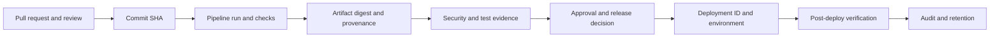

# Giữ quy trình kiểm soát có thể kiểm chứng mà không tạo thành thủ tục hình thức

Một quy trình phát hành có thể có rất nhiều biểu mẫu, cuộc họp và nút approval nhưng vẫn không ngăn được một artifact chưa kiểm thử đi vào production. Ngược lại, một pipeline có thể tự động thực hiện nhiều kiểm tra nhưng không để lại bằng chứng đủ rõ để biết ai đã thay đổi, điều kiện nào đã được xác minh và tại sao hệ thống cho phép triển khai.

Trong CI/CD, kiểm soát bảo mật có giá trị khi nó gắn với một mục tiêu rủi ro cụ thể, được thực thi nhất quán và để lại bằng chứng có thể kiểm tra. **Quy trình tốt biến yêu cầu kiểm soát thành hành vi kỹ thuật và quyết định có trách nhiệm; nó không chỉ tạo thêm bước ký xác nhận.**

Giữ quy trình có thể kiểm chứng không đồng nghĩa tự động hóa mọi quyết định hoặc loại bỏ con người. Các quyết định liên quan đến rủi ro, ngoại lệ và tác động nghiệp vụ vẫn cần người có thẩm quyền. Nhưng người đó phải nhận được thông tin phù hợp, còn các kiểm tra lặp lại nên được tự động hóa để giảm sai sót và thời gian chờ.

## 1. Kiểm soát là gì trong CI/CD?

Kiểm soát (control) là một cơ chế được thiết kế để giảm khả năng xảy ra một rủi ro hoặc giới hạn hậu quả khi rủi ro xuất hiện. Trong pipeline, kiểm soát có thể là một quy tắc kỹ thuật, một bước xác minh, một giới hạn quyền, một approval hoặc một quy trình xử lý ngoại lệ.

Ví dụ:

- Yêu cầu review trước khi merge nhằm giảm nguy cơ thay đổi không được kiểm tra đi vào nhánh chính.
- Secret scanning nhằm phát hiện credential bị commit.
- Job deploy production dùng workload identity có scope giới hạn nhằm giảm tác động nếu runner bị xâm nhập.
- Quality gate kiểm tra artifact digest và kết quả scan nhằm ngăn triển khai artifact chưa được xác minh.
- Approval của release owner cho thay đổi có tác động cao nhằm bảo đảm người có thẩm quyền đã xem xét bằng chứng và kế hoạch phục hồi.
- Audit log ghi nhận ai phê duyệt, artifact nào được triển khai và môi trường nào bị tác động nhằm hỗ trợ điều tra.

Một kiểm soát cần trả lời được bốn câu hỏi:

1. **Rủi ro nào cần giảm?** Ví dụ, một người có thể tự đưa mã chưa review vào production.
2. **Cơ chế nào tác động đến rủi ro?** Ví dụ, branch protection yêu cầu review độc lập và required checks.
3. **Bằng chứng nào cho thấy cơ chế đã hoạt động?** Ví dụ, trạng thái review, commit SHA và kết quả CI gắn với pull request.
4. **Ai chịu trách nhiệm khi kiểm soát không hoạt động hoặc cần ngoại lệ?** Ví dụ, repository owner và security owner.

Nếu không trả lời được các câu hỏi này, bước kiểm soát có thể chỉ là thủ tục mà không tạo ra mức bảo vệ có thể chứng minh.

## 2. Phân biệt kiểm soát thực chất và thủ tục hình thức

Một thủ tục hình thức thường có dấu hiệu là người tham gia hoàn thành bước theo thói quen nhưng bước đó không thay đổi quyết định, không kiểm tra bằng chứng hoặc không giảm rủi ro.

| Thủ tục hình thức | Kiểm soát có thể kiểm chứng |
|---|---|
| Người duyệt bấm Approve mà không có thông tin về thay đổi | Approval hiển thị commit, artifact, test result, scan finding, phạm vi ảnh hưởng và kế hoạch rollback |
| Checklist yêu cầu xác nhận “đã kiểm thử” | Pipeline gắn report của các test bắt buộc với đúng revision và artifact |
| Một người có thể tự review và tự merge mọi thay đổi | Branch rule yêu cầu review độc lập, giới hạn quyền bypass và ghi audit event |
| Security review được yêu cầu cho mọi thay đổi như nhau | Mức review tăng theo dữ liệu, quyền, exposure và phạm vi ảnh hưởng |
| Log chỉ ghi “deployment successful” | Deployment record nối commit, digest, environment, actor, approval và kết quả xác minh |
| Ngoại lệ được chấp nhận qua trao đổi không lưu dấu vết | Waiver có finding, lý do, owner, approver, biện pháp bù trừ và expiry |
| Chính sách dài nhưng không có cơ chế thực thi | Policy được mã hóa thành rule, test và gate có trạng thái rõ |

Một bước thủ công vẫn có thể là kiểm soát thực chất nếu nó giải quyết quyết định mà máy không thể tự đưa ra. Ngược lại, một bước tự động không mặc nhiên có giá trị: scanner chạy sai phạm vi, report không gắn với artifact hoặc job luôn được đánh dấu pass thì kiểm soát đó không đáng tin.

## 3. Bắt đầu từ mục tiêu kiểm soát và rủi ro

Không nên bắt đầu bằng câu hỏi “cần thêm bao nhiêu approval?”. Hãy bắt đầu từ những gì có thể gây hại cho hệ thống, người dùng hoặc tổ chức.

Các mục tiêu kiểm soát thường gặp trong CI/CD gồm:

- Chỉ mã nguồn đã qua review và kiểm tra bắt buộc mới được hợp nhất.
- Chỉ artifact được tạo từ nguồn và pipeline tin cậy mới được phát hành.
- Secret không bị đưa vào source, log, cache hoặc artifact.
- Job chỉ có quyền cần thiết cho nhiệm vụ và môi trường của nó.
- Thay đổi có rủi ro cao được xem xét bởi người có thẩm quyền.
- Trạng thái production có thể truy ngược về commit, artifact và cấu hình.
- Triển khai có cách phát hiện lỗi, dừng rollout và phục hồi.
- Ngoại lệ được giới hạn, phê duyệt và xem xét lại.

### Đánh giá rủi ro theo ngữ cảnh

Một thay đổi cần được đánh giá theo nhiều yếu tố:

| Yếu tố | Câu hỏi |
|---|---|
| Tài sản | Thay đổi có tác động đến dữ liệu cá nhân, tài chính, bí mật hoặc dịch vụ quan trọng không? |
| Exposure | Thành phần có thể truy cập từ Internet hoặc mạng không tin cậy không? |
| Quyền | Job hoặc service có quyền quản trị, ghi dữ liệu hoặc truy cập nhiều môi trường không? |
| Phạm vi | Thay đổi chỉ ảnh hưởng một module hay thư viện và pipeline dùng chung? |
| Khả năng đảo ngược | Có thể rollback nhanh không? Có migration hoặc side effect không thể đảo ngược không? |
| Khả năng phát hiện | Có telemetry, audit và alert để phát hiện hậu quả không? |
| Độ tin cậy của bằng chứng | Test, scan và provenance có gắn với đúng artifact không? |

Không cần biến mọi yếu tố thành một điểm số phức tạp. Một ma trận mức ảnh hưởng với tiêu chí và ví dụ rõ ràng thường hữu ích hơn một công thức mà không ai hiểu. Nếu thông tin thiếu, pipeline nên yêu cầu bổ sung hoặc áp dụng mức kiểm tra thận trọng hơn thay vì tự gán rủi ro thấp.

## 4. Phân loại kiểm soát theo thời điểm tác động

Kiểm soát có thể được tổ chức theo mục tiêu và thời điểm can thiệp.

| Loại | Vai trò | Ví dụ trong CI/CD |
|---|---|---|
| Preventive — phòng ngừa | Ngăn hành động rủi ro xảy ra | Branch protection, least privilege, cấm secret production trong job không tin cậy |
| Detective — phát hiện | Phát hiện hành vi hoặc cấu hình không phù hợp | Secret scan, audit log, drift detection, alert sau deploy |
| Corrective — khắc phục | Giảm tác động và đưa hệ thống về trạng thái an toàn | Revoke token, rollback, disable feature flag, rotate credential |
| Compensating — bù trừ | Giảm rủi ro khi kiểm soát chính chưa thể thực hiện | Giới hạn network, tăng giám sát, giảm quyền hoặc rút ngắn thời gian ngoại lệ |

Một mục tiêu quan trọng thường cần nhiều lớp. Ví dụ, bảo vệ production không thể chỉ dựa vào approval. Cần quyền deploy riêng, artifact verification, environment protection, rollout guardrail và audit log. Nếu một lớp thất bại, các lớp còn lại giúp hạn chế hậu quả.

## 5. Chuyển yêu cầu kiểm soát thành policy có thể thực thi

Policy as Code là cách biểu diễn quy tắc bằng cấu hình hoặc mã để pipeline, platform hay hệ thống triển khai có thể kiểm tra tự động. Nó giúp giảm cách hiểu khác nhau giữa nhóm và làm rõ điều kiện pass/fail.

Một policy có thể mô tả:

- Phạm vi áp dụng: repository, branch, service, artifact hoặc environment.
- Điều kiện đầu vào: loại event, commit, mức ảnh hưởng và metadata.
- Điều kiện bắt buộc: review, test, scan, chữ ký hoặc approval.
- Quy tắc quyền: job nào được đọc secret hoặc deploy môi trường nào.
- Hành động khi vi phạm: block, warn, yêu cầu review hoặc fallback.
- Chủ sở hữu, version và thời điểm hiệu lực.

Ví dụ YAML sau chỉ mô tả khái niệm, không phải schema chạy trực tiếp của một nền tảng cụ thể:

```yaml
release_policy:
  scope:
    environment: production

  required_evidence:
    - approved_commit
    - required_ci_checks_passed
    - artifact_digest
    - security_scan_result
    - provenance_verified
    - deployment_plan

  change_risk:
    high:
      require:
        - service_owner_review
        - security_review_when_security_sensitive
        - recovery_plan
    normal:
      require:
        - service_owner_review

  artifact:
    immutable_reference: true
    verify_signature: true
    reject_unknown_provenance: true

  failure_behavior:
    missing_required_evidence: block
    policy_evaluation_error: block

  exception:
    require_owner: true
    require_approver: true
    require_expiry: true
    require_compensating_controls: true
```

Policy chỉ có giá trị khi pipeline thực sự thực thi nó, kết quả không thể bị sửa bởi job không tin cậy và người vận hành có thể hiểu vì sao một lần phát hành bị chặn. Cần version hóa policy, kiểm thử rule và review thay đổi policy như thay đổi mã nguồn quan trọng.

### Policy cần có owner

Mỗi policy nên có người hoặc nhóm sở hữu, người có quyền phê duyệt thay đổi và quy trình cập nhật. Nếu không có owner, rule có thể lỗi thời, quá rộng hoặc tạo ngoại lệ vĩnh viễn. Owner cần xem lại policy khi kiến trúc, threat model, yêu cầu pháp lý hoặc cách triển khai thay đổi.

## 6. Tự động hóa kiểm soát lặp lại

Những điều kiện có thể kiểm tra bằng máy nên được đưa vào pipeline hoặc platform để giảm phụ thuộc vào trí nhớ.

Ví dụ:

- Required status checks xác nhận lint, test và scan bắt buộc đã hoàn tất.
- Secret scanning phát hiện credential mới trong diff.
- SCA kiểm tra dependency theo policy.
- IaC policy kiểm tra quyền, network và cấu hình storage.
- Artifact signing và provenance ghi nhận nguồn tạo artifact.
- Deployment controller chỉ nhận artifact có digest và chữ ký hợp lệ.
- Environment protection giới hạn ai hoặc workflow nào được deploy production.
- Post-deploy check xác minh health và ngưỡng telemetry.

Tự động hóa không có nghĩa mọi job phải chặn merge. Một số kiểm tra có thể ở chế độ quan sát trong giai đoạn thử nghiệm, nhưng cần trạng thái rõ ràng, owner và ngày chuyển sang enforcement. Không để một cảnh báo quan trọng tồn tại vô thời hạn mà không ai chịu trách nhiệm.

### Kiểm soát phải gắn với đúng đối tượng

Kết quả test của commit A không chứng minh artifact build từ commit B đã được kiểm tra. Approval cho staging không tự động có nghĩa production được phép dùng một artifact khác. Một scan report không gắn digest có thể không chứng minh image đang deploy chính là image đã scan.

Vì vậy, bằng chứng nên gắn với các định danh bất biến:

- Commit SHA và repository.
- Pipeline run ID và phiên bản workflow.
- Artifact name, version và digest.
- SBOM, scan report và provenance.
- Deployment ID, environment và config revision.

## 7. Approval có ý nghĩa và phân tách nhiệm vụ

Approval phù hợp khi cần đánh giá rủi ro, tác động nghiệp vụ hoặc chấp nhận phần rủi ro còn lại. Nó không nên thay thế các kiểm tra có thể tự động hóa.

Một yêu cầu approval hữu ích cần hiển thị:

- Thay đổi nào sẽ được phát hành và phạm vi ảnh hưởng.
- Commit SHA và artifact digest.
- Kết quả test, security scan và quality gate.
- Finding chưa khắc phục và waiver đang có hiệu lực.
- Cấu hình hoặc migration thay đổi.
- Kế hoạch rollout, quan sát và phục hồi.
- Người hoặc nhóm sở hữu service.

Người duyệt cần biết họ đang quyết định điều gì. Một nút Approve không có ngữ cảnh dễ biến thành hành vi lặp lại theo thói quen.

### Separation of duties

Phân tách nhiệm vụ nhằm tránh một người kiểm soát toàn bộ chuỗi từ tạo thay đổi đến tự phê duyệt và triển khai một thay đổi có rủi ro cao. Ví dụ, người tạo pull request không tự phê duyệt review bắt buộc của chính mình; người thay đổi policy production không được tự ý vô hiệu hóa kiểm soát mà không có review độc lập.

Mức phân tách nên tương xứng với quy mô và rủi ro:

| Tình huống | Kiểm soát phù hợp |
|---|---|
| Thay đổi thông thường trong service | Một reviewer khác, required checks và owner rõ |
| Thay đổi authentication hoặc authorization | Reviewer hiểu miền bảo mật, test quyền và approval theo policy |
| Thay đổi pipeline cấp quyền production | Review độc lập, CODEOWNERS hoặc policy owner, kiểm tra permission và audit |
| Thay đổi IAM hoặc network production | Owner hạ tầng/bảo mật review plan và quyền tác động |
| Sự cố cần thao tác khẩn cấp | Break-glass có giới hạn, ghi log đầy đủ và review sau sự cố |

Nhóm nhỏ có thể không đủ người để tách mọi vai trò. Khi đó dùng biện pháp bù trừ: review sau hành động, giới hạn quyền theo thời gian, log bất biến, cảnh báo tự động và yêu cầu người thứ hai xác minh sau khi xử lý khẩn cấp.

## 8. Tạo bằng chứng có thể kiểm chứng

Bằng chứng (evidence) là dữ liệu cho phép người khác xác minh một kiểm soát đã được thực hiện và kết quả của nó. Bằng chứng tốt cần đủ cụ thể để trả lời ai, cái gì, khi nào, trên đối tượng nào và kết quả ra sao.

Ví dụ:

| Mục tiêu kiểm soát | Bằng chứng hữu ích |
|---|---|
| Thay đổi đã được review | Pull request ID, commit SHA, reviewer identity, thời điểm và trạng thái review |
| Kiểm thử đã đạt | Test run ID, revision, report, số test và trạng thái gate |
| Artifact đã được scan | Digest, scanner/rule version, thời điểm, kết quả và finding được chấp nhận |
| Artifact có nguồn gốc tin cậy | Provenance, build identity, source revision và chữ ký |
| Production deploy được phê duyệt | Approval identity, environment, artifact digest và deployment ID |
| Credential được cấp đúng quyền | Workload identity, trust policy revision và audit event |
| Rollout được xác minh | Health check, telemetry window, ngưỡng và kết quả |
| Ngoại lệ được chấp nhận | Finding ID, lý do, approver, owner, expiry và biện pháp bù trừ |

Bằng chứng nên được tạo tự động ở nơi thực thi kiểm soát. Không yêu cầu người dùng chụp màn hình hoặc nhập lại kết quả nếu hệ thống đã có dữ liệu đáng tin cậy. Tài liệu thủ công chỉ nên bổ sung ngữ cảnh mà máy không thể ghi nhận, ví dụ lý do chấp nhận rủi ro.

### Tính toàn vẹn và thời hạn lưu bằng chứng

Evidence cần được bảo vệ khỏi chỉnh sửa trái phép, có quyền truy cập phù hợp và retention policy. Có thể dùng audit log tập trung, artifact store có versioning, chữ ký số hoặc hệ thống lưu trữ bất biến tùy yêu cầu.

Không cần lưu mọi log vô thời hạn. Hãy phân loại bằng chứng theo mục đích: dữ liệu debug, test report, deployment record, approval, security finding và incident record có thời hạn lưu khác nhau. Tránh đưa secret, dữ liệu cá nhân hoặc nội dung nhạy cảm vào evidence nếu không cần thiết.

## 9. Xây dựng chuỗi truy vết từ thay đổi đến production

Một lần phát hành cần nối được các bước trong cùng một chuỗi bằng định danh rõ ràng.



Khi production có sự cố, người điều tra cần trả lời:

- Artifact nào đang chạy?
- Nó được build từ commit nào và bởi workflow nào?
- Ai đã review và phê duyệt?
- Những kiểm tra nào đã chạy trên chính artifact đó?
- Có finding hoặc waiver nào chưa được xử lý không?
- Cấu hình nào được nạp vào môi trường?
- Khi nào deployment diễn ra và kết quả xác minh ra sao?

Nếu phải ghép thủ công từ nhiều bảng tính hoặc hỏi nhiều nhóm để tìm câu trả lời, chuỗi truy vết chưa đủ tốt. Nên có một deployment record trung tâm liên kết các ID thay vì sao chép toàn bộ nội dung vào một biểu mẫu mới.

## 10. Thiết kế quy trình ngoại lệ có giới hạn

Không phải mọi rủi ro đều có thể xử lý ngay. Có thể chưa có bản vá tương thích, một dependency bên thứ ba chưa phát hành sửa lỗi hoặc một sự cố production cần thay đổi khẩn cấp. Ngoại lệ là cần thiết trong một số trường hợp, nhưng phải được quản lý như một quyết định có thời hạn.

Một waiver nên có:

1. Đối tượng cụ thể: finding, service, artifact, environment hoặc policy nào được miễn.
2. Lý do: vì sao chưa thể đáp ứng yêu cầu thông thường.
3. Đánh giá rủi ro còn lại: khả năng và hậu quả nếu vấn đề bị khai thác.
4. Biện pháp bù trừ: giới hạn network, giảm quyền, tắt chức năng, tăng giám sát hoặc hạn chế rollout.
5. Owner chịu trách nhiệm khắc phục.
6. Approver có thẩm quyền chấp nhận rủi ro.
7. Ngày hết hạn và điều kiện xem xét lại.
8. Bằng chứng đóng ngoại lệ sau khi khắc phục.

Waiver cần giới hạn theo finding và artifact. Không nên tạo một ngoại lệ chung như “bỏ qua tất cả scan của service X”. Khi waiver hết hạn, pipeline phải tự đưa điều kiện trở lại trạng thái cần xử lý hoặc yêu cầu phê duyệt mới.

### Không biến break-glass thành đường phát hành thông thường

Break-glass là quyền hoặc quy trình khẩn cấp để xử lý sự cố khi đường thông thường không khả dụng. Nó cần được bảo vệ bằng quyền riêng, thời hạn ngắn, lý do bắt buộc, audit log và review sau hành động.

Nếu break-glass được dùng thường xuyên, đó là tín hiệu quy trình chuẩn có vấn đề. Cần điều tra nguyên nhân và cải thiện đường phát hành thông thường thay vì mở rộng quyền khẩn cấp.

## 11. Xử lý trạng thái kiểm soát không rõ ràng

Một quality gate không nên chỉ có pass và fail. Trong thực tế, kiểm tra có thể bị bỏ qua, công cụ không chạy, dữ liệu thiếu hoặc phạm vi không áp dụng.

| Trạng thái | Ý nghĩa | Hành động gợi ý |
|---|---|---|
| `pass` | Có đủ bằng chứng và điều kiện đạt | Cho phép bước tiếp theo |
| `fail` | Bằng chứng cho thấy vi phạm hoặc test thất bại | Dừng và yêu cầu xử lý |
| `warning` | Có vấn đề chưa chặn theo policy | Ghi owner, thời hạn hoặc theo dõi |
| `not_applicable` | Kiểm tra không áp dụng theo quy tắc xác định | Ghi lý do và rule quyết định |
| `waived` | Có ngoại lệ còn hiệu lực | Cho phép trong phạm vi waiver và lưu audit |
| `skipped` | Job không chạy | Phải xác định vì sao; không tự coi là pass |
| `unknown/error` | Không đủ dữ liệu hoặc công cụ thất bại | Fallback hoặc block theo mức rủi ro |

Với kiểm soát bảo vệ production, thiếu bằng chứng thường cần fail closed: không cho phép phát hành cho đến khi có kết quả đáng tin cậy. Với một kiểm tra phụ trợ không ảnh hưởng trực tiếp đến quyết định phát hành, có thể cho phép tiếp tục kèm cảnh báo và owner. Chính sách phải nêu rõ trường hợp nào áp dụng.

## 12. Giảm số bước thủ công bằng thiết kế tốt

Muốn giảm thủ tục mà vẫn giữ kiểm soát, cần cải thiện luồng công việc thay vì chỉ xóa approval.

### Một nguồn dữ liệu chuẩn

Dùng hệ thống CI, artifact registry, secret manager, deployment controller và audit log làm nguồn bằng chứng. Tránh yêu cầu người phát hành nhập lại commit, version, test status hoặc digest vào biểu mẫu nếu hệ thống đã biết.

### Một lần xác minh, dùng lại bằng chứng

Nếu artifact đã được scan theo digest và nội dung không thay đổi, bước promotion có thể tham chiếu kết quả đó. Không cần scan lại cùng artifact ở mọi môi trường nếu policy và bối cảnh không yêu cầu. Tuy nhiên, nếu môi trường hoặc cách triển khai tạo thêm rủi ro, cần kiểm tra phần thay đổi tương ứng.

### Tạo đường phát hành chuẩn

Platform team có thể cung cấp reusable workflow hoặc pipeline template đã tích hợp review, scan, artifact signing, deployment record và health check. Nhóm service cấu hình metadata và tiêu chí nghiệp vụ cần thiết. Cách này giúp các nhóm dùng cùng guardrail mà không phải tự viết lại logic.

### Chỉ yêu cầu người can thiệp ở điểm có quyết định

Máy có thể kiểm tra chữ ký, digest, test status và quyền. Con người nên tập trung vào đánh giá rủi ro còn lại, tác động nghiệp vụ, ngoại lệ và thay đổi không thể tự động đánh giá.

## 13. Phân bổ kiểm soát theo mức rủi ro

Một ma trận đơn giản giúp nhóm biết khi nào cần kiểm soát tự động và khi nào cần review chuyên môn.

| Mức thay đổi | Kiểm soát tự động | Kiểm soát con người |
|---|---|---|
| Thấp | Baseline, required checks, secret scan phù hợp | Review thông thường |
| Thông thường | Test, SAST/SCA, artifact traceability | Reviewer khác và service owner khi cần |
| Đáng chú ý | Thêm contract/API/IaC/container checks, provenance và rollout guardrail | Review owner của dependency hoặc môi trường |
| Cao/Critical | Toàn bộ kiểm tra liên quan, policy enforcement, artifact verification, telemetry gate | Review chuyên môn, approval theo quyền, recovery plan |

Ma trận không phải quy tắc cứng cho mọi tổ chức. Điều quan trọng là có tiêu chí rõ, kiểm tra được và tránh để mức rủi ro do người tạo thay đổi tự khai báo mà không có xác minh độc lập.

## 14. Ví dụ xuyên suốt: phát hành thay đổi có ảnh hưởng đến quyền truy cập

Giả sử một pull request thay đổi cách `orders-api` kiểm tra quyền đọc hóa đơn. Endpoint có thể trả dữ liệu tài chính, vì vậy thay đổi được phân loại là rủi ro cao.

**Bước 1 — Pull request:** branch rule yêu cầu reviewer khác người tạo thay đổi, CODEOWNERS yêu cầu owner của service tham gia và các required checks phải hoàn tất. Pipeline chạy unit test cho policy, SAST, secret scan và dependency scan.

**Bước 2 — Kiểm tra phạm vi:** change-impact analysis xác định API contract, database access và các consumer bị ảnh hưởng. Integration test kiểm tra quyền giữa các user và tenant; contract test xác minh response không làm lộ field ngoài hợp đồng.

**Bước 3 — Artifact:** build một image bất biến, scan image, tạo SBOM và provenance. Kết quả được gắn với digest. Nếu scanner không chạy hoặc provenance thiếu, gate không đánh dấu pass.

**Bước 4 — Staging:** deploy đúng digest lên staging. Chạy API security test với tài khoản test, xác minh user A không thể đọc hóa đơn của user B. Dashboard và alert được kiểm tra trước release.

**Bước 5 — Approval:** release owner nhận một trang tổng hợp gồm phạm vi thay đổi, test report, scan result, artifact digest, finding còn mở, kế hoạch canary và cách tắt endpoint. Approval được ghi với danh tính và thời điểm.

**Bước 6 — Production:** deployment controller xác minh digest và chữ ký, dùng workload identity có quyền giới hạn, triển khai canary và theo dõi lỗi 401/403, truy cập chéo tenant và error rate. Nếu tín hiệu vượt ngưỡng, rollout dừng và nhóm tắt endpoint hoặc phục hồi phiên bản ổn định.

**Bước 7 — Audit:** deployment record lưu commit, review, evidence, approval, digest, environment và kết quả sau deploy. Khi cần điều tra, nhóm có thể tái dựng quyết định mà không phải tìm lại ảnh chụp màn hình từ nhiều người.

Quy trình này có nhiều kiểm soát nhưng mỗi kiểm soát gắn với một rủi ro cụ thể. Phần lớn bằng chứng được tạo tự động; con người tập trung vào review chuyên môn và quyết định release có tác động cao.

## 15. Đo lường hiệu quả của hệ thống kiểm soát

Không nên đánh giá chất lượng kiểm soát bằng số lượng approval, checklist hoặc policy. Cần đo cả khả năng giảm rủi ro và chi phí mà quy trình tạo ra.

| Chỉ số | Điều cần hiểu | Câu hỏi cải tiến |
|---|---|---|
| Control coverage | Tỷ lệ repository/service/artifact áp dụng kiểm soát bắt buộc | Có vùng nào chưa được bảo vệ không? |
| Evidence completeness | Tỷ lệ release có đủ bằng chứng theo policy | Có bước nào không tạo hoặc không liên kết evidence? |
| Policy bypass rate | Tần suất và lý do bypass | Bypass có phải đường thường xuyên để phát hành không? |
| Waiver age | Tuổi của ngoại lệ chưa đóng | Ngoại lệ có bị kéo dài hoặc không có owner không? |
| Approval lead time | Thời gian chờ quyết định của con người | Người duyệt có thiếu ngữ cảnh hoặc bị yêu cầu duyệt quá nhiều không? |
| False positive rate | Tỷ lệ finding hoặc gate không phản ánh rủi ro thật | Rule/scanner có cần điều chỉnh không? |
| Change failure rate | Tỷ lệ thay đổi gây lỗi sau phát hành | Gate có phát hiện được rủi ro quan trọng không? |
| Time to restore | Thời gian phục hồi dịch vụ | Có đủ quyền, runbook và bằng chứng để khôi phục không? |
| Manual evidence effort | Công sức tạo và thu thập bằng chứng thủ công | Có thể lấy dữ liệu tự động từ hệ thống nguồn không? |

Một số dấu hiệu cần điều tra:

- Approval thường được hoàn tất trong vài giây mà không có nhận xét hoặc bằng chứng được xem xét.
- Waiver hết hạn liên tục được gia hạn mà không có kế hoạch khắc phục.
- Nhóm thường xuyên dùng quyền bypass để đáp ứng thời hạn release.
- Evidence phải được nhập lại thủ công từ nhiều hệ thống.
- Gate fail nhiều vì scanner lỗi hoặc rule không phù hợp hơn là vì vấn đề thật.
- Pipeline xanh nhưng vẫn có sự cố lặp lại ở cùng một ranh giới.

Các chỉ số cần được dùng để cải thiện hệ thống, không biến thành bảng xếp hạng cá nhân. Nếu approval lead time cao, có thể vấn đề nằm ở chất lượng bằng chứng hoặc phân quyền, không phải người duyệt làm việc chậm.

## 16. Những anti-pattern thường gặp

| Anti-pattern | Hệ quả | Cách cải thiện |
|---|---|---|
| Thêm approval cho mọi bước | Tạo hàng đợi nhưng không tăng chất lượng quyết định | Chỉ yêu cầu approval ở điểm có rủi ro hoặc quyền quyết định thực sự |
| Checklist không gắn bằng chứng | Người thực hiện có thể đánh dấu hoàn tất theo cảm tính | Tự động đính kèm test, scan, digest và deployment record |
| Một người tự tạo, duyệt và deploy thay đổi nhạy cảm | Không có kiểm tra độc lập | Separation of duties hoặc biện pháp bù trừ có audit |
| Policy chỉ nằm trong tài liệu | Thực thi không nhất quán giữa các nhóm | Policy as Code, test và owner |
| Scanner luôn chạy nhưng kết quả không chặn gì | Tạo cảm giác an toàn giả | Định nghĩa severity/risk threshold và hành động cụ thể |
| Bằng chứng không gắn với artifact | Không biết artifact nào đã được xác minh | Dùng digest và provenance bất biến |
| Waiver không có hạn | Ngoại lệ trở thành quy tắc | Owner, approver, expiry và tự động nhắc/chặn khi hết hạn |
| Fail-open khi công cụ lỗi | Không có bằng chứng nhưng vẫn phát hành | Phân loại unknown/error và fail closed ở cổng quan trọng |
| Bypass không có audit | Không thể giải thích quyết định phát hành | Ghi actor, lý do, thời điểm và review sau bypass |
| Lưu mọi log vô thời hạn | Chi phí cao và tăng rủi ro dữ liệu | Retention theo mục đích và mức nhạy cảm |
| Dùng số lượng control làm thước đo | Khuyến khích thêm thủ tục thay vì giảm rủi ro | Đo coverage, incident, evidence quality và effort |

## 17. Checklist thiết kế quy trình kiểm soát có thể kiểm chứng

Trước khi đưa quy trình vào vận hành, nhóm có thể rà soát:

- [ ] Mỗi kiểm soát gắn với một rủi ro và mục tiêu rõ ràng.
- [ ] Có owner cho policy, repository, service và môi trường.
- [ ] Điều kiện pass/fail/warning/waived/unknown được định nghĩa.
- [ ] Kiểm tra lặp lại được tự động hóa và gắn với đúng commit/artifact.
- [ ] Artifact dùng định danh bất biến; provenance và chữ ký được xác minh khi cần.
- [ ] Approval hiển thị thông tin đủ để đánh giá phạm vi, rủi ro và phương án phục hồi.
- [ ] Separation of duties tương xứng với tác động của thay đổi.
- [ ] Nhóm nhỏ có biện pháp bù trừ khi không thể phân tách vai trò đầy đủ.
- [ ] Evidence được tạo tại nơi kiểm soát thực thi, có quyền truy cập và retention phù hợp.
- [ ] Chuỗi truy vết nối pull request, commit, pipeline, artifact, approval và deployment.
- [ ] Waiver có lý do, owner, approver, biện pháp bù trừ và ngày hết hạn.
- [ ] Break-glass có quyền giới hạn, audit và review sau hành động.
- [ ] Công cụ hoặc policy lỗi không bị tự động coi là pass ở cổng quan trọng.
- [ ] Bypass và thay đổi policy được ghi audit.
- [ ] Có kiểm thử định kỳ để xác nhận control vẫn hoạt động.
- [ ] Metrics phản ánh rủi ro, chất lượng bằng chứng và thời gian chờ thay vì số bước thủ tục.

## 18. Kết luận

Quy trình kiểm soát CI/CD có thể kiểm chứng khi mỗi yêu cầu bảo vệ được nối với một rủi ro, một cơ chế thực thi, bằng chứng đáng tin cậy và người chịu trách nhiệm. Tự động hóa các kiểm tra lặp lại, dùng approval cho quyết định thực sự cần phán đoán, phân quyền theo mức ảnh hưởng và quản lý ngoại lệ có thời hạn giúp giảm công việc hình thức.

Một hệ thống kiểm soát tốt không được đánh giá bằng số biểu mẫu hoặc số lần bấm duyệt. Nó được đánh giá bằng khả năng ngăn hành động nguy hiểm, phát hiện sai lệch, giới hạn tác động, giải thích quyết định và khôi phục khi có sự cố. Khi policy, evidence và audit được thiết kế ngay trong pipeline, bảo mật trở thành một phần của luồng phát hành hằng ngày thay vì một lớp thủ tục nằm ngoài công việc phát triển.
