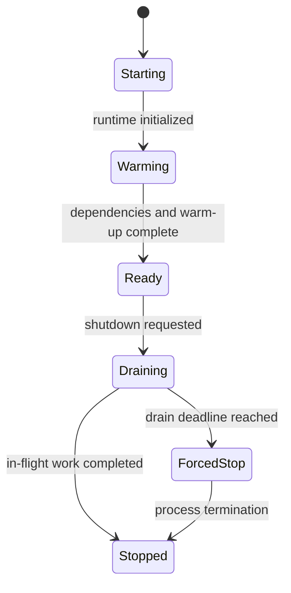
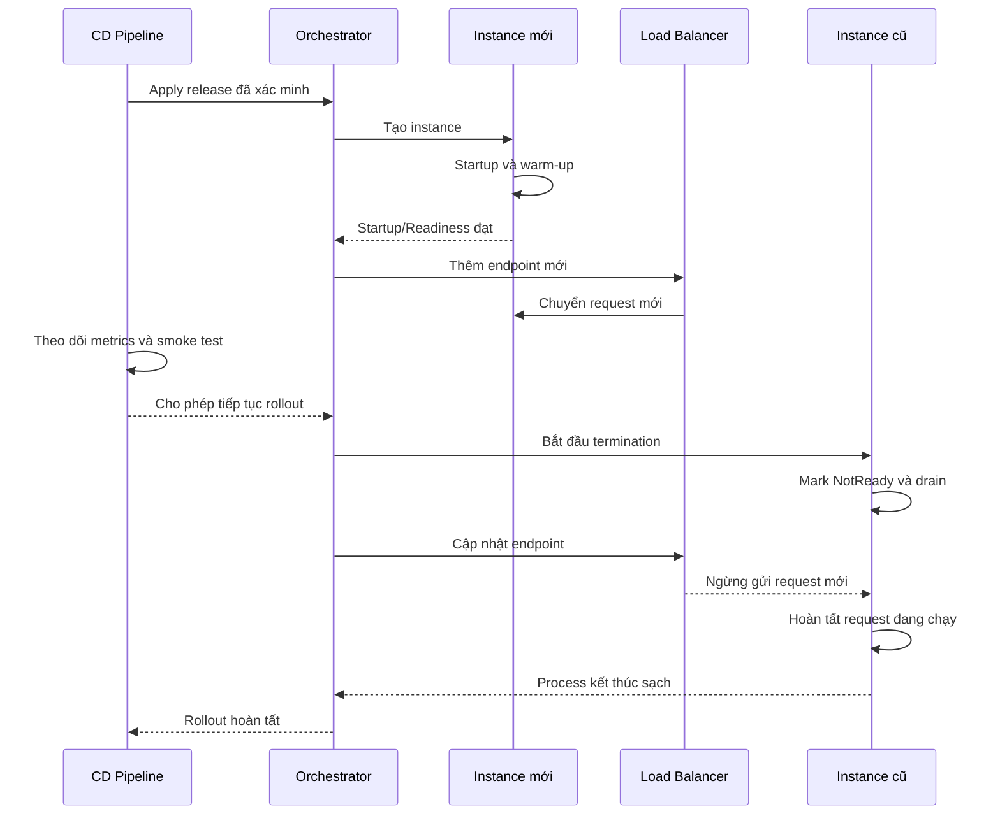

# Giảm gián đoạn bằng khởi động, chuyển lưu lượng và dừng có kiểm soát

Một lần triển khai tự động không chỉ là tạo phiên bản mới rồi thay phiên bản cũ. Trong khoảng thời gian chuyển đổi, hệ thống phải tiếp tục nhận yêu cầu, xử lý công việc đang chạy và giữ dữ liệu nhất quán. Nếu dừng instance cũ quá sớm, đưa traffic vào instance mới trước khi nó sẵn sàng hoặc đóng process khi vẫn còn request đang xử lý, người dùng có thể gặp lỗi dù pipeline báo deploy thành công.

Để giảm gián đoạn, quy trình triển khai cần điều phối ba giai đoạn: **khởi động phiên bản mới, chuyển lưu lượng có kiểm soát và dừng phiên bản cũ sau khi đã drain**. Mỗi giai đoạn cần có điều kiện sẵn sàng, thời hạn chờ, tín hiệu quan sát và hành động khi không đạt.

Nguyên lý này áp dụng cho VM, container, Kubernetes, service chạy sau load balancer và worker xử lý queue. Các nền tảng có cơ chế cụ thể khác nhau, nhưng đều cần bảo đảm phiên bản mới đã sẵn sàng trước khi nhận tải và phiên bản cũ có đủ thời gian hoàn tất công việc trước khi bị kết thúc.

## 1. Vì sao triển khai có thể gây gián đoạn?

Một deployment có thể làm dịch vụ gián đoạn ở nhiều thời điểm:

- Instance mới khởi động nhưng chưa nạp xong cấu hình, kết nối database hoặc warm-up cache.
- Load balancer chuyển request tới instance mới chỉ vì process đã mở port, trong khi ứng dụng chưa thể xử lý nghiệp vụ.
- Instance cũ bị xóa khỏi pool quá nhanh, khiến số instance còn phục vụ thấp hơn tải thực tế.
- Request đang chạy, giao dịch hoặc tác vụ nền bị ngắt khi process nhận tín hiệu dừng.
- Kết nối keep-alive, WebSocket, streaming hoặc long polling chưa được drain.
- Phiên bản mới và cũ cùng truy cập database nhưng schema đã bị thay đổi không tương thích.
- Deployment controller đánh giá pod là Ready nhưng ứng dụng chưa hoàn thành warm-up hoặc chưa kết nối được dependency bắt buộc.
- Bản triển khai mới có lỗi nhưng traffic đã chuyển hết, trong khi nhóm không còn đường quay lại nhanh.

Giảm gián đoạn đòi hỏi nhìn toàn bộ vòng đời của một instance, không chỉ trạng thái container hay lệnh deploy. Một process sống không đồng nghĩa nó sẵn sàng nhận request; một instance không còn nhận request mới vẫn có thể cần thời gian để hoàn thành request cũ.

### Ba giai đoạn cần phối hợp

| Giai đoạn | Mục tiêu | Điều kiện để chuyển tiếp |
|---|---|---|
| Khởi động phiên bản mới | Nạp cấu hình, mở kết nối, khởi tạo tài nguyên và warm-up | Readiness đạt ổn định, kiểm tra cơ bản thành công |
| Chuyển lưu lượng | Đưa một phần hoặc toàn bộ traffic tới phiên bản mới theo chiến lược | Metrics và health check nằm trong ngưỡng chấp nhận |
| Dừng phiên bản cũ | Ngừng nhận việc mới, drain request/task đang chạy, giải phóng tài nguyên | Không còn công việc cần giữ hoặc đã hết thời gian drain an toàn |

Quy trình chỉ nên chuyển sang giai đoạn tiếp theo khi điều kiện của giai đoạn hiện tại được xác nhận. Nếu phiên bản mới chưa Ready, tiếp tục giữ traffic ở phiên bản cũ và xử lý lỗi thay vì ép chuyển tiếp.

## 2. Thiết kế khởi động ứng dụng theo trạng thái

Ứng dụng thường trải qua nhiều trạng thái từ khi process được tạo đến khi có thể phục vụ:

1. Process bắt đầu và đọc cấu hình.
2. Khởi tạo runtime, dependency injection và các thành phần nội bộ.
3. Thiết lập kết nối database, cache, message broker hoặc dịch vụ cần thiết.
4. Nạp dữ liệu nền, warm-up cache hoặc chuẩn bị model.
5. Bắt đầu nhận request hoặc công việc mới.

Không nên mở traffic ngay khi process vừa mở socket. Hãy biểu diễn trạng thái sẵn sàng bằng health endpoint hoặc tín hiệu tương đương để hệ thống điều phối biết khi nào có thể đưa instance vào pool.

### Tách trạng thái sống và trạng thái sẵn sàng

Hai khái niệm thường bị nhầm lẫn:

- **Liveness:** process còn hoạt động và không rơi vào trạng thái cần khởi động lại. Liveness giúp phát hiện deadlock hoặc lỗi nội bộ khiến process không thể phục hồi.
- **Readiness:** instance có thể nhận và xử lý request mới tại thời điểm hiện tại. Readiness có thể chưa đạt trong lúc startup, warm-up hoặc khi instance đang drain.

Readiness thất bại thường có nghĩa là tạm thời không gửi traffic tới instance; nó không nhất thiết yêu cầu restart. Liveness thất bại có thể khiến orchestrator khởi động lại container. Nếu liveness kiểm tra một dependency dùng chung như database, sự cố database có thể làm tất cả instance restart liên tục, khiến hệ thống càng khó phục hồi.

Một số ứng dụng còn có **startup probe** để dành đủ thời gian cho quá trình khởi tạo dài. Startup probe chưa thành công sẽ ngăn liveness và readiness probe bắt đầu đánh giá theo chu kỳ thông thường. Sau khi startup thành công, readiness vẫn quyết định instance có nhận traffic hay không.

### Không dùng một health check cho mọi mục đích

Health endpoint nên phản ánh đúng câu hỏi của probe:

| Endpoint | Câu hỏi | Hành vi mong muốn |
|---|---|---|
| `/health/live` | Process có còn hoạt động và có thể tiếp tục chạy không? | Không phụ thuộc tùy tiện vào dịch vụ ngoài; chỉ báo lỗi khi process thực sự không thể phục hồi |
| `/health/ready` | Instance có thể nhận request mới không? | Chỉ đạt sau khi khởi tạo xong và các điều kiện cần thiết đã sẵn sàng |
| `/health/startup` | Quá trình khởi tạo đã hoàn tất chưa? | Chỉ đạt sau khi ứng dụng qua giai đoạn startup cần thiết |

Tên đường dẫn chỉ là ví dụ. Có thể dùng các endpoint Actuator, endpoint của framework hoặc probe TCP/exec tùy kiến trúc. Điều quan trọng là không đánh đồng port mở với ứng dụng sẵn sàng.

### Cẩn trọng khi readiness kiểm tra dependency

Readiness có thể kiểm tra database hoặc dịch vụ mà request cần dùng. Tuy nhiên, nếu một dependency dùng chung gặp sự cố, mọi instance có thể đồng loạt trở thành NotReady và load balancer không còn endpoint nào để phục vụ. Với dependency tùy chọn hoặc có fallback, ứng dụng có thể tiếp tục phục vụ một phần chức năng.

Hãy quyết định dependency nào thật sự bắt buộc cho khả năng nhận request. Có thể phân biệt readiness tổng thể với health của từng tính năng, hoặc giữ instance trong pool nhưng trả lỗi có kiểm soát cho một chức năng cụ thể. Không đưa mọi cảnh báo phụ thuộc vào readiness nếu chúng không làm instance mất khả năng phục vụ.

## 3. Warm-up trước khi nhận traffic

Một instance có thể báo Ready ngay sau khi process khởi động nhưng vẫn có hiệu năng kém trong những request đầu tiên. Các nguyên nhân thường gặp gồm JIT compilation, tạo connection pool, nạp cache, đọc cấu hình từ xa, tải model hoặc khởi tạo client tới dịch vụ khác.

Warm-up giúp thực hiện các bước chuẩn bị đó trước khi instance nhận traffic người dùng. Ví dụ:

- Tạo và kiểm tra connection pool tới database.
- Nạp metadata hoặc cấu hình cần thiết.
- Khởi tạo serializer, template, route và client.
- Nạp dữ liệu tham chiếu vào cache cục bộ.
- Gọi một số thao tác nội bộ an toàn để khởi động code path quan trọng.
- Kiểm tra một truy vấn hoặc thao tác read-only tối thiểu.

Warm-up phải có timeout và giới hạn tài nguyên. Không tải toàn bộ dữ liệu lớn hoặc thực hiện thao tác ghi nghiệp vụ chỉ để làm nóng ứng dụng. Nếu warm-up thất bại, instance nên giữ trạng thái NotReady và cung cấp lỗi đủ rõ để điều tra.

### Tách startup khỏi readiness

Quá trình startup có thể hoàn tất trước khi warm-up hoàn tất. Ví dụ, server đã mở port nhưng cache chưa nạp xong. Trong trường hợp đó, startup probe có thể thành công trong khi readiness vẫn thất bại. Điều này cho phép hệ thống phân biệt process khởi động được với instance có thể nhận traffic.

Với ứng dụng có nhiều tính năng, readiness có thể dựa trên tập điều kiện cốt lõi. Những tác vụ warm-up không bắt buộc có thể chạy nền và không cần chặn toàn bộ traffic, miễn là ứng dụng xử lý trạng thái chưa sẵn sàng của tính năng đó đúng cách.

## 4. Chuyển lưu lượng theo từng chiến lược

Sau khi phiên bản mới đã sẵn sàng, hệ thống cần quyết định traffic được chuyển như thế nào. Ba chiến lược phổ biến là rolling, blue-green và canary.

| Chiến lược | Cách chuyển | Điểm mạnh | Điều cần kiểm soát |
|---|---|---|---|
| Rolling update | Thay từng nhóm instance cũ bằng instance mới | Tận dụng pool hiện có, không cần nhân đôi toàn bộ môi trường | Capacity trong lúc chuyển, readiness và số instance tối thiểu |
| Blue-green | Dựng môi trường mới song song rồi đổi route từ môi trường cũ sang mới | Chuyển nhanh, có thể quay lại môi trường cũ | Chi phí chạy song song, dữ liệu và schema tương thích |
| Canary | Chuyển một tỷ lệ nhỏ traffic sang phiên bản mới, tăng dần khi đạt | Phát hiện lỗi dưới tải thật với phạm vi ảnh hưởng nhỏ | Routing theo tỷ lệ, metrics đủ tin cậy và tiêu chí dừng rõ |

### Rolling update

Rolling update tạo một số instance mới, đợi chúng Ready rồi mới giảm số instance cũ. Quá trình tiếp tục theo từng đợt cho đến khi toàn bộ replica chạy phiên bản mới.

Để rolling update không làm giảm capacity quá mức, cần cấu hình số instance có thể thêm mới (`maxSurge`) và số instance có thể thiếu so với desired replicas (`maxUnavailable`). Nếu đặt `maxUnavailable: 0`, controller phải giữ đủ số replica khả dụng trong khi tạo instance mới; đổi lại, cần tài nguyên để chạy thêm pod.

Rolling update phù hợp với service stateless hoặc service đã tách trạng thái ra hệ thống dùng chung. Nếu instance lưu session hoặc file cục bộ, cần có chiến lược chuyển trạng thái trước khi thay thế.

### Blue-green deployment

Blue-green duy trì hai môi trường:

- Blue là phiên bản đang nhận traffic.
- Green là phiên bản mới được dựng và kiểm thử song song.

Khi Green Ready và smoke test đạt, load balancer hoặc router chuyển traffic sang Green. Blue được giữ trong một khoảng thời gian để có thể quay lại nếu metrics xấu. Chỉ dừng Blue sau khi thời gian quan sát và điều kiện rollback đã được đáp ứng.

Chiến lược này giúp đổi traffic nhanh, nhưng không tự giải quyết tương thích dữ liệu. Nếu Green chạy migration làm Blue không thể đọc schema, việc chuyển route ngược về Blue có thể không còn an toàn.

### Canary deployment

Canary bắt đầu bằng một phần nhỏ traffic, chẳng hạn 1%, 5% hoặc 10%, rồi tăng theo từng bước nếu các chỉ số nằm trong ngưỡng. Tỷ lệ cụ thể phụ thuộc lưu lượng, khả năng phân phối traffic và mức rủi ro.

Ở mỗi bước, theo dõi ít nhất:

- Tỷ lệ lỗi HTTP hoặc lỗi nghiệp vụ.
- Latency p50/p95/p99.
- Throughput và số request đang xử lý.
- CPU, memory, thread pool và connection pool.
- Timeout, retry, queue lag và số tác vụ thất bại.
- Chỉ số nghiệp vụ quan trọng như thanh toán thành công hoặc đơn hàng được tạo.

Không tăng tỷ lệ chỉ vì pod Ready. Readiness chỉ cho biết instance có thể nhận traffic; canary cần thêm bằng chứng rằng phiên bản mới hoạt động tốt dưới tải thực tế.

## 5. Điều kiện để chuyển traffic an toàn

Trước khi thêm phiên bản mới vào pool, cần xác nhận:

1. Artifact đã được xác minh và đúng commit/release dự kiến.
2. Cấu hình môi trường và secret đã được cấp đúng phạm vi.
3. Process khởi động thành công và hoàn tất các bước bắt buộc.
4. Readiness đạt ổn định trong một khoảng thời gian, không chỉ thành công một lần.
5. Smoke test nội bộ hoặc kiểm tra endpoint quan trọng đạt.
6. Capacity của cluster hoặc pool đủ cho cả phiên bản cũ và mới trong giai đoạn overlap.
7. Schema, API và message format tương thích với phiên bản đang chạy song song.

Một lần probe thành công có thể chỉ là tín hiệu tức thời. `minReadySeconds` hoặc cơ chế ổn định tương đương giúp yêu cầu instance duy trì Ready trong một khoảng trước khi được coi là khả dụng cho rollout. Ngoài ra, cần theo dõi lỗi startup và readiness flapping: instance liên tục Ready/NotReady có thể khiến rollout tiến triển không ổn định.

### Kiểm tra capacity trước khi rollout

Nếu có 4 replica và rollout thêm 1 pod mới, cluster cần đủ CPU, memory, quota và địa chỉ mạng để chạy thêm pod. Nếu thiếu capacity, pod mới có thể Pending; rollout không tiến triển và phiên bản cũ tiếp tục chạy. Điều đó thường an toàn hơn việc xóa instance cũ quá sớm, nhưng deployment sẽ bị treo cho tới khi giải quyết được tài nguyên.

Đừng đặt `maxUnavailable: 0` mà không tính tới quota hoặc khả năng scheduling. Cấu hình an toàn cần cân bằng availability với khả năng cấp thêm tài nguyên.

## 6. Dừng phiên bản cũ có kiểm soát

Khi phiên bản mới đã nhận traffic, instance cũ cần được đưa ra khỏi pool rồi mới kết thúc process. Dừng có kiểm soát thường gồm các bước:

1. Đánh dấu instance đang draining để readiness chuyển sang NotReady.
2. Ngừng nhận request hoặc công việc mới.
3. Chờ load balancer, service discovery hoặc endpoint controller cập nhật trạng thái và ngừng gửi traffic mới.
4. Cho các request, transaction, WebSocket hoặc tác vụ nền đang chạy hoàn tất trong thời gian cho phép.
5. Đóng connection pool, consumer, thread pool và tài nguyên nội bộ.
6. Kết thúc process trước khi hết termination deadline.

Không nên dừng server ngay khi nhận lệnh deploy. Nếu load balancer vẫn gửi request trong lúc process đóng listener, client sẽ nhận connection reset hoặc 5xx.

### Graceful shutdown và tín hiệu SIGTERM

Trên Linux container, orchestrator thường gửi `SIGTERM` để yêu cầu process dừng, sau đó mới dùng `SIGKILL` khi hết thời gian grace period. Ứng dụng cần xử lý `SIGTERM` để ngừng nhận việc mới và hoàn tất công việc đang chạy.

Với Java service, framework có thể hỗ trợ graceful shutdown. Ví dụ Spring Boot:

```properties
server.shutdown=graceful
spring.lifecycle.timeout-per-shutdown-phase=30s
```

Thiết lập này yêu cầu embedded server ngừng nhận request mới và cho request đang xử lý thời gian hoàn tất theo timeout của lifecycle phase. Cần kiểm tra framework/server version và cấu hình thực tế, vì hành vi cụ thể có thể khác giữa embedded server hoặc ứng dụng tự quản lý thread.

Với ứng dụng tự quản lý executor, consumer hoặc connection, cần bổ sung lifecycle hook để:

- Dừng nhận task mới.
- Dừng polling queue hoặc consumer trước khi đóng connection.
- Chờ task đang xử lý hoàn tất hoặc đưa về trạng thái có thể retry an toàn.
- Flush dữ liệu/buffer cần thiết.
- Đóng client và executor theo thứ tự phụ thuộc.

Không chờ vô hạn. Mỗi bước cần timeout nhỏ hơn tổng grace period để process còn thời gian kết thúc sạch.

### Connection draining

Connection draining cho phép request đang chạy hoàn tất trong khi các request mới được chuyển sang instance khác. Với HTTP keep-alive, load balancer cần ngừng tạo kết nối mới tới instance cũ nhưng vẫn cho kết nối hiện tại kết thúc trong khoảng drain đã cấu hình.

Với WebSocket, gRPC stream hoặc long polling, thời gian drain có thể dài. Cần xác định chính sách: chờ tối đa bao lâu, gửi thông báo đóng kết nối hay cho client reconnect, và cách tránh mất message. Nếu client có thể retry, request phải có idempotency key hoặc cơ chế chống xử lý trùng.

### Dừng worker xử lý queue

Worker không nên bị kill giữa lúc xử lý một message nếu có thể tránh. Khi shutdown:

1. Tắt consumer hoặc dừng nhận message mới.
2. Chờ message đang xử lý hoàn tất trong thời hạn.
3. Commit offset hoặc ack sau khi xử lý thành công.
4. Nếu không thể hoàn tất, không ack để message được retry theo semantics của broker.
5. Đóng connection sau khi trạng thái xử lý đã an toàn.

Với queue có visibility timeout hoặc lease, thời gian xử lý và shutdown phải tương thích với thời hạn lease. Nếu không, message có thể được giao cho worker khác trong khi worker cũ vẫn đang chạy, gây xử lý trùng.

## 7. Kubernetes: readiness, rollout và termination lifecycle

Kubernetes cung cấp probe và Deployment rolling update để điều phối việc thay thế Pod. Ứng dụng vẫn phải triển khai health endpoint và graceful shutdown đúng cách; Kubernetes không thể tự biết một request nghiệp vụ đã hoàn tất hay chưa.

### Ví dụ Deployment có startup, readiness và liveness probe

```yaml
apiVersion: apps/v1
kind: Deployment
metadata:
  name: orders-api
spec:
  replicas: 3
  minReadySeconds: 10
  progressDeadlineSeconds: 600
  strategy:
    type: RollingUpdate
    rollingUpdate:
      maxSurge: 1
      maxUnavailable: 0
  selector:
    matchLabels:
      app: orders-api
  template:
    metadata:
      labels:
        app: orders-api
    spec:
      terminationGracePeriodSeconds: 60
      containers:
        - name: orders-api
          image: registry.example.com/team/orders-api@sha256:<approved-image-digest>
          ports:
            - name: http
              containerPort: 8080
          startupProbe:
            httpGet:
              path: /actuator/health/liveness
              port: http
            periodSeconds: 5
            timeoutSeconds: 2
            failureThreshold: 30
          readinessProbe:
            httpGet:
              path: /actuator/health/readiness
              port: http
            periodSeconds: 5
            timeoutSeconds: 2
            failureThreshold: 3
          livenessProbe:
            httpGet:
              path: /actuator/health/liveness
              port: http
            periodSeconds: 10
            timeoutSeconds: 2
            failureThreshold: 3
          lifecycle:
            preStop:
              httpGet:
                path: /internal/drain
                port: http
```

Đây là manifest minh họa cho service có endpoint tương ứng. `/internal/drain` là endpoint do ứng dụng tự triển khai: khi nhận request, nó đánh dấu instance đang draining, làm readiness thất bại và có thể chờ một khoảng để endpoint controller/load balancer cập nhật trước khi trả về. Không có endpoint này trong Spring Boot mặc định; cần cài đặt và bảo vệ endpoint theo kiến trúc thực tế.

`startupProbe` dùng endpoint liveness để xác nhận ứng dụng đã khởi tạo runtime; nó không chờ dependency hoặc warm-up nghiệp vụ. Cách tách này tránh việc một database dùng chung đang lỗi khiến startup probe thất bại và buộc container restart liên tục. `startupProbe` cho phép ứng dụng có tối đa khoảng 150 giây để đạt trạng thái startup trong cấu hình minh họa (`periodSeconds × failureThreshold`), chưa tính một số yếu tố lập lịch và timeout. Trong thời gian startup probe chưa đạt, Kubernetes chưa chạy liveness và readiness probe theo chu kỳ thông thường. Khi startup probe thành công, readiness tiếp tục quyết định Pod có nhận traffic hay không.

`maxUnavailable: 0` giữ số Pod khả dụng theo desired replicas trong rollout; `maxSurge: 1` cho phép tạo thêm một Pod. `minReadySeconds: 10` yêu cầu Pod duy trì Ready đủ thời gian trước khi được tính là available. Các giá trị phải được điều chỉnh theo tải, quota và thời gian khởi động thực tế.

### Cấu hình Spring Boot health endpoint

Với Spring Boot Actuator, có thể bật probe health group và chỉ expose endpoint cần thiết trên mạng nội bộ:

```properties
server.shutdown=graceful
spring.lifecycle.timeout-per-shutdown-phase=30s

management.endpoint.health.probes.enabled=true
management.endpoints.web.exposure.include=health
```

Khi probe health group được bật, ứng dụng có thể cung cấp `/actuator/health/liveness` và `/actuator/health/readiness`. Cần xác nhận Actuator dependency đã được thêm và endpoint không bị công khai ngoài ý muốn. Không expose chi tiết health nội bộ cho Internet nếu không cần.

Readiness của Spring Boot có thể phản ánh trạng thái ứng dụng như `REFUSING_TRAFFIC` trong startup/shutdown. Nếu ứng dụng có warm-up bất đồng bộ hoặc dependency riêng, cần bổ sung HealthIndicator hoặc cơ chế trạng thái để readiness chỉ chuyển UP khi điều kiện thực tế đạt.

### Vai trò của `preStop` và termination grace period

Kubernetes gọi lifecycle `preStop` trước khi gửi `SIGTERM` cho process trong container. Thời gian chạy hook được tính vào `terminationGracePeriodSeconds`. Khi hook hoàn tất, runtime gửi tín hiệu dừng; nếu process không kết thúc trước khi grace period hết, container có thể bị kill cưỡng bức.

Vì vậy:

- `preStop` cần ngắn, có timeout và không phụ thuộc dịch vụ bên ngoài không ổn định.
- Endpoint drain phải làm readiness chuyển NotReady trước khi chờ request đang chạy.
- Ứng dụng phải xử lý `SIGTERM` và có timeout shutdown phù hợp.
- Tổng thời gian hook, propagation, drain và cleanup phải nhỏ hơn grace period.
- Không dùng một khoảng `sleep` cố định như biện pháp duy nhất nếu không hiểu thời gian cập nhật endpoint và load balancer của môi trường.

Khi Pod kết thúc, EndpointSlice và các thành phần routing sẽ cập nhật trạng thái endpoint. Việc lan truyền thay đổi có thể mất một khoảng thời gian; ứng dụng nên giữ khả năng xử lý an toàn trong khoảng chuyển tiếp đó. Đối với hệ thống có ingress/service mesh hoặc external load balancer, cần xác minh thời gian drain ở từng lớp.

### Theo dõi rollout

Sau khi áp dụng manifest:

```bash
kubectl apply -f deployment.yaml
kubectl rollout status deployment/orders-api --timeout=10m
kubectl get pods -l app=orders-api -w
```

Nếu rollout không tiến triển, kiểm tra Pod Pending, image pull, startup probe, readiness probe, event và log container. Không xóa Pod cũ thủ công để ép rollout khi chưa hiểu lý do Pod mới không Ready.

## 8. Thực hiện graceful shutdown trong ứng dụng

Readiness chỉ giúp điều phối traffic; ứng dụng vẫn cần logic dừng để tránh nhận công việc mới và làm mất công việc đang xử lý.

### Mô hình trạng thái drain

Một service có thể quản lý trạng thái nội bộ như sau:



Khi chuyển sang `Draining`, ứng dụng nên:

- Trả readiness NotReady.
- Từ chối hoặc chuyển hướng request mới theo hợp đồng của service.
- Dừng nhận message/task mới.
- Theo dõi số request/task đang chạy.
- Chờ số lượng in-flight giảm về 0 hoặc hết deadline.
- Đóng tài nguyên theo thứ tự: consumer, server listener, pool, client và executor.

Endpoint drain phải có quyền truy cập phù hợp. Nếu endpoint có thể bị gọi từ bên ngoài, attacker có thể cố ý làm instance ngừng nhận traffic. Giới hạn nó trong mạng nội bộ, dùng authentication hoặc cơ chế bảo vệ ở tầng platform.

### Không để shutdown hook chạy quá lâu

Một shutdown hook không nên chờ vô hạn hoặc tự thực hiện migration lớn. Nếu có request đang chạy lâu hơn shutdown deadline, cần chính sách rõ: hoàn tất, hủy an toàn, hoặc để client retry. Với thao tác ghi dữ liệu, cần transaction và idempotency để tránh trạng thái nửa chừng.

Tổng thời gian timeout của các lifecycle phase phải thấp hơn grace period mà orchestrator cấp. Ví dụ, nếu Kubernetes cấp 60 giây, ứng dụng có thể dành 30 giây cho server request drain, 15 giây cho worker và 5 giây cleanup, để lại khoảng đệm cho hook và scheduling. Các con số chỉ là minh họa; cần đo thời gian p95/p99 của request và task thực tế.

## 9. Tương thích giữa phiên bản cũ và mới

Trong rolling hoặc canary deployment, hai phiên bản có thể cùng chạy và cùng truy cập database, cache hoặc message broker. Vì vậy, thay đổi giao thức và schema phải tương thích trong giai đoạn overlap.

### Database migration theo mô hình expand-contract

Một cách an toàn là chia migration thành các bước:

1. **Expand:** thêm cột, bảng hoặc index mới mà phiên bản cũ vẫn hoạt động được.
2. **Deploy code tương thích:** phiên bản mới có thể đọc/ghi theo schema cũ và mới trong giai đoạn chuyển tiếp.
3. **Backfill:** chuyển dữ liệu theo batch, có thể chạy lại an toàn và có thể theo dõi tiến độ.
4. **Switch:** chuyển logic đọc sang cấu trúc mới sau khi dữ liệu đã sẵn sàng.
5. **Contract:** chỉ xóa cột hoặc cấu trúc cũ sau khi mọi phiên bản cũ đã dừng và không còn consumer phụ thuộc.

Không xóa hoặc đổi tên cột mà phiên bản cũ vẫn đang sử dụng. Nếu migration không tương thích ngược, rolling update có thể làm một số request thất bại ngay khi hai phiên bản cùng hoạt động.

### API và message schema

API nên thêm trường tùy chọn trước khi yêu cầu client gửi trường mới; server cần tiếp tục đọc định dạng cũ trong thời gian chuyển tiếp. Với message queue, consumer mới nên đọc được message cũ và consumer cũ không bị phá vỡ bởi message mới nếu cả hai có thể cùng tồn tại.

Nếu cần thay đổi breaking, triển khai theo hai pha: phát hành consumer/provider tương thích trước, sau đó mới bật producer hoặc client dùng schema mới. Theo dõi số message cũ và phiên bản client trước khi loại bỏ đường tương thích.

### Session và trạng thái cục bộ

Không giữ session quan trọng chỉ trong memory của instance nếu cần chuyển traffic giữa các phiên bản. Dùng session store dùng chung hoặc cơ chế token stateless có versioning. Nếu client có sticky session, cần xác định điều gì xảy ra khi instance cũ bị loại khỏi pool.

File upload hoặc dữ liệu tạm cần được lưu ở storage dùng chung có quyền và lifecycle rõ ràng. Không dựa vào filesystem của Pod cũ để phục vụ request sau khi Pod bị thay thế.

## 10. Xử lý failure và rollback trong lúc chuyển traffic

Triển khai tự động cần định nghĩa trước điều kiện dừng rollout. Không nên đợi người dùng báo lỗi mới phát hiện phiên bản mới không ổn định.

Các tín hiệu có thể kích hoạt dừng hoặc rollback:

- Readiness liên tục thất bại hoặc Pod restart vượt ngưỡng.
- Tỷ lệ 5xx hoặc lỗi nghiệp vụ tăng rõ rệt so với baseline.
- Latency p95/p99 vượt SLO trong cửa sổ quan sát.
- Queue lag tăng nhanh hoặc worker không xử lý được message.
- CPU, memory, thread pool hoặc connection pool chạm giới hạn.
- Smoke test hoặc synthetic transaction thất bại.
- Số lần retry, timeout hoặc circuit breaker open tăng bất thường.

### Dừng tăng traffic trước khi quyết định

Với canary, khi metrics xấu, trước hết dừng bước tăng tỷ lệ. Nếu có thể, giữ tỷ lệ hiện tại hoặc chuyển traffic về phiên bản cũ theo policy. Thu thập log, trace và release metadata để xác định lỗi.

Với rolling update, khi rollout vượt `progressDeadlineSeconds`, Deployment được đánh dấu điều kiện `ProgressDeadlineExceeded`; controller vẫn tiếp tục reconcile theo desired state. Pipeline hoặc người vận hành cần đọc condition này rồi quyết định pause, sửa nguyên nhân hay rollback. Không giả định Kubernetes tự động dừng rollout hoặc tự rollback, và không xóa thủ công toàn bộ replica cũ khi phiên bản mới chưa được xác nhận.

### Rollback ứng dụng và rollback dữ liệu là hai việc khác nhau

Quay về image hoặc binary trước đó có thể khôi phục code, nhưng không tự đảo ngược database migration, message đã ghi hoặc thay đổi dữ liệu nghiệp vụ. Vì vậy, migration cần backward-compatible và có kế hoạch khôi phục riêng.

Nếu migration đã xóa dữ liệu hoặc biến đổi không thể đảo ngược, rollback code có thể làm ứng dụng cũ không hoạt động. Trong trường hợp đó, cần forward fix hoặc quy trình phục hồi dữ liệu đã kiểm chứng thay vì chạy ngược migration một cách tùy tiện.

### Ví dụ lệnh rollback Kubernetes

```bash
kubectl rollout history deployment/orders-api
kubectl rollout undo deployment/orders-api
kubectl rollout status deployment/orders-api --timeout=10m
```

Lệnh `rollout undo` đưa Deployment về revision trước đó nếu revision history còn và image/config của revision đó vẫn sử dụng được. Sau rollback, cần chạy smoke test, xác nhận traffic và metrics đã phục hồi. Nếu cấu hình secret hoặc ConfigMap dùng tên mutable, revision cũ có thể vẫn nhận cấu hình mới; hãy quản lý version cấu hình cùng release.

## 11. Quan sát quá trình khởi động, chuyển traffic và dừng

Không nên chỉ theo dõi trạng thái `Deployment Available`. Cần quan sát cả hành vi của request và công việc nền trong suốt quá trình chuyển đổi.

| Giai đoạn | Chỉ số/tín hiệu | Câu hỏi vận hành |
|---|---|---|
| Startup | Startup duration, probe failure, restart count | Instance có khởi động trong thời gian dự kiến không? |
| Warm-up | Cache load duration, dependency connection, initialization error | Các thành phần bắt buộc đã sẵn sàng chưa? |
| Readiness | Ready replica, readiness flapping, time-to-ready | Có đủ instance nhận traffic ổn định không? |
| Traffic shift | Request rate theo version, 4xx/5xx, latency, saturation | Phiên bản mới có hành vi tốt dưới tải không? |
| Drain | In-flight request, active connection, queue consumer lag | Instance cũ đã ngừng nhận việc mới và hoàn tất việc cũ chưa? |
| Shutdown | Shutdown duration, forced kill, exit code | Process có kết thúc sạch trước deadline không? |
| Sau deploy | Smoke test, synthetic transaction, business KPI | Dịch vụ thực sự hoạt động đúng sau chuyển đổi không? |

Gắn version, commit SHA hoặc release ID vào metric và log để phân biệt phiên bản cũ/mới. Tránh đưa dữ liệu cá nhân hoặc secret vào label metric. Label có cardinality cao như request ID không nên dùng làm metric dimension; có thể dùng trace hoặc log correlation thay thế.

### Đặt ngưỡng theo baseline

Không có một ngưỡng 5xx hoặc latency phù hợp cho mọi service. Hãy so sánh canary với baseline cùng khoảng thời gian và tải tương đương. Một spike nhỏ trong vài giây có thể là nhiễu; một xu hướng tăng liên tục trong nhiều cửa sổ có thể là regression. Điều kiện rollback nên có thời gian quan sát, số mẫu tối thiểu và mức độ ảnh hưởng được thống nhất trước.

## 12. Ví dụ trình tự deployment có kiểm soát

Một quy trình rolling deployment cho service stateless có thể gồm:

1. CI tạo artifact, xác minh checksum/chữ ký và lưu release metadata.
2. CD kiểm tra cấu hình, secret reference, capacity và policy của môi trường.
3. Orchestrator tạo một replica phiên bản mới.
4. Startup probe chờ process hoàn tất khởi tạo; readiness chỉ đạt sau warm-up.
5. Khi Pod duy trì Ready đủ thời gian, Service bắt đầu gửi traffic tới Pod mới.
6. Metrics và smoke test được theo dõi; nếu có lỗi, dừng rollout và xử lý theo policy.
7. Khi Pod mới phục vụ ổn định, controller giảm một Pod cũ.
8. Pod cũ chuyển sang draining, ngừng nhận request mới và hoàn tất request/task đang chạy.
9. Ứng dụng xử lý SIGTERM, đóng tài nguyên và kết thúc trước grace period.
10. Lặp lại cho tới khi toàn bộ replica dùng phiên bản mới; chạy xác minh sau triển khai.



Sơ đồ mô tả trình tự khái niệm. Trong Kubernetes, endpoint removal và quá trình termination có thể diễn ra đồng thời; cần cấu hình readiness, `preStop`, grace period và load balancer để xử lý khoảng propagation. Không giả định mọi request mới sẽ lập tức biến mất khỏi instance ngay khi Pod bắt đầu Terminating.

## 13. Những tình huống cần xử lý riêng

### Request dài và WebSocket

Request dài có thể vượt thời gian drain mặc định. Hãy xác định deadline tối đa, gửi tín hiệu đóng kết nối phù hợp và bảo đảm client có thể reconnect. Với WebSocket, server có thể gửi close frame với mã phù hợp trước khi đóng. Với gRPC stream, cần quy định deadline và retry behavior.

### Tác vụ ghi không thể retry tùy tiện

Một request thanh toán hoặc tạo đơn hàng bị ngắt giữa chừng có thể được client gửi lại. Cần idempotency key, transaction boundary và trạng thái xử lý rõ để retry không tạo giao dịch trùng. Graceful shutdown giảm xác suất gián đoạn nhưng không loại bỏ hoàn toàn lỗi mạng hoặc process crash.

### Consumer chạy nhiều phiên bản

Khi rolling update, consumer cũ và mới có thể cùng đọc queue. Cần tương thích message schema, xử lý idempotent và cơ chế quản lý partition/lease phù hợp. Khi shutdown, consumer phải ngừng nhận message mới và hoàn tất hoặc nhả message đang xử lý theo semantics của broker.

### Service có state local

Nếu service giữ state trong memory hoặc local disk, cần xác định cách chuyển, đồng bộ hoặc tái tạo state. Rolling update không tự di chuyển state giữa Pod. Với stateful workload, dùng cơ chế rollout và storage phù hợp, cân nhắc thứ tự khởi động/dừng và fencing để tránh hai instance cùng ghi một dữ liệu.

## 14. Những cách triển khai dễ gây gián đoạn

| Cách làm | Hệ quả | Cách cải thiện |
|---|---|---|
| Chuyển traffic ngay khi port mở | Request tới instance chưa warm-up | Dùng readiness probe phản ánh khả năng phục vụ |
| Dùng liveness để kiểm tra mọi dependency | Sự cố DB có thể làm toàn bộ Pod restart | Tách liveness khỏi readiness và kiểm tra dependency có chọn lọc |
| Dừng instance cũ trước khi instance mới Ready | Giảm capacity hoặc mất endpoint | Chờ readiness và duy trì overlap |
| Không drain request đang chạy | Client nhận reset/5xx, task bị ngắt | Mark NotReady, ngừng nhận việc mới và chờ in-flight |
| Grace period ngắn hơn thời gian xử lý | Process bị SIGKILL giữa request | Đo thời gian drain và cấu hình deadline phù hợp |
| `preStop` chỉ sleep mà không đổi readiness | Instance vẫn có thể nhận traffic trong lúc chờ | Drain endpoint hoặc cơ chế deregistration thực sự |
| Dùng tag image di động | Phiên bản deploy có thể khác phiên bản đã kiểm thử | Pin immutable digest |
| Migration breaking trong rolling update | Phiên bản cũ và mới không tương thích schema | Expand-contract và backward compatibility |
| Canary tăng tỷ lệ chỉ theo trạng thái Ready | Không phát hiện lỗi nghiệp vụ dưới tải | Theo dõi metrics, trace và synthetic test |
| Rollback code nhưng bỏ qua dữ liệu | Phiên bản cũ không đọc được schema mới | Kế hoạch rollback/forward-fix dữ liệu riêng |

## 15. Checklist giảm gián đoạn khi triển khai

Trước khi bật tự động rollout, hãy kiểm tra:

- [ ] Artifact và cấu hình được xác minh, gắn với release ID/digest cụ thể.
- [ ] Ứng dụng phân biệt startup, liveness, readiness và draining.
- [ ] Readiness chỉ đạt sau khi các điều kiện bắt buộc và warm-up hoàn tất.
- [ ] Liveness không phụ thuộc tùy tiện vào dịch vụ ngoài có thể lỗi đồng loạt.
- [ ] Startup probe có thời gian đủ cho ứng dụng khởi động trong điều kiện tải thực tế.
- [ ] Có đủ capacity để chạy phiên bản cũ và mới đồng thời trong giai đoạn overlap.
- [ ] Chiến lược rolling, blue-green hoặc canary có tiêu chí chuyển traffic rõ.
- [ ] Có ngưỡng dừng/rollback dựa trên lỗi, latency, saturation và chỉ số nghiệp vụ.
- [ ] Instance cũ được đánh dấu NotReady trước khi dừng nhận request mới.
- [ ] Load balancer/service discovery có thời gian cập nhật và connection draining phù hợp.
- [ ] Ứng dụng xử lý SIGTERM, dừng consumer và hoàn tất in-flight work có timeout.
- [ ] Tổng thời gian preStop, drain và cleanup nằm trong termination grace period.
- [ ] WebSocket, stream, long request và queue worker có chính sách dừng riêng.
- [ ] Database, API và message schema tương thích trong thời gian hai phiên bản cùng chạy.
- [ ] Có smoke test và quan sát metrics sau mỗi bước chuyển traffic.
- [ ] Rollback code không phụ thuộc giả định rằng database migration có thể tự đảo ngược.
- [ ] Có log, metric và trace gắn với release/version để điều tra nhanh.

Giảm gián đoạn là kết quả của việc phối hợp đúng thời điểm: phiên bản mới chỉ nhận traffic khi thực sự sẵn sàng, traffic được chuyển theo chiến lược có thể quan sát và phiên bản cũ chỉ kết thúc sau khi đã drain công việc. Khi startup, readiness, routing, graceful shutdown và rollback được thiết kế cùng nhau, deployment tự động có thể diễn ra liên tục mà vẫn giữ dịch vụ ổn định cho người dùng.
