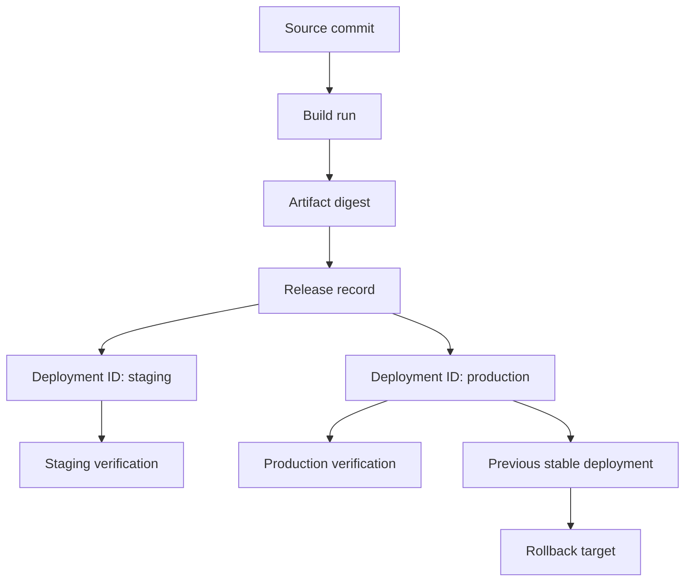
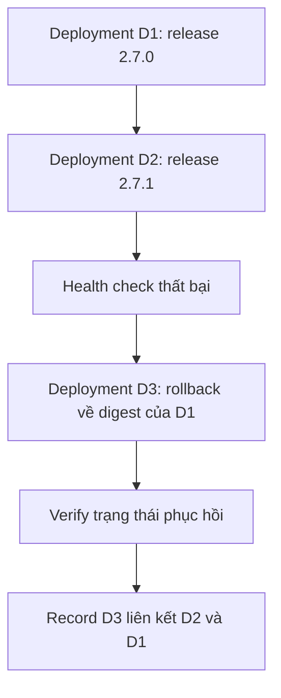

# Lưu định danh bản triển khai để kiểm chứng và phục hồi

Một artifact đã được build và kiểm thử vẫn chưa cho biết hệ thống production đang chạy phiên bản nào. Cùng một image có thể được triển khai nhiều lần, ở nhiều môi trường, với cấu hình và chiến lược rollout khác nhau. Một lần triển khai cũng có thể thất bại giữa chừng, chỉ cập nhật một phần instance hoặc bị thay đổi thủ công sau khi pipeline kết thúc.

Vì vậy, CI/CD cần lưu **định danh bản triển khai (deployment identity)** cho mỗi lần đưa một phiên bản vào môi trường. Định danh này liên kết hành động triển khai với artifact cụ thể, mã nguồn, cấu hình, hạ tầng, môi trường, người hoặc quy trình thực hiện và kết quả xác minh. Khi có sự cố, nhóm có thể trả lời chính xác điều gì đã được triển khai, ở đâu, bằng cách nào và cần khôi phục về trạng thái nào.

Trong module CI/CD, deployment identity là mắt xích nối artifact management, pipeline automation, environment configuration, quality gates, audit và rollback. Nó giúp chuyển câu hỏi mơ hồ “production đang ở version nào?” thành một bản ghi có thể truy vấn và kiểm chứng.

## 1. Phân biệt release, artifact và deployment

Ba khái niệm liên quan nhưng không đồng nghĩa:

- **Release** là phiên bản hoặc tập thay đổi được tổ chức chấp nhận để cung cấp. Một release có thể gồm ứng dụng, migration, manifest, tài liệu và các thành phần liên quan.
- **Artifact identity** xác định chính xác nội dung được tạo ra, thường bằng digest hoặc checksum. Ví dụ một container image có digest sha256:....
- **Deployment identity** xác định một lần áp dụng artifact và cấu hình vào một mục tiêu cụ thể. Cùng artifact có thể có nhiều deployment identity ở staging, production, các vùng hoặc các lần rollout khác nhau.

Ví dụ, image orders-service với digest sha256:abc... được build từ commit 4f2a9c1. Pipeline triển khai image đó lên staging vào buổi sáng và lên production vào buổi chiều. Hai lần này dùng cùng artifact digest nhưng là hai deployment riêng, có ID, môi trường, người phê duyệt, cấu hình và kết quả kiểm tra khác nhau.

Không nên dùng tag như latest, tên branch hoặc version hiển thị làm định danh duy nhất. Tag có thể di chuyển; version có thể được triển khai nhiều lần; tên môi trường không cho biết lần triển khai nào đã tạo ra trạng thái hiện tại. Cần có ID riêng cho từng lần triển khai và tham chiếu đến artifact bằng định danh nội dung bất biến.

## 2. Một deployment identity cần trả lời điều gì?

Một bản ghi triển khai nên cho phép trả lời ít nhất các câu hỏi:

1. **Cái gì được triển khai?** Artifact name, version và digest/checksum.
2. **Được tạo từ đâu?** Repository, commit SHA, pipeline run và build provenance.
3. **Triển khai ở đâu?** Environment, account/project, cluster, region, namespace và workload.
4. **Dùng cấu hình nào?** Config revision, deployment manifest, chart version và tham chiếu secret version phù hợp.
5. **Ai hoặc quy trình nào thực hiện?** Actor, service identity, workflow run và approval record.
6. **Triển khai theo cách nào?** Rolling, blue-green, canary hoặc chiến lược khác; phạm vi rollout và tham số quan trọng.
7. **Kết quả ra sao?** Trạng thái, thời điểm, health check, smoke test, metric và các bước bị lỗi.
8. **Có thể phục hồi về đâu?** Deployment ổn định trước đó, artifact/config tương ứng và điều kiện tương thích dữ liệu.

Không phải mọi hệ thống đều cần lưu mọi trường trong một file duy nhất. Có thể dùng deployment database, release catalog, event store hoặc metadata service. Điều quan trọng là các bản ghi có ID ổn định, liên kết được với nhau và không bị mất khi pipeline log hết hạn.

## 3. Mô hình định danh và quan hệ giữa các bản ghi

Một mô hình đơn giản có thể gồm các thực thể:

| Thực thể | Định danh | Vai trò |
|---|---|---|
| Source revision | Commit SHA | Xác định nội dung mã nguồn |
| Build run | Pipeline run ID | Ghi nhận lần build và công cụ đã sử dụng |
| Artifact | Digest/checksum | Xác định chính xác nội dung được đóng gói |
| Release | Release ID/version | Nhóm artifact và metadata được chấp nhận |
| Deployment | Deployment ID | Xác định một lần triển khai vào một mục tiêu |
| Environment target | Environment/cluster/namespace ID | Xác định nơi nhận triển khai |
| Configuration revision | Config commit/version/digest | Xác định cấu hình không bí mật được áp dụng |
| Verification evidence | Test/health/scan run ID | Ghi nhận bằng chứng sau triển khai |

Quan hệ tổng quát:



Một release có thể có nhiều artifact, ví dụ image backend, frontend bundle và migration package. Một deployment có thể triển khai nhiều workload cùng lúc. Khi đó, deployment record cần lưu danh sách artifact theo vai trò thay vì chỉ một digest chung.

Deployment ID nên duy nhất và không tái sử dụng, ví dụ UUID hoặc ID do deployment controller cấp. ID có thể được tạo trước khi bắt đầu để ghi nhận ý định triển khai, nhưng cần phân biệt trạng thái requested, started, succeeded, failed, cancelled hoặc partially_succeeded. Không đánh dấu thành công chỉ vì lệnh deploy đã trả về exit code 0; cần xác minh trạng thái thực tế theo tiêu chí đã đặt.

## 4. Lưu cả trạng thái mong muốn và trạng thái thực tế

Deployment record có hai góc nhìn:

- **Desired state:** artifact, replica count, manifest, chart và cấu hình mà pipeline yêu cầu hệ thống áp dụng.
- **Observed state:** image digest, revision, replica, pod hoặc instance thực sự đang chạy sau triển khai.

Hai trạng thái có thể khác nhau. Một rollout có thể chỉ cập nhật một phần instance; controller có thể chưa hội tụ; một thao tác thủ công có thể tạo drift sau deployment; hoặc một instance cũ vẫn còn phục vụ lưu lượng.

Do đó, bản ghi cần lưu desired digest và kết quả quan sát được. Với container orchestration, có thể truy vấn workload/controller và runtime để xác minh image digest hoặc revision thực tế. Không chỉ dựa vào manifest đã gửi lên API.

Ví dụ với Kubernetes, deployment manifest có thể tham chiếu image theo digest:

```yaml
apiVersion: apps/v1
kind: Deployment
metadata:
  name: orders-service
  namespace: production-orders
  annotations:
    delivery.example.com/deployment-id: "dep-2026-004281"
    delivery.example.com/source-commit: "4f2a9c1..."
spec:
  template:
    spec:
      containers:
        - name: orders-service
          image: registry.example.com/orders-service@sha256:abc...
```

Các annotation trên là ví dụ minh họa. Hệ thống thực tế cần dùng digest đầy đủ và xác minh đúng cú pháp, quyền truy cập registry cùng hành vi rollout. Annotation giúp tra cứu nhưng không thay thế dữ liệu từ deployment controller hoặc runtime. Có thể cần lưu observed image ID/digest của từng instance sau khi rollout hoàn tất.

## 5. Những trường nên có trong deployment record

Một record có thể được tổ chức theo các nhóm:

| Nhóm | Trường tham khảo | Mục đích |
|---|---|---|
| Identity | deployment_id, release_id, idempotency_key | Phân biệt lần triển khai và chống tạo trùng do retry |
| Source | Repository, commit SHA, branch/tag đã xác minh | Truy về mã nguồn |
| Artifact | Tên, version, digest, registry/repository | Xác định chính xác sản phẩm |
| Build | Pipeline run ID, builder, toolchain, provenance | Kiểm chứng nguồn gốc |
| Target | Environment, cloud account/project, region, cluster, namespace, workload | Xác định nơi triển khai |
| Configuration | Config revision/digest, chart/manifest version, secret reference version | Tái dựng cấu hình mà không lưu giá trị bí mật |
| Execution | Actor/principal, workflow, runner, strategy, start/end time | Hiểu ai và cách nào thực hiện |
| Approval | Reviewer, approval ID, policy result | Chứng minh điều kiện phê duyệt |
| Verification | Desired/observed digest, health, smoke test, metric window | Xác nhận trạng thái thực tế |
| Recovery | Previous deployment ID, rollback target, migration compatibility | Hỗ trợ phục hồi |
| Status | Requested, running, succeeded, failed, partial, rolled_back | Theo dõi vòng đời |

Không đưa password, token, private key hoặc secret value vào record. Nếu cần biết credential nào đã được dùng, lưu tên secret reference, version ID hoặc identity principal; dữ liệu bí mật vẫn được quản lý trong secret manager với quyền riêng.

## 6. Ví dụ deployment record

Ví dụ YAML dưới đây minh họa một lần triển khai production:

```yaml
deployment:
  deployment_id: "dep-2026-004281"
  release_id: "orders-service-2.7.1"
  status: "succeeded"
  requested_at: "2026-11-18T08:30:00Z"
  started_at: "2026-11-18T08:31:12Z"
  completed_at: "2026-11-18T08:34:50Z"

source:
  repository: "platform/orders-service"
  commit: "4f2a9c1..."
  build_run_id: "ci-18452"

artifact:
  name: "orders-service"
  reference: "registry.example.com/orders-service"
  digest: "sha256:abc..."

target:
  environment: "production"
  region: "ap-southeast-1"
  cluster: "prod-apps"
  namespace: "production-orders"
  workload: "deployment/orders-service"

configuration:
  manifest_revision: "deploy-config@7c91e2..."
  chart_version: "orders-chart-4.3.0"
  secret_references:
    - "secret://production/orders-db#version-12"

execution:
  strategy: "rolling"
  actor: "ci-production-deployer"
  workflow_run_id: "release-9821"
  approval_id: "approval-771"

verification:
  desired_digest: "sha256:abc..."
  observed_digest: "sha256:abc..."
  rollout: "complete"
  smoke_test_run: "smoke-2917"
  health_check: "passed"

recovery:
  previous_deployment_id: "dep-2026-004105"
  rollback_artifact_digest: "sha256:def..."
```

Các giá trị và schema là ví dụ, không phải định dạng chuẩn của Kubernetes hay một CI vendor. secret_references chỉ lưu định danh tham chiếu; không lưu secret value. Trong hệ thống thật, timestamp nên chuẩn hóa theo UTC, ID phải duy nhất và trạng thái phải phản ánh kết quả được xác minh.

## 7. Ghi record theo sự kiện trong quá trình triển khai

Không nên chỉ tạo một bản ghi sau cùng từ log text. Pipeline hoặc deployment controller nên phát ra sự kiện ở các mốc quan trọng:

1. **Requested:** có yêu cầu triển khai release/artifact vào target cụ thể.
2. **Authorized:** policy, branch protection và approval đã được kiểm tra.
3. **Started:** controller bắt đầu cập nhật target.
4. **Progressed:** rollout đạt các mốc như canary percentage hoặc số replica sẵn sàng.
5. **Verified:** observed state khớp desired state và health/smoke check đạt.
6. **Completed hoặc failed:** kết thúc với kết quả, thời gian và lý do.
7. **Rolled back:** nếu phục hồi, liên kết deployment mới với deployment bị thay thế và rollback target.

Ghi nhận sự kiện giúp phân biệt triển khai thất bại trước khi thay đổi tài nguyên với triển khai đã cập nhật một phần. Nó cũng hỗ trợ tính toán thời gian triển khai, phát hiện rollout treo và điều tra ai đã thực hiện hành động.

### Idempotency khi retry

CI job có thể bị timeout sau khi hệ thống đích đã nhận yêu cầu. Nếu pipeline retry mà không có idempotency, nó có thể tạo hai deployment record hoặc thực hiện cùng thao tác nhiều lần theo cách không mong muốn.

Sử dụng idempotency key hoặc deployment request ID ổn định cho cùng một yêu cầu. Khi retry, hệ thống truy vấn trạng thái của request hiện tại trước khi tạo thao tác mới. Nếu cần tạo một lần triển khai mới, tạo deployment ID mới và liên kết với lần trước.

Không tái sử dụng deployment ID cho một release khác hoặc một lần rollout độc lập. ID duy nhất giúp audit và đối chiếu sự kiện chính xác.

## 8. Xác minh bản triển khai sau khi áp dụng

Một deployment chỉ nên chuyển sang succeeded khi những điều kiện đã định nghĩa được thỏa mãn. Tùy loại hệ thống, có thể cần:

- Controller báo rollout hoàn tất và số instance sẵn sàng đạt yêu cầu.
- Image digest hoặc package version thực tế khớp digest đã phê duyệt.
- Health endpoint và smoke test đạt.
- Metric về error rate, latency, saturation không vượt ngưỡng trong khoảng quan sát.
- Log không có lỗi khởi động hoặc migration quan trọng.
- Các dependency và service phụ trợ hoạt động đúng.
- Traffic đã được chuyển theo chiến lược dự kiến.

Với canary, succeeded có thể chỉ được xác nhận sau khi các bước tăng traffic hoàn tất và metric nằm trong ngưỡng. Nếu canary thất bại, record phải thể hiện phần trăm traffic đã nhận phiên bản mới, thời điểm dừng và hành động phục hồi.

Với blue-green, record nên lưu màu/target mới, thời điểm chuyển traffic và target cũ còn được giữ để quay lui. Với rolling deployment, lưu số replica mong muốn, số replica updated/available và revision thực tế.

## 9. Liên kết deployment với cấu hình và hạ tầng

Cùng artifact nhưng cấu hình khác có thể tạo ra hành vi rất khác. Để kiểm chứng và phục hồi, deployment record cần liên kết tới cấu hình đã áp dụng:

- Manifest Kubernetes hoặc Helm chart version.
- Terraform plan/apply run và revision của infrastructure code.
- Config repository commit hoặc configuration bundle digest.
- Feature flag state/version nếu nó ảnh hưởng đến hành vi release.
- Database migration version và trạng thái thực hiện.
- Secret reference/version, không phải secret value.

Nếu cấu hình được cập nhật độc lập sau deployment, cần có config change record hoặc sự kiện riêng. Khi điều tra, nhóm phải phân biệt lỗi do artifact với lỗi do config drift.

Không nên sao chép toàn bộ config có thể chứa dữ liệu nhạy cảm vào deployment record. Lưu revision/digest và tham chiếu đến hệ thống quản lý cấu hình được phân quyền. Khi cần tái dựng, chỉ người hoặc job được cấp quyền mới có thể lấy giá trị tương ứng.

## 10. Dùng deployment identity để phục hồi

Rollback cần chọn một trạng thái đã biết là tốt, không chỉ chọn version thấp hơn. Deployment record giúp xác định:

- Artifact digest nào đã chạy trước đó.
- Cấu hình, manifest và chart revision nào đi cùng.
- Môi trường và workload nào đã nhận bản đó.
- Bản trước đã qua health check và smoke test nào.
- Migration hoặc thay đổi dữ liệu nào đã xảy ra sau đó.

Một rollback có thể được ghi như một deployment mới tham chiếu tới release cũ. Không xóa record của lần triển khai lỗi. Thay vào đó, tạo deployment ID mới cho hành động phục hồi và liên kết rollback_of hoặc recovery_from với ID bị ảnh hưởng.

Ví dụ:



Giữ lịch sử D2 rất quan trọng: nó cho biết phiên bản nào gây sự cố, đã chạy trong bao lâu và những thay đổi nào cần điều tra. D3 thể hiện hành động phục hồi, còn D1 là deployment ổn định trước đó.

### Kiểm tra tương thích dữ liệu trước rollback

Artifact cũ có thể không chạy được với database schema hoặc message format mới. Trước khi rollback, kiểm tra migration và tương thích giữa phiên bản cũ/mới. Chiến lược expand-and-contract giúp giữ tương thích trong thời gian rollback window: thêm cấu trúc mới trước, cho cả phiên bản cũ và mới hoạt động, chuyển đổi dữ liệu, rồi chỉ loại bỏ cấu trúc cũ sau khi hết thời gian phục hồi.

Nếu không thể rollback an toàn, record cần chỉ ra phương án recovery khác như roll-forward, sửa nóng, khôi phục backup dữ liệu hoặc tắt feature flag. Không ghi trạng thái rolled_back chỉ vì đã chạy lệnh deploy lại; phải xác minh trạng thái hệ thống sau hành động.

## 11. Lưu trữ và bảo vệ deployment history

Deployment history có giá trị cho audit và điều tra, nên retention cần được xác định riêng với log debug:

- Giữ record định danh và trạng thái của release theo thời gian cần kiểm toán.
- Giữ liên kết đến artifact digest, provenance, SBOM, test evidence và approval.
- Bảo vệ record khỏi sửa/xóa tùy tiện; ghi audit khi có điều chỉnh.
- Hạn chế quyền đọc thông tin nhạy cảm về môi trường và secret references.
- Sao lưu hoặc replicate metadata quan trọng để không mất lịch sử khi CI platform gặp sự cố.
- Không lưu secret value hoặc token trong record và log.

Nếu record được lưu trong hệ thống ngoài CI, cần đảm bảo pipeline có thể ghi nhận sự kiện ngay cả khi job kết thúc bất thường. Có thể dùng deployment controller hoặc event collector làm nguồn sự thật, còn CI run chỉ là một nguồn metadata.

## 12. Ví dụ quy trình triển khai có truy vết

Một pipeline tham khảo cho dịch vụ container:

1. Merge commit đã qua review vào branch bảo vệ.
2. Build image, tạo digest, ký artifact và lưu provenance.
3. Chạy test và scan trên đúng digest.
4. Tạo release record liên kết commit, pipeline run, artifact và evidence.
5. Tạo deployment ID cho staging, triển khai theo digest và ghi target/config revision.
6. Xác minh rollout, observed digest, health và smoke test; cập nhật trạng thái deployment.
7. Sau approval, tạo deployment ID riêng cho production, tham chiếu cùng artifact digest.
8. Theo dõi rollout/metric, lưu approval và observed state.
9. Nếu lỗi, tạo deployment phục hồi mới, tham chiếu deployment trước và artifact/config đã chọn.

Ví dụ pseudocode:

```text
release = create_release_record(
    source_commit,
    build_run_id,
    artifact_digest,
    test_evidence,
    provenance
)

deployment = create_deployment_record(
    release_id = release.id,
    target = production_target,
    config_revision = approved_config_revision,
    actor = deployment_identity,
    previous_deployment_id = current_stable_deployment
)

result = deploy_by_digest(release.artifact_digest)
observed = verify_runtime_state(target)

if result.completed and observed.digest == release.artifact_digest:
    run_health_and_smoke_checks()
    mark_deployment_succeeded(deployment.id)
else:
    mark_deployment_failed_or_partial(deployment.id, observed)
    initiate_recovery_using_recorded_target()
```

Đây là pseudocode mô tả trách nhiệm của hệ thống, không phải API có sẵn. Các thao tác tạo record, triển khai và cập nhật trạng thái cần xử lý retry, concurrency và lỗi giữa chừng. Không để record báo thành công trước khi xác minh runtime.

## 13. Những sai lầm thường gặp

| Sai lầm | Hệ quả | Cách khắc phục |
|---|---|---|
| Dùng release version làm deployment ID | Không phân biệt các lần triển khai cùng version | Tạo ID riêng cho mỗi deployment |
| Chỉ lưu tên tag image | Không xác định được nội dung thực tế | Lưu digest và observed digest |
| Chỉ lưu desired manifest | Không biết runtime có thực sự hội tụ | Thu thập observed state từ controller/runtime |
| Ghi một record sau khi pipeline kết thúc | Mất thông tin khi job bị timeout hoặc triển khai một phần | Ghi event theo từng giai đoạn |
| Không liên kết config revision | Khó phân biệt lỗi artifact và config drift | Lưu config/manifest/chart revision |
| Ghi secret value vào record | Tăng nguy cơ lộ credential | Chỉ lưu secret reference/version |
| Xóa lịch sử deployment lỗi | Mất bằng chứng điều tra | Giữ record bất biến và liên kết recovery record |
| Retry tạo deployment trùng | Khó xác định lần nào đang chạy | Dùng idempotency key và request ID |
| Đánh dấu success ngay khi lệnh deploy trả về | Có thể còn instance cũ hoặc health check lỗi | Xác minh rollout và runtime trước khi hoàn tất |
| Rollback chỉ theo version mà bỏ qua migration | Phiên bản cũ có thể không tương thích dữ liệu | Ghi migration state và kiểm tra khả năng rollback |

## 14. Checklist thiết kế deployment identity

- [ ] Mỗi lần triển khai có deployment ID duy nhất, không tái sử dụng.
- [ ] Phân biệt release ID, artifact digest và deployment ID.
- [ ] Record liên kết source commit, build run, artifact và provenance.
- [ ] Ghi environment, region, cluster, namespace và workload đích.
- [ ] Ghi config/manifest/chart/infrastructure revision; chỉ lưu secret reference, không lưu secret value.
- [ ] Ghi actor, workflow, approval, strategy và thời điểm thực hiện.
- [ ] Phân biệt desired state với observed runtime state.
- [ ] Xác minh digest thực tế, rollout, health, smoke test và metric trước khi đánh dấu success.
- [ ] Ghi trạng thái failed/partial/cancelled và giữ lại lịch sử.
- [ ] Dùng idempotency key để xử lý retry an toàn.
- [ ] Liên kết rollback record với deployment bị thay thế và target ổn định trước đó.
- [ ] Kiểm tra database/config/API compatibility trước khi phục hồi.
- [ ] Bảo vệ deployment history, retention và audit trail.

Deployment identity biến mỗi lần triển khai thành một sự kiện có thể truy vết và kiểm chứng. Khi ID được liên kết với artifact digest, source revision, cấu hình, môi trường, actor và observed state, nhóm có thể biết chính xác hệ thống đang chạy gì, điều tra thay đổi nào gây ra sự cố và phục hồi về một trạng thái đã được xác minh.
