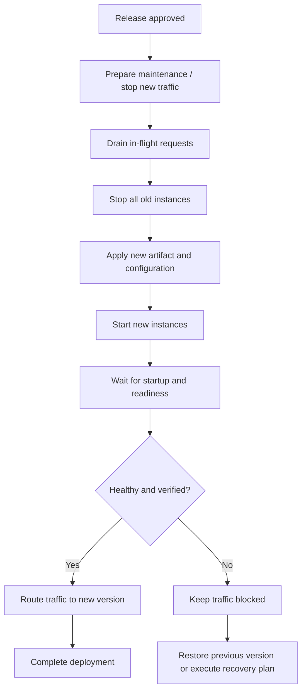

# Hiểu triển khai thay thế toàn bộ và khoảng gián đoạn

## 1. Bài toán khi thay phiên bản ứng dụng

Khi phát hành phiên bản mới, hệ thống cần thay các tiến trình hoặc instance đang chạy bằng phiên bản mới. Cách thay thế ảnh hưởng trực tiếp đến thời gian người dùng không truy cập được dịch vụ, mức tài nguyên cần thiết, độ phức tạp vận hành và khả năng khôi phục khi có lỗi.

Một chiến lược đơn giản là dừng toàn bộ instance của phiên bản cũ, sau đó mới khởi động phiên bản mới. Cách này thường được gọi là **Recreate deployment** hoặc triển khai thay thế toàn bộ. Trong khoảng giữa hai phiên bản, không có instance ứng dụng nào sẵn sàng phục vụ. Vì vậy, chiến lược này có thể tạo ra downtime có chủ đích.

Ví dụ, một dịch vụ nội bộ chỉ chạy một instance. Khi triển khai bản mới, pipeline dừng instance cũ, cập nhật package, khởi động service và chờ health check. Trong thời gian service cũ đã dừng nhưng service mới chưa sẵn sàng, người dùng có thể nhận lỗi kết nối hoặc trang bảo trì.

Chiến lược này dễ hiểu và có thể phù hợp với hệ thống chấp nhận cửa sổ bảo trì. Để sử dụng an toàn, nhóm cần dự đoán thời gian gián đoạn, xử lý request đang chạy, kiểm soát thay đổi dữ liệu và chuẩn bị phương án quay lui.

## 2. Recreate deployment hoạt động như thế nào?

Recreate thay thế toàn bộ nhóm instance cũ bằng nhóm instance mới theo trình tự. Trình tự khái quát:

1. Xác minh artifact, cấu hình, migration và điều kiện phát hành.
2. Đưa dịch vụ vào trạng thái chuẩn bị bảo trì hoặc ngừng nhận request mới.
3. Drain traffic và cho request/connection đang chạy kết thúc trong thời gian cho phép.
4. Dừng toàn bộ instance cũ.
5. Áp dụng phiên bản artifact và cấu hình mới.
6. Khởi động các instance mới.
7. Chờ startup, readiness và các kiểm tra sau khởi động.
8. Đưa instance mới vào phục vụ traffic.
9. Chạy smoke test và xác minh các chỉ số vận hành.
10. Hoàn tất phát hành hoặc kích hoạt quy trình phục hồi nếu kiểm tra thất bại.



Các nền tảng có thể triển khai chi tiết khác nhau. Điểm cốt lõi của Recreate là toàn bộ workload cũ được dừng trước khi workload mới được tạo hoặc đưa vào chạy theo chiến lược đó. Không có giai đoạn phục vụ đồng thời giữa hai phiên bản như rolling update hoặc blue-green.

## 3. Khoảng gián đoạn hình thành ở đâu?

Downtime người dùng cảm nhận thường bắt đầu khi instance cũ cuối cùng không còn phục vụ được và kết thúc khi instance mới đầu tiên được đưa vào phục vụ ổn định. Các thao tác chuẩn bị có thể diễn ra trước thời điểm này, nhưng nếu nhóm đã chặn traffic thì chúng cũng góp phần vào thời gian người dùng bị gián đoạn.

Một cách ước lượng bảo thủ là cộng các khoảng thời gian thực hiện tuần tự:

\[
T_{maintenance} \approx T_{drain} + T_{shutdown} + T_{release} + T_{startup} + T_{readiness} + T_{routing} + T_{verification}
\]

Trong đó:

| Thành phần | Ý nghĩa | Yếu tố ảnh hưởng |
|---|---|---|
| Drain | Ngừng nhận request mới và chờ request/connection đang chạy | Request dài, WebSocket, keep-alive, timeout |
| Shutdown | Dừng instance cũ an toàn | Grace period, hook shutdown, xử lý background task |
| Release | Thay package, image, config hoặc mount volume | Tốc độ tải image/package, thao tác file, migration |
| Startup | Khởi động tiến trình mới | Runtime initialization, kết nối dependency, cache warm-up |
| Readiness | Chờ instance đủ điều kiện nhận traffic | Health/readiness check, thời gian khởi tạo dữ liệu |
| Routing | Cập nhật load balancer, service endpoint hoặc proxy | Health polling, propagation delay, DNS nếu có |
| Verification | Chạy smoke test và xác nhận hành vi chính | Số test, thời gian phản hồi dependency, cửa sổ quan sát |

Công thức là mô hình lập kế hoạch, không phải phép đo chính xác trong mọi nền tảng. Một số thao tác có thể chồng lấp. Thời gian gián đoạn thực tế nên được đo từ thời điểm endpoint cuối cùng của bản cũ ngừng nhận traffic đến thời điểm endpoint mới sẵn sàng và traffic được khôi phục.

Ví dụ: drain mất 20 giây, shutdown 8 giây, cập nhật package 15 giây, startup 35 giây, readiness 20 giây và routing/verification 12 giây. Nếu tất cả diễn ra nối tiếp, cửa sổ bảo trì ước lượng khoảng 110 giây. Khi lập lịch, cần cộng thêm biên dự phòng cho biến động tải, cache lạnh, registry chậm hoặc dependency không ổn định.

## 4. Phân biệt thời gian triển khai và downtime người dùng

Không phải toàn bộ thời gian pipeline chạy đều là downtime. Build, test, scan, phê duyệt và chuẩn bị artifact có thể hoàn tất trước cửa sổ bảo trì. Downtime chủ yếu nằm trong giai đoạn dịch vụ không có instance sẵn sàng hoặc traffic đã bị chặn.

Nên tách các mốc thời gian:

- **Pipeline duration:** từ lúc pipeline bắt đầu đến khi hoàn tất.
- **Deployment duration:** từ lúc bắt đầu thay đổi workload đến khi kết thúc triển khai.
- **Maintenance window:** khoảng thời gian hệ thống chủ động hạn chế hoặc ngừng phục vụ.
- **User-visible downtime:** khoảng thời gian request hợp lệ không thể được phục vụ theo mục tiêu dịch vụ.

Một pipeline có thể chạy 15 phút nhưng chỉ tạo 90 giây downtime nếu phần lớn thời gian được dùng để build và xác minh trước. Ngược lại, một thao tác triển khai chỉ kéo dài vài phút vẫn có thể gây ảnh hưởng lớn nếu trùng giờ cao điểm hoặc không có thông báo bảo trì.

Để đo chính xác, cần ghi timestamp của các mốc drain, endpoint cũ ngừng phục vụ, instance mới ready, traffic được mở lại và smoke test đạt. Không chỉ dùng thời gian job deploy làm đại diện cho downtime.

## 5. Khi nào Recreate phù hợp?

Recreate có thể là lựa chọn hợp lý khi:

- Ứng dụng nhỏ, ít người dùng hoặc chỉ phục vụ nội bộ.
- Hệ thống có cửa sổ bảo trì được chấp nhận và đã thông báo.
- Một phiên bản mới không thể chạy đồng thời với phiên bản cũ do xung đột tài nguyên hoặc giao thức.
- Ứng dụng chỉ chạy một instance và không có yêu cầu sẵn sàng liên tục.
- Môi trường không đủ tài nguyên để chạy đồng thời hai nhóm instance.
- Việc dừng toàn bộ tiến trình giúp đơn giản hóa thay đổi có ràng buộc đặc biệt, sau khi đã đánh giá dữ liệu và khả năng khôi phục.
- Dịch vụ có thể khởi động nhanh, trạng thái được lưu bên ngoài và request có thể retry an toàn.

Ví dụ có thể là công cụ quản trị nội bộ chỉ dùng trong giờ làm việc, một ứng dụng demo, một dịch vụ batch chạy theo lịch hoặc hệ thống được vận hành trong maintenance window đã thống nhất.

Recreate thường không phù hợp khi dịch vụ phải phục vụ liên tục, có SLA nghiêm ngặt, startup kéo dài, request không thể retry hoặc downtime gây mất giao dịch. Khi đó cần cân nhắc chiến lược duy trì capacity trong lúc thay phiên bản.

## 6. Ưu điểm và giới hạn

| Khía cạnh | Ưu điểm | Giới hạn |
|---|---|---|
| Độ đơn giản | Luồng dừng rồi chạy dễ hiểu, ít trạng thái triển khai song song | Cần điều phối chính xác thời điểm dừng/mở traffic |
| Tài nguyên | Không cần duy trì đồng thời toàn bộ capacity cũ và mới | Không có instance phục vụ trong khoảng chuyển tiếp |
| Tương thích phiên bản | Không có giai đoạn hai phiên bản cùng nhận traffic | Rollback vẫn cần kiểm tra tương thích cấu hình và dữ liệu |
| Vận hành | Dễ xác định nhóm instance nào đang được thay thế | Một lỗi startup có thể làm toàn bộ dịch vụ ngừng lâu hơn dự kiến |
| Kiểm thử | Có thể xác minh phiên bản mới trước khi mở traffic | Kiểm thử sau khi dừng bản cũ làm tăng thời gian gián đoạn |
| Chi phí | Phù hợp môi trường hạn chế tài nguyên | Có thể phát sinh chi phí bảo trì, hỗ trợ và gián đoạn nghiệp vụ |

Không có chiến lược triển khai nào tốt nhất trong mọi tình huống. Recreate tối ưu sự đơn giản của trình tự thay thế; nhóm phải chấp nhận và quản lý downtime tương ứng.

## 7. Chuẩn bị traffic trước khi dừng phiên bản cũ

Nếu dừng instance ngay khi pipeline bắt đầu, các request đang chạy có thể bị ngắt. Trước khi dừng, nên phối hợp với load balancer, ingress, reverse proxy hoặc service discovery để:

1. Đánh dấu instance không nhận request mới hoặc bật maintenance response.
2. Chờ hệ thống routing ngừng gửi request mới tới instance.
3. Cho request đang chạy hoàn tất trong thời gian drain đã định.
4. Xử lý connection dài như WebSocket, streaming hoặc gRPC theo chính sách.
5. Sau thời hạn, kết thúc tiến trình còn lại theo cơ chế graceful shutdown rồi force stop nếu cần.

Drain chỉ có tác dụng khi lớp routing hiểu trạng thái instance và có thời gian truyền trạng thái. Nếu ứng dụng nhận traffic trực tiếp qua DNS hoặc client giữ connection lâu, việc ngừng nhận request mới có thể phức tạp hơn. DNS TTL không bảo đảm mọi client cập nhật đúng thời điểm vì resolver và ứng dụng có thể cache khác nhau.

Với hệ thống không có load balancer, có thể bật trang bảo trì hoặc đưa endpoint vào trạng thái từ chối request có kiểm soát. Phản hồi 503 kèm `Retry-After` có thể hữu ích với client hỗ trợ retry, nhưng chỉ dùng khi hành vi retry đã được thiết kế để tránh tạo tải dồn hoặc lặp giao dịch.

## 8. Xử lý request đang chạy và background job

Graceful shutdown giúp ứng dụng kết thúc công việc đang xử lý trước khi tiến trình bị dừng. Cần xác định thời gian chờ tối đa và hành vi khi hết thời gian.

Các tình huống cần xem xét:

- Request HTTP đang xử lý: hoàn tất trong grace period hoặc trả lỗi có thể retry.
- Giao dịch thanh toán/đặt hàng: bảo đảm tính idempotent và có cơ chế kiểm tra trạng thái trước khi retry.
- WebSocket/streaming: thông báo đóng kết nối và hướng dẫn client reconnect.
- Background worker: ngừng nhận job mới, hoàn tất hoặc trả job về queue an toàn.
- Scheduled task: tránh chạy trùng giữa tiến trình cũ và tiến trình mới.
- Consumer message: commit offset/ack sau khi xử lý thành công; không mất hoặc xử lý trùng ngoài khả năng chịu đựng.

Không nên giả định gửi tín hiệu dừng là mọi request đã hoàn tất. Cần quan sát số request đang chạy, số job trong queue và trạng thái consumer trước khi kết thúc tiến trình.

## 9. Trạng thái và dữ liệu phải tồn tại ngoài instance

Recreate loại bỏ toàn bộ instance cũ. Nếu ứng dụng lưu session, upload, file người dùng hoặc trạng thái nghiệp vụ trên filesystem cục bộ, dữ liệu đó có thể mất khi instance bị xóa.

Trước khi chọn chiến lược, phân loại dữ liệu:

| Loại dữ liệu | Cách xử lý phù hợp |
|---|---|
| Session người dùng | Lưu ở session store dùng chung hoặc cơ chế token phía client |
| Dữ liệu nghiệp vụ | Lưu trong database/dịch vụ lưu trữ có backup và chính sách phục hồi |
| File upload | Lưu trên object storage hoặc volume bền vững được quản lý riêng |
| Cache | Xác định có thể tạo lại hay không; chuẩn bị cache warm-up nếu cần |
| Queue/job state | Dùng broker hoặc store bền vững, hỗ trợ ack/retry/idempotency |
| File tạm | Chỉ giữ trong workspace/instance nếu có thể tạo lại |

Nếu buộc phải lưu dữ liệu trên volume bền vững, cần kiểm tra cách detach/attach, quyền truy cập, filesystem recovery và việc phiên bản mới có thể đọc dữ liệu cũ. Volume bền vững không tự động bảo đảm ứng dụng ghi dữ liệu nhất quán trước khi shutdown.

## 10. Tương thích database và migration

Một điểm dễ bị bỏ sót là Recreate không loại bỏ rủi ro migration. Việc chỉ có một phiên bản ứng dụng hoạt động tại một thời điểm giúp giảm nhu cầu tương thích đồng thời giữa hai phiên bản trong giai đoạn phục vụ, nhưng database có thể chứa dữ liệu cần được giữ và phiên bản cũ có thể vẫn cần đọc sau rollback.

Trước khi migration, cần xác định:

- Migration có phá hủy hoặc đổi kiểu dữ liệu không?
- Có backup và đã thử restore chưa?
- Thời gian migration có nằm trong maintenance window không?
- Nếu migration thất bại giữa chừng, trạng thái schema và dữ liệu ra sao?
- Artifact cũ có tương thích với schema sau migration không?
- Có thể rollback migration hay cần roll-forward bằng script sửa dữ liệu?
- Có cần chạy bước xác minh số lượng hoặc tính toàn vẹn dữ liệu không?

Chiến lược expand-and-contract vẫn hữu ích: mở rộng schema theo cách tương thích trước, triển khai ứng dụng, di chuyển dữ liệu và chỉ loại bỏ cấu trúc cũ khi không còn phiên bản cần dùng. Nếu chọn Recreate vì ứng dụng mới yêu cầu schema không tương thích, hãy coi migration là thay đổi riêng có gate, backup, kế hoạch khôi phục và phê duyệt phù hợp.

Không tự động chạy migration không thể đảo ngược ngay khi job deploy bắt đầu. Nếu migration làm mất khả năng chạy lại phiên bản cũ, rollback ứng dụng đơn thuần sẽ không đủ.

## 11. Quản lý cấu hình và secret trong cửa sổ thay thế

Artifact mới có thể yêu cầu cấu hình khác hoặc schema config mới. Trước khi dừng ứng dụng cũ, hãy xác minh:

- Config revision tương thích với phiên bản artifact mới.
- Các biến bắt buộc có giá trị và đúng môi trường.
- Secret/certificate còn hiệu lực và identity triển khai có quyền đọc.
- Cấu hình đã được validate, có revision để quay lại nếu cần.
- Không nhúng secret vào image hoặc file log.
- Nếu thay đổi secret, phiên bản cũ còn hiệu lực trong thời gian cần rollback hoặc có phương án cấp lại.

Deployment record nên liên kết artifact digest, config revision và secret reference/version. Khi phiên bản mới khởi động thất bại, nhóm cần biết chính xác tổ hợp đầu vào nào đã được áp dụng để khôi phục hoặc điều tra.

## 12. Health check và thời điểm mở lại traffic

Khởi động thành công không đồng nghĩa ứng dụng đã sẵn sàng phục vụ. Một tiến trình có thể đang chạy nhưng chưa kết nối database, chưa nạp cache hoặc chưa hoàn tất migration.

Phân biệt các kiểm tra:

- **Startup check/probe:** xác định ứng dụng đã hoàn tất giai đoạn khởi động trong giới hạn cho phép.
- **Readiness check/probe:** xác định instance có thể nhận traffic hay chưa.
- **Liveness check/probe:** xác định tiến trình có còn hoạt động hay bị kẹt cần khởi động lại.
- **Smoke test:** xác minh một số luồng chính qua giao diện mà người dùng hoặc hệ thống khác sử dụng.
- **Post-deploy verification:** xác minh metric, log, trace và hành vi nghiệp vụ sau khi mở traffic.

Readiness là điều kiện quan trọng để đưa instance mới vào load balancer hoặc Service endpoints. Liveness không nên dùng để thay thế readiness; nếu liveness quá nhạy, ứng dụng khởi động chậm có thể bị restart liên tục.

Trong Recreate, hãy giữ traffic ở trạng thái bảo trì hoặc chưa route cho đến khi instance mới đủ readiness và smoke test tối thiểu đạt. Nếu kiểm tra thất bại, không mở traffic chỉ để kết thúc pipeline cho nhanh.

## 13. Kubernetes Deployment với chiến lược Recreate

Kubernetes Deployment hỗ trợ `strategy.type: Recreate`. Khi cập nhật Deployment theo chiến lược này, các Pod cũ được kết thúc trước khi Pod mới được tạo. Do không có nhóm Pod mới chạy song song để duy trì capacity trong lúc thay thế, ứng dụng có thể có khoảng không có Pod sẵn sàng phục vụ.

Ví dụ cấu hình minh họa:

```yaml
apiVersion: apps/v1
kind: Deployment
metadata:
  name: internal-admin
spec:
  replicas: 2
  strategy:
    type: Recreate
  selector:
    matchLabels:
      app: internal-admin
  template:
    metadata:
      labels:
        app: internal-admin
    spec:
      terminationGracePeriodSeconds: 30
      containers:
        - name: app
          image: registry.example.com/internal-admin@sha256:<image-digest>
          ports:
            - containerPort: 8080
          startupProbe:
            httpGet:
              path: /startup
              port: 8080
            periodSeconds: 5
            failureThreshold: 24
          readinessProbe:
            httpGet:
              path: /ready
              port: 8080
            periodSeconds: 5
            failureThreshold: 3
          livenessProbe:
            httpGet:
              path: /health/live
              port: 8080
            periodSeconds: 10
            failureThreshold: 3
```

Đây là cấu hình minh họa; image digest, endpoint và probe threshold phải phù hợp ứng dụng thực tế. `terminationGracePeriodSeconds` đặt thời gian cho Pod kết thúc có kiểm soát trước khi bị buộc dừng. Ứng dụng cần xử lý tín hiệu `SIGTERM` và ngừng nhận công việc mới trong thời gian này.

Với `Recreate`, không cấu hình `maxSurge`/`maxUnavailable` như một chiến lược RollingUpdate; các tham số rollout đó thuộc chiến lược RollingUpdate. Cần kiểm tra hành vi controller và workload cụ thể, đặc biệt khi có nhiều controller hoặc job khác cùng thao tác tài nguyên.

Service chỉ nên đưa Pod sẵn sàng vào endpoint phục vụ theo readiness. Tuy vậy, cần có maintenance handling ở lớp ingress/load balancer nếu muốn người dùng nhận thông báo rõ ràng thay vì lỗi kết nối khi không có endpoint.

## 14. Triển khai thay thế trên VM hoặc service truyền thống

Với ứng dụng chạy trên VM hoặc máy chủ riêng, Recreate có thể được thực hiện bằng systemd, script triển khai hoặc công cụ quản lý cấu hình.

Một trình tự minh họa:

```bash
set -euo pipefail

sudo systemctl stop order-service

# Cài artifact đã xác minh vào release directory mới.
sudo install -d -m 0755 /opt/order-service/releases/2.4.1
sudo install -m 0644 order-service.jar /opt/order-service/releases/2.4.1/order-service.jar

# Tạo symlink mới rồi thay thế release pointer trên cùng filesystem.
sudo ln -sfn /opt/order-service/releases/2.4.1 /opt/order-service/current.next
sudo mv -Tf /opt/order-service/current.next /opt/order-service/current

sudo systemctl start order-service
sudo systemctl is-active --quiet order-service
```

Đây là ví dụ Linux dùng GNU `mv -T`, đơn giản và chưa phải runbook production hoàn chỉnh. Thư mục `current.next` và `current` cần nằm trên cùng filesystem để thao tác rename thay thế là nguyên tử; cần kiểm tra trạng thái nếu lệnh tạo symlink hoặc rename thất bại. Cần tải artifact theo digest, xác minh checksum/signature, quản lý quyền file, giữ release trước đó, validate cấu hình, chờ readiness endpoint và kiểm tra log/metric. `systemctl is-active` chỉ xác nhận service unit đang active, không chứng minh endpoint nghiệp vụ đã sẵn sàng.

Không ghi đè trực tiếp package đang chạy nếu có thể chuẩn bị release directory riêng. Giữ bản cũ cho đến khi phiên bản mới được xác minh và rollback có thể thực hiện. Khi cập nhật symlink, thao tác cần được thực hiện nguyên tử theo filesystem và quy trình của hệ điều hành.

## 15. Thiết kế maintenance window

Nếu downtime được chấp nhận, hãy quản lý nó như một thay đổi có kế hoạch:

- Xác định người dùng, hệ thống phụ thuộc và luồng nghiệp vụ bị ảnh hưởng.
- Chọn thời gian có lưu lượng hoặc mức tác động thấp theo dữ liệu thực tế.
- Thông báo trước và công bố thời gian dự kiến, phạm vi, cách liên hệ.
- Tách thời gian chuẩn bị khỏi thời gian ngừng phục vụ.
- Đặt thời lượng tối đa cho drain, shutdown, migration, startup và verification.
- Chuẩn bị trang bảo trì hoặc phản hồi lỗi có kiểm soát.
- Xác định điều kiện dừng triển khai và thời điểm chuyển sang rollback.
- Bố trí người trực, dashboard và runbook.
- Có kế hoạch nếu vượt maintenance window, ví dụ tiếp tục khôi phục bản cũ hoặc kéo dài cửa sổ theo quyết định được duyệt.

Không nên công bố thời gian downtime chỉ dựa trên thời gian trung bình của một lần triển khai. Hãy dùng dữ liệu lịch sử, percentile cao hơn như p95 và biên dự phòng. Nếu chưa có dữ liệu, đo thử trên môi trường tương đương và công bố khoảng thời gian có dự phòng.

## 16. Ước lượng và đo downtime

Một kế hoạch triển khai nên có bảng ước lượng từng bước và ghi thời gian thực tế sau mỗi lần chạy.

Ví dụ:

| Bước | Ước lượng | Thời gian thực tế | Ghi chú |
|---|---:|---:|---|
| Drain traffic | 20 giây |  | Chờ request đang chạy |
| Shutdown | 10 giây |  | Graceful termination |
| Thay artifact/config | 15 giây |  | Không tính build trước release |
| Startup | 35 giây |  | JVM initialization |
| Readiness | 20 giây |  | Dependency và cache warm-up |
| Routing/smoke | 15 giây |  | Endpoint và luồng chính |
| Dự phòng | 30 giây |  | Biến động môi trường |
| **Tổng kế hoạch** | **145 giây** |  | Cần đo lại sau triển khai |

Các mốc nên thu thập tự động:

- `maintenance_started_at`
- `last_old_endpoint_removed_at`
- `old_workload_stopped_at`
- `new_workload_started_at`
- `first_new_instance_ready_at`
- `traffic_restored_at`
- `smoke_test_passed_at`

Từ đó có thể tính thời gian không có endpoint sẵn sàng, thời gian maintenance tổng và thời gian xác minh. Nếu nhiều instance cũ bị dừng theo các thời điểm khác nhau, mốc cuối cùng ngừng phục vụ và mốc đầu tiên phục vụ trở lại có ý nghĩa với user-visible downtime.

## 17. Kế hoạch rollback khi phiên bản mới không khởi động

Trong Recreate, phiên bản cũ đã bị dừng trước khi phiên bản mới được kiểm tra. Vì vậy, nếu bản mới không khởi động hoặc readiness không đạt, dịch vụ có thể tiếp tục gián đoạn cho đến khi khôi phục xong.

Kế hoạch rollback cần chuẩn bị trước:

1. Giữ artifact cũ trong repository với digest đã biết.
2. Lưu config revision trước đó và xác định secret version còn hiệu lực.
3. Xác minh artifact cũ tương thích với schema database hiện tại.
4. Xác định lệnh hoặc quy trình quay về release pointer trước.
5. Giữ traffic ở trạng thái bảo trì trong lúc phục hồi.
6. Khởi động bản cũ và chờ readiness.
7. Chạy smoke test, kiểm tra log/metric rồi mới mở traffic.
8. Ghi nhận lý do rollback và các bước cần khắc phục trước lần phát hành tiếp theo.

Rollback ứng dụng không đồng nghĩa rollback dữ liệu. Nếu migration đã thay đổi schema hoặc dữ liệu, có thể cần roll-forward hoặc chạy script phục hồi riêng. Không tự động chạy migration down nếu chưa chứng minh thao tác đó an toàn và không làm mất dữ liệu mới.

## 18. Các điểm thất bại và cách ứng phó

| Điểm thất bại | Tác động | Cách ứng phó |
|---|---|---|
| Drain không hoàn tất | Request/connection còn dang dở | Đặt timeout, quan sát connection, quyết định chờ hay ngắt theo policy |
| Tiến trình cũ không dừng | Release bị kẹt hoặc hai tiến trình cùng tranh tài nguyên | Điều tra process, dùng escalation có kiểm soát, không xóa file đang dùng tùy tiện |
| Tải artifact thất bại | Không có package mới để chạy | Giữ traffic ở trạng thái bảo trì, retry tải từ registry tin cậy hoặc rollback |
| Migration thất bại | Schema ở trạng thái không rõ hoặc ứng dụng không khởi động | Dừng rollout, kiểm tra migration state, thực hiện runbook dữ liệu |
| Ứng dụng mới crash loop | Không có instance ready | Thu thập log, giữ traffic, rollback artifact/config nếu tương thích |
| Readiness không đạt | Không thể mở traffic an toàn | Kiểm tra dependency và cấu hình; không nhầm liveness với readiness |
| Routing chưa cập nhật | Request vẫn tới endpoint cũ hoặc không tới endpoint mới | Kiểm tra load balancer/service discovery và propagation |
| Smoke test thất bại | Phiên bản mới có thể không đáp ứng luồng chính | Dừng mở traffic, phân loại lỗi và rollback/roll-forward |
| Vượt maintenance window | Ảnh hưởng người dùng kéo dài | Kích hoạt quyết định tiếp tục hay khôi phục theo người có thẩm quyền |

Mỗi tình huống nên có owner, timeout, tín hiệu quan sát và điều kiện kết thúc. Tránh để pipeline chờ vô hạn một health check hoặc tự retry vô hạn khi dịch vụ không thể sẵn sàng.

## 19. So sánh ngắn với Rolling, Blue-Green và Canary

Recreate là một trong nhiều chiến lược thay phiên bản. Lựa chọn phụ thuộc vào mức downtime chấp nhận, tài nguyên, khả năng tương thích và năng lực vận hành.

| Chiến lược | Cách chuyển phiên bản | Downtime dự kiến | Nhu cầu tài nguyên/độ phức tạp |
|---|---|---|---|
| Recreate | Dừng toàn bộ bản cũ rồi khởi động bản mới | Có thể có downtime rõ rệt | Đơn giản hơn, không cần duy trì hai nhóm capacity cùng lúc |
| Rolling | Thay instance từng phần, giữ một phần capacity phục vụ | Có thể rất thấp nếu capacity và readiness được thiết kế đúng | Có thể cần surge capacity; phải tương thích khi hai phiên bản cùng chạy |
| Blue-Green | Dựng môi trường mới song song, sau đó chuyển traffic | Có thể gần như không gián đoạn khi chuyển traffic | Cần capacity cho hai môi trường và kiểm soát trạng thái dữ liệu |
| Canary | Chuyển một phần traffic sang phiên bản mới rồi tăng dần | Thường tránh downtime toàn dịch vụ | Cần routing, metric và phân tích rollout tốt |

Recreate không nên được gọi là zero-downtime. Ngược lại, Rolling hoặc Blue-Green cũng không tự động bảo đảm không gián đoạn: readiness sai, migration không tương thích, connection bị ngắt hoặc capacity thiếu vẫn có thể gây lỗi người dùng.

## 20. Ví dụ runbook Recreate cho một dịch vụ nội bộ

Giả sử một ứng dụng quản trị chỉ phục vụ nhân viên, cho phép bảo trì tối đa ba phút. Nhóm đã chuẩn bị artifact, config revision và rollback release trước đó.

| Giai đoạn | Hành động | Điều kiện chuyển tiếp |
|---|---|---|
| Trước cửa sổ | Build/test/scan artifact, xác minh digest, validate config và thông báo | Tất cả gate trước deploy đạt |
| Bắt đầu | Bật maintenance response, ngừng nhận request mới | Load balancer không còn route request mới tới instance cũ |
| Drain | Chờ request và background job hoàn tất | Connection trong giới hạn hoặc đã xử lý theo policy |
| Stop | Dừng toàn bộ instance cũ | Process cũ kết thúc, tài nguyên được giải phóng |
| Replace | Cài artifact mới và áp dụng config revision đã duyệt | Digest/config revision khớp release manifest |
| Start | Khởi động instance mới | Startup hoàn tất, không có crash loop |
| Verify | Readiness, smoke test, kiểm tra log và metric | Các kiểm tra bắt buộc đạt |
| Resume | Mở lại traffic, tắt maintenance response | Endpoint phục vụ ổn định |
| Close | Ghi deployment record và thời gian thực tế | Không còn cảnh báo nghiêm trọng; release được xác nhận |

Nếu startup hoặc smoke test thất bại, runbook giữ maintenance response, khôi phục artifact/config trước đó nếu tương thích, khởi động lại và xác minh. Nếu migration đã thay đổi dữ liệu theo cách không thể quay lại, người phụ trách phải chọn phương án roll-forward/repair thay vì chạy rollback tự động.

## 21. Những anti-pattern thường gặp

| Anti-pattern | Hệ quả | Cách cải thiện |
|---|---|---|
| Gọi Recreate là zero-downtime | Kỳ vọng sai và không lập kế hoạch downtime | Công bố rõ cửa sổ gián đoạn và đo thực tế |
| Dừng ứng dụng trước khi chuẩn bị artifact | Tăng downtime do tải/build sau khi đã ngừng phục vụ | Build, scan, publish và validate trước maintenance window |
| Mở traffic ngay khi process chạy | Request tới ứng dụng chưa sẵn sàng | Chờ readiness và smoke test tối thiểu |
| Không drain request đang chạy | Mất giao dịch hoặc ngắt kết nối | Graceful shutdown, timeout và idempotency |
| Lưu session/file trên instance | Mất trạng thái khi instance bị thay | Externalize state và dùng storage bền vững |
| Migration không có backup/restore plan | Rollback ứng dụng không khôi phục được dữ liệu | Gate migration, thử restore và chuẩn bị roll-forward |
| Chỉ kiểm tra service active | Process chạy nhưng dependency hoặc nghiệp vụ chưa hoạt động | Readiness, smoke test và metric sau deploy |
| Không giữ artifact/config cũ | Không thể khôi phục chính xác | Lưu release bundle và deployment record |
| Retry startup vô hạn | Downtime kéo dài và che nguyên nhân | Timeout, giới hạn retry và điều kiện rollback |
| Không đo mốc downtime | Không biết tác động thực tế tới SLA | Ghi timestamp endpoint và traffic ở từng giai đoạn |

## 22. Checklist trước khi chọn Recreate

Trước khi quyết định dùng triển khai thay thế toàn bộ, hãy xác minh:

- [ ] Downtime có được nghiệp vụ và SLA chấp nhận không?
- [ ] Có maintenance window, thông báo và người trực không?
- [ ] Artifact mới đã build, test, scan và publish trước khi dừng bản cũ chưa?
- [ ] Có thể drain request, connection và background job an toàn không?
- [ ] Session, file và trạng thái cần giữ đã được externalize hoặc backup chưa?
- [ ] Migration có backup, kiểm tra tương thích và kế hoạch phục hồi không?
- [ ] Config revision và secret version đã được xác minh cho artifact mới chưa?
- [ ] Thời gian shutdown, startup, readiness và routing đã được đo/ước lượng có dự phòng chưa?
- [ ] Có health/readiness và smoke test trước khi mở traffic không?
- [ ] Artifact/config cũ còn sẵn sàng và tương thích cho rollback không?
- [ ] Có tiêu chí rõ để dừng triển khai hoặc chuyển sang phương án phục hồi không?
- [ ] Deployment record lưu digest, config revision, môi trường và downtime thực tế không?

## 23. Nguyên tắc thực hành cốt lõi

1. Hiểu Recreate là dừng toàn bộ workload cũ trước khi khởi động workload mới; dự kiến có khoảng không sẵn sàng phục vụ.
2. Tách thời gian pipeline, deployment, maintenance window và user-visible downtime.
3. Chuẩn bị artifact, cấu hình, kiểm tra và phê duyệt trước khi bắt đầu cửa sổ bảo trì.
4. Drain request và background work; dùng graceful shutdown với timeout rõ ràng.
5. Externalize session, file và dữ liệu bền vững khỏi instance bị thay thế.
6. Kiểm soát migration, backup và tương thích schema trước khi dừng bản cũ.
7. Chỉ mở traffic sau khi instance mới đạt readiness và smoke test bắt buộc.
8. Giữ artifact/config/secret reference trước đó và kiểm tra khả năng rollback.
9. Đo downtime thực tế từ trạng thái endpoint và traffic, không chỉ từ thời gian job.
10. Chọn Recreate khi downtime có thể chấp nhận và sự đơn giản của thay thế toàn bộ phù hợp với rủi ro hệ thống.

Triển khai thay thế toàn bộ là chiến lược rõ ràng: dừng phiên bản cũ, thay bằng phiên bản mới rồi xác minh trước khi phục vụ trở lại. Giá trị của nó nằm ở sự đơn giản và yêu cầu tài nguyên dễ dự đoán; chi phí là khoảng gián đoạn cần được lập kế hoạch, đo lường và truyền đạt. Khi nhóm quản lý tốt traffic, dữ liệu, migration, readiness và rollback, Recreate có thể là lựa chọn phù hợp cho những hệ thống chấp nhận maintenance window.
