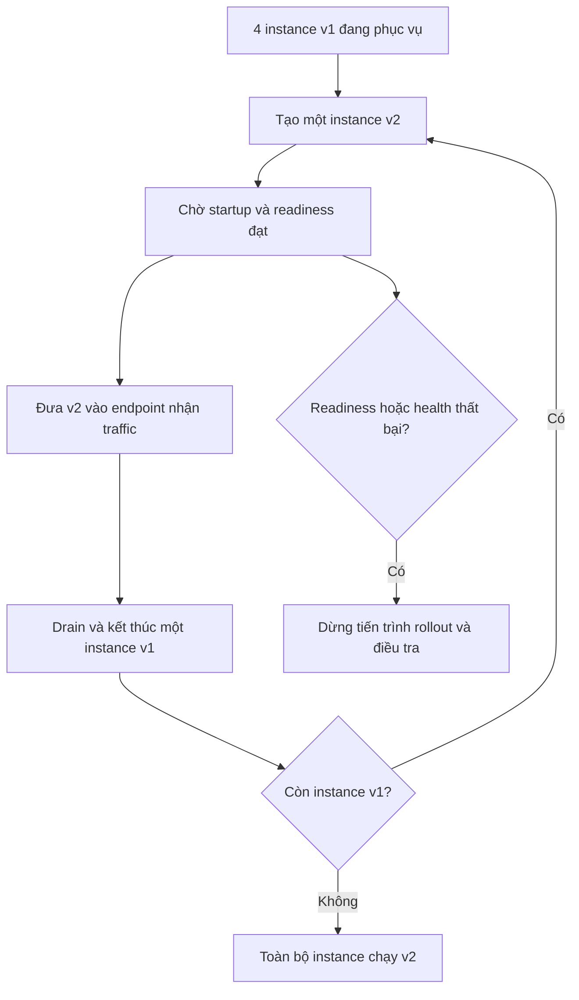
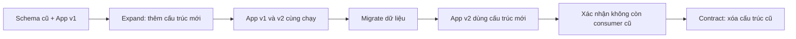
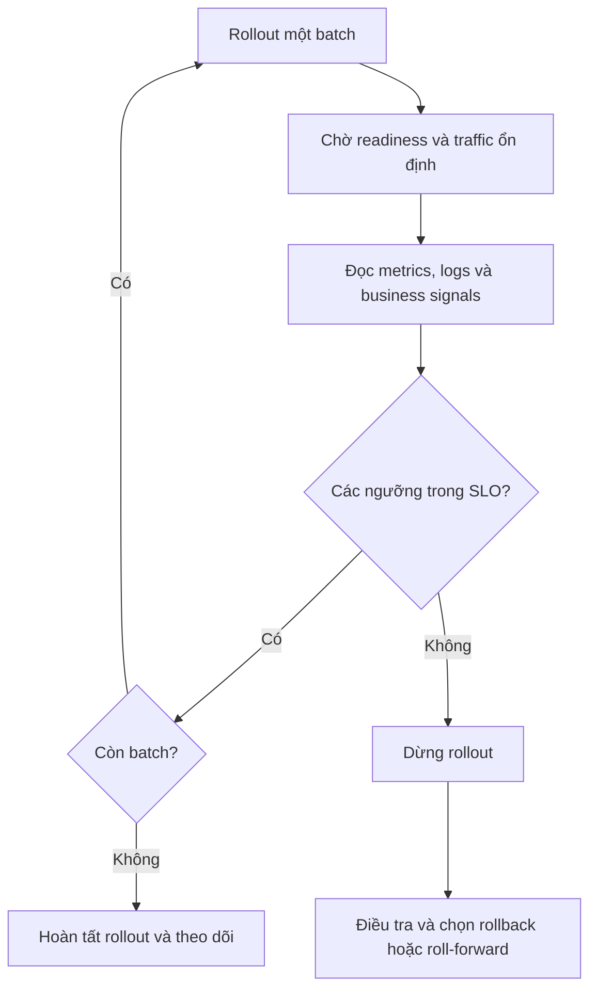

# Hiểu triển khai cuốn chiếu và điều kiện tương thích

Triển khai cuốn chiếu (rolling deployment hoặc rolling update) thay thế các instance của phiên bản đang chạy bằng instance của phiên bản mới theo từng nhóm nhỏ. Trong thời gian chuyển đổi, phiên bản cũ và phiên bản mới cùng tồn tại và có thể cùng nhận traffic. Cách triển khai này giúp duy trì năng lực phục vụ mà không phải dừng toàn bộ hệ thống, nhưng chỉ an toàn khi các phiên bản có thể làm việc đồng thời với cùng API, dữ liệu, message, cấu hình và tài nguyên dùng chung.

Điểm khó nhất của rolling deployment không nằm ở việc tạo Pod hoặc VM mới. Đó là giai đoạn hỗn hợp (mixed-version period): một số request đến phiên bản cũ, request khác đến phiên bản mới; worker cũ có thể đọc message do worker mới tạo; schema database có thể đã được mở rộng trong khi ứng dụng cũ vẫn chạy. Nếu thay đổi không tương thích, rollout có thể làm lỗi xuất hiện ngay cả khi từng phiên bản chạy riêng lẻ đều hoạt động tốt.

## 1. Rolling deployment hoạt động như thế nào?

Giả sử một service có bốn instance phiên bản `v1`. Rolling update tạo một số instance `v2`, chờ chúng sẵn sàng nhận traffic, sau đó giảm dần số instance `v1`. Quá trình tiếp tục cho đến khi toàn bộ replica chạy `v2` hoặc rollout bị dừng do lỗi.



Trong giai đoạn chuyển đổi, hệ thống có thể chạy đồng thời `v1` và `v2`. Vì vậy, điều kiện tương thích phải được thiết kế trước khi phát hành. Rolling deployment không tự động bảo đảm zero downtime: nếu instance mới không sẵn sàng, instance cũ bị dừng quá sớm, capacity không đủ hoặc request đang xử lý bị ngắt, người dùng vẫn có thể gặp gián đoạn.

### 1.1. Rolling update khác thay thế toàn bộ

Với kiểu thay thế toàn bộ (recreate), hệ thống có thể dừng instance cũ trước khi chạy instance mới; cách này đơn giản nhưng thường tạo khoảng gián đoạn. Rolling update giữ một phần năng lực cũ trong lúc tăng dần năng lực mới. Đổi lại, hệ thống phải chấp nhận thời gian hai phiên bản cùng hoạt động và xử lý được sự khác biệt giữa chúng.

### 1.2. Các bước của một vòng rollout

1. Bộ điều phối xác định số instance mới cần tạo theo chính sách rollout.
2. Instance mới khởi động, tải cấu hình và kết nối dependency.
3. Startup/health checks xác nhận tiến trình đã khởi động đúng.
4. Readiness check xác nhận instance có thể nhận traffic.
5. Load balancer hoặc service discovery đưa instance mới vào endpoint.
6. Instance cũ được ngừng nhận request mới, drain kết nối và kết thúc an toàn.
7. Bộ điều phối tiếp tục cho đến khi đạt số replica và trạng thái mong muốn.
8. Hệ thống xác minh rollout hoàn tất và theo dõi chỉ số sau triển khai.

## 2. Vì sao cần tương thích giữa phiên bản cũ và mới?

Một rolling deployment không chuyển tất cả instance trong cùng một thời điểm. Trong khoảng thời gian đó, các thành phần có thể tương tác chéo phiên bản:

- Load balancer gửi request đến cả `v1` và `v2`.
- `v2` ghi dữ liệu mà `v1` vẫn cần đọc.
- `v1` tạo message cho consumer `v2`, hoặc ngược lại.
- Session được tạo bởi phiên bản mới nhưng được đọc bởi phiên bản cũ.
- Cache key hoặc cache value được ghi bởi một phiên bản và đọc bởi phiên bản khác.
- Mobile app, browser hoặc đối tác bên ngoài vẫn gọi API theo hợp đồng cũ.
- Job nền hoặc worker chạy lâu có thể tồn tại lâu hơn thời gian rollout.

Điều kiện tương thích cần xét cả chiều ngược và chiều xuôi:

- **Backward compatibility (tương thích ngược):** phiên bản mới vẫn chấp nhận dữ liệu, request hoặc giao thức do phiên bản cũ tạo ra.
- **Forward compatibility (tương thích xuôi):** phiên bản cũ có thể bỏ qua hoặc xử lý an toàn dữ liệu, trường hoặc message mới mà nó chưa biết.

Trong rolling update, thường cần phiên bản mới tương thích với trạng thái hiện tại và phiên bản cũ không bị phá vỡ bởi thay đổi được triển khai trước hoặc trong rollout. Chỉ kiểm tra `v2` với database mới là chưa đủ; phải kiểm tra cả tình huống `v1` và `v2` cùng chạy trên schema đang tồn tại.

## 3. Xác định ma trận tương thích trước khi phát hành

Hãy lập danh sách các giao diện và trạng thái được chia sẻ giữa phiên bản:

| Ranh giới | Câu hỏi tương thích |
|---|---|
| HTTP/API | Request/response có thêm trường bắt buộc, đổi kiểu dữ liệu hoặc đổi ý nghĩa status/error không? |
| Database schema | Phiên bản cũ có chạy được sau khi schema được mở rộng không? Phiên bản mới có đọc được dữ liệu cũ không? |
| Message/event | Consumer cũ có bỏ qua field mới? Producer mới có còn phát schema mà consumer cũ hiểu không? |
| Session/cookie | Phiên bản cũ có đọc session hoặc cookie được phiên bản mới tạo không? |
| Cache | Hai phiên bản có cùng hiểu key, value và serialization format không? |
| File/object storage | Tên, format, metadata và vòng đời file có tương thích không? |
| Config/feature flag | Giá trị mới có khiến phiên bản cũ khởi động lỗi hoặc hiểu sai không? |
| Background job | Job cũ có tiếp tục chạy sau khi phiên bản mới triển khai không? |
| Protocol/service discovery | TLS, gRPC, DNS, endpoint hoặc auth protocol có thay đổi không? |

Với mỗi ranh giới, xác định producer, consumer, phiên bản đang chạy đồng thời và cách kiểm tra. Nếu không thể bảo đảm tương thích, cần một bước chuyển đổi có kiểm soát, chẳng hạn tạm dừng consumer, drain queue hoặc chia rollout thành các pha.

## 4. Tương thích API trong giai đoạn mixed-version

### 4.1. Thay đổi thường an toàn hơn

Các thay đổi sau thường dễ tương thích hơn nếu được thực hiện đúng:

- Thêm trường response tùy chọn mà client cũ có thể bỏ qua.
- Thêm endpoint mới mà không xóa endpoint cũ.
- Thêm giá trị metadata mà consumer được thiết kế để bỏ qua trường chưa biết.
- Mở rộng enum theo cách client xử lý unknown value an toàn.
- Thêm header tùy chọn không làm thay đổi semantics của request cũ.

Tuy nhiên, “thêm trường” không luôn an toàn. Một client có thể deserialize nghiêm ngặt và từ chối trường lạ; một schema validator có thể cấm additional properties; một enum client có thể crash khi nhận giá trị chưa biết. Cần kiểm tra hành vi của consumer thật, không chỉ nhìn thay đổi từ phía server.

### 4.2. Thay đổi dễ phá vỡ tương thích

- Xóa hoặc đổi tên field/endpoint đang được sử dụng.
- Đổi kiểu field, ví dụ số nguyên thành chuỗi hoặc timestamp thành local date.
- Biến field tùy chọn thành bắt buộc.
- Đổi ý nghĩa giá trị, đơn vị hoặc quy tắc làm tròn.
- Thay đổi authentication/authorization mà client cũ chưa hỗ trợ.
- Thay đổi thứ tự hoặc semantics của message khi consumer phụ thuộc vào thứ tự.
- Trả về status code hoặc error format khác với hợp đồng đã công bố.

Những thay đổi này thường cần giai đoạn chuyển tiếp: hỗ trợ cả hợp đồng cũ và mới, chuyển consumer, quan sát mức sử dụng rồi mới loại bỏ hợp đồng cũ ở release sau.

### 4.3. Ví dụ thêm field vào API

Giả sử API cũ trả về:

```json
{
  "orderId": "ORD-1042",
  "status": "CONFIRMED"
}
```

Phiên bản mới muốn thêm `fulfillmentMode`:

```json
{
  "orderId": "ORD-1042",
  "status": "CONFIRMED",
  "fulfillmentMode": "DELIVERY"
}
```

Để rollout an toàn, client cũ phải bỏ qua field chưa biết hoặc schema contract cho phép mở rộng. Server không nên ngay lập tức yêu cầu mọi client gửi `fulfillmentMode` trong request nếu các client cũ vẫn đang hoạt động. Có thể triển khai theo thứ tự: server chấp nhận field mới ở dạng optional, client mới bắt đầu gửi field, quan sát adoption, rồi mới cân nhắc yêu cầu field trong một release có kế hoạch.

### 4.4. Consumer-driven contract test

Contract test kiểm tra hợp đồng giữa consumer và provider. Trong CI, có thể xác minh provider mới vẫn đáp ứng contract của consumer đang được hỗ trợ và consumer mới vẫn làm việc với provider hiện tại. Với hệ thống nhiều dịch vụ, contract version và compatibility matrix giúp phát hiện thay đổi phá vỡ trước khi triển khai.

Không nên chỉ kiểm thử provider với mock do chính provider tạo ra. Contract cần đại diện cho cách consumer thật sử dụng API, bao gồm field tùy chọn, giá trị unknown, error handling và semantics nghiệp vụ.

## 5. Database migration: điều kiện tương thích quan trọng nhất

Database thường được chia sẻ giữa phiên bản cũ và mới trong suốt rolling update. Vì vậy, schema migration cần cho phép hai phiên bản cùng chạy.

### 5.1. Expand-and-contract

Chiến lược expand-and-contract tách thay đổi phá vỡ thành nhiều release:

1. **Expand:** thêm cột/bảng/index mới hoặc mở rộng schema theo cách phiên bản cũ vẫn hoạt động.
2. **Deploy compatible code:** triển khai phiên bản mới có thể đọc/ghi cấu trúc cũ và mới.
3. **Migrate data:** chuyển dữ liệu theo batch, có thể tiếp tục an toàn và quan sát tiến độ.
4. **Switch usage:** chuyển dần code sang trường/cấu trúc mới và xác minh kết quả.
5. **Contract:** ở một release sau, khi không còn phiên bản cũ hoặc consumer cũ, mới xóa cột/bảng/API cũ.



Ví dụ đổi cột `customer_name` thành `display_name`: không rename hoặc drop cột cũ ngay trong rollout. Thay vào đó, thêm `display_name`, cho code mới đọc cả hai và ghi theo chiến lược tương thích, backfill dữ liệu, chuyển consumer, theo dõi rồi mới drop `customer_name` ở một release sau.

### 5.2. Dual-write cần thận trọng

Trong giai đoạn chuyển tiếp, code có thể ghi cả cột cũ và cột mới. Cách này giúp phiên bản cũ và mới cùng đọc dữ liệu, nhưng tạo rủi ro hai giá trị lệch nhau nếu một lần ghi thất bại giữa chừng. Nếu cần dual-write, nên thực hiện trong cùng transaction khi có thể, có kiểm tra đối soát và metric phát hiện sai khác. Một lựa chọn khác là chỉ ghi nguồn chuẩn và backfill bằng job có thể chạy lặp an toàn.

### 5.3. Migration phải có khả năng tiếp tục và quan sát

Migration dữ liệu lớn nên chia batch, ghi checkpoint, có rate limit và có thể tiếp tục sau lỗi. Tránh migration khóa bảng lâu trong lúc traffic production đang chạy. Kiểm tra query plan, index build, replication lag và dung lượng trước khi thực hiện. Migration phá hủy cần approval và kế hoạch phục hồi riêng.

### 5.4. Rollback ứng dụng không đồng nghĩa rollback schema

Sau khi ứng dụng mới ghi dữ liệu theo schema mới, phiên bản cũ có thể không hiểu dữ liệu đó. Rollback binary về `v1` chưa chắc khôi phục được hệ thống. Vì vậy, trong giai đoạn mixed-version, schema phải tương thích với cả hai phiên bản; thay đổi contract chỉ thực hiện sau khi không còn đường quay về phiên bản cũ hoặc đã có phương án roll-forward.

## 6. Message, event và background worker

Trong kiến trúc bất đồng bộ, producer và consumer có thể được triển khai theo thời điểm khác nhau. Một message mới có thể nằm trong queue nhiều phút hoặc nhiều giờ trước khi consumer xử lý. Vì vậy, tương thích cần kéo dài hơn thời gian rollout.

Các nguyên tắc hữu ích:

- Thêm field mới dưới dạng optional hoặc có default an toàn.
- Consumer bỏ qua field chưa biết khi schema cho phép.
- Không đổi ý nghĩa field hiện có mà vẫn giữ cùng schema version.
- Version hóa event khi thay đổi contract không tương thích.
- Duy trì consumer có thể đọc message cũ trong thời gian queue còn chứa message đó.
- Dùng dead-letter queue, retry có giới hạn và metric theo schema/version.
- Kiểm tra idempotency để message được xử lý lặp không tạo side effect sai.

Ví dụ event cũ:

```json
{
  "eventType": "OrderCreated",
  "orderId": "ORD-1042",
  "customerId": "CUS-91"
}
```

Event mới thêm `sourceChannel`:

```json
{
  "eventType": "OrderCreated",
  "orderId": "ORD-1042",
  "customerId": "CUS-91",
  "sourceChannel": "MOBILE"
}
```

Consumer cũ cần bỏ qua trường mới hoặc schema registry phải cho phép thay đổi tương thích. Nếu thay đổi semantics hoặc xóa field, hãy dùng event version mới và có giai đoạn hỗ trợ song song. Không xóa consumer cũ trước khi queue, retry topic và dead-letter queue không còn message mà consumer đó cần xử lý.

## 7. Session, cookie và cache trong rollout

### 7.1. Session được chia sẻ giữa phiên bản

Nếu session lưu trong Redis hoặc database, phiên bản cũ và mới có thể cùng đọc session. Khi thay đổi serialization format, hãy duy trì khả năng đọc định dạng cũ trong giai đoạn chuyển tiếp. Có thể thêm version field cho session payload, nhưng parser phải xử lý an toàn session cũ và session chưa có version.

Nếu session lưu trong memory của từng instance, load balancer có thể đưa request tiếp theo sang instance khác và làm mất session. Sticky session chỉ giảm tình huống này, không thay thế thiết kế session phù hợp khi instance bị thay thế. Với rolling deployment, cần shared session store hoặc cơ chế stateless token có tương thích.

### 7.2. Xoay khóa ký và mã hóa

Khi đổi signing/encryption key cho cookie hoặc token, phiên bản cũ có thể không xác minh được token do phiên bản mới tạo. Một cách chuyển tiếp là cho phiên bản mới ký bằng key mới nhưng tạm thời chấp nhận cả key cũ và mới; sau khi token cũ hết hạn và mọi instance đã cập nhật, mới loại key cũ. Quy trình này cần quản lý secret an toàn và thời gian overlap có giới hạn.

### 7.3. Cache key và value format

Cache là trạng thái chia sẻ giữa phiên bản. Nếu `v2` đổi format value nhưng `v1` vẫn đọc key đó, có thể gây lỗi deserialize hoặc sai dữ liệu. Dùng version trong cache key, ví dụ `orders:v2:<id>`, hoặc duy trì parser tương thích trong thời gian rollout. Có thể chủ động invalidate cache nếu dữ liệu có thể tạo lại, nhưng phải đánh giá tải tăng đột biến khi cache cold.

## 8. Cấu hình và feature flag trong thời gian chuyển đổi

Một rolling update có thể chạy code mới trong khi feature mới vẫn tắt. Feature flag cho phép tách triển khai code khỏi thời điểm bật tính năng. Tuy nhiên, cả hai phiên bản phải hiểu trạng thái flag và cấu hình trong thời gian overlap.

- Thêm cấu hình mới với default tương thích trước khi triển khai code phụ thuộc vào nó.
- Không xóa key cấu hình cũ khi instance cũ còn cần.
- Đặt default an toàn khi flag service không truy cập được.
- Kiểm tra flag theo nhóm người dùng và khả năng rollback.
- Theo dõi owner, thời hạn và kế hoạch xóa flag sau khi rollout hoàn tất.
- Không dùng flag để che một schema migration phá vỡ tương thích.

Nếu config được nạp lúc startup, cần bảo đảm mọi instance đã nhận cấu hình cần thiết trước khi chuyển traffic. Nếu config được refresh động, kiểm tra phiên bản mới có thể xử lý trạng thái chuyển tiếp và lỗi refresh.

## 9. Readiness, startup, liveness và graceful shutdown

Rolling update phụ thuộc vào tín hiệu cho biết instance mới có thể nhận traffic và instance cũ có thể dừng an toàn.

### 9.1. Startup probe

Startup probe cho ứng dụng có thời gian khởi động dài. Nó cho phép ứng dụng hoàn tất initialization trước khi liveness/readiness bắt đầu có hiệu lực theo cấu hình. Nếu không dùng startup probe phù hợp, liveness có thể restart ứng dụng liên tục khi nó vẫn đang khởi động hợp lệ.

### 9.2. Readiness probe

Readiness trả lời instance có sẵn sàng nhận request hay chưa. Chỉ khi readiness đạt, nền tảng mới nên đưa instance vào tập endpoint phục vụ traffic theo cơ chế của nó. Readiness cần phản ánh khả năng xử lý thực tế: ứng dụng đã load config, mở connection cần thiết và sẵn sàng phục vụ.

Không nên để readiness luôn trả 200 chỉ vì process còn sống. Ngược lại, cũng không nên kiểm tra mọi dependency phụ không thiết yếu đến mức một service phụ bị lỗi khiến toàn bộ instance liên tục bị loại khỏi traffic.

### 9.3. Liveness probe

Liveness giúp phát hiện process bị treo hoặc không thể tự phục hồi. Nó không nên phụ thuộc quá chặt vào một dịch vụ bên ngoài dùng chung. Nếu database tạm thời mất kết nối và liveness restart toàn bộ instance, hệ thống có thể tạo ra vòng lặp restart làm tình trạng nặng hơn.

### 9.4. Graceful shutdown và connection draining

Khi instance cũ bị kết thúc, nó cần ngừng nhận request mới, hoàn tất request đang xử lý trong giới hạn cho phép, đóng consumer hoặc connection và giải phóng tài nguyên. Ứng dụng nên xử lý SIGTERM hoặc tín hiệu tương đương, có thời gian drain rõ ràng và không bắt đầu công việc mới sau khi nhận shutdown signal.

Với worker queue, cần ngừng nhận message mới, hoàn tất hoặc trả lại message đang xử lý theo semantics của broker. Nếu tiến trình bị kill trước khi ack, message có thể được gửi lại; handler cần idempotent.

## 10. Cấu hình rolling update trong Kubernetes

Kubernetes Deployment hỗ trợ chiến lược `RollingUpdate`. Hai tham số quan trọng:

- `maxSurge`: số Pod bổ sung tối đa có thể tạo vượt số replica mong muốn trong rollout.
- `maxUnavailable`: số Pod tối đa được phép không sẵn sàng trong rollout.

Các giá trị có thể là số nguyên hoặc phần trăm. Với cấu hình mặc định của Deployment, hai tham số thường là 25%; hãy khai báo rõ khi hệ thống cần hành vi dự đoán được. Khi `maxUnavailable: 0`, cần cho phép ít nhất một Pod surge để rollout có thể tiến triển.

Ví dụ với bốn replica, `maxSurge: 1` và `maxUnavailable: 0` cho phép tạo thêm tối đa một Pod mới và không chủ động giảm số Pod available dưới số mong muốn trong quá trình rollout. Cấu hình này cần đủ quota CPU/RAM và capacity cluster để chạy thêm Pod.

```yaml
apiVersion: apps/v1
kind: Deployment
metadata:
  name: orders
spec:
  replicas: 4
  minReadySeconds: 10
  progressDeadlineSeconds: 600
  revisionHistoryLimit: 5
  strategy:
    type: RollingUpdate
    rollingUpdate:
      maxSurge: 1
      maxUnavailable: 0
  selector:
    matchLabels:
      app: orders
  template:
    metadata:
      labels:
        app: orders
    spec:
      terminationGracePeriodSeconds: 45
      containers:
        - name: orders
          image: registry.example.com/orders@sha256:0123456789abcdef...
          ports:
            - containerPort: 8080
          startupProbe:
            httpGet:
              path: /health/startup
              port: 8080
            periodSeconds: 5
            failureThreshold: 30
          readinessProbe:
            httpGet:
              path: /health/ready
              port: 8080
            periodSeconds: 5
            failureThreshold: 3
          livenessProbe:
            httpGet:
              path: /health/live
              port: 8080
            periodSeconds: 10
            failureThreshold: 3
```

Digest trong ví dụ là placeholder. Probe path cần do ứng dụng cung cấp và phản ánh trạng thái đúng. `minReadySeconds` yêu cầu Pod duy trì trạng thái Ready trong một khoảng thời gian trước khi được tính là available cho Deployment. `progressDeadlineSeconds` giúp phát hiện rollout không tiến triển; khi vượt deadline, Deployment báo trạng thái tiến triển thất bại nhưng không tự động khôi phục phiên bản cũ.

### 10.1. Theo dõi rollout

Các lệnh thường dùng:

```bash
kubectl rollout status deployment/orders --timeout=10m
kubectl get deployment orders
kubectl get pods -l app=orders -o wide
kubectl describe deployment orders
kubectl rollout history deployment/orders
```

Khi rollout thất bại, xem Pod events, probe failures, container logs, scheduling constraints, image pull errors, resource quota và readiness. Không chỉ nhìn trạng thái Deployment; cần xác minh endpoint và traffic thực tế.

### 10.2. Capacity và scheduling

`maxSurge` tạo thêm Pod trong thời gian overlap. Cluster phải có đủ tài nguyên và quota để scheduler đặt Pod mới. Nếu thiếu CPU/RAM, Pod có thể Pending và rollout không tiến triển. Cần tính cả headroom, autoscaler delay, image pull time và tài nguyên dùng chung.

### 10.3. PodDisruptionBudget không thay thế rollout settings

PodDisruptionBudget (PDB) chủ yếu kiểm soát các voluntary disruptions đi qua eviction API. Không nên dựa vào PDB như cơ chế thay thế `maxUnavailable` của Deployment rollout. Hãy cấu hình rolling update trực tiếp và hiểu đúng phạm vi của PDB khi bảo trì node hoặc drain cluster.

## 11. Điều kiện để rolling deployment không gây gián đoạn

Không có một cấu hình duy nhất bảo đảm zero downtime cho mọi ứng dụng. Cần phối hợp nhiều điều kiện:

- Có ít nhất một tập instance đủ năng lực phục vụ trong suốt rollout.
- Readiness phản ánh đúng khả năng nhận traffic.
- Instance mới không nhận traffic trước khi khởi động và kết nối dependency xong.
- Instance cũ được drain và kết thúc graceful.
- Load balancer/service discovery cập nhật endpoint đúng và có thời gian hội tụ phù hợp.
- API, schema, session, cache và message tương thích trong thời gian overlap.
- Database migration không khóa hoặc phá vỡ hoạt động của phiên bản đang chạy.
- Có capacity cho surge và headroom khi instance bị lỗi.
- Theo dõi error rate, latency, saturation và business metrics trong từng đợt rollout.
- Có cách dừng rollout và phục hồi khi chỉ số vượt ngưỡng.

Nếu ứng dụng có kết nối dài như WebSocket, streaming hoặc gRPC, cần xem xét connection draining và giới hạn thời gian kết nối. Việc loại Pod khỏi endpoint không nhất thiết kết thúc ngay các kết nối đã tồn tại.

## 12. Kiểm thử tương thích trước khi rolling update

CI nên kiểm tra nhiều hơn việc build phiên bản mới độc lập:

1. **API contract tests:** provider mới đáp ứng consumer contract cũ; consumer mới xử lý response của provider hiện tại.
2. **Schema compatibility tests:** code cũ và mới chạy được trên schema trong từng pha migration.
3. **Migration tests:** expand, backfill, retry, resume và rollback/roll-forward được kiểm tra trên dữ liệu đại diện.
4. **Message compatibility tests:** consumer xử lý event cũ và mới; producer không phát schema mà consumer được hỗ trợ không hiểu.
5. **Session/cache tests:** phiên bản cũ đọc được session/cache tạo bởi phiên bản mới trong giai đoạn overlap.
6. **Graceful shutdown tests:** request đang chạy được drain, worker không mất message và tiến trình kết thúc trong deadline.
7. **Load/capacity tests:** hệ thống chịu được số instance giảm tạm thời và phần tài nguyên surge.
8. **Deployment rehearsal:** triển khai thử trên staging với cấu hình rolling gần production, quan sát readiness, traffic và rollback.

Với hệ thống nhiều service, có thể duy trì ma trận tương thích `N` và `N-1`: phiên bản hiện tại phải tương tác được với phiên bản liền trước trong các ranh giới được hỗ trợ. Ma trận cần phản ánh chính sách version thực tế; không nhất thiết phải hỗ trợ mọi tổ hợp lịch sử.

## 13. Theo dõi rollout và quyết định tiếp tục hay dừng

Rolling update nên có điều kiện dừng rõ ràng. Theo dõi ít nhất:

- Tỷ lệ HTTP 5xx hoặc lỗi nghiệp vụ.
- Latency p95/p99 và timeout.
- Throughput và saturation CPU/RAM/thread/connection pool.
- Readiness failures, restart count và thời gian startup.
- Queue lag, dead-letter count và message processing failures.
- Database connection, lock wait, replication lag và migration progress.
- Tỷ lệ hoàn thành tác vụ quan trọng của người dùng.

Có thể triển khai theo từng đợt nhỏ và chờ quan sát một khoảng thời gian trước khi tiếp tục. Nếu lỗi vượt ngưỡng, dừng rollout để tránh mở rộng phạm vi ảnh hưởng. Ngưỡng cần dựa trên baseline/SLO, không chọn một con số chung cho mọi service.



## 14. Rollback trong một rollout cuốn chiếu

Nếu phiên bản mới gây lỗi, có thể dừng rollout và triển khai lại revision trước. Tuy nhiên, rollback chỉ an toàn khi phiên bản cũ tương thích với schema, dữ liệu, message, session và cấu hình hiện tại.

Trước rollback, kiểm tra:

- Database đã có migration phá hủy hay chưa.
- `v2` đã ghi dữ liệu mà `v1` không hiểu chưa.
- Queue có message mới mà consumer cũ không xử lý được không.
- Session/cookie/cache đã đổi format hoặc key chưa.
- External API hoặc client đã bắt đầu phụ thuộc vào field mới chưa.
- Feature flag và cấu hình hiện tại có tương thích với `v1` không.

Nếu các điều kiện không cho phép quay về `v1`, có thể cần roll-forward bằng bản sửa lỗi tương thích hoặc khôi phục dữ liệu theo quy trình riêng. Không tự động rollback schema chỉ vì ứng dụng đã rollback. Migration và rollback ứng dụng là hai thao tác có vòng đời khác nhau.

## 15. Ví dụ xuyên suốt: thêm trường địa chỉ giao hàng

Service `orders` hiện lưu địa chỉ giao hàng trong cột `address`. Phiên bản mới muốn tách thành `street`, `city` và `postal_code`. Nếu đổi schema và code trong một release duy nhất, rolling update có thể làm `v1` lỗi ngay khi cột `address` bị xóa.

Một cách chuyển đổi an toàn hơn:

1. **Release A – Expand:** thêm các cột mới nullable; giữ `address` và index cũ. Code `v1` vẫn hoạt động.
2. **Release B – Compatible app:** triển khai code có thể đọc cả `address` và các cột mới. Khi ghi, code duy trì dữ liệu theo quy tắc chuyển tiếp có đối soát.
3. **Backfill:** chạy job chuyển dữ liệu cũ sang cột mới theo batch, ghi checkpoint và kiểm tra số bản ghi.
4. **Switch:** chuyển đọc chính sang các cột mới; theo dõi bản ghi thiếu hoặc sai lệch. Các instance `v1` còn lại vẫn đọc được `address`.
5. **Drain old version:** xác nhận không còn instance, worker hoặc consumer cần cột cũ; chờ hết các job dài và cửa sổ rollback đã định.
6. **Release C – Contract:** trong một release sau, ngừng ghi/đọc `address`, sau đó mới xóa cột và code tương thích cũ.

Trong từng rolling update, readiness và graceful shutdown giúp thay instance an toàn; expand-and-contract giúp hai phiên bản cùng làm việc với schema; metrics và data reconciliation xác nhận migration đúng. Đây là phối hợp giữa chiến lược triển khai và thiết kế tương thích, không chỉ là cấu hình Deployment.

## 16. Những anti-pattern thường gặp

| Anti-pattern | Rủi ro | Cách làm tốt hơn |
|---|---|---|
| Đổi schema phá vỡ trong cùng rollout | Instance cũ lỗi khi schema bị thay đổi | Expand-and-contract qua nhiều release |
| Readiness chỉ kiểm tra process còn sống | Pod nhận traffic trước khi sẵn sàng | Readiness kiểm tra điều kiện phục vụ thực tế |
| Dùng liveness để kiểm tra mọi dependency | Restart hàng loạt khi dịch vụ ngoài lỗi | Phân biệt startup, readiness và liveness |
| Kết thúc instance cũ ngay lập tức | Request/worker đang chạy bị ngắt | Graceful shutdown và drain |
| Giả định API thêm field luôn an toàn | Client parser nghiêm ngặt có thể lỗi | Contract test và kiểm tra unknown fields |
| Đổi serialization session/cache một bước | Phiên bản cũ không đọc được trạng thái mới | Versioned format hoặc key namespace |
| Chỉ test từng phiên bản riêng | Không phát hiện lỗi khi chúng cùng tồn tại | Test N/N-1 và mixed-version scenarios |
| Dựa vào PDB để kiểm soát Deployment rollout | Hiểu sai phạm vi bảo vệ của PDB | Cấu hình `maxSurge`/`maxUnavailable` trực tiếp |
| Rollback binary mà không kiểm tra dữ liệu | Phiên bản cũ không tương thích với schema mới | Xác minh schema/message/session trước rollback |
| Tăng replica nhưng không tính capacity | Pod mới Pending, rollout không tiến triển | Dự trù headroom và quota cho surge |

## 17. Checklist thiết kế rolling deployment

- [ ] Đã xác định số replica, `maxSurge`, `maxUnavailable` và capacity trong thời gian overlap.
- [ ] Readiness, startup và liveness probes có mục tiêu riêng và phản ánh đúng trạng thái ứng dụng.
- [ ] Instance mới chỉ nhận traffic sau khi thực sự sẵn sàng.
- [ ] Instance cũ có graceful shutdown, connection draining và thời gian kết thúc phù hợp.
- [ ] Phiên bản cũ và mới tương thích với API, schema, event/message, session, cache và config.
- [ ] Database migration dùng expand-and-contract khi có thay đổi phá vỡ.
- [ ] Có test N/N-1, contract tests và mixed-version integration tests.
- [ ] Background worker và queue xử lý được message cũ/mới trong thời gian overlap.
- [ ] Có metrics và business signals với ngưỡng dừng rollout dựa trên SLO.
- [ ] Có thể pause rollout, giữ bằng chứng và xác định artifact digest đang chạy.
- [ ] Rollback đã được đánh giá cùng schema, dữ liệu, message và cấu hình.
- [ ] Sau rollout, xác minh toàn bộ instance chạy digest dự kiến và hành vi người dùng bình thường.

Triển khai cuốn chiếu giúp thay phiên bản từng phần và duy trì năng lực phục vụ, nhưng đòi hỏi các phiên bản cùng tồn tại phải tương thích. Hãy thiết kế API, schema, message, session và cache theo các pha chuyển tiếp; dùng readiness và graceful shutdown để kiểm soát traffic; theo dõi rollout bằng tín hiệu kỹ thuật lẫn nghiệp vụ; và chỉ loại bỏ cấu trúc cũ sau khi không còn consumer cần nó. Khi các điều kiện này được kiểm chứng trong CI/CD, rolling deployment mới trở thành một cách phát hành an toàn và có thể phục hồi.
