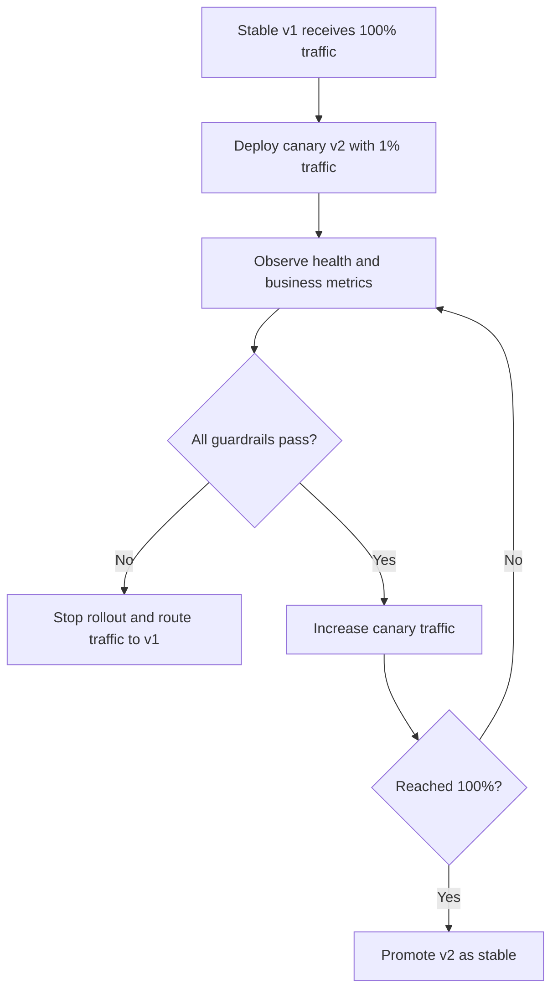
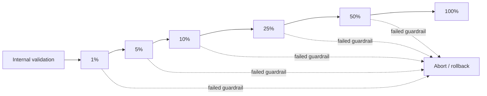

# Hiểu canary và cách tăng dần phạm vi ảnh hưởng

Triển khai một phiên bản mới cho toàn bộ người dùng trong một lần có thể làm sự cố lan rộng trước khi nhóm kịp nhận ra. Một lỗi nhỏ trong logic tính giá, truy vấn database hoặc cấu hình kết nối có thể ảnh hưởng đến hàng nghìn request ngay khi toàn bộ traffic chuyển sang phiên bản mới.

Canary deployment giảm rủi ro bằng cách đưa phiên bản mới đến một phần nhỏ traffic hoặc một nhóm người dùng trước. Nhóm quan sát hành vi thực tế, so sánh với baseline và chỉ mở rộng khi các chỉ số quan trọng vẫn nằm trong ngưỡng cho phép. Nếu xuất hiện tín hiệu xấu, rollout được dừng hoặc traffic được chuyển lại phiên bản ổn định.

**Canary là cách kiểm chứng phiên bản mới trong điều kiện production với phạm vi ảnh hưởng được giới hạn.** Việc tăng dần traffic phải đi cùng tiêu chí đo lường, khoảng quan sát, quyết định tự động hoặc có người chịu trách nhiệm, và phương án phục hồi đã chuẩn bị trước. Chỉ tăng tỷ lệ traffic theo thời gian mà không đánh giá sức khỏe hệ thống thì chưa tạo thành một canary an toàn.

## 1. Canary deployment là gì?

Canary deployment là chiến lược phát hành trong đó phiên bản mới (canary) chỉ nhận một phần traffic hoặc một cohort người dùng trong giai đoạn đầu. Phiên bản đang phục vụ ổn định tiếp tục nhận phần traffic còn lại. Khi có đủ bằng chứng rằng phiên bản mới hoạt động tốt, nhóm tăng dần phạm vi của nó cho đến khi hoàn tất rollout.

Tên gọi canary bắt nguồn từ cách dùng chim hoàng yến để phát hiện khí độc trong hầm mỏ: một tín hiệu sớm giúp nhận biết nguy hiểm trước khi nhiều người bị ảnh hưởng. Trong triển khai phần mềm, nhóm người dùng hoặc traffic nhỏ đóng vai trò phát hiện sớm vấn đề của phiên bản mới.

Ví dụ, một dịch vụ đang chạy phiên bản `v1` nhận 100% traffic. Nhóm triển khai `v2` và chuyển 1% traffic sang `v2`. Nếu error rate, latency và chỉ số nghiệp vụ ổn định trong cửa sổ quan sát, nhóm tăng lên 5%, 10%, 25%, 50% rồi 100%. Nếu `v2` có lỗi vượt ngưỡng, hệ thống dừng tăng traffic và đưa traffic về `v1`.



Canary thường được xếp vào nhóm progressive delivery (phân phối tăng dần). Nó tập trung vào cách đưa traffic đến phiên bản mới theo từng bước và dùng quan sát để quyết định bước tiếp theo.

## 2. Phân biệt deploy, rollout và promotion

Các thuật ngữ này thường xuất hiện cùng nhau nhưng không hoàn toàn giống nhau:

- **Deploy:** đưa phiên bản mới hoặc tài nguyên mới vào môi trường, chẳng hạn tạo pod, VM hoặc release mới.
- **Rollout:** quá trình thay thế dần phiên bản cũ bằng phiên bản mới, có thể bao gồm khởi tạo instance, kiểm tra readiness và điều chỉnh traffic.
- **Traffic shifting:** thay đổi tỷ lệ request được định tuyến đến từng phiên bản.
- **Promotion:** quyết định phiên bản canary đủ điều kiện trở thành phiên bản chính hoặc nhận toàn bộ traffic.
- **Rollback:** quay lại phiên bản hoặc trạng thái trước đó khi phiên bản mới không đạt điều kiện.
- **Roll forward:** sửa lỗi và triển khai một phiên bản mới hơn để đưa hệ thống về trạng thái đúng.

Một canary có thể được deploy nhưng chưa nhận traffic. Sau đó traffic được chuyển dần. Khi đạt 100%, phiên bản mới được promote. Tách các bước này giúp nhóm có thể khởi động và kiểm tra instance trước khi cho người dùng truy cập.

## 3. Canary khác gì rolling, blue-green và feature flag?

| Chiến lược | Cách hoạt động | Cách giới hạn ảnh hưởng | Điểm cần lưu ý |
|---|---|---|---|
| Rolling deployment | Thay instance cũ bằng instance mới theo từng nhóm | Một phần instance chạy phiên bản mới trong lúc chuyển đổi | Không nhất thiết giới hạn tỷ lệ request chính xác đến phiên bản mới |
| Blue-green | Duy trì hai môi trường, chuyển traffic từ blue sang green | Có thể chuyển traffic theo một lần hoặc theo tỷ lệ nếu có router hỗ trợ | Cần duy trì hai môi trường và đồng bộ trạng thái dữ liệu |
| Canary | Cho một phần traffic/cohort dùng phiên bản mới rồi tăng dần | Tỷ lệ traffic hoặc nhóm người dùng được kiểm soát | Cần metric, guardrail và quy trình quyết định rõ |
| Feature flag | Bật/tắt một tính năng trong cùng phiên bản hoặc giữa các phiên bản | Nhóm người dùng hoặc request được chọn theo rule | Không thay thế deploy, kiểm tra tương thích hoặc rollback artifact |

Các chiến lược có thể kết hợp. Ví dụ, triển khai canary bằng rolling update để tạo instance mới, dùng service mesh để chia traffic và feature flag để chỉ bật chức năng mới cho cohort nhỏ. Blue-green cũng có thể dùng làm nền tảng cho canary nếu router hỗ trợ phân luồng theo tỷ lệ.

Điều quan trọng là xác định chính xác cơ chế đang giới hạn rủi ro. Nếu chỉ chạy 1 pod mới nhưng load balancer vẫn gửi gần như toàn bộ traffic đến pod đó, cấu hình canary chưa đạt mục tiêu.

## 4. Khi nào nên dùng canary?

Canary hữu ích khi phiên bản mới có thể tạo rủi ro vận hành hoặc nghiệp vụ đáng kể và hệ thống có khả năng quan sát, định tuyến traffic cùng phục hồi nhanh.

Các tình huống phù hợp:

- Thay đổi API hoặc logic nghiệp vụ có lượng request lớn.
- Thay đổi thuật toán tính giá, phân loại, gợi ý hoặc xử lý giao dịch.
- Nâng runtime, framework hoặc dependency quan trọng.
- Thay đổi cấu hình cache, connection pool, timeout hoặc concurrency.
- Thay đổi authentication, authorization hoặc luồng dữ liệu nhạy cảm.
- Triển khai service có nhiều instance và hỗ trợ định tuyến traffic theo phiên bản.
- Thử nghiệm hiệu năng hoặc độ ổn định trên một phần traffic thực.

Canary ít phù hợp nếu không thể phân biệt request theo phiên bản, không có telemetry đáng tin cậy, không thể đưa traffic trở lại phiên bản cũ hoặc thay đổi tạo side effect không thể đảo ngược. Với job batch chạy một lần, migration phá hủy dữ liệu hoặc tác vụ không có traffic liên tục, cần chiến lược kiểm soát khác.

### Điều kiện tiên quyết

Trước khi chọn canary, cần xác nhận:

1. Có ít nhất một phiên bản ổn định để nhận phần traffic chưa chuyển.
2. Router, ingress, load balancer hoặc service mesh có thể điều khiển traffic theo phiên bản.
3. Mỗi phiên bản có thể được nhận diện trong metrics, logs và traces.
4. Có baseline hoặc tiêu chí để đánh giá phiên bản mới.
5. Có health check và metric nghiệp vụ phù hợp.
6. Có cách dừng rollout và chuyển traffic về phiên bản ổn định.
7. Thay đổi database, message và cache tương thích trong thời gian hai phiên bản cùng chạy.

## 5. Chọn phạm vi canary: traffic, cohort hay instance

Canary có thể giới hạn theo nhiều cách. Chọn cách nào phụ thuộc kiến trúc, loại người dùng và khả năng định tuyến.

### 5.1. Chia theo tỷ lệ traffic

Router gửi một tỷ lệ request nhất định đến phiên bản mới, ví dụ 1%, 5% hoặc 10%. Cách này dễ hiểu và phù hợp với API/service stateless.

Tuy nhiên, 1% request không nhất thiết tương đương 1% người dùng. Một người dùng có thể tạo nhiều request; một request nặng có thể chiếm nhiều tài nguyên hơn request thông thường. Cần xác định đơn vị phân bổ và quan sát cả request count lẫn tải thực tế.

### 5.2. Chia theo cohort người dùng

Nhóm có thể chọn một nhóm người dùng, tenant, tài khoản nội bộ hoặc khu vực địa lý để nhận phiên bản mới. Cohort cần được chọn ổn định và có tiêu chí rõ ràng.

Ưu điểm là dễ kiểm soát nhóm thử nghiệm và theo dõi trải nghiệm xuyên suốt. Rủi ro là cohort có thể không đại diện cho toàn bộ người dùng. Ví dụ, nhân viên nội bộ thường có hành vi khác khách hàng thật; tenant lớn có thể tạo tải khác tenant nhỏ.

### 5.3. Chia theo instance hoặc zone

Có thể triển khai phiên bản mới trên một số instance hoặc một availability zone trước. Cách này giúp quan sát ảnh hưởng đến hạ tầng và khả năng chịu tải, nhưng traffic không nhất thiết được chia đều nếu thuật toán định tuyến hoặc phân bố người dùng khác nhau.

### 5.4. Sticky routing và session

Với ứng dụng có session, một người dùng có thể cần tiếp tục được định tuyến đến cùng phiên bản trong một khoảng thời gian để tránh mất trạng thái. Sticky routing giúp trải nghiệm ổn định nhưng có thể làm tỷ lệ thực tế khác tỷ lệ cấu hình.

Nếu phiên bản mới và cũ không chia sẻ session format hoặc cache schema tương thích, việc chuyển request giữa hai phiên bản có thể gây lỗi. Cần thiết kế session và cache theo hướng tương thích trong giai đoạn rollout.

## 6. Thiết kế các giai đoạn tăng dần

Một rollout canary thường được chia thành các bước có phạm vi và thời gian quan sát cụ thể. Không có tỷ lệ chuẩn áp dụng cho mọi hệ thống.

Ví dụ lịch tăng dần:

| Giai đoạn | Traffic canary | Mục tiêu |
|---|---:|---|
| Internal | 0% traffic công khai; nhóm nội bộ thử trước | Kiểm tra khởi động và luồng chính |
| Canary nhỏ | 1% | Phát hiện lỗi nghiêm trọng sớm |
| Canary mở rộng | 5% | Xác minh hành vi dưới tải thực cao hơn |
| Early rollout | 10% | Kiểm tra thêm cohort và phân bố request |
| Mid rollout | 25% | Quan sát tác động rõ hơn đến tải và nghiệp vụ |
| Late rollout | 50% | Xác minh trước khi chuyển phần lớn traffic |
| Complete | 100% | Promote phiên bản mới thành stable |



Mỗi giai đoạn cần xác định:

- Tỷ lệ traffic hoặc cohort mục tiêu.
- Thời gian tối thiểu để thu thập đủ dữ liệu.
- Số request hoặc giao dịch tối thiểu.
- Metric và ngưỡng chấp nhận.
- Người hoặc controller quyết định bước tiếp theo.
- Điều kiện dừng, giữ nguyên tỷ lệ hoặc rollback.

Tăng từ 1% lên 100% chỉ sau vài phút có thể quá nhanh nếu hệ thống có chu kỳ tải theo giờ hoặc tác vụ batch. Ngược lại, giữ 1% quá lâu khi lưu lượng rất thấp có thể không thu thập đủ mẫu để đánh giá.

## 7. Chọn metric và guardrail cho canary

Canary chỉ có ý nghĩa nếu nhóm có thể nhận ra phiên bản mới đang tốt hơn, tương đương hay tệ hơn phiên bản ổn định.

### 7.1. Metric kỹ thuật

- Request success rate và error rate theo phiên bản.
- HTTP 5xx, timeout và lỗi kết nối.
- Latency p50, p95, p99.
- CPU, memory, garbage collection và thread saturation.
- Queue depth, consumer lag và retry rate.
- Database connection, query latency, lock wait và deadlock.
- Restart count, crash loop và readiness failure.

### 7.2. Metric nghiệp vụ

- Tỷ lệ tạo đơn hàng thành công.
- Tỷ lệ thanh toán được chấp nhận.
- Tỷ lệ đăng nhập thành công.
- Tỷ lệ hoàn tất quy trình hoặc conversion.
- Tỷ lệ giao dịch trùng, bị từ chối hoặc bị hủy.
- Tỷ lệ dữ liệu sai hoặc sự kiện bị thất lạc.

Metric nghiệp vụ rất quan trọng vì một phiên bản có thể có CPU và latency tốt nhưng tạo kết quả sai. Ví dụ, API trả HTTP 200 nhưng tính sai phí giao hàng thì canary vẫn gây thiệt hại.

### 7.3. Guardrail

Guardrail là điều kiện giới hạn để quyết định tiếp tục rollout. Ví dụ:

| Metric | Ví dụ guardrail minh họa | Hành động nếu vượt ngưỡng |
|---|---|---|
| 5xx rate | Không tăng quá 0,5 điểm phần trăm so với baseline trong cửa sổ đủ mẫu | Dừng tăng traffic, điều tra hoặc rollback |
| p95 latency | Không tăng quá 15% so với stable | Giữ tỷ lệ hoặc dừng rollout |
| Crash/restart | Không có crash loop mới hoặc restart tăng bất thường | Dừng rollout và kiểm tra |
| Business success rate | Không giảm quá ngưỡng đã định theo nghiệp vụ | Dừng rollout, xác minh dữ liệu và hành vi |
| Queue lag | Không vượt mức backlog có thể xử lý trong SLO | Giữ tỷ lệ hoặc rollback |

Các con số trên chỉ là ví dụ. Ngưỡng thực tế phải dựa trên SLO, baseline, tải và mức độ rủi ro của sản phẩm. Không nên sao chép một ngưỡng chung cho mọi service.

### 7.4. So sánh canary với stable

So sánh hai phiên bản trong cùng khoảng thời gian giúp loại bớt ảnh hưởng của tải hoặc sự kiện chung. Cần gắn label phiên bản vào metrics và trace, đồng thời so sánh những request có đặc điểm tương đương.

Nếu canary nhận toàn request đơn giản còn stable nhận phần lớn request phức tạp, so sánh latency thô có thể gây kết luận sai. Có thể phân nhóm theo endpoint, tenant, khu vực, loại giao dịch hoặc độ phức tạp của request.

## 8. Cửa sổ quan sát và ý nghĩa thống kê

Một vài request thành công không đủ chứng minh phiên bản mới ổn định. Canary cần thời gian và số mẫu đủ để phát hiện lỗi với mức tin cậy phù hợp.

Các yếu tố cần cân nhắc:

- Lưu lượng trung bình và giờ cao điểm.
- Chu kỳ batch, cron job và tác vụ nền.
- Số request tối thiểu cho mỗi giai đoạn.
- Tần suất lỗi hiếm và hậu quả của lỗi.
- Mùa vụ hoặc sự kiện làm thay đổi hành vi người dùng.
- Độ trễ của metric và hệ thống telemetry.

Nếu một service chỉ có vài request mỗi phút, tỷ lệ lỗi trong 1% traffic có thể không đủ mẫu. Có thể tăng cohort nội bộ, dùng synthetic test hoặc giữ giai đoạn lâu hơn. Không nên tăng traffic chỉ vì thời gian quan sát đã hết nếu số mẫu tối thiểu chưa đạt.

### Tránh kết luận từ một metric đơn lẻ

Một metric có thể dao động do nhiễu. Ví dụ, CPU tăng nhẹ khi cache lạnh nhưng request success và latency vẫn ổn định. Ngược lại, error rate có thể không tăng nhưng tỷ lệ nghiệp vụ thất bại tăng do response sai.

Nên kết hợp:

1. Metric kỹ thuật phản ánh sức khỏe service.
2. Metric nghiệp vụ phản ánh kết quả người dùng.
3. Metric hạ tầng phản ánh áp lực tài nguyên.
4. Log và trace để giải thích thay đổi bất thường.

Với quyết định tự động, cần quy định mức độ dữ liệu tối thiểu và cách xử lý telemetry bị thiếu. Metric không có dữ liệu không thể được hiểu là metric tốt.

## 9. Tự động hóa phân tích và quyết định rollout

Progressive delivery controller có thể tự đánh giá metric ở mỗi giai đoạn. Tuy nhiên, quyết định cần có quy tắc minh bạch và có thể truy vết.

Luồng tự động thường gồm:

1. Tạo canary workload và gắn version label.
2. Cấu hình traffic weight ban đầu.
3. Chờ readiness và smoke check.
4. Thu thập metric trong cửa sổ quan sát.
5. Đánh giá guardrail và số mẫu.
6. Nếu đạt, tăng traffic theo bước kế tiếp.
7. Nếu không đạt hoặc không đủ dữ liệu, dừng hoặc giữ nguyên rollout theo policy.
8. Khi đạt 100%, xác nhận stable revision và lưu release evidence.

### Pseudocode quyết định

```python
def evaluate_stage(metrics, sample_count, policy):
    if metrics.telemetry_missing:
        return "HOLD"

    if sample_count < policy.minimum_samples:
        return "HOLD"

    if metrics.critical_error_detected:
        return "ABORT"

    if metrics.error_rate > policy.max_error_rate:
        return "ABORT"

    if metrics.p95_latency > policy.max_p95_latency:
        return "HOLD"

    if metrics.business_success_rate < policy.minimum_business_success:
        return "ABORT"

    return "PROMOTE"
```

Đây là pseudocode minh họa. Hệ thống thực tế cần định nghĩa metric, baseline, cách tính tỷ lệ, cửa sổ thời gian, mức độ nghiêm trọng và hành vi khi dữ liệu thiếu. `HOLD` có thể giữ traffic ở mức hiện tại để thu thập thêm dữ liệu; `ABORT` dừng rollout và thực hiện hành động phục hồi; `PROMOTE` cho phép tăng tỷ lệ.

### Manual approval hay automated analysis?

Tự động hóa phù hợp với metric định lượng và policy rõ. Người vận hành cần tham gia khi có thay đổi rủi ro cao, dữ liệu mâu thuẫn, tín hiệu bất thường khó giải thích hoặc cần chấp nhận rủi ro còn lại. Có thể kết hợp: controller tự đánh giá và chuẩn bị evidence, người có thẩm quyền xác nhận ở mốc 50% hoặc trước 100% tùy policy.

## 10. Triển khai canary trên Kubernetes và service mesh

Canary cần một cơ chế định tuyến nhận biết phiên bản. Kubernetes Deployment có thể tạo nhiều ReplicaSet, nhưng Service thông thường chọn pod theo label và không tự cung cấp tỷ lệ traffic chính xác giữa hai revision. Để chia traffic theo tỷ lệ, thường cần ingress controller, gateway, service mesh hoặc progressive delivery controller hỗ trợ.

### 10.1. Tách stable và canary workload

Ví dụ minh họa hai Deployment cùng phục vụ một service:

```yaml
apiVersion: apps/v1
kind: Deployment
metadata:
  name: orders-api-stable
spec:
  replicas: 8
  selector:
    matchLabels:
      app: orders-api
      track: stable
  template:
    metadata:
      labels:
        app: orders-api
        track: stable
        version: v1
    spec:
      containers:
        - name: app
          image: registry.example.test/orders-api@sha256:STABLE_DIGEST
          ports:
            - containerPort: 8080
---
apiVersion: apps/v1
kind: Deployment
metadata:
  name: orders-api-canary
spec:
  replicas: 1
  selector:
    matchLabels:
      app: orders-api
      track: canary
  template:
    metadata:
      labels:
        app: orders-api
        track: canary
        version: v2
    spec:
      containers:
        - name: app
          image: registry.example.test/orders-api@sha256:CANARY_DIGEST
          ports:
            - containerPort: 8080
```

Đây là manifest minh họa nhãn và workload riêng, không phải cấu hình traffic split hoàn chỉnh. Cần cấu hình Service/gateway phù hợp để định tuyến đúng. Không nên giả định một pod canary sẽ nhận 1/9 traffic chỉ vì có một pod trong tổng số chín pod; kết quả còn phụ thuộc kết nối, load balancing, keep-alive và router.

### 10.2. Traffic routing

Ingress, gateway hoặc service mesh có thể định tuyến theo weight, header, cookie hoặc identity. Cần xác minh weight thực tế và khả năng áp dụng đồng đều qua các gateway/region.

Với canary theo header, chỉ người dùng hoặc test có header hợp lệ được chuyển sang phiên bản mới. Cách này phù hợp để kiểm tra nội bộ trước khi mở tỷ lệ traffic công khai, nhưng cần bảo vệ header để người dùng không tự chọn phiên bản nếu không mong muốn.

### 10.3. Progressive delivery controller

Các controller như Argo Rollouts hoặc Flagger có thể điều phối canary, cập nhật traffic weight, chờ analysis và tự động promote/abort theo metric. Cấu hình cần pin version, bảo vệ quyền controller và kiểm thử policy trước khi dùng trên production.

## 11. Quản lý trạng thái dùng chung khi hai phiên bản cùng chạy

Trong giai đoạn canary, phiên bản cũ và mới thường cùng hoạt động. Điều này tạo yêu cầu tương thích đối với database, cache, session, message và API.

### 11.1. Database schema

Không triển khai một thay đổi schema khiến phiên bản cũ không thể chạy trong khi canary vẫn cần rollback về phiên bản cũ. Dùng chiến lược expand–migrate–contract:

1. Thêm cột hoặc cấu trúc mới theo cách phiên bản cũ vẫn hoạt động.
2. Triển khai phiên bản mới có thể đọc/ghi schema mới.
3. Chuyển dữ liệu hoặc dual-write có kiểm soát nếu cần.
4. Chờ tất cả instance cũ ngừng sử dụng schema cũ.
5. Xóa cấu trúc cũ ở một release riêng sau khi cửa sổ rollback kết thúc.

Migration phá hủy dữ liệu thường không thể rollback chỉ bằng cách chuyển traffic về image cũ. Cần backup, restore plan hoặc roll-forward migration.

### 11.2. Cache và session

Hai phiên bản cần hiểu cùng định dạng cache và session trong thời gian chuyển tiếp. Nếu phiên bản mới đổi key hoặc serialization, nên dùng versioned key hoặc hỗ trợ đọc cả format cũ và mới trong giai đoạn rollout.

### 11.3. Message và event schema

Consumer cũ có thể nhận event do producer mới phát ra. Schema cần tương thích ngược hoặc có versioning; tránh xóa field bắt buộc hoặc thay đổi semantics trong lúc hai phiên bản cùng hoạt động.

### 11.4. External side effects

Canary có thể gửi email, tạo thanh toán, cập nhật tồn kho hoặc phát event. Không nhân đôi side effect chỉ vì request được retry hoặc định tuyến lại. Cần idempotency key, deduplication và quy tắc ownership rõ ràng.

## 12. Rollback, abort và roll forward

Khi canary không đạt guardrail, hành động đầu tiên thường là ngừng tăng traffic. Sau đó xác định cần chuyển traffic về stable, scale down canary, tắt feature flag hay triển khai bản sửa.

### Abort

Abort dừng rollout đang diễn ra. Nó có thể giữ canary để điều tra hoặc scale down tùy chính sách. Nếu phiên bản mới đã gây side effect, abort không tự hoàn tác dữ liệu hoặc giao dịch đã xảy ra.

### Rollback

Rollback chuyển traffic hoặc workload về phiên bản ổn định trước đó. Cần bảo đảm artifact cũ vẫn có sẵn, cấu hình tương thích và database schema không khiến phiên bản cũ lỗi.

### Roll forward

Roll forward triển khai một phiên bản mới sửa lỗi. Cách này phù hợp khi thay đổi dữ liệu hoặc schema khiến rollback không an toàn, hoặc bản cũ không còn tương thích với trạng thái hiện tại.

### Tiêu chí phục hồi

- Tỷ lệ lỗi vượt ngưỡng critical.
- Latency hoặc saturation vượt SLO trong thời gian quy định.
- Metric nghiệp vụ cho thấy giao dịch sai, thất bại hoặc trùng lặp.
- Có dấu hiệu mất dữ liệu, truy cập sai quyền hoặc sự cố bảo mật.
- Telemetry thiết yếu không hoạt động khiến không thể đánh giá an toàn.

Không nên chờ hết mọi cửa sổ quan sát nếu đã xuất hiện tín hiệu critical. Với lỗi ít nghiêm trọng hoặc có khả năng do nhiễu, có thể giữ traffic ở mức hiện tại và thu thập thêm bằng chứng.

## 13. Bảo vệ và truy vết canary

Canary là một deployment production nên phải tuân theo cùng yêu cầu bảo mật như rollout thông thường.

- Artifact canary cần được build từ commit đã review, có digest bất biến và provenance.
- Không cấp quyền rộng hơn cho canary chỉ vì nó là phiên bản thử nghiệm.
- Secret và workload identity cần scope đúng service và environment.
- Traffic split không được làm lộ endpoint nội bộ hoặc bỏ qua authentication.
- Cohort thử nghiệm cần tuân thủ quyền riêng tư và chính sách dữ liệu.
- Canary không nên ghi dữ liệu production khác biệt nếu chưa có kế hoạch tương thích.
- Log, metrics và trace phải gắn release ID, version và deployment ID.
- Mọi lần tăng traffic, hold, abort, promote và rollback cần được audit.

Nếu dùng header hoặc cookie để chọn cohort, không dùng giá trị có thể giả mạo để cấp quyền. Routing chỉ chọn phiên bản; authorization vẫn phải được thực hiện ở ứng dụng.

## 14. Canary cho các hệ thống khác nhau

### 14.1. API và microservices

Đây là trường hợp phổ biến nhất. Gateway hoặc service mesh chia traffic theo weight; metrics phân biệt stable/canary; controller tự tăng tỷ lệ khi guardrail đạt.

### 14.2. Web frontend

Có thể phục vụ bundle mới cho một cohort hoặc một tỷ lệ người dùng. Cần giữ asset cũ sẵn có và bảo đảm API backend tương thích với cả frontend cũ lẫn mới trong thời gian rollout.

### 14.3. Mobile application

Không thể thu hồi binary đã cài trên thiết bị người dùng theo cách giống server. Có thể phát hành theo staged rollout trên app store, theo dõi crash/ANR và tỷ lệ lỗi theo version, sau đó tăng tỷ lệ phát hành. Feature flag và server-side kill switch giúp tắt chức năng rủi ro mà không cần người dùng cài lại ngay.

### 14.4. Batch và worker

Với worker, có thể tăng dần số worker mới, chia partition hoặc queue consumer group. Cần tránh hai phiên bản cùng xử lý một message gây side effect trùng. Idempotency và ownership của partition/lease rất quan trọng.

### 14.5. Data pipeline và ML model

Có thể chạy phiên bản mới trên một bản sao dữ liệu hoặc shadow traffic trước khi cho phép ghi kết quả. Shadow mode giúp so sánh output nhưng không nên thực hiện side effect. Khi canary model nhận một phần traffic, cần theo dõi chất lượng dự đoán, bias, drift và metric nghiệp vụ, không chỉ latency.

## 15. Shadow traffic và canary khác nhau thế nào?

Shadow traffic sao chép request đến phiên bản mới để quan sát output nhưng không dùng output đó làm kết quả phục vụ người dùng. Canary thực sự cho một phần người dùng hoặc request nhận kết quả từ phiên bản mới.

| Tiêu chí | Shadow traffic | Canary |
|---|---|---|
| Người dùng nhận response | Từ phiên bản stable | Từ phiên bản canary đối với cohort được chọn |
| Mục tiêu | So sánh output và tải trước khi phục vụ thật | Xác minh hành vi thực tế với phạm vi ảnh hưởng nhỏ |
| Side effect | Phải bị chặn hoặc mô phỏng | Có thể xảy ra thật trong phạm vi được kiểm soát |
| Rủi ro | Tăng tải và nguy cơ side effect nếu không cô lập | Ảnh hưởng trực tiếp một phần người dùng |
| Phù hợp | Thay đổi logic phức tạp, model hoặc query | Release service có metric và rollback rõ |

Shadow không thay thế canary hoàn toàn. Nó giúp kiểm tra trước, nhưng không chứng minh người dùng sẽ có trải nghiệm tốt khi output của phiên bản mới thực sự được sử dụng.

## 16. Ví dụ cấu hình rollout tăng dần

YAML dưới đây mô tả policy ở mức khái niệm. Cú pháp cụ thể phụ thuộc controller và gateway đang sử dụng:

```yaml
canary:
  stable_version: orders-api-v1
  candidate_version: orders-api-v2
  artifact_digest: sha256:REPLACE_WITH_REAL_DIGEST

  traffic_steps:
    - weight: 1
      min_duration: 10m
      min_requests: 500
    - weight: 5
      min_duration: 10m
      min_requests: 1000
    - weight: 10
      min_duration: 15m
      min_requests: 2000
    - weight: 25
      min_duration: 20m
      min_requests: 5000
    - weight: 50
      min_duration: 20m
      min_requests: 10000
    - weight: 100
      require_final_approval: true

  analysis:
    compare_with: stable_version
    metrics:
      - name: http_5xx_rate
        max_relative_increase: 0.10
      - name: p95_latency_ms
        max_relative_increase: 0.15
      - name: order_success_rate
        min_absolute_value: 0.995

  on_insufficient_data: hold
  on_critical_failure: abort_and_restore_stable_traffic
  on_pass: advance_to_next_step
```

Các giá trị chỉ để minh họa cấu trúc. `max_relative_increase` và `min_absolute_value` cần được định nghĩa đơn vị, baseline và cách tính rõ ràng. Một hệ thống thật nên lưu policy version cùng release để có thể giải thích vì sao controller đã promote hoặc abort.

## 17. Ví dụ xuyên suốt: canary cho orders-api

Giả sử `orders-api` đang chạy phiên bản `v1` trên tám replica. Phiên bản `v2` thay đổi cách tính phí giao hàng và thêm một trường vào response.

**Chuẩn bị:** pipeline build `v2` một lần, chạy unit, integration và contract test, scan artifact và lưu digest. Database migration dùng expand–migrate–contract để `v1` và `v2` cùng hoạt động.

**Deploy canary:** tạo một nhóm instance `v2` riêng, kiểm tra readiness và smoke test. Gateway vẫn gửi 100% traffic người dùng đến `v1` trong lúc xác minh nội bộ.

**Mở 1%:** một cohort nhỏ nhận response từ `v2`. Metrics được gắn version label; nhóm theo dõi 5xx, p95 latency, database query latency và tỷ lệ tạo đơn thành công.

**Mở 5% và 10%:** sau khi đủ số request và cửa sổ quan sát, controller tăng traffic. Nhóm kiểm tra phân bố request theo khu vực, loại đơn hàng và tenant để tránh canary chỉ nhận các request đơn giản.

**Phát hiện bất thường:** ở mức 25%, tỷ lệ đơn hàng có phí giao hàng sai tăng dù HTTP success rate vẫn bình thường. Business guardrail thất bại, controller dừng rollout và chuyển traffic về `v1`. Nhóm giữ lại log/trace theo release ID và xác định lỗi nằm trong quy tắc làm tròn phí.

**Khắc phục:** nhóm sửa logic, tạo artifact `v2.1`, chạy lại test và bắt đầu canary mới. Không tiếp tục rollout `v2` chỉ vì metric hạ tầng vẫn xanh.

**Hoàn tất:** khi `v2.1` vượt qua từng giai đoạn, đạt 100% traffic và telemetry ổn định, nhóm promote phiên bản mới thành stable. Deployment record lưu digest, policy, metric window, các lần tăng traffic và quyết định.

Ví dụ này cho thấy canary phải quan sát kết quả nghiệp vụ, không chỉ trạng thái process. Một phiên bản có thể khỏe về kỹ thuật nhưng vẫn tạo dữ liệu sai.

## 18. Những anti-pattern thường gặp

| Anti-pattern | Hệ quả | Cách cải thiện |
|---|---|---|
| Chỉ tạo một pod mới và gọi đó là canary | Traffic có thể không được chia theo tỷ lệ mong muốn | Dùng router hỗ trợ weight và xác minh phân phối thực tế |
| Tăng traffic theo lịch cố định mà không phân tích metric | Lỗi có thể lan rộng dù guardrail đã thất bại | Chỉ promote khi đủ dữ liệu và mọi guardrail đạt |
| Chỉ nhìn CPU và HTTP status | Bỏ sót sai lệch nghiệp vụ | Theo dõi metric kỹ thuật và nghiệp vụ |
| Cửa sổ quan sát quá ngắn | Không đủ mẫu hoặc bỏ qua chu kỳ tải | Đặt min duration và min sample theo traffic/SLO |
| Cohort không đại diện | Kết quả tốt ở nhóm thử nhưng lỗi ở người dùng khác | Phân tầng theo tenant, khu vực, loại request và tải |
| Không gắn version vào telemetry | Không phân biệt stable và canary | Thêm release/version/deployment label và trace context |
| Schema không tương thích khi chạy hai phiên bản | Rollback hoặc instance cũ bị lỗi | Expand–migrate–contract và contract testing |
| Side effect bị nhân đôi | Giao dịch, email hoặc event trùng | Idempotency, deduplication và kiểm soát replay |
| Rollback chỉ chuyển traffic nhưng không xử lý dữ liệu | Hệ thống vẫn ở trạng thái sai | Có data recovery hoặc roll-forward plan |
| Không giữ artifact stable | Không thể phục hồi nhanh | Giữ artifact bất biến và deployment metadata |
| Canary không có quyền và secret đúng phạm vi | Tăng rủi ro bảo mật trong giai đoạn thử | Áp dụng least privilege như workload stable |
| Không dừng khi telemetry thiếu | Promote khi không có bằng chứng | Hold hoặc abort theo policy khi metric không khả dụng |

## 19. Checklist thiết kế canary an toàn

Trước khi bắt đầu rollout, nhóm có thể rà soát:

- [ ] Có phiên bản stable đang phục vụ và artifact cũ sẵn sàng để phục hồi.
- [ ] Artifact canary được build một lần, có digest bất biến và provenance.
- [ ] Router/gateway/service mesh hỗ trợ chia traffic theo phiên bản.
- [ ] Đã xác minh tỷ lệ traffic thực tế, không chỉ tỷ lệ cấu hình.
- [ ] Cohort hoặc cách chia traffic có tính đại diện phù hợp.
- [ ] Stable và canary có thể cùng chạy với schema, session, cache và message format hiện tại.
- [ ] Side effect có idempotency hoặc cơ chế ngăn xử lý trùng.
- [ ] Metrics kỹ thuật và nghiệp vụ được gắn version/release ID.
- [ ] Baseline, guardrail, cửa sổ quan sát và số mẫu tối thiểu đã định nghĩa.
- [ ] Telemetry thiếu hoặc không đủ mẫu có hành vi hold/abort rõ.
- [ ] Có điều kiện dừng ngay cho lỗi critical hoặc dấu hiệu dữ liệu sai.
- [ ] Quyết định promote có thể tự động hoặc có owner/approver rõ.
- [ ] Rollback/roll-forward và xử lý database migration đã được chuẩn bị.
- [ ] Secret, identity và quyền của canary tuân theo least privilege.
- [ ] Mọi lần tăng traffic, hold, abort, promote và rollback được audit.
- [ ] Có deployment record nối commit, digest, policy, metric và môi trường.

## 20. Kết luận

Canary deployment giúp kiểm chứng phiên bản mới với một phần traffic hoặc cohort trước khi mở rộng cho toàn bộ người dùng. Giá trị của nó nằm ở việc giới hạn blast radius, quan sát hành vi thực tế, so sánh với phiên bản ổn định và chỉ tăng phạm vi khi có đủ bằng chứng.

Một canary đáng tin cậy cần traffic routing chính xác, các giai đoạn tăng dần, metric kỹ thuật và nghiệp vụ, cửa sổ quan sát đủ mẫu, guardrail rõ ràng và phương án abort/rollback/roll forward. Đồng thời, hai phiên bản phải tương thích về database, session, cache và message trong thời gian cùng chạy. Khi các quyết định được tự động hóa có kiểm soát và lưu dấu vết, nhóm có thể phát hành thường xuyên hơn mà vẫn giới hạn rủi ro cho người dùng và hệ thống.
