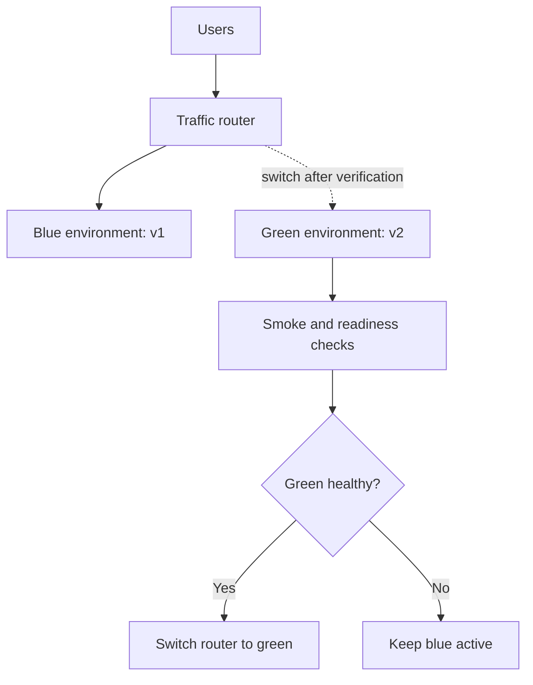
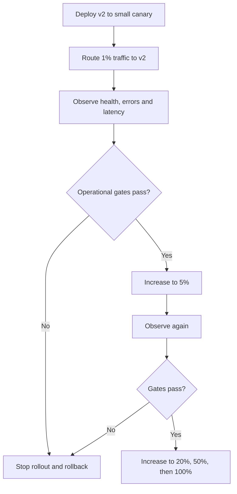
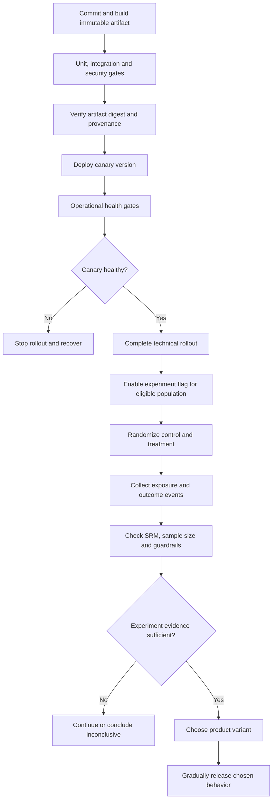

# Phân biệt chiến lược triển khai với thử nghiệm A/B

Một nhóm có thể đưa phiên bản mới lên production theo kiểu rolling, blue-green hoặc canary; đồng thời nhóm sản phẩm có thể chạy thử nghiệm A/B để so sánh hai trải nghiệm. Hai hoạt động này thường xuất hiện cùng nhau trong một quy trình release, nhưng chúng trả lời hai câu hỏi khác nhau.

**Chiến lược triển khai** quyết định cách đưa phiên bản hoặc cấu hình mới vào môi trường chạy, kiểm soát phạm vi ảnh hưởng và xác minh hệ thống có tiếp tục hoạt động ổn định hay không. **Thử nghiệm A/B** quyết định cách phân nhóm người dùng hoặc đơn vị thí nghiệm vào các biến thể để đo xem thay đổi có cải thiện kết quả sản phẩm hay không. Một chiến lược triển khai quản lý rủi ro vận hành; một thử nghiệm A/B tạo bằng chứng cho quyết định sản phẩm.

Nếu xem canary 5% là thử nghiệm A/B, nhóm có thể kết luận sai rằng một phiên bản tốt hơn chỉ vì error rate thấp trong vài phút đầu. Nếu dùng A/B test để thay thế rollout an toàn, nhóm có thể đưa một phiên bản lỗi đến toàn bộ cohort thử nghiệm mà không có cơ chế giới hạn blast radius. Cần thiết kế hai cơ chế riêng, rồi kết hợp chúng khi mục tiêu yêu cầu.

## 1. Hai khái niệm, hai mục tiêu

| Góc nhìn | Chiến lược triển khai | Thử nghiệm A/B |
|---|---|---|
| Câu hỏi chính | Đưa phiên bản mới vào hệ thống bằng cách nào và với rủi ro vận hành nào? | Biến thể nào tạo kết quả sản phẩm tốt hơn theo giả thuyết đã đặt ra? |
| Đơn vị điều khiển | Instance, pod, node, region, traffic hoặc nhóm triển khai | Người dùng, tài khoản, phiên, cửa hàng hoặc đơn vị được randomize |
| Mục tiêu | Availability, correctness, capacity, latency và khả năng phục hồi | Causal effect lên conversion, retention, revenue, engagement hoặc outcome sản phẩm |
| Cơ chế phổ biến | Rolling, recreate, blue-green, canary, ring, shadow | Control/treatment, random assignment, sticky bucketing, feature variant |
| Tín hiệu quyết định | Health check, error rate, latency, saturation, log và rollout status | Primary metric, guardrail metric, sample size, confidence interval và experiment policy |
| Kết quả | Tiếp tục, tạm dừng, rollback hoặc roll forward | Chọn variant, giữ control, chạy tiếp hoặc kết luận chưa đủ bằng chứng |
| Thời gian | Có thể từ vài giây đến vài giờ, tùy rollout và rủi ro | Thường cần đủ mẫu và thời gian để quan sát hành vi, có thể nhiều ngày hoặc lâu hơn |

Hai hoạt động có thể cùng sử dụng traffic splitting hoặc feature flag. Điểm phân biệt nằm ở mục đích, cách phân nhóm, metric và tiêu chuẩn kết luận, không chỉ ở con số phần trăm traffic.

## 2. Chiến lược triển khai quản lý vòng đời phiên bản

Một chiến lược triển khai mô tả cách phiên bản mới thay thế hoặc chạy song song với phiên bản đang phục vụ. Nó cần trả lời:

- Phiên bản cũ và mới chạy đồng thời hay thay thế nhau?
- Bao nhiêu instance hoặc traffic được chuyển sang phiên bản mới ở mỗi bước?
- Có thể dừng rollout ngay khi phát hiện lỗi không?
- Health check nào xác nhận instance mới sẵn sàng?
- Metric nào là điều kiện tiếp tục hoặc rollback?
- Cần tương thích database, message schema và client ở giai đoạn chuyển tiếp ra sao?
- Phiên bản cũ được giữ lại bao lâu để phục hồi?

Các chiến lược khác nhau về tốc độ, tài nguyên, độ phức tạp và blast radius. Không có một chiến lược tốt nhất cho mọi service. Một ứng dụng stateless có thể rolling update dễ dàng; một hệ thống xử lý thanh toán hoặc migration database phức tạp có thể cần canary, bước phê duyệt và kiểm tra kỹ hơn.

## 3. Recreate deployment

Recreate dừng các instance của phiên bản cũ rồi khởi chạy phiên bản mới. Cách này đơn giản, dễ hiểu và có thể phù hợp với workload không cần availability liên tục, môi trường development hoặc service có cơ chế bảo trì rõ ràng.

```text
Before:  v1 v1 v1 v1  -> serving traffic
Step 1:  stop v1 v1 v1 v1
Step 2:  start v2 v2 v2 v2
After:   v2 v2 v2 v2  -> serving traffic
```

Ưu điểm là không cần duy trì hai phiên bản cùng lúc và ít phức tạp về routing. Nhược điểm là có thể tạo downtime trong khoảng dừng và khởi động. Nếu phiên bản mới không khởi động được, hệ thống cần quy trình khôi phục phiên bản cũ.

Recreate không phải thử nghiệm A/B: không có nhóm control và treatment được phân bổ để đo hiệu quả sản phẩm. Đây chỉ là cách thay phiên bản đang chạy.

## 4. Rolling deployment

Rolling deployment thay thế instance cũ từng phần. Trong lúc rollout, một số instance chạy phiên bản cũ và số khác chạy phiên bản mới. Orchestrator tăng số instance mới, chờ readiness rồi giảm instance cũ theo từng bước.

Ví dụ cấu hình Kubernetes Deployment:

```yaml
apiVersion: apps/v1
kind: Deployment
metadata:
  name: order-service
spec:
  replicas: 6
  strategy:
    type: RollingUpdate
    rollingUpdate:
      maxSurge: 2
      maxUnavailable: 1
  selector:
    matchLabels:
      app: order-service
  template:
    metadata:
      labels:
        app: order-service
    spec:
      containers:
        - name: app
          image: registry.example/order-service@sha256:REPLACE_WITH_DIGEST
          readinessProbe:
            httpGet:
              path: /ready
              port: 8080
            periodSeconds: 5
```

Digest trong ví dụ là placeholder. `maxSurge` giới hạn số pod có thể vượt số replica mong muốn trong quá trình cập nhật; `maxUnavailable` giới hạn số pod có thể không sẵn sàng. Readiness probe giúp Kubernetes chỉ đưa pod đủ điều kiện vào service endpoints.

Rolling phù hợp với service stateless hoặc service hỗ trợ chạy song song nhiều phiên bản. Nhóm cần bảo đảm v1 và v2 tương thích trong thời gian rollout: API, session, cache, message và database schema không được giả định tất cả instance chuyển phiên bản cùng lúc.

Rolling không tự động là canary. Nếu orchestrator thay một số pod theo lịch nhưng không có bước đánh giá metric trước khi tiếp tục, rollout có thể tiến nhanh đến toàn bộ fleet. Muốn có canary, cần giới hạn cohort/traffic và có quyết định tiếp tục dựa trên tín hiệu đã định nghĩa.

## 5. Blue-green deployment

Blue-green duy trì hai môi trường tương đương. Blue đang phục vụ traffic; green được dựng với phiên bản mới và kiểm tra trước. Khi green đạt điều kiện, router/load balancer chuyển traffic sang green. Blue có thể được giữ lại trong một khoảng thời gian để hỗ trợ chuyển lại.



Ưu điểm:

- Có thể kiểm tra phiên bản mới trước khi chuyển traffic người dùng.
- Chuyển traffic nhanh khi môi trường mới sẵn sàng.
- Có đường quay lại môi trường cũ nếu vấn đề xuất hiện và dữ liệu vẫn tương thích.

Nhược điểm là cần tài nguyên cho hai môi trường, phải quản lý đồng bộ cấu hình và dữ liệu, đồng thời việc chuyển traffic không giải quyết được migration phá tương thích. Nếu v2 ghi dữ liệu theo schema mà v1 không đọc được, quay lại blue có thể gây lỗi dù blue vẫn chạy.

Blue-green là kỹ thuật thay phiên bản. Nếu sau khi chuyển traffic nhóm muốn so sánh hai trải nghiệm bằng random assignment và metric sản phẩm, cần thêm lớp thử nghiệm A/B riêng.

## 6. Canary deployment

Canary đưa phiên bản mới đến một phần nhỏ traffic hoặc một nhóm instance trước, theo dõi tín hiệu vận hành rồi mới tăng dần phạm vi. Ví dụ rollout 1%, 5%, 20%, 50%, 100%, với thời gian quan sát và điều kiện tiếp tục ở mỗi bước.



Canary tập trung vào câu hỏi: phiên bản mới có hoạt động an toàn dưới traffic thực đại diện không? Các metric thường gồm:

- HTTP 5xx hoặc lỗi nghiệp vụ.
- p95/p99 latency và timeout.
- CPU, memory, connection pool, queue depth và saturation.
- Crash/restart, readiness và failed request.
- Chỉ số nghiệp vụ có thể dùng làm guardrail, như tỷ lệ giao dịch thất bại.

Canary cần có cohort đại diện và đủ traffic để phát hiện vấn đề. Chuyển 1% traffic trong vài giây có thể không tạo đủ mẫu cho một service ít request. Ngưỡng và thời gian quan sát phải được thiết kế theo lưu lượng, mức rủi ro và tốc độ xuất hiện lỗi.

Canary không mặc nhiên là A/B test. Việc gửi 5% request đến v2 để xem lỗi và latency không chứng minh v2 làm tăng conversion hoặc doanh thu. Để đưa ra kết luận sản phẩm, cần thiết kế thí nghiệm, đơn vị randomization, control group, primary metric và phân tích thống kê phù hợp.

## 7. Ring deployment và progressive exposure

Ring deployment phát hành theo các vòng người dùng hoặc môi trường có mức độ ảnh hưởng tăng dần. Ví dụ:

1. Ring 0: nội bộ đội phát triển và test account.
2. Ring 1: nhân viên nội bộ hoặc khách hàng opt-in.
3. Ring 2: một nhóm tenant/region nhỏ.
4. Ring 3: phần lớn người dùng.
5. General availability: toàn bộ đối tượng đủ điều kiện.

Ring thường dựa trên nhóm có thể xác định trước, chẳng hạn region, tenant, cohort nội bộ hoặc phần cứng. Mục tiêu là phát hiện vấn đề trong phạm vi nhỏ và tăng dần blast radius.

Ring rollout có thể sử dụng feature flag hoặc policy định tuyến, nhưng việc chọn nhóm không nhất thiết randomize và không nhất thiết có control group. Nếu muốn đánh giá tác động sản phẩm, phải bổ sung thiết kế A/B phù hợp. Không lấy kết quả từ nhóm nhân viên nội bộ làm kết luận nhân quả cho toàn bộ khách hàng nếu nhóm đó khác biệt về hành vi và môi trường sử dụng.

## 8. Shadow deployment và traffic mirroring

Shadow deployment gửi bản sao request đến phiên bản mới nhưng chỉ phiên bản chính thức trả response cho người dùng. Phiên bản shadow xử lý request để nhóm so sánh kết quả, latency, lỗi hoặc mức tiêu thụ tài nguyên mà không làm thay đổi response thật.

Shadow hữu ích khi:

- Thay đổi logic truy vấn hoặc tính toán cần so sánh output.
- Di chuyển sang service hoặc database mới.
- Đánh giá năng lực xử lý dưới traffic thực.
- Kiểm tra compatibility trước khi chuyển traffic.

Phải kiểm soát side effect. Request được mirror không nên tạo giao dịch thật, gửi email, trừ tiền, phát event trùng hoặc ghi dữ liệu production ngoài ý muốn. Có thể dùng read-only mode, sandbox dependency hoặc loại bỏ các lệnh ghi.

Shadow không phải A/B test thông thường vì người dùng không được phân vào hai trải nghiệm để nhận kết quả khác nhau. Nó cũng không cho biết hành vi người dùng sẽ thay đổi thế nào khi nhìn thấy response mới; chỉ đo hành vi xử lý của phiên bản shadow.

## 9. Feature flag: tách deploy khỏi release

Feature flag cho phép bật/tắt một tính năng hoặc chọn hành vi ở runtime mà không nhất thiết phải triển khai lại artifact. Nhờ đó, nhóm có thể deploy code lên production nhưng chỉ mở tính năng cho một nhóm đối tượng hoặc chưa mở cho ai.

Feature flag thường được dùng cho:

- Tắt nhanh một tính năng gây lỗi mà không rollback toàn bộ artifact.
- Mở tính năng theo tenant, region hoặc nhóm người dùng.
- Thử nghiệm A/B giữa control và treatment.
- Phát hành dần một tính năng sau khi code đã có mặt ở production.
- Ẩn chức năng chưa hoàn tất bằng release toggle.

Ví dụ pseudocode:

```java
CheckoutResult result;

if (featureFlags.isEnabled("new-checkout", userContext)) {
    result = newCheckoutService.checkout(request);
} else {
    result = legacyCheckoutService.checkout(request);
}
```

Đây là ví dụ minh họa. Trong hệ thống thật, cần xác định nguồn flag, cache/refresh, hành vi khi flag service không truy cập được và giá trị mặc định an toàn. Flag liên quan thanh toán hoặc quyền truy cập cần fail-safe theo yêu cầu nghiệp vụ.

Feature flag không tự tạo ra một thí nghiệm đúng. Nếu nhóm bật tính năng cho toàn bộ người dùng rồi so sánh trước/sau, kết quả có thể bị ảnh hưởng bởi mùa vụ, chiến dịch, thay đổi traffic hoặc yếu tố bên ngoài. A/B test cần nhóm control đồng thời và phân bổ có kiểm soát.

## 10. Thử nghiệm A/B là gì?

Thử nghiệm A/B là một phương pháp thực nghiệm so sánh ít nhất hai biến thể. Nhóm control (A) nhận trải nghiệm hiện tại hoặc baseline; nhóm treatment (B) nhận thay đổi cần đánh giá. Người dùng hoặc đơn vị thí nghiệm được phân bổ theo một quy tắc đã định nghĩa, thường là random assignment, để giảm thiên lệch lựa chọn.

Ví dụ: nhóm muốn biết nút thanh toán mới có làm tăng tỷ lệ hoàn tất checkout không. Người dùng đủ điều kiện được gán ổn định vào A hoặc B. A hiển thị nút hiện tại; B hiển thị nút mới. Nhóm đo conversion theo định nghĩa đã thống nhất và theo dõi guardrail như lỗi thanh toán, thời gian hoàn tất và tỷ lệ hủy.

Một A/B test cần có:

- Giả thuyết có thể kiểm chứng.
- Đối tượng đủ điều kiện và đơn vị randomization.
- Control và treatment được mô tả rõ.
- Cách gán nhóm và giữ assignment ổn định.
- Primary metric, guardrail metrics và định nghĩa sự kiện.
- Sample size, power, mức sai lầm chấp nhận và thời gian chạy.
- Quy tắc dừng, phân tích và quyết định sau thử nghiệm.

Nếu thiếu các thành phần này, việc chia traffic 50/50 chỉ là phân phối request; chưa chắc là một thí nghiệm có thể đưa ra kết luận đáng tin.

## 11. Randomization unit và sticky assignment

Đơn vị randomization phải phù hợp với câu hỏi và cách người dùng tương tác. Có thể là user ID, account/tenant ID, household, device hoặc session. Chọn sai đơn vị có thể khiến một người nhìn thấy cả hai biến thể hoặc các thành viên trong cùng tổ chức bị phân vào nhóm khác nhau.

| Đơn vị | Khi phù hợp | Rủi ro cần xem xét |
|---|---|---|
| User ID | Người dùng đăng nhập và hành vi gắn với tài khoản | Một người có nhiều tài khoản hoặc thiết bị |
| Account/tenant | B2B, nhóm người dùng chia sẻ dữ liệu hoặc quy trình | Số tenant ít, cần sample size theo cụm |
| Device ID | Ứng dụng không yêu cầu đăng nhập | Một người dùng nhiều thiết bị có thể vào nhiều nhóm |
| Session ID | Thí nghiệm ngắn trong một phiên | Một người có thể trải nghiệm nhiều variant giữa các phiên |
| Household/organization | Có tương tác hoặc spillover giữa thành viên | Cần xác định ranh giới nhóm và phân tích theo cluster |

Sticky assignment giữ một đơn vị ở cùng variant trong suốt thử nghiệm. Một cách phổ biến là hash định danh ổn định cùng experiment ID và salt để xác định bucket. Không dùng random mỗi request vì cùng người dùng có thể thấy A rồi B trong một hành trình, làm dữ liệu bị nhiễu.

Nếu người dùng chưa đăng nhập rồi đăng nhập sau đó, hệ thống cần quy tắc hợp nhất identity và xử lý exposure. Nếu assignment thay đổi sau khi identity được liên kết, có thể gây contamination. Quy tắc phải được xác định trước và lưu trong experiment design.

## 12. Hypothesis, control, treatment và exposure

Giả thuyết tốt mô tả thay đổi, nhóm chịu tác động và outcome kỳ vọng. Ví dụ:

> Với người dùng mới trên web, hiển thị tiến độ checkout theo từng bước sẽ tăng tỷ lệ hoàn tất đơn hàng vì người dùng hiểu rõ còn bao nhiêu bước, đồng thời không làm tăng tỷ lệ lỗi thanh toán.

Từ giả thuyết này, cần xác định:

- **Population:** người dùng mới trên web đáp ứng điều kiện nào?
- **Control:** giao diện checkout hiện tại.
- **Treatment:** giao diện có progress indicator.
- **Assignment:** randomize theo user ID và giữ ổn định.
- **Exposure:** thời điểm người dùng thực sự nhìn thấy component, không chỉ lúc được gán nhóm.
- **Primary metric:** tỷ lệ hoàn tất checkout theo định nghĩa cụ thể.
- **Guardrails:** payment error rate, latency, refund/cancel rate và các chỉ số cần bảo vệ.

Phân biệt assignment với exposure rất quan trọng. Một user có thể được gán treatment nhưng không bao giờ mở trang checkout. Nếu phân tích chỉ tính những người thực sự thấy tính năng mà bỏ qua quy tắc randomization ban đầu, kết quả có thể bị selection bias. Nhóm cần xác định trước phân tích theo assignment (intention-to-treat) hay theo exposure và giải thích giới hạn của mỗi cách.

## 13. Metric sản phẩm và guardrail metric

Primary metric đo outcome chính của giả thuyết. Guardrail metric phát hiện tác động phụ không mong muốn. Không nên chọn metric sau khi xem kết quả vì điều đó làm tăng nguy cơ chọn ra một kết luận có vẻ tích cực do ngẫu nhiên.

Ví dụ cho checkout:

| Nhóm metric | Ví dụ | Vai trò |
|---|---|---|
| Primary | Checkout completion rate | Đánh giá giả thuyết chính |
| Secondary | Thời gian từ cart đến order, số bước bị bỏ | Giải thích cơ chế và hành vi |
| Guardrail | Payment failure rate, duplicate order, refund rate | Bảo vệ chất lượng và an toàn giao dịch |
| Operational | p95 latency, 5xx, CPU, queue lag | Phát hiện tác động kỹ thuật |

Metric cần có mẫu số, cửa sổ thời gian và cách xử lý trường hợp thiếu dữ liệu rõ ràng. Ví dụ conversion có thể là số người dùng hoàn tất checkout chia cho số người dùng đủ điều kiện đã được randomize; nếu dùng số session làm mẫu số thì câu hỏi đo lường đã khác.

Guardrail không chỉ là metric kỹ thuật. Một biến thể có thể tăng click nhưng cũng tăng hủy đơn hoặc khiếu nại. Nhóm cần xác định outcome nào không được suy giảm quá ngưỡng trước khi bắt đầu thử nghiệm.

## 14. Thống kê: sample size, power và ý nghĩa thực tiễn

A/B test cần đủ dữ liệu để phân biệt hiệu ứng thực với dao động ngẫu nhiên. Trước khi chạy, nhóm nên xác định:

- Baseline rate hoặc phân phối metric hiện tại.
- Minimum Detectable Effect (MDE): mức thay đổi nhỏ nhất có giá trị để phát hiện.
- Statistical power, thường được chọn theo chính sách phân tích.
- Significance level hoặc cách kiểm soát false positive.
- Sample size ước lượng cho mỗi nhóm.
- Thời gian cần thiết để đạt mẫu và bao phủ chu kỳ hành vi.

Không có một tỷ lệ phần trăm traffic hoặc một số ngày cố định phù hợp với mọi thử nghiệm. Nếu conversion thấp, cần nhiều mẫu hơn. Nếu metric biến động theo ngày trong tuần, chạy vài giờ có thể không đủ đại diện. Nếu đơn vị randomization là tenant, số tenant có thể quan trọng hơn số request.

Không nên liên tục xem p-value rồi dừng ngay khi thấy kết quả có ý nghĩa nếu phương pháp phân tích không hỗ trợ sequential testing. Việc nhìn dữ liệu nhiều lần và chọn thời điểm dừng có thể làm tăng false positive. Có thể dùng phương pháp sequential phù hợp, nhưng cần định nghĩa trước cách kiểm soát sai lầm.

Statistical significance không đồng nghĩa với business significance. Một cải thiện rất nhỏ có thể có ý nghĩa thống kê khi sample cực lớn nhưng không đáng chi phí triển khai. Ngược lại, một hiệu ứng có giá trị thực tiễn nhưng chưa đạt ngưỡng thống kê có thể cần thêm dữ liệu hoặc một thiết kế tốt hơn. Cần báo cáo effect size và confidence interval, không chỉ một nhãn `significant`.

## 15. Sample Ratio Mismatch và chất lượng assignment

Sample Ratio Mismatch (SRM) xảy ra khi tỷ lệ phân bổ quan sát được khác đáng kể tỷ lệ dự kiến, ví dụ thiết kế 50/50 nhưng dữ liệu ghi nhận 60/40. Đây là dấu hiệu cần điều tra trước khi diễn giải outcome.

Nguyên nhân có thể gồm:

- Một variant tải chậm hoặc lỗi khiến exposure event không được ghi nhận.
- Assignment service không nhất quán giữa client và server.
- User bị loại khỏi phân tích theo điều kiện sau khi đã randomize.
- Event tracking mất dữ liệu hoặc gửi trùng.
- Identity mapping làm một user được tính nhiều lần.
- Cache hoặc feature flag dùng bucket khác nhau giữa các request.

Kiểm tra SRM trên population và cửa sổ đã định nghĩa. Nếu phát hiện mismatch chưa giải thích được, không nên tiếp tục diễn giải kết quả như một A/B test hợp lệ. Cần điều tra assignment, exposure logging và data pipeline trước.

## 16. A/B test không phải so sánh trước và sau

So sánh conversion tuần trước với tuần sau khi release không phải A/B test ngẫu nhiên. Hai giai đoạn có thể khác nhau về mùa vụ, marketing campaign, giá, nguồn traffic, ngày nghỉ hoặc hành vi người dùng.

Một nhóm có thể triển khai phiên bản mới vào thứ Hai rồi thấy conversion tăng vào thứ Ba. Không thể kết luận thay đổi là nguyên nhân nếu không kiểm soát các yếu tố khác. A/B test chạy đồng thời control và treatment giúp giảm ảnh hưởng của biến động thời gian, miễn là randomization và instrumentation hợp lệ.

Nếu không thể randomize, có thể dùng phương pháp quasi-experimental như difference-in-differences hoặc matched cohort khi phù hợp. Tuy nhiên, các phương pháp đó có giả định riêng và không tương đương với randomized controlled experiment. Cần trình bày rõ giới hạn suy luận.

## 17. Canary và A/B test: so sánh trực tiếp

| Tiêu chí | Canary rollout | A/B test |
|---|---|---|
| Mục tiêu | Xác minh phiên bản mới không làm hỏng vận hành | Đo tác động nhân quả của thay đổi lên outcome |
| Nhóm so sánh | Traffic/instance đang chạy phiên bản cũ có thể làm baseline vận hành | Control và treatment được gán theo thiết kế thí nghiệm |
| Phân bổ | Có thể theo tỷ lệ traffic, region, tenant hoặc instance | Thường randomize theo đơn vị thí nghiệm đã chọn |
| Metric ưu tiên | Error, latency, saturation, health, lỗi giao dịch | Primary/secondary product metric và guardrail |
| Thời gian | Theo cửa sổ rollout và tốc độ phát hiện lỗi | Theo sample size, power và chu kỳ hành vi |
| Quyết định | Tiếp tục tăng traffic, pause hoặc rollback | Chọn variant, giữ control hoặc kết luận chưa đủ bằng chứng |
| Câu hỏi không trả lời được | Tính năng có cải thiện hành vi sản phẩm không? | Phiên bản có an toàn khi mở rộng toàn bộ hạ tầng không? |

Canary có thể dùng random traffic split, nhưng random split tự nó không tạo thành A/B test. A/B test có thể phát hiện thay đổi conversion nhưng không thay thế health gate của rollout. Một biến thể tăng doanh thu nhưng làm error rate tăng vượt ngưỡng vẫn không nên được phát hành rộng.

## 18. Kết hợp deployment strategy với A/B testing

Có thể kết hợp hai cơ chế theo hai lớp:

1. Dùng deployment strategy để đưa code mới vào production an toàn, ví dụ canary 5% instance hoặc traffic.
2. Khi phiên bản mới ổn định, dùng feature flag để randomize người dùng vào control/treatment.
3. Thu thập product metrics và guardrails theo experiment ID, variant và user/account assignment.
4. Khi thử nghiệm kết thúc, quyết định giữ treatment, sửa tiếp hoặc tắt flag.
5. Sau khi tính năng được chấp nhận, mở flag theo rollout policy và loại bỏ code/flag cũ theo kế hoạch.

Một lựa chọn khác là chạy A/B test trên cùng một phiên bản binary, trong đó feature flag chọn hai hành vi. Cách này giảm việc thay đổi hạ tầng giữa các nhóm, nhưng cần bảo đảm hai variant thực sự khác đúng yếu tố được thử nghiệm.

Không nên đồng thời thay đổi nhiều yếu tố không liên quan giữa control và treatment. Nếu treatment dùng code mới, database mới, cache mới và UI mới cùng lúc, kết quả có thể cho thấy outcome khác nhưng khó xác định thành phần nào gây ra khác biệt.

## 19. Luồng CI/CD khi có cả canary và A/B test

Một luồng minh họa:



Các bước có thể được điều phối bởi nhiều hệ thống: CI/CD quản lý artifact và rollout; feature management quản lý flag/assignment; analytics platform xử lý event; experimentation platform kiểm tra thống kê. Cần dùng chung experiment ID, release ID và artifact digest để truy vết nhưng vẫn tách rõ mục đích của từng hệ thống.

## 20. Metric rollout và metric thí nghiệm phải được tách

Trong canary, metric thường được so sánh giữa phiên bản mới và baseline để phát hiện hồi quy vận hành. Ví dụ error rate của v2 có tăng hơn v1 không, p99 latency có vượt ngưỡng không, CPU có bão hòa không.

Trong A/B test, metric so sánh outcome của nhóm được randomize. Ví dụ tỷ lệ hoàn tất checkout của B so với A, với confidence interval và guardrails.

Một số metric có thể xuất hiện ở cả hai nơi, như payment failure rate. Nhưng cách sử dụng khác nhau:

- Trong canary, đây có thể là guardrail vận hành để dừng rollout ngay khi lỗi tăng.
- Trong A/B test, đây có thể là guardrail sản phẩm để bảo đảm treatment không làm chất lượng giao dịch giảm.

Nên có hai dashboard hoặc hai khu vực rõ ràng. Dashboard rollout hiển thị version, digest, traffic share, health và operational threshold. Dashboard experiment hiển thị experiment ID, allocation, exposure, sample size, effect size, confidence interval và guardrails.

## 21. Điều kiện dừng, rollback và dừng thí nghiệm

Khi canary thất bại, nhóm có thể pause rollout, chuyển traffic về phiên bản cũ hoặc rollback theo runbook. Điều kiện dừng nên có ngưỡng rõ, chẳng hạn 5xx tăng vượt baseline trong cửa sổ liên tục, p99 latency vượt SLO hoặc readiness failure tăng.

Khi A/B test có kết quả xấu, nhóm thường tắt treatment flag hoặc kết thúc experiment theo policy. Không nhất thiết rollback toàn bộ artifact nếu code đã được deploy nhưng tính năng vẫn được flag tắt. Tuy nhiên, nếu lỗi thuộc binary, migration hoặc dependency dùng chung, cần xử lý ở cấp deployment.

Phân biệt các hành động:

- **Pause rollout:** ngừng tăng tỷ lệ phiên bản mới để điều tra.
- **Rollback deployment:** đưa traffic hoặc workload về artifact trước đó.
- **Disable feature flag:** tắt hành vi mới trong runtime nếu flag có thể kiểm soát an toàn.
- **Stop experiment:** dừng thu thập/đánh giá thí nghiệm theo protocol; giữ lại dữ liệu và lý do.
- **Roll forward:** triển khai bản sửa mới khi rollback không an toàn hoặc không giải quyết được nguyên nhân.

Không dùng việc dừng A/B test như cách thay thế quy trình incident response. Nếu treatment gây lỗi nghiêm trọng, ưu tiên bảo vệ người dùng và dữ liệu trước khi phân tích thống kê.

## 22. Database và backward compatibility trong rollout

Trong rolling, canary hoặc blue-green, phiên bản cũ và mới có thể cùng chạy. Vì vậy, database schema, message schema và API cần tương thích trong giai đoạn chuyển tiếp.

Một mẫu thường dùng là expand-contract:

1. Thêm field/table/index mới theo cách không phá phiên bản cũ.
2. Deploy code có thể đọc/ghi tương thích với cả schema cũ và mới.
3. Backfill dữ liệu và xác minh.
4. Chuyển traffic hoặc bật tính năng mới sau khi điều kiện đạt.
5. Chỉ xóa field/schema cũ khi không còn phiên bản nào phụ thuộc.

Rollback ứng dụng không tự đảo ngược migration. Nếu v2 ghi dữ liệu mà v1 không đọc được, quay lại v1 có thể làm lỗi. Cần kiểm tra tương thích dữ liệu, có backup/restore hoặc roll-forward plan và tránh migration phá hủy trong cùng bước rollout khó phục hồi.

A/B test cũng cần giữ schema và event tracking ổn định. Nếu hai variant phát event với cấu trúc khác nhau mà analytics pipeline không xử lý đúng, kết quả experiment có thể sai dù ứng dụng hoạt động bình thường.

## 23. Quan sát và gắn định danh để truy vết

Để phân biệt sự cố rollout với kết quả experiment, log, metric và trace nên mang theo các thuộc tính thích hợp:

- `service.name` và `service.version`.
- Artifact digest hoặc image digest.
- Deployment/release ID và rollout step.
- Environment, region và instance/pod identity.
- Experiment ID và variant khi request thuộc experiment.
- Cohort/assignment metadata ở dạng không tiết lộ dữ liệu cá nhân.
- Correlation/trace ID để nối request qua nhiều service.

Không đưa email, số điện thoại hoặc thông tin cá nhân trực tiếp vào metric label vì có thể gây rủi ro riêng tư và cardinality rất cao. Dùng ID giả danh hoặc cohort label theo chính sách, giới hạn quyền truy cập và retention dữ liệu experiment.

Metric cần được phân đoạn cẩn thận. Nếu chỉ nhìn toàn bộ service, lỗi của canary 5% có thể bị che bởi 95% traffic cũ. Nếu chỉ nhìn một variant, khác biệt về region hoặc platform có thể gây nhiễu. Hãy phân đoạn theo version, rollout cohort, variant và nhóm đủ điều kiện, nhưng tránh tạo cardinality không kiểm soát.

## 24. Các lỗi thiết kế thường gặp

| Lỗi | Vì sao nguy hiểm | Cách cải thiện |
|---|---|---|
| Gọi canary 5% là A/B test | Có thể kết luận sản phẩm mà không có randomization và thiết kế thống kê | Đặt tên theo mục tiêu; dùng experiment protocol cho A/B |
| Dùng A/B test thay health gate | Treatment có thể gây lỗi vận hành cho cohort | Luôn có readiness, SLO và rollout guardrails |
| Chia traffic 50/50 nhưng không có sticky assignment | Một user có thể thấy nhiều variant | Randomize theo unit ổn định và giữ assignment |
| Chỉ so sánh trước/sau | Bị ảnh hưởng bởi mùa vụ và thay đổi traffic | Dùng control đồng thời hoặc phương pháp causal phù hợp |
| Dừng thử nghiệm khi p-value vừa đạt ngưỡng | Tăng false positive do peeking | Định nghĩa sample size/stopping rule hoặc dùng sequential method hợp lệ |
| Chọn metric sau khi xem dữ liệu | Tăng nguy cơ cherry-picking | Đăng ký primary/guardrail trước khi chạy |
| Bỏ qua SRM | Assignment/tracking có thể sai | Kiểm tra tỷ lệ nhóm và điều tra mismatch |
| Không đo exposure | Gán nhóm nhưng không biết người dùng đã thấy variant | Định nghĩa và ghi exposure event |
| Thay nhiều yếu tố trong treatment | Không biết yếu tố nào tạo tác động | Giới hạn thay đổi hoặc dùng thiết kế factorial phù hợp |
| Không giữ tương thích v1/v2 | Rolling/rollback có thể làm lỗi dữ liệu | Expand-contract và test compatibility |
| Dùng metric toàn hệ thống cho canary nhỏ | Lỗi canary bị che bởi traffic cũ | Phân đoạn theo version/cohort |
| Không dọn feature flag | Tăng nhánh code và độ phức tạp | Gán owner, ngày hết hạn và kế hoạch xóa |

## 25. Ví dụ thực tế: phát hành checkout mới

Giả sử nhóm muốn thay đổi luồng checkout để giảm số bước và tăng tỷ lệ hoàn tất đơn hàng. Thay đổi gồm code mới trong `order-service`, giao diện frontend và một feature flag `new-checkout`.

**Giai đoạn triển khai:**

1. Build một artifact immutable, lưu commit SHA và digest.
2. Chạy unit, integration, contract và security tests.
3. Deploy backend/frontend bằng rolling hoặc canary nhỏ.
4. Theo dõi 5xx, payment failure, p99 latency, queue lag và duplicate order.
5. Nếu guardrail thất bại, dừng rollout và rollback/roll forward theo runbook.
6. Khi phiên bản ổn định, hoàn tất technical rollout nhưng giữ feature flag ở trạng thái tắt hoặc giới hạn.

**Giai đoạn A/B test:**

1. Xác định population là người dùng mới trên web đủ điều kiện checkout.
2. Randomize theo user ID, giữ assignment ổn định.
3. Nhóm A dùng checkout cũ; nhóm B dùng checkout mới.
4. Ghi assignment, exposure và outcome với experiment ID.
5. Primary metric là checkout completion rate; guardrails gồm payment failure, duplicate order và p95 latency.
6. Tính sample size và thời gian chạy trước khi bắt đầu; kiểm tra SRM và chất lượng event.
7. Khi đủ bằng chứng, đánh giá effect size, confidence interval và guardrails.
8. Nếu treatment có lợi và không vi phạm guardrail, mở flag theo rollout policy; nếu không, giữ control hoặc thiết kế lại.

Trong ví dụ này, canary bảo vệ hệ thống khỏi một phiên bản lỗi; A/B test đánh giá trải nghiệm mới có cải thiện outcome sản phẩm hay không. Cả hai dùng chung artifact digest và release ID để truy vết, nhưng có cohort, metric và quyết định riêng.

## 26. Cách chọn chiến lược phù hợp

Hãy bắt đầu bằng việc phân loại câu hỏi cần trả lời:

| Nhu cầu | Cơ chế phù hợp |
|---|---|
| Thay phiên bản đơn giản, chấp nhận downtime | Recreate |
| Thay instance từng phần, service tương thích phiên bản | Rolling |
| Dựng môi trường mới và chuyển traffic nhanh | Blue-green |
| Giới hạn blast radius và quan sát phiên bản mới theo từng bước | Canary |
| Phát hành theo nhóm môi trường/tenant/region | Ring deployment |
| So sánh xử lý của phiên bản mới mà không trả response mới cho user | Shadow/traffic mirroring |
| Bật/tắt hành vi runtime hoặc giới hạn tính năng | Feature flag |
| Đo tác động nhân quả của hai trải nghiệm | A/B test |

Trước khi quyết định, cân nhắc:

- Mức availability cần đạt và downtime có thể chấp nhận.
- Khả năng chạy song song phiên bản cũ/mới.
- Tính tương thích của database, API, event và session.
- Khả năng route traffic theo instance, request, tenant hoặc user.
- Mức độ đại diện của canary cohort.
- Chất lượng observability và tốc độ phát hiện lỗi.
- Chi phí tài nguyên và độ phức tạp vận hành.
- Khả năng rollback, roll forward và phục hồi dữ liệu.
- Mục tiêu là bảo vệ vận hành hay đo outcome sản phẩm.

Nếu mục tiêu gồm cả an toàn vận hành và hiệu quả sản phẩm, hãy thiết kế hai lớp: progressive deployment trước, experiment sau hoặc đồng thời trong phạm vi đã kiểm soát.

## 27. Checklist trước khi rollout

- [ ] Artifact đã được build, xác minh và định danh bằng digest bất biến.
- [ ] Có deployment strategy phù hợp với availability và blast radius.
- [ ] Readiness/liveness/health check phản ánh khả năng phục vụ thật.
- [ ] Có metric và threshold cho error, latency, saturation và lỗi nghiệp vụ.
- [ ] Có bước pause/rollback/roll-forward và owner trực vận hành.
- [ ] Phiên bản cũ và mới tương thích trong thời gian chạy song song.
- [ ] Database migration có kế hoạch expand-contract hoặc phương án tương đương.
- [ ] Canary cohort đại diện và có traffic đủ để đánh giá health.
- [ ] Dashboard phân đoạn theo version và rollout step.
- [ ] Runtime sau deploy được xác minh đúng digest.

## 28. Checklist trước khi chạy A/B test

- [ ] Có giả thuyết và outcome chính được xác định trước.
- [ ] Control và treatment khác nhau ở yếu tố được thử nghiệm.
- [ ] Population đủ điều kiện và exclusion rule được định nghĩa.
- [ ] Randomization unit phù hợp với hành vi và không gây spillover lớn.
- [ ] Assignment ổn định giữa các lần truy cập.
- [ ] Exposure event được định nghĩa và ghi nhận đáng tin cậy.
- [ ] Primary, secondary và guardrail metrics có công thức rõ.
- [ ] Baseline, MDE, sample size, power và stopping rule được tính trước.
- [ ] Có kiểm tra SRM, event loss, duplicate và identity mapping.
- [ ] Không dừng tùy tiện sau nhiều lần xem kết quả nếu phương pháp không hỗ trợ.
- [ ] Có kế hoạch phân tích effect size, confidence interval và ý nghĩa thực tiễn.
- [ ] Có người sở hữu quyết định, thời hạn experiment và kế hoạch dọn flag.

## 29. Kết luận

Chiến lược triển khai quyết định cách phiên bản mới đi vào môi trường chạy và cách nhóm giới hạn rủi ro vận hành. Recreate, rolling, blue-green, canary, ring và shadow giải quyết các nhu cầu rollout khác nhau. Feature flag tách việc deploy code khỏi việc mở hành vi cho người dùng.

Thử nghiệm A/B là phương pháp đo tác động của biến thể sản phẩm bằng control, treatment, random assignment, metric và phân tích thống kê. Canary 5% không tự động là A/B test; chia traffic 50/50 cũng chưa đủ nếu thiếu giả thuyết, sticky assignment, exposure tracking và tiêu chuẩn kết luận.

Khi cần cả hai, hãy dùng deployment strategy để bảo vệ hệ thống và A/B test để học từ hành vi người dùng. Giữ artifact digest, release ID, rollout cohort và experiment ID liên kết với nhau; theo dõi operational guardrails độc lập với product metrics. Cách tổ chức này giúp nhóm vừa phát hành có kiểm soát vừa đưa ra quyết định sản phẩm dựa trên bằng chứng đáng tin cậy.
