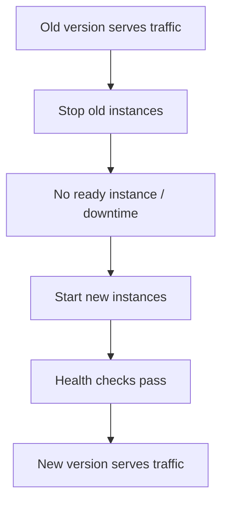
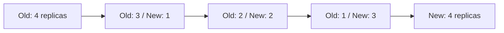
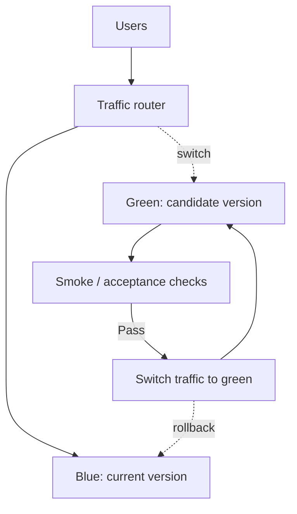
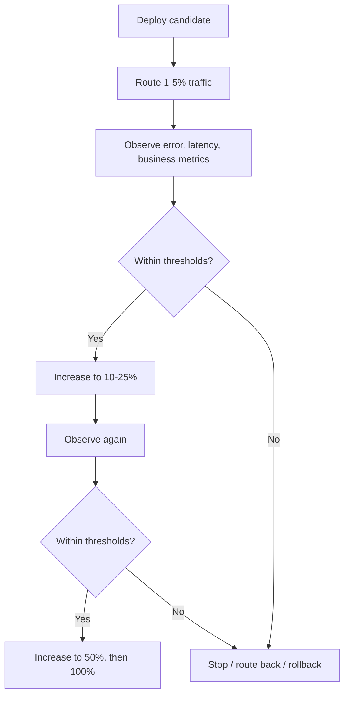

# Đánh giá chi phí hạ tầng và mức rủi ro của từng chiến lược

Chọn chiến lược triển khai không chỉ là chọn cách cập nhật phiên bản ứng dụng. Mỗi cách triển khai tạo ra một cấu trúc chi phí và một mức phơi nhiễm rủi ro khác nhau: có cách cần ít tài nguyên nhưng chấp nhận downtime; có cách giữ hai phiên bản cùng lúc để chuyển traffic nhanh nhưng tốn thêm compute; có cách chỉ đưa một phần traffic vào bản mới để giới hạn blast radius nhưng đòi hỏi quan sát và điều phối tốt.

Một quyết định hợp lý cần trả lời hai câu hỏi: **chi phí tăng thêm trong thời gian phát hành là bao nhiêu, và nếu phiên bản mới có lỗi thì phạm vi cùng hậu quả có thể lớn đến đâu?** Không nên chỉ so sánh số máy hoặc số pod. Cần tính cả load balancer, network, storage, dữ liệu, monitoring, thời gian giữ môi trường song song, công sức vận hành, thời gian phục hồi và chi phí gián đoạn dịch vụ.

## 1. Các nhóm chi phí cần đưa vào đánh giá

Chi phí của một chiến lược triển khai gồm chi phí hạ tầng trực tiếp và chi phí vận hành phát sinh do cách triển khai.

| Nhóm chi phí | Thành phần thường gặp | Câu hỏi cần đặt ra |
|---|---|---|
| Compute | VM, node, pod, CPU, RAM, autoscaling capacity | Có cần chạy đồng thời phiên bản cũ và mới không? Surge capacity tối đa là bao nhiêu? |
| Storage | Volume, snapshot, image layer, log, dữ liệu tạm | Có phải giữ hai bộ dữ liệu hoặc snapshot trong thời gian rollout không? |
| Network | Load balancer, ingress, service mesh, cross-zone traffic, egress | Có phát sinh traffic nhân đôi, chuyển vùng hoặc thêm hop không? |
| Data services | Database replica, cache, queue, search cluster | Có cần mở rộng dependency để chịu tải của hai phiên bản hoặc shadow traffic không? |
| Observability | Metrics, logs, traces, synthetic checks, alerting | Có cần tăng sampling hoặc giữ telemetry chi tiết trong thời gian canary không? |
| Automation | Deployment controller, traffic router, policy engine, test environment | Có cần công cụ hoặc nền tảng bổ sung để điều phối và kiểm soát rollout không? |
| Operational effort | Thiết kế pipeline, runbook, on-call, diễn tập rollback | Bao nhiêu công sức để vận hành an toàn và điều tra khi lỗi? |
| Downtime/business impact | Giao dịch thất bại, người dùng không truy cập được, SLA/SLO bị vi phạm | Một phút gián đoạn có giá trị hoặc hậu quả bao nhiêu? |

Không phải mọi chi phí đều tăng theo số lượng instance. Ví dụ, Blue-Green có thể tăng compute gần gấp đôi trong thời gian hai môi trường cùng tồn tại, nhưng lại giảm thời gian chuyển phiên bản và có thể rút ngắn thời gian phục hồi. Canary có thể chỉ cần một nhóm instance nhỏ, nhưng chi phí telemetry và kỹ thuật phân luồng có thể đáng kể. Recreate ít tốn compute trong lúc chuyển đổi nhưng downtime có thể tạo ra chi phí nghiệp vụ lớn hơn phần compute tiết kiệm được.

## 2. Mô hình hóa chi phí và rủi ro

### Chi phí triển khai trực tiếp

Có thể ước tính chi phí hạ tầng trong một lần phát hành bằng:

**C_release = C_base + C_surge + C_duplicate + C_data + C_network + C_observability**

Trong đó:

- **C_base:** chi phí tài nguyên nền đang phục vụ production trong khoảng thời gian rollout.
- **C_surge:** chi phí năng lực tăng thêm để chạy song song các replica mới hoặc xử lý tải tăng.
- **C_duplicate:** chi phí môi trường hoặc workload được nhân đôi, chẳng hạn green environment.
- **C_data:** storage, database, cache hoặc queue capacity tăng thêm.
- **C_network:** load balancer, traffic replication, egress và cross-zone transfer.
- **C_observability:** log, metric, trace và kiểm thử bổ sung trong rollout.

Nếu dùng cloud theo giờ, một thành phần compute có thể tính gần đúng:

**C_compute = N_instance * H_running * R_hour**

Với container orchestration, có thể thay số instance bằng tổng CPU/RAM request hoặc mức tài nguyên thực sự được tính phí. Cần dùng đúng mô hình tính phí của nhà cung cấp: một số nền tảng tính theo node, số vCPU/GB-giờ, request, hoặc mức capacity đã provision.

### Chi phí kỳ vọng do rủi ro

Chiến lược triển khai cũng ảnh hưởng xác suất xảy ra sự cố, phạm vi ảnh hưởng và thời gian phát hiện/phục hồi. Một mô hình đơn giản để thảo luận là:

**E_loss = P_incident * Impact_incident**

Trong thực tế có thể tách impact thành:

**Impact = C_outage + C_data + C_recovery + C_compliance + C_reputation**

Đây là mô hình quyết định, không phải công thức dự báo chính xác. Xác suất sự cố khó ước lượng nếu thiếu lịch sử; tác động cũng phụ thuộc dịch vụ, thời điểm và số người dùng bị ảnh hưởng. Dù vậy, cách nhìn này nhắc nhóm rằng chiến lược rẻ nhất về compute chưa chắc rẻ nhất về tổng chi phí.

### Đánh giá rủi ro theo nhiều chiều

Không nên dùng một điểm rủi ro duy nhất mà không xem thành phần phía sau. Với mỗi chiến lược, hãy đánh giá:

| Chiều rủi ro | Ý nghĩa |
|---|---|
| Blast radius | Bao nhiêu người dùng, request, tenant hoặc vùng có thể nhận phiên bản lỗi? |
| Detection time | Bao lâu mới phát hiện lỗi sau khi traffic chuyển sang bản mới? |
| Rollback time | Bao lâu để quay về phiên bản ổn định? |
| Data compatibility | Hai phiên bản có thể cùng đọc/ghi dữ liệu và schema không? |
| Control complexity | Có thể điều phối, quan sát và dừng rollout đúng lúc không? |
| Partial-state risk | Có thể tồn tại trạng thái nửa cũ/nửa mới gây lỗi không? |
| Dependency risk | Database, queue, cache hoặc service phụ thuộc có chịu được mô hình chuyển đổi không? |

## 3. Recreate: dừng phiên bản cũ rồi tạo phiên bản mới

Recreate dừng các instance cũ trước, sau đó khởi tạo phiên bản mới. Trong một khoảng thời gian, dịch vụ có thể không có instance sẵn sàng.

### Chi phí hạ tầng

- Thường không cần chạy đồng thời hai nhóm instance trong thời gian chuyển đổi.
- Ít yêu cầu surge capacity và không cần giữ môi trường thứ hai.
- Có thể cần tài nguyên tạm để chạy migration, warm-up hoặc kiểm tra sau khi khởi động.
- Chi phí compute trực tiếp thường thấp trong các chiến lược có overlap.

### Rủi ro

- Downtime là đặc tính thường gặp, thời lượng phụ thuộc thời gian dừng, khởi động, warm-up và kiểm tra.
- Nếu phiên bản mới không khởi động, dịch vụ tiếp tục gián đoạn cho tới khi sửa hoặc khôi phục bản cũ.
- Rollback có thể chậm vì phải dừng phiên bản mới và khởi động lại phiên bản cũ.
- Nếu migration database không tương thích ngược, quay lại binary cũ có thể không đủ để phục hồi.

### Khi phù hợp

Recreate có thể phù hợp với ứng dụng nội bộ, môi trường development/test, workload có thể dừng trong cửa sổ bảo trì hoặc dịch vụ không yêu cầu availability cao. Không nên chọn chỉ vì tiết kiệm pod nếu downtime gây thiệt hại lớn hơn chi phí tài nguyên.

## 4. Rolling update: thay thế từng phần

Rolling update thay instance cũ bằng instance mới theo từng đợt. Trong quá trình rollout, hai phiên bản có thể cùng phục vụ traffic.

### Chi phí hạ tầng

- Cần capacity tạm thời tùy `maxSurge` hoặc cách orchestrator thay instance.
- Nếu cho phép `maxUnavailable` lớn hơn 0, có thể giảm surge capacity nhưng đổi lại giảm số instance sẵn sàng trong rollout.
- Không cần giữ cả một môi trường production thứ hai như Blue-Green.
- Load balancer/service discovery và health check cần cập nhật theo vòng đời instance.

Ví dụ, một deployment có 4 replica và `maxSurge: 25%` thường cho phép tạo thêm tối đa 1 replica trong quá trình rollout (tùy quy tắc làm tròn của nền tảng). Nếu `maxUnavailable: 0`, hệ thống cố giữ đủ số replica khả dụng trong khi tạo mới; do đó cần capacity cho ít nhất một pod tăng thêm, đồng thời node phải còn CPU/RAM phù hợp.

### Rủi ro

- Phiên bản cũ và mới cùng tồn tại, nên phải tương thích về API, message schema, session và database schema.
- Nếu bản mới lỗi nhưng readiness probe vẫn báo đạt, traffic có thể được chuyển tới instance lỗi.
- Nếu rollout dừng ở giữa, hệ thống có thể duy trì trạng thái hỗn hợp lâu hơn dự kiến.
- Rollback là một rollout ngược, không nhất thiết tức thì; dữ liệu đã ghi bởi bản mới có thể khiến bản cũ không tương thích.

### Khi phù hợp

Rolling update phù hợp với service stateless hoặc đã thiết kế tương thích ngược, có health/readiness check tốt và muốn cân bằng giữa chi phí cùng availability. Đây thường là lựa chọn mặc định hợp lý cho workload container khi không cần chuyển traffic theo tỷ lệ phức tạp.

## 5. Blue-Green: duy trì hai môi trường và chuyển traffic

Blue-Green duy trì môi trường đang phục vụ (blue) và một môi trường mới (green). Phiên bản mới được triển khai và kiểm tra trên green trước khi load balancer, ingress hoặc router chuyển traffic sang đó.

### Chi phí hạ tầng

- Có thể cần gần gấp đôi compute cho service trong thời gian blue và green cùng tồn tại.
- Có thể nhân đôi load balancer target, cache, worker hoặc các thành phần phụ thuộc nếu chúng không dùng chung.
- Cần thêm network capacity và có thể phát sinh chi phí dữ liệu nếu green phải sao chép dataset hoặc storage.
- Có thể giảm thời gian overlap bằng cách tạo green sát giờ release và hủy blue sau thời gian xác minh, nhưng phải cân nhắc thời gian rollback.

### Rủi ro

- Chuyển traffic có thể nhanh, nhưng không tự giải quyết được vấn đề database migration hoặc side effect.
- Nếu blue và green cùng ghi vào database, cần bảo đảm schema và logic tương thích.
- Nếu green xử lý nền hoặc consumer queue đồng thời với blue, có thể xử lý trùng message hoặc tạo side effect kép.
- Nếu giữ blue quá ngắn, rollback nhanh không còn khả thi khi lỗi xuất hiện muộn.
- Cần xác minh session, sticky routing, cache, connection draining và background job trước khi switch.

### Khi phù hợp

Blue-Green phù hợp khi downtime cần rất thấp, có thể duy trì hai môi trường và cần một điểm chuyển traffic rõ ràng. Nó đặc biệt hữu ích khi cần kiểm tra candidate đầy đủ trước khi cho người dùng truy cập. Chi phí tăng thêm thường hợp lý hơn với dịch vụ quan trọng mà thời gian phục hồi có giá trị cao.

## 6. Canary: tăng dần tỷ lệ traffic vào phiên bản mới

Canary đưa phiên bản mới tới một phần nhỏ traffic hoặc một nhóm người dùng, quan sát kết quả rồi tăng tỷ lệ theo từng bước. Nếu metrics vượt ngưỡng, rollout dừng hoặc chuyển traffic về bản cũ.

Các tỷ lệ 1%, 5%, 10%, 25% hoặc 50% chỉ là ví dụ. Lộ trình thực tế cần phù hợp traffic, khả năng đo lường và mức rủi ro của dịch vụ.

### Chi phí hạ tầng

- Thường cần một nhóm canary nhỏ chạy song song với stable version; chi phí compute tăng theo capacity của nhóm mới.
- Không thể giả định 5% traffic chỉ cần 5% tài nguyên. Request có thể không phân bố đều; một nhóm người dùng hoặc loại giao dịch có thể tiêu tốn nhiều CPU/DB hơn.
- Cần traffic router/service mesh/ingress hỗ trợ phân luồng hoặc một cơ chế tương đương.
- Cần tăng observability: phân biệt metrics theo version, cohort, region hoặc route để so sánh canary với control group.
- Rollout kéo dài làm tăng thời gian duy trì hai phiên bản và chi phí quan sát.

### Rủi ro

- Nếu traffic được chọn không đại diện, canary có thể không gặp trường hợp gây lỗi.
- Nếu không tách metrics theo phiên bản, lỗi của canary có thể bị che bởi lưu lượng stable lớn hơn.
- Sample quá nhỏ khiến tín hiệu thống kê yếu; sample quá lớn làm blast radius tăng.
- Side effect như gửi email, thu tiền hoặc xử lý message có thể gây hậu quả thật ngay cả ở tỷ lệ nhỏ.
- Cần tiêu chí tự động dừng rõ ràng; quyết định thủ công chậm có thể để canary tiếp tục gây lỗi.

### Khi phù hợp

Canary phù hợp với dịch vụ có traffic đủ lớn, khả năng phân luồng và metrics đáng tin cậy. Nó đặc biệt có ích khi cần giới hạn blast radius và đánh giá hành vi thực tế dưới tải người dùng. Với traffic thấp hoặc hệ thống khó phân biệt phiên bản, canary có thể tạo cảm giác an toàn giả.

## 7. Shadow deployment: nhân bản request để kiểm tra mà không trả response mới

Shadow deployment (traffic mirroring) gửi bản sao request production tới phiên bản mới, trong khi response từ phiên bản cũ vẫn được trả cho người dùng. Phiên bản shadow không trực tiếp quyết định kết quả hiển thị.

### Chi phí hạ tầng

- Có thể cần xử lý gần như toàn bộ hoặc một tỷ lệ request được mirror, nên compute phía sau có thể tăng mạnh.
- Database read, cache, network và downstream service có thể chịu tải bổ sung.
- Cần cơ chế lọc hoặc vô hiệu hóa side effect để shadow không gửi thanh toán, email, message hoặc ghi dữ liệu thật.
- Cần storage/observability để so sánh response và trace giữa stable cùng shadow.

### Rủi ro

- Request mirror có thể chứa dữ liệu nhạy cảm; cần kiểm soát quyền truy cập, retention và masking.
- Nếu shadow ghi database hoặc gọi API có side effect, có thể tạo giao dịch trùng.
- Tải mirror có thể ảnh hưởng chính production nếu không giới hạn tỷ lệ và capacity.
- Response khác nhau không luôn có nghĩa là lỗi; cần quy tắc so sánh bỏ qua field không xác định như timestamp, ID hoặc thứ tự không quan trọng.

### Khi phù hợp

Shadow phù hợp khi cần kiểm tra tương thích hoặc so sánh logic trên request thực tế trước khi chuyển traffic. Nó thường có chi phí compute và network cao, nên nên bắt đầu bằng sampling hoặc chỉ mirror các loại request quan trọng. Phải thiết kế chế độ read-only hoặc sandbox side effect.

## 8. A/B testing và phân biệt với canary

A/B testing chia người dùng thành các nhóm để so sánh hành vi hoặc kết quả sản phẩm giữa các biến thể. Canary chủ yếu đánh giá độ an toàn và tính ổn định của phiên bản mới trước khi rollout rộng. Hai cách có thể cùng dùng traffic splitting nhưng mục tiêu khác nhau.

| Tiêu chí | Canary | A/B testing |
|---|---|---|
| Mục tiêu | Giảm rủi ro phát hành và phát hiện regression | Đo tác động của biến thể tới hành vi/nghiệp vụ |
| Chỉ số | Error rate, latency, saturation, crash, SLO | Conversion, retention, revenue hoặc metric sản phẩm |
| Thời gian | Thường theo các bước rollout và cửa sổ quan sát | Có thể cần thời gian đủ dài để đạt ý nghĩa thống kê |
| Quyết định | Tiếp tục, dừng hoặc rollback | Chọn biến thể, điều chỉnh hoặc kết thúc thí nghiệm |
| Chi phí | Candidate capacity và observability | Nhiều biến thể, phân nhóm, analytics và thời gian duy trì |

Không nên coi A/B test là cơ chế an toàn triển khai đầy đủ. Một biến thể có thể cải thiện conversion nhưng vẫn có lỗi reliability hoặc security. Các quality gate vận hành và bảo mật vẫn phải áp dụng.

## 9. So sánh chi phí và rủi ro giữa các chiến lược

Bảng sau là đánh giá tương đối. Mức thực tế phụ thuộc topology, traffic, nền tảng, thời gian overlap và cách xử lý dữ liệu.

| Chiến lược | Chi phí compute tạm thời | Độ phức tạp vận hành | Downtime tiềm năng | Blast radius khi phát hiện sớm | Tốc độ rollback |
|---|---|---|---|---|---|
| Recreate | Thấp | Thấp–trung bình | Cao hơn; có khoảng không phục vụ | Có thể toàn bộ dịch vụ khi chuyển phiên bản | Thường chậm hơn do phải khởi động lại |
| Rolling | Thấp–trung bình, tùy surge/unavailable | Trung bình | Thấp nếu cấu hình tốt | Tăng dần theo số instance mới; có thể hỗn hợp phiên bản | Trung bình; rollout ngược |
| Blue-Green | Cao, có thể gần 2x compute trong overlap | Trung bình–cao | Thấp nếu switch và health check tốt | Có thể giới hạn trước switch; sau switch phụ thuộc khả năng chuyển lại | Nhanh nếu môi trường cũ còn nguyên và dữ liệu tương thích |
| Canary | Thấp–trung bình, tùy capacity candidate | Cao | Thấp nếu traffic stable vẫn phục vụ | Thường nhỏ hơn nếu traffic được giới hạn đúng | Nhanh khi router có thể đưa traffic về stable |
| Shadow | Trung bình–cao; có thể gần nhân đôi xử lý request được mirror | Cao | Không nhất thiết gây downtime trực tiếp | Không tác động response người dùng nếu side effect được chặn; vẫn có rủi ro tải/data | Ngừng mirror nhanh; không phải rollback runtime thông thường |
| A/B testing | Trung bình–cao tùy số biến thể và thời gian | Cao | Thấp nếu phân luồng đúng | Theo cohort; có thể kéo dài trong suốt thử nghiệm | Chuyển nhóm về biến thể cũ, nhưng cần xử lý dữ liệu/analytics |

Một chiến lược có thể có chi phí compute thấp nhưng rủi ro gián đoạn cao. Một chiến lược khác có thể tăng chi phí trong vài giờ nhưng giảm thời gian phục hồi hoặc phạm vi người dùng bị ảnh hưởng. Hãy đánh giá tổng chi phí và rủi ro theo mục tiêu dịch vụ, không xếp hạng tuyệt đối.

## 10. Ví dụ định lượng: ước tính surge capacity

Giả sử một dịch vụ có 10 instance, mỗi instance tiêu tốn một đơn vị compute mỗi giờ. Một cửa sổ rollout kéo dài 2 giờ. Bỏ qua chi phí data, network và observability để tập trung so sánh compute.

Chi phí nền trong cửa sổ này:

**C_base = 10 * 2 = 20 đơn vị**

| Chiến lược | Giả định minh họa | Compute bổ sung trong 2 giờ | Tổng compute trong cửa sổ |
|---|---|---:|---:|
| Recreate | Dừng 10 instance cũ rồi khởi động 10 instance mới; không overlap | Xấp xỉ 0 so với baseline theo cách tính đơn giản | Xấp xỉ 20 đơn vị, chưa tính khoảng downtime |
| Rolling | `maxSurge` tương đương 3 instance bổ sung trong suốt 2 giờ | (3 * 2 = 6) | 26 đơn vị |
| Blue-Green | 10 instance green chạy song song với 10 instance blue trong 2 giờ | (10 * 2 = 20) | 40 đơn vị |
| Canary | 1 instance candidate bổ sung trong 2 giờ | (1 * 2 = 2) | 22 đơn vị |
| Shadow | Giả định workload mirror cần thêm năng lực tương đương 7 instance trong 2 giờ | (7 * 2 = 14) | 34 đơn vị |

Các con số chỉ minh họa cách tính. Trong Recreate, chi phí theo giờ có thể không giảm nếu node vẫn được tính phí dù pod dừng; trong Canary, một instance có thể không đủ nếu traffic candidate đòi hỏi nhiều CPU; trong Shadow, tải bổ sung phụ thuộc sampling và mức độ nặng của request. Blue-Green cũng có thể không cần nhân đôi toàn bộ database nếu hai phiên bản dùng chung một data store, nhưng khi đó cần giải quyết tương thích schema và side effect.

Điểm rút ra: hãy tính theo tài nguyên thực sự bị provision và tính phí, không chỉ theo số pod nhìn thấy trong manifest. Sau đó cộng chi phí network, storage, telemetry và công sức vận hành để có tổng chi phí gần thực tế hơn.

## 11. Chi phí ẩn thường bị bỏ sót

### Database và migration

Blue-Green hoặc Rolling thường cần hai phiên bản cùng truy cập một schema. Nếu migration phá vỡ tương thích, nhóm có thể phải giữ hai schema, chạy dual-write hoặc thêm bước chuyển dữ liệu. Chi phí này có thể lớn hơn phần compute tăng thêm.

Chiến lược expand-and-contract thường giúp giảm rủi ro:

1. Thêm schema mới theo cách vẫn tương thích với code cũ.
2. Deploy code có thể đọc/ghi theo cách chuyển tiếp.
3. Backfill dữ liệu và xác minh.
4. Chuyển toàn bộ traffic/consumer sang logic mới.
5. Chờ hết thời gian rollback an toàn.
6. Xóa schema cũ ở một lần phát hành riêng.

Không nên xóa cột hoặc đổi kiểu dữ liệu không tương thích trong cùng lần triển khai mà vẫn kỳ vọng rollback binary đơn giản.

### Queue và background worker

Nếu hai phiên bản cùng tiêu thụ queue, cần kiểm tra message schema, idempotency, thứ tự xử lý và khả năng xử lý trùng. Shadow traffic không được phép gửi lại side effect. Có thể cần tách consumer group, tạm dừng worker hoặc dùng versioned message contract.

### Cache và session

Cache key hoặc session format thay đổi có thể khiến phiên bản cũ không đọc được dữ liệu do phiên bản mới ghi. Cần version hóa key, hỗ trợ format chuyển tiếp hoặc chủ động invalidate cache theo kế hoạch.

### Observability và dữ liệu phân tích

Canary yêu cầu metrics có nhãn phiên bản và nhóm traffic; Shadow cần trace correlation để so sánh request; A/B test cần analytics và lưu trạng thái cohort. Chi phí ingest và retention có thể tăng đáng kể trong giai đoạn thử nghiệm.

### Công sức vận hành

Chiến lược phức tạp cần runbook, diễn tập, dashboard, alert và người trực có khả năng xử lý. Nếu nhóm chưa có năng lực vận hành Canary nhưng cố áp dụng, rủi ro do cấu hình sai hoặc bỏ lỡ tín hiệu có thể lớn hơn lợi ích lý thuyết.

## 12. Đánh giá rủi ro theo đặc tính hệ thống

Chọn chiến lược dựa trên đặc tính ứng dụng và dependency:

| Đặc tính | Rủi ro chính | Chiến lược có thể cân nhắc |
|---|---|---|
| Stateless web/API, có health check tốt | Khả năng phục vụ khi thay instance | Rolling; Canary nếu traffic và metrics đủ tốt |
| Dịch vụ có yêu cầu availability cao | Downtime và thời gian phục hồi | Blue-Green hoặc Canary; cần kiểm tra data compatibility |
| Traffic lớn, nhiều cohort người dùng | Không phát hiện regression ở một nhóm nhỏ | Canary với phân nhóm đại diện; A/B nếu mục tiêu là sản phẩm |
| Thay đổi runtime/compiler lớn | Lỗi tương thích khó thấy ở test tổng hợp | Shadow hoặc Canary có quan sát kỹ |
| Database migration phức tạp | Schema và dữ liệu không tương thích ngược | Expand-and-contract; rollout theo bước; phê duyệt riêng |
| Background worker xử lý message | Duplicate, ordering và mixed-version messages | Rolling có contract tương thích; tách consumer rollout |
| Ứng dụng nội bộ có cửa sổ bảo trì | Chi phí duy trì môi trường song song | Recreate hoặc Rolling với `maxUnavailable` phù hợp |
| Hệ thống thiếu telemetry tốt | Không phát hiện lỗi sớm | Cải thiện observability trước khi áp dụng Canary tự động |

Nếu không thể xác định phiên bản nào gây ra lỗi hoặc không thể tự động dừng rollout, chiến lược traffic splitting sẽ không phát huy tác dụng. Trước tiên cần bổ sung version label, correlation ID, SLO và dashboard.

## 13. Cách chọn chiến lược theo ngân sách và mức rủi ro chấp nhận

Một quy trình ra quyết định có thể đi theo các bước:

1. Xác định SLO, downtime tối đa và thời gian phục hồi mục tiêu (RTO) của dịch vụ.
2. Xác định blast radius chấp nhận được: toàn bộ service, một vùng, một cohort hay một tỷ lệ traffic.
3. Kiểm tra ứng dụng có thể chạy song song hai phiên bản không; database, cache, queue và session có tương thích không.
4. Ước tính compute surge, môi trường duplicate, storage, network, observability và thời gian giữ tài nguyên.
5. Xác định khả năng phát hiện lỗi: health check, smoke test, metrics theo version, business metric và alert.
6. Xác định rollback có thể thực hiện bằng chuyển traffic, rollout ngược hay cần restore dữ liệu.
7. Đánh giá năng lực vận hành và mức tự động hóa hiện có.
8. Chọn phương án đáp ứng rủi ro chấp nhận được với tổng chi phí hợp lý; ghi lại giả định và điều kiện cần thiết.

### Ma trận quyết định tham khảo

| Ưu tiên chính | Điều kiện nền tảng | Phương án nên xem xét đầu tiên |
|---|---|---|
| Chi phí compute thấp, downtime chấp nhận được | Có maintenance window và rollback được | Recreate |
| Cân bằng chi phí/availability cho service stateless | Health/readiness tốt, hỗ trợ chạy song song | Rolling |
| Chuyển phiên bản nhanh, cần môi trường candidate đầy đủ | Có capacity dự phòng và data compatibility | Blue-Green |
| Giới hạn blast radius và quan sát traffic thật | Traffic đủ lớn, router và metrics theo version | Canary |
| So sánh logic mới với request thực tế trước khi switch | Có thể mirror an toàn, chặn side effect | Shadow |
| Đo tác động của biến thể tới metric sản phẩm | Có cohorting và analytics đáng tin cậy | A/B testing |

Đây là điểm bắt đầu để thảo luận, không phải quy tắc cứng. Một dịch vụ có thể dùng Rolling cho phần lớn release và chuyển sang Canary cho thay đổi rủi ro cao; hoặc dùng Blue-Green cho tầng API nhưng Rolling cho worker. Chiến lược có thể khác nhau giữa các thành phần trong cùng một hệ thống.

## 14. Ví dụ: chọn chiến lược cho API thanh toán

Giả sử API thanh toán xử lý giao dịch liên tục, có yêu cầu availability cao. Hệ thống có 12 replica, database dùng chung, queue cho xử lý bất đồng bộ và dashboard theo dõi error rate, p95 latency cùng tỷ lệ giao dịch thành công.

### Recreate

Compute bổ sung thấp, nhưng khi dừng 12 replica sẽ tạo khoảng không phục vụ. Với API thanh toán, request thất bại hoặc timeout có thể khiến người dùng gửi lại và tạo giao dịch trùng nếu idempotency không tốt. Phương án này không phù hợp nếu không có maintenance window và cơ chế tiếp nhận giao dịch an toàn.

### Rolling

Có thể thay từng replica và giữ service hoạt động. Tuy nhiên, phiên bản cũ/mới cùng chạy phải tương thích database schema, message format và API nội bộ. Nếu migration được triển khai theo expand-and-contract và các giao dịch có idempotency, Rolling có thể cân bằng chi phí và availability.

### Blue-Green

Có thể tạo green với 12 replica, kiểm thử smoke test rồi chuyển traffic. Compute tạm thời gần gấp đôi cho API trong giai đoạn overlap. Nhưng hai môi trường cùng kết nối database và queue cần được thiết kế để không xử lý cùng một giao dịch hai lần. Nếu database migration không tương thích, switch traffic nhanh không giúp rollback an toàn.

### Canary

Có thể bắt đầu với 5% traffic, theo dõi tỷ lệ giao dịch thành công, error rate và p95 latency theo version. Nếu metrics đạt ngưỡng qua cửa sổ quan sát, tăng lên 20%, 50% rồi 100%. Cần bảo đảm 5% traffic đại diện cho các loại phương thức thanh toán và cohort quan trọng. Nếu một payment provider chỉ xuất hiện ở một nhóm nhỏ, tỷ lệ 5% ngẫu nhiên có thể không kiểm tra được đường đi đó.

### Shadow

Có thể mirror một tỷ lệ request tới phiên bản mới để so sánh response hoặc quyết định tính phí. Tuy nhiên, shadow không được gọi payment provider, ghi giao dịch hoặc phát message thực. Có thể dùng sandbox/mock cho side effect và chỉ so sánh các trường kết quả xác định.

Với giả định này, một lựa chọn hợp lý có thể là Rolling cho thay đổi tương thích ngược và Canary cho thay đổi logic thanh toán có rủi ro cao, sau khi đã có metrics theo version và cơ chế dừng tự động. Blue-Green có thể dùng khi cần kiểm tra candidate đầy đủ và ngân sách capacity cho phép. Quyết định cuối cùng phụ thuộc SLO, traffic, thiết kế dữ liệu và khả năng phục hồi đã được diễn tập.

## 15. Đo lường sau mỗi lần triển khai để cập nhật giả định chi phí/rủi ro

Sau release, hãy ghi lại dữ liệu thực tế để điều chỉnh quyết định lần sau:

- Peak CPU/RAM và thời gian dùng surge capacity.
- Tổng giờ compute bổ sung và thời gian giữ môi trường song song.
- Storage, network egress và telemetry phát sinh.
- Thời gian từ bắt đầu rollout tới khi hoàn tất.
- Số lần rollout bị dừng, rollback hoặc cần can thiệp thủ công.
- Thời gian phát hiện (MTTD) và thời gian phục hồi (MTTR).
- Số người dùng/request bị ảnh hưởng và mức độ ảnh hưởng.
- Chi phí outage hoặc SLO error budget tiêu thụ nếu đo được.
- Các lỗi tương thích schema, cache, queue hoặc session.

So sánh kết quả giữa các release cùng loại. Nếu Canary thường xuyên không phát hiện lỗi do sample không đại diện, cần thay đổi cohort hoặc bổ sung test. Nếu Blue-Green giữ môi trường cũ quá lâu, hãy xác định thời điểm có thể hủy blue sau khi rollback window kết thúc. Nếu Rolling thường thiếu capacity, điều chỉnh node headroom hoặc surge limit dựa trên số liệu thay vì đặt giá trị tùy ý.

## 16. Anti-pattern thường gặp

- **Chọn theo số pod thấp nhất:** bỏ qua downtime, chi phí sự cố và thời gian phục hồi.
- **Coi traffic 10% đồng nghĩa compute 10%:** request có thể không phân bố đều hoặc có chi phí xử lý khác nhau.
- **Blue-Green nhưng không kiểm tra database compatibility:** switch nhanh nhưng rollback binary không phục hồi được dữ liệu.
- **Canary không có metrics theo version:** không phân biệt lỗi của candidate với stable version.
- **Shadow cho phép side effect thật:** tạo giao dịch, gửi message hoặc email trùng.
- **Dùng A/B test thay quality gate:** đo conversion nhưng bỏ qua reliability và security.
- **Giữ môi trường duplicate vô thời hạn:** chi phí compute/storage tiếp tục phát sinh sau khi rollback window kết thúc.
- **Không tính network, log và trace:** chi phí thực tế cao hơn dự toán.
- **Không kiểm tra năng lực node trước rollout:** maxSurge được khai báo nhưng pod không thể schedule do thiếu CPU/RAM.
- **Rollback chỉ được kiểm tra trên giấy:** khi sự cố xảy ra, thiếu artifact cũ, cấu hình hoặc quyền cần thiết.
- **Tăng traffic tự động mà không có stop condition:** lỗi có thể lan rộng trước khi người trực phản ứng.
- **Không ghi lại chi phí và kết quả thực tế:** lần phát hành sau lặp lại giả định sai.

## 17. Checklist đánh giá trước khi chọn chiến lược

Trước một release quan trọng, hãy kiểm tra:

1. SLO, downtime tối đa, RTO và blast radius chấp nhận được đã rõ chưa?
2. Chiến lược cần bao nhiêu compute surge hoặc môi trường duplicate ở mức đỉnh?
3. Node/cluster có đủ capacity để schedule replica mới mà không làm suy giảm workload khác không?
4. Đã tính storage, database, cache, queue, load balancer, network và observability chưa?
5. Có thể chạy hai phiên bản đồng thời mà vẫn tương thích API, schema, message, cache và session không?
6. Có migration nào không thể rollback bằng cách quay lại binary cũ không?
7. Health check, smoke test và metrics có thể phân biệt candidate với stable không?
8. Canary cohort hoặc shadow traffic có đại diện và được giới hạn an toàn không?
9. Stop condition và người chịu trách nhiệm quyết định có rõ không?
10. Rollback target, artifact digest, config revision và runbook đã sẵn sàng chưa?
11. Thời gian giữ môi trường song song và điều kiện cleanup đã xác định chưa?
12. Có đo chi phí thực tế, MTTD, MTTR và blast radius sau release không?

Chiến lược triển khai tốt là chiến lược cân bằng được chi phí tài nguyên với mức rủi ro mà dịch vụ có thể chấp nhận. Recreate tiết kiệm compute nhưng có thể trả giá bằng downtime; Rolling thường cân bằng chi phí và availability; Blue-Green mua khả năng chuyển đổi nhanh bằng tài nguyên dự phòng; Canary giảm blast radius nhờ rollout có quan sát; Shadow và A/B tạo thêm cách đánh giá nhưng cần kiểm soát tải, dữ liệu và side effect. Khi tính đủ chi phí trực tiếp, chi phí vận hành và tác động kỳ vọng của sự cố, nhóm có thể chọn chiến lược dựa trên dữ liệu và mục tiêu dịch vụ thay vì chỉ dựa vào thói quen.
