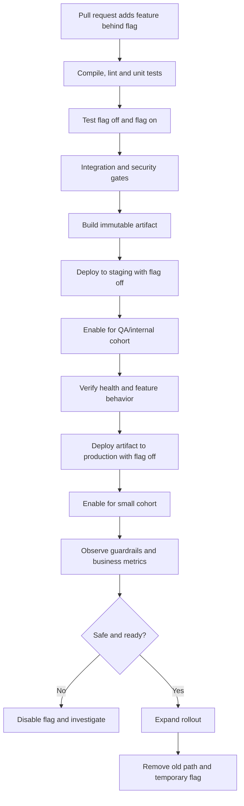

# Giới thiệu cờ tính năng và cách che thay đổi chưa hoàn tất

Trong CI/CD, nhóm thường muốn tích hợp code thường xuyên vào nhánh chính dù một tính năng chưa hoàn thành. Nếu phải giữ một nhánh dài ngày cho mỗi tính năng, các nhánh dễ lệch nhau, merge conflict tăng và lỗi tích hợp chỉ xuất hiện muộn. Nhưng nếu code chưa sẵn sàng được bật ngay cho mọi người dùng, việc deploy trực tiếp có thể làm lộ giao diện dang dở, kích hoạt luồng chưa được kiểm chứng hoặc gây tác động ngoài dự kiến.

**Feature flag** (cờ tính năng, còn gọi là feature toggle) cho phép ứng dụng quyết định tại runtime có thực thi một hành vi hay không. Nhóm có thể deploy code mới lên môi trường thật nhưng giữ nhánh hành vi đó ở trạng thái tắt, sau đó bật cho nội bộ, một nhóm nhỏ hoặc toàn bộ người dùng khi đã sẵn sàng. Cách làm này tách thời điểm đưa code vào môi trường khỏi thời điểm phát hành tính năng đến người dùng.

Feature flag đặc biệt hữu ích để che thay đổi chưa hoàn tất, giảm rủi ro rollout và tắt nhanh một tính năng có vấn đề. Tuy nhiên, flag tạo thêm nhánh logic và cấu hình runtime; nếu không có owner, thời hạn và kế hoạch dọn dẹp, chúng sẽ trở thành nợ kỹ thuật.

## 1. Feature flag là gì?

Feature flag là một điều kiện được đánh giá khi ứng dụng chạy để chọn hành vi. Flag thường có một key ổn định, trạng thái hoặc rule, giá trị mặc định và ngữ cảnh dùng để đánh giá.

Ví dụ đơn giản:

```java
if (featureFlags.isEnabled("new-checkout", userContext)) {
    return newCheckoutService.checkout(request);
}

return legacyCheckoutService.checkout(request);
```

Khi `new-checkout` tắt, ứng dụng tiếp tục dùng luồng cũ. Khi flag bật cho một nhóm được chọn, nhóm đó dùng luồng mới. Code của cả hai nhánh đã được deploy trong cùng artifact; cấu hình flag quyết định nhánh nào được thực thi.

Một hệ thống feature flag thường có các thành phần:

- **Flag definition:** tên, loại, mô tả, owner, trạng thái mặc định và thời hạn.
- **Evaluation context:** user ID, tenant, region, application version hoặc thuộc tính cần thiết khác.
- **Rules/targeting:** điều kiện bật cho nhóm hoặc tỷ lệ người dùng.
- **SDK/evaluation engine:** thư viện trong ứng dụng hoặc dịch vụ đánh giá rule.
- **Configuration distribution:** cách cập nhật flag đến các instance, SDK hoặc client.
- **Audit history:** ai thay đổi flag, lúc nào và vì sao.
- **Fallback behavior:** ứng dụng xử lý thế nào khi không đọc được cấu hình.

Flag có thể được lưu trong file cấu hình, database, hệ thống quản lý feature flag hoặc dịch vụ nội bộ. Cách lưu không quan trọng bằng việc giá trị được kiểm soát, có thể audit và có hành vi mặc định an toàn.

## 2. Tách deploy khỏi release

Deploy là đưa một phiên bản ứng dụng hoặc artifact vào môi trường. Release là làm cho một tính năng có hiệu lực đối với người dùng hoặc hệ thống mục tiêu. Hai việc có thể diễn ra ở hai thời điểm khác nhau.

| Trạng thái | Code trong artifact | Flag | Người dùng nhìn thấy |
|---|---|---|---|
| Chưa deploy | Chưa có code mới | Không áp dụng | Chỉ có hành vi cũ |
| Đã deploy, flag tắt | Có code mới | Off | Hành vi cũ tiếp tục hoạt động |
| Đã deploy, bật nội bộ | Có code mới | On cho nhóm nội bộ | Nhóm nội bộ thấy hành vi mới |
| Rollout một phần | Có code mới | On theo cohort/rule | Chỉ nhóm được chọn thấy hành vi mới |
| Phát hành rộng | Có code mới | On cho toàn bộ đối tượng đủ điều kiện | Hành vi mới trở thành mặc định |

Tách deploy khỏi release giúp nhóm tích hợp code thường xuyên, kiểm tra artifact trên staging và production, rồi chọn thời điểm mở tính năng theo nhu cầu sản phẩm. Nếu tính năng gặp lỗi nhưng artifact vẫn ổn định, có thể tắt flag để quay về hành vi cũ mà không cần deploy lại toàn bộ ứng dụng.

Flag không thay thế deployment strategy. Rolling, blue-green hoặc canary vẫn quyết định cách thay artifact và kiểm soát sức khỏe hạ tầng. Feature flag quyết định hành vi nào được bật bên trong artifact đã triển khai.

## 3. Che code chưa hoàn tất bằng release toggle

Release toggle là loại flag dùng để giữ tính năng chưa hoàn tất ở trạng thái tắt cho đến khi code và trải nghiệm sẵn sàng. Đây là cách phổ biến để tích hợp từng phần của một thay đổi lớn vào nhánh chính.

Ví dụ, nhóm đang xây dựng trang checkout mới gồm nhiều phần: API tính phí, giao diện, xác nhận thanh toán và gửi event. Có thể tích hợp dần các phần này nhưng giữ `new-checkout` tắt cho người dùng thật. Khi toàn bộ luồng đã được kiểm tra, nhóm bật cho nhân viên nội bộ rồi mở rộng theo từng nhóm.

Một release toggle nên có:

- Giá trị mặc định là tắt cho đối tượng chưa được cho phép.
- Nhánh cũ vẫn hoạt động và được kiểm thử trong giai đoạn chuyển tiếp.
- Nhánh mới không tạo side effect khi flag tắt.
- Các dependency và schema cần thiết được triển khai theo thứ tự tương thích.
- Có owner và điều kiện rõ ràng để bật hoặc xóa flag.

Flag chỉ che hành vi tại runtime; nó không làm code chưa hoàn tất biến mất khỏi artifact. Code vẫn phải compile, vượt static analysis và không làm lộ secret. Không đặt một tính năng nguy hiểm sau flag rồi giả định chỉ cần tắt flag là mọi rủi ro được loại bỏ.

## 4. Các loại feature flag thường gặp

Không phải flag nào cũng có vòng đời hoặc cách vận hành giống nhau. Phân loại giúp chọn default, thời hạn và cách kiểm soát phù hợp.

| Loại flag | Mục đích | Vòng đời thường gặp |
|---|---|---|
| Release toggle | Che tính năng đang phát triển hoặc chưa phát hành | Tạm thời; xóa sau khi phát hành ổn định |
| Experiment toggle | Chọn control/treatment trong A/B test | Tồn tại trong thời gian thí nghiệm và phân tích |
| Operational toggle | Bật/tắt hành vi vận hành như chế độ bảo trì hoặc giảm tải | Có thể tồn tại lâu hơn; cần owner vận hành |
| Kill switch | Tắt nhanh một chức năng khi có sự cố | Có thể dài hạn; cần kiểm thử đường tắt và quy trình khôi phục |
| Permission/access rule | Quyết định ai có quyền làm gì | Là chính sách bảo mật/ủy quyền, cần hệ thống authorization chuyên dụng |

Permission rule thường được liệt kê cùng feature flags trong một số nền tảng, nhưng không nên dùng flag UI hoặc release toggle làm cơ chế bảo vệ tài nguyên. Quyền truy cập phải được kiểm tra ở server bằng authorization policy. Người dùng có thể sửa JavaScript hoặc gọi API trực tiếp; ẩn nút trên giao diện không ngăn được truy cập trái phép.

## 5. Release toggle và nhánh code chưa hoàn tất

Khi nhiều developer cùng làm một tính năng, có thể dùng flag để merge từng phần nhỏ vào mainline. Ví dụ:

1. Thêm model và interface mới nhưng chưa gọi từ luồng người dùng.
2. Thêm service mới sau flag mặc định tắt.
3. Tích hợp API và UI theo từng pull request.
4. Viết test cho cả trạng thái flag off và on.
5. Hoàn thiện telemetry, error handling và fallback.
6. Bật flag trong môi trường test hoặc cho tài khoản nội bộ.
7. Mở rộng dần sau khi đạt quality gate.
8. Xóa nhánh cũ và flag khi tính năng đã ổn định.

Ví dụ:

```java
public CheckoutResult checkout(
        CheckoutRequest request,
        UserContext userContext) {

    if (!flags.isEnabled("new-checkout", userContext)) {
        return legacyCheckout.checkout(request);
    }

    return newCheckout.checkout(request);
}
```

Nhánh mới cần được triển khai theo cách có thể tồn tại an toàn dù chưa bật. Nếu constructor của `newCheckout` kết nối một dependency chưa có hoặc chạy migration khi khởi tạo, flag tắt vẫn có thể làm ứng dụng lỗi. Nên trì hoãn việc gọi dependency mới đến lúc nhánh được chọn, đồng thời bảo đảm khởi động ứng dụng không phụ thuộc vào tính năng đang ẩn.

## 6. Branch by Abstraction

Branch by Abstraction là kỹ thuật thay đổi một phần hệ thống lớn bằng cách đưa một abstraction ổn định vào trước, sau đó chuyển implementation dần dần. Feature flag có thể chọn implementation cũ hoặc mới qua abstraction đó.

Ví dụ, hệ thống đang dùng `LegacyPricingService`; nhóm muốn chuyển sang engine định giá mới:

```java
public interface PricingService {
    Price calculate(Order order);
}

public final class PricingRouter implements PricingService {
    private final PricingService legacy;
    private final PricingService next;
    private final FeatureFlags flags;

    public PricingRouter(
            PricingService legacy,
            PricingService next,
            FeatureFlags flags) {
        this.legacy = legacy;
        this.next = next;
        this.flags = flags;
    }

    @Override
    public Price calculate(Order order) {
        UserContext context = UserContext.forTenant(order.tenantId());
        return flags.isEnabled("new-pricing", context)
                ? next.calculate(order)
                : legacy.calculate(order);
    }
}
```

Đây là ví dụ minh họa; kiểu dữ liệu và cách tạo context phụ thuộc ứng dụng. Abstraction giúp các caller không phải biết implementation nào đang được chọn. Khi implementation mới đã thay thế hoàn toàn implementation cũ, có thể xóa router, flag và code cũ trong một thay đổi riêng.

Không nên tạo abstraction chỉ để bọc một `if` đơn giản nếu nó làm thiết kế phức tạp hơn. Kỹ thuật này phù hợp khi thay đổi implementation lớn, có nhiều caller hoặc cần chuyển dần qua nhiều release.

## 7. Targeting: bật flag cho đúng đối tượng

Flag có thể được bật theo nhiều tiêu chí:

- Môi trường: development, staging hoặc production.
- Danh sách tài khoản nội bộ hoặc tenant được cho phép.
- Region, quốc gia hoặc cụm triển khai.
- Phiên bản ứng dụng hoặc client capability.
- Nhóm người dùng đã được phân bổ.
- Tỷ lệ phần trăm người dùng hoặc request.
- Thuộc tính nghiệp vụ như loại gói dịch vụ hoặc trạng thái tài khoản.

Ví dụ rule minh họa:

```yaml
flags:
  new-checkout:
    enabled: true
    default: false
    targeting:
      environments:
        - staging
      users:
        - qa-user-01
        - internal-reviewer-02
      percentage: 0
```

Đây là cấu hình minh họa, không phải schema của một nền tảng cụ thể. Cần xác định thứ tự ưu tiên giữa environment, allowlist, percentage và default. Nếu rule mâu thuẫn, hệ thống phải có semantics rõ ràng và có test.

Trong production, không nên bật flag chỉ dựa trên email hoặc thuộc tính do client tự khai báo. Context dùng cho targeting cần được lấy từ danh tính đã xác thực hoặc nguồn dữ liệu đáng tin. Không đưa thông tin cá nhân nhạy cảm vào rule nếu không cần thiết.

## 8. Percentage rollout và deterministic bucketing

Percentage rollout cho phép bật tính năng cho một tỷ lệ cohort, ví dụ 1%, 5%, 10%, 25%, 50% rồi 100%. Để người dùng không liên tục đổi trạng thái giữa các request, hệ thống thường dùng deterministic bucketing: hash một định danh ổn định cùng flag/experiment key và đưa kết quả vào bucket.

Pseudocode:

```text
bucket = hash(flagKey + stableSubjectId) modulo 10000
enabled = bucket < rolloutPercentage * 100
```

Ví dụ `rolloutPercentage = 5` tương ứng 500 bucket trong tổng 10.000 bucket. Cách hash thực tế cần được định nghĩa thống nhất giữa các service/SDK nếu chúng phải cho cùng một người dùng kết quả giống nhau.

Định danh subject phải phù hợp với mục tiêu. Với ứng dụng B2B, tenant ID có thể phù hợp hơn user ID vì các thành viên trong một tổ chức cần cùng trải nghiệm. Với hành trình cá nhân, user ID có thể phù hợp hơn session ID. Nếu không có định danh ổn định, cần quy tắc fallback rõ ràng.

Không dùng random mới cho mỗi request nếu mục tiêu là rollout theo cohort. Random per request có thể làm cùng người dùng thấy hai hành vi khác nhau, tạo lỗi dữ liệu và khó điều tra.

## 9. Dark launch: chạy code nhưng chưa công bố kết quả

Dark launch là cách đưa một khả năng mới vào production nhưng chưa hiển thị hoặc chưa dùng kết quả của nó cho người dùng. Có thể chạy logic mới ở chế độ shadow, ghi metric hoặc so sánh kết quả với hệ thống cũ.

Ví dụ, nhóm muốn thay engine tìm kiếm. Request được xử lý bởi engine cũ để trả response; engine mới cũng nhận bản sao request ở chế độ read-only để đo latency và so sánh kết quả. Khi engine mới đủ ổn định, nhóm có thể chuyển một phần traffic sang kết quả mới bằng flag.

Dark launch cần kiểm soát side effect:

- Không gửi email, push notification hoặc webhook trùng.
- Không tạo đơn hàng, thanh toán hoặc thay đổi trạng thái thật.
- Không ghi dữ liệu production ngoài phạm vi được phép.
- Giới hạn CPU, memory và network để workload shadow không ảnh hưởng hệ thống chính.
- Tránh log payload nhạy cảm hoặc dữ liệu cá nhân không cần thiết.

Dark launch khác với chỉ ẩn UI. Code mới có thể thực sự chạy trong nền, vì vậy cần giới hạn quyền và tác động của nó.

## 10. Safe default và fallback khi flag service gặp lỗi

Flag có thể được đánh giá từ cấu hình local, cache hoặc dịch vụ từ xa. Nếu nguồn cấu hình không truy cập được, ứng dụng cần hành vi xác định trước.

Các lựa chọn phổ biến:

- **Default off:** nhánh mới bị tắt nếu không thể đánh giá flag. Phù hợp với release toggle đang che code chưa hoàn tất.
- **Last known good:** dùng cấu hình hợp lệ gần nhất đã nhận và xác minh. Phù hợp khi tiếp tục hành vi hiện tại an toàn hơn việc thay đổi đột ngột.
- **Default on:** chỉ phù hợp khi nhánh mới đã là hành vi ổn định và policy cho phép; không nên dùng mặc định cho tính năng chưa hoàn tất.
- **Fail closed:** từ chối một thao tác nếu không thể xác minh điều kiện bắt buộc. Cần tránh nhầm với fallback chức năng; đây là quyết định theo rủi ro.

Không có một default phù hợp cho mọi flag. Ví dụ kill switch dùng để ngăn xử lý giao dịch khi dependency lỗi có thể cần default theo hướng an toàn; release toggle che code chưa hoàn tất thường nên off. Hãy ghi rõ fallback ngay trong định nghĩa flag và kiểm thử khi SDK timeout, config sai hoặc cache hết hạn.

Ứng dụng không nên gọi flag service đồng bộ trên mỗi request nếu điều đó tạo dependency mạng quan trọng và làm tăng latency. SDK có thể nhận cấu hình nền, cache kết quả và đánh giá local. Tuy nhiên, cache cần có thời gian sống, cách refresh và hành vi khi cấu hình cũ quá lâu.

## 11. Đánh giá flag nhất quán trong một request

Nếu cùng một request đánh giá một flag nhiều lần trong khi cấu hình đang cập nhật, hai đoạn code có thể nhận kết quả khác nhau. Điều này dễ tạo trạng thái nửa cũ nửa mới, ví dụ UI hiển thị bước checkout mới nhưng API xử lý theo luồng cũ.

Các cách hạn chế:

- Đánh giá flag một lần ở ranh giới request hoặc use case rồi truyền kết quả xuống các lớp liên quan.
- Dùng evaluation context bất biến trong suốt request.
- Ghi lại flag key, variant và config version trong trace/log theo chính sách.
- Với workflow dài hoặc background job, lưu quyết định variant nếu cần bảo đảm cùng hành vi trong toàn bộ job.
- Nếu nhiều service phải phối hợp, truyền capability/version rõ ràng thay vì để mỗi service tự randomize độc lập.

Không truyền toàn bộ flag configuration qua API công khai nếu có rule nội bộ hoặc thông tin nhạy cảm. Chỉ truyền kết quả/capability cần thiết và kiểm tra tính hợp lệ ở server.

## 12. Feature flag ở backend và frontend

Flag ở backend có thể chọn service implementation, thuật toán hoặc quy trình nghiệp vụ. Flag ở frontend có thể ẩn/hiện component, điều hướng hoặc thay đổi trải nghiệm.

Một số điểm cần lưu ý:

- Flag frontend có thể bị người dùng xem hoặc thay đổi qua devtools; không chứa secret hay thông tin nội bộ.
- Ẩn button không thay thế authorization ở API.
- Server phải kiểm tra quyền và trạng thái nghiệp vụ trước khi thực hiện thao tác.
- Nếu UI mới yêu cầu API mới, server cần hỗ trợ version/capability tương thích trong giai đoạn rollout.
- SSR và browser SDK cần nhất quán để tránh render khác nhau hoặc nhấp nháy giao diện.
- Cache/CDN có thể giữ HTML hoặc config flag cũ; cần quy tắc cache invalidation và targeting an toàn.

Không gửi dữ liệu cá nhân không cần thiết sang nhà cung cấp flag chỉ để đánh giá rule. Dùng ID giả danh hoặc thuộc tính tối thiểu theo chính sách privacy.

## 13. Flag không phải cơ chế bảo mật

Feature flag thường được dùng để kiểm soát khả năng hiển thị hoặc rollout, nhưng không nên là lớp authorization duy nhất. Nếu API chỉ kiểm tra flag `admin-feature` mà không xác minh user có quyền admin, một người dùng có thể gọi endpoint trực tiếp hoặc sửa request.

Hãy tách hai quyết định:

- **Feature availability:** tính năng có được mở ở môi trường/cohort hiện tại không?
- **Authorization:** principal hiện tại có quyền thực hiện hành động trên resource này không?

Một thao tác chỉ được thực hiện khi cả hai điều kiện phù hợp. Authorization cần được kiểm tra ở server trên mỗi request hoặc theo cơ chế policy đáng tin cậy. Flag không được dùng để che dữ liệu nhạy cảm khỏi client nếu dữ liệu đó đã được gửi xuống trình duyệt.

Flag targeting cũng không thay thế tenant isolation. Rule chọn tenant chỉ quyết định trải nghiệm; query và service vẫn phải kiểm tra tenant ownership để tránh truy cập chéo dữ liệu.

## 14. Flag và thay đổi database/API

Tắt flag không hoàn tác schema migration hoặc dữ liệu đã ghi. Nếu nhánh mới cần cột, bảng, event hoặc endpoint mới, hãy chuẩn bị thay đổi theo hướng tương thích trước khi bật flag.

Một trình tự an toàn có thể là:

1. Expand schema hoặc thêm API/event theo cách không phá phiên bản cũ.
2. Deploy code có thể chạy khi flag off và tương thích với schema cũ/mới.
3. Kiểm thử cả nhánh off và on.
4. Backfill dữ liệu nếu cần và xác minh.
5. Bật flag cho nhóm nội bộ.
6. Mở rộng cohort sau khi health và business guardrails đạt.
7. Giữ đường cũ trong rollback window.
8. Khi tính năng ổn định và không còn rollback về code cũ, contract schema/API và xóa flag.

Nếu code mới ghi dữ liệu mà code cũ không đọc được, tắt flag sau sự cố vẫn có thể không khôi phục khả năng tương thích. Cần kiểm tra rollback của cả ứng dụng và dữ liệu, không chỉ trạng thái flag.

## 15. Kiểm thử hai trạng thái của flag

Mọi flag quan trọng cần test cả trạng thái bật và tắt. Test chỉ chạy nhánh mới sẽ không phát hiện lỗi khi fallback hoặc cấu hình production mặc định.

Ví dụ:

```java
@Test
void usesLegacyCheckoutWhenFlagIsOff() {
    when(flags.isEnabled(eq("new-checkout"), any()))
            .thenReturn(false);

    CheckoutResult result = checkoutFacade.checkout(request, user);

    verify(legacyCheckout).checkout(request);
    verifyNoInteractions(newCheckout);
}

@Test
void usesNewCheckoutWhenFlagIsOn() {
    when(flags.isEnabled(eq("new-checkout"), any()))
            .thenReturn(true);

    checkoutFacade.checkout(request, user);

    verify(newCheckout).checkout(request);
    verifyNoInteractions(legacyCheckout);
}
```

Đây là ví dụ với Mockito và các dependency giả định. Trong test thực tế, nên kiểm tra thêm kết quả nghiệp vụ, lỗi từ implementation mới, fallback khi flag provider lỗi và việc không tạo side effect khi flag off.

Các lớp test hữu ích:

- Unit test cho rule và nhánh code.
- Component test cho cách flag được inject và đánh giá.
- Integration test cho config provider/cache/refresh.
- Contract test cho API mà nhánh mới sử dụng.
- E2E test cho cohort được bật và cohort chưa được bật.
- Test concurrency nếu config có thể thay đổi trong khi request đang xử lý.

## 16. Kiểm soát số tổ hợp flag

Khi ứng dụng có nhiều flag, số tổ hợp có thể tăng rất nhanh. Với 10 flag boolean độc lập, về lý thuyết có (2^{10}=1024) tổ hợp. Không phải mọi tổ hợp đều hợp lệ hoặc cần test, nhưng cần tránh để các flag phụ thuộc nhau theo cách không được mô tả.

Các cách quản lý:

- Xác định flag nào có thể bật cùng nhau và flag nào loại trừ nhau.
- Dùng configuration validation để phát hiện tổ hợp không hợp lệ.
- Test các trạng thái quan trọng: mặc định, rollout, fallback và kill switch.
- Ưu tiên test theo rủi ro và dependency thay vì thử mọi tổ hợp một cách máy móc.
- Ghi nhận flag/version trong test report để tái tạo lỗi.
- Giữ số flag sống đồng thời ở mức có thể quản lý.

Một flag mới không nên âm thầm thay đổi semantics của flag cũ. Nếu có dependency, biểu diễn rõ bằng rule hoặc một capability tổng hợp có tên và owner.

## 17. Rollout flag theo từng bước

Sau khi code đã deploy và kiểm tra ở trạng thái off, có thể bật flag theo lộ trình:

1. **Internal only:** bật cho developer, QA hoặc tài khoản nội bộ.
2. **Small cohort:** mở cho một nhóm nhỏ được xác định trước.
3. **Percentage rollout:** tăng dần 1%, 5%, 10%, 25%, 50% hoặc các mức phù hợp.
4. **Broader targeting:** mở theo region, tenant hoặc nhóm đủ điều kiện.
5. **General availability:** bật cho toàn bộ đối tượng mục tiêu.
6. **Cleanup:** loại bỏ nhánh cũ và flag sau khi ổn định.

Ở mỗi bước cần có metric và ngưỡng rõ. Ví dụ error rate, p95 latency, tỷ lệ giao dịch thất bại, crash rate hoặc một guardrail nghiệp vụ. Nếu vượt ngưỡng, dừng tăng rollout và tắt flag hoặc rollback theo runbook.

Không tăng tỷ lệ chỉ dựa trên thời gian đã trôi qua. Cần đủ traffic và cửa sổ quan sát để thu thập tín hiệu có ý nghĩa. Với service ít traffic, có thể cần synthetic test hoặc nhóm canary được kiểm soát.

## 18. Kết hợp feature flag với canary deployment

Canary deployment và feature flag có thể phối hợp nhưng kiểm soát hai lớp khác nhau:

- Canary điều khiển phiên bản artifact hoặc traffic đến instance mới.
- Feature flag điều khiển hành vi bên trong artifact theo user/tenant/context.

Ví dụ, v2 được deploy đến 10% instance. Trong số request đến v2, flag `new-checkout` vẫn off ban đầu. Sau khi v2 khỏe, nhóm bật flag cho nhân viên nội bộ, rồi mở dần theo cohort. Nếu code v2 có lỗi hạ tầng, rollback deployment. Nếu chỉ tính năng checkout mới có vấn đề và đường cũ vẫn an toàn, tắt flag.

Không dùng flag để che một lỗi khởi động hoặc lỗi dependency xảy ra trước khi flag được đánh giá. Canary vẫn cần health/readiness và operational gate. Ngược lại, rollback artifact có thể ảnh hưởng nhiều tính năng khác; flag giúp tắt một hành vi hẹp hơn khi phù hợp.

## 19. Kill switch và giới hạn tác động khi có sự cố

Kill switch là flag cho phép tắt nhanh một chức năng có thể gây tác động lớn, chẳng hạn xử lý recommendation, gửi thông báo, tích hợp đối tác hoặc một luồng ghi dữ liệu mới.

Một kill switch cần:

- Có người sở hữu và runbook rõ.
- Có thể thay đổi nhanh, có audit và quyền truy cập giới hạn.
- Được kiểm thử ở trạng thái bật và tắt.
- Có fallback an toàn khi flag provider không khả dụng.
- Không làm ứng dụng rơi vào trạng thái không nhất quán khi flag thay đổi.
- Có metric xác nhận hành vi đã thực sự dừng.

Kill switch không nên được dùng thay cho circuit breaker hoặc cơ chế chống quá tải nếu vấn đề thuộc dependency/network. Nó có thể bổ sung cho các cơ chế resilience, nhưng mỗi cơ chế giải quyết một loại lỗi khác nhau.

Với chức năng có side effect, cần xác định request đang xử lý dở khi flag chuyển off sẽ được hoàn tất, hủy hay bù trừ. Tắt flag không tự hủy transaction hoặc job đã được enqueue.

## 20. Đặt tên, owner và metadata cho flag

Flag cần có tên phản ánh hành vi, không chỉ tên ticket hoặc người tạo. Một định nghĩa tốt thường có:

| Metadata | Ví dụ |
|---|---|
| Key | `new-checkout` |
| Type | `release` |
| Description | Chọn checkout flow mới cho người dùng đủ điều kiện |
| Owner | `team-checkout` |
| Default | `false` |
| Created | Ngày tạo |
| Expiry/review date | Ngày phải đánh giá hoặc xóa |
| Rollout plan | Internal → 5% → 25% → 100% |
| Fallback | Dùng checkout legacy |
| Related change | Pull request hoặc release record |

Tên key nên ổn định, dễ tìm và không chứa thông tin cá nhân. Tránh key mơ hồ như `new-feature`, `temp-flag`, `test1` hoặc key gắn với tên developer sẽ nghỉ dự án.

Metadata giúp nhóm biết flag nào còn cần, ai được quyền thay đổi và khi nào phải xóa. Nếu hệ thống flag hỗ trợ owner/expiry, hãy bắt buộc điền; nếu không, duy trì inventory trong repository hoặc hệ thống quản lý thay đổi.

## 21. Vòng đời và dọn dẹp flag

Feature flag nên được xem là tài nguyên có vòng đời, không phải một điều kiện tồn tại vĩnh viễn trong code.

Vòng đời release toggle điển hình:

1. **Proposed:** tạo flag, mô tả mục tiêu, owner và fallback.
2. **Development:** code được tích hợp nhưng flag mặc định off.
3. **Validation:** kiểm thử cả hai nhánh và bật ở môi trường test.
4. **Internal release:** mở cho nhóm nội bộ.
5. **Progressive rollout:** tăng cohort theo metric.
6. **Fully released:** hành vi mới trở thành mặc định.
7. **Cleanup:** xóa flag, nhánh cũ, config rule và test không còn cần.

Không nên chỉ đặt flag thành 100% rồi để lại mọi nhánh code. Mỗi lần đánh giá nên quyết định flag sẽ được giữ lại có chủ đích, chuyển thành config dài hạn hay xóa.

Operational toggle hoặc kill switch có thể sống lâu hơn release toggle, nhưng vẫn cần owner, kiểm thử và review định kỳ. Flag experiment nên được dọn sau khi kết thúc phân tích và lưu kết quả thí nghiệm.

## 22. Nợ kỹ thuật do flag tồn tại quá lâu

Flag cũ làm tăng số nhánh logic, số tổ hợp test và khó khăn khi debug. Các rủi ro gồm:

- Developer không biết nhánh nào còn được sử dụng.
- Code cũ không còn test nhưng vẫn có thể được bật lại.
- Flag phụ thuộc lẫn nhau tạo tổ hợp không thể hiểu.
- Config rule cũ vô tình bật cho cohort mới.
- SDK evaluation và remote config tăng latency hoặc độ phức tạp.
- Incident khó điều tra vì không biết giá trị flag tại thời điểm request.
- Một lần cleanup thiếu sót làm mất đường rollback hoặc fallback.

Để giảm nợ:

- Gắn expiry/review date cho release và experiment toggle.
- Tạo ticket cleanup khi flag được tạo.
- Theo dõi flag stale hoặc không còn được đánh giá.
- Xóa code cũ sau khi hết rollback window.
- Xóa rule, targeting và test fixture liên quan.
- Giữ audit history để điều tra, nhưng không giữ nhánh code cũ không cần thiết.

## 23. Bảo mật và quyền thay đổi flag

Người có quyền bật flag production có thể thay đổi hành vi hệ thống mà không cần deploy artifact mới. Vì vậy, quyền quản lý flag là quyền vận hành nhạy cảm.

Nên áp dụng:

- RBAC theo project, environment và loại flag.
- Phân biệt quyền xem, sửa rule, bật production và quản trị hệ thống.
- Audit log cho mọi thay đổi, bao gồm actor, thời gian, giá trị trước/sau và lý do.
- Approval cho flag ảnh hưởng thanh toán, dữ liệu hoặc chức năng quan trọng.
- Giới hạn targeting để tránh mở nhầm toàn bộ tenant hoặc region.
- Bảo vệ API token/SDK key và rotate khi cần.
- Không ghi secret hoặc dữ liệu cá nhân vào description, rule hay log.
- Dùng môi trường tách biệt để thử config trước khi áp dụng production.

Client-side SDK key thường được thiết kế để công khai trong ứng dụng frontend và chỉ cho phép đọc flag đã được lọc; vẫn cần kiểm tra đặc tính của nhà cung cấp. Server-side credential có quyền quản trị hoặc ghi flag phải được giữ bí mật và không gửi xuống browser.

## 24. Quan sát và điều tra hành vi theo flag

Khi một request đi theo nhánh mới, nhóm cần biết flag nào đã được đánh giá, variant nào được chọn và cấu hình nào có hiệu lực. Có thể ghi các thuộc tính:

- Flag key và variant (`control`, `treatment`, `on`, `off`).
- Environment và config version.
- Release ID và artifact digest.
- Experiment ID hoặc rollout cohort nếu có.
- Evaluation reason hoặc rule ID ở mức không tiết lộ dữ liệu nhạy cảm.

Không ghi toàn bộ evaluation context nếu nó chứa email, số điện thoại hoặc thuộc tính cá nhân. Dùng ID giả danh và giới hạn quyền truy cập log/trace.

Dashboard nên cho biết tỷ lệ request/user đi theo từng nhánh, error rate, latency và outcome nghiệp vụ theo variant. Nếu flag đã bật 10% nhưng metric cho thấy 40% request đi vào nhánh mới, cần kiểm tra assignment, cache, SDK và cách đếm exposure.

Với flag quan trọng, cần cảnh báo khi không thể tải config, config quá cũ, evaluation error tăng hoặc tỷ lệ phân bổ lệch khỏi dự kiến.

## 25. Tác động đến cache, session và background job

Flag có thể thay đổi trong lúc người dùng đang thao tác hoặc job đang chạy. Nếu đánh giá flag lại ở mỗi bước, một workflow có thể bắt đầu theo luồng cũ rồi kết thúc theo luồng mới.

Các cách xử lý:

- Với request ngắn, snapshot kết quả flag vào request context.
- Với workflow dài, lưu variant hoặc behavior version cùng job nếu cần tái lập.
- Với session nhiều request, quyết định có cần sticky assignment hay không.
- Với cache, đưa variant/config version vào cache key nếu dữ liệu khác nhau.
- Khi tắt flag, xử lý các job đã enqueue theo schema/behavior mà chúng được tạo ra.
- Nếu config refresh không đồng thời giữa các instance, bảo đảm hai nhánh vẫn tương thích trong thời gian chuyển tiếp.

Không giả định flag off có thể thu hồi mọi request đã đi vào nhánh mới. Job đang chạy, event đã phát và transaction đã commit cần được xử lý theo quy trình riêng.

## 26. Ví dụ cấu hình và kiểm tra trong CI

Một file inventory đơn giản có thể mô tả flag và vòng đời:

```yaml
flags:
  new-checkout:
    type: release
    owner: team-checkout
    default: false
    fallback: legacy-checkout
    expires: 2026-12-15
    description: Enable the new checkout flow for approved cohorts.
```

Đây là cấu trúc minh họa; định dạng thực tế phụ thuộc flag platform hoặc schema nội bộ. Không lưu secret trong file này. Nếu config được dùng trực tiếp bởi runtime, cần validate schema và kiểm soát quyền thay đổi.

CI có thể kiểm tra:

- Flag key không trùng và tuân theo naming convention.
- Mỗi flag có type, owner, default và review/expiry date.
- Release toggle mặc định off trong cấu hình production ban đầu.
- Không có secret hoặc dữ liệu cá nhân trong rule.
- Code có test cho cả nhánh on/off.
- Flag đã hết hạn hoặc stale tạo cảnh báo/ticket.
- Thay đổi flag production có approval và audit theo policy.

Không nên chỉ dùng regex để validate cấu hình phức tạp. Dùng schema validator hoặc SDK/parser của hệ thống flag để kiểm tra semantics.

## 27. Ví dụ luồng CI/CD với feature flag

Một luồng tham khảo:



Các bước có thể được chia qua nhiều pipeline và hệ thống. Điểm quan trọng là artifact được build và kiểm thử có định danh bất biến; cấu hình flag được quản lý riêng; production flag change có quyền và audit phù hợp; và sau khi release ổn định, code path cũ cùng flag tạm thời được dọn.

## 28. Các anti-pattern thường gặp

| Anti-pattern | Hậu quả | Cách cải thiện |
|---|---|---|
| Dùng flag thay authorization | Người dùng có thể gọi API trực tiếp | Kiểm tra quyền ở server bằng policy riêng |
| Flag mặc định on cho code chưa hoàn tất | Người dùng có thể gặp luồng dang dở khi config lỗi | Default off và fallback rõ |
| Chỉ test nhánh on | Nhánh cũ/fallback có thể hỏng | Test cả on, off và provider failure |
| Flag service là dependency đồng bộ cho mọi request | Tăng latency và tạo điểm lỗi tập trung | SDK local evaluation, cache và timeout phù hợp |
| Random lại mỗi request | Một người thấy nhiều hành vi trong cùng journey | Deterministic bucketing và sticky assignment |
| Dùng flag để che schema breaking | Tắt flag không sửa dữ liệu/schema đã thay đổi | Expand-migrate-contract và compatibility test |
| Bật flag toàn bộ chỉ bằng thao tác tay không audit | Khó truy vết và dễ mở nhầm | RBAC, approval, audit và staged rollout |
| Giữ flag release vô thời hạn | Tăng nhánh logic và chi phí test | Owner, expiry và cleanup ticket |
| Tạo quá nhiều flag phụ thuộc nhau | Tổ hợp runtime khó hiểu | Giảm số flag, mô tả dependency và validation |
| Ghi toàn bộ user context vào log | Rủi ro riêng tư và log phình lớn | Ghi metadata tối thiểu, giả danh hóa |
| Chỉ ẩn UI nhưng backend không kiểm tra | Endpoint vẫn có thể bị gọi trực tiếp | Authorization và validation phía server |
| Tắt flag nhưng không theo dõi job đang chạy | Side effect có thể tiếp tục sau khi tắt | Xử lý queue/job/transaction riêng |

## 29. Checklist trước khi tạo feature flag

- [ ] Mục tiêu của flag và hành vi được điều khiển được mô tả rõ.
- [ ] Loại flag được chọn đúng: release, experiment, operational hoặc kill switch.
- [ ] Có owner chịu trách nhiệm.
- [ ] Có default và fallback an toàn khi config không truy cập được.
- [ ] Flag không được dùng thay authorization hoặc tenant isolation.
- [ ] Code mới không tạo side effect khi flag off.
- [ ] Dependency mới không làm ứng dụng lỗi ngay cả khi nhánh flag chưa được chọn.
- [ ] Database/API/event thay đổi vẫn tương thích với phiên bản cũ.
- [ ] Targeting dựa trên context đáng tin và dữ liệu tối thiểu.
- [ ] Percentage rollout dùng assignment ổn định khi cần.
- [ ] Có test cho trạng thái on, off và evaluation failure.
- [ ] Có metric/log/trace để biết variant thực tế.
- [ ] Quyền bật flag production được giới hạn và audit.
- [ ] Có expiry/review date và kế hoạch cleanup.

## 30. Checklist phát hành và dọn flag

- [ ] Artifact đã được build, kiểm thử và triển khai theo digest xác định.
- [ ] Flag vẫn off khi deploy production lần đầu nếu chưa sẵn sàng.
- [ ] QA/internal cohort đã kiểm tra hành vi mới.
- [ ] Canary/deployment health gates đạt trước khi mở rộng tính năng.
- [ ] Cohort và percentage được tăng theo kế hoạch.
- [ ] Guardrail và business metrics được theo dõi.
- [ ] Có thể tắt flag nhanh và xác minh hành vi đã quay về fallback.
- [ ] Đã đánh giá job, event, cache và transaction đang chạy khi flag thay đổi.
- [ ] Khi tính năng ổn định, code cũ và flag tạm thời được lên lịch xóa.
- [ ] Test, config rule, dashboard và tài liệu liên quan được cập nhật.
- [ ] Operational toggle/kill switch còn lại có owner và runbook.

## 31. Kết luận

Feature flag giúp nhóm tích hợp code chưa hoàn tất vào nhánh chính mà vẫn kiểm soát được thời điểm và đối tượng sử dụng. Release toggle che hành vi mới; percentage targeting và deterministic bucketing hỗ trợ rollout theo cohort; dark launch cho phép kiểm tra xử lý mà chưa công bố kết quả; kill switch giúp tắt nhanh một chức năng khi có sự cố.

Để sử dụng an toàn, mỗi flag cần có loại, owner, default, fallback, targeting và vòng đời rõ ràng. Hãy kiểm thử cả trạng thái bật/tắt, giữ API và dữ liệu tương thích trong thời gian chuyển tiếp, tách flag khỏi authorization, kiểm soát quyền thay đổi production và quan sát variant thực tế. Khi tính năng đã ổn định, xóa flag tạm cùng nhánh code cũ để tránh tích lũy nợ kỹ thuật.
