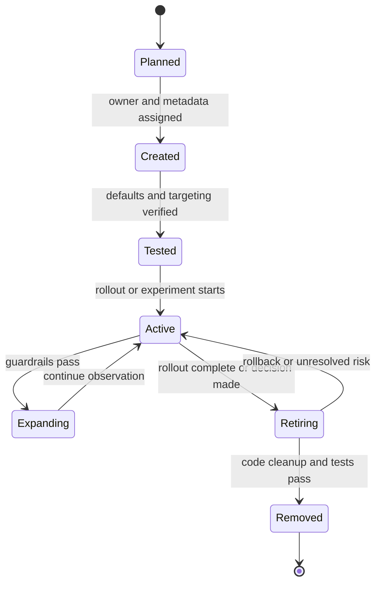

# Xác định trách nhiệm, vòng đời và thời điểm gỡ cờ

Feature flag (cờ tính năng) cho phép tách việc triển khai mã khỏi thời điểm bật một tính năng cho người dùng. Một phiên bản ứng dụng có thể đã được deploy lên production nhưng tính năng mới vẫn tắt, chỉ bật cho nhân viên nội bộ, một nhóm khách hàng hoặc một tỷ lệ traffic nhỏ. Cách làm này hỗ trợ rollout dần, thử nghiệm, tắt nhanh chức năng gặp sự cố và phối hợp phát hành giữa nhiều service.

Tuy nhiên, mỗi flag tạo thêm một nhánh hành vi và một trạng thái cấu hình cần quản lý. Nếu không có người chịu trách nhiệm, ngày xem xét và kế hoạch gỡ, flag tạm thời có thể tồn tại nhiều năm, khiến code khó hiểu, test matrix phình to và hành vi production phụ thuộc vào cấu hình mà không ai nhớ lý do.

**Một feature flag cần có owner, mục đích, vòng đời và điều kiện kết thúc ngay từ lúc tạo.** Người sở hữu phải biết ai được thay đổi flag, trạng thái nào đang được bật ở từng môi trường, cần theo dõi tín hiệu gì và khi nào có thể xóa flag cùng nhánh mã cũ. Gỡ cờ là một thay đổi mã nguồn có kiểm thử và review, không chỉ là xóa một dòng cấu hình.

## 1. Feature flag giải quyết vấn đề gì?

Feature flag là một điều kiện cấu hình quyết định ứng dụng thực hiện hành vi nào tại runtime hoặc trong quá trình xử lý request. Mã nguồn chứa cả đường hành vi được bảo vệ và đường hành vi thay thế; giá trị flag quyết định nhánh nào được sử dụng.

Ví dụ:

```java
if (featureFlags.isEnabled("new-checkout", customerContext)) {
    return newCheckoutService.checkout(request);
}

return legacyCheckoutService.checkout(request);
```

Khi `new-checkout` tắt, ứng dụng tiếp tục dùng luồng cũ. Khi bật cho một nhóm khách hàng, chỉ nhóm đó đi qua luồng mới. Nhóm có thể mở rộng phạm vi mà không cần build lại artifact nếu hệ thống flag hỗ trợ cập nhật cấu hình runtime.

Feature flag thường được dùng để:

- Triển khai mã trước, bật tính năng sau.
- Rollout theo tỷ lệ, tenant, khu vực hoặc nhóm người dùng.
- Thử nghiệm A/B với control và treatment.
- Tắt nhanh một chức năng gây lỗi bằng kill switch.
- Phối hợp thay đổi giữa nhiều service trong thời gian chuyển tiếp.
- Ẩn tính năng chưa sẵn sàng khỏi người dùng nhưng vẫn cho nhóm nội bộ kiểm tra.

Flag không thay thế kiểm thử, authorization, deployment strategy hoặc rollback. Một flag chỉ quyết định nhánh hành vi; nó không tự bảo đảm nhánh mới an toàn, tương thích hay có thể phục hồi.

## 2. Phân loại flag trước khi tạo

Các loại flag có mục đích và thời gian sống khác nhau. Phân loại ngay từ đầu giúp chọn owner, thời hạn và cách gỡ phù hợp.

| Loại flag | Mục tiêu | Vòng đời thường gặp | Cách kết thúc |
|---|---|---|---|
| Release flag | Ẩn tính năng mới trong lúc phát triển và rollout | Ngắn hạn, theo release | Sau khi rollout hoàn tất và code cũ không còn cần |
| Experiment flag | Chia nhóm control/treatment để đo tác động | Theo thời gian chạy thí nghiệm | Sau khi có kết luận, giữ biến thể thắng hoặc bỏ biến thể thua |
| Operational flag | Điều chỉnh hành vi vận hành, tải hoặc tính năng phụ trợ | Có thể dài hạn | Giữ nếu có runbook và owner; rà soát định kỳ |
| Kill switch | Tắt nhanh một chức năng khi có sự cố | Có thể dài hạn | Chỉ gỡ khi cơ chế thay thế và kế hoạch sự cố đã được xác nhận |
| Permission/entitlement flag | Kiểm soát tính năng theo gói dịch vụ hoặc quyền khách hàng | Có thể dài hạn | Chuyển sang mô hình entitlement/authorization chính thức khi phù hợp |
| Migration flag | Điều phối đọc/ghi giữa schema hoặc hệ thống cũ và mới | Ngắn đến trung hạn | Sau khi migration và xác minh dữ liệu hoàn tất |

Không nên áp một thời hạn vài ngày cho mọi flag. Release flag thường cần được gỡ sớm sau khi phát hành; operational flag hoặc entitlement flag có thể là cấu hình dài hạn nhưng cần owner và tài liệu vận hành rõ ràng.

### Không nhầm feature flag với quyền truy cập

Flag có thể ẩn một nút hoặc đường giao diện nhưng không phải cơ chế bảo vệ dữ liệu. Nếu một API chỉ kiểm tra flag mà không kiểm tra danh tính và quyền của caller, người dùng có thể gọi trực tiếp endpoint để vượt qua giao diện.

Authorization phải được thực hiện ở phía server theo identity, resource và policy. Feature flag chỉ điều khiển khả năng sử dụng hoặc rollout của hành vi trong phạm vi quyền đã được cấp.

## 3. Mỗi flag cần có owner rõ ràng

Không có owner thì không ai có trách nhiệm quyết định bật, tắt, gia hạn hay gỡ flag. Một bản ghi flag nên phân biệt người chịu trách nhiệm nghiệp vụ và người chịu trách nhiệm kỹ thuật khi cần.

### Vai trò thường gặp

| Vai trò | Trách nhiệm |
|---|---|
| Product owner hoặc feature owner | Xác định mục đích, người dùng mục tiêu, tiêu chí thành công và thời điểm kết thúc rollout |
| Technical owner/service owner | Bảo đảm code, default value, test, fallback và việc gỡ flag đúng kỹ thuật |
| Release manager | Phối hợp rollout, cửa sổ phát hành và điều kiện promote khi quy trình yêu cầu |
| Experiment owner/analyst | Thiết kế giả thuyết, nhóm control/treatment, metric và quyết định kết thúc thí nghiệm |
| Operations/on-call | Hiểu kill switch, quyền thay đổi khẩn cấp, runbook và cách xác minh sau khi tắt |
| Platform/flag administrator | Quản lý nền tảng, quyền truy cập, audit và chính sách toàn hệ thống |

Với nhóm nhỏ, một người có thể giữ nhiều vai trò, nhưng trách nhiệm vẫn cần được ghi rõ. Flag không nên được tạo bằng một tên chung như `temporary-feature-1` mà không có service, owner hoặc mục tiêu.

### Owner cần làm gì?

Owner chịu trách nhiệm:

- Xác nhận flag có mục đích hợp lệ và loại flag phù hợp.
- Đặt default an toàn cho từng môi trường.
- Xác định ai có quyền thay đổi và thay đổi trong điều kiện nào.
- Theo dõi rollout hoặc thí nghiệm bằng metric đã chọn.
- Xem xét flag trước ngày hết hạn.
- Quyết định giữ, chuyển thành cấu hình dài hạn hay gỡ.
- Đảm bảo code và test được dọn sau khi flag không còn cần thiết.

Owner có thể ủy quyền thao tác nhưng trách nhiệm cuối cùng vẫn cần một nhóm hoặc cá nhân có thể liên hệ.

## 4. Metadata tối thiểu cho một feature flag

Flag nên được đăng ký cùng metadata để có thể tìm kiếm, audit và quản lý vòng đời.

| Trường | Nội dung |
|---|---|
| Key | Định danh ổn định, duy nhất trong phạm vi ứng dụng hoặc project |
| Description | Mô tả hành vi mà flag điều khiển |
| Type | Release, experiment, operational, kill switch, entitlement hoặc migration |
| Owner | Nhóm/cá nhân chịu trách nhiệm và kênh liên hệ |
| Service/component | Thành phần chứa code sử dụng flag |
| Created date | Ngày tạo |
| Review/expiry date | Ngày cần xem xét hoặc ngày dự kiến gỡ |
| Default | Giá trị khi không tải được cấu hình hoặc flag service không sẵn sàng |
| Environments | Giá trị và rule theo dev, test, staging, production |
| Targeting | Cohort, tenant, khu vực hoặc điều kiện áp dụng |
| Success/stop criteria | Metric và ngưỡng quyết định rollout/thí nghiệm |
| Removal plan | Điều kiện và bước xóa flag cùng nhánh mã |
| Change history | Ai đổi trạng thái, khi nào, lý do và kết quả |

Không lưu thông tin cá nhân hoặc secret trong tên flag, description hay targeting rule. Dùng định danh tham chiếu phù hợp và giới hạn dữ liệu được ghi trong audit log.

### Quy ước đặt tên

Tên flag nên mô tả hành vi hoặc mục tiêu, ví dụ:

- `checkout.new-flow`
- `orders.async-confirmation`
- `billing.invoice-v2`
- `search.rank-experiment`
- `payments.provider-fallback`

Tránh tên gắn với ngày hoặc cá nhân như `john-test-2026` nếu không phản ánh mục đích. Với flag tạm thời, có thể thêm mã ticket hoặc release reference trong metadata thay vì làm key quá dài.

## 5. Vòng đời của feature flag

Một vòng đời rõ ràng giúp flag không bị quên sau khi tính năng đã phát hành.



### Các trạng thái

1. **Planned:** đã có mục tiêu, owner, loại flag và kế hoạch kết thúc.
2. **Created:** flag đã được khai báo trong code hoặc flag platform; default và targeting đã xác định.
3. **Tested:** đã kiểm tra cả trạng thái bật, tắt và hành vi khi không lấy được cấu hình.
4. **Active:** flag đang được dùng để điều khiển rollout, thử nghiệm hoặc vận hành.
5. **Expanding:** phạm vi bật đang tăng theo tiêu chí và guardrail.
6. **Retiring:** mục đích tạm thời đã kết thúc; nhóm đang chuyển cấu hình và dọn code.
7. **Removed:** code, cấu hình và metadata runtime không còn tham chiếu flag.

Một flag có thể quay lại trạng thái Active nếu rollout cần dừng hoặc phải khôi phục hành vi cũ. Tuy nhiên, không nên để flag ở trạng thái Retiring quá lâu mà không có owner và thời hạn hoàn tất.

## 6. Xác định thời hạn và ngày xem xét ngay khi tạo

Ngày hết hạn không phải lúc nào cũng là ngày hệ thống tự xóa flag. Đây là mốc bắt buộc owner xem lại mục đích và quyết định tiếp theo. Với release flag, có thể đặt ngày dự kiến gỡ sau khi rollout ổn định. Với operational flag, dùng review date định kỳ thay vì expiry tự động nếu nó cần tồn tại lâu dài.

Một chính sách tham khảo:

| Loại flag | Mốc xem xét gợi ý | Điều kiện kết thúc |
|---|---|---|
| Release flag | Trong vài ngày hoặc một sprint sau khi rollout 100% | Hành vi mới là mặc định và code cũ đã có thể xóa |
| Experiment flag | Khi đủ sample size và kết thúc thời gian thử nghiệm | Có quyết định giữ, bỏ hoặc thiết kế lại biến thể |
| Migration flag | Sau khi mọi consumer và dữ liệu đã chuyển | Không còn đọc/ghi qua đường cũ |
| Operational flag | Rà soát theo quý hoặc chu kỳ vận hành | Có thể giữ nếu runbook, owner và kiểm soát còn cần |
| Kill switch | Rà soát định kỳ và sau mỗi lần kích hoạt | Chỉ gỡ khi có cơ chế bảo vệ thay thế và đã diễn tập |
| Entitlement flag | Rà soát theo thay đổi mô hình sản phẩm/quyền | Chuyển sang hệ thống entitlement chính thức hoặc tiếp tục quản lý như cấu hình lâu dài |

Các mốc thời gian là gợi ý, không phải chuẩn cứng. Rủi ro của flag, tốc độ phát hành và khả năng phục hồi quyết định thời điểm phù hợp.

### Ngày hết hạn cần tạo ra hành động

Khi đến review date, hệ thống nên:

- Gửi thông báo cho owner trước hạn.
- Hiển thị nơi flag đang được sử dụng và trạng thái từng môi trường.
- Yêu cầu owner chọn giữ, gia hạn có lý do hoặc bắt đầu gỡ.
- Tạo công việc dọn code nếu flag tạm thời đã hết mục đích.
- Cảnh báo hoặc chặn tạo flag mới nếu owner có quá nhiều flag quá hạn, tùy policy.

Không tự động xóa flag đang điều khiển hành vi production chỉ vì quá ngày. Xóa cấu hình mà không xóa code hoặc không hiểu targeting có thể làm hệ thống chuyển sang default ngoài ý muốn.

## 7. Quyết định khi rollout hoàn tất

Khi một release flag đã bật 100%, nhóm cần xác định liệu còn cần giữ hai nhánh hành vi hay không.

Thông thường, release flag có thể được gỡ khi:

- Phiên bản mới đã được triển khai đến toàn bộ phạm vi dự kiến.
- Metric kỹ thuật và nghiệp vụ ổn định qua cửa sổ quan sát đủ dài.
- Không còn cohort hoặc tenant cần giữ hành vi cũ.
- Rollback window đã kết thúc hoặc đã có kế hoạch phục hồi khác.
- Không có consumer hoặc service nào phụ thuộc vào nhánh cũ.
- Product owner và technical owner đồng ý chuyển hành vi mới thành mặc định.

Nếu vẫn cần khả năng tắt nhanh sau release, hãy cân nhắc chuyển flag thành operational kill switch với owner, runbook và review date riêng. Không nên giữ một release flag vô thời hạn chỉ vì lo ngại có thể cần rollback.

### Rollback window và quyết định gỡ

Gỡ flag quá sớm có thể làm mất đường quay lại hành vi cũ. Nhưng giữ quá lâu làm tăng độ phức tạp. Cần phân biệt:

- Rollback artifact: triển khai phiên bản ứng dụng trước.
- Toggle rollback: tắt flag để trở lại hành vi cũ trong cùng artifact.
- Operational kill switch: vô hiệu hóa chức năng khi có sự cố.

Nếu rollback artifact vẫn cần nhánh code cũ, phải giữ flag đến khi phiên bản có thể quay lại không còn cần nhánh đó. Nếu release process dùng artifact bất biến và rollback về phiên bản trước, flag có thể được gỡ trong một release sau khi cửa sổ rollback kết thúc.

## 8. Quy trình gỡ release flag an toàn

Gỡ flag là thay đổi code và cấu hình. Quy trình nên có các bước cụ thể:

1. Xác nhận owner và mục tiêu tạm thời đã kết thúc.
2. Xem lại giá trị flag ở mọi môi trường và targeting rule đang tồn tại.
3. Xác định nhánh nào là hành vi được giữ lại.
4. Xóa nhánh không còn cần và gọi trực tiếp implementation được giữ lại.
5. Xóa test chỉ dành riêng cho nhánh đã loại bỏ; giữ test xác minh hành vi chính.
6. Xóa khai báo flag khỏi code, config, SDK registry hoặc flag service khi phù hợp.
7. Chạy unit, integration, contract và E2E test liên quan.
8. Kiểm tra không còn tham chiếu đến key hoặc API flag.
9. Deploy và xác minh hành vi mặc định trên môi trường cần thiết.
10. Đánh dấu metadata là Removed, lưu audit và đóng công việc dọn dẹp.

### Ví dụ trước và sau khi gỡ

Trước khi gỡ:

```java
public CheckoutResult checkout(CheckoutRequest request) {
    if (flags.isEnabled("checkout.new-flow", request.customer())) {
        return newCheckout.checkout(request);
    }
    return legacyCheckout.checkout(request);
}
```

Sau khi xác nhận luồng mới là mặc định và không còn cần rollback qua flag:

```java
public CheckoutResult checkout(CheckoutRequest request) {
    return newCheckout.checkout(request);
}
```

Việc xóa nhánh cũ cần đi cùng kiểm thử và review. Không chỉ thay giá trị flag trên dashboard thành `true` rồi coi như đã gỡ cờ; code và metadata vẫn có thể giữ cả hai nhánh.

## 9. Phân biệt gỡ cờ với xóa hoàn toàn khả năng vận hành

Một số flag điều khiển khả năng cần thiết khi production gặp sự cố. Nếu xóa kill switch sau khi rollout, nhóm có thể mất cách giảm tải hoặc tắt một integration đang gây lỗi.

Với operational flag và kill switch, có thể giữ lâu dài nếu:

- Có owner/on-call chịu trách nhiệm.
- Có mô tả tình huống cần bật/tắt.
- Có runbook và quyền thay đổi rõ ràng.
- Có metric để xác minh tác động sau khi thay đổi.
- Có default an toàn khi flag service không sẵn sàng.
- Có kiểm thử định kỳ cho cả trạng thái bật và tắt.
- Có audit log và cảnh báo thay đổi.

Nếu một kill switch không còn cần thiết, phải chứng minh cơ chế thay thế đã đáp ứng cùng mục tiêu. Gỡ cờ không nên làm mất khả năng bảo vệ mà hệ thống đang dựa vào.

## 10. Thiết kế default và hành vi khi flag service lỗi

Ứng dụng có thể không kết nối được flag service do network, timeout hoặc lỗi xác thực. Cần quyết định hành vi khi không lấy được giá trị flag.

| Loại flag | Default thường cần cân nhắc | Lý do |
|---|---|---|
| Release flag chưa rollout | Tắt | Tránh bật tính năng mới ngoài kế hoạch |
| Experiment flag | Control/default behavior | Không làm thay đổi nhóm thử nghiệm khi hệ thống cấu hình lỗi |
| Kill switch | Thiết kế fail-safe theo chức năng bảo vệ | Cần xác định tắt tính năng hay giữ chức năng để tránh gây hại lớn hơn |
| Operational capacity flag | Giá trị ổn định đã kiểm thử | Tránh thay đổi giới hạn tài nguyên bất ngờ |
| Entitlement flag | Không dùng flag làm nguồn quyền duy nhất | Authorization phải dựa vào policy/quyền tin cậy |
| Migration flag | Trạng thái tương thích an toàn đã xác định | Tránh đọc/ghi sai nguồn dữ liệu |

Không có một default `false` hoặc `true` đúng cho mọi flag. Với kill switch, tên và ý nghĩa cần rõ: `disable-payment-provider` có thể mặc định false, còn `payment-provider-enabled` có thể mặc định true. Hai cách đặt tên mang cùng ý nghĩa vận hành nhưng dễ bị hiểu ngược nếu không có convention.

Nên có test cho tình huống flag service timeout, cache hết hạn, cấu hình sai hoặc SDK chưa khởi tạo. Nếu flag điều khiển hành vi nhạy cảm, ứng dụng cần một fallback đã được đánh giá rủi ro thay vì tự suy đoán.

## 11. Quyền thay đổi flag và kiểm soát production

Không phải ai có quyền đọc dashboard cũng nên có quyền thay đổi flag production. Một thay đổi flag có thể mở tính năng chưa kiểm thử, làm tăng tải, thay đổi chi phí hoặc ảnh hưởng dữ liệu.

Một mô hình quyền tham khảo:

| Hành động | Quyền phù hợp |
|---|---|
| Xem flag và metadata | Thành viên có quyền đọc theo project/service |
| Tạo flag trong development | Developer hoặc service owner |
| Thay đổi targeting trong test | Developer/QA theo quy trình test |
| Bật cohort nhỏ trên production | Feature owner hoặc release operator theo policy |
| Mở rộng đến 100% | Release owner hoặc rollout controller sau khi guardrail đạt |
| Thay đổi kill switch khi incident | On-call có quyền khẩn cấp và audit |
| Xóa flag khỏi registry | Technical owner sau khi code cleanup được review |

Quyền cần được phân tách theo môi trường và hành động. Không nên dùng một API key quản trị chung cho mọi service. Ưu tiên SSO, role-based access, workload identity cho automation và audit log không thể bị người thay đổi flag xóa.

### Thay đổi flag production cần ghi nhận

- Actor hoặc workload identity.
- Flag key và environment.
- Giá trị trước/sau hoặc targeting rule trước/sau.
- Lý do thay đổi và ticket/release reference nếu có.
- Thời điểm và kết quả áp dụng.
- Người phê duyệt nếu policy yêu cầu.

## 12. Targeting, cohort và quyền riêng tư

Flag có thể bật theo tỷ lệ traffic, tenant, khu vực, nhóm tài khoản hoặc thuộc tính người dùng. Targeting cần được thiết kế để không làm lộ thông tin cá nhân và không tạo hành vi phân quyền ngoài ý muốn.

Các nguyên tắc:

- Chỉ dùng thuộc tính cần thiết cho quyết định rollout.
- Ưu tiên segment hoặc định danh giả danh thay cho thông tin cá nhân trực tiếp.
- Không đưa email, số điện thoại, access token hoặc dữ liệu nhạy cảm vào flag key hay log.
- Giới hạn ai được tạo hoặc chỉnh targeting rule.
- Kiểm tra quy tắc theo tenant và vùng dữ liệu để tránh bật nhầm cohort.
- Dùng stable assignment khi cần một người dùng giữ nguyên nhóm qua nhiều request.
- Có cách loại trừ nhóm nội bộ hoặc tài khoản kiểm thử khỏi metric sản phẩm khi cần.

Targeting không phải authorization. Người dùng không thuộc cohort có thể không nhìn thấy tính năng, nhưng API vẫn phải xác minh quyền nếu họ cố gọi trực tiếp.

## 13. Test các trạng thái của feature flag

Mỗi flag tạo thêm trạng thái cần kiểm tra. Với một flag Boolean, tối thiểu có trạng thái bật và tắt; nếu có targeting, còn có các nhóm được bật và không được bật; nếu flag service lỗi, cần kiểm tra fallback.

| Trạng thái | Điều cần xác minh |
|---|---|
| Flag tắt | Hành vi cũ hoặc default hoạt động đúng |
| Flag bật | Hành vi mới hoạt động đúng |
| Cohort được chọn | Đúng nhóm nhận tính năng |
| Cohort không được chọn | Không bị bật ngoài ý muốn |
| Flag service unavailable | Ứng dụng dùng fallback an toàn |
| Cấu hình không hợp lệ | Có cảnh báo và không chuyển sang trạng thái nguy hiểm |
| Chuyển từ off sang on | Không làm mất session hoặc tạo side effect trùng |
| Chuyển từ on sang off | Hành vi trở lại trạng thái dự kiến và không làm hỏng dữ liệu |

Không nên tạo toàn bộ tổ hợp của hàng chục flag nếu không cần. Có thể kiểm tra từng flag ở phạm vi code, test các tổ hợp có tương tác và chạy một số luồng end-to-end đại diện. Với flag ảnh hưởng thanh toán, quyền hoặc migration, cần kiểm tra sâu hơn theo rủi ro.

### Tránh test phụ thuộc trạng thái dashboard

Unit test nên có thể đặt giá trị flag bằng test fixture hoặc fake provider để chạy lặp lại. Integration test có thể xác minh SDK và config distribution. Không nên để kết quả unit test phụ thuộc vào flag production hiện tại trên dashboard.

## 14. Quan sát tác động của flag

Khi bật flag, cần biết thay đổi đó tạo ra kết quả gì. Nếu chỉ ghi nhận flag đã bật mà không đo hành vi, nhóm không thể xác định rollout thành công.

Các tín hiệu nên theo dõi:

- Số request hoặc người dùng thuộc mỗi nhánh.
- Error rate và latency theo trạng thái flag.
- Metric nghiệp vụ như checkout success, payment success hoặc conversion.
- Tỷ lệ retry, timeout, queue lag và resource usage.
- Số lần flag được thay đổi, người thay đổi và môi trường.
- Tỷ lệ người dùng không được đánh giá do thiếu context hoặc lỗi SDK.

Nên gắn flag key/version hoặc variant vào telemetry theo cách giới hạn cardinality. Không đưa raw user ID hoặc dữ liệu cá nhân vào metric label. Với log/tracing, dùng định danh giả danh và sampling phù hợp.

### Success criteria và stop criteria

Mỗi release/experiment flag cần tiêu chí thành công và điều kiện dừng. Ví dụ, tính năng checkout mới cần giữ tỷ lệ hoàn tất đơn hàng không thấp hơn baseline quá mức cho phép, không tăng lỗi thanh toán và không làm latency vượt SLO.

Khi guardrail thất bại, owner cần biết nên tắt flag, giữ tỷ lệ, dừng rollout hay rollback artifact. Không nên tự động bật lại nhánh cũ nếu schema hoặc side effect không còn tương thích.

## 15. Gỡ experiment flag sau khi thí nghiệm kết thúc

Experiment flag có thể điều khiển nhiều biến thể và nhóm control/treatment. Khi thí nghiệm đủ sample size hoặc đến hạn, owner/analyst cần:

1. Kiểm tra chất lượng phân bổ nhóm và dữ liệu exposure.
2. Xác nhận metric chính, guardrail và khoảng tin cậy theo kế hoạch.
3. Đưa ra quyết định giữ, bỏ hoặc thử nghiệm tiếp.
4. Chọn biến thể mặc định theo quyết định đã ghi nhận.
5. Dừng phân bổ người dùng mới vào thí nghiệm.
6. Chuyển code sang biến thể được giữ và xóa nhánh không dùng.
7. Gỡ flag khỏi config và SDK registry.
8. Lưu kết quả thí nghiệm và audit record.

Không nên kết thúc experiment chỉ vì một metric ngắn hạn có vẻ tốt. Cần xem sample size, thời gian, segment, guardrail và các ảnh hưởng phụ. Khi kết quả không đủ kết luận, có thể tiếp tục hoặc thiết kế lại experiment, nhưng cần ngày review mới và lý do rõ.

## 16. Gỡ migration flag và flag phối hợp nhiều service

Migration flag thường tồn tại trong giai đoạn chuyển dữ liệu hoặc chuyển traffic giữa hệ thống cũ và mới. Gỡ quá sớm có thể làm mất khả năng đối chiếu hoặc rollback.

Trước khi gỡ:

- Xác nhận mọi producer/consumer đã dùng schema hoặc endpoint mới.
- Kiểm tra dữ liệu đã backfill và đối chiếu đủ.
- Xác nhận không còn traffic hoặc job chạy qua đường cũ.
- Kiểm tra backup, restore và rollback window.
- Dừng dual-write hoặc compatibility path khi đã an toàn.
- Xóa code cũ trong một thay đổi được review.
- Theo dõi metric sau khi loại bỏ nhánh migration.

Với nhiều service, cần có thứ tự và owner cho từng consumer. Một flag ở `orders-api` có thể phụ thuộc vào `inventory-api`, event consumer và job báo cáo. Không gỡ chỉ vì một service đã hoàn tất chuyển đổi.

## 17. Tự động phát hiện flag quá hạn và tham chiếu không còn dùng

Khi số lượng flag tăng, review thủ công không đủ. Có thể xây dựng báo cáo hoặc automation để tìm:

- Flag quá review date hoặc đã hết expiry.
- Flag không có owner hoặc owner không còn hoạt động.
- Flag luôn bật/tắt trong mọi môi trường nhưng vẫn còn nhánh code.
- Flag không có evaluation event hoặc không còn được tham chiếu.
- Flag có nhiều targeting rule trùng lặp hoặc không còn cohort.
- Flag đã rollout 100% nhưng chưa có removal PR.
- Flag bị thay đổi production ngoài quy trình hoặc không có audit.

Các phát hiện này nên tạo công việc cho owner thay vì tự xóa ngay. Một flag không có evaluation event có thể là kill switch ít khi dùng nhưng vẫn cần thiết khi sự cố. Trước khi gỡ phải xác minh mục đích và code reference.

### Báo cáo flag debt

Một dashboard quản lý flag có thể hiển thị:

| Chỉ số | Ý nghĩa |
|---|---|
| Active flags by type | Số flag theo loại |
| Overdue flags | Flag quá ngày review/expiry |
| Flags without owner | Flag không có owner |
| Flags with no code references | Flag có thể đã không còn được sử dụng |
| Flags fully rolled out | Release flag đã bật toàn bộ phạm vi |
| Average flag age | Tuổi trung bình theo loại flag |
| Removal lead time | Thời gian từ quyết định gỡ đến khi code được xóa |
| Production changes without ticket | Thay đổi flag thiếu lý do hoặc reference theo policy |

Không nên tối ưu bằng cách xóa càng nhiều flag càng tốt. Mục tiêu là giảm flag tạm thời đã hết mục đích, đồng thời giữ những cơ chế vận hành dài hạn có owner và kiểm soát.

## 18. Ví dụ metadata và quy trình CI/CD

YAML sau là ví dụ registry khái niệm, không phải schema của một nhà cung cấp flag cụ thể:

```yaml
feature_flags:
  - key: checkout.new-flow
    type: release
    description: "New checkout flow rollout"
    owner:
      team: checkout
      contact: checkout-oncall
    service: storefront
    created_at: 2026-11-01
    review_at: 2026-11-25
    expires_at: 2026-12-02
    default: false
    environments:
      development: true
      test: true
      staging: true
      production: false
    rollout:
      success_metric: checkout_success_rate
      stop_metric: payment_error_rate
      target: internal_then_percentage
    removal:
      condition: "100 percent rollout and rollback window closed"
      owner: checkout
      tracking_issue: CHECKOUT-482

  - key: payments.provider-fallback
    type: kill_switch
    description: "Disable provider integration during incident"
    owner:
      team: payments
      contact: payments-oncall
    service: payment-api
    review_at: 2027-02-01
    default: false
    environments:
      development: false
      test: false
      staging: false
      production: false
    runbook: payments-provider-incident
```

Pipeline có thể kiểm tra metadata khi pull request tạo hoặc thay đổi flag:

```yaml
jobs:
  validate_feature_flags:
    steps:
      - check_unique_flag_keys
      - require_flag_type_and_owner
      - require_review_or_expiry_date
      - validate_environment_defaults
      - verify_targeting_rules
      - detect_expired_flags
      - publish_flag_inventory_report

  release:
    needs: [validate_feature_flags, required_tests]
    steps:
      - deploy_immutable_artifact
      - verify_flag_configuration
      - record_flag_revision

  cleanup:
    trigger: scheduled
    steps:
      - find_overdue_temporary_flags
      - notify_owners
      - create_cleanup_tasks
```

Các bước chỉ mô tả logic. Trong hệ thống thật, `cleanup` nên tạo cảnh báo hoặc công việc review, không tự xóa flag production chỉ vì ngày hết hạn đã đến.

## 19. Ví dụ xuyên suốt: phát hành checkout mới

Giả sử nhóm triển khai checkout mới cho `storefront`. Release flag `checkout.new-flow` được tạo trước khi code merge, owner là nhóm checkout và review date được đặt trong cùng sprint.

**Development:** flag bật cho developer để kiểm tra luồng mới. Unit test chạy cả nhánh mới và cũ. Test xác minh default khi flag service không kết nối được.

**Test/QA:** flag bật trong test environment. QA chạy integration test với payment sandbox, contract test với `orders-api` và E2E test cho luồng checkout. Mỗi test dùng dữ liệu riêng.

**Staging:** flag bật cho nhóm nội bộ. Smoke test và synthetic journey xác minh hệ thống. Release owner đặt success metric là tỷ lệ checkout hoàn tất, guardrail là payment error rate và p95 latency.

**Production rollout:** owner bật cho 1% cohort, sau đó tăng 5%, 10%, 25%, 50% và 100% khi đủ dữ liệu. Mọi lần thay đổi được audit. Nếu payment error rate vượt ngưỡng, on-call dùng runbook tắt flag hoặc dừng rollout theo khả năng tương thích của phiên bản.

**Retiring:** sau khi tính năng mới phục vụ toàn bộ người dùng và cửa sổ rollback kết thúc, product owner xác nhận luồng mới là mặc định. Technical owner tạo pull request xóa nhánh legacy, cập nhật test và xóa flag khỏi registry.

**Removed:** pipeline chạy unit/integration/E2E liên quan, kiểm tra không còn code reference và deploy artifact mới. Flag được đánh dấu Removed; dashboard không còn tính nó vào active flag debt.

Nếu nhóm muốn giữ khả năng tắt checkout mới khi provider thanh toán gặp sự cố, họ tạo hoặc giữ một operational kill switch riêng có runbook và owner. Không kéo dài release flag chỉ để thay thế một cơ chế vận hành cần tồn tại lâu dài.

## 20. Những anti-pattern thường gặp

| Anti-pattern | Hệ quả | Cách cải thiện |
|---|---|---|
| Tạo flag không có owner | Không ai quyết định bật, gia hạn hoặc gỡ | Bắt buộc owner và team trong registry |
| Không có expiry/review date | Flag tạm thời tồn tại vô hạn | Đặt mốc review ngay khi tạo và cảnh báo trước hạn |
| Giữ release flag sau rollout 100% | Code và test matrix phức tạp | Gỡ sau rollback window và xác minh tương thích |
| Xóa kill switch mà không có thay thế | Mất khả năng giảm tác động khi incident | Xác minh runbook/cơ chế mới trước khi gỡ |
| Dùng feature flag làm authorization | API có thể bị gọi trực tiếp để vượt giao diện | Kiểm tra quyền ở server bằng policy độc lập |
| Dùng một flag cho nhiều mục tiêu | Không rõ owner, metric và thời điểm kết thúc | Tách flag theo mục đích và vòng đời |
| Chỉ bật/tắt trên dashboard, không dọn code | Nhánh cũ vẫn tồn tại và tăng nợ kỹ thuật | Tạo removal PR và kiểm tra không còn reference |
| Không test trạng thái off | Fallback có thể hỏng khi cần rollback | Test cả on/off và flag service unavailable |
| Targeting chứa dữ liệu cá nhân | Tăng rủi ro riêng tư và lộ thông tin | Dùng segment/identifier giả danh và giới hạn log |
| Cho mọi người quyền sửa flag production | Có thể bật tính năng ngoài kế hoạch | RBAC, approval theo rủi ro và audit |
| Tự xóa flag hết hạn | Ứng dụng có thể rơi vào default nguy hiểm | Tạo review task; chỉ xóa sau khi owner xác nhận |
| Không theo dõi flag debt | Không biết flag nào quá hạn hoặc không còn dùng | Dashboard inventory và metric cleanup |

## 21. Checklist quản lý trách nhiệm, vòng đời và gỡ cờ

Trước khi phát hành một flag, nhóm có thể rà soát:

- [ ] Flag có key, mô tả, loại và mục tiêu rõ ràng.
- [ ] Có product/feature owner và technical/service owner.
- [ ] Có created date, review date hoặc expiry phù hợp với loại flag.
- [ ] Default được xác định cho từng môi trường và khi flag service lỗi.
- [ ] Targeting rule không dùng dữ liệu nhạy cảm không cần thiết.
- [ ] Quyền đọc/ghi flag được phân tách theo môi trường và vai trò.
- [ ] Thay đổi production có audit, actor, lý do và release/ticket reference.
- [ ] Có test cho trạng thái bật, tắt, targeting và fallback.
- [ ] Có success metric, stop criteria và runbook nếu flag ảnh hưởng vận hành.
- [ ] Rollout hoàn tất có người xác nhận và ngày bắt đầu retirement.
- [ ] Release/experiment/migration flag có điều kiện gỡ rõ.
- [ ] Gỡ cờ bao gồm code, test, config và registry, không chỉ đổi giá trị runtime.
- [ ] Đã kiểm tra không còn consumer hoặc code reference trước khi xóa.
- [ ] Kill switch dài hạn có owner, runbook và được diễn tập.
- [ ] Flag quá hạn được thông báo và theo dõi đến khi có quyết định.
- [ ] Waiver/gia hạn có lý do, người duyệt và ngày xem xét mới.
- [ ] Dashboard phản ánh active, overdue, ownerless và removed flags.

## 22. Kết luận

Feature flag giúp nhóm kiểm soát thời điểm và phạm vi bật tính năng độc lập với việc deploy mã. Lợi ích đó chỉ bền vững khi mỗi flag có mục đích, owner, quyền thay đổi, default, metric và vòng đời rõ ràng.

Release flag và experiment flag thường cần được gỡ sau khi rollout hoặc thí nghiệm kết thúc; migration flag được xóa sau khi dữ liệu và consumer đã chuyển; operational flag và kill switch có thể tồn tại lâu dài nhưng phải có owner, runbook và review định kỳ. Gỡ cờ cần xóa cả nhánh mã, test, cấu hình và metadata sau khi xác nhận không còn phụ thuộc. Khi pipeline kiểm tra metadata, nhắc hạn và tạo bằng chứng cho quá trình cleanup, feature flag trở thành công cụ phát hành có kiểm soát thay vì nguồn nợ kỹ thuật kéo dài.
