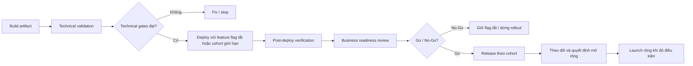
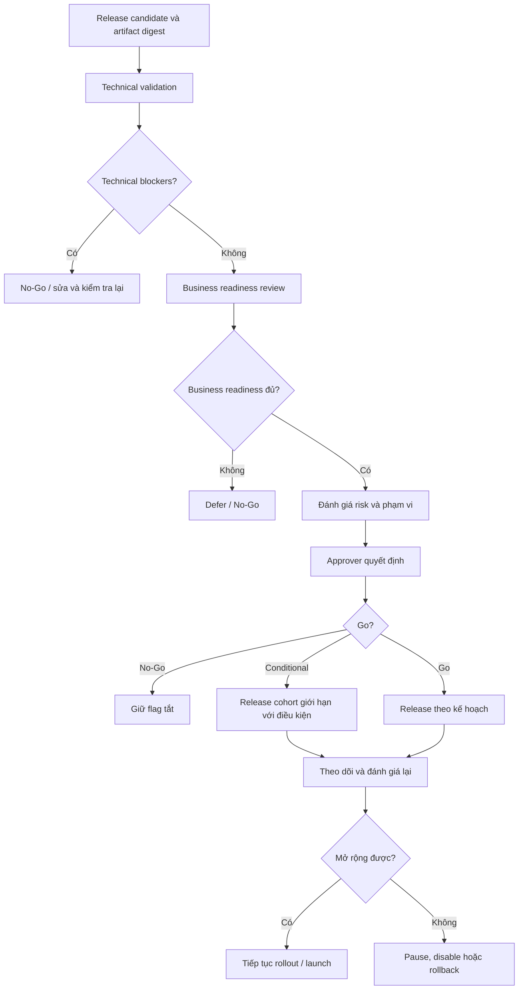

# Phân biệt quyết định phát hành nghiệp vụ với kiểm tra kỹ thuật

Một pipeline có thể build thành công, tất cả test đều đạt, image đã được scan và deployment đã sẵn sàng nhưng tính năng vẫn chưa nên được mở cho khách hàng. Có thể đội hỗ trợ chưa được hướng dẫn, điều khoản giá chưa được duyệt, dữ liệu chưa được chuyển đổi, đối tác chưa sẵn sàng hoặc thời điểm phát hành trùng với một sự kiện kinh doanh quan trọng. Ngược lại, áp lực ra mắt không thể biến một artifact lỗi, một lỗ hổng nghiêm trọng hoặc một hệ thống chưa có khả năng phục hồi thành một bản phát hành an toàn.

Vì vậy, cần phân biệt **kiểm tra kỹ thuật** với **quyết định phát hành nghiệp vụ**. Kiểm tra kỹ thuật cung cấp bằng chứng về chất lượng, an toàn và khả năng vận hành của phần mềm. Quyết định nghiệp vụ cân nhắc giá trị, khách hàng, thời điểm, mức độ sẵn sàng của tổ chức và rủi ro còn lại để quyết định có đưa tính năng đến người dùng hay không. Hai phần bổ sung cho nhau; không phần nào tự thay thế phần còn lại.

## 1. Ba khái niệm cần tách biệt: deploy, release và launch

Trong hội thoại hằng ngày, nhóm thường dùng “deploy”, “release” và “launch” như từ đồng nghĩa. Nhưng khi thiết kế CI/CD, nên phân biệt:

- **Deploy (triển khai):** đưa một artifact hoặc phiên bản phần mềm đến môi trường đích, cập nhật service, cấu hình hoặc hạ tầng để phiên bản đó có thể chạy.
- **Release (phát hành):** quyết định cho phép một phiên bản/tính năng trở thành phần được hỗ trợ hoặc có thể sử dụng theo chính sách sản phẩm. Release có thể diễn ra sau deploy, chẳng hạn khi bật feature flag hoặc mở quyền truy cập cho nhóm người dùng.
- **Launch (ra mắt):** hoạt động đưa sản phẩm/tính năng ra thị trường hoặc thông báo rộng rãi, có thể bao gồm truyền thông, tài liệu, hỗ trợ, giá và kế hoạch tiếp cận khách hàng.

Một artifact có thể được deploy lên production nhưng feature flag vẫn tắt. Khi đó code đã có mặt trong môi trường production, nhưng tính năng chưa được release cho người dùng. Tương tự, tính năng có thể được release theo từng nhóm nhỏ trước khi có launch rộng rãi.

| Hoạt động | Câu hỏi chính | Ví dụ |
|---|---|---|
| Build | Có tạo được artifact từ source đã xác định không? | Tạo image `orders@sha256:...` |
| Technical validation | Artifact và hệ thống có đạt các điều kiện kỹ thuật không? | Test, security scan, performance, compatibility |
| Deploy | Artifact đã được đưa đến môi trường nào? | Triển khai image lên production với flag tắt |
| Business release decision | Có nên cho phép nhóm người dùng sử dụng tính năng không? | Bật tính năng cho 5% khách hàng đủ điều kiện |
| Launch | Tổ chức đã sẵn sàng công bố và hỗ trợ rộng rãi chưa? | Mở cho toàn bộ khách hàng và thông báo chính thức |

## 2. Kiểm tra kỹ thuật trả lời câu hỏi nào?

Technical validation kiểm tra những thuộc tính kỹ thuật đã được định nghĩa trước. Kết quả có thể là pass, fail, warning hoặc chưa có bằng chứng. Các kiểm tra thường nằm trong CI, trước deploy, trong quá trình deploy và sau deploy.

### 2.1. Build và tính toàn vẹn artifact

- Build được từ commit SHA xác định và toolchain được kiểm soát.
- Dependency được cài theo lockfile; đầu vào build có thể truy vết.
- Artifact có version/digest, lưu trong registry được kiểm soát.
- Provenance, chữ ký và SBOM được tạo/xác minh theo chính sách.
- Artifact được kiểm thử chính là artifact sẽ được promote đến môi trường tiếp theo.

### 2.2. Chất lượng mã và kiểm thử

- Unit, integration, contract và end-to-end tests đạt theo phạm vi yêu cầu.
- Static analysis, lint, type checking và coverage đạt ngưỡng phù hợp.
- Không có regression nghiêm trọng trong luồng nghiệp vụ quan trọng.
- Migration và tương thích giữa phiên bản cũ/mới đã được xác minh.
- Test flaky, test bị quarantine hoặc test bị skip được ghi nhận và có chính sách xử lý.

### 2.3. Bảo mật và tuân thủ kỹ thuật

- Dependency, container image và source được scan theo chính sách.
- Secret không bị nhúng vào artifact, log hoặc repository.
- Quyền pipeline và workload identity theo least privilege.
- Lỗ hổng, license và policy violation được phân loại theo mức độ.
- Artifact và deployment có bằng chứng nguồn gốc, chữ ký hoặc attestation khi cần.

### 2.4. Khả năng vận hành

- Health/readiness/liveness checks hoạt động đúng.
- Capacity, latency, error rate và resource saturation nằm trong ngưỡng.
- Logging, metrics, tracing và alert đã sẵn sàng.
- Có runbook, rollback/roll-forward và người trực xử lý.
- Database, queue, cache, API và service phụ thuộc tương thích với phiên bản mới.

### 2.5. Kiểm tra sau triển khai

Sau khi deploy, pipeline hoặc hệ thống vận hành cần xác minh:

- Runtime thực sự chạy đúng artifact digest đã phê duyệt.
- Instance/Pod đã Ready và traffic được định tuyến đúng.
- Smoke test, synthetic check và health endpoint đạt.
- Metrics không vượt ngưỡng lỗi, latency hoặc saturation.
- Các luồng nghiệp vụ trọng yếu hoạt động trên môi trường thật.
- Không có lỗi migration, queue backlog hoặc log bất thường.

Technical checks chỉ có ý nghĩa trong phạm vi chúng đo được. Một test đạt không chứng minh khách hàng cần tính năng; security scan không chứng minh đội hỗ trợ đã được đào tạo; health check xanh không chứng minh giá bán và điều khoản hợp đồng đã được duyệt.

## 3. Quyết định phát hành nghiệp vụ trả lời câu hỏi nào?

Business release decision cân nhắc liệu tổ chức có nên đưa tính năng đến người dùng ở thời điểm, phạm vi và cách thức cụ thể hay không. Quyết định này sử dụng bằng chứng kỹ thuật nhưng còn cần thông tin ngoài phạm vi CI.

### 3.1. Giá trị và mục tiêu sản phẩm

- Tính năng giải quyết vấn đề nào và có phù hợp với mục tiêu sản phẩm không?
- Đã xác định nhóm khách hàng, use case và kết quả mong đợi chưa?
- Phạm vi phát hành có đúng với cam kết sản phẩm và roadmap không?
- Có cần thử nghiệm giới hạn để kiểm chứng giả thuyết trước khi mở rộng không?

### 3.2. Sẵn sàng phục vụ khách hàng

- Hướng dẫn sử dụng, FAQ và nội dung trợ giúp đã cập nhật chưa?
- Customer support, sales, account team và vận hành đã được briefing chưa?
- Có quy trình xử lý khi khách hàng gặp lỗi hoặc yêu cầu tắt tính năng không?
- Khách hàng hiện tại có cần thông báo, migration hoặc hướng dẫn chuyển đổi không?

### 3.3. Giá, hợp đồng và chính sách

- Giá, billing, entitlement và điều khoản sử dụng đã được duyệt chưa?
- Có ảnh hưởng đến hợp đồng, SLA, dữ liệu cá nhân hoặc cam kết với đối tác không?
- Có yêu cầu pháp lý, khu vực, ngành nghề hoặc chính sách nội bộ cần đáp ứng không?
- Nội dung truyền thông và tuyên bố tính năng có chính xác với hành vi thực tế không?

### 3.4. Thời điểm và năng lực tổ chức

- Có đang trong thời gian freeze, kỳ chốt sổ hoặc sự kiện quan trọng không?
- Đội hỗ trợ và vận hành có đủ người theo dõi trong cửa sổ phát hành không?
- Đối tác, nhà cung cấp hoặc nhóm liên quan đã sẵn sàng chưa?
- Có thay đổi khác đang diễn ra khiến việc quy kết sự cố khó khăn không?

### 3.5. Rủi ro và mức chấp nhận

- Tác động nếu tính năng lỗi là gì: mất doanh thu, mất dữ liệu, ảnh hưởng trải nghiệm hay vi phạm cam kết?
- Nhóm người dùng nào có thể bị ảnh hưởng và mức độ nghiêm trọng ra sao?
- Có thể giới hạn cohort, region, tenant hoặc transaction value không?
- Rủi ro còn lại có người chịu trách nhiệm chấp nhận và thời hạn xử lý không?

Quyết định nghiệp vụ không phải là bỏ qua kỹ thuật để kịp ngày ra mắt. Nó xác định có chấp nhận phạm vi rủi ro còn lại hay không sau khi các điều kiện bắt buộc đã được kiểm tra.

## 4. Bảng phân biệt technical gate và business gate

| Chủ đề | Technical validation | Business readiness/decision |
|---|---|---|
| Chất lượng | Test, static analysis, regression | Tính năng đáp ứng nhu cầu và phạm vi đã cam kết |
| Bảo mật | Vulnerability scan, IAM, secret handling | Rủi ro khách hàng, hợp đồng và chính sách đã được chấp nhận |
| Hiệu năng | Load test, latency, capacity | Có đủ năng lực hỗ trợ và vận hành trong thời gian phát hành |
| Dữ liệu | Migration, schema compatibility, backup test | Quyền sử dụng dữ liệu, thông báo và tác động đến khách hàng |
| Vận hành | Monitoring, alert, runbook, rollback | Owner, trực hỗ trợ, escalation và truyền thông đã sẵn sàng |
| Artifact | Digest, signature, provenance | Phiên bản/tính năng được phép phát hành theo kế hoạch sản phẩm |
| Phạm vi | Deployment target, flag targeting, access control | Cohort/segment/region phù hợp với chiến lược thương mại |
| Kết quả | Pass/fail theo tiêu chí kỹ thuật | Go/No-Go/Conditional Go bởi người có thẩm quyền |

Hai loại gate có thể dùng chung một hệ thống phê duyệt nhưng cần lưu riêng kết quả và chủ thể chịu trách nhiệm. Ví dụ, CI tự động xác nhận security scan đạt; Product Owner quyết định mở tính năng cho nhóm khách hàng đầu tiên; Release Manager điều phối cửa sổ triển khai; Security/Compliance có thể giữ quyền chặn khi vi phạm chính sách bắt buộc.

## 5. Pass kỹ thuật không đồng nghĩa Go về nghiệp vụ

Một pipeline xanh chỉ nói rằng các kiểm tra được cấu hình đã đạt trên một revision/artifact và môi trường cụ thể. Nó không trả lời toàn bộ câu hỏi về giá trị, khách hàng, thời điểm hoặc năng lực tổ chức.

Ví dụ:

- Tất cả test đạt, nhưng pricing page chưa được cập nhật và khách hàng sẽ thấy mức giá sai.
- Image đã scan, nhưng đội hỗ trợ chưa biết cách xử lý yêu cầu hủy hoặc hoàn tiền.
- Deployment staging ổn định, nhưng đối tác thanh toán chưa bật cấu hình production.
- Health check xanh, nhưng điều khoản hợp đồng chưa cho phép mở tính năng tại một khu vực.
- Tính năng hoạt động tốt, nhưng đợt phát hành trùng với ngày chốt sổ và không có nhân sự trực.

Trong các trường hợp này, kỹ thuật có thể sẵn sàng nhưng quyết định nghiệp vụ vẫn là No-Go hoặc trì hoãn phạm vi launch. Việc chờ không phải thất bại của CI/CD; đó là kiểm soát phát hành dựa trên toàn bộ bối cảnh.

## 6. Go, No-Go và Conditional Go

Một quyết định phát hành nên có trạng thái rõ ràng, phạm vi cụ thể và bằng chứng đi kèm.

| Quyết định | Ý nghĩa | Điều kiện điển hình |
|---|---|---|
| Go | Cho phép phát hành theo phạm vi đã duyệt | Technical gates đạt; business readiness đạt; owner và hỗ trợ sẵn sàng |
| No-Go | Không phát hành ở thời điểm/phạm vi hiện tại | Có blocker kỹ thuật, thiếu readiness nghiệp vụ hoặc rủi ro vượt mức chấp nhận |
| Conditional Go | Cho phép phạm vi hạn chế với điều kiện cụ thể | Rủi ro còn lại được đánh giá, có giới hạn, owner, thời hạn và tiêu chí dừng |
| Defer | Hoãn quyết định để bổ sung bằng chứng hoặc chờ điều kiện | Thiếu dữ liệu, phụ thuộc bên ngoài chưa sẵn sàng hoặc thời điểm chưa phù hợp |

Conditional Go không nên trở thành cách gọi khác của “cứ phát hành rồi tính”. Điều kiện phải có thể kiểm chứng: ví dụ chỉ mở cho nhân viên nội bộ, chỉ một tenant thử nghiệm, giới hạn số giao dịch, flag tự tắt khi vượt ngưỡng hoặc chỉ triển khai trong giờ có đội trực.

Một số điều kiện không được phép override bằng quyết định nghiệp vụ, tùy chính sách tổ chức: lỗ hổng ở mức chặn, vi phạm pháp lý, mất khả năng bảo vệ dữ liệu, artifact không xác định được nguồn gốc hoặc thiếu cơ chế kiểm soát bắt buộc. Nếu cần ngoại lệ, phải dùng quy trình risk acceptance chính thức với người có thẩm quyền và thời hạn; không sửa trạng thái test thành pass.

## 7. Ai có quyền quyết định?

Không nên mặc định một người chịu trách nhiệm mọi mặt. Quyền quyết định cần được phân theo loại rủi ro và chính sách tổ chức.

| Vai trò | Trách nhiệm chính |
|---|---|
| Product Owner/Product Manager | Xác nhận mục tiêu, phạm vi, nhóm khách hàng và quyết định giá trị phát hành |
| Engineering Lead/Tech Lead | Xác nhận thay đổi kỹ thuật, compatibility, vận hành và phương án phục hồi |
| QA/Test Lead | Báo cáo phạm vi test, chất lượng bằng chứng, lỗi còn mở và giới hạn kiểm thử |
| Security/Compliance | Đánh giá rủi ro bảo mật, quyền, dữ liệu và các điều kiện tuân thủ bắt buộc |
| Operations/SRE | Xác nhận monitoring, capacity, runbook, on-call và khả năng xử lý sự cố |
| Customer Support/Success | Xác nhận tài liệu, đào tạo, kịch bản hỗ trợ và thông tin khách hàng |
| Release Manager | Điều phối lịch, checklist, phê duyệt, trạng thái và liên lạc trong cửa sổ release |
| Business owner/Executive sponsor | Chấp nhận rủi ro nghiệp vụ trong phạm vi thẩm quyền và quyết định ưu tiên |

Một tổ chức có thể gộp vai trò ở nhóm nhỏ, nhưng cần làm rõ ai đưa ra bằng chứng, ai tư vấn, ai phê duyệt và ai chịu trách nhiệm cuối cùng. Người có quyền deploy không nhất thiết là người có quyền quyết định tính năng phù hợp để bán hoặc mở cho khách hàng.

### 7.1. Tách approval nghiệp vụ và approval kỹ thuật

Approval kỹ thuật có thể xác nhận các tiêu chí như test, scan, provenance và rollout plan đã đạt. Approval nghiệp vụ xác nhận giá trị, phạm vi, thời điểm và readiness của tổ chức. Có thể lưu hai approval trong cùng release record, nhưng không nên gộp thành một checkbox “Approved” không rõ ý nghĩa.

### 7.2. Separation of duties

Với phát hành có rủi ro cao, người thay đổi policy hoặc tạo artifact không nên là người duy nhất phê duyệt production. Có thể yêu cầu reviewer độc lập, owner của môi trường và business approver. Mức tách biệt tùy rủi ro; mục tiêu là tránh một cá nhân tự tạo thay đổi, tự xác minh và tự cấp quyền phát hành mà không có kiểm soát.

## 8. Quy trình Go/No-Go có bằng chứng

Một cuộc review phát hành hiệu quả không cần đọc lại mọi log. Nó cần một release dossier ngắn, liên kết đến bằng chứng gốc và làm rõ các ngoại lệ.

### Bước 1: Xác định đối tượng phát hành

Ghi tên tính năng, version, commit SHA, artifact digest, môi trường, nhóm người dùng, region/tenant và thời điểm dự kiến. Nếu tính năng dùng feature flag, ghi flag key, trạng thái mặc định và cohort.

### Bước 2: Tổng hợp technical evidence

Tập hợp build/test status, security scan, artifact provenance, compatibility, performance, migration, monitoring, runbook và rollback readiness. Ghi rõ test nào chưa chạy, bị skip, flaky hoặc có ngoại lệ.

### Bước 3: Tổng hợp business readiness

Xác nhận mục tiêu, customer impact, pricing/contract, tài liệu, support training, đối tác, truyền thông, thời điểm và nguồn lực trực. Nếu một hạng mục không áp dụng, ghi lý do thay vì để trống.

### Bước 4: Đánh giá rủi ro còn lại

Liệt kê issue chưa đóng, mức ảnh hưởng, xác suất, phạm vi cohort, biện pháp giảm thiểu, owner và hạn xử lý. Phân biệt blocker bắt buộc với rủi ro có thể chấp nhận có điều kiện.

### Bước 5: Quyết định và ghi nhận

Người có thẩm quyền ghi Go/No-Go/Conditional Go/Defer, phạm vi cho phép, điều kiện, thời hạn và lý do. Approval phải gắn với artifact digest và release scope cụ thể.

### Bước 6: Thực hiện theo kế hoạch

Triển khai hoặc bật tính năng theo cohort/region/tenant đã duyệt. Không tự động mở rộng phạm vi chỉ vì bước đầu thành công; mỗi lần mở rộng phải thỏa tiêu chí đã định.

### Bước 7: Xác minh và cập nhật quyết định

Theo dõi technical metrics và business signals. Nếu điều kiện không còn đúng, dừng rollout, tắt flag hoặc quay về trạng thái an toàn. Ghi lại kết quả và quyết định tiếp theo.

## 9. Release dossier: nội dung tối thiểu

Một release dossier có thể là trang release, change record hoặc bản tóm tắt trong công cụ quản lý phát hành. Nội dung nên đủ để người phê duyệt hiểu chính xác điều gì sẽ thay đổi.

| Nhóm | Thông tin cần có |
|---|---|
| Định danh | Feature, release version, commit SHA, artifact digest, workflow run |
| Phạm vi | Environment, region, tenant/cohort, phần trăm traffic, flag key |
| Technical evidence | Test summary, scan, compatibility, performance, migration, provenance |
| Operational readiness | Dashboard, alert, runbook, on-call, capacity, rollback/disable plan |
| Business readiness | Mục tiêu, customer impact, pricing, contract, support, docs, communication |
| Rủi ro | Issue còn mở, mức độ, mitigation, owner, deadline và risk acceptance |
| Quyết định | Go/No-Go/Conditional/Defer, approver, timestamp, điều kiện và lý do |
| Sau phát hành | Metrics, business outcomes, incident, rollout progress và quyết định mở rộng |

### 9.1. Approval phải gắn với đúng artifact và phạm vi

Nếu artifact digest thay đổi, approval cũ không tự động áp dụng cho artifact mới. Nếu phạm vi thay đổi từ nội bộ sang khách hàng, từ một region sang toàn cầu hoặc từ 5% sang 100%, cần đánh giá lại readiness và điều kiện rủi ro. Tương tự, nếu cấu hình hoặc migration thay đổi đáng kể sau phê duyệt, release dossier cần cập nhật và có thể phải xin approval lại.

## 10. Kết hợp technical gate với business gate trong CI/CD

CI/CD có thể tự động hóa việc thu thập bằng chứng và thực thi policy, nhưng không nên biến mọi quyết định nghiệp vụ thành một lệnh shell hoặc checkbox không có owner.

Một pipeline có thể tổ chức theo các lớp:

1. **CI gates:** build, unit/integration tests, static analysis và security checks.
2. **Artifact gates:** digest, provenance, signature, SBOM, vulnerability/license policy.
3. **Pre-deploy gates:** compatibility, migration readiness, environment config, capacity và approval kỹ thuật.
4. **Post-deploy gates:** health, smoke, synthetic, metrics và business transaction checks.
5. **Business release gate:** approval theo mục tiêu, cohort, thời điểm và readiness tổ chức.
6. **Expansion gate:** quyết định tăng cohort hoặc mở rộng launch dựa trên kết quả thực tế.

### 10.1. Máy móc kiểm tra điều kiện; con người quyết định trade-off

Các điều kiện có thể đo rõ ràng nên tự động hóa: test pass, scan threshold, artifact digest, deployment health, error rate hoặc capacity. Những quyết định cần cân nhắc bối cảnh như thời điểm thương mại, tác động hợp đồng hoặc ưu tiên khách hàng cần owner chịu trách nhiệm.

Không dùng một approval thủ công để thay thế test tự động có thể lặp lại. Cũng không giả định một pipeline xanh có thể tự quyết định giá trị kinh doanh hoặc chấp nhận rủi ro mà tổ chức chưa ủy quyền.

### 10.2. Không để business approval bỏ qua blocker kỹ thuật bắt buộc

Nếu policy quy định lỗ hổng nghiêm trọng, dữ liệu có nguy cơ bị mất, artifact không xác minh được hoặc test bắt buộc chưa chạy là blocker, business approver không nên có nút “Go” để âm thầm bỏ qua. Ngoại lệ phải đi qua quy trình risk acceptance được thiết kế riêng, có người chịu trách nhiệm, thời hạn và biện pháp giảm thiểu. Một số ràng buộc pháp lý hoặc an toàn có thể không cho phép ngoại lệ.

## 11. Conditional Go và risk acceptance

Conditional Go cho phép phát hành giới hạn khi rủi ro còn lại đã được hiểu và có biện pháp kiểm soát. Ví dụ:

- Chỉ mở cho nhân viên nội bộ hoặc một nhóm khách hàng pilot.
- Giới hạn region, tenant, số giao dịch hoặc giá trị giao dịch.
- Giữ feature flag tắt mặc định và bật cho cohort được chỉ định.
- Chỉ triển khai trong cửa sổ có đội vận hành trực.
- Tự động dừng khi error rate hoặc business metric vượt ngưỡng.
- Chấp nhận một issue mức thấp với owner và deadline cụ thể.

Một risk acceptance record nên có:

- Rủi ro và nguyên nhân.
- Tài sản/khách hàng bị ảnh hưởng.
- Xác suất, mức độ tác động và phạm vi.
- Biện pháp giảm thiểu và tín hiệu phát hiện.
- Người có thẩm quyền chấp nhận.
- Owner khắc phục, hạn xử lý và ngày hết hiệu lực.
- Điều kiện tự động dừng hoặc thu hồi quyết định.

Risk acceptance không phải cách đổi một lỗi thành pass. Kết quả kỹ thuật vẫn phải giữ nguyên; quyết định chấp nhận rủi ro được lưu riêng để audit.

## 12. Staged release: mở rộng theo bằng chứng

Khi tính năng có thể bật theo cohort, hãy xem release là một chuỗi quyết định thay vì một lần bật toàn bộ.

Ví dụ các giai đoạn:

| Giai đoạn | Phạm vi | Mục tiêu và điều kiện mở rộng |
|---|---|---|
| Internal | Nhân viên và test account | Xác minh luồng chính, hỗ trợ và telemetry |
| Pilot | Một số tenant/khách hàng đồng ý thử | Kiểm tra hành vi thực, phản hồi và quy trình hỗ trợ |
| Limited | Một cohort hoặc tỷ lệ traffic nhỏ | Theo dõi error/latency, adoption và business guardrails |
| Broad | Tăng dần cohort/region | Mở rộng khi metrics ổn định và owner phê duyệt |
| General availability | Mở cho nhóm khách hàng mục tiêu rộng | Tài liệu, support, pricing và vận hành đã sẵn sàng |

Mỗi giai đoạn cần có thời gian quan sát, metric, ngưỡng dừng và người ra quyết định. Không nên tự động chuyển từ 5% lên 100% chỉ vì một khoảng thời gian không có alert; có thể cần số lượng giao dịch đủ lớn hoặc kiểm tra các tình huống ít gặp.

## 13. Ví dụ: phát hành tính năng chọn khung giờ giao hàng

Một sản phẩm thương mại điện tử muốn cho khách chọn khung giờ giao hàng. Tính năng có giá trị kinh doanh vì giảm giao thất bại và tăng tỷ lệ hoàn tất đơn, nhưng có phụ thuộc vào năng lực kho, đối tác vận chuyển và hệ thống tính phí.

### 13.1. Technical validation

- Unit/integration tests xác minh kiểm tra slot, timezone, capacity và xung đột lịch.
- Contract tests xác minh API giữa checkout, inventory và delivery partner.
- Load test xác minh giờ cao điểm và số request đồng thời.
- Security/privacy checks xác minh quyền truy cập địa chỉ và thông tin khách hàng.
- Migration test xác minh dữ liệu slot và đơn hàng cũ vẫn tương thích.
- Staging smoke test xác minh đặt đơn, đổi lịch và hủy đơn.
- Monitoring có metric slot availability, booking failure, partner timeout và queue lag.
- Rollback/disable flag đã được thử và có thể giữ luồng checkout cũ.

### 13.2. Business readiness

- Vùng giao hàng và đối tác vận chuyển đã xác nhận capacity.
- Giá phụ thu và điều kiện hoàn tiền đã được duyệt.
- Nội dung checkout, FAQ và email xác nhận đã cập nhật.
- Customer support được hướng dẫn xử lý trường hợp không còn slot hoặc đối tác trễ.
- Sales/marketing đã thống nhất thông điệp và nhóm khách hàng mục tiêu.
- Có nhân sự vận hành trực trong pilot và thời gian mở rộng.

### 13.3. Quyết định

Technical gates đều đạt nhưng đối tác vận chuyển mới chỉ xác nhận capacity ở hai thành phố. Product Owner đề xuất Conditional Go: bật flag cho nhân viên nội bộ và một nhóm khách hàng pilot ở hai thành phố; không hiển thị tính năng ở các khu vực khác. Operations theo dõi booking failure và partner timeout; Support dùng FAQ đã chuẩn bị.

Sau một giai đoạn quan sát, nhóm đánh giá cả tín hiệu kỹ thuật lẫn nghiệp vụ: tỷ lệ đặt slot thành công, giao đúng giờ, số ticket hỗ trợ, tỷ lệ chuyển đổi và phản hồi khách hàng. Nếu đạt tiêu chí, business owner phê duyệt mở thêm khu vực. Nếu đối tác không đáp ứng capacity, flag được tắt hoặc giữ nguyên phạm vi pilot.

Ví dụ này cho thấy technical pass là điều kiện quan trọng để bắt đầu, còn phạm vi và thời điểm release phụ thuộc vào readiness kinh doanh và vận hành.

## 14. Emergency release và thay đổi khẩn cấp

Sự cố production có thể yêu cầu phát hành bản sửa lỗi nhanh hơn quy trình thông thường. Quy trình khẩn cấp nên rút gọn thời gian chờ nhưng vẫn giữ kiểm soát tối thiểu:

- Xác định incident, mức độ ảnh hưởng và mục tiêu giảm thiểu.
- Chọn người có thẩm quyền quyết định và người thực hiện deploy.
- Giữ các kiểm tra kỹ thuật bắt buộc phù hợp với mức rủi ro; không bỏ qua kiểm tra có thể phát hiện lỗi gây mất dữ liệu hoặc mở rộng sự cố.
- Xác định artifact digest, source revision và phạm vi triển khai.
- Có kế hoạch rollback/roll-forward và người trực theo dõi.
- Ghi nhận lý do bỏ qua bước thông thường, người phê duyệt và thời hạn bổ sung review.
- Thực hiện post-incident review và hoàn thiện hồ sơ audit sau khi ổn định.

Emergency không đồng nghĩa với bỏ audit hoặc dùng tài khoản cá nhân toàn quyền. Nếu một bước approval được thực hiện sau do tình huống khẩn cấp, phải ghi rõ ngoại lệ và thời điểm hoàn tất hậu kiểm theo chính sách.

## 15. Những anti-pattern thường gặp

| Anti-pattern | Hệ quả | Cách làm tốt hơn |
|---|---|---|
| Pipeline xanh tự động đồng nghĩa phát hành | Bỏ qua giá, khách hàng, hỗ trợ và thời điểm | Tách technical gates và business decision |
| Product approval bỏ qua security/test blocker | Rủi ro kỹ thuật bị che giấu | Giữ blocker bắt buộc và risk acceptance riêng |
| Một checkbox “Approved” không rõ người/ý nghĩa | Không biết ai quyết định và quyết định điều gì | Ghi loại approval, approver, scope và evidence |
| Approval không gắn artifact digest | Artifact khác có thể được phát hành dưới approval cũ | Bind approval với digest, environment và cohort |
| Deploy được coi là launch | Tính năng có thể lộ trước khi support/pricing sẵn sàng | Tách deploy, release và launch |
| Mở 100% ngay sau pilot ngắn | Không đủ dữ liệu về hành vi và tải | Tăng cohort theo tiêu chí và thời gian quan sát |
| Risk acceptance không có owner/hạn | Ngoại lệ trở thành vĩnh viễn | Có owner, expiry, mitigation và review |
| Chỉ xem metric kỹ thuật | Bỏ lỡ adoption, conversion hoặc ticket hỗ trợ | Theo dõi business outcomes cùng operational metrics |
| Emergency release không có hậu kiểm | Mất audit trail và nợ kiểm soát | Ghi ngoại lệ, hoàn thiện review sau incident |

## 16. Checklist Go/No-Go

### Technical readiness

- [ ] Artifact được định danh bằng version/digest và truy ngược đến commit/build run.
- [ ] Test, scan và quality gates bắt buộc đã đạt; ngoại lệ được ghi riêng.
- [ ] API, database, message và dependency tương thích với hệ thống hiện tại.
- [ ] Cấu hình, secret và quyền deploy đúng environment.
- [ ] Monitoring, alert, dashboard và runbook sẵn sàng.
- [ ] Rollback/disable/roll-forward đã được đánh giá và có người chịu trách nhiệm.
- [ ] Post-deploy verification có tiêu chí và ngưỡng dừng rõ.

### Business readiness

- [ ] Mục tiêu, phạm vi và nhóm khách hàng đã được xác nhận.
- [ ] Pricing, contract, entitlement và chính sách liên quan đã được duyệt.
- [ ] Tài liệu, FAQ, support và account team đã sẵn sàng.
- [ ] Đối tác và các nhóm phụ thuộc đã xác nhận khả năng phục vụ.
- [ ] Thời điểm phát hành và nguồn lực trực phù hợp.
- [ ] Rủi ro khách hàng và kế hoạch truyền thông đã được đánh giá.
- [ ] Cohort, region, rollout limit và điều kiện mở rộng được xác định.

### Decision record

- [ ] Có quyết định Go/No-Go/Conditional Go/Defer.
- [ ] Người có thẩm quyền và loại approval được ghi nhận.
- [ ] Quyết định gắn với artifact digest, environment, cohort và thời điểm.
- [ ] Risk acceptance có owner, mitigation và expiry nếu có.
- [ ] Có tiêu chí pause, disable, rollback hoặc mở rộng.
- [ ] Kết quả sau phát hành sẽ được review và ghi lại.

Quyết định phát hành nghiệp vụ và kiểm tra kỹ thuật là hai lớp kiểm soát khác nhau. Technical validation chứng minh artifact và hệ thống đạt các điều kiện kỹ thuật đã định; business release decision xác nhận tổ chức nên đưa tính năng đến ai, khi nào và trong phạm vi nào. Khi hai lớp có chủ thể, bằng chứng và quyền quyết định rõ ràng, pipeline có thể tự động hóa các kiểm tra lặp lại mà vẫn giữ trách nhiệm của con người đối với giá trị, khách hàng và rủi ro của lần phát hành.
