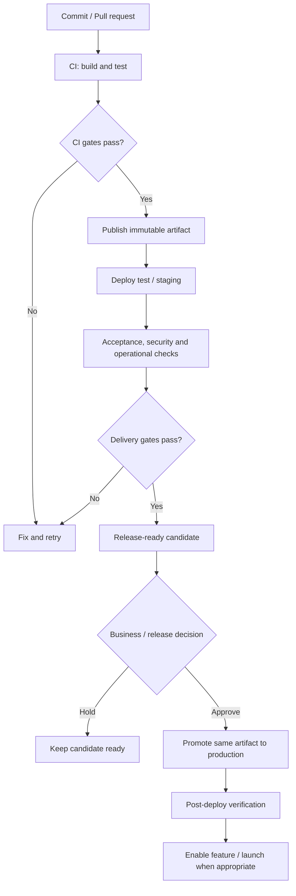
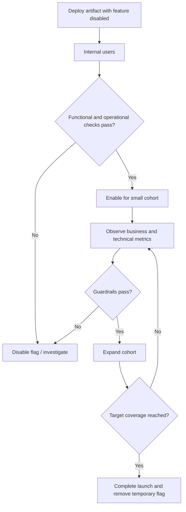

# Nhận diện trường hợp cần phân phối liên tục mà chưa triển khai liên tục

## 1. Phân phối liên tục không đồng nghĩa tự động phát hành mọi thay đổi

Trong CI/CD, mục tiêu quan trọng là giữ cho phần mềm luôn ở trạng thái có thể phát hành. Mỗi thay đổi được tích hợp cần được build, kiểm thử và đóng gói theo quy trình tự động để nhóm có thể phát hành khi có quyết định phù hợp. Cách làm này thường được gọi là **Continuous Delivery** (phân phối liên tục).

Continuous Delivery không bắt buộc mọi thay đổi phải tự động đi vào production ngay khi pipeline xanh. Nhóm có thể giữ một bước quyết định trước khi phát hành production, chẳng hạn phê duyệt của người phụ trách, lựa chọn thời điểm kinh doanh, xác nhận điều kiện pháp lý hoặc phối hợp với một đợt phát hành của nhiều hệ thống.

**Continuous Deployment** (triển khai liên tục) đi thêm một bước: mọi thay đổi đáp ứng các kiểm tra và chính sách đã định sẽ tự động được triển khai lên production mà không cần quyết định phát hành thủ công cho từng thay đổi. Nếu pipeline không đạt gate, thay đổi bị chặn; nếu đạt, luồng tự động tiếp tục.

Vì vậy, một tổ chức có thể thực hành Continuous Delivery tốt mà chưa áp dụng Continuous Deployment. Phần mềm vẫn được tích hợp thường xuyên, artifact luôn sẵn sàng, môi trường trước production được cập nhật tự động và release có thể thực hiện nhanh. Quyết định đưa tính năng tới người dùng được điều khiển riêng theo rủi ro và nhu cầu.

## 2. Phân biệt Continuous Integration, Continuous Delivery và Continuous Deployment

Ba thuật ngữ liên quan nhưng mô tả những mức tự động hóa khác nhau:

| Thực hành | Trọng tâm | Production có tự động nhận mọi thay đổi đạt gate không? |
|---|---|---|
| Continuous Integration (CI) | Tích hợp thay đổi thường xuyên và tự động build/test để phát hiện lỗi sớm | Không phải mục tiêu trực tiếp của CI |
| Continuous Delivery | Giữ phần mềm luôn có thể phát hành; build, test, package và chuẩn bị release được tự động hóa | Không bắt buộc; có thể cần quyết định hoặc thao tác release có chủ đích |
| Continuous Deployment | Tự động triển khai mọi thay đổi vượt qua toàn bộ gate lên production | Có, theo chính sách tự động đã thiết lập |

Một pipeline Continuous Delivery điển hình có thể tự động chạy CI, publish artifact, deploy staging, chạy acceptance test và chuẩn bị release record. Sau đó, người có thẩm quyền hoặc release policy quyết định thời điểm promote artifact đã kiểm tra sang production.

Một pipeline Continuous Deployment có thể thực hiện toàn bộ chuỗi đó tự động. Điều kiện là các kiểm tra, quan sát sau triển khai, khả năng dừng rollout và phục hồi đủ tin cậy để không cần phê duyệt từng lần.

Tên gọi trong từng tổ chức có thể khác nhau. Khi trao đổi, hãy mô tả chính xác hành vi: pipeline tự động tới đâu, điều gì chặn production, ai quyết định release và người dùng nhận tính năng vào thời điểm nào.

## 3. Phân biệt build, deploy, release và launch

Một nguyên nhân gây nhầm lẫn là dùng các từ build, deploy, release và launch như thể chúng là một hành động. Trong thực tế, chúng có thể xảy ra ở những thời điểm khác nhau.

| Khái niệm | Ý nghĩa | Ví dụ |
|---|---|---|
| Build | Biến source revision và đầu vào thành artifact | Tạo image `orders-api` từ commit `abc123` |
| Deploy | Đưa artifact vào một môi trường hoặc cập nhật workload | Triển khai image lên production cluster nhưng chưa mở tính năng mới |
| Release | Cho phép một phiên bản hoặc thay đổi được sử dụng theo chính sách sản phẩm | Promote release đã được duyệt hoặc bật tính năng cho nhóm người dùng |
| Launch | Thời điểm hoặc hoạt động đưa tính năng tới người dùng mục tiêu | Bật feature flag cho toàn bộ khách hàng sau thông báo |

Các khái niệm này có thể trùng thời điểm trong một hệ thống đơn giản. Nhưng khi cần kiểm soát thời gian phát hành, nhóm nên tách chúng. Một binary mới có thể đã được deploy production nhưng tính năng mới vẫn bị tắt bằng feature flag. Ngược lại, một tính năng có thể được bật dần cho một nhóm nhỏ sau khi artifact đã được triển khai trước đó.

Tách deploy và release giúp tổ chức giữ tốc độ kỹ thuật cao trong khi vẫn chủ động quyết định tác động tới người dùng.

## 4. Luồng Continuous Delivery có quyết định release riêng

Một mô hình thường gặp:



Ở mô hình này, các bước kỹ thuật lặp lại được tự động hóa. Điểm quyết định trước production có thể là approval, release calendar, điều kiện pháp lý, sự sẵn sàng của hỗ trợ khách hàng hoặc trạng thái của hệ thống phụ thuộc.

Điều quan trọng là trạng thái “release-ready” phải có bằng chứng: artifact digest, commit nguồn, test/scan result, config revision, release notes và kế hoạch triển khai. Khi quyết định release được đưa ra, pipeline promote đúng artifact đã qua kiểm tra, không build lại một gói mới.

## 5. Khi nào nên Continuous Delivery nhưng chưa Continuous Deployment?

Một số trường hợp hợp lý để giữ quyết định release production riêng:

### 5.1. Có yêu cầu pháp lý, tuân thủ hoặc kiểm soát thay đổi

Một số hệ thống cần người có trách nhiệm xác nhận trước khi thay đổi ảnh hưởng đến dữ liệu, tài chính, quyền truy cập hoặc dịch vụ chịu quản lý. Quy trình có thể yêu cầu bằng chứng kiểm thử, đánh giá rủi ro, phê duyệt độc lập hoặc lưu hồ sơ release.

Trong trường hợp này, CI/CD vẫn có thể tự động build, test, scan, tạo SBOM, ký artifact và triển khai staging. Approval chỉ nằm tại điểm cần trách nhiệm hoặc bằng chứng của con người. Không nên biến mọi thao tác thành phê duyệt thủ công nếu chúng có thể tự động kiểm tra.

### 5.2. Thời điểm phát hành phụ thuộc hoạt động kinh doanh

Một tính năng có thể cần được công bố cùng chiến dịch marketing, thông báo khách hàng, hợp đồng, chương trình bán hàng hoặc lịch đào tạo hỗ trợ. Artifact có thể sẵn sàng trước ngày công bố, nhưng launch cần diễn ra đúng thời điểm.

Continuous Delivery giúp chuẩn bị sẵn bản phát hành. Release manager có thể chọn thời điểm bật tính năng hoặc mở lưu lượng mà không phải chờ build và kiểm thử lại từ đầu.

### 5.3. Cần phối hợp nhiều hệ thống hoặc nhiều nhóm

Một thay đổi có thể phụ thuộc vào API của dịch vụ khác, schema database, ứng dụng mobile, hệ thống đối tác hoặc quy trình vận hành. Nếu triển khai một thành phần quá sớm, hệ thống tổng thể có thể ở trạng thái không tương thích.

Nhóm vẫn có thể tích hợp và deploy các thành phần tới môi trường chuẩn bị, nhưng giữ release cho đến khi các phụ thuộc đạt điều kiện. Hợp đồng API, version compatibility và chiến lược expand-and-contract giúp giảm thời gian phải chờ đồng bộ.

### 5.4. Thay đổi có rủi ro cao hoặc khó đảo ngược

Thay đổi dữ liệu, migration lớn, thay đổi thuật toán tính tiền, phân quyền hoặc logic xử lý giao dịch có thể cần đánh giá thêm trước khi mở cho người dùng. Việc tự động deploy không đồng nghĩa phải tự động bật tính năng cho toàn bộ traffic.

Nhóm có thể deploy code đã tắt feature flag, chạy shadow traffic hoặc kiểm thử trên nhóm nội bộ trước. Quyết định mở rộng được đưa ra sau khi xem bằng chứng và mức rủi ro.

### 5.5. Có cửa sổ vận hành hoặc hạn chế hỗ trợ

Một số dịch vụ chỉ được phép thay đổi trong khung giờ bảo trì, tránh giờ cao điểm hoặc cần nhân sự trực sẵn sàng. Pipeline có thể tạo release candidate bất cứ lúc nào nhưng chỉ thực hiện production rollout trong cửa sổ được phép.

### 5.6. Cần xác nhận nội dung hoặc trải nghiệm với người dùng

Đối với sản phẩm có nội dung, giao diện, giá, chính sách hoặc quy trình nghiệp vụ, nhóm có thể cần product owner, legal, operations hoặc customer success xác nhận. Tự động hóa kiểm tra kỹ thuật vẫn có giá trị; quyết định phát hành dựa trên tiêu chí sản phẩm có thể cần vai trò chuyên môn.

## 6. Không dùng approval để bù cho pipeline thiếu chất lượng

Giữ một bước approval không có nghĩa người duyệt phải thay pipeline kiểm tra. Người duyệt không thể đọc lại mọi dòng code, chạy thủ công mọi test hoặc xác minh mọi dependency trong mỗi release.

Trước approval, pipeline nên tự động cung cấp:

- Artifact đã được build và định danh bằng digest.
- Kết quả unit, integration, acceptance và regression test theo phạm vi.
- Kết quả SAST, dependency scan, secret scan và image scan theo policy.
- SBOM, provenance và chữ ký nếu quy trình yêu cầu.
- Release notes, danh sách thay đổi và liên kết ticket.
- Deployment plan, cấu hình đích và migration impact.
- Kết quả staging, smoke test và trạng thái vận hành.
- Kế hoạch rollout, điều kiện dừng và rollback/roll-forward.

Approval nên trả lời câu hỏi thuộc thẩm quyền con người: thời điểm có phù hợp không, rủi ro còn lại có được chấp nhận không, các nhóm liên quan đã sẵn sàng chưa, có điều kiện kinh doanh hoặc tuân thủ nào chưa hoàn tất không.

Nếu test hoặc scan bắt buộc thất bại, không nên để một nút approval chung biến kết quả đó thành pass. Ngoại lệ cần là waiver riêng, có phạm vi, lý do, người phê duyệt, thời hạn và biện pháp giảm thiểu.

## 7. Giữ artifact luôn sẵn sàng phát hành

Continuous Delivery chỉ có ý nghĩa khi nhóm có thể phát hành artifact đã được kiểm tra mà không phải tái tạo sản phẩm trong phút cuối.

Một release candidate cần gắn với:

- Source commit và repository.
- Artifact name, version và digest bất biến.
- Build environment, toolchain và dependency metadata.
- Test/scan evidence gắn với đúng digest.
- Config schema hoặc config bundle dự kiến.
- SBOM, provenance và signature theo policy.
- Release notes và deployment manifest.

Khi release được duyệt, pipeline promote chính artifact này từ repository nội bộ sang channel hoặc môi trường đích. Nếu phải build lại vì artifact hết hạn, đầu vào thay đổi hoặc package bị thay thế, đó là một build/release candidate mới và cần chạy lại những kiểm tra có liên quan.

## 8. Feature flag giúp tách deploy và launch

Feature flag (cờ tính năng) cho phép code đã được triển khai nhưng hành vi mới chỉ bật cho một nhóm người dùng hoặc điều kiện nhất định. Đây là kỹ thuật quan trọng khi muốn phân phối liên tục nhưng kiểm soát thời điểm launch.

Ví dụ:

```java
if (featureFlags.isEnabled("new-checkout", userContext)) {
    return newCheckoutService.checkout(request);
}

return legacyCheckoutService.checkout(request);
```

Code mới đã có trong artifact production, nhưng chỉ người dùng được flag cho phép mới đi vào luồng mới. Nhóm có thể bật cho nhân viên nội bộ, một tenant thử nghiệm, một phần trăm traffic hoặc toàn bộ người dùng khi sẵn sàng.

Feature flag hỗ trợ:

- Deploy code trước, launch sau.
- Tách nhóm người dùng và thời điểm sử dụng.
- Thử nghiệm có kiểm soát hoặc rollout theo cohort.
- Tắt nhanh một tính năng gặp sự cố mà không cần build lại, nếu đường fallback vẫn an toàn.
- Đồng bộ launch với thông báo, hỗ trợ hoặc điều kiện kinh doanh.

Flag không thay thế kiểm thử. Cả nhánh bật và nhánh tắt đều cần được kiểm tra. Nếu flag điều khiển logic quan trọng, cần test các tổ hợp có ý nghĩa và xác minh hành vi khi flag service không khả dụng.

## 9. Chọn loại feature flag phù hợp

Không phải mọi flag đều có cùng vòng đời. Có thể phân loại:

| Loại flag | Mục đích | Vòng đời dự kiến |
|---|---|---|
| Release flag | Ẩn tính năng chưa sẵn sàng hoặc tách deploy khỏi launch | Tạm thời; xóa sau khi tính năng ổn định |
| Experiment flag | Chia nhóm để thử nghiệm trải nghiệm hoặc kết quả | Theo thời gian thử nghiệm và phân tích |
| Operational flag | Bật/tắt hành vi để giảm tải hoặc ứng phó sự cố | Có thể tồn tại lâu hơn, cần owner và runbook |
| Permission/entitlement flag | Quyết định người dùng/tenant có quyền dùng tính năng | Theo mô hình quyền sản phẩm, cần kiểm soát truy cập |

Không nên dùng một hệ thống flag như kho cấu hình tùy tiện. Flag cần tên có ý nghĩa, owner, mục đích, giá trị mặc định, phạm vi người dùng, thời hạn hoặc điều kiện loại bỏ và audit log cho thay đổi nhạy cảm.

Release flag thường nên được dọn sau khi launch hoàn tất. Nếu để lại nhiều flag cũ, số nhánh code và tổ hợp trạng thái tăng lên, làm test và bảo trì phức tạp. Operational flag có thể cần tồn tại lâu hơn nhưng phải có người chịu trách nhiệm và cách kiểm tra trạng thái.

## 10. Release on demand và lịch phát hành

Continuous Delivery cho phép release on demand: nhóm có thể phát hành khi có nhu cầu, sau khi artifact và bằng chứng đã sẵn sàng. Không có nghĩa mọi release phải diễn ra ngay lập tức hoặc vào bất kỳ thời điểm nào.

Một tổ chức có thể chọn:

- **Release ngay khi được duyệt:** phù hợp với thay đổi nhỏ và thời điểm linh hoạt.
- **Release theo lịch:** gom các thay đổi đã sẵn sàng vào một cửa sổ đã thông báo.
- **Release theo đợt phối hợp:** đồng bộ với ứng dụng mobile, API đối tác, database hoặc nhóm vận hành.
- **Release theo điều kiện:** chỉ phát hành khi một phụ thuộc, sự kiện kinh doanh hoặc trạng thái vận hành đạt yêu cầu.
- **Release theo cohort:** bật cho nhóm người dùng hoặc tenant theo từng giai đoạn.

Release calendar nên là công cụ điều phối, không phải lý do để giữ thay đổi trong nhánh chưa tích hợp. Nhóm vẫn nên merge thường xuyên, kiểm tra liên tục và giữ artifact sẵn sàng. Việc gom thời điểm launch không nên biến thành nhánh release dài hạn chứa nhiều thay đổi chưa được kiểm chứng cùng nhau.

## 11. Phê duyệt release có ý nghĩa và có thể kiểm toán

Manual approval chỉ hữu ích khi người duyệt có thông tin để quyết định và trách nhiệm rõ ràng.

Một yêu cầu approval nên hiển thị:

- Release ID, artifact digest và commit nguồn.
- Tóm tắt thay đổi và đối tượng người dùng bị ảnh hưởng.
- Kết quả gate kỹ thuật và các rủi ro còn lại.
- Môi trường đích, thời gian dự kiến và phạm vi rollout.
- Phụ thuộc đã sẵn sàng hay chưa.
- Migration/data impact và trạng thái backup nếu có.
- Kế hoạch dừng, rollback hoặc roll-forward.
- Người chịu trách nhiệm vận hành và kênh xử lý sự cố.

Approval record cần lưu người hoặc identity phê duyệt, thời điểm, release/artifact cụ thể, policy version và quyết định. Nếu artifact hoặc config thay đổi sau approval, cần đánh giá lại theo policy. Không tái sử dụng approval cũ cho một release candidate khác chỉ vì tên version giống nhau.

## 12. Tránh biến approval thành nút thắt cổ chai

Một bước thủ công cho mỗi commit có thể tạo hàng đợi lớn và làm mất lợi ích của phân phối liên tục. Cần phân biệt quyết định thực sự cần con người với kiểm tra có thể tự động hóa.

Có thể cải thiện bằng cách:

- Tự động kiểm tra mọi điều kiện kỹ thuật trước khi yêu cầu approval.
- Chỉ yêu cầu approval tại điểm thay đổi có tác động hoặc trách nhiệm rõ.
- Dùng policy phê duyệt theo mức rủi ro thay vì yêu cầu cùng số người duyệt cho mọi release.
- Cho phép release nhỏ, rủi ro thấp đi qua luồng nhanh nếu policy cho phép.
- Tự động nhắc người có thẩm quyền và đặt SLA xử lý approval.
- Hiển thị bằng chứng và tóm tắt thay đổi để giảm thời gian review.
- Theo dõi thời gian chờ, tỷ lệ approval và lý do trì hoãn.

Nếu người duyệt chỉ bấm nút mà không xem bằng chứng, approval không tạo ra kiểm soát thực chất. Hãy thiết kế bước này cho một quyết định cụ thể, có người chịu trách nhiệm và dữ liệu hỗ trợ.

## 13. Progressive delivery: triển khai và mở rộng có kiểm soát

Continuous Delivery có thể kết hợp với progressive delivery (phân phối tăng dần). Thay vì chuyển toàn bộ người dùng sang tính năng mới ngay khi release, nhóm mở rộng theo từng bước và đánh giá tín hiệu ở mỗi bước.

Một luồng ví dụ:



Các kỹ thuật liên quan:

- Feature flag theo user, tenant hoặc cohort.
- Canary rollout với một phần traffic.
- Blue-green deployment và chuyển traffic có kiểm soát.
- Shadow traffic để so sánh kết quả mà không trả response mới cho người dùng.
- A/B testing để đánh giá tác động sản phẩm.

Các kỹ thuật này có thể kết hợp nhưng không đồng nghĩa. Canary chủ yếu kiểm tra độ an toàn kỹ thuật của một phiên bản trên một phần traffic; A/B testing so sánh kết quả trải nghiệm hoặc kinh doanh giữa các nhóm. Feature flag là cơ chế điều khiển hành vi, không tự cung cấp phân tích thống kê.

## 14. Điều kiện dừng và rollback khi release không đạt

Khi release được điều khiển riêng, nhóm cần xác định cách dừng launch mà không phải lúc nào cũng rollback toàn bộ artifact.

Một số lựa chọn:

- Tắt feature flag để quay về luồng cũ nếu code cũ vẫn tương thích.
- Dừng mở rộng cohort hoặc canary và giữ tỷ lệ hiện tại trong khi điều tra.
- Chuyển traffic về phiên bản ổn định trước đó.
- Roll-forward bằng bản sửa lỗi nếu migration hoặc dữ liệu khiến rollback không an toàn.
- Tạm dừng release mới nhưng giữ artifact đã deploy ở trạng thái không bật tính năng.

Trước khi dựa vào feature flag như nút rollback, cần kiểm tra nhánh fallback vẫn hoạt động và tương thích với schema, API, cache, event và dữ liệu đã được tạo bởi tính năng mới. Tắt flag không hoàn tác dữ liệu hoặc giao dịch đã xảy ra.

Guardrail nên bao gồm metric kỹ thuật và nghiệp vụ: error rate, latency, timeout, tỷ lệ giao dịch thành công, số lỗi xử lý, queue lag hoặc metric phù hợp với tính năng. Nếu dữ liệu chưa đủ, giữ rollout ở trạng thái chờ thay vì tự động mở rộng.

## 15. Tương thích dữ liệu khi deploy trước, release sau

Deploy code trước khi bật tính năng tạo ra một giai đoạn mà artifact mới chạy nhưng tính năng chưa được sử dụng. Trong giai đoạn này, code mới vẫn có thể khởi tạo kết nối, đăng ký route, đọc schema hoặc chạy background task.

Do đó, cần bảo đảm:

- Code mới có thể chạy an toàn khi flag đang tắt.
- Code cũ và mới tương thích với schema database trong thời gian chuyển tiếp.
- API và event contract tương thích khi các dịch vụ được cập nhật lệch thời điểm.
- Background worker không xử lý dữ liệu mới trước khi hệ thống sẵn sàng.
- Cache key và serialization format hỗ trợ phiên bản cũ/mới nếu cùng tồn tại.
- Dữ liệu tạo bởi tính năng mới không làm phiên bản cũ crash nếu cần rollback.

Chiến lược expand-and-contract giúp triển khai thay đổi schema theo nhiều bước: mở rộng cấu trúc tương thích, deploy code hỗ trợ cả hai dạng, chuyển đổi dữ liệu, bật tính năng và chỉ loại bỏ cấu trúc cũ khi không còn consumer cần nó.

## 16. Ví dụ: chuẩn bị tính năng thanh toán mới nhưng launch theo lịch

Giả sử nhóm phát triển luồng thanh toán mới. Tính năng cần tích hợp với nhà cung cấp thanh toán, nhóm hỗ trợ khách hàng cần được đào tạo và marketing muốn công bố vào một ngày cụ thể.

Luồng có thể như sau:

1. Developer merge thay đổi thường xuyên vào nhánh chính; CI build và test trên mỗi thay đổi.
2. Pipeline tạo artifact bất biến, scan dependency/image và publish provenance.
3. Artifact được deploy staging; nhóm chạy integration test với sandbox của nhà cung cấp.
4. Artifact được deploy production nhưng feature flag `new-payment-flow` vẫn tắt.
5. Nhóm nội bộ bật flag để kiểm thử end-to-end với tài khoản thử nghiệm.
6. Product, operations và support xác nhận tài liệu, dashboard, runbook và lịch thông báo.
7. Tại thời điểm release, bật flag cho một cohort nhỏ và quan sát tỷ lệ thanh toán thành công, latency và lỗi.
8. Nếu guardrail đạt, mở rộng dần cohort; nếu không, tắt flag và điều tra.
9. Khi tính năng ổn định, bật cho toàn bộ đối tượng mục tiêu và lên kế hoạch xóa release flag tạm thời.

Trong ví dụ này, code được phân phối và deploy tự động. Launch được điều khiển theo lịch và quyết định sản phẩm. Nhóm không cần build lại artifact vào ngày công bố; họ chỉ thay đổi trạng thái release/flag theo quy trình được kiểm soát.

## 17. Ví dụ pipeline Continuous Delivery có approval trước production

Một cấu hình khái niệm:

```yaml
stages:
  - build_test
  - publish
  - staging
  - release_ready
  - production

build_test:
  script:
    - ./gradlew clean test
    - ./gradlew bootJar

publish:
  needs: [build_test]
  script:
    - publish-artifact --input build/libs/service.jar
    - record-artifact-digest

staging:
  needs: [publish]
  script:
    - deploy-by-digest --environment staging
    - run-acceptance-tests

release_ready:
  needs: [staging]
  script:
    - generate-release-evidence
    - mark-release-ready

production:
  needs: [release_ready]
  when: manual
  script:
    - promote-approved-artifact --environment production
    - verify-deployment
```

Đây là pseudocode để minh họa luồng, không phải cú pháp có thể chạy nguyên trạng trên mọi CI platform. Trong triển khai thật, job production cần tải artifact theo digest đã lưu ở job publish, kiểm tra approval gắn với đúng release ID, dùng credential production chỉ trong job đó và xác minh post-deploy. Không nên để job production build lại từ source.

Nếu tổ chức chọn Continuous Deployment, bước `when: manual` có thể được thay bằng policy tự động sau khi mọi gate đạt. Quyết định đó chỉ phù hợp khi các điều kiện tự động, observability và recovery đủ tin cậy.

## 18. Release train và nhóm thay đổi theo lịch

Một số tổ chức phát hành theo release train: các thay đổi được tích hợp thường xuyên, nhưng được gom vào các đợt release theo lịch. Cách này có thể phù hợp khi cần phối hợp với khách hàng, nhà cung cấp, thiết bị, ứng dụng mobile hoặc quy trình triển khai tại nhiều địa điểm.

Release train không nên đồng nghĩa với việc tạo nhánh dài hạn và trì hoãn tích hợp. Để duy trì lợi ích Continuous Delivery:

- Merge sớm và thường xuyên vào nhánh chính.
- Dùng feature flag để giữ tính năng chưa launch.
- Tạo release candidate từ revision rõ ràng.
- Tự động kiểm tra artifact và phụ thuộc trước ngày release.
- Chỉ đưa vào train những thay đổi đã đáp ứng tiêu chí release-ready.
- Giữ artifact và release notes bất biến sau khi chốt candidate.
- Có quy trình loại một thay đổi lỗi mà không làm trễ toàn bộ train nếu có thể.

Nếu release train tạo ra một nhánh chứa nhiều thay đổi chưa được tích hợp, rủi ro merge conflict và lỗi tích hợp sẽ tăng. Hãy dùng train để điều phối thời điểm phát hành, không thay thế CI.

## 19. Đo lường Continuous Delivery khi production chưa tự động

Không nên đánh giá mức trưởng thành chỉ bằng việc có hay không có manual approval. Cần xem toàn bộ luồng từ thay đổi đến release-ready và từ release-ready đến người dùng.

Các chỉ số có thể theo dõi:

- **Deployment frequency:** tần suất deploy lên môi trường, phân biệt staging và production.
- **Lead time for changes:** thời gian từ commit đến khi thay đổi sẵn sàng hoặc được đưa vào production; cần định nghĩa mốc đo nhất quán.
- **Release-ready lead time:** thời gian từ commit đến khi artifact và bằng chứng đã đủ điều kiện release.
- **Approval wait time:** thời gian chờ quyết định của con người.
- **Change failure rate:** tỷ lệ thay đổi production gây suy giảm hoặc cần khắc phục.
- **Failed deployment recovery time:** thời gian phục hồi sau lần triển khai lỗi.
- **Release hold duration:** thời gian artifact đã sẵn sàng nhưng chờ điều kiện kinh doanh hoặc lịch phát hành.
- **Feature exposure time:** thời gian từ deploy code đến khi tính năng được bật cho nhóm người dùng mục tiêu.

Các chỉ số này giúp xác định nút thắt nằm ở kiểm thử, môi trường, approval, phụ thuộc hay lịch kinh doanh. Không nên cố giảm approval wait time bằng cách bỏ một kiểm soát bắt buộc; hãy tự động hóa bằng chứng và phân loại quyết định để chỉ giữ bước thủ công nơi thực sự cần.

## 20. Lộ trình từ Continuous Delivery tới Continuous Deployment

Continuous Deployment có thể là bước phát triển tiếp theo khi tổ chức đã có bằng chứng rằng các gate tự động đủ tin cậy. Không cần đặt mục tiêu tự động hóa production bằng mọi giá.

Một lộ trình khả thi:

1. Chuẩn hóa CI và tích hợp thường xuyên trên nhánh chính.
2. Tự động hóa build, test, scan, package và provenance.
3. Giữ artifact bất biến và triển khai tự động lên môi trường trước production.
4. Xây dựng acceptance test, smoke test và quality gate theo rủi ro.
5. Tự động hóa deployment, health check, canary và post-deploy verification.
6. Tách deploy khỏi launch bằng feature flag và progressive delivery.
7. Đo change failure rate, recovery time, false positive và thời gian chờ approval.
8. Tự động hóa các quyết định có tiêu chí khách quan và dữ liệu đầy đủ.
9. Giữ approval cho thay đổi cần trách nhiệm pháp lý, nghiệp vụ hoặc điều phối đặc biệt.
10. Thử Continuous Deployment trước với dịch vụ/phạm vi có rủi ro phù hợp, sau đó mở rộng dựa trên kết quả.

Nếu một approval tồn tại chỉ vì pipeline chưa có test hoặc observability, hãy cải thiện kỹ thuật trước khi cân nhắc bỏ approval. Nếu approval phản ánh trách nhiệm kinh doanh hoặc quy định bắt buộc, giữ nó là lựa chọn đúng ngay cả khi pipeline đã tự động hóa tốt.

## 21. Những anti-pattern thường gặp

| Anti-pattern | Hệ quả | Cách cải thiện |
|---|---|---|
| Đồng nhất Continuous Delivery với Continuous Deployment | Đặt mục tiêu tự động production không phù hợp | Mô tả rõ pipeline tự động đến đâu và điểm quyết định nằm ở đâu |
| Giữ manual approval cho mọi commit | Tạo hàng đợi và approval theo thói quen | Chỉ giữ approval cho quyết định có trách nhiệm rõ |
| Approval thay thế test/scan | Người duyệt phải gánh việc máy có thể kiểm tra | Tự động hóa bằng chứng và gate kỹ thuật |
| Build lại sau khi được duyệt | Artifact production có thể khác artifact đã test | Promote đúng digest đã được duyệt |
| Deploy đồng nghĩa launch | Tính năng tới người dùng trước khi nhóm sẵn sàng | Dùng feature flag/cohort để tách thời điểm |
| Dùng feature flag không có owner/hạn | Tích tụ nhánh code và tổ hợp test | Đặt owner, mục đích, ngày hết hạn và cleanup |
| Tắt flag được xem là rollback đầy đủ | Dữ liệu hoặc giao dịch đã phát sinh vẫn còn | Kiểm tra tương thích dữ liệu và runbook phục hồi |
| Release train làm chậm tích hợp | Nhánh dài hạn và merge conflict tăng | Merge thường xuyên, điều khiển launch bằng flag |
| Bỏ approval nhưng thiếu observability | Lỗi production khó phát hiện và phục hồi | Xây dựng guardrail, canary, alert và rollback trước |
| Đo số lần deploy mà không đo tác động | Tăng tần suất nhưng chất lượng có thể giảm | Theo dõi cả change failure và recovery time |

## 22. Checklist nhận diện mô hình phù hợp

Khi quyết định có nên tự động deploy production hay giữ Continuous Delivery với release decision riêng, hãy kiểm tra:

- [ ] CI chạy thường xuyên và thay đổi được tích hợp vào nhánh chính với rủi ro merge thấp.
- [ ] Artifact được tạo, kiểm thử, định danh và lưu bất biến.
- [ ] Test/scan/quality gate có bằng chứng mới, đúng commit và đúng artifact digest.
- [ ] Staging hoặc môi trường tương đương được cập nhật tự động và có acceptance test.
- [ ] Cấu hình môi trường và secret được quản lý, truy vết riêng.
- [ ] Có health check, metric, log, trace và post-deploy verification.
- [ ] Có khả năng dừng rollout, rollback hoặc roll-forward đã được kiểm chứng.
- [ ] Các thay đổi có thể được deploy trước và launch sau nếu cần.
- [ ] Có lý do cụ thể cho approval hoặc lịch phát hành: pháp lý, kinh doanh, phụ thuộc, vận hành hay rủi ro.
- [ ] Người duyệt nhận được bằng chứng và chịu trách nhiệm cho quyết định xác định.
- [ ] Approval không được dùng để bỏ qua gate kỹ thuật bắt buộc.
- [ ] Thời gian chờ và tác động của bước release decision được đo lường.
- [ ] Có thể tự động hóa những quyết định khách quan mà không làm mất kiểm soát cần thiết.

## 23. Nguyên tắc thực hành cốt lõi

1. Continuous Delivery giữ phần mềm luôn có thể phát hành; Continuous Deployment tự động đưa mọi thay đổi đạt gate lên production.
2. Tách build, deploy, release và launch để điều khiển thời điểm và phạm vi ảnh hưởng.
3. Tự động hóa kiểm tra kỹ thuật và giữ artifact bất biến trước khi chờ quyết định release.
4. Giữ approval khi có trách nhiệm pháp lý, kinh doanh, vận hành hoặc phối hợp phụ thuộc thực sự.
5. Không dùng approval để bù cho test, scan, provenance hoặc observability còn thiếu.
6. Dùng feature flag và progressive delivery để deploy trước, bật tính năng theo thời điểm/cohort.
7. Xác minh cả nhánh bật/tắt, tương thích dữ liệu và khả năng phục hồi trước khi dựa vào flag.
8. Gắn approval với đúng release ID, artifact digest và bằng chứng đã kiểm tra.
9. Đo release-ready lead time, approval wait time, change failure rate và recovery time.
10. Chỉ chuyển sang Continuous Deployment khi gate tự động, quan sát và recovery đủ tin cậy; giữ kiểm soát thủ công ở nơi có lý do rõ.

Phân phối liên tục nhưng chưa triển khai liên tục là một mô hình có chủ đích: nhóm tự động hóa việc tích hợp, kiểm thử, đóng gói và chuẩn bị phát hành, trong khi giữ quyền quyết định thời điểm hoặc đối tượng nhận tính năng. Khi artifact luôn sẵn sàng, bằng chứng đầy đủ và release decision được giới hạn vào đúng điểm cần thiết, tổ chức có thể duy trì tốc độ kỹ thuật mà vẫn đáp ứng yêu cầu kinh doanh, vận hành và kiểm soát rủi ro.
