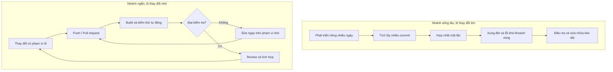
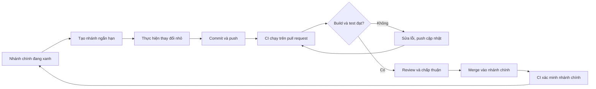

# Tích hợp thay đổi nhỏ và thường xuyên

## 1. Nguyên lý và mục tiêu

Trong CI/CD, tích hợp thay đổi nhỏ và thường xuyên có nghĩa là đưa các phần thay đổi mã nguồn có phạm vi rõ ràng vào nhánh dùng chung theo nhịp ngắn, đồng thời chạy kiểm tra tự động ngay sau mỗi lần tích hợp hoặc mỗi lần cập nhật pull request. Nhóm không để nhiều tuần làm việc tích tụ thành một lần hợp nhất lớn.

“Nhỏ” ở đây nói về phạm vi và rủi ro của một đơn vị thay đổi, không phải số dòng mã tuyệt đối. Một thay đổi nhỏ thường giải quyết một mục đích có thể diễn giải, review, kiểm thử và nếu cần thì hoàn tác độc lập. “Thường xuyên” nói về khoảng thời gian từ lúc bắt đầu thay đổi đến lúc nó được tích hợp và nhận phản hồi từ nhánh chung. Nhịp cụ thể tùy dự án, nhưng mục tiêu là giảm thời gian sống của nhánh và giảm kích thước lô thay đổi.

Nguyên lý này là nền tảng của Continuous Integration (CI). Khi mỗi thay đổi được tích hợp đều đặn và kiểm chứng bằng build, kiểm thử cùng các quality gate phù hợp, nhóm có thể phát hiện xung đột và lỗi gần thời điểm chúng xuất hiện. Đây là một trong những cách quan trọng để xây dựng luồng CI/CD có thể lặp lại, truy vết và phát hành an toàn.

## 2. Vì sao kích thước lô thay đổi ảnh hưởng đến chất lượng?

Giả sử hai lập trình viên cùng phát triển một chức năng. Nếu mỗi người giữ nhánh riêng trong thời gian dài, mã nguồn trên hai nhánh sẽ dần khác nhánh chính và khác nhau giữa hai nhánh. Khi hợp nhất, Git có thể báo xung đột văn bản, nhưng những vấn đề khó hơn là xung đột về ý nghĩa: hai thay đổi riêng lẻ có thể biên dịch thành công nhưng không hoạt động đúng khi kết hợp.

Kích thước lô thay đổi càng lớn, số tương tác cần xem xét càng nhiều. Khi có lỗi sau một lần hợp nhất lớn, nhóm phải điều tra nhiều commit, nhiều file và nhiều giả định cùng lúc. Nếu một thay đổi nhỏ được tích hợp và kiểm thử ngay, phạm vi cần tìm nguyên nhân thường hẹp hơn.

Có thể hình dung sự khác nhau như sau:



Tích hợp thường xuyên mang lại các lợi ích chính:

- **Giảm độ lệch giữa các nhánh:** thay đổi mới liên tục được đồng bộ với nhánh chung, giảm lượng khác biệt phải hợp nhất.
- **Phát hiện lỗi sớm:** lỗi build, test hoặc tương thích được phát hiện khi thay đổi còn mới và dễ hiểu.
- **Review dễ hơn:** người review có thể tập trung vào một mục tiêu, hiểu lý do thay đổi và đánh giá tác động rõ ràng.
- **Khoanh vùng sự cố nhanh hơn:** khi pipeline thất bại, số thay đổi liên quan thường ít hơn.
- **Tăng tính dự đoán:** nhánh chính được kiểm chứng thường xuyên, giúp các bước tạo artifact và phát hành có đầu vào ổn định hơn.
- **Giảm công việc dở dang bị che khuất:** tiến độ được thể hiện qua các thay đổi nhỏ đã tích hợp thay vì các nhánh dài ngày khó đánh giá.

Lợi ích không đến chỉ từ việc merge nhiều lần. Mỗi lần tích hợp cần đi kèm phản hồi có giá trị và trách nhiệm xử lý lỗi. Nếu nhóm merge thường xuyên nhưng bỏ qua test thất bại hoặc để nhánh chính ở trạng thái hỏng, nguyên lý đã không được thực hiện đúng.

## 3. Chọn kích thước thay đổi hợp lý

Một thay đổi nên đủ nhỏ để người khác có thể hiểu được trong một lần review, nhưng cũng đủ hoàn chỉnh để tạo ra giá trị kỹ thuật có thể kiểm chứng. Không nên chia nhỏ máy móc đến mức mỗi pull request chỉ chứa vài dòng vô nghĩa hoặc phụ thuộc vào hàng loạt pull request chưa thể tích hợp.

Ví dụ, khi bổ sung chức năng lọc đơn hàng, có thể chia công việc theo các lát cắt có ý nghĩa:

1. Thêm hàm chuẩn hóa và kiểm tra tham số lọc, kèm unit test.
2. Bổ sung truy vấn lọc ở tầng repository, kèm kiểm thử tích hợp phù hợp.
3. Kết nối tham số vào endpoint và bổ sung kiểm thử API.
4. Cập nhật tài liệu API và telemetry cần thiết.

Mỗi lát cắt cần giữ hệ thống ở trạng thái build được và không làm hỏng hành vi hiện có. Nếu một phần chức năng chưa sẵn sàng cho người dùng, nhóm có thể dùng feature flag để kiểm soát việc bật tính năng. Feature flag cho phép tích hợp mã nguồn trước khi công bố chức năng, nhưng cần có chủ sở hữu, thời hạn xem xét và kế hoạch loại bỏ cờ tạm thời.

Một số tiêu chí giúp nhận biết thay đổi có phạm vi hợp lý:

- Có một mục đích chính và mô tả được trong tiêu đề pull request.
- Có thể review mà không phải hiểu một lượng lớn công việc không liên quan.
- Có cách kiểm thử hoặc xác minh phù hợp với hành vi được thay đổi.
- Có thể hợp nhất mà không để nhánh chính ở trạng thái không sử dụng được.
- Nếu cần hoàn tác, có thể xác định tác động và phương án khôi phục.
- Không gộp các thay đổi định dạng hàng loạt, đổi tên diện rộng hoặc cập nhật dependency không liên quan vào một thay đổi chức năng nếu chúng làm review khó hơn.

Không có một giới hạn số dòng áp dụng cho mọi dự án. Một thay đổi 20 dòng có thể phức tạp nếu thay đổi giao thức bảo mật; một thay đổi 300 dòng có thể hợp lý nếu đó là một thành phần tự chứa với kiểm thử rõ ràng. Hãy đánh giá theo độ phức tạp, mức độ phụ thuộc và khả năng kiểm chứng.

## 4. Giữ nhánh ngắn và tích hợp theo nhịp đều

Một cách thực hành phổ biến là làm việc trên nhánh ngắn hạn hoặc trunk-based development. Lập trình viên tạo nhánh từ nhánh chính, thực hiện một mục tiêu nhỏ, push thường xuyên, mở pull request sớm và hợp nhất ngay khi review cùng các kiểm tra bắt buộc đạt.

Luồng làm việc điển hình:



Các thực hành hỗ trợ nhịp tích hợp ngắn:

1. **Đồng bộ với nhánh chính thường xuyên:** cập nhật nhánh làm việc để phát hiện sớm thay đổi tương tác. Dùng merge hoặc rebase theo quy ước của dự án; điều quan trọng là không để khác biệt tích tụ quá lâu.
2. **Mở pull request sớm:** có thể đánh dấu là draft khi còn đang làm để nhận phản hồi về hướng tiếp cận và giảm rủi ro phát hiện vấn đề lớn ở cuối.
3. **Giữ pull request tập trung:** tách refactor độc lập khỏi thay đổi chức năng khi điều đó giúp review và kiểm thử rõ ràng hơn.
4. **Tự động hóa kiểm tra bắt buộc:** build, unit test, lint và các kiểm tra phù hợp phải chạy trên đúng commit dự kiến hợp nhất.
5. **Xử lý phản hồi nhanh:** người tạo thay đổi theo dõi kết quả CI và review, sửa lỗi khi ngữ cảnh còn mới.
6. **Bảo vệ nhánh chính:** yêu cầu kiểm tra bắt buộc, review theo chính sách và hạn chế push trực tiếp nếu dự án cần kiểm soát thay đổi.

Một số nhóm dùng nhánh tồn tại rất ngắn và tích hợp trực tiếp vào trunk nhiều lần trong ngày. Nhóm khác dùng pull request và nhánh tính năng ngắn hạn. Cả hai cách đều có thể hỗ trợ CI nếu thay đổi được tích hợp thường xuyên, nhánh chung luôn được xác minh và quy trình không tạo hàng đợi review kéo dài.

## 5. CI phải cung cấp phản hồi nhanh và đáng tin cậy

Tích hợp nhỏ và thường xuyên chỉ hiệu quả khi mỗi lần cập nhật nhận được phản hồi đủ nhanh để người thực hiện còn nhớ rõ thay đổi vừa làm. Pipeline nên chia kiểm tra thành các lớp phù hợp:

| Lớp kiểm tra | Ví dụ | Thời điểm phù hợp |
|---|---|---|
| Kiểm tra nhanh | Format, lint, kiểm tra kiểu, unit test trọng yếu | Mỗi lần push hoặc cập nhật pull request |
| Kiểm tra tích hợp | Integration test, kiểm tra database hoặc dịch vụ phụ thuộc | Pull request hoặc trước khi hợp nhất, tùy thời gian chạy |
| Kiểm tra mở rộng | End-to-end test, kiểm tra hiệu năng, quét sâu hoặc kiểm tra tương thích | Trước phát hành, theo lịch hoặc trên nhánh phù hợp |

Không nhất thiết chạy toàn bộ bộ kiểm thử dài nhất trên mọi lần commit nếu chi phí quá cao. Tuy nhiên, các kiểm tra cần thiết để bảo vệ nhánh chính phải được định nghĩa rõ, có kết quả đáng tin cậy và có cơ chế xử lý khi thất bại. Các kiểm tra mở rộng có thể chạy song song hoặc theo lịch, nhưng rủi ro mà chúng bảo vệ cần được xem xét trước khi phát hành.

Pipeline cũng cần tránh trạng thái “flaky test” – cùng một mã nguồn nhưng kết quả lúc đạt lúc không do timing, dữ liệu dùng chung, phụ thuộc mạng hoặc môi trường thiếu ổn định. Test chập chờn làm nhóm mất niềm tin và có thể dẫn đến thói quen chạy lại cho đến khi xanh. Cần ghi nhận, ưu tiên sửa và nếu buộc phải tạm thời cô lập thì phải có chủ sở hữu cùng thời hạn xử lý; không âm thầm bỏ qua lỗi.

Nếu pipeline quá chậm, hãy xem xét cache dependency an toàn, chạy job song song, giảm trùng lặp, tối ưu fixture và phân tầng test. Mục tiêu là rút ngắn thời gian phản hồi mà vẫn giữ các kiểm tra bảo vệ quan trọng.

## 6. Giữ nhánh chính luôn ở trạng thái có thể tích hợp

Nhánh chính (mainline hoặc trunk) là điểm hội tụ của các thay đổi. Nhóm nên duy trì quy tắc rằng nhánh này luôn build được và vượt qua các kiểm tra bắt buộc. Khi một lần tích hợp làm nhánh chính hỏng, cần coi đó là ưu tiên khôi phục.

Quy trình xử lý khi nhánh chính bị hỏng:

1. Thông báo trạng thái lỗi và xác định commit hoặc lần tích hợp gây ra vấn đề.
2. Tạm dừng các thay đổi tiếp theo có nguy cơ làm khó việc khoanh vùng.
3. Sửa lỗi ngay nếu nguyên nhân rõ và bản sửa nhỏ, an toàn.
4. Nếu chưa thể sửa nhanh hoặc không chắc tác động, revert thay đổi gây lỗi để khôi phục nhánh chính.
5. Chạy lại các kiểm tra liên quan, xác nhận nhánh chính đã xanh rồi mới tiếp tục tích hợp.
6. Phân tích nguyên nhân để cải thiện test, review, cấu hình pipeline hoặc cách chia nhỏ thay đổi.

Ví dụ lệnh hoàn tác một commit đã được tích hợp có thể là:

```bash
git revert <commit-sha>
git push origin main
```

`git revert` tạo commit mới đảo ngược thay đổi của commit được chỉ định, phù hợp với nhánh đã chia sẻ. Cần tuân theo chính sách bảo vệ nhánh và quy trình review của dự án; không dùng `git reset --hard` rồi force-push lên nhánh chung để xử lý sự cố nếu chưa có quy trình được phê duyệt. Với một pull request chưa hợp nhất, người tạo có thể sửa commit trên nhánh của mình hoặc đóng pull request theo quy ước nhóm.

## 7. Ví dụ thực tế: thêm trường dữ liệu vào API

Một nhóm cần thêm trường `deliveryNote` vào API tạo đơn hàng. Nếu lập trình viên thay đổi đồng thời database, domain model, API, giao diện, migration và tài liệu trong một nhánh kéo dài nhiều tuần, các phần khác của hệ thống có thể tiếp tục thay đổi trong thời gian đó. Đến khi hợp nhất, lỗi tương thích và xung đột khó tách biệt.

Nhóm có thể chia công việc theo hướng tương thích ngược:

| Bước | Thay đổi nhỏ | Kiểm chứng |
|---|---|---|
| 1 | Thêm cột database cho `delivery_note`, cho phép null hoặc có giá trị mặc định an toàn. | Migration chạy được trên schema hiện tại; kiểm thử migration. |
| 2 | Bổ sung trường tùy chọn vào model và mapping. | Unit test cho mapping có và không có giá trị. |
| 3 | API chấp nhận và trả về trường tùy chọn. | API test xác minh request cũ vẫn hoạt động. |
| 4 | Cập nhật client hoặc giao diện gửi trường mới. | Integration test và kiểm thử luồng nghiệp vụ. |
| 5 | Bật chức năng theo feature flag nếu cần rollout có kiểm soát. | Smoke test và theo dõi lỗi sau khi bật. |

Mỗi bước có thể được review, tích hợp và kiểm thử độc lập. Trong giai đoạn chuyển tiếp, phiên bản cũ vẫn hoạt động vì trường mới là tùy chọn. Sau khi tất cả thành phần đã sẵn sàng và dữ liệu được xác minh, nhóm mới có thể áp dụng ràng buộc chặt hơn nếu nghiệp vụ yêu cầu.

Ví dụ này cho thấy tích hợp nhỏ không chỉ là chia file hay chia commit. Nó đòi hỏi thiết kế thay đổi theo hướng tương thích qua các bước, để hệ thống vẫn hoạt động trong khi nhiều phiên bản thành phần cùng tồn tại.

## 8. Khi nào cần dùng feature flag và kỹ thuật tương thích?

Có những chức năng không thể hoàn thành trong một thay đổi nhỏ duy nhất. Một tính năng có thể cần nhiều lớp hoặc nhiều nhóm cùng phối hợp. Trong trường hợp này, nhóm có thể tích hợp phần mã chưa hoàn chỉnh nhưng giữ nó ở trạng thái chưa hiển thị cho người dùng bằng feature flag hoặc cơ chế cấu hình tương đương.

Feature flag nên được sử dụng có kỷ luật:

- Mặc định tắt nếu chức năng chưa sẵn sàng hoặc cần giới hạn nhóm người dùng.
- Không để nhánh mã chưa hoàn chỉnh gây lỗi cho luồng hiện tại khi cờ tắt.
- Kiểm thử cả trạng thái bật và tắt nếu hai trạng thái có hành vi khác nhau.
- Giới hạn người có quyền bật cờ trong production.
- Ghi nhận ngày xem xét, chủ sở hữu và tiêu chí xóa cờ.

Với thay đổi API, database hoặc message schema, hãy cân nhắc mô hình expand-and-contract: trước tiên mở rộng schema theo cách tương thích với phiên bản cũ, triển khai ứng dụng có thể đọc/ghi theo định dạng chuyển tiếp, di chuyển dữ liệu nếu cần, rồi mới loại bỏ cấu trúc cũ sau khi xác minh không còn thành phần phụ thuộc. Nhờ đó, việc triển khai từng phần không buộc tất cả thành phần phải thay đổi cùng một thời điểm.

Feature flag và migration tương thích hỗ trợ tích hợp thường xuyên, nhưng chúng làm tăng cấu hình và số trạng thái cần kiểm thử. Cần tránh giữ quá nhiều cờ lâu dài hoặc tạo các nhánh hành vi khó hiểu.

## 9. Những cách làm khiến nguyên lý thất bại

| Cách làm | Hệ quả | Cách cải thiện |
|---|---|---|
| Giữ nhánh tính năng nhiều tuần | Khác biệt với nhánh chính tích tụ; xung đột và lỗi tích hợp tăng. | Chia chức năng thành lát cắt có thể tích hợp; đồng bộ và push thường xuyên. |
| Pull request quá lớn | Review hời hợt, khó hiểu mục đích và khó khoanh vùng lỗi. | Tách theo mục tiêu và phụ thuộc; dùng feature flag khi cần. |
| Hợp nhất dù CI thất bại | Nhánh chính mất trạng thái đáng tin cậy. | Bảo vệ nhánh và yêu cầu các kiểm tra bắt buộc đạt. |
| Bỏ qua test chập chờn | Nhóm mất niềm tin vào pipeline, lỗi thật có thể bị bỏ qua. | Điều tra nguyên nhân, cô lập có thời hạn và theo dõi chủ sở hữu. |
| Review bị tồn đọng | Nhánh sống lâu dù mã đã sẵn sàng; thời gian chờ tăng. | Chia sẻ trách nhiệm review, giới hạn số việc đang làm và ưu tiên pull request nhỏ. |
| Gộp refactor lớn với thay đổi nghiệp vụ | Khó phân biệt lỗi do thay đổi cấu trúc hay logic. | Tách refactor độc lập và xác minh hành vi trước/sau. |
| Tích hợp thường xuyên nhưng không kiểm tra | Lỗi được đưa vào nhánh chung nhanh hơn nhưng không được phát hiện. | Gắn mỗi lần tích hợp với build, test và quality gate phù hợp. |
| Dùng feature flag không quản lý | Tích tụ cờ cũ, tăng số trạng thái và rủi ro bật nhầm. | Có chủ sở hữu, thời hạn và kế hoạch dọn dẹp. |

## 10. Đo lường nhịp tích hợp

Nhóm có thể dùng một số tín hiệu để biết nguyên lý đang được thực hiện tốt đến đâu:

- **Thời gian sống của nhánh:** thời gian từ khi tạo nhánh hoặc bắt đầu thay đổi đến khi tích hợp. Nhánh sống càng lâu thường tích tụ càng nhiều khác biệt.
- **Kích thước pull request:** số file, dòng thay đổi hoặc độ phức tạp review. Chỉ số này cần đọc cùng bối cảnh; số dòng thấp không tự động có nghĩa rủi ro thấp.
- **Thời gian chờ review:** thời gian từ lúc pull request sẵn sàng đến khi có phản hồi và quyết định. Hàng đợi dài có thể làm mất lợi ích của nhánh ngắn.
- **Thời gian phản hồi CI:** thời gian từ lần push đến khi có kết quả kiểm tra cần thiết. Phản hồi càng chậm, việc sửa lỗi trong ngữ cảnh ban đầu càng khó.
- **Tần suất tích hợp:** số lần thay đổi được đưa vào nhánh chung trong một khoảng thời gian. Chỉ số này cần kết hợp với chất lượng và giá trị của thay đổi.
- **Tỷ lệ nhánh chính bị hỏng hoặc lần tích hợp phải revert:** phản ánh mức độ tin cậy của quy trình, nhưng cần phân tích nguyên nhân thay vì chỉ tối ưu con số.

Không nên đặt mục tiêu cứng như “mọi pull request dưới 100 dòng” hoặc “phải merge 10 lần mỗi ngày” cho mọi nhóm. Chỉ số là công cụ phát hiện điểm nghẽn và thảo luận cải tiến, không phải lý do để chia nhỏ giả tạo hoặc giảm chất lượng review.

## 11. Checklist áp dụng trong nhóm

Trước khi tích hợp một thay đổi, nhóm có thể tự kiểm tra:

- [ ] Thay đổi có một mục tiêu chính và phạm vi dễ giải thích.
- [ ] Nhánh làm việc được cập nhật với nhánh chính theo nhịp phù hợp.
- [ ] Pull request mô tả lý do, tác động và cách kiểm thử.
- [ ] Build và các kiểm tra bắt buộc chạy trên commit mới nhất.
- [ ] Kết quả kiểm thử có thể truy cập và không bị bỏ qua tùy tiện.
- [ ] Người review hiểu được thay đổi và các rủi ro chính.
- [ ] Thay đổi không làm nhánh chính mất khả năng build hoặc kiểm thử.
- [ ] Nếu chức năng chưa sẵn sàng cho người dùng, cơ chế kiểm soát như feature flag đã được kiểm tra.
- [ ] Có thể truy vết commit và có phương án xử lý nếu thay đổi gây sự cố.

Sau khi tích hợp, nhóm tiếp tục theo dõi trạng thái pipeline của nhánh chính và xử lý ngay nếu có lỗi. Tích hợp không kết thúc ở thao tác merge; nó kết thúc khi thay đổi đã được xác minh trong bối cảnh nhánh chung.

## 12. Nguyên tắc thực hành cốt lõi

1. Chia công việc thành thay đổi có mục tiêu rõ ràng, đủ nhỏ để review và kiểm thử độc lập.
2. Giữ nhánh sống ngắn, push và đồng bộ với nhánh chính thường xuyên.
3. Mở pull request sớm, xử lý review và phản hồi CI khi ngữ cảnh còn mới.
4. Duy trì nhánh chính ở trạng thái build được và vượt qua các kiểm tra bắt buộc.
5. Dùng feature flag và thiết kế tương thích để tích hợp từng phần của chức năng lớn.
6. Khôi phục nhánh chính nhanh khi có lỗi, sau đó cải thiện nguyên nhân gốc.
7. Đo thời gian chờ, kích thước thay đổi và độ tin cậy của pipeline để tìm điểm nghẽn.

Tích hợp thay đổi nhỏ và thường xuyên tạo ra một vòng phản hồi ngắn giữa người viết mã, hệ thống CI và nhánh dùng chung. Khi vòng phản hồi này đáng tin cậy, nhóm giảm được rủi ro tích hợp, phát hiện lỗi sớm và tạo nền tảng ổn định cho các bước đóng gói, triển khai và phát hành tiếp theo trong CI/CD.
