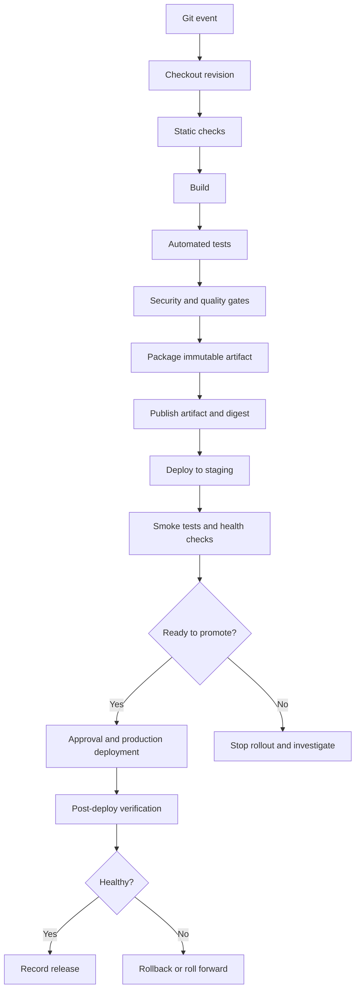

# Tự động hóa quy trình có thể lặp lại

Một quy trình CI/CD chỉ đáng tin cậy khi nhóm có thể chạy lại nó và hiểu vì sao kết quả lần này giống hoặc khác lần trước. Nếu việc phát hành phụ thuộc vào trí nhớ của một người, vài lệnh chạy thủ công hoặc cấu hình chỉ tồn tại trên máy cá nhân, nhóm khó kiểm soát chất lượng và khó điều tra sự cố.

Tự động hóa quy trình có thể lặp lại là nguyên lý thiết kế mọi bước từ lúc mã nguồn thay đổi đến khi phiên bản được triển khai theo một cách rõ ràng, có thể kiểm tra, có thể truy vết và có thể thực hiện lại. Mục tiêu không phải là tự động hóa mọi thao tác bằng mọi giá. Mục tiêu là biến các bước thường xuyên, có quy tắc và có thể kiểm chứng thành một quy trình nhất quán; giữ sự can thiệp của con người ở những quyết định thực sự cần đánh giá hoặc phê duyệt.

Trong CI/CD, nguyên lý này giúp giảm sai sót do thao tác, rút ngắn thời gian phản hồi, tăng độ tin cậy của bản phát hành và tạo bằng chứng để nhóm biết chính xác mã nào đã được kiểm thử, đóng gói và triển khai.

## 1. Hiểu đúng về tính lặp lại

Một quy trình có thể lặp lại khi cùng một định nghĩa quy trình, cùng đầu vào và cùng điều kiện thực thi sẽ tạo ra kết quả tương đương. Các đầu vào cần được nhận diện rõ, chẳng hạn:

- Phiên bản mã nguồn hoặc mã commit.
- Phiên bản runtime, compiler, công cụ build và dependency.
- Cấu hình build, tham số kiểm thử và biến môi trường.
- Artifact đầu vào, dữ liệu kiểm thử và dịch vụ phụ thuộc.
- Quyền truy cập, thông tin xác thực và môi trường đích.

Cần phân biệt ba khái niệm liên quan:

| Khái niệm | Ý nghĩa | Ví dụ |
|---|---|---|
| Tự động hóa (automation) | Máy thực hiện một bước theo quy tắc đã định nghĩa | Pipeline tự chạy unit test khi mở pull request |
| Tính lặp lại (repeatability) | Có thể chạy lại cùng quy trình với đầu vào và điều kiện tương đương để nhận kết quả tương đương | Cùng commit và bộ công cụ tạo ra cùng bộ kiểm thử và cùng loại artifact |
| Tính tái tạo (reproducibility) | Có thể tái tạo kết quả một cách chặt chẽ từ các đầu vào đã ghi nhận; với build nghiêm ngặt, artifact có thể giống nhau từng byte | Hai lần build độc lập tạo ra artifact có cùng digest |

Một quy trình lặp lại không tự động bảo đảm mọi kết quả đều giống từng byte. Ví dụ, artifact có thể chứa timestamp, chữ ký hoặc metadata thay đổi theo lần chạy. Tuy vậy, quy trình vẫn có thể đáng tin cậy nếu các khác biệt được hiểu và kiểm soát. Khi cần kiểm chứng nguồn gốc hoặc điều tra chuỗi cung ứng phần mềm, khả năng tái tạo và xác minh digest trở nên đặc biệt quan trọng.

Tính lặp lại cũng không đồng nghĩa với việc chạy pipeline nhiều lần cho đến khi thành công. Nếu một lần chạy thất bại vì dependency không ổn định, test phụ thuộc thời gian hoặc cấu hình môi trường bị trôi, việc chạy lại có thể chỉ che giấu nguyên nhân. Một quy trình tốt phải làm rõ đầu vào, điều kiện chạy, kết quả và nguyên nhân thất bại.

## 2. Đưa quy trình vào mã nguồn

Quy trình CI/CD nên được mô tả bằng tệp cấu hình có phiên bản và được lưu cùng repository hoặc trong repository quản trị pipeline. Cách làm này thường được gọi là pipeline as code.

Khi quy trình nằm trong mã nguồn:

- Thay đổi pipeline có thể được review như thay đổi ứng dụng.
- Nhóm có thể xem lịch sử ai sửa bước nào và sửa vì lý do gì.
- Mỗi nhánh hoặc phiên bản có thể gắn với định nghĩa pipeline tương ứng.
- Có thể kiểm tra cú pháp, chính sách và cấu hình pipeline tự động.
- Nhóm mới có thể hiểu cách build, test và phát hành mà không phụ thuộc vào hướng dẫn truyền miệng.

Các thao tác quan trọng không nên chỉ được ghi trong một tài liệu hướng dẫn rồi để người vận hành tự nhớ. Tài liệu vẫn cần thiết để giải thích mục đích và quy trình xử lý ngoại lệ, nhưng các bước máy có thể thực hiện ổn định nên được thể hiện trong pipeline hoặc script được quản lý bằng version control.

Ví dụ, thay vì yêu cầu mỗi lập trình viên nhớ lần lượt chạy formatter, linter, unit test và build, repository có thể cung cấp một lệnh kiểm tra chuẩn. Pipeline và máy phát triển cùng gọi lệnh đó. Như vậy, tiêu chuẩn kiểm tra không bị phân tán thành nhiều phiên bản.

Pipeline cũng cần được review. Một thay đổi nhỏ như mở rộng quyền token, bỏ một quality gate hoặc thay nguồn tải dependency có thể ảnh hưởng đến toàn bộ chuỗi phát hành. Review nên xem cả logic, quyền hạn, nguồn đầu vào và cách xử lý khi bước chạy thất bại.

## 3. Khai báo đầu vào và cố định môi trường thực thi

Một pipeline khó lặp lại nếu các thành phần của nó thay đổi âm thầm. Ví dụ, dùng phiên bản công cụ mới nhất, tải dependency không khóa phiên bản hoặc build trên image có tag thay đổi theo thời gian có thể khiến cùng commit cho kết quả khác nhau.

Để kiểm soát đầu vào:

1. Khóa dependency bằng lockfile hoặc cơ chế tương đương; review thay đổi dependency như thay đổi mã nguồn.
2. Chỉ rõ phiên bản runtime, compiler, package manager và công cụ build.
3. Dùng container image hoặc môi trường build đã xác định phiên bản; với yêu cầu kiểm soát cao, tham chiếu image bằng digest.
4. Ghi nhận tham số build, cấu hình và biến ảnh hưởng đến kết quả.
5. Hạn chế phụ thuộc vào tài nguyên bên ngoài không ổn định; nếu phải sử dụng, cần kiểm soát phiên bản, checksum hoặc nguồn cung cấp.
6. Tách dữ liệu kiểm thử khỏi dữ liệu thực tế và làm cho dữ liệu kiểm thử có thể khởi tạo lại.

Không phải mọi thông tin đều nên cố định thành một hằng số trong pipeline. Những giá trị thay đổi theo môi trường như URL dịch vụ, tên cụm hoặc giới hạn tài nguyên nên được quản lý bằng cấu hình môi trường. Điều quan trọng là biết giá trị nào ảnh hưởng đến build, giá trị nào chỉ ảnh hưởng đến triển khai và nguồn nào có quyền thay đổi chúng.

Một build đáng tin cậy cần ghi nhận đủ thông tin để giải thích kết quả, ví dụ: commit SHA, phiên bản toolchain, lockfile, tham số build và digest của image build. Nếu thiếu các thông tin này, nhóm có thể biết pipeline đã chạy nhưng không chắc pipeline đã chạy trong điều kiện nào.

## 4. Thiết kế pipeline thành các bước có hợp đồng rõ ràng

Mỗi bước tự động nên có đầu vào, đầu ra, điều kiện thực thi và cách báo lỗi rõ ràng. Các bước nên nhỏ vừa đủ để có thể hiểu và chẩn đoán, nhưng không chia vụn đến mức pipeline trở nên khó quản lý.

Một luồng CI/CD cơ bản thường gồm các chặng sau:

1. **Nhận sự kiện:** tiếp nhận pull request, commit vào nhánh chính, tag phát hành hoặc yêu cầu triển khai được cho phép.
2. **Lấy mã nguồn:** checkout đúng revision và ghi nhận commit SHA.
3. **Kiểm tra nhanh:** kiểm tra định dạng, cú pháp, lint, kiểu dữ liệu và các quy tắc tĩnh.
4. **Build:** cài đặt dependency theo lockfile và tạo đầu ra từ mã nguồn.
5. **Kiểm thử:** chạy unit test, integration test và các kiểm tra phù hợp với rủi ro.
6. **Đóng gói:** tạo artifact có định danh duy nhất và tính digest.
7. **Đánh giá chất lượng và bảo mật:** kiểm tra lỗ hổng, license, cấu hình, secret bị lộ và chính sách phát hành.
8. **Lưu trữ và phát hành:** đẩy artifact vào registry hoặc kho lưu trữ có kiểm soát.
9. **Triển khai:** lấy đúng artifact đã được phê duyệt và triển khai vào môi trường đích.
10. **Xác minh:** kiểm tra sức khỏe dịch vụ, smoke test, chỉ số vận hành và trạng thái rollout.
11. **Hoàn tất hoặc quay lui:** ghi nhận kết quả, phát hành thông báo vận hành phù hợp và kích hoạt phương án rollback khi điều kiện thất bại được thỏa mãn.

Sơ đồ dưới đây thể hiện luồng điển hình. Một số bước có thể chạy song song, nhưng bước triển khai phải phụ thuộc vào artifact và các cổng chất lượng tương ứng.



Các bước không nhất thiết phải chạy tuần tự. Lint, kiểm tra dependency và một số nhóm test có thể chạy song song sau khi checkout. Việc song song giúp giảm thời gian phản hồi, nhưng cần giữ điều kiện tổng hợp: chỉ khi tất cả kiểm tra bắt buộc đạt thì pipeline mới được chuyển sang chặng tiếp theo.

Cần phân biệt pipeline kiểm tra thay đổi với pipeline phát hành. Pull request thường cần phản hồi nhanh và không có quyền triển khai production. Khi commit được hợp nhất vào nhánh phát hành, pipeline có thể tạo artifact chính thức. Quyền và điều kiện triển khai nên được giới hạn theo sự kiện, nhánh, môi trường và chính sách.

## 5. Dùng quality gate để kiểm soát việc chuyển chặng

Một quality gate là điều kiện bắt buộc phải đạt trước khi pipeline chuyển sang bước có rủi ro cao hơn. Gate có thể kiểm tra:

- Unit test và integration test bắt buộc đã đạt.
- Coverage hoặc ngưỡng chất lượng đáp ứng chính sách của dự án.
- Không có lỗ hổng ở mức nghiêm trọng bị cấm phát hành.
- Dependency và license tuân thủ chính sách.
- Artifact được tạo từ revision đã xác định và có thể xác minh.
- Người hoặc hệ thống có thẩm quyền đã phê duyệt triển khai khi cần.

Gate phải phản ánh rủi ro thực tế. Nếu mọi cảnh báo đều chặn phát hành, nhóm có thể tìm cách bỏ qua gate. Nếu gate chỉ mang tính hình thức, nó không bảo vệ được chất lượng. Mỗi điều kiện nên có chủ sở hữu, ngưỡng rõ ràng, lý do tồn tại và cách xử lý ngoại lệ.

Không nên biến một kiểm tra chưa ổn định thành gate bắt buộc mà không xử lý nguồn gây nhiễu. Flaky test khiến cùng commit lúc đạt lúc trượt sẽ làm giảm niềm tin vào pipeline. Cần ghi nhận test không ổn định, xác định nguyên nhân và có thời hạn khắc phục; việc tạm bỏ qua phải có phạm vi và dấu vết phê duyệt.

Con người vẫn có vai trò trong CI/CD. Phê duyệt production, đánh giá thay đổi có ảnh hưởng lớn hoặc quyết định xử lý sự cố là các điểm kiểm soát hợp lý. Tuy nhiên, sau khi phê duyệt, các bước triển khai và xác minh nên được thực hiện bằng quy trình đã định nghĩa để giảm khác biệt giữa các lần phát hành.

## 6. Build một lần, triển khai cùng artifact qua các môi trường

Một nguyên tắc quan trọng là tạo artifact một lần cho một revision phát hành, sau đó đưa chính artifact đó qua các môi trường như development, staging và production.

Nếu mỗi môi trường tự build lại từ mã nguồn, các môi trường có thể nhận được artifact khác nhau do dependency, công cụ hoặc thời điểm build thay đổi. Khi staging đã kiểm thử một bản build nhưng production nhận một bản build mới, bằng chứng kiểm thử không còn gắn chắc chắn với thứ được phát hành.

Luồng nên được tổ chức như sau:

- Build tạo artifact bất biến.
- Artifact được lưu trong registry hoặc kho lưu trữ có kiểm soát.
- Mỗi lần triển khai tham chiếu artifact bằng version và/hoặc digest.
- Cấu hình môi trường được cung cấp tại thời điểm triển khai.
- Quá trình promotion chỉ thay đổi trạng thái phê duyệt hoặc môi trường đích, không thay đổi nội dung artifact.

Cấu hình môi trường và artifact có vòng đời khác nhau. Ví dụ, cùng một image ứng dụng có thể dùng ở staging và production, nhưng nhận URL dịch vụ, giới hạn tài nguyên và thông tin kết nối khác nhau. Những cấu hình này cần được kiểm tra và quản lý riêng; bí mật phải lấy từ secret manager hoặc cơ chế cấp phát an toàn.

Thay đổi cơ sở dữ liệu cần được tính đến trong chiến lược triển khai. Migration không tương thích có thể khiến rollback ứng dụng không còn an toàn. Một cách tiếp cận phổ biến là mở rộng schema trước, triển khai phiên bản ứng dụng tương thích cả schema cũ và mới, chuyển đổi dữ liệu, rồi mới loại bỏ phần cũ ở một lần phát hành sau. Nhờ vậy, ứng dụng có thể được quay lui trong khoảng thời gian cần thiết.

## 7. Làm cho thao tác an toàn khi chạy lại

Pipeline có thể bị chạy lại vì runner mất kết nối, timeout, người vận hành yêu cầu retry hoặc hệ thống điều phối không nhận được phản hồi cuối cùng. Vì vậy, các thao tác cần được thiết kế để xử lý retry an toàn.

Một thao tác idempotent là thao tác mà việc thực hiện nhiều lần với cùng trạng thái đầu vào không làm thay đổi kết quả cuối cùng sau lần thực hiện đầu tiên. Ví dụ, khai báo trạng thái mong muốn của một deployment và để hệ thống điều phối hội tụ về trạng thái đó thường an toàn hơn việc mỗi lần chạy lại đều tạo thêm một deployment mới.

Không phải mọi bước đều có thể idempotent hoàn toàn. Gửi email, tạo hóa đơn hoặc chạy migration có tác dụng phụ cần cơ chế bảo vệ riêng, chẳng hạn:

- Dùng khóa idempotency hoặc mã giao dịch duy nhất.
- Kiểm tra trạng thái hiện tại trước khi tạo tài nguyên.
- Ghi nhận kết quả của thao tác để retry có thể tiếp tục đúng chỗ.
- Dùng transaction hoặc cơ chế bù trừ khi thao tác gồm nhiều bước.
- Phân biệt timeout với thất bại thực sự; timeout không chứng minh thao tác ở hệ thống đích chưa xảy ra.

Retry nên có giới hạn, khoảng chờ tăng dần và điều kiện dừng. Chỉ retry lỗi tạm thời có khả năng hồi phục, chẳng hạn lỗi kết nối ngắn hạn hoặc dịch vụ phụ thuộc đang quá tải. Lỗi logic, cấu hình sai, test thất bại hoặc thiếu quyền cần được xử lý nguyên nhân thay vì lặp lại vô hạn.

Cần chú ý đến các bước cleanup. Một lệnh xóa tài nguyên dùng chung hoặc xóa theo pattern quá rộng có thể làm hỏng môi trường khi chạy lại. Nên giới hạn phạm vi tài nguyên theo mã pipeline, revision hoặc môi trường, đồng thời yêu cầu quyền riêng cho thao tác phá hủy.

## 8. Bảo vệ bí mật và giới hạn quyền của pipeline

Pipeline là một phần của chuỗi cung ứng phần mềm và thường có quyền đọc mã nguồn, tải dependency, ghi artifact hoặc triển khai dịch vụ. Nếu token có quyền quá rộng bị lộ, kẻ tấn công có thể sử dụng pipeline để truy cập hệ thống khác.

Các nguyên tắc cơ bản gồm:

- Không lưu mật khẩu, token, private key hoặc credential trong repository, log hay artifact.
- Lấy bí mật từ secret manager hoặc kho bí mật do nền tảng CI/CD cung cấp.
- Chỉ cấp quyền tối thiểu cho từng job; job kiểm thử không cần quyền triển khai production.
- Ưu tiên credential ngắn hạn và cơ chế định danh workload/OIDC khi nền tảng hỗ trợ.
- Giới hạn quyền ghi registry, tạo release và triển khai theo nhánh, môi trường hoặc workflow.
- Không in bí mật ra log; kiểm tra cả output của công cụ có thể vô tình chứa token.
- Cẩn trọng với pull request từ fork hoặc mã nguồn chưa tin cậy; không cấp bí mật phát hành cho job chạy mã đó.

Tách job cũng giúp giới hạn phạm vi ảnh hưởng. Ví dụ, job chạy test có thể không được truy cập secret production. Chỉ job triển khai sau các gate và điều kiện phê duyệt mới nhận credential cần thiết, trong thời gian ngắn nhất có thể.

## 9. Truy vết từ commit đến lần triển khai

Khi có lỗi sau phát hành, nhóm cần trả lời nhanh các câu hỏi: phiên bản nào đang chạy, được build từ commit nào, dùng dependency nào, ai hoặc hệ thống nào đã phê duyệt, artifact có digest gì, pipeline nào đã tạo nó và những kiểm tra nào đã đạt?

Để trả lời, mỗi lần build và triển khai nên ghi nhận một tập thông tin liên kết với nhau:

| Thông tin | Mục đích |
|---|---|
| Repository và commit SHA | Xác định chính xác mã nguồn |
| Pipeline run ID và thời điểm | Xác định lần thực thi tạo ra kết quả |
| Phiên bản toolchain và dependency | Giải thích điều kiện build |
| Artifact version và digest | Xác minh đúng gói được lưu trữ và triển khai |
| Kết quả test và quality gate | Cho biết bằng chứng chất lượng tại thời điểm phát hành |
| Môi trường, revision cấu hình | Xác định điều kiện triển khai |
| Người hoặc danh tính hệ thống phê duyệt | Truy vết quyết định và quyền thực hiện |
| Kết quả triển khai và xác minh sau triển khai | Xác định trạng thái thực tế của dịch vụ |

Metadata này có thể được lưu trong log pipeline, release manifest, provenance hoặc hệ thống quản lý phát hành. Không nên chỉ dựa vào tag dễ bị ghi đè như latest. Digest giúp xác minh nội dung artifact, còn manifest liên kết artifact với mã nguồn, pipeline và kết quả kiểm tra.

Log cần đủ chi tiết để điều tra nhưng không chứa dữ liệu bí mật. Nên giữ log và metadata theo thời hạn phù hợp với yêu cầu vận hành, kiểm toán và khả năng khôi phục của hệ thống.

## 10. Xác minh sau triển khai và chuẩn bị quay lui

Pipeline thành công ở bước deploy chỉ chứng minh lệnh triển khai đã hoàn tất theo cách công cụ báo cáo. Nó chưa chứng minh người dùng có thể sử dụng dịch vụ bình thường.

Sau triển khai, cần kiểm tra tối thiểu:

- Workload đã sẵn sàng và số replica đúng như mong muốn.
- Health endpoint hoặc readiness check hoạt động.
- Một số luồng nghiệp vụ quan trọng vượt qua smoke test.
- Tỷ lệ lỗi, độ trễ và tài nguyên không vượt ngưỡng bất thường.
- Log không xuất hiện lỗi khởi động, lỗi kết nối hoặc lỗi cấu hình nghiêm trọng.

Với hệ thống có lưu lượng lớn, có thể dùng canary hoặc blue-green deployment để giới hạn phạm vi ảnh hưởng. Canary đưa phiên bản mới đến một phần lưu lượng trước, quan sát chỉ số rồi mới mở rộng. Blue-green duy trì hai môi trường tương đương và chuyển lưu lượng khi môi trường mới đã sẵn sàng. Lựa chọn phụ thuộc vào kiến trúc, chi phí và khả năng chuyển đổi trạng thái của dữ liệu.

Rollback phải là một phần được chuẩn bị trước của quy trình phát hành. Nhóm cần biết artifact trước đó nằm ở đâu, cách chuyển lưu lượng về phiên bản cũ, migration nào có thể đảo ngược và điều kiện nào kích hoạt quay lui. Với thay đổi dữ liệu không thể đảo ngược, phương án roll forward bằng một bản sửa tiếp theo có thể an toàn hơn rollback ứng dụng.

Quy trình xác minh và rollback cũng cần có log, quyền hạn và dấu vết như các bước phát hành khác. Sau sự cố, nhóm nên dùng dữ liệu từ pipeline để xác định điểm thất bại và cập nhật quy trình nhằm tránh lặp lại cùng một lỗi.

## 11. Ví dụ về hợp đồng pipeline

Đoạn YAML dưới đây là mô hình khái niệm, không gắn với cú pháp của một nhà cung cấp CI/CD cụ thể. Nó thể hiện các đầu vào, bước xử lý và điều kiện chuyển chặng mà một pipeline thực tế cần khai báo.

```yaml
pipeline:
  name: application-ci-cd

  triggers:
    - pull_request
    - push_to_main
    - release_tag

  inputs:
    source_revision: required
    toolchain_version: pinned
    dependency_lockfile: required
    build_configuration: versioned

  jobs:
    validate:
      permissions:
        source_read: true
        production_deploy: false
      steps:
        - checkout: source_revision
        - install_dependencies: dependency_lockfile
        - run_static_checks: required
        - run_unit_tests: required

    build_and_verify:
      needs: [validate]
      steps:
        - build: source_revision
        - run_integration_tests: required
        - scan_dependencies: required
        - create_immutable_artifact: true
        - calculate_artifact_digest: true

    publish:
      needs: [build_and_verify]
      condition: trusted_release_event
      steps:
        - publish_artifact: immutable
        - record_provenance: true

    deploy_staging:
      needs: [publish]
      environment: staging
      steps:
        - fetch_artifact_by_digest: recorded_digest
        - deploy: staging
        - run_smoke_tests: required
        - evaluate_health_metrics: required

    deploy_production:
      needs: [deploy_staging]
      environment: production
      approval: required
      steps:
        - verify_approval: true
        - fetch_artifact_by_digest: recorded_digest
        - deploy: production
        - verify_release_health: required
        - record_deployment: true
```

Khi chuyển mô hình này thành cấu hình thật, cần thay các bước khái niệm bằng action hoặc command cụ thể của nền tảng đang dùng. Cần kiểm tra cú pháp, quyền của từng job, điều kiện trigger, cách truyền artifact giữa job và cách giữ digest xuyên suốt các môi trường. Không nên sao chép nguyên cấu hình mẫu vào production mà chưa đối chiếu với nền tảng và kiến trúc của dự án.

## 12. Cách áp dụng nguyên lý vào một dự án

Có thể triển khai theo từng bước để nhóm nhìn thấy giá trị sớm và tránh tạo ra một pipeline lớn khó vận hành:

1. **Ghi lại quy trình hiện tại:** liệt kê thao tác từ commit đến triển khai, người thực hiện, đầu vào, đầu ra và lỗi thường gặp.
2. **Chọn một luồng chuẩn:** bắt đầu với kiểm tra mã nguồn, unit test và build trên pull request.
3. **Đưa lệnh vào repository:** gom các bước có thể tái sử dụng thành script hoặc target chuẩn; pipeline và máy phát triển gọi cùng một lệnh.
4. **Khóa đầu vào:** thêm lockfile, cố định toolchain và xác định môi trường build.
5. **Tạo artifact bất biến:** đặt version, tính digest và lưu ở kho có kiểm soát.
6. **Bổ sung quality gate:** chọn các kiểm tra có ý nghĩa với rủi ro của ứng dụng.
7. **Tự động hóa triển khai staging:** triển khai đúng artifact đã build và chạy smoke test.
8. **Thiết lập promotion production:** giới hạn quyền, bổ sung phê duyệt cần thiết và dùng lại artifact đã xác minh.
9. **Gắn truy vết và quan sát:** liên kết commit, pipeline run, artifact, môi trường và kết quả xác minh.
10. **Diễn tập retry và rollback:** kiểm tra tình huống runner mất kết nối, triển khai dở dang, health check thất bại và quay về phiên bản trước.

Nên đo hiệu quả bằng các chỉ số gắn với mục tiêu vận hành, chẳng hạn thời gian từ commit đến phản hồi CI, tỷ lệ pipeline thất bại do hạ tầng, thời gian phát hành, tỷ lệ triển khai gây sự cố và thời gian khôi phục. Các chỉ số giúp nhận ra bước nào đang chậm hoặc thiếu ổn định; chúng không nên trở thành mục tiêu khiến nhóm giảm kiểm thử hoặc bỏ qua kiểm soát.

## 13. Những dấu hiệu cho thấy quy trình chưa thực sự lặp lại

| Dấu hiệu | Rủi ro | Hướng xử lý |
|---|---|---|
| Chỉ một người biết cách phát hành | Quy trình phụ thuộc cá nhân | Đưa thao tác vào pipeline và lưu tài liệu xử lý ngoại lệ |
| Build trên máy cá nhân mới thành công | Môi trường build không được kiểm soát | Chuẩn hóa toolchain, dependency và môi trường build |
| Mỗi môi trường build lại từ mã nguồn | Artifact giữa các môi trường có thể khác nhau | Build một lần, promotion cùng digest |
| Dùng tag artifact có thể ghi đè | Không xác định được nội dung đã triển khai | Dùng version bất biến và digest |
| Retry tạo thêm tài nguyên hoặc tác dụng phụ | Chạy lại có thể gây lỗi kép | Thiết kế idempotency, kiểm tra trạng thái và khóa giao dịch |
| Test lúc đạt lúc trượt | Gate không đáng tin cậy | Cô lập test, kiểm soát dữ liệu và xử lý flaky test |
| Token triển khai có trong mọi job | Tăng phạm vi ảnh hưởng khi bị lộ | Phân quyền theo job, dùng credential ngắn hạn |
| Pipeline báo thành công nhưng dịch vụ lỗi | Thiếu xác minh sau triển khai | Thêm health check, smoke test và ngưỡng rollback |
| Không liên kết được commit với bản đang chạy | Điều tra và khôi phục chậm | Lưu manifest, digest và deployment record |

## 14. Checklist đánh giá

Trước khi xem một luồng CI/CD là đủ tin cậy, nhóm có thể rà soát các câu hỏi sau:

- [ ] Quy trình được lưu trong version control và có review.
- [ ] Trigger và revision đầu vào được xác định rõ.
- [ ] Toolchain và dependency được khóa phiên bản phù hợp.
- [ ] Các bước có đầu vào, đầu ra và điều kiện thất bại rõ ràng.
- [ ] Kiểm tra tự động phản hồi sớm và quality gate có chủ sở hữu.
- [ ] Artifact có định danh bất biến và digest để xác minh.
- [ ] Cùng artifact được promotion qua các môi trường.
- [ ] Cấu hình môi trường được quản lý riêng và bí mật không nằm trong mã nguồn hoặc log.
- [ ] Quyền pipeline tuân theo nguyên tắc tối thiểu.
- [ ] Retry không tạo tác dụng phụ ngoài dự kiến.
- [ ] Có thể truy vết từ commit đến pipeline run, artifact và deployment.
- [ ] Có kiểm tra sau triển khai và phương án rollback hoặc roll forward.
- [ ] Nhóm có thể thực hiện lại quy trình mà không phụ thuộc vào trí nhớ của một cá nhân.

## Kết luận

Tự động hóa quy trình có thể lặp lại là nền tảng để CI/CD tạo ra kết quả đáng tin cậy. Quy trình cần được mô tả bằng mã, đầu vào và môi trường cần được kiểm soát, artifact cần bất biến, các cổng chất lượng cần có ý nghĩa, quyền truy cập cần giới hạn và mọi lần triển khai cần có dấu vết cùng bước xác minh.

Khi các nguyên tắc này được áp dụng nhất quán, nhóm có thể trả lời rõ ràng mã nào đã được kiểm thử, artifact nào đã được triển khai, triển khai trong điều kiện nào và cần làm gì khi phát hành gặp sự cố. Đó là cơ sở để phát hành thường xuyên mà vẫn duy trì khả năng kiểm soát và khôi phục.

