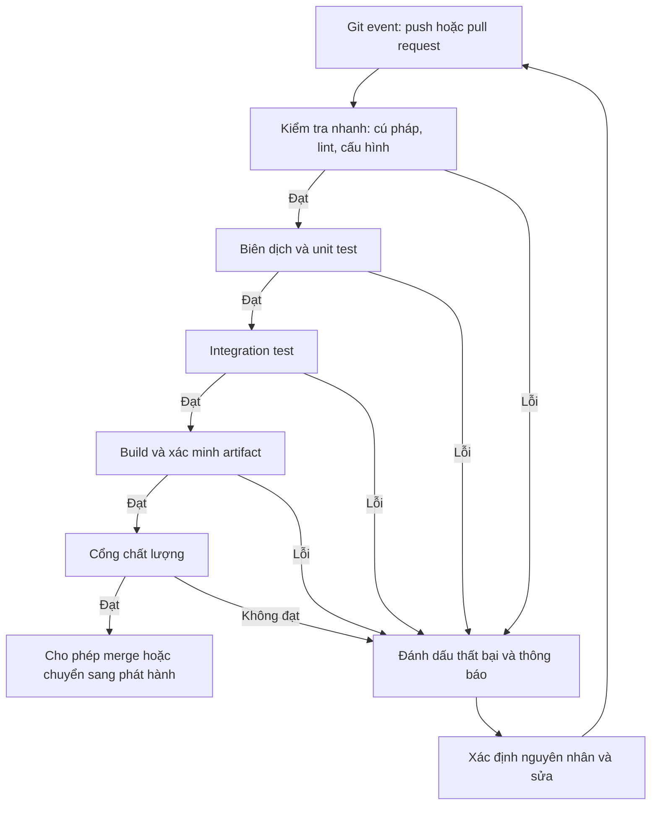

# Phát hiện lỗi sớm và ưu tiên sửa luồng tích hợp bị hỏng

Trong CI/CD, một thay đổi chỉ thực sự sẵn sàng để đi tiếp khi hệ thống đã kiểm tra được những điều kiện chất lượng cần thiết. Vì vậy, pipeline phải phát hiện lỗi ngay sau khi thay đổi được đẩy lên Git, cung cấp đủ bằng chứng để tìm nguyên nhân và giúp nhóm khôi phục luồng tích hợp nhanh chóng.

Nguyên lý cốt lõi là **giảm thời gian từ lúc lỗi xuất hiện đến lúc lỗi được phát hiện, rồi giảm thời gian từ lúc phát hiện đến lúc khôi phục**. Khi nhánh chính hoặc một bước kiểm tra bắt buộc bị hỏng, nhóm cần ưu tiên sửa nguyên nhân làm gián đoạn tích hợp trước khi tiếp tục đưa thêm thay đổi vào luồng đó. Một pipeline luôn báo xanh nhưng bỏ qua kiểm thử hoặc che giấu lỗi không phải là pipeline đáng tin cậy.

Nguyên lý này đặc biệt quan trọng trong CI/CD vì luồng phát hành được hình thành từ nhiều phần phụ thuộc nhau: sự kiện Git, mã pipeline, môi trường build, dependency, kiểm thử, artifact, cấu hình triển khai và các cổng chất lượng. Một lỗi nhỏ ở đầu luồng có thể làm sai lệch kết quả ở các bước sau hoặc khiến nhiều nhóm cùng chờ đợi.

## 1. Vì sao cần phát hiện lỗi càng sớm càng tốt?

Một lỗi được phát hiện ngay trong lần chạy CI của pull request thường còn gắn với một thay đổi nhỏ, một tác giả và một tập log cụ thể. Nếu để lỗi đi qua nhiều lần merge, nhiều lần build hoặc tới tận môi trường staging, phạm vi tìm kiếm sẽ rộng hơn: có thể phải xem lại nhiều commit, dependency đã thay đổi, cấu hình môi trường và artifact đã tạo.

Phát hiện sớm đem lại bốn lợi ích thực tế:

- **Giảm chi phí sửa lỗi:** người viết vẫn nhớ ý định và phạm vi thay đổi; nhóm ít phải lần ngược qua nhiều commit.
- **Ngăn lỗi lan rộng:** kiểm tra thất bại có thể chặn merge hoặc chặn phát hành trước khi mã lỗi trở thành nền tảng cho các thay đổi tiếp theo.
- **Giữ phản hồi đáng tin cậy:** kết quả CI cho biết trạng thái của đúng revision đang được xem xét, thay vì một trạng thái cũ hoặc một lần chạy không liên quan.
- **Giảm thời gian chờ của cả nhóm:** một lỗi được thông báo rõ ràng, giao đúng người và xử lý sớm sẽ không giữ các pull request hoặc đợt phát hành phía sau ở trạng thái chờ.

Thời gian phản hồi cũng ảnh hưởng đến chất lượng phản hồi. Nếu một pull request phải chờ hàng giờ mới có kết quả, tác giả có thể đã chuyển sang việc khác. Khi kết quả thất bại xuất hiện, họ phải tải lại ngữ cảnh và tái hiện vấn đề. Một pipeline nhanh, ổn định giúp sửa lỗi khi ngữ cảnh còn mới.

Không phải kiểm tra nào cũng cần chạy ở cùng một thời điểm. Những kiểm tra rẻ và có khả năng phát hiện nhiều lỗi nên chạy sớm; các kiểm tra tốn thời gian hoặc cần môi trường chuyên biệt có thể chạy ở giai đoạn sau. Mục tiêu là phát hiện đủ sớm mà vẫn giữ phản hồi có ý nghĩa.

## 2. Phát hiện lỗi ở những điểm nào trong luồng CI/CD?

Luồng CI thường bắt đầu từ một sự kiện Git như push, mở hoặc cập nhật pull request, tạo tag hay merge vào nhánh chính. Từ sự kiện đó, pipeline thực thi các bước kiểm tra theo một thứ tự đã khai báo bằng mã.

Các lớp kiểm tra thường gặp gồm:

| Điểm kiểm tra | Lỗi có thể phát hiện | Thời điểm phù hợp |
|---|---|---|
| Kiểm tra cấu trúc và cú pháp | YAML sai, cấu hình thiếu, định dạng không hợp lệ, lỗi lint | Ngay khi nhận thay đổi |
| Phân tích tĩnh và kiểm tra dependency | Lỗi quy tắc mã, dependency có lỗ hổng hoặc giấy phép không phù hợp | Sớm trong pull request |
| Biên dịch và unit test | Lỗi kiểu dữ liệu, API không tương thích, logic sai trong đơn vị nhỏ | Mỗi pull request hoặc commit cần tích hợp |
| Integration test | Thành phần không phối hợp được, sai hợp đồng API, lỗi truy cập database hoặc message broker | Sau khi các kiểm tra nhanh vượt qua |
| Build và kiểm tra artifact | Đóng gói thất bại, thiếu file, sai metadata hoặc artifact không thể sử dụng | Trước khi lưu artifact |
| Kiểm thử trên môi trường gần thực tế | Lỗi cấu hình, migration, kết nối dịch vụ và hành vi khi chạy | Trước khi phát hành hoặc triển khai rộng |
| Smoke test sau triển khai | Ứng dụng không khởi động, endpoint chính không hoạt động, cấu hình runtime sai | Ngay sau triển khai |

Một pipeline có thể được hình dung như sau:



Sơ đồ là một cách tổ chức phổ biến, không phải thứ tự bắt buộc cho mọi dự án. Có thể chạy song song các kiểm tra độc lập để rút ngắn thời gian, nhưng một cổng chất lượng chỉ được thông qua khi tất cả điều kiện bắt buộc của nó đã có kết quả hợp lệ.

### Phản hồi nhanh và phản hồi sâu

Nên chia kiểm tra thành hai nhóm để cân bằng tốc độ và độ bao phủ:

- **Phản hồi nhanh:** kiểm tra cú pháp, lint, biên dịch, unit test và các quy tắc cấu hình. Nhóm này nên chạy thường xuyên, có thời gian ngắn và chỉ rõ lỗi.
- **Phản hồi sâu:** integration test, kiểm thử hiệu năng, kiểm thử bảo mật chuyên sâu hoặc xác minh trên môi trường tích hợp. Nhóm này có thể tốn thời gian hơn, nhưng phải hoàn thành trước cổng phát hành tương ứng.

Không được dùng việc chia nhóm để bỏ qua một kiểm tra bắt buộc. Nếu một kiểm tra bảo mật hoặc integration test là điều kiện phát hành, pipeline phải thể hiện rõ điều kiện đó và giữ trạng thái chưa đạt cho đến khi có kết quả.

## 3. Thế nào là một luồng tích hợp bị hỏng?

Một lần chạy CI thất bại chưa chắc có nghĩa nhánh chính đã hỏng. Ví dụ, pull request của một cá nhân có thể thất bại trong khi nhánh chính vẫn xanh. Tuy nhiên, nếu một thay đổi đã được merge khiến pipeline bắt buộc của nhánh chính không thể hoàn tất, nhóm đang có một luồng tích hợp bị hỏng.

Các dấu hiệu thường gặp gồm:

- Build trên nhánh chính không biên dịch hoặc không tạo được artifact.
- Unit test hoặc integration test bắt buộc thất bại sau một lần merge.
- Pipeline không khởi chạy do sai cấu hình, thiếu quyền hoặc mất runner.
- Dependency hoặc dịch vụ dùng trong kiểm thử không sẵn sàng, khiến kết quả không còn đáng tin cậy.
- Cổng chất lượng không nhận được báo cáo cần thiết hoặc báo cáo gắn với sai revision.
- Artifact được tạo nhưng không thể xác minh, tải xuống hoặc sử dụng ở bước kế tiếp.

Nhóm cần phân biệt **lỗi sản phẩm**, **lỗi pipeline** và **lỗi môi trường**. Lỗi sản phẩm xuất phát từ mã ứng dụng hoặc hợp đồng giữa các thành phần. Lỗi pipeline xuất phát từ cấu hình, script, quyền hoặc logic điều phối công việc. Lỗi môi trường có thể đến từ runner, mạng, registry, database kiểm thử hoặc dịch vụ bên ngoài. Cả ba đều có thể làm luồng tích hợp dừng lại, nhưng cách khắc phục khác nhau.

Một lần chạy thất bại do hạ tầng tạm thời vẫn cần được ghi nhận và xử lý. Không nên tự động coi mọi lỗi ngoài mã nguồn là có thể bỏ qua. Nếu không phân loại đúng, nhóm có thể sửa nhầm mã ứng dụng trong khi runner đang lỗi, hoặc liên tục chạy lại một kiểm thử vốn đang phát hiện regression thật.

## 4. Ưu tiên sửa lỗi nào trước?

Khi nhiều lỗi xuất hiện cùng lúc, thứ tự xử lý nên dựa trên mức độ ảnh hưởng đến khả năng tích hợp và phát hành. Câu hỏi đầu tiên là: **lỗi nào đang chặn nhiều người hoặc ngăn nhánh chính tạo ra một kết quả có thể tin cậy?**

| Mức ưu tiên | Tình huống | Hành động phù hợp |
|---|---|---|
| Khẩn cấp | Pipeline bắt buộc của nhánh chính bị hỏng; không thể build hoặc kiểm thử revision mới | Dừng merge thêm vào luồng bị ảnh hưởng, xác định commit hoặc thay đổi gây lỗi và khôi phục pipeline |
| Rất cao | Lỗi chặn nhiều pull request, cổng phát hành hoặc phát hiện rủi ro bảo mật nghiêm trọng | Giao chủ sở hữu rõ ràng, xử lý ngay trong chu kỳ hiện tại và đánh giá phạm vi ảnh hưởng |
| Cao | Một kiểm thử quan trọng hoặc một dịch vụ tích hợp không ổn định, khiến kết quả CI không đáng tin | Khôi phục độ ổn định, tìm nguyên nhân gốc và bảo đảm kiểm thử có thể phát hiện regression |
| Trung bình | Lỗi chỉ ảnh hưởng một nhánh hoặc một kiểm tra không chặn luồng chính | Giao người phụ trách, đặt thời hạn và theo dõi trước khi nó trở thành lỗi chặn |
| Thấp | Cảnh báo chất lượng chưa vi phạm ngưỡng đã thống nhất, không ảnh hưởng khả năng tích hợp hiện tại | Đưa vào backlog có chủ sở hữu và thời điểm xem xét |

Thứ tự trên là hướng dẫn ra quyết định, không thay thế đánh giá rủi ro. Một cảnh báo bảo mật có thể cần ưu tiên khẩn cấp dù pipeline vẫn xanh. Ngược lại, một lỗi chỉ xảy ra trên nhánh thử nghiệm cá nhân có thể được xử lý sau nếu không gây ảnh hưởng tới nhóm.

Khi đánh giá ưu tiên, hãy xem xét đồng thời:

1. **Phạm vi ảnh hưởng:** một người, một nhóm, toàn bộ nhánh chính hay tất cả môi trường phát hành?
2. **Mức độ chặn:** có ngăn merge, build, kiểm thử, tạo artifact hoặc triển khai không?
3. **Rủi ro nếu tiếp tục:** lỗi có thể đi vào sản phẩm, làm sai dữ liệu, lộ bí mật hoặc khiến rollback khó hơn không?
4. **Khả năng khôi phục:** có thể sửa trực tiếp, revert commit gây lỗi, khôi phục runner hay quay về cấu hình đã biết tốt không?
5. **Độ tin cậy của bằng chứng:** lỗi có tái hiện ổn định và gắn với đúng revision không, hay mới chỉ là một lần timeout không rõ nguyên nhân?

### Quy tắc bảo vệ nhánh chính

Nhánh chính nên luôn ở trạng thái có thể tích hợp: mã nguồn có thể build, các kiểm tra bắt buộc có thể chạy và kết quả được gắn với commit cụ thể. Nếu pipeline chính bị đỏ, nhóm nên tạm dừng merge các thay đổi không cần thiết vào luồng đó cho đến khi khôi phục. Việc này giới hạn số commit mới có thể làm phức tạp quá trình tìm lỗi.

Nếu cần tiếp tục công việc khẩn cấp, nhóm phải ghi nhận ngoại lệ, phạm vi ảnh hưởng, người chấp thuận và thời điểm hết hiệu lực. Không nên biến thao tác bỏ qua kiểm tra thành đường đi mặc định. Cổng chất lượng chỉ có ý nghĩa khi mọi ngoại lệ đều minh bạch và có thể truy vết.

## 5. Quy trình xử lý khi pipeline bị hỏng

Một quy trình ngắn, nhất quán giúp nhóm tránh việc nhiều người cùng thử các cách khác nhau mà không chia sẻ bằng chứng.

### Bước 1: Xác định đúng lần chạy và revision

Ghi nhận repository, nhánh, commit SHA, pull request, workflow, job và bước đầu tiên thất bại. Kiểm tra thời điểm bắt đầu, runner, môi trường và các thay đổi vừa được tích hợp. Không chỉ nhìn trạng thái tổng hợp màu đỏ; cần mở log của bước đầu tiên có lỗi thực sự.

Nếu nhiều job phụ thuộc nhau, các job phía sau có thể bị đánh dấu skipped hoặc cancelled. Đó có thể chỉ là hệ quả của một lỗi gốc ở job trước. Ưu tiên tìm lỗi đầu tiên có bằng chứng cụ thể thay vì sửa từng trạng thái bị ảnh hưởng dây chuyền.

### Bước 2: Phân loại nguyên nhân

Đối chiếu thông báo lỗi với loại công việc:

- Lỗi compile hoặc assertion thường hướng tới mã nguồn, dependency hoặc kỳ vọng kiểm thử.
- Lỗi xác thực, permission denied hoặc không tải được artifact thường hướng tới quyền, token, registry hoặc cấu hình kết nối.
- Timeout, mất kết nối hoặc runner không sẵn sàng thường hướng tới môi trường; cần kiểm tra xem có thể tái hiện độc lập hay không.
- Một test lúc đạt lúc thất bại với cùng revision thường là dấu hiệu kiểm thử không ổn định, chia sẻ trạng thái hoặc phụ thuộc thời gian.

Phân loại là giả thuyết ban đầu. Cần xác minh bằng log, so sánh với lần chạy thành công gần nhất và thử tái hiện có kiểm soát.

### Bước 3: Chọn cách khôi phục ít rủi ro nhất

Nếu một commit mới gây regression và chưa có thay đổi phụ thuộc, revert có thể khôi phục nhánh chính nhanh hơn một bản sửa phức tạp. Nếu lỗi nằm trong workflow, sửa mã pipeline và kiểm tra trên nhánh phù hợp. Nếu runner hoặc dịch vụ ngoài bị gián đoạn, khôi phục dịch vụ rồi chạy lại đúng revision.

Không nên chọn cách sửa chỉ để làm cho trạng thái chuyển sang xanh. Ví dụ, xóa một test đang thất bại có thể che mất regression. Tắt cổng chất lượng có thể cho phép artifact lỗi đi tiếp. Một giải pháp khôi phục đúng phải đưa hệ thống về trạng thái có bằng chứng đáng tin cậy.

### Bước 4: Giao quyền sở hữu và truyền đạt trạng thái

Mỗi lỗi cần có một người hoặc một nhóm chịu trách nhiệm điều phối. Thông báo nên có liên kết tới lần chạy, commit, bước lỗi, mức độ ảnh hưởng, người phụ trách và cập nhật tiếp theo. Tránh chỉ gửi thông báo chung như “CI đỏ” mà không kèm dữ liệu để hành động.

Nếu nguyên nhân thuộc dịch vụ dùng chung, chủ sở hữu dịch vụ cần được gọi vào sớm. Nếu nguyên nhân nằm trong một pull request, tác giả cần nhận được log và bước tái hiện. Người điều phối vẫn theo dõi trạng thái tổng thể cho đến khi nhánh chính được khôi phục.

### Bước 5: Xác minh trên đúng revision và đóng sự cố

Sau khi sửa, chạy lại các kiểm tra liên quan và toàn bộ cổng bắt buộc. Xác minh rằng kết quả gắn với commit mới, artifact được tạo đúng và bước kế tiếp có thể sử dụng artifact đó. Nếu đã revert, cũng cần xác nhận pipeline của revision sau revert chạy thành công.

Sau khi luồng tích hợp hoạt động trở lại, ghi lại nguyên nhân gốc, cách phát hiện, cách khôi phục và hành động ngăn tái diễn. Nếu sự cố chỉ được xử lý bằng một workaround, phải ghi rõ giới hạn và việc còn lại cần hoàn thành.

## 6. Thiết kế pipeline để phản hồi nhanh và đáng tin cậy

### Chạy kiểm tra nhanh trước

Đặt các bước có thời gian chạy ngắn và khả năng bắt lỗi cao ở đầu luồng. Ví dụ, kiểm tra cấu trúc workflow và lint trước khi chạy bộ integration test lớn. Các kiểm tra độc lập có thể chạy song song, nhưng nên giữ quan hệ phụ thuộc rõ ràng để người đọc biết vì sao một job được phép bắt đầu.

Không phải lúc nào chạy song song cũng nhanh hơn. Nếu nhiều job cùng tranh chấp một database kiểm thử hoặc runner có giới hạn, thời gian tổng thể có thể tăng và kết quả trở nên không ổn định. Cần đo thời gian chờ runner, thời gian thực thi và tài nguyên thực tế để điều chỉnh.

### Giữ kiểm thử ổn định

Một kiểm thử chỉ có giá trị khi kết quả của nó có thể tin cậy. Hãy cô lập dữ liệu, dọn trạng thái sau mỗi lần chạy, tránh phụ thuộc thứ tự test, kiểm soát đồng hồ và sử dụng dependency giả lập khi phù hợp. Với integration test, tạo môi trường riêng hoặc namespace riêng để các lần chạy không ghi đè dữ liệu của nhau.

Nếu test flaky chưa thể sửa ngay, cần đánh dấu rõ, tạo công việc khắc phục có chủ sở hữu và thời hạn. Chỉ cách ly test khỏi cổng chặn khi nhóm đã đánh giá rủi ro, có biện pháp kiểm soát thay thế và có thời điểm đưa test trở lại. Retry có giới hạn có thể giúp phân biệt lỗi hạ tầng thoáng qua, nhưng không được dùng để biến một test không ổn định thành trạng thái xanh giả tạo.

### Giữ pipeline dưới dạng mã

Workflow cần được review và quản lý phiên bản cùng mã nguồn. Thay đổi pipeline nên có kiểm tra cú pháp, quyền tối thiểu và lịch sử thay đổi. Dùng phiên bản action hoặc image đã kiểm soát; với môi trường yêu cầu mức bảo đảm cao, có thể pin action theo commit SHA và cập nhật qua quy trình review.

Ví dụ dưới đây minh họa một workflow GitHub Actions tối giản cho dự án Gradle. Workflow chạy kiểm tra khi có pull request hoặc push vào `main`, sau đó tạo và lưu artifact khi toàn bộ bước kiểm tra thành công:

```yaml
name: CI

on:
  pull_request:
  push:
    branches: [main]

permissions:
  contents: read

jobs:
  verify:
    runs-on: ubuntu-latest
    timeout-minutes: 20
    steps:
      - name: Checkout source
        uses: actions/checkout@v4

      - name: Set up Java
        uses: actions/setup-java@v4
        with:
          distribution: temurin
          java-version: '21'

      - name: Set up Gradle
        uses: gradle/actions/setup-gradle@v4

      - name: Verify and package
        run: ./gradlew --no-daemon clean check assemble

      - name: Store build artifact
        if: success()
        uses: actions/upload-artifact@v4
        with:
          name: application-${{ github.sha }}
          path: build/libs/*.jar
          if-no-files-found: error
          retention-days: 14
```

Trong ví dụ này, `check` chạy các kiểm tra được cấu hình trong dự án Gradle; `assemble` tạo đầu ra đóng gói. Hai task nằm trong cùng một lần gọi Gradle nên các đầu ra trung gian có thể được dùng chung trong cùng task graph. Bước upload chỉ chạy sau khi lệnh verify và package thành công. Tên artifact chứa commit SHA để dễ liên hệ với revision tạo ra nó.

Đây là ví dụ nền tảng, không phải cấu hình hoàn chỉnh cho mọi ứng dụng. Dự án cần bổ sung các kiểm tra, quyền, phiên bản Java, đường dẫn artifact và chính sách lưu trữ phù hợp. Nếu artifact được đưa qua staging rồi production, nên giữ nguyên artifact đã xác minh và thăng cấp chính artifact đó giữa các môi trường; không build lại một gói khác cho mỗi môi trường.

### Dùng cổng chất lượng và bảo vệ nhánh

Thiết lập các status check bắt buộc trong chính sách bảo vệ nhánh. Pull request chỉ được merge khi những kiểm tra đã thống nhất hoàn thành trên revision phù hợp. Cần đặt tên check ổn định và bảo đảm workflow thực sự chạy trên các loại thay đổi liên quan; một check không được kích hoạt có thể khiến trạng thái chờ kéo dài hoặc làm chính sách bảo vệ nhánh khó hiểu.

Các điều kiện nên được phân biệt rõ:

- **Điều kiện bắt buộc:** phải đạt trước merge hoặc phát hành.
- **Cảnh báo:** cung cấp thông tin để nhóm theo dõi, chưa chặn luồng.
- **Ngoại lệ có kiểm soát:** chỉ áp dụng khi có người chịu trách nhiệm, lý do, phạm vi và thời hạn.

Không nên biến mọi cảnh báo thành cổng chặn. Quá nhiều cảnh báo không liên quan làm người dùng mất tập trung và dễ bỏ qua tín hiệu quan trọng. Ngược lại, điều kiện bắt buộc phải được thực thi nhất quán ở đúng điểm kiểm soát.

### Bảo vệ bí mật và khả năng truy vết

Log phải đủ chi tiết để chẩn đoán nhưng không được in token, mật khẩu, private key hoặc dữ liệu nhạy cảm. Cấp quyền tối thiểu cho job, dùng secret store phù hợp và giới hạn secret theo môi trường hoặc phạm vi workflow. Nếu nghi ngờ bí mật đã xuất hiện trong log, cần xử lý như một sự cố lộ bí mật: thu hồi hoặc xoay vòng thông tin xác thực và xem xét phạm vi truy cập.

Mỗi lần chạy nên liên kết được với commit SHA, người hoặc sự kiện kích hoạt, phiên bản workflow, môi trường và artifact tạo ra. Khả năng truy vết này giúp nhóm xác định chính xác lần chạy nào tạo ra gói đang được kiểm thử hoặc triển khai.

## 7. Tránh những cách xử lý làm mất tín hiệu lỗi

Một số cách làm có vẻ giúp pipeline xanh nhanh nhưng khiến chất lượng tích hợp suy giảm:

- **Merge khi check bắt buộc đang đỏ:** làm lỗi lan vào nhánh chính và khiến các commit sau khó xác định nguyên nhân.
- **Tắt test hoặc cổng chất lượng để giải phóng hàng chờ:** loại bỏ bằng chứng cần thiết và có thể cho phép regression đi tiếp.
- **Retry vô hạn:** kéo dài thời gian phản hồi, tiêu tốn runner và che khuất test không ổn định.
- **Chỉ xem trạng thái tổng hợp:** bỏ qua lỗi gốc ở bước đầu tiên và dẫn tới sửa nhầm các job bị ảnh hưởng dây chuyền.
- **Dùng artifact không gắn với revision:** khiến nhóm không biết gói nào đã được kiểm thử và gói nào đang được phát hành.
- **Không có chủ sở hữu:** lỗi tồn tại qua nhiều lần chạy vì mọi người đều nghĩ người khác đang xử lý.
- **Thông báo quá nhiều nhưng thiếu ngữ cảnh:** tạo nhiễu mà không giúp người nhận xác định hành động tiếp theo.

Nếu phải dùng workaround để khôi phục dịch vụ, hãy ghi nhận rõ workaround đó, người chấp thuận, thời điểm hết hạn và bước xác minh cần hoàn tất. Khi nguyên nhân gốc đã được sửa, cần khôi phục lại các kiểm tra hoặc cổng chất lượng đã tạm thời thay đổi.

## 8. Đo lường hiệu quả phát hiện và khôi phục lỗi

Không nên chỉ đo tỷ lệ pipeline thành công. Một tỷ lệ xanh cao có thể đến từ kiểm thử tốt, nhưng cũng có thể do nhóm đã tắt những kiểm tra thường thất bại. Hãy kết hợp nhiều chỉ số:

| Chỉ số | Ý nghĩa | Cách sử dụng |
|---|---|---|
| Thời gian từ commit đến kết quả CI | Tốc độ phản hồi cho người tạo thay đổi | Tách thời gian chờ runner khỏi thời gian chạy để tìm nút thắt |
| Tỷ lệ pipeline thất bại theo nguyên nhân | Mức độ ổn định của mã, workflow và môi trường | Phân nhóm lỗi thay vì chỉ nhìn một tỷ lệ tổng |
| Tỷ lệ test flaky | Mức độ tin cậy của bộ kiểm thử | Theo dõi test tái diễn và ưu tiên sửa test gây nhiễu |
| Thời gian khôi phục nhánh chính | Thời gian từ lúc mainline bị hỏng đến khi luồng tích hợp trở lại bình thường | Đánh giá khả năng phản ứng và chất lượng quy trình xử lý |
| Số lần merge khi cổng bắt buộc chưa đạt | Mức độ tuân thủ chính sách tích hợp | Tìm ngoại lệ không được kiểm soát |
| Tỷ lệ lỗi lọt qua từng cổng | Khả năng phát hiện của các lớp kiểm tra | Bổ sung kiểm tra tại điểm có thể phát hiện sớm hơn |

Đọc các chỉ số theo xu hướng và theo loại dự án. Một pipeline có thêm integration test có thể chạy lâu hơn nhưng giảm lỗi lọt tới môi trường sau. Mục tiêu không phải tối thiểu hóa mọi phút chạy CI; mục tiêu là cung cấp phản hồi đủ nhanh, đủ chính xác để giảm tổng thời gian chờ và rủi ro.

## 9. Ví dụ: một commit làm hỏng nhánh chính

Giả sử nhóm merge một pull request thay đổi cách xử lý dữ liệu đơn hàng. Sau merge, job unit test trên `main` thất bại; các job đóng gói và kiểm tra artifact bị bỏ qua vì phụ thuộc vào job test.

Nhóm xử lý theo trình tự:

1. Mở lần chạy CI gắn với commit merge và tìm assertion thất bại đầu tiên.
2. So sánh thay đổi vừa merge với lần chạy thành công gần nhất; tái hiện test trên đúng revision.
3. Xác định lỗi do thay đổi logic chuyển trạng thái đơn hàng, không phải do runner.
4. Tạm dừng merge các thay đổi không khẩn cấp vào `main`; giao tác giả và người phụ trách module cùng xử lý.
5. Nếu bản sửa nhỏ và có thể xác minh nhanh, tạo commit sửa lỗi. Nếu chưa thể sửa an toàn, revert commit gây lỗi để khôi phục mainline.
6. Chạy lại toàn bộ cổng bắt buộc trên revision mới, xác nhận build và artifact thành công.
7. Ghi lại nguyên nhân và bổ sung trường hợp kiểm thử để ngăn lỗi tương tự tái diễn.

Điểm quan trọng là nhóm xử lý lỗi ở nơi nó xuất hiện, dùng đúng revision làm bằng chứng và xác minh cả luồng sau khi sửa. Chỉ nhìn thấy một lần chạy xanh sau khi retry mà không hiểu vì sao lần trước thất bại là chưa đủ để kết luận sự cố đã được giải quyết.

## 10. Checklist vận hành

Khi thiết kế hoặc rà soát một luồng CI/CD, hãy kiểm tra các câu hỏi sau:

- [ ] Mọi push hoặc pull request quan trọng đều kích hoạt đúng workflow.
- [ ] Các kiểm tra nhanh chạy sớm và có log đủ rõ để xác định bước lỗi.
- [ ] Những kiểm tra bắt buộc được khai báo thành status check hoặc cổng chất lượng rõ ràng.
- [ ] Nhánh chính có cơ chế ngăn merge khi cổng bắt buộc chưa đạt.
- [ ] Nhóm phân biệt được lỗi mã nguồn, lỗi pipeline, lỗi môi trường và test không ổn định.
- [ ] Mỗi lỗi chặn luồng có chủ sở hữu và cập nhật trạng thái.
- [ ] Retry có giới hạn và không che giấu regression.
- [ ] Artifact gắn với commit SHA và có thể truy vết qua các môi trường.
- [ ] Log không làm lộ bí mật; quyền của job được giới hạn phù hợp.
- [ ] Sau khi sửa hoặc revert, toàn bộ kiểm tra bắt buộc được xác minh trên revision mới.
- [ ] Ngoại lệ tạm thời có lý do, người chấp thuận và thời hạn khôi phục.
- [ ] Nhóm theo dõi thời gian phản hồi, độ ổn định của test và thời gian khôi phục mainline.

Phát hiện lỗi sớm chỉ có tác dụng khi kết quả dẫn tới hành động cụ thể. Một pipeline tốt báo lỗi nhanh, chỉ ra bằng chứng, chặn đúng điểm cần chặn và giúp nhóm khôi phục luồng tích hợp có kiểm soát. Khi nhánh chính được giữ ở trạng thái có thể build và kiểm thử, các bước quản lý artifact, môi trường, phát hành và quay lui phía sau cũng có một nền tảng đáng tin cậy hơn.
