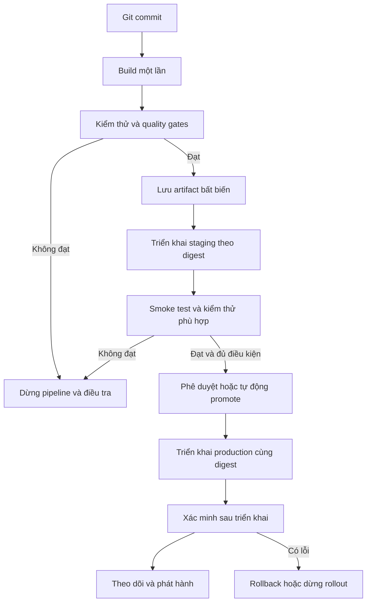

# Dựng một lần và sử dụng cùng artifact qua các môi trường

Một nguyên lý quan trọng khi thiết kế CI/CD là **build một lần, sau đó promote cùng artifact qua các môi trường**. Nghĩa là pipeline tạo ra sản phẩm phần mềm từ một revision mã nguồn, lưu sản phẩm đó với định danh bất biến, rồi đưa chính sản phẩm ấy qua các bước kiểm thử và triển khai ở development, staging, production hoặc các môi trường tương ứng.

Nguyên lý này tạo ra một mối liên hệ có thể kiểm chứng giữa thứ đã được kiểm thử và thứ đang chạy. Nếu staging đã xác minh image có digest `sha256:...`, production cũng cần triển khai image có đúng digest đó. Nhóm không phải phỏng đoán liệu lần build ở production có tạo ra một binary hơi khác so với binary đã được kiểm tra hay không.

Trong module CI/CD, nguyên lý này kết nối pipeline dưới dạng mã, build và kiểm thử tự động, quản lý artifact, cấu hình môi trường, cổng chất lượng, bảo vệ bí mật và quy trình phát hành. Mục tiêu không chỉ là giảm thời gian build; mục tiêu là bảo đảm tính nhất quán, khả năng truy vết và độ tin cậy của luồng đưa phần mềm đến người dùng.

## 1. Artifact là đơn vị được promote

Mã nguồn là đầu vào của quá trình build. Artifact là đầu ra cụ thể được tạo ra và lưu trữ để những bước sau sử dụng. Tùy kiến trúc, artifact có thể là:

- Tệp JAR hoặc WAR của ứng dụng Java.
- Image container được lưu trong container registry.
- Gói thư viện, package hoặc binary đã biên dịch.
- Bundle frontend, gói cài đặt hoặc một tập hợp tài nguyên đã đóng gói.

Artifact phải có định danh đủ chính xác để phân biệt nội dung của nó với những bản khác. Với image container, digest là định danh nội dung phù hợp. Với package hoặc tệp nhị phân, có thể dùng checksum như SHA-256. Tag phiên bản như `1.4.0` có ích cho con người, nhưng tag ở một số registry có thể được di chuyển hoặc ghi đè; vì vậy tag không thay thế được digest hoặc checksum khi cần xác định chính xác nội dung.

Một artifact có thể đi kèm metadata và bằng chứng như:

| Thông tin | Mục đích |
|---|---|
| Commit SHA | Xác định revision mã nguồn tạo ra artifact |
| Phiên bản và lần chạy pipeline | Tra cứu ngữ cảnh build và lịch sử xử lý |
| Digest hoặc checksum | Xác minh nội dung artifact không thay đổi |
| Build provenance | Ghi nhận nguồn, quy trình và công cụ đã tạo artifact |
| SBOM | Liệt kê thành phần và phụ thuộc có trong sản phẩm |
| Chữ ký và attestation | Hỗ trợ xác minh nguồn gốc, tính toàn vẹn và các tuyên bố kiểm tra |

Các thông tin này nên được lưu cùng artifact hoặc liên kết bằng định danh rõ ràng trong artifact repository. Khi cần điều tra, nhóm có thể đi từ phiên bản đang chạy về digest, pipeline run và commit nguồn tương ứng.

## 2. Build một lần nghĩa là gì?

Với một revision và một tập đầu vào build đã xác định, pipeline tạo artifact một lần trong luồng phát hành đó. Đầu vào cần được kiểm soát gồm mã nguồn, dependency, phiên bản compiler hoặc build tool, base image và các công cụ đóng gói. Kết quả được lưu vào kho artifact có quyền truy cập và chính sách lưu giữ phù hợp.

Sau khi lưu, các môi trường dùng lại artifact đã lưu. Bước triển khai có thể thay đổi manifest, tham số runtime, cấu hình mạng hoặc số lượng replica theo môi trường; những thay đổi đó không được âm thầm thay đổi nội dung ứng dụng đã build. Khi staging và production tham chiếu cùng digest, ta có bằng chứng rằng chúng dùng cùng nội dung image.

Ví dụ với dịch vụ Java:

1. Commit `4f2a9c1` được pipeline checkout.
2. Gradle biên dịch và đóng gói ứng dụng thành `orders-service.jar`.
3. Pipeline chạy kiểm tra, đóng gói JAR vào image và push image lên registry.
4. Registry trả về digest của image. Pipeline lưu digest cùng commit và kết quả kiểm tra.
5. Staging triển khai image theo digest đó và chạy smoke test.
6. Sau khi qua cổng chất lượng và phê duyệt cần thiết, production triển khai lại đúng digest đó.

Nếu production cần một phiên bản khác, đó là một thay đổi mới: tạo artifact mới, kiểm tra artifact mới và ghi nhận quan hệ giữa phiên bản cũ với phiên bản mới. Không chỉnh sửa thủ công artifact đã được kiểm tra rồi tiếp tục gọi nó là cùng một sản phẩm.

## 3. Vì sao không build lại ở từng môi trường?

Giả sử pipeline build một lần cho staging rồi chạy lại lệnh build khi triển khai production. Dù commit không đổi, đầu ra vẫn có thể khác vì:

- Dependency được tải từ repository có phiên bản động hoặc nội dung đã thay đổi.
- Phiên bản JDK, Gradle, compiler, plugin hoặc base image khác nhau.
- Build script phụ thuộc thời gian, dữ liệu bên ngoài hoặc trạng thái máy chạy.
- Cache, biến môi trường lúc build hoặc tham số đóng gói làm thay đổi đầu ra.
- Một tag image có thể trỏ đến nội dung mới sau khi lần build trước đã hoàn tất.

Khi đó, kết quả staging không còn là bằng chứng trực tiếp cho binary production. Nếu production phát sinh lỗi, nhóm phải xác định cả thay đổi mã nguồn lẫn khác biệt giữa hai lần build.

| Cách làm | Điều được kiểm soát | Rủi ro chính |
|---|---|---|
| Build riêng cho từng môi trường | Mỗi môi trường tự tạo đầu ra từ mã nguồn | Đầu ra có thể khác nhau dù commit giống nhau |
| Build một lần, promote artifact | Các môi trường nhận cùng artifact đã định danh | Cần quản lý artifact, cấu hình và quyền promote chặt chẽ |

Build một lần không tự động làm build có tính tái lập. **Reproducible build** là khả năng tạo lại cùng nội dung từ cùng đầu vào đã kiểm soát. **Build once, promote** là quy tắc vận hành: dùng lại artifact đã tạo thay vì tạo artifact mới ở mỗi môi trường. Hai nguyên lý bổ trợ nhau. Một quy trình có thể promote cùng artifact dù chưa đạt reproducible build hoàn toàn; đồng thời reproducible build vẫn hữu ích để xác minh độc lập nguồn gốc khi cần.

## 4. Luồng promote qua các môi trường

Một luồng tham khảo có thể tổ chức như sau:



Mỗi lần chuyển môi trường là một quyết định promote artifact đã có, kèm điều kiện và bằng chứng tương ứng. Ví dụ, staging chỉ được nhận artifact khi unit test và kiểm tra bảo mật đã đạt. Production chỉ được nhận artifact khi staging smoke test đạt, phê duyệt đã hoàn tất nếu chính sách yêu cầu và chữ ký hoặc provenance đã được xác minh.

Pipeline as code giúp mô tả rõ các quan hệ phụ thuộc này. Đoạn dưới đây là mã giả độc lập với nhà cung cấp CI/CD:

```yaml
pipeline:
  build_and_verify:
    trigger: commit
    steps:
      - checkout_exact_commit
      - resolve_locked_dependencies
      - build_application
      - run_unit_and_static_checks
      - package_application
      - create_digest_signature_and_provenance
      - publish_immutable_artifact

  staging:
    needs: build_and_verify
    artifact: published_artifact_digest
    steps:
      - deploy_artifact_by_digest
      - run_smoke_and_integration_checks
      - record_test_evidence

  production:
    needs: staging
    artifact: published_artifact_digest
    steps:
      - verify_signature_and_provenance
      - require_approval_when_policy_demands
      - deploy_artifact_by_the_same_digest
      - verify_health_and_observe_metrics
```

Điểm cốt lõi của ví dụ là `staging` và `production` cùng nhận `published_artifact_digest`. Pipeline không gọi build thêm lần nữa ở hai job triển khai. Các manifest triển khai của staging và production có thể khác nhau, nhưng tham chiếu đến cùng một artifact ứng dụng.

## 5. Tách artifact khỏi cấu hình môi trường

Để dùng cùng artifact ở nhiều môi trường, cấu hình cần được cung cấp bên ngoài nội dung build. Các giá trị thường khác nhau giữa development, staging và production gồm:

- URL hoặc địa chỉ của database, message broker và dịch vụ phụ trợ.
- Tên miền, endpoint tích hợp và thông tin định tuyến.
- Số replica, giới hạn CPU/bộ nhớ và chính sách autoscaling.
- Mức log, ngưỡng cảnh báo và tham số vận hành.
- Thông tin xác thực hoặc token truy cập dịch vụ.

Ứng dụng có thể nhận cấu hình qua environment variables, file cấu hình được mount, ConfigMap hoặc hệ thống quản lý cấu hình. Bí mật như mật khẩu database, private key và token cần được cấp từ secret manager hoặc cơ chế danh tính của nền tảng vào thời điểm triển khai hoặc runtime. Không ghi bí mật vào source code, image, artifact, manifest công khai hay log pipeline.

Phân biệt **build-time configuration** và **runtime configuration** rất quan trọng. Build-time configuration được nhúng vào sản phẩm trong lúc đóng gói; nếu URL production được biên dịch cứng vào frontend bundle, cùng bundle đó khó có thể dùng nguyên vẹn ở staging. Runtime configuration được đọc khi ứng dụng chạy hoặc khi triển khai, nên cùng artifact có thể nhận giá trị phù hợp ở từng môi trường.

Không phải mọi cấu hình đều có thể chuyển sang runtime. Một số framework frontend hoặc hệ thống tạo mã cần giá trị tại build time. Khi đó, cần thiết kế đầu ra theo cách hỗ trợ cấu hình bên ngoài nếu muốn promote cùng artifact; nếu không thể, phải xác định rõ từng biến thể là artifact riêng, được build, kiểm tra và truy vết như một sản phẩm riêng. Không nên tạo khác biệt ngầm mà vẫn tuyên bố các môi trường dùng cùng artifact.

Ví dụ, cùng image `orders-service@sha256:abc...` có thể chạy ở staging với `DB_URL` trỏ đến database staging và ở production với `DB_URL` trỏ đến database production. Image không chứa mật khẩu hay URL cố định. Deployment manifest của hai môi trường cung cấp cấu hình và secret tương ứng.

## 6. Quản lý artifact bất biến và truy vết

Artifact repository hoặc container registry là nơi lưu trữ đầu ra đã được xác minh. Để hỗ trợ promote an toàn, cần có các quy tắc sau:

1. **Không ghi đè nội dung đã phát hành:** bật immutable tag hoặc chính sách tương đương nếu registry hỗ trợ; khi có build mới, tạo phiên bản mới.
2. **Triển khai bằng định danh nội dung:** dùng digest hoặc checksum đã ghi nhận, không chỉ dùng tag có thể thay đổi.
3. **Lưu metadata cùng artifact:** ghi commit, pipeline run, toolchain, dependency lock và thông tin build cần thiết.
4. **Giữ bằng chứng kiểm tra:** liên kết test report, scan report, SBOM, chữ ký và attestation với đúng digest.
5. **Quản lý vòng đời:** đặt chính sách retention để artifact còn tồn tại đủ lâu cho triển khai, điều tra và rollback; giới hạn quyền xóa hoặc thay thế.

Khi triển khai, hệ thống có thể ghi lại digest thực tế được runtime kéo về hoặc đang chạy. Đối chiếu digest mong muốn trong manifest với digest thực tế giúp phát hiện trường hợp môi trường chạy nhầm phiên bản, tag bị di chuyển hoặc quá trình cập nhật chưa hoàn tất.

Truy vết cũng cần đi theo chiều ngược lại. Từ một commit, nhóm cần tìm được artifact được tạo ra, các lần promote, môi trường đã nhận artifact, kết quả kiểm tra và ai đã phê duyệt hành động production. Từ một instance đang chạy, nhóm cần truy về được digest, commit và lần build. Đây là cơ sở để kiểm toán, phân tích sự cố và xác định phạm vi ảnh hưởng khi có lỗ hổng dependency.

## 7. Bảo vệ chuỗi cung ứng và quyền promote

Vì artifact được dùng xuyên nhiều môi trường, bảo vệ tính toàn vẹn của artifact và đường đi của nó là yêu cầu quan trọng.

- Chỉ pipeline hoặc danh tính build được cấp quyền publish artifact vào repository.
- Job triển khai chỉ có quyền đọc artifact cần thiết; không cấp quyền ghi đè tùy tiện.
- Dùng credential ngắn hạn hoặc workload identity khi nền tảng hỗ trợ; tránh lưu token dài hạn trong repository.
- Ký artifact hoặc tạo chữ ký/attestation gắn với digest; xác minh trước khi triển khai môi trường nhạy cảm.
- Kiểm tra dependency, image và SBOM theo chính sách bảo mật đã đặt ra.
- Giới hạn quyền promote production, yêu cầu phê duyệt khi cần và ghi lại người hoặc quy trình thực hiện.
- Không để dữ liệu bí mật trong log, artifact hoặc bằng chứng build được chia sẻ rộng rãi.

Chữ ký chỉ có giá trị khi bên triển khai kiểm tra chữ ký và tin cậy đúng danh tính ký. Tương tự, provenance chỉ hữu ích khi nội dung của nó được xác minh theo chính sách, thay vì chỉ tồn tại như một tệp đính kèm. Các kiểm tra này giúp giảm nguy cơ artifact bị thay thế giữa build và deploy.

## 8. Kiểm thử artifact ở các môi trường

Không phải mọi kiểm tra đều cần chờ artifact được triển khai. Unit test, formatter và static analysis thường chạy sớm trên mã nguồn. Sau khi build, pipeline có thể kiểm tra package, quét dependency và xác minh metadata. Khi triển khai staging, nhóm kiểm tra artifact trong môi trường gần với production hơn.

Các kiểm tra sau deploy có thể gồm:

- Smoke test để xác nhận tiến trình khởi động và các endpoint thiết yếu hoạt động.
- Integration hoặc contract test với dịch vụ phụ trợ và hệ thống liên quan.
- Kiểm tra migration, tương thích schema và khả năng chạy đồng thời phiên bản cũ/mới.
- Kiểm tra tải hoặc hiệu năng khi thay đổi có rủi ro về tài nguyên.
- Xác minh metric, log, trace và cảnh báo trong khoảng thời gian quan sát.

Kết quả test phải gắn với digest đã kiểm tra. Nếu staging kiểm tra `sha256:abc...` nhưng production lại deploy `sha256:def...`, test evidence của staging không chứng minh cho artifact production. Đây là lý do định danh artifact cần được truyền xuyên suốt pipeline thay vì tra cứu lại theo một tag chung.

## 9. Xử lý ngoại lệ và rollback

Nguyên lý build once, promote không có nghĩa một artifact duy nhất phù hợp với mọi nền tảng và mọi kiến trúc. Nếu phải tạo binary riêng cho từng hệ điều hành, kiến trúc CPU hoặc biến thể sản phẩm, mỗi đầu ra là một artifact có định danh riêng. Mỗi artifact cần được kiểm tra và promote đúng theo luồng của nó. Với image đa kiến trúc, cần giữ định danh manifest list và xác minh nền tảng runtime nhận được biến thể dự kiến.

Một số thay đổi như vá lỗi, nâng dependency hoặc sửa cấu hình build làm thay đổi nội dung sản phẩm. Khi đó phải tạo artifact mới và chạy lại các kiểm tra phù hợp; không được sửa artifact cũ tại chỗ. Nếu chỉ thay đổi cấu hình runtime hoặc số replica, có thể cập nhật cấu hình triển khai mà không build lại ứng dụng, miễn là thay đổi đó không làm biến đổi artifact.

Rollback thường là promote lại artifact ổn định trước đó bằng digest đã lưu. Trước khi rollback, cần xem xét tương thích database và trạng thái dữ liệu. Migration phá vỡ tương thích có thể khiến phiên bản cũ không chạy được; chiến lược expand-and-contract và các bước chuyển đổi dữ liệu có kiểm soát giúp giữ khả năng quay lui. Với canary hoặc blue-green, có thể chuyển lưu lượng về nhóm phiên bản ổn định nếu health check, tỷ lệ lỗi hoặc metric vượt ngưỡng dừng.

Sau rollback, ghi nhận artifact bị lỗi, digest ổn định, commit liên quan, môi trường, thời điểm, người phê duyệt và tín hiệu quan sát. Bằng chứng này giúp nhóm tái hiện vấn đề và bổ sung quality gate phù hợp.

## 10. Checklist áp dụng nguyên lý

Trước khi đưa một luồng CI/CD vào sử dụng, hãy kiểm tra các câu hỏi sau:

- [ ] Pipeline tạo artifact từ một commit xác định và khóa phiên bản dependency/toolchain cần thiết.
- [ ] Artifact được lưu trong repository hoặc registry có kiểm soát quyền và vòng đời.
- [ ] Mỗi artifact có digest/checksum, commit SHA và pipeline run để truy vết.
- [ ] Các môi trường tham chiếu cùng digest khi promote cùng một sản phẩm.
- [ ] Staging test đúng artifact dự kiến đưa lên production và lưu kết quả gắn với digest.
- [ ] Cấu hình môi trường và bí mật được cấp bên ngoài artifact theo quyền tối thiểu.
- [ ] Chữ ký, provenance và các cổng chất lượng được xác minh theo chính sách.
- [ ] Production có bước phê duyệt, xác minh sau triển khai và theo dõi đủ để dừng rollout.
- [ ] Artifact ổn định trước đó còn sẵn sàng để rollback và database có kế hoạch tương thích.

Khi một artifact được tạo, định danh, kiểm tra và lưu trữ rõ ràng, các môi trường chỉ cần promote sản phẩm đó cùng cấu hình phù hợp. Nhờ vậy, nhóm có thể chứng minh production đang chạy đúng thứ đã được kiểm tra, truy vết nhanh khi có sự cố và đưa ra quyết định phát hành dựa trên bằng chứng thay vì dựa vào giả định.
