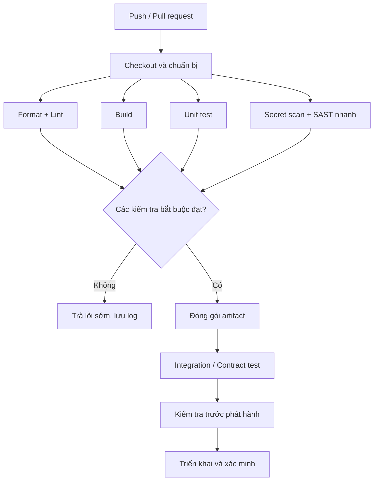

# Thiết kế kiểm tra theo rủi ro và thời gian phản hồi

## 1. Nguyên lý: kiểm tra đúng rủi ro, trả kết quả đúng lúc

Một pipeline CI/CD cần đủ kiểm tra để phát hiện những lỗi có thể gây ảnh hưởng đến người dùng, dữ liệu hoặc hoạt động vận hành. Tuy nhiên, thời gian chạy pipeline cũng là một phần của chất lượng quy trình. Nếu mọi thay đổi đều phải chờ hàng chục phút để nhận kết quả từ những bài kiểm tra không liên quan, lập trình viên sẽ mất ngữ cảnh, hàng đợi review kéo dài và tốc độ tích hợp giảm.

Thiết kế kiểm tra theo rủi ro và thời gian phản hồi là cách tổ chức bộ kiểm thử sao cho:

- Mỗi thay đổi được kiểm tra bằng các bài test phù hợp với phạm vi và mức độ ảnh hưởng của nó.
- Những lỗi nghiêm trọng có khả năng xảy ra được phát hiện càng sớm càng tốt.
- Các kiểm tra nhanh bảo vệ vòng phản hồi hằng ngày; kiểm tra sâu hơn chạy ở giai đoạn thích hợp.
- Kết quả thất bại có thể hiểu, truy nguyên và xử lý, thay vì chỉ trả về một dấu X màu đỏ.
- Chi phí thực thi, thời gian chờ và độ tin cậy của test được đo lường để cải tiến liên tục.

Nguyên lý này đặc biệt quan trọng trong CI/CD vì pipeline được kích hoạt thường xuyên từ sự kiện Git. Một thay đổi nhỏ trên pull request cần phản hồi nhanh để người viết sửa ngay; một thay đổi ảnh hưởng đến schema dữ liệu, xác thực hoặc tính toán tiền cần bộ kiểm tra sâu hơn trước khi phát hành. Cùng một bộ test chạy ở mọi thời điểm có thể vừa lãng phí thời gian ở thay đổi ít rủi ro, vừa bỏ sót các kiểm tra chuyên biệt ở thay đổi rủi ro cao.

## 2. Đánh giá rủi ro trước khi chọn kiểm tra

Rủi ro của thay đổi phần mềm có thể được xem xét qua hai câu hỏi: nếu lỗi xảy ra thì hậu quả lớn đến đâu, và khả năng lỗi xuất hiện hoặc lọt qua quy trình hiện tại cao đến mức nào? Đây là cách đánh giá định tính để định hướng kiểm thử, không phải phép tính chính xác dự đoán số lỗi.

Các yếu tố thường cần xem xét:

| Yếu tố | Câu hỏi cần đặt ra | Ví dụ rủi ro cao |
|---|---|---|
| Tác động nghiệp vụ | Nếu hành vi sai, người dùng hoặc tổ chức chịu hậu quả gì? | Tính sai số tiền, ghi nhận sai đơn hàng, mất quyền truy cập. |
| Phạm vi ảnh hưởng | Bao nhiêu dịch vụ, người dùng hoặc luồng nghiệp vụ phụ thuộc vào thay đổi? | Thư viện dùng chung, API công khai, luồng đăng nhập. |
| Dữ liệu | Thay đổi có ghi, xóa, chuyển đổi hoặc làm lộ dữ liệu không? | Migration schema, xử lý dữ liệu cá nhân, đồng bộ dữ liệu. |
| Bảo mật | Thay đổi có ảnh hưởng đến danh tính, quyền, bí mật hoặc ranh giới tin cậy không? | Xác thực, phân quyền, xử lý token, kiểm tra đầu vào. |
| Tương thích | Phiên bản cũ và mới có thể cùng tồn tại không? | Thay đổi API, event schema, định dạng lưu trữ. |
| Độ phức tạp | Logic có nhiều nhánh, phụ thuộc hoặc trạng thái đặc biệt không? | Tính giá có nhiều quy tắc, xử lý đồng thời, retry. |
| Khả năng phát hiện | Nếu lỗi xảy ra, test hiện tại có thể phát hiện trước production không? | Lỗi chỉ xuất hiện khi tải cao hoặc khi một dịch vụ bên ngoài chậm. |
| Khả năng khôi phục | Có thể rollback hoặc sửa dữ liệu an toàn không? | Migration phá hủy dữ liệu hoặc thay đổi không tương thích. |

Có thể dùng ma trận định tính để thống nhất cách ưu tiên:

| Hậu quả nếu lỗi | Khả năng lỗi thấp | Khả năng lỗi trung bình | Khả năng lỗi cao |
|---|---|---|---|
| Thấp | Kiểm tra cơ bản | Kiểm tra mục tiêu | Kiểm tra mục tiêu và xem xét nguyên nhân |
| Trung bình | Kiểm tra mục tiêu | Kiểm tra nhiều lớp | Kiểm tra nhiều lớp, cân nhắc kiểm thử mở rộng |
| Cao | Kiểm tra chuyên biệt bắt buộc | Kiểm tra chuyên biệt và tích hợp | Ưu tiên cao nhất, kiểm tra chuyên sâu và kế hoạch phát hành/khôi phục |

Ma trận này giúp nhóm thảo luận nhất quán, không thay thế đánh giá kỹ thuật. Một thay đổi nhỏ về số dòng vẫn có thể có rủi ro cao nếu đụng đến phân quyền hoặc migration dữ liệu. Ngược lại, một thay đổi lớn về tài liệu có thể có rủi ro chức năng thấp. Đừng dùng số dòng code hoặc độ lớn pull request làm đại diện duy nhất cho rủi ro.

## 3. Ghép rủi ro với loại kiểm tra

Không có một loại test nào phát hiện được mọi lỗi. Mỗi loại kiểm tra có phạm vi, chi phí và tốc độ khác nhau. Hãy chọn bài test dựa trên lỗi cần ngăn chặn và vị trí có thể quan sát lỗi đó.

| Loại kiểm tra | Phát hiện tốt | Chi phí/thời gian tương đối | Ví dụ sử dụng |
|---|---|---|---|
| Format, lint, type check | Quy tắc mã nguồn, lỗi cú pháp hoặc kiểu phổ biến | Thấp | Mỗi lần push hoặc pull request |
| Unit test | Sai logic ở hàm hoặc lớp riêng lẻ | Thấp đến trung bình | Quy tắc tính toán, validation, chuyển đổi dữ liệu |
| Component/service test | Hành vi của một thành phần với dependency được kiểm soát | Trung bình | Service xử lý nghiệp vụ với database giả lập hoặc test container |
| Contract test | Không tương thích giữa bên cung cấp và bên sử dụng API/event | Thấp đến trung bình | Schema request/response, message contract |
| Integration test | Lỗi tương tác giữa nhiều thành phần thực | Trung bình đến cao | Repository với database, service với message broker |
| End-to-end test | Luồng nghiệp vụ qua nhiều lớp của hệ thống | Cao | Tạo đơn hàng từ API đến trạng thái lưu trữ |
| Security test | Lỗ hổng, sai quyền, cấu hình yếu và dependency dễ bị khai thác | Tùy công cụ và phạm vi | SAST, dependency scan, secret scan, DAST |
| Performance/load test | Độ trễ, thông lượng, giới hạn tài nguyên và suy giảm khi tải | Cao | API tính giá hoặc truy vấn có lưu lượng lớn |
| Resilience/failure test | Khả năng chịu lỗi, timeout, retry và phục hồi | Cao | Mất kết nối dịch vụ phụ thuộc, broker chậm |
| Migration/compatibility test | Tương thích schema và nâng cấp dữ liệu | Trung bình đến cao | Nâng phiên bản database hoặc event schema |

Một cấu trúc thường dùng là đặt nhiều unit test nhanh ở nền, số lượng vừa phải component và integration test ở lớp giữa, cùng một số end-to-end test đại diện cho luồng quan trọng ở lớp trên. Đây là gợi ý về chi phí và phạm vi, không phải tỷ lệ cứng. Dự án có nhiều tích hợp bên ngoài có thể cần nhiều contract test; hệ thống xử lý dữ liệu có thể cần kiểm tra migration chuyên biệt.

Ví dụ, thay đổi nhãn hiển thị có thể chỉ cần lint, build và một số unit test liên quan. Thay đổi cách xác định người dùng có quyền hoàn tiền cần unit test cho quy tắc, integration test với cơ chế phân quyền, contract/API test, security test và kiểm thử luồng nghiệp vụ. Chọn kiểm tra theo rủi ro giúp dành thời gian cho những vùng mà lỗi có hậu quả lớn.

## 4. Phân tầng kiểm tra theo thời điểm phản hồi

Một cách thực tế để cân bằng tốc độ và độ bao phủ là tổ chức pipeline thành nhiều tầng. Các kiểm tra rẻ và có khả năng phát hiện lỗi phổ biến chạy trước; kiểm tra tốn kém hoặc cần môi trường chuyên biệt chạy sau, song song hoặc theo lịch.

| Tầng | Thời điểm | Kiểm tra điển hình | Quyết định được hỗ trợ |
|---|---|---|---|
| Tại máy lập trình viên | Trước commit hoặc trước push | Format, lint, unit test nhanh | Có nên gửi thay đổi lên hệ thống CI? |
| Pull request | Mỗi push/cập nhật pull request | Build, lint, type check, unit test, test liên quan, kiểm tra bảo mật nhanh | Có đủ điều kiện review và hợp nhất? |
| Sau hợp nhất | Trên nhánh chính | Bộ integration test, contract test, tạo artifact, kiểm tra metadata | Nhánh chính và artifact có đáng tin cậy? |
| Trước phát hành | Trên artifact dự kiến triển khai | End-to-end, migration, kiểm tra bảo mật sâu, performance hoặc kiểm thử chấp nhận theo rủi ro | Có đủ điều kiện đưa qua môi trường tiếp theo? |
| Sau triển khai | Trên môi trường đích | Smoke test, health check, canary analysis, kiểm tra chỉ số vận hành | Có tiếp tục rollout hay dừng/rollback? |
| Theo lịch hoặc theo sự kiện | Ban đêm, cuối tuần hoặc khi dependency thay đổi | Full regression, quét sâu, kiểm thử tải, kiểm thử phục hồi | Có rủi ro nền nào cần xử lý trước lần phát hành sau? |

Các tầng có thể chồng lấn. Ví dụ, một security scan nhanh chạy trên pull request, trong khi quét sâu hơn chạy trước release hoặc theo lịch. Điều quan trọng là nhóm phải biết kiểm tra nào là điều kiện bắt buộc cho quyết định nào. Không nên hiểu rằng test chạy sau hợp nhất thì có thể thay thế hoàn toàn kiểm tra cần thiết để bảo vệ nhánh chính.

## 5. Đặt ngân sách thời gian phản hồi

Thời gian phản hồi là khoảng thời gian từ lúc một thay đổi được gửi đến khi người thực hiện nhận được kết quả đủ để hành động. Nó bao gồm thời gian chờ runner, thời gian chuẩn bị môi trường, thời gian chạy test và thời gian tổng hợp báo cáo.

Một pipeline có thể có thời gian chạy trung bình tốt nhưng vẫn gây khó chịu nếu đôi khi phải chờ rất lâu. Vì vậy nên theo dõi cả phân vị, chẳng hạn p50 và p95, thay vì chỉ nhìn giá trị trung bình. p50 cho biết trải nghiệm điển hình; p95 cho thấy những lần chờ dài mà nhóm thường gặp.

Ví dụ về ngân sách nội bộ minh họa (nhóm cần điều chỉnh theo công nghệ, runner và mức rủi ro):

| Nhóm kiểm tra | Mục tiêu phản hồi minh họa | Ý nghĩa |
|---|---:|---|
| Format, lint, type check | 1–3 phút | Phát hiện vấn đề cơ bản gần như ngay lập tức |
| Unit test trọng yếu | 2–5 phút | Kiểm chứng logic thay đổi trước review |
| Bộ kiểm tra pull request | 5–10 phút | Giữ vòng review có nhịp nhanh |
| Integration test | 10–20 phút | Xác minh tương tác trong thời gian chấp nhận được |
| End-to-end hoặc kiểm tra sâu | Theo kế hoạch riêng | Chạy ở tầng phù hợp, tránh chặn mọi thay đổi ít rủi ro |

Các con số trên không phải tiêu chuẩn chung. Một dự án mobile, hệ thống nhúng hoặc monorepo lớn có đặc tính khác nhau. Hãy đặt mục tiêu dựa trên thời gian người dùng pipeline có thể chờ, độ rủi ro của phần mềm và năng lực hạ tầng. Nếu một bài test thiết yếu không thể chạy trong ngân sách pull request, cần xem xét tối ưu, chia nhỏ, chạy song song hoặc thiết kế lại cách kiểm tra; không tự động loại bỏ nó chỉ vì chậm.

## 6. Thiết kế pipeline theo kiểu fail fast và chạy song song

Fail fast nghĩa là chạy những kiểm tra nhanh, có khả năng phát hiện lỗi phổ biến trước khi tiêu tốn tài nguyên cho các bước đắt hơn. Các job độc lập có thể chạy song song để giảm tổng thời gian, trong khi các bước có phụ thuộc phải chờ đúng đầu ra.

Ví dụ một pipeline có thể tổ chức như sau:

Để áp dụng hiệu quả:

1. Chạy các kiểm tra độc lập song song, ví dụ lint, unit test và quét secret.
2. Đưa các bước chuẩn bị chung như checkout hoặc khôi phục dependency vào phần dùng lại được khi nền tảng hỗ trợ.
3. Không chạy integration test nếu build đã thất bại và test đó phụ thuộc artifact build.
4. Dừng sớm khi một điều kiện bắt buộc đã thất bại, nhưng vẫn lưu đủ log cần thiết để chẩn đoán.
5. Tránh tạo quá nhiều job nhỏ đến mức thời gian khởi tạo runner lớn hơn thời gian kiểm tra.
6. Theo dõi hàng đợi runner; tối ưu thời gian thực thi không giúp nhiều nếu phần lớn thời gian là chờ máy.

Cache dependency và kết quả build có thể rút ngắn pipeline, nhưng cache phải được khóa theo phiên bản công cụ, dependency và đầu vào liên quan. Cache sai hoặc dùng chung không an toàn có thể khiến pipeline sử dụng đầu ra cũ, tạo kết quả không tái lập hoặc làm lộ dữ liệu giữa các job. Khi nghi ngờ cache ảnh hưởng kết quả, cần có cách chạy sạch để xác minh.

## 7. Chọn test theo phạm vi thay đổi và đồ thị phụ thuộc

Trong repository lớn, chạy toàn bộ test cho mọi thay đổi có thể rất tốn kém. Nhóm có thể dùng thông tin file thay đổi, module bị ảnh hưởng và đồ thị phụ thuộc để chọn một tập test mục tiêu. Ví dụ, thay đổi trong module định dạng ngày có thể kích hoạt unit test của module đó và các thành phần phụ thuộc trực tiếp.

Tuy nhiên, lựa chọn test dựa trên file thay đổi có thể bỏ sót lỗi nếu quan hệ phụ thuộc không được khai báo đầy đủ hoặc thay đổi ảnh hưởng đến hành vi qua cấu hình, reflection, schema hay hợp đồng dùng chung. Do đó:

- Duy trì một tập kiểm tra nền luôn chạy trên pull request, gồm build và các kiểm tra chất lượng cốt lõi.
- Chạy test mục tiêu theo module hoặc dependency khi có thể xác định đáng tin cậy.
- Với thay đổi ở thư viện dùng chung, API, schema, authentication hoặc cấu hình toàn hệ thống, mở rộng tập test sang các consumer liên quan.
- Có full regression theo lịch hoặc trước các mốc phát hành phù hợp.
- Ghi nhận vì sao một test được chọn hoặc bỏ qua để có thể giải thích kết quả.
- Định kỳ đối chiếu test được chọn với các lỗi thực tế để phát hiện lỗ hổng trong quy tắc lựa chọn.

Ví dụ: sửa một hàm chuẩn hóa địa chỉ có thể ảnh hưởng đến checkout, vận chuyển và tính thuế dù các module này không nằm trong cùng thư mục. Nếu chỉ chạy test theo đường dẫn file, pipeline có thể bỏ sót tương tác. Đồ thị phụ thuộc, contract test và một số test luồng nghiệp vụ đại diện giúp phát hiện rủi ro xuyên module.

## 8. Bảo đảm test đáng tin cậy và môi trường có thể lặp lại

Một bài test nhanh nhưng không ổn định có thể làm chậm cả nhóm hơn một bài test dài nhưng đáng tin cậy. Test chập chờn (flaky test) là test cho kết quả khác nhau khi đầu vào và mã nguồn không thay đổi, thường do timing, thứ tự thực thi, dữ liệu dùng chung, phụ thuộc mạng hoặc tài nguyên môi trường.

Khi test thất bại, pipeline cần giúp trả lời: test nào lỗi, commit nào đang được kiểm tra, môi trường nào đã dùng, log và báo cáo ở đâu, lỗi có tái hiện được không? Một số thực hành quan trọng:

- Dùng dữ liệu kiểm thử cô lập, có quy tắc tạo và dọn dẹp rõ ràng.
- Tránh để test phụ thuộc thứ tự chạy hoặc trạng thái còn sót từ lần trước.
- Kiểm soát phiên bản runtime, công cụ build và dependency.
- Dùng clock giả hoặc cơ chế điều khiển thời gian khi kiểm thử logic liên quan thời gian.
- Giảm phụ thuộc mạng không cần thiết; với tích hợp thật, dùng môi trường kiểm thử ổn định và có timeout.
- Thu thập log, stack trace, test report và thông tin môi trường khi thất bại.
- Không tự động chạy lại vô hạn đến khi xanh. Nếu retry để nhận diện lỗi chập chờn, phải ghi nhận lần thất bại đầu tiên và theo dõi riêng.

Môi trường kiểm thử cần đủ giống môi trường đích ở những thuộc tính ảnh hưởng đến kết quả, chẳng hạn phiên bản database, runtime, cấu hình TLS hoặc loại broker. Không nhất thiết sao chép toàn bộ production cho mọi test; cần hiểu khác biệt nào có thể làm kết quả kiểm thử sai lệch.

## 9. Thiết kế quality gate theo mức rủi ro

Quality gate là điều kiện quyết định pipeline được chuyển sang bước tiếp theo hay không. Một gate tốt nêu rõ điều kiện, nguồn dữ liệu, phạm vi áp dụng và người có quyền xử lý ngoại lệ.

Ví dụ phân tầng gate:

| Mức | Điều kiện ví dụ | Hành động khi không đạt |
|---|---|---|
| Cơ bản trên pull request | Build, lint, unit test bắt buộc và kiểm tra secret đạt | Không cho hợp nhất cho đến khi sửa hoặc xử lý theo chính sách |
| Theo thành phần | Contract/integration test của module và consumer liên quan đạt | Chặn thay đổi ảnh hưởng đến hợp đồng hoặc tương tác |
| Trước phát hành | Kiểm tra bảo mật theo chính sách, migration, test chấp nhận và artifact hợp lệ | Không promote artifact sang môi trường tiếp theo |
| Production rollout | Health check, smoke test và chỉ số canary nằm trong ngưỡng | Dừng rollout, điều tra hoặc rollback theo runbook |

Không phải mọi cảnh báo đều nên chặn pipeline. Hãy phân biệt lỗi bắt buộc xử lý, cảnh báo cần xem xét và thông tin tham khảo. Ví dụ, một lỗ hổng mức nghiêm trọng cao theo chính sách có thể chặn phát hành; một cảnh báo mức thấp có thể được ghi nhận với thời hạn xử lý. Quyết định cần nhất quán và có người chịu trách nhiệm.

Nếu cần ngoại lệ khẩn cấp, ngoại lệ phải có lý do, người phê duyệt, phạm vi và thời hạn. Không nên âm thầm bỏ qua test hoặc thay đổi ngưỡng gate để làm pipeline xanh. Mọi lần bỏ qua kiểm tra cần truy vết được và được xem xét lại sau sự cố hoặc trong buổi cải tiến quy trình.

## 10. Đo lường hiệu quả kiểm tra

Để biết thiết kế có cân bằng đúng hay không, nhóm cần đo cả tốc độ lẫn khả năng phát hiện lỗi. Một số chỉ số hữu ích:

| Chỉ số | Ý nghĩa | Cách sử dụng |
|---|---|---|
| Time to first feedback | Thời gian từ push đến kết quả kiểm tra đầu tiên có thể hành động | Tìm điểm chậm ở hàng đợi hoặc bước chuẩn bị |
| Thời gian pipeline p50/p95 | Thời gian chạy điển hình và các lần chờ dài | Đặt ngân sách và xác định biến động |
| Queue time | Thời gian job chờ runner | Quyết định tăng runner, điều chỉnh concurrency hoặc lịch chạy |
| Thời gian từng job | Chi phí của mỗi loại kiểm tra | Tối ưu job chậm hoặc ít giá trị |
| Tỷ lệ flaky test | Tỷ lệ test thất bại không ổn định | Ưu tiên sửa test làm giảm niềm tin |
| Tỷ lệ lỗi lọt qua | Lỗi được phát hiện sau khi đã qua các gate | Đánh giá lỗ hổng trong chiến lược kiểm thử |
| Tỷ lệ test có giá trị phát hiện | Mức độ test thực sự phát hiện hồi quy hoặc lỗi có ý nghĩa | Xem xét test trùng lặp hoặc ít giá trị |
| Tỷ lệ rollback/hotfix sau phát hành | Tín hiệu về chất lượng phát hành và kiểm soát rủi ro | Kết hợp phân tích nguyên nhân, không quy kết chỉ cho test |

Code coverage có thể giúp nhận biết phần mã chưa được thực thi bởi test, nhưng coverage cao không tự chứng minh test kiểm tra đúng hành vi. Một test gọi qua mọi dòng mà không xác minh kết quả vẫn có thể tạo coverage đẹp nhưng giá trị thấp. Hãy kết hợp coverage với assertion có ý nghĩa, mutation testing khi phù hợp, review test và dữ liệu lỗi thực tế.

Không nên tối ưu một chỉ số riêng lẻ. Rút pipeline từ 20 phút xuống 5 phút bằng cách bỏ test quan trọng có thể làm tăng lỗi production. Ngược lại, thêm mọi bài test vào mỗi pull request có thể làm nhóm trì hoãn tích hợp. Đánh giá đồng thời tốc độ, độ tin cậy, mức bao phủ rủi ro và chi phí vận hành.

## 11. Ví dụ: thay đổi quy tắc tính chiết khấu đơn hàng

Giả sử nhóm thay đổi cách áp dụng mã giảm giá cho đơn hàng. Một lỗi có thể khiến khách hàng bị tính sai tiền, doanh thu bị ghi nhận sai hoặc một mã giảm giá bị sử dụng trái phép. Đây là thay đổi có rủi ro nghiệp vụ và dữ liệu cao dù chỉ sửa một vài dòng điều kiện.

Nhóm có thể thiết kế kế hoạch kiểm tra như sau:

| Rủi ro cần kiểm soát | Kiểm tra phù hợp | Thời điểm |
|---|---|---|
| Sai công thức hoặc biên số tiền | Unit test cho từng quy tắc, giá trị biên, làm tròn và kết hợp nhiều ưu đãi | Mỗi pull request |
| Người không đủ quyền áp dụng ưu đãi | Unit test phân quyền và security/API test | Pull request |
| API thay đổi gây lỗi client | Contract test với consumer liên quan | Pull request hoặc sau hợp nhất |
| Tổng tiền lưu khác tổng tiền trả về | Integration test qua service và database | Pull request hoặc sau hợp nhất tùy thời gian |
| Luồng checkout không hoàn tất | End-to-end test cho luồng quan trọng | Trước phát hành |
| Hiệu năng giảm do truy vấn mới | Performance test trên dữ liệu đại diện | Trước phát hành hoặc theo lịch nếu thay đổi truy vấn có rủi ro |
| Bản phát hành gây tăng tỷ lệ đơn sai | Canary, metric đối soát và cảnh báo | Sau triển khai |

Trên pull request, nhóm chạy các unit test công thức, kiểm tra phân quyền, build và contract test. Sau hợp nhất, pipeline chạy integration test và tạo artifact. Trước production, nhóm xác minh luồng checkout cùng migration nếu có. Khi rollout, theo dõi tỷ lệ lỗi, tổng tiền đối soát và các metric nghiệp vụ. Nếu tín hiệu vượt ngưỡng, dừng rollout và kích hoạt quy trình khôi phục.

Kế hoạch này ưu tiên kiểm tra có phản hồi nhanh cho logic quan trọng, đồng thời dành kiểm tra tốn kém cho thời điểm có đủ artifact và môi trường phù hợp. Nhóm có thể thay đổi vị trí các test theo thời gian chạy thực tế, nhưng không được đánh mất khả năng phát hiện rủi ro cốt lõi.

## 12. Những sai lầm thường gặp

| Sai lầm | Vì sao gây hại | Cách xử lý |
|---|---|---|
| Chạy mọi test ở mọi commit | Tạo thời gian chờ lớn, lãng phí runner và làm chậm phản hồi | Phân tầng theo chi phí, rủi ro và quyết định cần hỗ trợ |
| Chỉ chạy test nhanh | Lỗi tương tác, migration, hiệu năng hoặc bảo mật có thể lọt qua | Bổ sung kiểm tra chuyên biệt ở tầng phù hợp |
| Chỉ chọn test theo file thay đổi | Bỏ sót tác động xuyên module hoặc qua cấu hình/hợp đồng | Kết hợp dependency graph, test nền và full regression định kỳ |
| Chạy lại test đến khi thành công | Che khuất flaky test và lỗi thực | Ghi nhận lần thất bại đầu, phân loại và sửa nguyên nhân |
| Dùng coverage làm thước đo duy nhất | Coverage cao vẫn có thể thiếu assertion có ý nghĩa | Đánh giá chất lượng assertion, mutation và lỗi lọt qua |
| Gate chỉ có trạng thái xanh/đỏ nhưng thiếu log | Người sửa không biết lỗi ở đâu hoặc tái hiện thế nào | Lưu report, log, commit, môi trường và liên kết job |
| Bỏ qua gate không có thời hạn | Ngoại lệ tạm thời trở thành quy tắc | Ghi lý do, người duyệt, thời hạn và lịch rà soát |
| Tối ưu thời gian bằng cách bỏ kiểm tra rủi ro cao | Pipeline nhanh nhưng không bảo vệ được sản phẩm | Đo song song tốc độ và lỗi lọt qua; tối ưu cách chạy thay vì xóa kiểm tra thiết yếu |

## 13. Checklist thiết kế chiến lược kiểm tra

Trước khi đưa một bộ kiểm tra vào pipeline, nhóm có thể trả lời các câu hỏi sau:

- [ ] Rủi ro hoặc loại lỗi cụ thể mà bài test cần phát hiện là gì?
- [ ] Thay đổi nào hoặc module nào cần kích hoạt bài test?
- [ ] Bài test có thể chạy ở pull request, sau hợp nhất, trước phát hành hay sau triển khai?
- [ ] Thời gian chờ và thời gian chạy có phù hợp với quyết định mà nó hỗ trợ không?
- [ ] Có test nhanh hơn hoặc ít tốn kém hơn để phát hiện cùng loại lỗi không?
- [ ] Test có dữ liệu, môi trường và kết quả đủ ổn định để tin cậy không?
- [ ] Khi thất bại, log và báo cáo có giúp xác định nguyên nhân không?
- [ ] Điều kiện gate và cách xử lý ngoại lệ đã rõ ràng chưa?
- [ ] Có chỉ số để theo dõi thời gian phản hồi, flaky test và lỗi lọt qua không?
- [ ] Tập test được chọn có bỏ sót tác động xuyên module hoặc thay đổi hợp đồng không?

## 14. Nguyên tắc thực hành cốt lõi

1. Đánh giá rủi ro theo hậu quả, khả năng xảy ra, phạm vi ảnh hưởng, dữ liệu và khả năng khôi phục.
2. Ghép từng rủi ro với loại kiểm tra có khả năng phát hiện phù hợp.
3. Đặt kiểm tra nhanh và quan trọng ở đầu vòng phản hồi; bố trí kiểm tra sâu ở thời điểm có đủ môi trường và artifact.
4. Chạy song song các job độc lập, kiểm soát cache và giảm thời gian chờ runner.
5. Chọn test theo phạm vi thay đổi nhưng duy trì tập kiểm tra nền và kiểm tra hồi quy mở rộng.
6. Bảo đảm test ổn định, môi trường có thể lặp lại và báo cáo đủ thông tin chẩn đoán.
7. Thiết kế quality gate minh bạch, có thể truy vết và quản lý ngoại lệ có thời hạn.
8. Đo tốc độ cùng chất lượng phát hiện lỗi để cải tiến mà không đánh đổi an toàn phát hành.

Một chiến lược kiểm tra tốt không được đánh giá chỉ bằng số lượng test hoặc thời gian pipeline. Nó phải giúp nhóm nhận được phản hồi đủ nhanh để hành động, đồng thời phát hiện được những lỗi có hậu quả lớn trước khi chúng đến người dùng. Đó là cách biến kiểm thử tự động thành một cơ chế kiểm soát chất lượng thực sự trong CI/CD.
