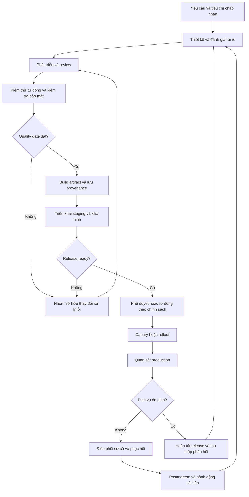

# Chia sẻ trách nhiệm về chất lượng, triển khai và phục hồi

Một thay đổi phần mềm đi qua nhiều nhóm trước khi đến người dùng: người phát triển viết mã, người kiểm thử xác minh hành vi, nhóm nền tảng vận hành pipeline và hạ tầng, bộ phận bảo mật đặt chính sách, còn đội vận hành theo dõi production. Nếu mỗi nhóm chỉ chịu trách nhiệm cho phần việc của mình rồi bàn giao cho nhóm kế tiếp, lỗi có thể lọt qua các ranh giới. Khi production gặp sự cố, mọi người dễ tranh luận ai đã làm sai thay vì cùng khôi phục dịch vụ.

Trong CI/CD, **chất lượng, triển khai và phục hồi là trách nhiệm chung của những người tạo ra, phân phối và vận hành sản phẩm**. Trách nhiệm chung không có nghĩa mọi người cùng làm mọi việc hoặc không ai chịu trách nhiệm cuối cùng. Mỗi vai trò vẫn cần quyền hạn và nhiệm vụ rõ ràng; các vai trò phối hợp trên cùng mục tiêu, cùng tiêu chuẩn và cùng thông tin xuyên suốt vòng đời phần mềm.

Nguyên lý này giúp nhóm tránh cách làm “ném qua hàng rào” giữa phát triển và vận hành. Người viết thay đổi cần quan tâm cách thay đổi được kiểm thử, triển khai và quan sát. Người xây dựng nền tảng cần cung cấp con đường phát hành an toàn, dễ dùng. Người vận hành cần phản hồi dữ liệu production để nhóm cải thiện sản phẩm. Người quản lý sản phẩm cần làm rõ mức rủi ro và kết quả mong muốn. Tất cả cùng chịu trách nhiệm để thay đổi có giá trị được đưa đến người dùng một cách an toàn và có thể phục hồi.

## 1. Trách nhiệm chung có nghĩa là gì?

Trách nhiệm chung là thỏa thuận làm việc trong đó các nhóm cùng sở hữu kết quả đầu cuối, đồng thời mỗi vai trò hiểu rõ phần đóng góp và quyền quyết định của mình. Thay vì đo thành công bằng số ticket đã đóng hoặc số lần bàn giao, nhóm quan tâm thay đổi có đáp ứng nhu cầu, có thể phát hành, hoạt động đúng trong production và có thể phục hồi khi thất bại hay không.

Nguyên lý này có ba lớp:

1. **Trách nhiệm về kết quả:** các nhóm cùng quan tâm chất lượng dịch vụ, trải nghiệm người dùng, tốc độ phát hành và độ ổn định.
2. **Trách nhiệm theo vai trò:** từng người hoặc nhóm có nhiệm vụ cụ thể, người quyết định và giới hạn quyền hạn rõ ràng.
3. **Trách nhiệm xuyên suốt:** thông tin, bằng chứng và phản hồi được nối từ yêu cầu, commit, kiểm thử, artifact, lần triển khai đến hành vi production và hoạt động phục hồi.

Ví dụ, khi một API trả lỗi sau khi triển khai, người phát triển có thể điều tra thay đổi mã; nhóm nền tảng kiểm tra runner, cấu hình và hạ tầng; nhóm vận hành xem telemetry và tác động đến dịch vụ; nhóm sản phẩm xác định luồng nghiệp vụ bị ảnh hưởng. Một người điều phối sự cố chịu trách nhiệm thống nhất quyết định khôi phục. Các hoạt động diễn ra song song theo vai trò, thay vì đợi một nhóm chứng minh lỗi thuộc về nhóm khác.

### Trách nhiệm chung không làm mờ trách nhiệm cá nhân

Một hiểu lầm thường gặp là “mọi người đều chịu trách nhiệm” đồng nghĩa không cần chỉ định người phụ trách. Thực tế, khi không rõ ai có quyền quyết định, công việc dễ bị đình trệ. Mỗi thay đổi cần có người sở hữu; mỗi service cần có nhóm chịu trách nhiệm; mỗi cổng chất lượng cần có chủ sở hữu chính sách; mỗi lần phát hành cần có người hoặc cơ chế được trao quyền thực hiện.

Có thể phân biệt:

- **Shared ownership:** nhiều vai trò cùng đóng góp vào kết quả và chủ động hỗ trợ nhau.
- **Single-point accountability:** một người hoặc một vai trò được xác định rõ để đưa ra quyết định cuối cùng trong một phạm vi cụ thể.
- **Operational participation:** người tạo thay đổi tham gia xử lý và học từ tác động thực tế của thay đổi đó.

Chẳng hạn, nhóm dịch vụ chịu trách nhiệm về chất lượng và khả năng vận hành của dịch vụ; người phụ trách release có quyền quyết định tiếp tục hay dừng rollout theo chính sách; nhóm bảo mật sở hữu tiêu chuẩn bảo mật; nền tảng CI/CD cung cấp cơ chế thực thi tiêu chuẩn đó. Các vai trò cùng hướng đến kết quả nhưng không thay thế thẩm quyền của nhau.

## 2. Vì sao cần chia sẻ trách nhiệm trong CI/CD?

CI/CD rút ngắn thời gian từ thay đổi trong Git đến production. Khi tần suất triển khai tăng, số lần các quyết định kỹ thuật ảnh hưởng trực tiếp đến người dùng cũng tăng. Nếu chỉ một nhóm kiểm thử hoặc vận hành chịu trách nhiệm phát hiện mọi rủi ro ở cuối quy trình, nhóm đó trở thành nút thắt và không thể hiểu hết ngữ cảnh của mọi thay đổi.

Trách nhiệm chung giải quyết một số vấn đề điển hình:

| Vấn đề khi làm việc theo ranh giới nhóm | Hệ quả | Cách chia sẻ trách nhiệm giúp cải thiện |
|---|---|---|
| Nhà phát triển chỉ quan tâm mã chạy trên máy cá nhân | Thiếu cấu hình, logging hoặc kiểm tra cần thiết khi chạy thật | Người phát triển xem xét hành vi trong môi trường triển khai và production |
| QA bị xem là người duy nhất chịu trách nhiệm chất lượng | Lỗi thiết kế và yêu cầu mơ hồ chỉ được phát hiện muộn | Chất lượng được xây dựng từ yêu cầu, thiết kế, code review đến kiểm thử |
| Vận hành chỉ nhận gói phần mềm vào ngày release | Không có đủ thời gian đánh giá, chuẩn bị hoặc phản hồi | Vận hành tham gia từ sớm và cùng định nghĩa tiêu chí sẵn sàng |
| Nhóm nền tảng chỉ cung cấp công cụ | Pipeline mỗi nhóm tự xây theo cách khác nhau, khó kiểm soát | Nền tảng cung cấp con đường chuẩn có guardrail và tài liệu rõ ràng |
| Bảo mật chỉ kiểm tra ở cuối chu kỳ | Phát hiện vấn đề muộn, sửa tốn kém và dễ bị trì hoãn | Chính sách bảo mật được tích hợp vào thiết kế, pipeline và runtime |
| Sự cố biến thành cuộc tìm người có lỗi | Mất thời gian tranh luận, giảm khả năng chia sẻ thông tin | Mọi vai trò cùng khôi phục, phân tích nguyên nhân hệ thống và cải tiến |

Trách nhiệm chung còn giúp tối ưu toàn bộ luồng giá trị. Một nhóm có thể tăng tốc độ merge bằng cách bỏ qua review, nhưng nếu production thường xuyên gặp lỗi thì kết quả chung vẫn kém. Một nhóm vận hành có thể giữ hệ thống ổn định bằng cách từ chối mọi thay đổi, nhưng sản phẩm không thể tiến lên. Cần cân bằng tốc độ thay đổi và độ tin cậy bằng dữ liệu, chính sách và quyết định có chủ đích.

## 3. Chất lượng được tạo ra bởi cả nhóm

Chất lượng không thể được “kiểm tra vào” sản phẩm chỉ bằng một vòng QA cuối cùng. Nó bắt đầu từ cách nhóm hiểu yêu cầu, xác định tiêu chí chấp nhận, thiết kế giải pháp, viết mã, kiểm tra và theo dõi hành vi sau triển khai.

### 3.1. Từ yêu cầu đến tiêu chí có thể kiểm chứng

Nhóm sản phẩm, nhà phát triển, QA và vận hành nên làm rõ yêu cầu trước khi triển khai. Một yêu cầu tốt mô tả hành vi mong đợi, trường hợp biên, điều kiện lỗi và tác động đến người dùng. Tiêu chí chấp nhận cần có cách xác minh cụ thể.

Ví dụ, yêu cầu “API đặt hàng phải nhanh” chưa đủ để tạo quality gate. Nhóm cần xác định loại request, tải dự kiến, môi trường đo và ngưỡng chấp nhận. Một tiêu chí có thể là: “Với tải kiểm thử 300 request/giây trên môi trường chuẩn, p95 latency của API tạo đơn hàng không vượt 400 ms trong khoảng đo đã thống nhất.” Con số ở đây chỉ là ví dụ; ngưỡng thực tế cần dựa trên SLO và đặc điểm dịch vụ.

QA giúp khám phá trường hợp biên và rủi ro; nhà phát triển đánh giá tính khả thi và khả năng kiểm thử; vận hành chỉ ra giới hạn của môi trường; sản phẩm xác nhận tiêu chí có phản ánh nhu cầu hay không. Việc cùng làm rõ từ đầu giảm tình trạng mỗi nhóm hiểu một phiên bản khác nhau của yêu cầu.

### 3.2. Chất lượng trong thiết kế và code review

Người phát triển chịu trách nhiệm tạo thay đổi dễ đọc, dễ kiểm tra và có thể vận hành. Code review xem xét logic, độ phức tạp, xử lý lỗi, tương thích ngược, logging, cấu hình, quyền truy cập và ảnh hưởng đến hiệu năng. Review không nên chỉ tập trung vào phong cách viết mã.

Với thay đổi có rủi ro cao, nhóm có thể yêu cầu người am hiểu miền nghiệp vụ, dữ liệu hoặc bảo mật tham gia review. Những thay đổi về database schema cần xem xét khả năng tương thích với các phiên bản đang chạy. Thay đổi API hoặc event cần có kế hoạch versioning và thời gian chuyển tiếp cho consumer.

### 3.3. Kiểm thử là trách nhiệm của người tạo ra thay đổi

Nhà phát triển viết và duy trì unit test, integration test hoặc contract test phù hợp. QA hỗ trợ chiến lược kiểm thử, kiểm tra luồng người dùng, khám phá trường hợp khó dự đoán và đánh giá rủi ro. Nhóm nền tảng cung cấp môi trường và công cụ kiểm thử ổn định. Không nên đẩy toàn bộ trách nhiệm tạo dữ liệu, sửa test hoặc phân tích lỗi cho một nhóm QA riêng.

Khi một kiểm thử thất bại, nhóm cần phân biệt lỗi sản phẩm, lỗi test và lỗi môi trường. Người sở hữu mã hoặc service nên tham gia phân tích thay vì chỉ chuyển ticket sang nhóm kiểm thử. Với flaky test, nhóm cần theo dõi nguyên nhân, xác định mức ảnh hưởng và đặt thời hạn xử lý nếu phải tạm thời cô lập kiểm thử.

### 3.4. Định nghĩa chất lượng theo rủi ro

Không phải mọi thay đổi đều có cùng mức rủi ro. Một thay đổi văn bản có thể cần kiểm tra hiển thị; một thay đổi xác thực cần review bảo mật và kiểm thử quyền; một migration dữ liệu lớn cần kế hoạch tương thích, backup và diễn tập phục hồi.

Nhóm nên có một baseline kiểm tra bắt buộc cho mọi thay đổi, sau đó bổ sung kiểm tra theo loại tác động. Cách làm này giúp tránh hai cực đoan: kiểm tra quá ít khiến rủi ro lọt qua, hoặc bắt mọi thay đổi đi qua cùng một bộ kiểm tra nặng nề khiến phản hồi chậm mà không tăng đáng kể độ an toàn.

## 4. Chia sẻ trách nhiệm về triển khai

Triển khai là thời điểm mã nguồn, artifact, cấu hình, hạ tầng và quyền truy cập kết hợp để tạo ra trạng thái chạy thực tế. Vì vậy, trách nhiệm triển khai không thể chỉ thuộc về người nhấn nút release.

### 4.1. Người phát triển chịu trách nhiệm về khả năng triển khai của thay đổi

Người tạo thay đổi cần cung cấp thông tin đủ để pipeline và người vận hành triển khai an toàn: cấu hình mới, biến môi trường, dependency, migration, thay đổi hợp đồng API, feature flag, yêu cầu tài nguyên và hướng dẫn xác minh. Nếu thay đổi cần một thao tác thủ công, thao tác đó phải được ghi rõ, có người thực hiện và có thể kiểm tra.

Thay đổi nên tương thích trong khoảng thời gian các phiên bản cũ và mới cùng tồn tại. Với dịch vụ chạy nhiều instance, không thể giả định tất cả instance được cập nhật cùng một thời điểm. API và schema dữ liệu cần cho phép quá trình rolling hoặc canary diễn ra mà không làm phiên bản cũ bị lỗi.

### 4.2. Nhóm nền tảng chịu trách nhiệm về con đường phát hành an toàn

Nhóm platform hoặc DevOps cung cấp pipeline template, runner, registry, secret integration, môi trường triển khai và cơ chế quan sát. Nền tảng nên giúp nhóm sản phẩm thực hiện điều đúng một cách dễ dàng: quyền mặc định tối thiểu, artifact bất biến, log có thể truy vết, kiểm tra bắt buộc và cơ chế rollback được chuẩn hóa.

Nền tảng không nên trở thành nhóm phải tự hiểu mọi chi tiết nghiệp vụ của từng service. Nhóm service cung cấp health check, smoke test, dashboard và ngưỡng nghiệp vụ; nền tảng cung cấp cách tích hợp các tín hiệu đó vào quy trình chung.

### 4.3. Vận hành tham gia trước khi release

Người vận hành đóng góp hiểu biết về capacity, dependency, backup, lịch bảo trì, khả năng quan sát, giới hạn mạng và các ràng buộc production. Họ có thể giúp đánh giá kế hoạch rollout, kiểm tra runbook và xác định điều kiện dừng.

Nếu một thay đổi cần approval, người phê duyệt cần dựa trên bằng chứng được chuẩn bị từ trước: test report, scan result, release note, artifact digest, kế hoạch triển khai và kế hoạch phục hồi. Approval không nên trở thành bước ký tên hình thức mà không có thông tin để đánh giá.

### 4.4. Sử dụng guardrail thay cho phụ thuộc vào trí nhớ

Guardrail là cơ chế kỹ thuật hoặc quy trình ngăn hành động vượt quá chính sách đã thống nhất. Ví dụ:

- Chỉ artifact được tạo từ pipeline tin cậy mới được triển khai.
- Job kiểm thử không có quyền ghi production.
- Production yêu cầu environment protection hoặc approval theo mức rủi ro.
- Pipeline kiểm tra chữ ký và digest của artifact trước khi deploy.
- Rollout tự dừng khi health check hoặc ngưỡng telemetry không đạt.
- Thay đổi hạ tầng có tác động lớn yêu cầu review và kế hoạch rollback.

Guardrail cần có chủ sở hữu và cơ chế ngoại lệ minh bạch. Ngoại lệ phải có lý do, người chấp thuận, phạm vi, thời hạn và dấu vết kiểm toán. Một ngoại lệ khẩn cấp không nên âm thầm trở thành quy trình bình thường.

## 5. Phục hồi là một phần của trách nhiệm phát hành

Không có quy trình kiểm thử nào loại bỏ hoàn toàn lỗi production. Một hệ thống phân phối trưởng thành giả định rằng sự cố có thể xảy ra và chuẩn bị khả năng phát hiện, giới hạn tác động, khôi phục dịch vụ và học từ sự cố.

### 5.1. Người tạo thay đổi tham gia vận hành

Khi thay đổi gây lỗi, người hiểu rõ mã và quyết định thiết kế thường có thể giúp xác định nguyên nhân nhanh nhất. Vì vậy, nhóm sở hữu service cần tham gia trực tiếp vào việc theo dõi release, điều tra và sửa lỗi. Mức độ tham gia có thể khác nhau theo quy mô tổ chức và mô hình trực vận hành, nhưng không nên có khoảng trống trách nhiệm sau khi bàn giao artifact.

Nguyên tắc “you build it, you run it” nhấn mạnh sự liên kết giữa người tạo phần mềm và kết quả vận hành. Không nhất thiết mọi nhà phát triển phải trực production 24/7. Tổ chức có thể có đội SRE hoặc Operations chuyên trách điều phối và xử lý hạ tầng; nhóm phát triển vẫn cần sở hữu hành vi của service, cung cấp hỗ trợ chuyên môn và xử lý nguyên nhân trong mã.

### 5.2. Phân vai rõ trong một sự cố

Khi có sự cố, cần phân biệt người điều phối với người thực hiện kỹ thuật. Một mô hình đơn giản có thể gồm:

| Vai trò trong sự cố | Trách nhiệm chính |
|---|---|
| Incident commander | Đánh giá mức độ, điều phối nguồn lực, thống nhất ưu tiên và quyết định các mốc hành động |
| Technical lead | Dẫn dắt điều tra kỹ thuật, đề xuất giảm thiểu và xác minh phục hồi |
| Communications lead | Cập nhật tình trạng cho các nhóm liên quan và người dùng theo chính sách |
| Service owner | Cung cấp ngữ cảnh nghiệp vụ, mã nguồn, dependency và quyết định sửa lỗi của service |
| Platform/operations | Kiểm tra hạ tầng, traffic, triển khai, tài nguyên và công cụ vận hành |

Trong nhóm nhỏ, một người có thể đảm nhiệm nhiều vai trò. Điều quan trọng là mọi người biết ai đang điều phối và nơi cập nhật thông tin. Người điều phối cần tránh để nhiều người cùng thực hiện các hành động thay đổi trạng thái production mà không phối hợp.

### 5.3. Ưu tiên khôi phục dịch vụ và giới hạn tác động

Trong sự cố, mục tiêu đầu tiên thường là bảo vệ người dùng và khôi phục chức năng thiết yếu. Nhóm có thể dừng rollout, giảm tỷ lệ traffic vào phiên bản mới, tắt feature flag, chuyển traffic về phiên bản ổn định hoặc roll forward bằng bản sửa lỗi.

Quyết định phụ thuộc vào loại lỗi. Nếu phiên bản mới làm tăng lỗi HTTP nhưng dữ liệu chưa bị thay đổi, rollback ứng dụng có thể phù hợp. Nếu migration đã biến đổi dữ liệu theo cách không tương thích, triển khai lại image cũ có thể không giải quyết được. Khi đó nhóm cần đánh giá backup, tác vụ bù hoặc sửa lỗi tiến lên.

Các hành động giảm thiểu nên có hướng dẫn và được diễn tập. Runbook cần chỉ ra điều kiện kích hoạt, lệnh hoặc thao tác, quyền cần thiết, cách xác minh kết quả và cách quay lại trạng thái trước nếu hành động giảm thiểu gây tác dụng phụ.

### 5.4. Không đổ lỗi, nhưng phải có hành động khắc phục

Phân tích sau sự cố theo hướng không đổ lỗi (blameless postmortem) tập trung vào điều kiện và cơ chế khiến sự cố xảy ra: thông tin nào bị thiếu, guardrail nào không tồn tại, tín hiệu nào không được phát hiện, quyết định nào hợp lý với dữ liệu tại thời điểm đó nhưng dẫn đến kết quả xấu.

Không đổ lỗi không có nghĩa bỏ qua trách nhiệm hoặc chấp nhận hành vi cố ý vi phạm chính sách. Nó có nghĩa phân tích hệ thống trước khi quy kết cá nhân, để tổ chức học được điều có thể ngăn sự cố lặp lại. Báo cáo sau sự cố nên ghi nhận:

- Tác động đến người dùng và thời gian ảnh hưởng.
- Dòng thời gian sự kiện, tín hiệu phát hiện và quyết định đã đưa ra.
- Nguyên nhân trực tiếp cùng các yếu tố góp phần.
- Điều gì đã giúp giảm tác động và điều gì làm quá trình phục hồi chậm.
- Hành động cải tiến, người phụ trách, thời hạn và cách xác minh.

Một cuộc họp postmortem không tạo ra giá trị nếu các hành động không có người nhận và không được theo dõi đến khi hoàn tất. Cần ưu tiên sửa nguyên nhân có khả năng tái diễn hoặc tạo ra hậu quả lớn, thay vì lập danh sách dài các việc nhỏ không có thứ tự.

## 6. Ranh giới trách nhiệm giữa các vai trò

Trách nhiệm chung cần được chuyển thành thỏa thuận cụ thể. Bảng dưới đây là ví dụ tham khảo cho một nhóm sản phẩm có các vai trò phát triển, QA, platform, security, operations và product. Tổ chức có thể gộp hoặc tách vai trò tùy quy mô.

| Hoạt động | Người/nhóm dẫn dắt | Những bên cần phối hợp |
|---|---|---|
| Xác định yêu cầu và tiêu chí chấp nhận | Product owner | Development, QA, Operations, Security khi liên quan |
| Thiết kế kỹ thuật và đánh giá rủi ro | Service owner hoặc technical lead | Platform, Security, QA, Operations |
| Code review và unit test | Development | QA hoặc chuyên gia miền nghiệp vụ khi cần |
| Chiến lược và tự động hóa kiểm thử | Development và QA | Platform, Product, Operations |
| Pipeline template và runner | Platform engineering | Development, Security, Operations |
| Chính sách bảo mật và ngoại lệ | Security | Service owner, Platform, người phê duyệt |
| Artifact và provenance | Pipeline/platform owner | Development, Security |
| Kế hoạch rollout và release readiness | Service owner hoặc release owner | Operations, Platform, QA, Product |
| Theo dõi production | Service owner và Operations/SRE | Platform, Product, Security khi có sự cố liên quan |
| Điều phối sự cố | Incident commander | Service owner, Platform, Operations, Communications |
| Postmortem và hành động cải tiến | Service owner hoặc incident lead | Tất cả vai trò có liên quan |

Để tránh nhầm lẫn, nhóm có thể dùng ma trận RACI cho các quyết định quan trọng:

- **R — Responsible:** người trực tiếp thực hiện công việc.
- **A — Accountable:** người chịu trách nhiệm cuối cùng và có quyền quyết định trong phạm vi đó.
- **C — Consulted:** người cần được tham vấn trước khi quyết định.
- **I — Informed:** người cần được thông báo về kết quả hoặc thay đổi.

Mỗi hoạt động nên có một đầu mối A rõ ràng. Có thể có nhiều người R, C hoặc I. RACI không thay thế giao tiếp hằng ngày; nó chỉ giúp làm rõ quyền quyết định ở những chỗ dễ phát sinh khoảng trống hoặc xung đột.

Ví dụ, với rollout production, service owner có thể là A về tính sẵn sàng của service, release operator là R cho thao tác triển khai, Operations và Security là C theo mức rủi ro, Product là I về thời điểm phát hành. Nếu tổ chức dùng cơ chế tự động hoàn toàn, chính sách có thể trao quyền quyết định cho quality gate; khi đó cần xác định rõ chủ sở hữu chính sách và người xử lý ngoại lệ.

## 7. Xây dựng văn hóa phối hợp bằng thực hành hằng ngày

Trách nhiệm chung không xuất hiện chỉ vì tổ chức thay đổi sơ đồ đội nhóm hoặc tuyên bố áp dụng DevOps. Nó hình thành qua cách các nhóm cùng lập kế hoạch, cùng xem dữ liệu và cùng giải quyết vấn đề.

### 7.1. Cùng định nghĩa Done và Release Ready

Definition of Done mô tả điều kiện để một công việc được xem là hoàn thành. Tùy sản phẩm, điều kiện có thể gồm code review, test, tài liệu, logging, kiểm tra bảo mật và cập nhật hợp đồng API.

Release Ready mô tả điều kiện để một phiên bản được phép phát hành. Nó có thể gồm artifact bất biến, kết quả kiểm thử, scan report, cấu hình, approval, runbook, dashboard và kế hoạch phục hồi. Hai khái niệm này liên quan nhưng không giống nhau: một story có thể Done trong phạm vi phát triển nhưng release vẫn chờ các điều kiện tổng thể của phiên bản.

Các tiêu chí cần được nhóm liên quan cùng thống nhất, có thể kiểm tra và cập nhật khi rủi ro sản phẩm thay đổi. Nếu checklist quá dài mà không ai dùng, hãy xem lại tính cần thiết và tự động hóa những điều kiện có thể kiểm tra bằng máy.

### 7.2. Review chung trước thay đổi có rủi ro cao

Thay đổi liên quan đến authentication, authorization, dữ liệu nhạy cảm, database migration, network policy hoặc dependency quan trọng nên có cuộc trao đổi ngắn giữa các vai trò cần thiết. Mục tiêu là thống nhất rủi ro, phương án kiểm thử, kế hoạch rollout và cách phục hồi trước khi triển khai.

Không cần tổ chức cuộc họp cho mọi commit. Với thay đổi nhỏ và rủi ro thấp, code review và quality gate có thể đủ. Nhóm nên dùng mức rủi ro để quyết định mức độ phối hợp.

### 7.3. Chia sẻ dashboard và thông tin phát hành

Những thông tin cần thiết nên dễ truy cập với người có trách nhiệm: phiên bản đang chạy, commit SHA, artifact digest, deployment history, kết quả kiểm thử, trạng thái rollout, error rate, latency và SLO. Khi mọi người xem cùng một nguồn dữ liệu, cuộc trao đổi ít phụ thuộc vào ảnh chụp màn hình hoặc báo cáo thủ công.

Release note nên mô tả thay đổi người dùng nhận được, ảnh hưởng kỹ thuật, thay đổi cấu hình, migration, feature flag và các điểm cần theo dõi. Nếu có giới hạn hoặc rủi ro đã biết, cần nêu rõ để người trực vận hành có thể nhận diện sớm.

### 7.4. Tạo vòng phản hồi ngắn

Nhóm có thể tổ chức review sau release, xem lại pipeline failure, phân tích flaky test và rà soát sự cố định kỳ. Các cuộc trao đổi nên trả lời câu hỏi cụ thể: stage nào làm chậm luồng, lỗi nào lặp lại, quality gate nào phát hiện được vấn đề, tín hiệu nào cảnh báo quá muộn và hành động nào có thể giảm rủi ro.

Phản hồi production cần quay lại backlog phát triển. Một lỗi vận hành có thể dẫn đến cải thiện logging, thêm test hồi quy, thay đổi timeout, giới hạn retry, cập nhật runbook hoặc sửa thiết kế. Nếu dữ liệu production chỉ được giữ trong đội vận hành, nhóm phát triển sẽ tiếp tục lặp lại những giả định sai.

## 8. Tự động hóa trách nhiệm bằng pipeline và chính sách

Con người cần hợp tác để đưa ra quyết định, còn pipeline giúp thực thi các quy tắc lặp lại một cách nhất quán. Một pipeline được thiết kế tốt biến thỏa thuận của nhóm thành các bước có thể kiểm chứng.

Ví dụ, một quy trình release có thể yêu cầu:

1. Pull request phải có review và các kiểm tra bắt buộc đạt.
2. Pipeline tạo artifact từ revision đã được chấp nhận và lưu digest.
3. Kết quả test, scan và provenance được gắn với artifact.
4. Artifact được triển khai lên staging; acceptance test và smoke test chạy tự động.
5. Release owner xem bằng chứng và phê duyệt nếu chính sách yêu cầu.
6. Pipeline triển khai canary, quan sát telemetry và chỉ tăng traffic khi các ngưỡng đạt.
7. Nếu ngưỡng thất bại, rollout tự dừng và thực hiện hành động giảm thiểu đã được cho phép.
8. Deployment record lưu artifact, commit, người phê duyệt, cấu hình và kết quả xác minh.

Pipeline không thể tự quyết định mọi câu hỏi nghiệp vụ. Nó cần nhận tiêu chí và chính sách do con người thống nhất, đồng thời cung cấp bằng chứng đủ rõ để người có thẩm quyền đưa ra quyết định. Không nên biến approval thành một nút bấm không có thông tin hoặc cho phép một người vượt qua mọi guardrail mà không để lại dấu vết.

## 9. Ví dụ thực tế: một release gây lỗi sau khi triển khai

Giả sử nhóm phát triển `orders-api` triển khai phiên bản bổ sung kiểm tra tồn kho. Pipeline đã chạy unit test, integration test và smoke test. Sau khi canary nhận 10% traffic, dashboard cho thấy tỷ lệ timeout tăng và số đơn hàng được xác nhận giảm.

**Phát hiện và điều phối:** hệ thống cảnh báo kích hoạt theo ngưỡng đã thống nhất. Incident commander xác nhận mức độ ảnh hưởng, mở kênh sự cố và giao technical lead điều tra. Release owner dừng tăng traffic để giới hạn tác động.

**Điều tra song song:** nhóm service kiểm tra thay đổi gọi sang inventory service; Operations xem latency và connection pool; Platform xác minh cấu hình triển khai và tình trạng runner; Product xác định luồng tạo đơn hàng bị ảnh hưởng và ưu tiên nghiệp vụ. Mọi người chia sẻ bằng chứng trong cùng một dòng thời gian.

**Giảm thiểu:** nhóm phát hiện phiên bản mới tạo nhiều request kiểm tra tồn kho hơn dự kiến. Nếu feature flag có thể tắt an toàn, nhóm tắt flag và xác minh tỷ lệ lỗi giảm. Nếu không, release owner cùng technical lead quyết định chuyển traffic về artifact trước đó hoặc triển khai bản sửa lỗi. Trước khi rollback, nhóm xác minh migration và dữ liệu có tương thích với phiên bản cũ.

**Xác minh phục hồi:** sau hành động giảm thiểu, nhóm theo dõi timeout, error rate và tỷ lệ xác nhận đơn hàng. Chỉ khi các chỉ số trở về ngưỡng chấp nhận và luồng nghiệp vụ hoạt động bình thường, incident commander mới kết thúc giai đoạn xử lý khẩn cấp.

**Học từ sự cố:** postmortem phát hiện integration test chưa mô phỏng tải đồng thời của inventory service, dashboard chưa có chỉ số về tỷ lệ xác nhận đơn hàng và feature flag thiếu người phụ trách. Nhóm giao các hành động cụ thể: bổ sung kiểm thử tải, thêm metric nghiệp vụ, cập nhật release checklist và gán owner cho flag. Những thay đổi này được đưa vào backlog và xác minh ở lần release tiếp theo.

Không một vai trò đơn lẻ có thể giải quyết toàn bộ sự cố này. Người phát triển hiểu logic, Operations hiểu trạng thái production, Platform hiểu cơ chế triển khai, Product hiểu mức độ ảnh hưởng và người điều phối kết nối các quyết định. Trách nhiệm chung giúp các năng lực đó kết hợp thành một quá trình phục hồi có kiểm soát.

## 10. Những anti-pattern làm suy yếu trách nhiệm chung

| Anti-pattern | Dấu hiệu | Hệ quả | Cách điều chỉnh |
|---|---|---|---|
| Ném qua hàng rào | “Mã đã xong, QA tự kiểm tra”; “Đã deploy, Operations tự xử lý” | Mất ngữ cảnh và kéo dài thời gian điều tra | Nhóm sở hữu thay đổi theo dõi kết quả đến production và hỗ trợ phục hồi |
| QA là chốt chặn duy nhất | Chỉ QA được giao viết test và xác nhận chất lượng | Lỗi thiết kế và logic không được phát hiện sớm | Development và QA cùng xây chiến lược kiểm thử |
| Operations là đội nhận bàn giao | Runbook và dashboard chỉ được tạo ngay trước release | Thiếu thời gian chuẩn bị và hiểu biết về thay đổi | Operations tham gia thiết kế khả năng vận hành từ đầu |
| Platform là đội làm hộ pipeline | Mọi thay đổi workflow phải chờ một nhóm trung tâm | Tạo nút thắt và giảm quyền sở hữu của service team | Platform cung cấp self-service và guardrail có thể tái sử dụng |
| Approval hình thức | Người duyệt không có test report hoặc release plan | Quyết định không dựa trên bằng chứng | Hiển thị artifact, rủi ro, kiểm tra và kế hoạch phục hồi trước approval |
| Không có service owner | Không ai biết ai quyết định khi có lỗi | Chậm phản hồi và tranh cãi trách nhiệm | Chỉ định owner, kênh hỗ trợ và quy tắc escalation cho từng service |
| Chỉ số cục bộ | Nhóm tối ưu số ticket hoặc số deploy riêng | Tối ưu một phần gây hại kết quả chung | Theo dõi lead time, change failure rate, độ tin cậy và tác động người dùng cùng nhau |
| Postmortem tìm thủ phạm | Báo cáo tập trung vào sai sót cá nhân | Giảm minh bạch và không sửa nguyên nhân hệ thống | Phân tích điều kiện, guardrail, tín hiệu và quyết định trong bối cảnh thực tế |
| Hành động sau sự cố không có owner | Danh sách cải tiến không có người và hạn hoàn thành | Lỗi lặp lại dù đã họp rút kinh nghiệm | Giao người phụ trách, mức ưu tiên và cách xác minh cho từng hành động |

## 11. Đo lường mức độ trưởng thành của trách nhiệm chung

Không có một chỉ số duy nhất đo được văn hóa hợp tác. Nhóm cần kết hợp dữ liệu luồng phát hành, độ tin cậy, chất lượng phản hồi và mức hoàn thành cải tiến.

| Góc nhìn | Chỉ số hoặc bằng chứng | Câu hỏi cần xem xét |
|---|---|---|
| Chất lượng | Tỷ lệ lỗi lọt production, lỗi hồi quy, flaky test rate | Nhóm có phát hiện lỗi sớm và duy trì tín hiệu kiểm thử đáng tin cậy không? |
| Tốc độ luồng | Lead time for changes, pipeline duration, release queue time | Điểm nghẽn nằm ở kiểm thử, bàn giao, approval hay môi trường? |
| Độ ổn định | Change failure rate, time to restore service, SLO | Nhóm có phát hành thường xuyên mà vẫn khôi phục nhanh không? |
| Khả năng phối hợp | Thời gian tìm đúng owner, thời gian huy động người hỗ trợ | Khi có vấn đề, người liên quan có thể cùng hành động nhanh không? |
| Khả năng truy vết | Tỷ lệ release có commit, digest, test report và deployment record | Có thể nối sự cố với thay đổi và bằng chứng phát hành không? |
| Học hỏi | Tỷ lệ hành động postmortem hoàn tất và sự cố lặp lại | Nhóm có chuyển bài học thành thay đổi thực tế không? |
| Sở hữu vận hành | Service có owner, dashboard, alert và runbook | Có người hiểu và chịu trách nhiệm cho hành vi production không? |

Không nên dùng các chỉ số này để xếp hạng cá nhân hoặc tạo áp lực che giấu lỗi. Mục đích là tìm điểm yếu của hệ thống làm việc. Ví dụ, time to restore cao có thể do thiếu quyền rollback, thiếu artifact cũ, runbook không rõ hoặc không xác định được incident commander; giải pháp cần nhắm vào nguyên nhân tương ứng.

## 12. Checklist thực hành cho nhóm CI/CD

Nhóm có thể dùng checklist sau để rà soát xem trách nhiệm chung đã được chuyển thành cách làm cụ thể hay chưa:

- [ ] Mỗi service có owner, kênh hỗ trợ và người có quyền quyết định khi phát hành hoặc xảy ra sự cố.
- [ ] Product, Development, QA và Operations thống nhất tiêu chí chấp nhận cho thay đổi có rủi ro đáng kể.
- [ ] Người phát triển chịu trách nhiệm về test, khả năng cấu hình, logging và khả năng vận hành của thay đổi.
- [ ] QA tham gia thiết kế chiến lược kiểm thử và hỗ trợ khám phá rủi ro, không phải chốt chặn duy nhất.
- [ ] Platform cung cấp pipeline, artifact registry và môi trường self-service có guardrail rõ ràng.
- [ ] Security tham gia từ thiết kế và chính sách được thực thi tự động ở các bước phù hợp.
- [ ] Release Ready có tiêu chí, bằng chứng và người phê duyệt rõ ràng.
- [ ] Người trực vận hành có dashboard, alert, runbook và thông tin artifact trước khi release.
- [ ] Rollout có ngưỡng dừng, cách giảm thiểu và phương án phục hồi đã được kiểm tra.
- [ ] Vai trò điều phối, kỹ thuật và truyền thông trong sự cố được xác định.
- [ ] Nhóm sở hữu service tham gia điều tra và sửa nguyên nhân sau sự cố.
- [ ] Postmortem tập trung vào điều kiện hệ thống, có hành động, owner và thời hạn.
- [ ] Dữ liệu production và bài học sau release quay lại backlog phát triển.
- [ ] Các chỉ số được dùng để cải thiện luồng và độ tin cậy, không để đổ lỗi hoặc chạy theo thành tích cục bộ.

## 13. Kết luận

Chia sẻ trách nhiệm về chất lượng, triển khai và phục hồi là nền tảng để CI/CD hoạt động bền vững. Chất lượng được tạo từ yêu cầu đến code và kiểm thử; triển khai cần sự phối hợp giữa service owner, platform, security và operations; phục hồi cần vai trò điều phối rõ ràng cùng sự tham gia của những người hiểu sản phẩm và hệ thống.

Khi từng vai trò có nhiệm vụ cụ thể nhưng cùng sở hữu kết quả đầu cuối, nhóm có thể phát hành thường xuyên hơn mà vẫn kiểm soát rủi ro. Mỗi lần triển khai trở thành một cơ hội kiểm chứng giả định; mỗi sự cố trở thành nguồn dữ liệu để cải tiến pipeline, sản phẩm và cách phối hợp. Trách nhiệm chung vì thế được thể hiện bằng hành động, bằng chứng và những thay đổi cụ thể trong cách nhóm xây dựng, phân phối và vận hành phần mềm.
