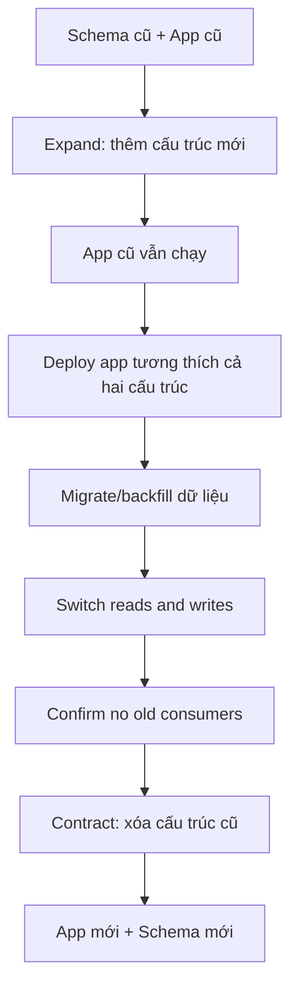

# Phối hợp phiên bản ứng dụng với phiên bản lược đồ

Một lần phát hành thường không chỉ thay đổi mã ứng dụng. Nó có thể thêm cột, đổi kiểu dữ liệu, tạo bảng, thay index hoặc chuyển cách lưu trữ thông tin. Nếu ứng dụng mới và lược đồ database không tương thích trong giai đoạn triển khai, service có thể lỗi ngay cả khi build và test đều thành công.

Rủi ro tăng lên khi dùng rolling deployment hoặc blue-green deployment. Trong lúc rollout, nhiều phiên bản ứng dụng có thể cùng chạy và cùng truy cập một database. Phiên bản cũ có thể vẫn đọc hoặc ghi theo cấu trúc cũ trong khi phiên bản mới đã bắt đầu sử dụng cấu trúc mới. Vì vậy, thay đổi ứng dụng và thay đổi lược đồ phải được phối hợp theo một trình tự có chủ đích.

Nguyên tắc cốt lõi là thiết kế thay đổi database để các phiên bản ứng dụng cần cùng tồn tại vẫn hoạt động được. Thay đổi lược đồ thường được chia thành các bước mở rộng, chuyển đổi và thu hẹp. Ứng dụng được triển khai ở giữa các bước đó, còn việc xóa cấu trúc cũ chỉ diễn ra sau khi không còn phiên bản hoặc consumer nào cần nó.

## 1. Ứng dụng và lược đồ có vòng đời khác nhau

Phiên bản ứng dụng thường được phát hành theo commit hoặc release. Phiên bản lược đồ được thay đổi bằng các migration có thứ tự và được lưu trong database. Hai loại phiên bản có quan hệ nhưng không nhất thiết tăng cùng lúc.

Ví dụ:

- Ứng dụng 2.8.0 có thể chạy trên schema version 41.
- Ứng dụng 2.9.0 có thể yêu cầu schema version 42.
- Một migration chỉ thêm index có thể không yêu cầu thay đổi phiên bản ứng dụng.
- Một lần phát hành ứng dụng có thể gồm nhiều migration nhỏ.
- Một schema mới có thể cần hỗ trợ đồng thời hai phiên bản ứng dụng trong thời gian rollout.

Không nên giả định mỗi application version tương ứng chính xác một schema version. Thay vào đó, xác định rõ từng phiên bản ứng dụng hỗ trợ những phiên bản schema nào.

Có thể biểu diễn quan hệ bằng một compatibility matrix:

| Ứng dụng | Schema 41 | Schema 42 | Schema 43 |
|---|---|---|---|
| App 2.8 | Hỗ trợ | Hỗ trợ nếu chỉ mở rộng tương thích | Không xác định nếu đã thu hẹp cấu trúc cũ |
| App 2.9 | Hỗ trợ nếu code còn tương thích schema cũ | Hỗ trợ | Hỗ trợ nếu thay đổi tương thích |
| App 3.0 | Có thể không hỗ trợ | Hỗ trợ nếu migration contract chưa chạy | Hỗ trợ |

Bảng thực tế phải dựa trên hành vi của ứng dụng và migration cụ thể. Đừng suy ra tương thích chỉ từ số version.

## 2. Vì sao rolling deployment làm bài toán khó hơn?

Trong rolling deployment, hệ thống thay thế từng nhóm instance thay vì dừng toàn bộ service. Trong một khoảng thời gian, các instance cũ và mới cùng hoạt động.

Giả sử ứng dụng cũ đọc cột customer_name, còn ứng dụng mới muốn dùng cột display_name. Nếu migration xóa customer_name trước khi instance cũ kết thúc, các request đang được xử lý bởi instance cũ sẽ lỗi. Nếu ứng dụng mới bắt đầu đọc display_name trước khi cột được tạo, instance mới cũng lỗi.

Trình tự an toàn phải tính đến các trạng thái đồng thời:

1. Schema cũ và app cũ đang chạy.
2. Schema đã được mở rộng nhưng app cũ vẫn chạy.
3. App mới và app cũ cùng chạy trên schema mở rộng.
4. Backfill chuyển dữ liệu sang cấu trúc mới.
5. App mới chuyển hẳn sang cấu trúc mới.
6. Chỉ sau khi không còn consumer cũ, schema mới được phép xóa cấu trúc cũ.

Blue-green deployment có thể giữ hai nhóm ứng dụng hoạt động song song trong thời gian chuyển traffic. Vì vậy, nó cũng cần tương thích schema. Việc chỉ đổi traffic từ blue sang green không làm cho database có thể lập tức loại bỏ cấu trúc mà blue vẫn cần nếu rollback được kích hoạt.

## 3. Backward compatibility và forward compatibility

Hai khái niệm này mô tả khả năng một thành phần tiếp tục hoạt động khi thành phần còn lại thay đổi.

**Backward compatibility của schema**: schema mới vẫn hỗ trợ ứng dụng cũ. Ví dụ, thêm một cột nullable mà code cũ không biết đến thường không làm code cũ hỏng.

**Forward compatibility của ứng dụng**: ứng dụng mới có thể hoạt động với schema cũ hoặc trạng thái dữ liệu cũ trong phạm vi được thiết kế. Ví dụ, app mới đọc cột mới nếu có giá trị, nhưng tạm thời vẫn có thể dùng cột cũ.

Trong rollout, cả hai chiều đều có thể cần thiết:

- Schema được mở rộng trước để app cũ không bị lỗi.
- App mới được thiết kế để chịu được trạng thái schema và dữ liệu chuyển tiếp.
- App mới và cũ cùng ghi trong thời gian cần dual-write.
- Schema chỉ bị thu hẹp sau khi app cũ không còn hoạt động và rollback về app cũ không còn được phép.

Không phải mọi thay đổi đều có thể tương thích hai chiều. Nếu thay đổi phá vỡ cấu trúc cũ, cần chia nó thành nhiều release hoặc dùng một quy trình migration có downtime được kiểm soát.

## 4. Mô hình expand-migrate-switch-contract

Một cách phổ biến để phối hợp ứng dụng với lược đồ là chia thay đổi thành bốn giai đoạn.


- **Expand:** thêm cấu trúc mới mà không xóa hoặc làm thay đổi cách cấu trúc cũ hoạt động.
- **Migrate:** chuyển dữ liệu từ cấu trúc cũ sang cấu trúc mới, thường theo batch có thể tiếp tục sau lỗi.
- **Switch:** cập nhật ứng dụng để đọc/ghi theo cấu trúc mới, có thể dùng feature flag hoặc dual-read trong giai đoạn chuyển tiếp.
- **Contract:** xóa cấu trúc cũ sau khi mọi ứng dụng và consumer đã ngừng sử dụng.

Sơ đồ:



Tách các giai đoạn giúp mỗi lần deploy có phạm vi rủi ro nhỏ hơn. Nếu có lỗi ở giai đoạn expand hoặc app tương thích, có thể dừng trước khi xóa dữ liệu hoặc cấu trúc cũ.

Contract thường nên là một release riêng hoặc một bước được phê duyệt sau khi đã quan sát đủ lâu. Không nên gộp expand và contract vào cùng một migration nếu các phiên bản ứng dụng cần cùng tồn tại.

## 5. Ví dụ đổi tên cột mà không làm gián đoạn service

Giả sử bảng customers có cột customer_name. Sản phẩm muốn chuyển sang display_name. Một migration đổi tên trực tiếp có thể làm app cũ lỗi ngay khi migration chạy.

Cách tiếp cận an toàn hơn:

**Giai đoạn 1 — Expand:** thêm cột display_name nullable. App cũ vẫn đọc và ghi customer_name.

```sql
ALTER TABLE customers
ADD COLUMN display_name VARCHAR(160);
```

**Giai đoạn 2 — Deploy app tương thích:** phiên bản mới có thể đọc display_name nếu có, nếu chưa có thì fallback sang customer_name. Trong giai đoạn chuyển tiếp, app có thể ghi cả hai cột để dữ liệu mới không bị lệch.

Ví dụ logic minh họa:

```java
String effectiveName(Customer row) {
    if (row.getDisplayName() != null) {
        return row.getDisplayName();
    }
    return row.getCustomerName();
}
```

Dual-write cần được thiết kế cẩn thận. Nếu hai cột được cập nhật bởi nhiều phiên bản ứng dụng hoặc nhiều writer khác nhau, cần xác định nguồn dữ liệu chuẩn và quy tắc xử lý khi hai giá trị khác nhau. Không để hai cột tự do ghi đè lẫn nhau mà không có quy tắc.

**Giai đoạn 3 — Migrate:** backfill display_name từ customer_name cho các bản ghi hiện có. Thực hiện theo batch, có checkpoint và có thể chạy lại.

**Giai đoạn 4 — Switch:** sau khi dữ liệu đã được chuyển, ứng dụng đọc và ghi display_name. Có thể giữ dual-write trong một khoảng thời gian quan sát hoặc trong cửa sổ rollback.

**Giai đoạn 5 — Contract:** sau khi mọi instance cũ đã dừng, các consumer cũ đã được cập nhật và rollback về code cũ không còn nằm trong kế hoạch, mới xóa customer_name trong một migration riêng.

Không nên coi đổi tên cột là một thao tác đơn giản nếu ứng dụng được rollout theo từng instance. Với hệ thống có nhiều service cùng dùng database, cần kiểm kê mọi consumer trước khi contract.

## 6. Migration phải có thứ tự và được quản lý như mã nguồn

Migration mô tả thay đổi lược đồ và đôi khi cả dữ liệu. Nó cần được lưu trong version control, review như code và chạy theo thứ tự xác định.

Với Flyway, migration dạng versioned thường có tên theo mẫu V001__description.sql. Ví dụ:

```text
src/main/resources/db/migration/
├── V041__create_customers.sql
├── V042__add_display_name.sql
└── V043__add_customer_display_name_index.sql
```

Khi migration versioned đã được áp dụng trong môi trường chia sẻ, không sửa nội dung file cũ để thay đổi lịch sử. Các công cụ như Flyway lưu checksum để phát hiện migration đã thay đổi sau khi thực thi. Nếu cần sửa logic, tạo migration mới có version cao hơn.

Liquibase cũng quản lý changeset và checksum. Cần giữ ID/author/path ổn định và không chỉnh sửa changeset đã triển khai theo cách làm thay đổi lịch sử thực thi. Cách xử lý changeset cũ phụ thuộc công cụ và chính sách của dự án.

Migration nên có mục tiêu hẹp, tên mô tả rõ và có thể xác minh sau khi chạy. Tránh một migration chứa hàng chục thay đổi không liên quan vì khó xác định phần nào gây lỗi.

## 7. Chọn thời điểm chạy migration

Có nhiều cách chạy migration, nhưng cần chọn một chủ thể chịu trách nhiệm rõ ràng.

**Migration job riêng trong pipeline** thường dễ kiểm soát. Pipeline lấy credential migration chuyên biệt, kiểm tra target, chạy migration rồi mới triển khai ứng dụng nếu điều kiện đạt.

**Ứng dụng tự chạy migration khi khởi động** có thể phù hợp với ứng dụng nhỏ hoặc môi trường đơn giản, nhưng nhiều replica có thể khởi động cùng lúc và cùng cố gắng thay đổi schema. Cần migration lock và hành vi concurrency được công cụ bảo đảm. Cũng cần phân biệt quyền chạy ứng dụng với quyền thay đổi database.

**Migration vận hành thủ công** có thể cần cho thay đổi rủi ro cao hoặc dữ liệu lớn, nhưng vẫn nên được mô tả bằng migration có version, review và ghi nhận kết quả.

Một luồng phổ biến:

1. Xác định schema version hiện tại.
2. Kiểm tra migration cần chạy và điều kiện tương thích.
3. Sao lưu hoặc xác nhận phương án phục hồi phù hợp với mức rủi ro.
4. Chạy migration expand.
5. Xác minh schema mới.
6. Triển khai ứng dụng tương thích.
7. Chạy backfill riêng nếu cần.
8. Quan sát và xác nhận không còn consumer cũ.
9. Chạy migration contract trong một lần phát hành sau.

Không nên để mọi instance ứng dụng tự ý chạy DDL bằng database credential có quyền cao. Tách migration identity khỏi runtime identity giúp giới hạn quyền của ứng dụng đang chạy.

## 8. Migration lock và triển khai đồng thời

Nếu hai pipeline cùng chạy migration, chúng có thể cạnh tranh trên bảng schema history hoặc cùng thay đổi một đối tượng database. Một số migration tool có cơ chế lock nội bộ, nhưng nhóm vẫn cần hiểu phạm vi và giới hạn của nó.

Cần xác định:

- Chỉ một migration runner được phép chạy trên database hoặc schema tại một thời điểm.
- Lock có timeout và được giải phóng sau khi hoàn tất hoặc lỗi.
- Pipeline khác biết trạng thái migration đang chạy và không triển khai code phụ thuộc schema chưa sẵn sàng.
- Có cách kiểm tra migration bị treo hoặc lock tồn tại bất thường.
- Migration chạy trên đúng database, schema và tenant.

Không tự xóa lock record hoặc chỉnh schema history chỉ để pipeline tiếp tục. Trước tiên phải xác định migration có đang chạy, đã commit một phần hay đã hoàn tất. Một số database hỗ trợ transactional DDL, một số thao tác DDL không thể rollback theo cách thông thường. Cần biết hành vi của hệ quản trị và công cụ đang dùng.

## 9. Tách schema migration khỏi data backfill dài

Thay đổi cấu trúc và chuyển hàng triệu bản ghi là hai loại công việc khác nhau. Nếu gộp chúng trong một transaction dài, migration có thể giữ lock lâu, tạo WAL hoặc transaction log lớn, tăng replication lag và gây ảnh hưởng tới traffic.

Một quy trình an toàn hơn:

- Migration expand chỉ tạo cấu trúc cần thiết và hoàn thành nhanh.
- Backfill chạy như một job riêng, theo batch nhỏ.
- Mỗi batch có thể xác định tiến độ và chạy lại an toàn.
- Có giới hạn tốc độ để không làm quá tải database.
- Có thể pause/resume khi hệ thống chịu tải cao.
- Migration contract chỉ chạy sau khi backfill và xác minh dữ liệu hoàn tất.

Ví dụ backfill theo ID trong PostgreSQL có thể dùng một batch nhỏ:

```sql
WITH batch AS (
    SELECT id
    FROM customers
    WHERE display_name IS NULL
      AND customer_name IS NOT NULL
    ORDER BY id
    LIMIT 500
)
UPDATE customers AS c
SET display_name = c.customer_name
FROM batch
WHERE c.id = batch.id;
```

Đây là ví dụ minh họa cho một batch; worker cần lặp lại cho tới khi không còn bản ghi cần chuyển. Thực tế phải xử lý trường hợp customer_name có thể null, bản ghi được cập nhật đồng thời, và cách ghi nhận checkpoint. Cần đo tác động lên lock, index, WAL và replication lag trước khi chọn batch size.

## 10. Backfill cần idempotent và có thể tiếp tục

Một job backfill có thể bị dừng giữa chừng do timeout, runner bị hủy hoặc database gặp sự cố. Khi chạy lại, nó phải tiếp tục mà không làm hỏng dữ liệu đã chuyển.

Một thiết kế tốt:

- Mỗi batch có phạm vi bản ghi xác định.
- Chỉ cập nhật bản ghi chưa đạt điều kiện đích hoặc dùng checkpoint đã lưu.
- Có thể chạy lại cùng batch mà không tạo tác dụng phụ khác.
- Lưu số lượng đã đọc, đã cập nhật và số lượng lỗi.
- Có cách phát hiện bản ghi bị bỏ sót.
- Có thể pause/resume theo điều kiện tải.
- Có giới hạn retry và xử lý bản ghi lỗi riêng.

Không chỉ dựa vào offset pagination trên một tập dữ liệu đang thay đổi nếu các bản ghi có thể bị thêm hoặc xóa làm dịch chuyển vị trí. Cursor theo khóa ổn định như ID thường dễ kiểm soát hơn. Với bảng lớn, cần index phù hợp cho điều kiện lọc và thứ tự xử lý.

Nếu dữ liệu nguồn tiếp tục thay đổi trong lúc backfill, dual-write hoặc change capture cần giữ cho dữ liệu đích được cập nhật. Sau backfill, chạy reconciliation để xác minh không còn chênh lệch trước khi switch hoàn toàn.

## 11. Dual-write và dual-read cần có giới hạn

Dual-write là ứng dụng ghi cùng một thay đổi vào cả cấu trúc cũ và mới. Dual-read là ứng dụng có thể đọc từ cả hai cấu trúc trong giai đoạn chuyển tiếp.

Các kỹ thuật này giúp rollout tương thích nhưng tạo thêm độ phức tạp:

- Hai lần ghi có thể thành công một phần nếu không nằm trong cùng transaction.
- Hai giá trị có thể lệch nhau nếu có writer khác.
- Logic fallback có thể che giấu dữ liệu mới chưa được backfill.
- Việc xóa đường code cũ có thể bị quên sau khi migration hoàn tất.
- Test cần bao phủ cả trường hợp dữ liệu cũ, mới và thiếu một trong hai.

Nếu hai cột nằm trong cùng database transaction, có thể ghi cả hai trong một transaction. Nếu dữ liệu nằm ở hai hệ thống, dual-write trực tiếp dễ tạo trạng thái không nhất quán; cần cân nhắc outbox, event hoặc quy trình reconciliation phù hợp.

Nên có một tiêu chí kết thúc dual-write. Ví dụ, khi backfill hoàn tất, mọi writer đã chuyển sang schema mới và reconciliation không còn chênh lệch trong một khoảng quan sát, có thể ngừng ghi cấu trúc cũ. Đừng duy trì dual-write mãi mãi.

## 12. Dùng feature flag để chuyển hành vi đọc/ghi

Feature flag có thể tách thời điểm triển khai code khỏi thời điểm bật hành vi mới. Điều này hữu ích khi app mới đã được deploy nhưng nhóm muốn quan sát trước khi chuyển toàn bộ traffic hoặc đọc dữ liệu từ cột mới.

Ví dụ:

1. Deploy app có code hỗ trợ cả old và new schema.
2. Giữ flag đọc từ cột cũ hoặc dùng fallback.
3. Chạy backfill và xác minh dữ liệu.
4. Bật flag cho một phần traffic hoặc một tenant.
5. Quan sát lỗi, latency và chênh lệch dữ liệu.
6. Mở rộng flag khi đạt tiêu chí.
7. Loại bỏ code và cấu hình cũ trong release sau.

Feature flag không thay thế migration. Nếu cột chưa tồn tại, việc bật flag đọc cột đó vẫn gây lỗi. Expand phải hoàn tất trước khi bật hành vi phụ thuộc cấu trúc mới.

Flag cũng cần owner, trạng thái mặc định, kế hoạch tắt và thời hạn loại bỏ. Flag chuyển schema nên được xem như một công cụ chuyển đổi tạm thời, không phải một nhánh logic vĩnh viễn.

## 13. Đánh giá compatibility trong từng giai đoạn

Có thể lập bảng trạng thái để xác định phiên bản nào được phép chạy cùng schema nào.

| Giai đoạn | Schema | App cũ | App mới | Điều kiện |
|---|---|---|---|---|
| Ban đầu | Cũ | Được phép | Chưa triển khai | Hệ thống hiện tại |
| Sau expand | Cũ + cấu trúc mới | Được phép | Có thể triển khai nếu hỗ trợ schema mới | Thay đổi chỉ mở rộng |
| Rolling deploy | Schema mở rộng | Được phép tạm thời | Được phép | Hai phiên bản cùng chạy an toàn |
| Sau backfill | Schema mở rộng + dữ liệu đã chuyển | Có thể còn chạy | Được phép | Kiểm tra dữ liệu đạt |
| Sau switch | Schema mới, cấu trúc cũ còn tồn tại | Không còn mục tiêu hỗ trợ lâu dài | Được phép | Mọi instance/consumer đã chuyển |
| Sau contract | Chỉ cấu trúc mới | Không được rollback về app cũ | Được phép | Rollback window cũ đã đóng |

Bảng này giúp nhìn ra một nguyên tắc quan trọng: contract là điểm thay đổi khả năng rollback. Trước contract, có thể còn quay về app cũ nếu schema vẫn giữ cấu trúc cũ. Sau contract, app cũ có thể không chạy được nữa.

## 14. Rollback ứng dụng không đồng nghĩa rollback schema

Khi một release ứng dụng có lỗi, cách phục hồi thường là triển khai lại phiên bản ứng dụng trước. Nhưng schema có thể đã được mở rộng hoặc dữ liệu đã được chuyển. Không phải lúc nào cũng có thể hoặc nên đảo ngược migration.

Một số thay đổi có thể rollback tương đối an toàn:

- Thêm cột nullable chưa được sử dụng.
- Thêm index chưa làm thay đổi dữ liệu.
- Tạo bảng mới nhưng chưa có consumer phụ thuộc.

Một số thay đổi có thể mất dữ liệu hoặc làm app cũ không tương thích:

- Xóa cột hoặc bảng.
- Chuyển kiểu dữ liệu làm mất độ chính xác.
- Gộp nhiều giá trị vào một trường rồi xóa dữ liệu nguồn.
- Thay đổi semantics của dữ liệu.
- Loại bỏ enum hoặc trạng thái mà app cũ vẫn có thể ghi.

Vì vậy, rollback plan cần tách hai câu hỏi:

1. Có thể quay lại phiên bản ứng dụng trước không?
2. Schema và dữ liệu hiện tại có còn tương thích với phiên bản ứng dụng trước không?

Nếu không thể rollback schema an toàn, ưu tiên forward-fix hoặc một migration bù có kiểm soát. Không chạy downgrade tự động chỉ vì deploy job thất bại.

## 15. Đặt contract sau rollback window

Sau khi app mới đã chạy ổn định, nhóm có thể muốn xóa cột hoặc bảng cũ. Nhưng nếu xóa quá sớm, một lỗi mới phát hiện có thể buộc phải triển khai app cũ trong khi schema không còn hỗ trợ.

Cần xác định rollback window dựa trên rủi ro và quy trình vận hành. Trong thời gian đó:

- Giữ cấu trúc cũ.
- Giữ code fallback hoặc dual-write nếu còn cần cho rollback.
- Theo dõi lỗi và dữ liệu không nhất quán.
- Xác minh không còn instance cũ hoặc consumer ngoài hệ thống.
- Đảm bảo backup và khả năng phục hồi phù hợp.

Khi rollback window đóng, cần có quyết định rõ ràng rằng không còn hỗ trợ quay lại app cũ. Sau đó mới chạy contract migration. Nếu contract có rủi ro cao, có thể cần approval riêng và maintenance window.

## 16. Thay đổi kiểu dữ liệu và cấu trúc phức tạp

Đổi kiểu trực tiếp có thể gây lock, rewrite bảng hoặc mất dữ liệu tùy database. Với bảng lớn hoặc hệ thống có traffic liên tục, nên cân nhắc thêm cột mới.

Ví dụ chuyển từ total_amount dạng chuỗi sang numeric:

1. Thêm cột total_amount_numeric nullable.
2. Deploy app tương thích, có thể đọc cột cũ và ghi cột mới theo quy tắc rõ.
3. Backfill và ghi nhận giá trị không chuyển đổi được.
4. Reconcile tổng số bản ghi và giá trị.
5. Chuyển read path sang cột mới.
6. Dừng ghi cột cũ sau khi mọi writer đã chuyển.
7. Contract xóa cột cũ ở release sau.

Cần xác định quy tắc chuyển đổi chính xác: định dạng thập phân, đơn vị tiền tệ, rounding, giá trị null và dữ liệu lỗi. Không dùng cast ngầm định nếu có thể làm thay đổi giá trị.

Với enum hoặc trạng thái, app cũ có thể không hiểu giá trị mới. Cần thêm giá trị hoặc cập nhật consumer trước khi producer bắt đầu ghi giá trị đó. Nếu consumer xử lý enum bằng switch exhaustive, một giá trị mới có thể làm lỗi logic hoặc deserialization.

## 17. Index và thay đổi trên bảng lớn

Tạo index hoặc thay đổi constraint có thể ảnh hưởng hiệu năng và lock. Cú pháp và mức khóa phụ thuộc database engine và phiên bản.

Với PostgreSQL, CREATE INDEX CONCURRENTLY có thể giảm thời gian chặn ghi so với tạo index thông thường, nhưng có các giới hạn riêng, chẳng hạn không chạy trong transaction block thông thường. Cần tham khảo đúng phiên bản database và migration tool trước khi đưa vào migration.

Các bước cần đánh giá:

- Kích thước bảng và tốc độ tăng dữ liệu.
- Thời gian tạo index dự kiến.
- Lock mode và tác động tới read/write.
- Dung lượng disk tạm.
- Replication lag.
- Khả năng hủy và tiếp tục nếu thao tác thất bại.
- Kiểm tra index/constraint sau khi tạo.

Không chạy migration nặng vào giờ cao điểm mà chưa đánh giá tải. Với thay đổi kéo dài, có thể cần job vận hành riêng và giới hạn tốc độ.

## 18. Kiểm thử compatibility trong CI

CI nên kiểm tra không chỉ app mới với schema mới, mà cả các tổ hợp cần cùng tồn tại trong rollout và rollback window.

Các kiểm tra hữu ích:

- Khởi tạo database từ schema trống và chạy toàn bộ migration.
- Nâng cấp từ phiên bản schema gần nhất đang được hỗ trợ.
- Chạy app phiên bản trước với schema sau expand.
- Chạy app mới với schema trước migration nếu thiết kế tuyên bố hỗ trợ.
- Chạy app cũ và mới đồng thời trên schema chuyển tiếp.
- Kiểm tra dual-write, fallback và dữ liệu null/legacy.
- Chạy backfill trên tập dữ liệu đại diện và xác minh reconciliation.
- Kiểm tra migration lock và hành vi khi hai runner cùng yêu cầu migration.
- Kiểm tra query plan và thời gian migration trên dữ liệu có kích thước gần thực tế.
- Kiểm tra contract chỉ được chạy khi không còn consumer cũ.

Không phải mọi tổ hợp cần chạy trong mọi pull request. Có thể phân nhóm test nhanh và test sâu, nhưng compatibility quan trọng phải là gate trước release.

## 19. Ví dụ pipeline phối hợp migration và ứng dụng

Một pipeline có thể tổ chức theo trình tự sau:

```yaml
jobs:
  validate:
    steps:
      - validate migration naming and checksums
      - start disposable database
      - apply all migrations
      - run schema and application tests

  expand:
    needs: [validate]
    steps:
      - obtain migration identity
      - verify target database
      - apply expand migrations
      - verify schema version

  deploy-compatible-app:
    needs: [expand]
    steps:
      - deploy application that supports old and new schema
      - verify rollout and health

  backfill:
    needs: [deploy-compatible-app]
    steps:
      - run resumable data migration in batches
      - reconcile old and new data

  switch:
    needs: [backfill]
    steps:
      - enable new read path
      - monitor errors and data consistency

  contract:
    needs: [switch]
    steps:
      - require separate approval
      - confirm no old application or consumer remains
      - apply contract migration
```

Các tên bước là mô tả khái niệm, cần thay bằng task và action của nền tảng CI. Contract thường nên nằm trong release hoặc change riêng, không tự động chạy ngay sau switch nếu rollback window chưa đóng.

Pipeline cũng cần xử lý trường hợp job bị hủy sau expand nhưng trước deploy. Trạng thái schema mở rộng có thể được giữ lại một cách an toàn; lần chạy tiếp theo cần kiểm tra schema history rồi tiếp tục, không chạy lại thao tác theo cách phá hủy.

## 20. Quản lý migration trong môi trường nhiều service

Một database có thể được chia sẻ bởi nhiều service hoặc nhiều phiên bản ứng dụng. Khi đó, quyền sở hữu schema cần được xác định rõ.

Các câu hỏi cần trả lời:

- Service nào sở hữu bảng hoặc schema?
- Service nào được phép thay đổi cấu trúc?
- Consumer khác có thể đọc trực tiếp bảng đó không?
- Có API hoặc event contract thay thế việc truy cập database trực tiếp không?
- Ai xác nhận không còn consumer cũ trước contract?
- Migration có ảnh hưởng tới tenant hoặc schema khác không?

Nếu nhiều service cùng sửa một schema mà không có ownership, một team có thể xóa cột mà team khác vẫn dùng. Cần catalog hoặc tài liệu về ownership và dependency, cùng quy trình thông báo thay đổi breaking.

Trong kiến trúc service, ưu tiên mỗi service sở hữu dữ liệu của mình và các service khác truy cập qua API/event. Nếu vẫn chia sẻ database, cần quản lý contract và version compatibility như một giao diện công khai.

## 21. Quan sát sau migration và sau deploy

Migration thành công về mặt SQL chưa đủ chứng minh dữ liệu đúng. Cần theo dõi cả quá trình chuyển dữ liệu và hành vi ứng dụng.

Một số tín hiệu:

- Migration duration và lock wait.
- Số bản ghi backfill thành công/thất bại.
- Số bản ghi còn thiếu giá trị mới.
- Chênh lệch giữa cột hoặc bảng cũ và mới.
- Database CPU, disk, WAL và replication lag.
- Query latency và error rate của app cũ/mới.
- Số instance còn chạy phiên bản cũ.
- Lỗi serialization hoặc enum không nhận diện.
- Tỷ lệ request đi qua read path mới.
- Số lần fallback về cấu trúc cũ.

Đặt ngưỡng dừng trước khi bắt đầu. Nếu replication lag vượt ngưỡng hoặc lỗi database tăng mạnh, backfill có thể cần pause. Nếu chênh lệch dữ liệu không giảm, không nên switch read path chỉ để hoàn tất release.

Evidence nên gắn với schema version, application version, migration run ID và target database. Điều này giúp điều tra khi một lỗi xuất hiện sau khi rollout hoàn tất.

## 22. Tình huống thực tế: app mới cần cột bắt buộc

Một phiên bản mới muốn dùng cột email_normalized để tra cứu người dùng. App cũ vẫn ghi email vào cột email. Nếu app mới được triển khai ngay sau khi thêm cột, những bản ghi cũ chưa có email_normalized có thể không tìm thấy.

Một trình tự an toàn:

1. Thêm email_normalized nullable và index phù hợp.
2. Deploy app hỗ trợ cả email và email_normalized.
3. App tiếp tục ghi email cũ và đồng thời ghi giá trị normalized theo quy tắc thống nhất.
4. Backfill các bản ghi hiện có theo batch.
5. Reconcile để xác minh mọi bản ghi hợp lệ đã có giá trị normalized.
6. Bật read path mới bằng feature flag.
7. Theo dõi kết quả tìm kiếm và lỗi trong rollback window.
8. Dừng ghi cột cũ khi mọi writer đã chuyển.
9. Xóa cột cũ trong release contract sau khi không còn consumer.

Nếu có bản ghi email null hoặc không hợp lệ, cần quy tắc xử lý riêng. Không ép NOT NULL trước khi dữ liệu được làm sạch và mọi writer đã bảo đảm cung cấp giá trị.

## 23. Các anti-pattern thường gặp

| Cách làm chưa tốt | Hệ quả | Cách cải thiện |
|---|---|---|
| Đổi tên hoặc xóa cột trong cùng release với app mới | App cũ lỗi trong rolling deployment | Expand trước, contract sau |
| Chỉ test app mới với schema mới | Bỏ sót lỗi khi app cũ và mới cùng chạy | Test compatibility matrix |
| Mỗi app instance tự chạy DDL bằng quyền admin | Nhiều replica tranh chấp migration | Dùng migration job và identity riêng |
| Sửa migration đã chạy ở môi trường chia sẻ | Lịch sử và checksum không nhất quán | Tạo migration mới |
| Backfill toàn bảng trong một transaction dài | Lock, log và tải database tăng | Chạy batch có checkpoint |
| Bật read path mới trước khi backfill xong | Dữ liệu cũ bị bỏ sót | Reconcile trước khi switch |
| Dual-write không có nguồn dữ liệu chuẩn | Hai cấu trúc lệch nhau | Quy định write ownership và reconciliation |
| Contract ngay sau deploy | Mất khả năng rollback app cũ | Đợi rollback window và xác nhận consumer |
| Downgrade tự động khi deploy lỗi | Có thể mất dữ liệu hoặc làm schema không tương thích | Ưu tiên forward-fix hoặc migration bù |
| Dùng một version schema cho nhiều thay đổi không liên quan | Khó xác định lỗi và trạng thái | Migration nhỏ, có thứ tự và mục tiêu rõ |
| Không kiểm tra consumer khác | Service khác vẫn dùng cấu trúc cũ | Quản lý ownership và dependency |
| Không theo dõi replication lag khi backfill | Replica chậm và ảnh hưởng ứng dụng | Giới hạn batch và theo dõi tải |

## 24. Lộ trình áp dụng trong một dự án

Có thể chuẩn hóa quy trình phối hợp app và schema theo các bước:

1. **Kiểm kê consumer:** xác định mọi ứng dụng, job, báo cáo và integration đọc/ghi dữ liệu.
2. **Mô tả thay đổi:** xác định cấu trúc cũ, cấu trúc mới, dữ liệu cần chuyển và khả năng tương thích.
3. **Lập compatibility matrix:** liệt kê app/schema version được phép chạy cùng nhau trong rollout và rollback window.
4. **Thiết kế expand:** thêm cấu trúc mới mà không phá vỡ app hiện tại.
5. **Triển khai app tương thích:** hỗ trợ dữ liệu cũ và mới trong thời gian chuyển tiếp.
6. **Backfill:** chuyển dữ liệu theo batch, có checkpoint và giới hạn tải.
7. **Reconcile:** xác minh tính đầy đủ và nhất quán của dữ liệu.
8. **Switch:** chuyển read/write path bằng release hoặc feature flag.
9. **Quan sát:** theo dõi lỗi, latency, dữ liệu lệch và instance cũ.
10. **Đóng rollback window:** xác nhận không còn consumer cũ và quyết định không rollback về app cũ.
11. **Contract:** xóa cấu trúc cũ trong migration riêng, có review và approval.
12. **Lưu bằng chứng:** ghi schema version, app version, migration run và kết quả xác minh.

Với thay đổi nhỏ và tương thích rõ, quy trình có thể đơn giản hơn. Với bảng lớn, nhiều consumer hoặc dữ liệu quan trọng, cần tách backfill và contract thành các bước vận hành độc lập.

## 25. Checklist trước khi phát hành thay đổi schema

- [ ] Đã xác định application version và schema version hiện tại.
- [ ] Đã liệt kê mọi consumer đọc/ghi cấu trúc bị thay đổi.
- [ ] Có compatibility matrix cho các phiên bản cùng tồn tại.
- [ ] Migration expand không phá vỡ ứng dụng hiện tại.
- [ ] Migration có version, thứ tự và checksum được quản lý.
- [ ] Migration đã được thử trên database cùng loại/phiên bản phù hợp.
- [ ] Quyền migration được tách khỏi runtime identity khi cần.
- [ ] Có cơ chế ngăn hai migration runner cùng thay đổi schema.
- [ ] Backfill có batch, checkpoint, retry và cleanup rõ.
- [ ] Có cách xử lý bản ghi null, lỗi hoặc được cập nhật đồng thời.
- [ ] Có reconciliation trước khi chuyển read path.
- [ ] App cũ và app mới cùng chạy được trong giai đoạn rollout.
- [ ] Feature flag có tiêu chí bật/tắt và kế hoạch loại bỏ.
- [ ] Rollback ứng dụng không phụ thuộc vào downgrade schema nguy hiểm.
- [ ] Contract chờ rollback window đóng và consumer cũ biến mất.
- [ ] Có approval riêng cho migration phá vỡ hoặc xóa dữ liệu.
- [ ] Theo dõi lock, latency, replication lag và data consistency.
- [ ] Evidence ghi lại app version, schema version, migration và target.

## Kết luận

Phối hợp phiên bản ứng dụng với phiên bản lược đồ là bài toán tương thích trong suốt vòng đời phát hành, đặc biệt khi nhiều phiên bản ứng dụng cùng chạy trong rolling hoặc blue-green deployment. Không thể chỉ kiểm tra rằng migration chạy thành công và app mới khởi động được; cần bảo đảm các phiên bản đang tồn tại đều có thể làm việc với schema trong từng giai đoạn.

Thiết kế expand-migrate-switch-contract, migration có version và thứ tự rõ, backfill có thể tiếp tục, compatibility matrix, kiểm thử app cũ/mới và contract sau rollback window giúp thay đổi dữ liệu an toàn hơn. Khi tách quyền migration, điều phối runner và theo dõi tính nhất quán dữ liệu, pipeline có thể phát hành ứng dụng cùng thay đổi schema mà không buộc phải dừng toàn bộ hệ thống.

