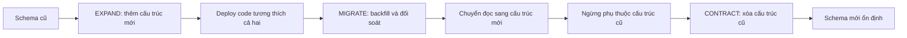
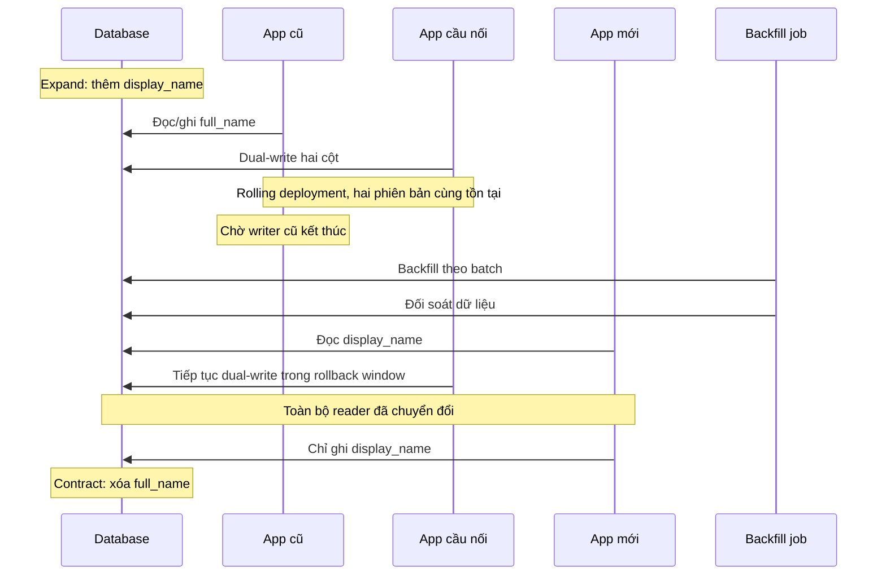

# Giới thiệu mở rộng, chuyển đổi rồi thu gọn lược đồ

Thay đổi cấu trúc database trong lúc ứng dụng vẫn phục vụ người dùng là một phần khó của CI/CD. Một lần phát hành có thể có nhiều phiên bản ứng dụng cùng tồn tại: instance cũ chưa được thay hết, instance mới đang khởi động, worker nền vẫn chạy hoặc một job theo lịch đang dùng schema trước đó. Nếu migration đổi tên hoặc xóa cột ngay khi deploy, một trong các phiên bản đó có thể lập tức lỗi.

Mô hình **Expand – Migrate – Contract** giải quyết vấn đề bằng cách chia thay đổi lớn thành các bước nhỏ, mỗi bước vẫn tương thích với phiên bản ứng dụng đang chạy. Ta mở rộng schema trước, triển khai code có thể làm việc với cả cấu trúc cũ và mới, chuyển dữ liệu, chuyển cách đọc/ghi, rồi chỉ thu gọn cấu trúc cũ sau khi không còn thành phần nào phụ thuộc.

Mục tiêu không phải giữ schema cũ mãi mãi. Mục tiêu là tạo một khoảng chuyển tiếp có kiểm soát để deployment, backfill, xác minh và rollback có thể diễn ra mà không buộc mọi instance phải đổi cùng một thời điểm.

## 1. Vì sao thay đổi schema trực tiếp dễ gây lỗi?

Giả sử bảng `customers` đang có cột `full_name`. Ứng dụng hiện tại đọc và ghi cột đó. Một yêu cầu mới muốn đổi thành `display_name`.

Nếu migration chạy ngay:

```sql
ALTER TABLE customers RENAME COLUMN full_name TO display_name;
```

Phiên bản ứng dụng cũ vẫn chạy câu lệnh `SELECT full_name ...` và bắt đầu thất bại. Trong rolling deployment, đây là tình huống bình thường: không phải mọi instance được thay thế trong cùng một thời điểm. Worker, consumer hoặc job batch có thể còn dùng code cũ lâu hơn cả web server.

Xóa cột cũng có rủi ro tương tự. Một dashboard, báo cáo, script vận hành hoặc tác vụ theo lịch có thể vẫn đọc cột cũ dù code ứng dụng chính đã chuyển đổi.

Các thay đổi có nguy cơ phá vỡ tương thích gồm:

- Đổi tên hoặc xóa cột/bảng mà code cũ còn sử dụng.
- Đổi kiểu dữ liệu khiến giá trị cũ không còn đọc/ghi được.
- Thêm `NOT NULL` khi dữ liệu hiện tại còn NULL hoặc phiên bản cũ không gửi giá trị.
- Thêm constraint hoặc foreign key khiến các thao tác ghi hợp lệ trước đây bị từ chối.
- Đổi enum hoặc message schema khiến consumer cũ không hiểu giá trị mới.
- Chuyển dữ liệu sang cấu trúc mới trong khi phiên bản cũ vẫn ghi cấu trúc cũ.
- Tạo index hoặc chạy backfill lớn gây khóa bảng, tăng replication lag hoặc làm cạn tài nguyên.

### Hai phiên bản có thể cùng truy cập database

Trong một rollout, database có thể được truy cập bởi:

| Thành phần | Ví dụ | Vì sao cần tính đến |
|---|---|---|
| Web/API instance cũ | Phiên bản đang phục vụ trước deployment | Có thể tiếp tục đọc/ghi schema cũ |
| Web/API instance mới | Phiên bản mới vừa được rollout | Có thể cần schema mới hoặc dual-write |
| Background worker | Consumer queue, scheduler, batch job | Có vòng đời deploy khác web instance |
| Công cụ vận hành | Report, ETL, BI, script quản trị | Không phải lúc nào cũng được deploy cùng ứng dụng |
| Replica hoặc hệ thống downstream | Read replica, CDC, data warehouse | Có thể nhận thay đổi với độ trễ hoặc phụ thuộc tên cột cũ |

Một migration an toàn phải tính tới tất cả consumer của schema, không chỉ service chính.

## 2. Mô hình Expand – Migrate – Contract

Quy trình có ba pha lớn, trong đó pha chuyển đổi dữ liệu và code thường được chia thành nhiều bước nhỏ.



**Expand** thêm cấu trúc mới theo cách không làm phiên bản cũ lỗi. Ví dụ thêm cột nullable, bảng mới, index hoặc constraint ở trạng thái chưa được validate.

**Migrate** triển khai code tương thích, sao chép/backfill dữ liệu cũ sang cấu trúc mới, kiểm tra tính nhất quán và chuyển dần cách đọc. Trong giai đoạn này có thể phải dual-write hoặc shadow-read.

**Contract** loại bỏ cấu trúc cũ sau khi mọi ứng dụng, worker, báo cáo và công cụ đã ngừng sử dụng. Đây thường là bước có khả năng phá vỡ tương thích và khó rollback nhất, vì vậy phải thực hiện sau cùng.

### Ma trận tương thích cần duy trì

Ví dụ khi chuyển từ `full_name` sang `display_name`:

| Ứng dụng | Schema cũ | Schema đã expand | Schema đã contract |
|---|---:|---:|---:|
| Phiên bản cũ chỉ biết `full_name` | Hoạt động | Phải tiếp tục hoạt động | Không tương thích |
| Phiên bản cầu nối dual-write | Không nên triển khai trước expand | Hoạt động | Có thể không tương thích nếu còn ghi `full_name` |
| Phiên bản mới chỉ dùng `display_name` | Không tương thích | Hoạt động | Hoạt động |

Điều kiện quan trọng là **schema đã expand phải hỗ trợ cả code cũ và code cầu nối**. Chỉ sau khi mọi code cũ đã được thay thế và dữ liệu đã sẵn sàng mới chuyển sang contract.

## 3. Chuẩn bị trước khi thay đổi database

Trước khi viết migration, cần hiểu quy mô dữ liệu và mọi consumer đang dùng schema.

### Lập bản đồ phụ thuộc

Tìm các nơi đọc/ghi cột hoặc bảng sẽ thay đổi:

- Repository, ORM mapping, stored procedure, trigger và view.
- API, worker, scheduler, consumer và batch job.
- Report, BI, ETL, CDC và data warehouse.
- Script quản trị, dashboard nội bộ và tác vụ hỗ trợ khách hàng.
- Ứng dụng hoặc phiên bản cũ có thể được rollback trong thời gian phát hành.

Tìm trong source code là bước đầu; cần đối chiếu với query log, database catalog, audit hoặc telemetry nếu có. Một script chạy hàng tháng có thể không xuất hiện trong test suite nhưng vẫn phụ thuộc schema.

### Đánh giá đặc tính migration

Ghi rõ:

- Database engine và phiên bản cụ thể.
- Số dòng, kích thước bảng, index và tốc độ tăng dữ liệu.
- Khóa, constraint, trigger và query quan trọng liên quan.
- Khả năng tạo index online/concurrently của engine.
- Thời gian khóa tối đa có thể chấp nhận.
- Replication topology, CDC và độ trễ cho phép.
- Khả năng backup, point-in-time recovery và thời gian khôi phục.
- Kế hoạch chạy migration, backfill, xác minh và dừng khẩn cấp.

DDL có hành vi khác nhau giữa PostgreSQL, MySQL, SQL Server và các phiên bản của chúng. Không giả định một câu `ALTER TABLE` luôn là metadata-only hoặc luôn chạy online. Hãy kiểm tra tài liệu đúng engine/version và thử trên dữ liệu có kích thước gần production.

### Migration phải có chủ sở hữu thực thi

Không để mỗi replica ứng dụng tự chạy migration khi khởi động. Nhiều instance có thể cùng tranh khóa hoặc chạy cùng một thay đổi. Hãy dùng một migration job có kiểm soát, một migration tool có lock/version tracking hoặc cơ chế leader duy nhất.

Migration nên là mã được review và lưu trong Git cùng release. Job migration có quyền DDL riêng; runtime application user chỉ có quyền cần thiết cho truy vấn nghiệp vụ. Tách quyền giúp giảm rủi ro ứng dụng vô tình thay đổi schema.

## 4. Pha Expand: thêm cấu trúc mới theo cách tương thích

Pha expand thường ưu tiên thao tác bổ sung, có thể để phiên bản cũ tiếp tục hoạt động.

Ví dụ thêm cột mới:

```sql
ALTER TABLE customers
ADD COLUMN display_name text;
```

Cột mới cho phép NULL nên phiên bản cũ không bắt buộc phải gửi giá trị. Phiên bản cũ tiếp tục đọc/ghi `full_name`; code mới có thể được chuẩn bị để sử dụng `display_name`.

Các thao tác expand thường gặp:

- Thêm cột nullable hoặc có default tương thích.
- Tạo bảng mới song song với bảng cũ.
- Thêm index mà không chặn thao tác ghi quá lâu, nếu engine hỗ trợ.
- Thêm constraint ở chế độ chưa validate rồi validate riêng.
- Thêm trường vào message/API theo cách consumer cũ có thể bỏ qua.

### Không thêm `NOT NULL` quá sớm

Nếu phiên bản cũ chưa biết cột mới, lệnh thêm cột `NOT NULL` không có default có thể khiến thao tác ghi của code cũ thất bại. Ngay cả khi có default, hành vi và chi phí DDL phụ thuộc engine/version.

Một cách an toàn là thêm cột nullable, triển khai code ghi giá trị, backfill dữ liệu cũ, xác minh không còn giá trị thiếu rồi mới thêm constraint bắt buộc.

Với PostgreSQL, có thể thêm check constraint ở trạng thái `NOT VALID`, sau đó validate khi dữ liệu đã đạt:

```sql
ALTER TABLE customers
ADD CONSTRAINT customers_display_name_present
CHECK (display_name IS NOT NULL) NOT VALID;

ALTER TABLE customers
VALIDATE CONSTRAINT customers_display_name_present;
```

Constraint `NOT VALID` vẫn được áp dụng cho các row mới hoặc row được cập nhật theo quy tắc của PostgreSQL, trong khi việc kiểm tra toàn bộ dữ liệu cũ được tách ra bước validate. Cần đánh giá lock và tác động thực tế theo phiên bản PostgreSQL đang dùng. Sau khi đã validate, có thể xem xét đặt `NOT NULL`; không copy nguyên mẫu này sang engine khác.

### Tạo index mà không gây gián đoạn không cần thiết

Với PostgreSQL, `CREATE INDEX CONCURRENTLY` cho phép tạo index trong khi các thao tác ghi vẫn tiếp tục, dù vẫn có chi phí I/O, CPU và một số giai đoạn chờ. Lệnh này không được chạy bên trong transaction block:

```sql
CREATE INDEX CONCURRENTLY idx_customers_display_name
ON customers (display_name);
```

Migration tool cần cấu hình bước này chạy ngoài transaction nếu công cụ mặc định bao toàn bộ migration trong transaction. Nếu tạo index concurrently thất bại, có thể để lại index invalid; kiểm tra catalog và xử lý index đó trước khi chạy lại. Với bảng lớn, theo dõi thời gian, disk và replication lag.

## 5. Deploy phiên bản cầu nối tương thích

Sau khi schema mới đã tồn tại, triển khai phiên bản ứng dụng cầu nối. Phiên bản này phải hoạt động với schema đã expand và có thể chạy đồng thời với phiên bản cũ trong thời gian rollout.

Với ví dụ đổi tên cột, phiên bản cầu nối có thể:

- Tiếp tục đọc `full_name` để chưa thay đổi hành vi người dùng.
- Ghi cùng giá trị vào cả `full_name` và `display_name` trong một transaction.
- Không yêu cầu cột mới ở những đường code chưa được chuyển đổi.
- Có feature flag để chuyển đọc sang cột mới sau khi backfill và đối soát hoàn tất.

Ví dụ SQL ghi đồng thời hai cột:

```sql
UPDATE customers
SET full_name = :name,
    display_name = :name
WHERE id = :customer_id;
```

Hai cột trong cùng một câu lệnh giúp cập nhật nguyên tử trong database. Nếu ứng dụng thực hiện hai câu lệnh riêng, cần transaction và xử lý lỗi đúng cách để tránh chỉ một cột được cập nhật.

### Dual-write cần có thời hạn

Dual-write giúp giữ hai cấu trúc đồng bộ trong thời gian chuyển tiếp, nhưng làm tăng độ phức tạp:

- Mọi đường ghi phải cập nhật cả hai nơi, kể cả admin tool và worker.
- Nếu một lần ghi thành công một nửa, dữ liệu có thể lệch.
- Nếu ghi sang hai hệ thống độc lập, không thể giả định một transaction cục bộ bao phủ cả hai.
- Backfill và request ghi đồng thời cần quy tắc xử lý race condition.

Nếu hai cấu trúc nằm trong cùng database, ưu tiên một transaction duy nhất. Nếu cần ghi sang hai hệ thống khác nhau, cân nhắc transactional outbox, CDC hoặc một quy trình đồng bộ có retry/idempotency; không dùng hai lệnh ghi độc lập rồi coi chúng là nguyên tử.

Một database trigger có thể đồng bộ cột cũ và mới trong thời gian chuyển đổi, nhưng trigger tạo thêm logic ẩn. Nếu dùng, phải quản lý trigger như code, kiểm thử với mọi đường ghi và có kế hoạch gỡ bỏ ở pha contract.

### Chờ toàn bộ phiên bản cũ ngừng ghi

Trong rolling deployment, có một khoảng thời gian phiên bản cũ và cầu nối cùng chạy. Phiên bản cũ chỉ ghi `full_name`, nên backfill chạy trước khi các instance cũ kết thúc có thể bỏ sót cập nhật mới.

Hãy đợi toàn bộ web instance, worker, scheduler và job có khả năng ghi cột cũ chuyển sang phiên bản cầu nối. Sau đó mới thực hiện lượt backfill cuối và đối soát. Nếu không thể xác định chắc chắn mọi writer, cần một cơ chế đồng bộ bổ sung như trigger hoặc CDC, được thiết kế và quan sát rõ ràng.

## 6. Pha Migrate: backfill dữ liệu theo lô

Sau khi code cầu nối đã được triển khai và mọi writer cũ đã được thay thế, chuyển dữ liệu hiện có từ cột cũ sang cột mới.

Không nên cập nhật hàng triệu dòng trong một transaction duy nhất nếu có thể tránh. Một transaction quá lớn có thể:

- Giữ row lock lâu và làm request nghiệp vụ phải chờ.
- Tạo lượng WAL/undo log lớn và làm replica chậm theo.
- Tăng bloat, áp lực I/O và thời gian vacuum/cleanup.
- Khó dừng hoặc tiếp tục khi tiến trình lỗi giữa chừng.
- Tạo một cửa sổ rollback dữ liệu lớn và khó kiểm soát.

Thay vào đó, chia backfill thành các batch nhỏ, commit độc lập và có thể chạy lại.

### Ví dụ backfill theo batch trên PostgreSQL

Ví dụ dưới đây giả định `full_name` là nguồn dữ liệu cũ, `display_name` ban đầu NULL và ứng dụng cầu nối đã dual-write. Một worker có thể lấy một batch như sau:

```sql
BEGIN;

WITH batch AS (
    SELECT id
    FROM customers
    WHERE display_name IS NULL
      AND full_name IS NOT NULL
    ORDER BY id
    LIMIT 500
    FOR UPDATE SKIP LOCKED
)
UPDATE customers AS c
SET display_name = c.full_name
FROM batch
WHERE c.id = batch.id;

COMMIT;
```

Lặp lại transaction cho đến khi không còn row phù hợp. `SKIP LOCKED` hữu ích khi có nhiều worker backfill để tránh chờ cùng một row; nếu dùng nhiều worker, cần lặp lại lượt quét vì một batch có thể bỏ qua row đang bị transaction khác khóa. Cuối cùng vẫn phải chạy truy vấn đối soát toàn bộ để xác nhận không còn dữ liệu thiếu hoặc lệch.

Nếu chỉ có một worker, có thể bỏ `SKIP LOCKED` và dùng batch tuần tự. Đặt batch size dựa trên thời gian transaction, lock wait, WAL, replication lag và tải production; 500 chỉ là giá trị minh họa.

### Backfill phải idempotent

Chạy lại một batch không được làm dữ liệu sai hoặc tạo tác dụng phụ trùng lặp. Điều kiện `display_name IS NULL` giúp chỉ điền các giá trị chưa có. Với phép biến đổi phức tạp, cần xác định rõ source of truth và điều kiện cập nhật để không ghi đè giá trị mới do ứng dụng tạo.

Ví dụ, nếu `display_name` được chuẩn hóa từ nhiều trường, hãy viết biểu thức chuyển đổi có tính xác định và lưu phiên bản quy tắc. Không để cùng một dữ liệu đầu vào tạo kết quả khác nhau tùy thời điểm hoặc locale của worker.

### Backfill có checkpoint và giới hạn tốc độ

Với bảng rất lớn, ghi nhận tiến độ theo khóa chính hoặc phân vùng. Mỗi batch nên log:

- Migration ID và batch/checkpoint.
- Khoảng ID hoặc partition đã xử lý.
- Số row được đọc, cập nhật, bỏ qua và lỗi.
- Thời gian transaction và lock wait.
- Replication lag, WAL generation và mức tải database.

Giới hạn tốc độ hoặc tạm dừng khi database chịu tải cao. Không dùng `OFFSET` lớn để phân trang toàn bảng nếu có thể dùng keyset theo primary key hoặc truy vấn các row chưa được chuyển đổi. Nếu có nhiều worker, chia phạm vi rõ và bảo đảm checkpoint không khiến row bị bỏ sót.

### Xử lý row lỗi hoặc dữ liệu không hợp lệ

Không ép mọi row vào giá trị mặc định chỉ để migration hoàn tất. Nếu một số row không thể chuyển đổi, ghi nhận ID và lý do trong bảng lỗi hoặc báo cáo có quyền truy cập hạn chế. Phân loại lỗi:

- Dữ liệu thiếu nhưng hợp lệ theo nghiệp vụ.
- Dữ liệu cũ sai định dạng cần làm sạch.
- Giá trị vượt giới hạn hoặc không ánh xạ được.
- Lỗi tạm thời do lock, timeout hoặc dependency.

Lỗi tạm thời có thể retry có giới hạn. Dữ liệu không hợp lệ cần quyết định nghiệp vụ hoặc quy trình sửa riêng. Không log thông tin cá nhân đầy đủ nếu chỉ cần ID và mã lỗi để điều tra.

## 7. Đối soát trước khi chuyển cách đọc

Backfill kết thúc không có nghĩa dữ liệu đã đúng. Cần kiểm tra completeness và consistency trước khi chuyển traffic đọc sang cột mới.

Với ví dụ đổi tên cột, có thể kiểm tra:

```sql
-- Còn row có nguồn cũ nhưng chưa được backfill?
SELECT count(*) AS missing_rows
FROM customers
WHERE full_name IS NOT NULL
  AND display_name IS NULL;

-- Hai cột có khác nhau không? Dùng khi quy tắc chuyển đổi là sao chép trực tiếp.
SELECT count(*) AS mismatched_rows
FROM customers
WHERE display_name IS DISTINCT FROM full_name;
```

`IS DISTINCT FROM` là cú pháp PostgreSQL so sánh có xử lý NULL. Nếu `display_name` được chuẩn hóa hoặc biến đổi, hãy so sánh với biểu thức chuyển đổi mong đợi thay vì so sánh trực tiếp hai cột.

Ngoài số lượng, nên kiểm tra mẫu dữ liệu, phân bố độ dài, ký tự đặc biệt, encoding, giá trị biên và các quan hệ khóa ngoại. Với bảng lớn, có thể đối soát theo partition hoặc khoảng ID, nhưng phải có lượt kiểm tra bao phủ toàn bộ dữ liệu trước khi chuyển đổi chính thức.

### Shadow-read để so sánh kết quả

Sau khi backfill, ứng dụng có thể đọc cột mới song song với cột cũ nhưng chỉ trả kết quả từ cột cũ. Kết quả đọc từ cột mới được so sánh ở chế độ shadow, ghi metric về số lượng mismatch và loại mismatch.

Không ghi cả hai bản ghi chứa dữ liệu nhạy cảm vào log. Dùng ID không nhạy cảm, mã loại lỗi và số lượng mismatch. Shadow-read cần giới hạn tỷ lệ hoặc tải để không nhân đôi truy vấn gây quá tải database.

Chỉ chuyển đọc khi:

- Backfill hoàn tất và có checkpoint cuối.
- Không còn row thiếu hoặc mismatch ngoài sai lệch đã được giải thích.
- Dual-write hoạt động trên mọi đường ghi.
- Shadow-read ổn định trong thời gian quan sát đủ dài.
- Metrics database và ứng dụng vẫn trong ngưỡng.

## 8. Chuyển cách đọc bằng feature flag

Không nhất thiết chuyển mọi request sang cấu trúc mới trong một lần. Feature flag có thể giúp bật đọc mới cho một nhóm nhỏ, một tenant hoặc một tỷ lệ traffic, sau đó tăng dần.

Một trình tự thường dùng:

1. Đọc cột cũ và shadow-read cột mới.
2. Bật đọc cột mới cho nội bộ hoặc nhóm canary.
3. So sánh lỗi, latency và kết quả nghiệp vụ.
4. Tăng tỷ lệ đọc mới khi các chỉ số đạt.
5. Chuyển toàn bộ reader sang cột mới.
6. Giữ dual-write trong thời gian rollback ứng dụng còn cần thiết.

Nếu có fallback từ cột mới về cột cũ, cần ghi metric để biết fallback xảy ra. Fallback giúp tránh lỗi tức thời nhưng có thể che giấu backfill thiếu hoặc code mới sai. Không để fallback tồn tại âm thầm vô thời hạn.

### Đảm bảo mọi reader đã chuyển đổi

Trước khi xóa cột cũ, kiểm tra cả:

- API và worker ở mọi phiên bản.
- Job định kỳ, batch, data export và report.
- View, stored procedure, trigger và function trong database.
- Dashboard/BI, ETL, CDC connector và replica consumer.
- Script vận hành, công cụ hỗ trợ và tích hợp của hệ thống khác.

Có thể dùng query log hoặc database activity để phát hiện truy vấn còn tham chiếu cột cũ, nhưng quan sát trong một khoảng thời gian ngắn không chứng minh không còn consumer chạy theo tháng/quý. Cần inventory và xác nhận từ chủ sở hữu hệ thống.

## 9. Ngừng dual-write và chuẩn bị Contract

Khi toàn bộ reader đã dùng cấu trúc mới, có thể lên kế hoạch ngừng ghi cấu trúc cũ. Tuy nhiên, đừng dừng dual-write ngay sau khi bật đọc mới nếu phiên bản cũ vẫn là phương án rollback.

Một giai đoạn an toàn thường là:

1. Toàn bộ code đọc `display_name`.
2. Code vẫn ghi cả `full_name` và `display_name` trong thời gian rollback window.
3. Hết thời gian rollback và xác nhận không còn phiên bản/job cũ cần `full_name`.
4. Triển khai code chỉ ghi `display_name`.
5. Theo dõi để chắc chắn không còn thao tác ghi hoặc đọc `full_name`.
6. Thực hiện contract trong một migration riêng.

Rollback window cần được định nghĩa theo quy trình phát hành, ví dụ thời gian quan sát sau deploy, chu kỳ job và khả năng khôi phục. Không chọn một khoảng thời gian tùy ý mà bỏ qua batch job chạy thưa hoặc consumer có thể bị dừng lâu.

## 10. Pha Contract: loại bỏ cấu trúc cũ

Contract là bước cuối cùng và thường khó đảo ngược nhất. Chỉ thực hiện khi đã xác nhận:

- Không còn phiên bản ứng dụng nào đọc/ghi cấu trúc cũ.
- Worker, scheduler, consumer và batch job đã được cập nhật.
- Report, ETL, view, trigger và tích hợp downstream không còn phụ thuộc.
- Backfill và đối soát đã đạt.
- Thời gian rollback dựa trên schema cũ đã kết thúc.
- Có backup/PITR và kế hoạch phục hồi được kiểm chứng.
- DDL đã được thử trên phiên bản database và quy mô dữ liệu tương đương.

Với ví dụ, migration contract có thể xóa cột cũ:

```sql
ALTER TABLE customers
DROP COLUMN full_name;
```

Lệnh này chỉ được chạy sau khi mọi dependency đã được gỡ. `DROP COLUMN` có thể cần lock metadata và có ảnh hưởng tùy engine/version; việc xóa cột không nhất thiết thu hồi dung lượng file ngay lập tức. Hãy đánh giá lock timeout, thời gian chạy và tác động tới replica trước khi thực thi.

Nếu cần xóa index cũ trên PostgreSQL mà giảm chặn ghi, có thể dùng `DROP INDEX CONCURRENTLY` khi phù hợp. Lệnh này có giới hạn riêng và không chạy trong transaction block. Kiểm tra dependency của index trước khi xóa.

### Contract có thể chia thành nhiều lần phát hành

Không bắt buộc xóa mọi thứ trong một migration. Có thể:

- Ngừng dùng cột cũ ở code.
- Xóa trigger đồng bộ sau khi dual-write đã dừng.
- Xóa index hoặc constraint không còn cần.
- Xóa cột cũ trong một release sau.
- Xóa bảng cũ sau khi dữ liệu và downstream đã chuyển hoàn toàn.

Chia nhỏ giúp mỗi bước có phạm vi ảnh hưởng và kế hoạch khôi phục rõ ràng hơn.

## 11. Ví dụ xuyên suốt: đổi `full_name` thành `display_name`

Giả sử bảng hiện tại:

```sql
CREATE TABLE customers (
    id bigint PRIMARY KEY,
    full_name text NOT NULL,
    created_at timestamptz NOT NULL DEFAULT now()
);
```

Mục tiêu cuối cùng là code và schema chỉ dùng `display_name`. Quy trình triển khai có thể chia thành các release sau.

### Release A — Expand schema

Thêm cột mới nhưng giữ nguyên cột cũ:

```sql
ALTER TABLE customers
ADD COLUMN display_name text;
```

Ứng dụng cũ tiếp tục hoạt động vì `full_name` vẫn tồn tại và `display_name` cho phép NULL.

### Release B — Deploy bridge code

Code mới vẫn đọc `full_name`, nhưng mọi thao tác ghi cập nhật cả hai cột trong cùng transaction. Trong giai đoạn rolling, phiên bản cũ có thể vẫn tồn tại và chỉ ghi `full_name`; vì vậy chưa được coi dữ liệu đã đồng bộ hoàn toàn.

Đợi tất cả instance, worker và job cũ kết thúc. Xác nhận không còn writer cũ trước khi chuyển sang bước backfill cuối.

### Job C — Backfill và verify

Chạy batch update cho các row chưa có `display_name`. Giới hạn tốc độ, ghi checkpoint, theo dõi lock và replication lag. Chạy truy vấn kiểm tra `missing_rows` và `mismatched_rows` cho toàn bảng.

Nếu có row lỗi, xử lý theo quy tắc dữ liệu trước khi bật đọc mới. Không bỏ qua mismatch chỉ vì tỷ lệ nhỏ nếu đó là dữ liệu nghiệp vụ quan trọng.

### Release D — Switch reads

Bật feature flag để đọc `display_name` cho nhóm canary. Theo dõi lỗi, latency, fallback và kết quả shadow comparison. Tăng dần tới toàn bộ traffic khi đạt. Vẫn dual-write trong rollback window để code cũ có thể quay lại mà không mất cập nhật mới.

### Release E — Stop old writes

Sau khi hết rollback window và mọi reader/writer đã chuyển đổi, triển khai code chỉ ghi `display_name`. Theo dõi query log, job và report để chắc chắn `full_name` không còn được sử dụng.

### Release F — Contract schema

Xóa trigger hoặc logic đồng bộ cũ nếu có, sau đó xóa `full_name` trong migration riêng. Kiểm tra ứng dụng, worker và báo cáo sau migration. Từ thời điểm này, rollback về code chỉ biết `full_name` không còn là phương án an toàn nếu không phục hồi schema và dữ liệu tương ứng.



Ví dụ trên minh họa một lần đổi tên cột. Với thay đổi kiểu dữ liệu, tách bảng, thay khóa chính hoặc chuyển dữ liệu giữa database, các bước có thể phức tạp hơn nhưng nguyên tắc tương thích theo từng giai đoạn vẫn giữ nguyên.

## 12. Kiểm soát lock, transaction và tải database

Migration có thể đúng về logic nhưng vẫn gây outage do khóa hoặc tài nguyên. Cần kiểm tra cả cách DDL và backfill tương tác với workload thật.

### Giới hạn thời gian chờ khóa

Với PostgreSQL, có thể đặt `lock_timeout` và `statement_timeout` cho session migration:

```sql
SET lock_timeout = '3s';
SET statement_timeout = '15min';
```

Nếu không lấy được lock trong thời gian ngắn, migration có thể thất bại và được retry sau thay vì chờ trong hàng đợi rồi chặn các request khác. Timeout phải phù hợp với thao tác cụ thể; không đặt một giá trị chung cho mọi migration.

### Tránh transaction quá dài

Giữ transaction mở lâu có thể giữ lock, làm tăng lượng phiên bản row cần giữ và cản trở vacuum. Backfill nên commit theo batch, ghi checkpoint sau khi commit thành công và có thể tiếp tục sau lỗi.

Không cập nhật cột/index lớn trong giờ cao điểm nếu chưa đánh giá tác động. Theo dõi CPU, I/O, lock wait, connection pool, WAL và replication lag trong suốt quá trình.

### Migration và backfill là hai loại công việc khác nhau

DDL thay đổi cấu trúc; backfill biến đổi dữ liệu. Không nhất thiết phải chạy toàn bộ backfill trong cùng migration file hoặc cùng transaction với DDL. Tách chúng giúp:

- Migration schema hoàn tất nhanh và có trạng thái rõ.
- Backfill có thể pause/resume và giới hạn tốc độ.
- Có thể quan sát tiến độ và xử lý row lỗi.
- Không giữ transaction DDL mở trong lúc chuyển hàng triệu row.

Một migration tool có thể quản lý version schema, trong khi backfill chạy như job riêng có checkpoint. Cần ghi rõ dependency: job chỉ chạy sau khi schema expand và code cầu nối đã sẵn sàng.

## 13. Tích hợp Expand–Migrate–Contract vào CI/CD

Pipeline nên thể hiện rõ migration là một phần của release và có thứ tự phụ thuộc. Không nên gộp mọi thao tác vào một lệnh deploy không có trạng thái trung gian.

Một luồng điển hình:

1. **Pull request:** kiểm tra migration script, chạy migration test trên database tạm và kiểm tra code tương thích với schema expand.
2. **Pre-deploy:** xác minh backup/PITR, schema version, capacity và lock risk.
3. **Expand job:** chạy DDL bổ sung một lần bằng migration identity riêng.
4. **Application rollout:** deploy bridge code theo rolling/canary; theo dõi phiên bản cũ còn hoạt động.
5. **Backfill job:** chạy theo batch, checkpoint, rate limit và metrics.
6. **Verification gate:** kiểm tra missing/mismatch, shadow-read và consumer inventory.
7. **Read switch:** bật feature flag theo canary rồi tăng dần.
8. **Rollback window:** giữ dual-write và cấu trúc cũ trong thời gian đã định.
9. **Stop old writes:** deploy code chỉ dùng schema mới sau khi rollback cũ không còn cần.
10. **Contract job:** chạy DDL loại bỏ cấu trúc cũ trong một release riêng.

### Kiểm thử tương thích theo ma trận

Test migration cần kiểm tra không chỉ schema cuối mà cả các trạng thái trung gian:

| Trạng thái database | Phiên bản cần kiểm thử | Kết quả mong muốn |
|---|---|---|
| Schema cũ | App cũ | Hành vi hiện tại vẫn đạt |
| Schema đã expand | App cũ | Không lỗi khi cột/bảng mới tồn tại |
| Schema đã expand | Bridge app | Dual-write và đọc cũ hoạt động |
| Schema đã migrate | Bridge app | Dữ liệu mới đầy đủ và đồng bộ |
| Schema đã migrate | App mới đọc cấu trúc mới | Kết quả nghiệp vụ tương đương |
| Schema đã contract | App mới | Không còn tham chiếu cấu trúc cũ |

Ngoài unit test, nên có integration test chạy migration thật trên đúng database engine/version. Test trên H2 không đủ để chứng minh migration PostgreSQL hoặc MySQL an toàn vì DDL, locking và kiểu dữ liệu khác nhau.

### Chạy migration một lần và có quyền riêng

Trong CI/CD, tạo job migration riêng với concurrency control hoặc migration lock. Không để mỗi replica chạy DDL lúc startup. Credential của job migration cần quyền DDL; credential runtime không nên có quyền `ALTER`, `DROP` hoặc `CREATE` nếu không cần.

Job nên ghi nhận migration ID, release ID, schema version trước/sau, thời điểm, người/identity khởi chạy, kết quả và checkpoint backfill. Không ghi dữ liệu nhạy cảm vào log.

## 14. Rollback và phục hồi dữ liệu

Expand–Migrate–Contract giúp rollback dễ hơn ở các pha đầu vì cấu trúc cũ vẫn còn. Nhưng rollback cần phân biệt code, schema và dữ liệu.

### Trước khi switch reads

Nếu bridge code gặp lỗi, có thể quay lại app cũ trong khi giữ cột mới đã thêm. Schema expand thường có thể được để nguyên vì cột mới chưa làm code cũ lỗi. Không cần xóa ngay cột mới chỉ để rollback ứng dụng.

### Sau khi switch reads nhưng còn dual-write

Có thể chuyển feature flag về đọc cột cũ nếu dữ liệu cũ vẫn được cập nhật đồng bộ. Đây là lý do dual-write thường được giữ trong rollback window. Trước khi rollback, kiểm tra cột cũ có còn đầy đủ và tương thích với phiên bản cần khôi phục không.

### Sau khi ngừng ghi cấu trúc cũ

Nếu app chỉ ghi `display_name`, cột `full_name` có thể đã cũ. Rollback về app cũ có nguy cơ đọc dữ liệu lỗi thời. Khi đó cần backfill ngược có kiểm soát hoặc triển khai forward fix; không tự giả định đổi feature flag là đủ.

### Sau khi contract

Khi cột cũ đã bị xóa, rollback code cũ không còn an toàn. Muốn quay lại có thể phải thêm lại cấu trúc, phục hồi dữ liệu từ backup/PITR hoặc chạy migration ngược có kiểm chứng. Với dữ liệu bị xóa hoặc biến đổi không thể đảo ngược, cần quy trình phục hồi riêng.

Vì vậy, contract thường được tách khỏi release chuyển đổi và chỉ chạy sau khi rollback window kết thúc. Backup/PITR phải được thử phục hồi; một bản backup tồn tại nhưng chưa từng restore thử không phải bằng chứng phục hồi đáng tin cậy.

## 15. Những thay đổi cần lưu ý đặc biệt

### Đổi tên cột hoặc bảng

Không rename trực tiếp khi code cũ còn tồn tại. Thêm cột/bảng mới, dual-write hoặc đồng bộ, backfill, chuyển reader, rồi drop cấu trúc cũ sau cùng.

### Thay đổi kiểu dữ liệu

Nếu chuyển `integer` sang `bigint`, hoặc text sang kiểu chuẩn hóa, hãy xác định miền giá trị và khả năng đọc của phiên bản cũ. Với chuyển đổi phức tạp, tạo cột mới có kiểu đích, ghi song song, backfill và validate trước khi switch.

### Thêm enum value

Một phiên bản ứng dụng cũ có thể không xử lý được enum mới. Trước khi bắt đầu ghi giá trị mới, cần deploy consumer/provider có khả năng bỏ qua hoặc xử lý unknown value theo hợp đồng. Với hệ thống có nhiều ngôn ngữ hoặc client, kiểm tra cả parser và serializer.

### Thêm `NOT NULL` hoặc foreign key

Trước hết làm sạch/backfill dữ liệu, đảm bảo mọi writer gửi giá trị hợp lệ, sau đó thêm constraint. Trên PostgreSQL, có thể dùng `NOT VALID` và `VALIDATE CONSTRAINT` cho một số loại constraint để tách việc kiểm tra dữ liệu cũ khỏi thao tác thêm constraint. Kiểm tra giới hạn của engine/version.

### Tách hoặc gộp bảng

Đây là thay đổi lớn hơn đổi tên cột. Cần định nghĩa source of truth, đồng bộ dữ liệu, xử lý ghi đồng thời, quan hệ khóa ngoại, tính duy nhất và thứ tự chuyển reader/writer. Có thể cần outbox/CDC hoặc một giai đoạn dual-read để đối soát. Không coi việc copy dữ liệu xong là đủ nếu các giao dịch mới vẫn ghi vào bảng cũ.

## 16. Những cách làm dễ gây sự cố

| Cách làm | Rủi ro | Cách cải thiện |
|---|---|---|
| Rename/drop cột trong cùng release với code mới | Instance cũ lỗi ngay trong rolling deployment | Expand trước, contract sau |
| Thêm cột `NOT NULL` khi app cũ chưa ghi | Request cũ thất bại | Nullable, deploy bridge, backfill rồi thêm constraint |
| Backfill toàn bảng trong một transaction | Lock lâu, WAL lớn và khó tiếp tục | Batch nhỏ, checkpoint và rate limit |
| Backfill khi writer cũ còn hoạt động mà không có đồng bộ | Giá trị mới bị bỏ sót hoặc lệch | Chờ old writer kết thúc hoặc dùng cơ chế đồng bộ được kiểm soát |
| Switch read ngay sau khi bắt đầu backfill | App đọc NULL hoặc dữ liệu cũ | Đối soát và shadow-read trước khi chuyển |
| Dừng dual-write ngay khi canary đạt | Rollback về app cũ có thể đọc dữ liệu stale | Giữ dual-write trong rollback window |
| Contract ngay sau deploy | Job hoặc report cũ có thể còn phụ thuộc | Inventory consumer và chờ đủ chu kỳ vận hành |
| Cho từng replica tự chạy migration | Tranh chấp DDL và trạng thái không nhất quán | Một migration job có lock/version tracking |
| Dùng H2 để chứng minh DDL production an toàn | Khác biệt engine và locking bị bỏ qua | Test trên đúng engine/version |
| Giả định migration ngược luôn khôi phục dữ liệu | Thay đổi dữ liệu có thể không đảo ngược | Backup/PITR, forward fix và rollback plan riêng |

## 17. Checklist cho một thay đổi schema an toàn

Trước khi triển khai:

- [ ] Đã xác định tất cả ứng dụng, worker, job, report và downstream dùng schema cũ.
- [ ] Đã kiểm tra database engine/version, kích thước bảng và rủi ro lock.
- [ ] Có backup/PITR và đã kiểm chứng quy trình restore.
- [ ] Migration được version hóa, review và chạy bằng job riêng có concurrency control.
- [ ] Pha expand chỉ thêm cấu trúc tương thích với code cũ.
- [ ] Code cầu nối có thể chạy đồng thời với phiên bản cũ.
- [ ] Dual-write có transaction hoặc cơ chế đồng bộ phù hợp và có thời hạn.
- [ ] Backfill có batch, checkpoint, idempotency, rate limit và khả năng resume.
- [ ] Có theo dõi lock, WAL, replication lag, CPU, I/O và lỗi batch.
- [ ] Đã đối soát completeness và consistency trên toàn bộ dữ liệu.
- [ ] Shadow-read hoặc canary xác nhận kết quả mới trước khi chuyển toàn bộ reader.
- [ ] Rollback window được định nghĩa; dual-write được giữ đủ lâu nếu cần rollback.
- [ ] Đã xác nhận không còn reader/writer cũ trước khi contract.
- [ ] Contract chạy trong migration riêng và có kế hoạch xử lý lock/rollback.
- [ ] Test migration trên đúng database engine/version và dữ liệu có quy mô đại diện.
- [ ] Schema, application version và release ID có bằng chứng truy vết.

Expand–Migrate–Contract giúp database và ứng dụng thay đổi theo nhịp riêng mà vẫn tương thích trong giai đoạn chuyển tiếp. Khi schema mới được thêm trước, code cầu nối giữ hai cấu trúc đồng bộ, backfill được đối soát và cấu trúc cũ chỉ bị xóa sau khi hết phụ thuộc, CI/CD có thể phát hành thay đổi dữ liệu theo từng bước nhỏ, dễ quan sát và có phương án phục hồi rõ ràng.
