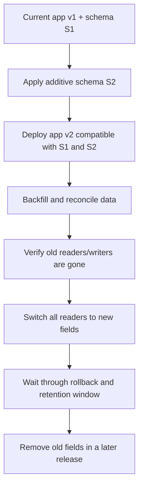
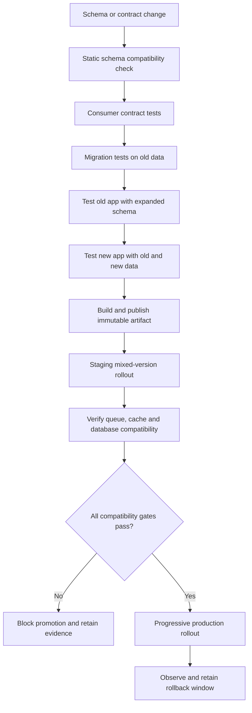

# Giữ tương thích khi nhiều phiên bản ứng dụng cùng chạy

Trong một lần phát hành, phiên bản cũ và mới thường cùng tồn tại trong một khoảng thời gian. Với rolling deployment, một số pod đã chạy bản mới trong khi pod khác vẫn chạy bản cũ. Với blue-green, hai môi trường có thể cùng hoạt động trước và sau khi chuyển traffic. Với canary, một phần request được xử lý bởi phiên bản mới trong khi phần còn lại vẫn đi vào phiên bản hiện tại. Ngoài ra, queue có thể còn message cũ, mobile client có thể chưa được cập nhật, worker có thể xử lý job được tạo từ nhiều ngày trước và rollback có thể đưa ứng dụng quay về phiên bản trước.

Vì vậy, thay đổi dữ liệu và hợp đồng giao tiếp cần được thiết kế để các phiên bản có thể cùng hoạt động an toàn. **Tương thích khi nhiều phiên bản ứng dụng cùng chạy** là khả năng giữ cho các producer, consumer, service, database và client tiếp tục trao đổi dữ liệu đúng trong giai đoạn chuyển tiếp. Đây là điều kiện quan trọng để CI/CD có thể phát hành dần, dừng rollout hoặc quay lui mà không làm hỏng dữ liệu.

## 1. Vì sao nhiều phiên bản cùng tồn tại?

Trong môi trường thật, không có một thời điểm duy nhất mà mọi thành phần chuyển sang phiên bản mới. Các tình huống phổ biến gồm:

- Rolling update thay pod hoặc instance theo từng nhóm.
- Canary chỉ chuyển một phần traffic sang phiên bản mới.
- Blue-green giữ môi trường cũ trong lúc kiểm tra môi trường mới.
- Autoscaling tạo instance mới trong khi instance cũ vẫn xử lý request.
- Job hoặc message được tạo bởi phiên bản trước nhưng xử lý bởi worker phiên bản mới.
- Consumer triển khai chậm hơn producer hoặc ngược lại.
- Mobile app, desktop client hoặc đối tác bên ngoài cập nhật theo lịch riêng.
- Rollback đưa application code về bản cũ trong khi database đã được mở rộng hoặc dữ liệu mới đã được ghi.

Ngay cả khi rollout chỉ mất vài phút, queue backlog, cache, session và client cũ có thể kéo dài thời gian tương thích lên nhiều giờ, nhiều ngày hoặc nhiều tháng. Do đó, không thể giả định “deploy xong là chỉ còn một version”.

## 2. Tương thích là một hợp đồng giữa producer và consumer

Một thành phần tạo dữ liệu được gọi là producer; thành phần đọc hoặc xử lý dữ liệu đó là consumer. Một hệ thống có thể vừa là producer vừa là consumer. Database schema, API request/response, event, message, cache entry, session và file đều là các hợp đồng dữ liệu.

Ví dụ:

```text
order-service v1 ----writes----> orders table
      |                              ^
      +----publishes event----------> billing-service v1

During rollout:
order-service v1 and v2 may both write/read
billing-service v1 and v2 may consume queued events
```

Một thay đổi chỉ an toàn khi các bên liên quan hiểu dữ liệu theo cách tương thích trong thời gian chuyển tiếp. Cần xác định ai đang ghi, ai đang đọc, dữ liệu cũ tồn tại bao lâu và thành phần nào có thể được rollback độc lập.

Đừng chỉ kiểm tra ứng dụng mới với schema mới. Hãy kiểm tra cả các cặp quan trọng như ứng dụng cũ với schema mới, ứng dụng mới với dữ liệu cũ và producer cũ với consumer mới.

## 3. Backward compatibility và forward compatibility

Hai thuật ngữ này thường bị dùng lẫn nhau. Hãy luôn nêu rõ góc nhìn producer/consumer khi sử dụng:

- **Backward compatible change:** phiên bản mới vẫn hỗ trợ những hợp đồng hoặc dữ liệu mà consumer/producer cũ đang sử dụng. Ví dụ API server mới vẫn chấp nhận request theo định dạng cũ.
- **Forward-compatible consumer:** consumer hiện tại có thể xử lý dữ liệu được tạo bởi producer mới, kể cả khi dữ liệu có thêm field hoặc enum value mà consumer chưa biết, theo quy tắc đã thiết kế.
- **Breaking change:** một bên không còn hiểu hoặc chấp nhận hợp đồng mà bên kia đang gửi; thay đổi có thể làm request thất bại, dữ liệu bị diễn giải sai hoặc message bị dead-letter.

Ví dụ về API: thêm một response field tùy chọn thường có thể backward compatible với client cũ nếu client bỏ qua field chưa biết. Đổi tên field bắt buộc hoặc thay kiểu dữ liệu thường là breaking change. Ví dụ về event: consumer mới đọc được event cũ là một chiều tương thích; consumer cũ có xử lý được event mới hay không là chiều khác.

Không có định nghĩa “backward” hoàn toàn độc lập với vai trò. Trong tài liệu review, nên viết cụ thể: “server v2 tiếp tục nhận request v1”, “consumer v1 bỏ qua field mới” hoặc “ứng dụng v1 đọc được schema database sau bước expand”.

## 4. Ma trận phiên bản cần kiểm tra

Giả sử release hiện tại là N và release sắp tới là N+1. Trong quá trình rollout, nhóm nên xem xét các tổ hợp sau:

| Producer/writer | Consumer/reader | Câu hỏi cần trả lời |
|---|---|---|
| N | N | Hệ thống hiện tại tiếp tục hoạt động với dữ liệu cũ không? |
| N+1 | N | Thành phần cũ có đọc được dữ liệu mới không? |
| N | N+1 | Thành phần mới có đọc được dữ liệu do phiên bản cũ tạo không? |
| N+1 | N+1 | Hai thành phần mới có tuân thủ hợp đồng mới không? |
| N+1 | rollback về N | Dữ liệu đã được ghi có còn đọc được sau rollback không? |

Không phải hệ thống nào cũng cần hỗ trợ mọi tổ hợp vô thời hạn. Nhưng ít nhất phải xác định các tổ hợp có thể xuất hiện trong rollout, queue retention, client support window và rollback window. Nếu một tổ hợp không được hỗ trợ, pipeline hoặc rollout controller cần ngăn nó xảy ra.

Với nhiều service, ma trận có thể lớn. Hãy bắt đầu từ dependency graph và luồng dữ liệu quan trọng: service nào ghi bảng, ai đọc bảng, ai publish event, ai consume event và client nào gọi API.

## 5. Nguyên tắc thay đổi theo hướng mở rộng trước

Một cách an toàn là thực hiện thay đổi theo các bước tương thích:

1. **Expand:** thêm cấu trúc hoặc khả năng mới nhưng vẫn giữ đường cũ hoạt động.
2. **Migrate:** cập nhật ứng dụng, chuyển dữ liệu và chuyển consumer dần sang cấu trúc mới.
3. **Verify:** xác minh không còn thành phần nào phụ thuộc vào cấu trúc cũ.
4. **Contract:** loại bỏ cấu trúc cũ trong một release sau, khi không còn consumer cần nó.

Mẫu này thường được gọi là *expand-migrate-contract* hoặc *expand-contract*. Điểm quan trọng là tách thao tác phá tương thích khỏi bước rollout ứng dụng ban đầu. Khi v1 và v2 cùng chạy, cả hai đều có thể làm việc với schema mở rộng.

Không gộp thêm cột mới, chuyển toàn bộ dữ liệu, xóa cột cũ và deploy code mới trong một migration duy nhất nếu ứng dụng cũ vẫn đang chạy. Việc tách giai đoạn tạo ra điểm dừng an toàn và giữ khả năng rollback ứng dụng.

## 6. Ví dụ expand-migrate-contract cho database

Giả sử bảng `customers` hiện có cột `full_name`. Nhóm muốn tách thành `given_name` và `family_name`.

**Giai đoạn 1 — Expand:** thêm hai cột mới, giữ `full_name`:

```sql
ALTER TABLE customers
    ADD COLUMN given_name VARCHAR(100),
    ADD COLUMN family_name VARCHAR(100);
```

Ở bước này, code cũ vẫn đọc/ghi `full_name`. Code mới cần được thiết kế để đọc dữ liệu cũ khi hai cột mới chưa được backfill.

**Giai đoạn 2 — Deploy code tương thích:**

- Code mới đọc `given_name` và `family_name` khi dữ liệu đã có.
- Nếu dữ liệu cũ chưa được chuyển đổi, code có fallback rõ ràng sang `full_name`.
- Trong giai đoạn dual-write, mọi thay đổi tên phải cập nhật cả biểu diễn cũ và mới theo một transaction hoặc cơ chế nhất quán được thiết kế.
- Code cũ vẫn hoạt động vì cột `full_name` chưa bị xóa.

Dual-write có thể tạo sai lệch nếu hai lần ghi không atomic hoặc một writer không tuân thủ. Nếu có nhiều service ghi cùng dữ liệu, cần chọn một nơi sở hữu việc chuyển đổi, dùng transaction/outbox hoặc cơ chế reconciliation phù hợp. Không bật dual-write theo kiểu tùy tiện ở mọi consumer.

**Giai đoạn 3 — Migrate:** backfill theo batch, có checkpoint và giới hạn tải:

```sql
UPDATE customers
SET given_name = split_part(full_name, ' ', 1),
    family_name = NULLIF(
        substring(full_name from length(split_part(full_name, ' ', 1)) + 2),
        ''
    )
WHERE given_name IS NULL
  AND full_name IS NOT NULL;
```

Đây chỉ là minh họa cho PostgreSQL và giả định quy tắc tách tên đơn giản. Tên người thực tế có thể có nhiều thành phần, dấu cách và quy tắc địa phương; cần quy tắc nghiệp vụ đã được xác nhận. Với bảng lớn, không chạy một câu update khổng lồ nếu nó gây lock, WAL hoặc replication lag quá lớn. Hãy chia batch theo khóa ổn định và theo dõi tiến độ.

**Giai đoạn 4 — Cutover:** sau khi backfill và kiểm tra dữ liệu, chuyển code sang đọc/ghi cấu trúc mới. Giữ cột cũ trong suốt rollback window và khi còn consumer cần.

**Giai đoạn 5 — Contract:** trong một release riêng, sau khi chứng minh không còn writer/reader phụ thuộc, mới ngừng dual-write và xóa `full_name`.

## 7. Trình tự release khi thay đổi database

Một trình tự tham khảo cho thay đổi schema:



Migration thường được chạy trước khi deploy code cần schema mới, nhưng phải tương thích với code đang chạy. Một số thay đổi có thể được thực hiện sau deploy tùy cách ứng dụng xử lý thiếu field; điều quan trọng là thứ tự đã được kiểm chứng trong môi trường staging.

Không chạy migration phá hủy trước khi mọi instance cũ dừng. Với hệ thống có nhiều region hoặc worker, cần xác minh toàn bộ consumer đã chuyển phiên bản và queue cũ đã được xử lý.

## 8. Thêm cột, đổi kiểu và xóa cột

Không phải mọi DDL đều có cùng rủi ro. Cần xem xét database engine, version, kích thước bảng, lock mode và cách migration được thực thi.

| Thay đổi | Rủi ro | Cách tiếp cận an toàn hơn |
|---|---|---|
| Thêm nullable column | Code cũ thường bỏ qua được, nhưng DDL vẫn có thể lock | Thêm trước, deploy code tương thích rồi mới ghi dữ liệu |
| Thêm column `NOT NULL` | Có thể cần default/backfill và validation trên dữ liệu cũ | Thêm nullable, backfill, kiểm tra, rồi thêm constraint theo bước phù hợp engine |
| Đổi tên column | Code cũ hoặc mới có thể không tìm thấy tên còn lại | Thêm cột mới, dual-read/write, migrate, rồi xóa cột cũ sau |
| Đổi kiểu dữ liệu | Có thể cần rewrite, mất dữ liệu hoặc lock lâu | Thêm cột mới, chuyển đổi theo batch và xác minh |
| Xóa column/table | Phiên bản cũ có thể còn đọc/ghi | Xác minh không còn dependency rồi contract trong release sau |
| Thêm index | Có thể ảnh hưởng tải và lock | Dùng cách tạo index online/concurrently nếu engine hỗ trợ và kiểm tra giới hạn |

Ví dụ PostgreSQL hỗ trợ `CREATE INDEX CONCURRENTLY` trong một số trường hợp để giảm lock ghi, nhưng câu lệnh này có các giới hạn riêng và không chạy được bên trong transaction block thông thường. Cần thiết kế migration tool phù hợp, xử lý index invalid nếu lệnh thất bại và xác minh query plan sau khi tạo.

Không giả định một câu DDL là “nhanh” chỉ vì nó ngắn. Hãy thử trên dữ liệu có kích thước gần production và đo lock duration, replication lag cùng tác động đến workload.

## 9. Thay đổi API theo hướng tương thích

API server và client thường không được deploy đồng thời. Web client có thể được cache, mobile app có thể tồn tại nhiều tháng và đối tác bên ngoài có thể nâng cấp theo lịch riêng.

Các thay đổi thường có thể triển khai an toàn nếu hợp đồng cho phép:

- Thêm response field tùy chọn mà client cũ bỏ qua được.
- Thêm endpoint mới trong khi giữ endpoint cũ.
- Thêm request field tùy chọn có default hợp lý.
- Mở rộng giới hạn theo cách không thay đổi ý nghĩa của dữ liệu hiện tại.
- Thêm capability mới có feature negotiation hoặc versioning rõ ràng.

Các thay đổi có nguy cơ breaking:

- Xóa hoặc đổi tên field đang được client dùng.
- Đổi kiểu dữ liệu hoặc đơn vị đo mà không có chuyển tiếp.
- Đổi ý nghĩa của field nhưng giữ nguyên tên.
- Chuyển field tùy chọn thành bắt buộc.
- Thêm enum value nhưng client cũ xử lý enum theo kiểu fail-fast.
- Thay đổi status code hoặc error semantics mà client phụ thuộc.
- Siết validation làm request hợp lệ trước đây bị từ chối.

Thêm field không phải lúc nào cũng an toàn. Client có thể deserialize bằng schema strict, dùng exhaustive switch trên enum hoặc reject unknown property. Hãy kiểm tra hành vi client thực tế và contract test, không chỉ dựa vào giả định rằng JSON parser sẽ bỏ qua field lạ.

## 10. Deprecation và loại bỏ API cũ

Khi cần thay API, hãy dùng quy trình deprecation có thời gian chuyển tiếp:

1. Công bố API/field mới và hướng dẫn migration.
2. Duy trì API cũ trong thời gian hỗ trợ đã định nghĩa.
3. Thêm telemetry để biết client nào còn gọi API cũ.
4. Gửi cảnh báo hoặc header deprecation/sunset nếu giao thức và hệ sinh thái hỗ trợ.
5. Hỗ trợ consumer chuyển sang API mới và kiểm tra bằng contract test.
6. Chỉ loại bỏ API cũ khi usage và cam kết hỗ trợ cho phép.

Không dựa vào số lượng request thấp trong vài ngày để kết luận không còn client cũ. Mobile client có thể quay lại sau thời gian offline; đối tác có thể gọi API theo batch hàng tuần. Cần xác định support window và cách xử lý client hết hạn.

Nếu phải phát hành breaking change, hãy tạo version API mới hoặc một migration plan có thời hạn, thông báo rõ và có thể chạy song song hai contract trong giai đoạn chuyển tiếp.

## 11. Event và message schema trong hệ thống bất đồng bộ

Message queue làm cho thời gian tương thích dài hơn vì event có thể nằm trong backlog hoặc được replay. Một event được publish hôm nay có thể được consumer xử lý vào ngày mai, sau khi consumer đã được cập nhật.

Ví dụ event `OrderCreated`:

```json
{
  "eventType": "OrderCreated",
  "schemaVersion": 1,
  "orderId": "ord-1042",
  "totalAmount": "520000.00",
  "currency": "VND"
}
```

Phiên bản sau có thể thêm field tùy chọn:

```json
{
  "eventType": "OrderCreated",
  "schemaVersion": 2,
  "orderId": "ord-1042",
  "totalAmount": "520000.00",
  "currency": "VND",
  "salesChannel": "web"
}
```

Consumer cũ có thể tiếp tục xử lý nếu nó bỏ qua field chưa biết và field mới không làm thay đổi semantics của field cũ. Consumer mới cần có default hoặc logic tương thích khi nhận event v1 không có `salesChannel`.

Trước khi đổi schema, hãy kiểm tra:

- Consumer nào đọc topic/queue và phiên bản đang chạy.
- Retention, retry queue và dead-letter queue có thể giữ event cũ bao lâu.
- Có replay/backfill từ event store không.
- Schema registry có compatibility mode nào được cấu hình.
- Consumer xử lý unknown field, unknown enum và version chưa hỗ trợ ra sao.
- Event có được xử lý idempotent khi retry hoặc replay không.

## 12. Quy tắc tương thích cho event

Các thay đổi thường an toàn hơn khi tuân theo quy tắc:

- Thêm field optional với default hoặc semantics rõ.
- Giữ nguyên tên, kiểu và ý nghĩa field đã phát hành.
- Không đổi đơn vị hoặc cách tính của field mà không đổi contract.
- Consumer bỏ qua field không biết nếu format và thư viện cho phép.
- Consumer xử lý enum không nhận diện theo fallback an toàn hoặc đưa message vào luồng lỗi có kiểm soát.
- Giữ event cũ có thể đọc trong thời gian replay/retention.
- Version schema được ghi rõ và có compatibility check trong CI.

Thay đổi kiểu `totalAmount` từ string decimal sang integer minor units là breaking nếu consumer chưa được chuẩn bị. Có thể thêm field mới `totalAmountMinor` trong giai đoạn chuyển tiếp, cho consumer mới đọc cả hai và chỉ xóa field cũ khi không còn consumer cũ.

Không tái sử dụng cùng event type cho hai ý nghĩa nghiệp vụ khác nhau. Nếu semantics thay đổi đáng kể, tạo event type/version mới và xác định consumer migration rõ ràng.

## 13. Schema registry và contract testing

Schema registry lưu schema cùng version và có thể áp dụng quy tắc compatibility trước khi producer publish schema mới. Tùy nền tảng, các chế độ thường gặp gồm:

- **Backward:** schema mới có thể đọc dữ liệu được ghi theo schema trước.
- **Forward:** schema cũ có thể đọc dữ liệu theo schema mới.
- **Full:** cả hai chiều đều được hỗ trợ theo định nghĩa của registry.
- **Transitive:** kiểm tra với nhiều version trước đó, không chỉ version liền kề.

Tên và định nghĩa chính xác phụ thuộc schema format và registry. Ví dụ Avro, Protobuf và JSON Schema có quy tắc khác nhau về default, optionality, field number và unknown fields. Không bật một chế độ chỉ dựa vào tên; cần đọc semantics của công cụ và test với consumer thực.

Contract test có thể xác minh provider vẫn đáp ứng yêu cầu consumer. Trong CI, khi thay schema, chạy compatibility check với các version được hỗ trợ và contract test của consumer quan trọng. Nếu schema mới chỉ tương thích với N-1 nhưng hệ thống còn client N-2 trong support window, cần kiểm tra thêm N-2.

## 14. Cache và session cũng là hợp đồng dữ liệu

Cache thường bị bỏ qua khi đánh giá compatibility. Tuy nhiên, phiên bản cũ và mới có thể cùng đọc/ghi một key trong Redis hoặc distributed cache. Nếu serialization format hoặc semantics thay đổi, một phiên bản có thể không deserialize được dữ liệu do phiên bản kia ghi.

Các cách giảm rủi ro:

- Dùng key namespace hoặc prefix có version khi format thay đổi không tương thích.
- Cho reader mới hỗ trợ format cũ trong giai đoạn chuyển tiếp.
- Tránh để reader cũ gặp payload mới nếu không có fallback.
- Dùng TTL phù hợp và có thể xóa cache an toàn khi dữ liệu được tái tạo từ nguồn chính.
- Không xem cache là nguồn dữ liệu duy nhất nếu chưa có cơ chế phục hồi.
- Kiểm tra session serialization khi rolling giữa các phiên bản.

Ví dụ key `cart:user:123` có thể được đổi thành `cart:v2:user:123`. Nhưng nếu mọi request được route ngẫu nhiên giữa v1 và v2, cần dual-read hoặc cơ chế chuyển tiếp. Đổi prefix không tự di chuyển dữ liệu; nhóm cần xác định phiên bản nào đọc key nào và khi nào dữ liệu cũ hết hạn.

Session cookie hoặc token cũng là contract. Khi thay đổi claim, signing key hoặc encryption format, cần hỗ trợ key rotation và thời gian token cũ còn hiệu lực. Không thu hồi key cũ ngay khi deploy nếu session hợp lệ vẫn được sử dụng và chưa có quy trình chuyển tiếp.

## 15. Configuration và feature flag compatibility

Code mới có thể yêu cầu một config key mới trong khi instance cũ chưa biết key đó. Ngược lại, config service có thể phát giá trị mới cho instance cũ.

Nên áp dụng:

- Thêm config key với default an toàn trước khi code mới bắt buộc sử dụng.
- Deploy code có thể chạy khi key chưa tồn tại nếu rollout cần hỗ trợ v1.
- Không đổi kiểu hoặc ý nghĩa config key đang được dùng.
- Validate schema cấu hình trước khi rollout.
- Cấp feature flag theo phiên bản/capability nếu hai version xử lý khác nhau.
- Giữ fallback cho đến khi mọi instance đủ điều kiện đã cập nhật.
- Xóa config cũ sau khi không còn consumer và qua rollback window.

Feature flag có thể hỗ trợ migration dữ liệu: bật reader mới trước, sau đó bật writer mới theo cohort. Tuy nhiên, flag không thay thế kiểm tra compatibility. Nếu writer mới tạo dữ liệu mà reader cũ không hiểu, việc bật flag khi v1 vẫn chạy có thể gây lỗi.

## 16. Mobile client và consumer bên ngoài

Server có thể được deploy nhiều lần trong ngày, nhưng mobile app hoặc phần mềm của đối tác không thể cập nhật đồng thời. Một API server cần có support window phù hợp với các client đang hoạt động.

Các thực hành hữu ích:

- Thiết kế API additive và tolerant reader.
- Có client version hoặc capability metadata nếu cần áp dụng chính sách tương thích.
- Không bắt buộc client gửi field mới ngay khi server deploy.
- Duy trì endpoint cũ trong thời gian đã công bố.
- Đo usage theo client version mà không thu thập dữ liệu cá nhân không cần thiết.
- Có cơ chế thông báo deprecation và sunset.
- Kiểm thử với client version cũ được hỗ trợ.

Không nên tin tuyệt đối vào `User-Agent` hoặc client version do client tự gửi để cấp quyền. Metadata version chỉ phục vụ compatibility/telemetry; xác thực và authorization vẫn phải dựa trên cơ chế bảo mật riêng.

## 17. Tương thích giữa background worker và job cũ

Worker có thể nhận job được tạo bởi ứng dụng trước đó. Payload của job cần có schema/version hoặc một hợp đồng đủ ổn định để worker mới xử lý dữ liệu cũ.

Ví dụ job `GenerateInvoice` được tạo bởi v1 có field `customerName`; worker v2 cần tiếp tục đọc field đó trong khi hỗ trợ payload mới dùng `customerId`. Có thể:

1. Thêm field mới vào payload và giữ field cũ.
2. Deploy worker có thể đọc cả hai dạng.
3. Chuyển producer sang phát payload mới.
4. Theo dõi queue cũ và retry/dead-letter.
5. Chỉ xóa field cũ sau khi queue retention, retry window và replay policy cho phép.

Không xóa hoặc đổi schema message chỉ vì queue hiện tại đang rỗng. Có thể còn delayed job, scheduled task, dead-letter queue hoặc event archive được replay về sau.

## 18. Rolling deployment cần tương thích ở mọi thời điểm

Trong rolling update, có thể tồn tại nhiều tổ hợp instance. Ví dụ 6 replica, rollout lần lượt từng pod; trong vài phút, v1 và v2 cùng phục vụ request. Load balancer có thể gửi request kế tiếp của cùng người dùng đến instance khác.

Do đó:

- Không lưu state phiên người dùng chỉ trong memory của một instance nếu request có thể đến instance khác.
- Session/cache format cần tương thích giữa v1 và v2.
- Database schema phải hỗ trợ cả hai phiên bản.
- API nội bộ giữa service cần tương thích theo thứ tự deploy.
- Message producer/consumer cần xử lý schema cũ/mới.
- Health check phải phân biệt process sống với khả năng phục vụ đúng.

Nếu v2 chỉ hoạt động khi tất cả pod đã chuyển, rolling có thể thất bại giữa chừng. Hãy kiểm thử mixed-version trước khi áp dụng production và định nghĩa cách pause/rollback nếu một phiên bản không còn tương thích.

## 19. Blue-green và rollback compatibility

Blue-green có vẻ dễ rollback vì môi trường cũ vẫn tồn tại. Nhưng chuyển traffic về blue chỉ an toàn khi trạng thái dùng chung vẫn tương thích:

- Database không bị thay đổi theo cách blue không đọc được.
- Event được publish bởi green không làm consumer blue lỗi.
- Cache/session không chứa payload mới mà blue không hiểu.
- File/object storage không bị chuyển sang format mới không thể đọc ngược.
- External side effect không bị lặp khi traffic được chuyển qua lại.

Giữ nguyên binary v1 không có nghĩa giữ nguyên trạng thái hệ thống ở thời điểm trước deploy. Blue có thể quay lại code cũ nhưng vẫn dùng database, queue và cache đã nhận dữ liệu từ green. Vì vậy, rollback plan cần xét cả dữ liệu và side effect, không chỉ router.

## 20. Thứ tự deploy producer và consumer

Trong hệ thống nhiều service, thứ tự deploy có thể quyết định compatibility. Một quy tắc thường dùng khi thay đổi event hoặc API là deploy consumer tolerant trước, rồi mới chuyển producer sang phát dữ liệu mới.

Ví dụ đổi event schema:

1. Deploy consumer v2 có thể đọc cả event v1 và v2.
2. Xác minh consumer v2 chạy ổn và xử lý backlog v1.
3. Deploy producer v2 có thể phát event v1-compatible hoặc v2.
4. Chuyển producer sang format mới theo policy.
5. Theo dõi consumer lag, error và dead-letter.
6. Chỉ ngừng format cũ khi mọi consumer và replay path đã chuyển.

Nếu consumer cũ không thể hiểu event mới, producer không được phát event mới trước khi tất cả consumer cũ đã được cập nhật hoặc có routing/versioning để tách luồng. Trong một số hệ thống, có thể dùng topic mới và chuyển consumer theo từng bước.

## 21. Dual-read, dual-write và đồng bộ dữ liệu

Dual-read là reader có thể đọc cả format cũ và mới. Dual-write là writer cập nhật hai biểu diễn trong giai đoạn chuyển tiếp. Hai kỹ thuật hữu ích nhưng tăng độ phức tạp.

Rủi ro của dual-read:

- Hai field cùng tồn tại nhưng có giá trị khác nhau.
- Fallback che giấu việc backfill chưa hoàn tất.
- Reader chọn sai nguồn có độ mới cao hơn.
- Không có metric để biết còn bao nhiêu record dùng format cũ.

Rủi ro của dual-write:

- Một lần ghi thành công, lần còn lại thất bại.
- Hai writer khác nhau cập nhật hai format theo thứ tự khác nhau.
- Retry tạo duplicate hoặc ghi đè dữ liệu mới hơn.
- Transaction không bao trùm được cả database và message broker.

Nếu phải dual-write, hãy xác định nguồn dữ liệu chính, quy tắc conflict resolution, atomicity, retry/idempotency và reconciliation. Với dữ liệu lớn, có thể dùng outbox hoặc change data capture để đồng bộ có thể theo dõi. Không giữ dual-write lâu hơn cần thiết.

## 22. Backfill và migration trên dữ liệu lớn

Backfill là quá trình điền hoặc chuyển đổi dữ liệu cũ sang cấu trúc mới. Trên bảng lớn, cần tránh tạo tải đột biến hoặc lock dài.

Một job backfill nên có:

- Phạm vi dữ liệu và điều kiện lọc rõ ràng.
- Batch size được giới hạn và có thể điều chỉnh.
- Checkpoint/cursor để tiếp tục sau khi process bị dừng.
- Idempotency để chạy lại không làm hỏng dữ liệu.
- Retry cho lỗi tạm thời và xử lý riêng lỗi dữ liệu không hợp lệ.
- Rate limit để không làm cạn connection pool hoặc ảnh hưởng traffic chính.
- Metric về số record đã xử lý, lỗi, thời gian và replication lag.
- Reconciliation để so sánh số lượng/checksum hoặc invariant nghiệp vụ.

Ví dụ pseudocode:

```text
lastId = loadCheckpoint()

while true:
    rows = fetchNextBatch(afterId = lastId, limit = 500)
    if rows is empty:
        break

    for row in rows:
        transformed = convert(row)
        upsertNewRepresentation(transformed)

    lastId = rows.last.id
    saveCheckpoint(lastId)
    emitProgress(rows.count, lastId)
```

Đây là pseudocode. Trong triển khai thật, checkpoint cần được commit an toàn với tiến độ dữ liệu hoặc thao tác phải idempotent để nếu process dừng giữa batch thì chạy lại không tạo sai lệch. Cursor nên dựa trên khóa ổn định, tránh offset pagination trên tập dữ liệu thay đổi liên tục nếu có nguy cơ bỏ sót.

Backfill không nên ghi đè thay đổi mới hơn do ứng dụng đang hoạt động. Cần điều kiện cập nhật theo version/timestamp hoặc quy tắc merge để tránh dữ liệu mới bị thay bằng snapshot cũ.

## 23. Concurrency và nhiều migration cùng chạy

Nhiều replica hoặc nhiều pipeline có thể cùng khởi động và cố chạy migration. Nếu migration không được khóa hoặc không idempotent, có thể xảy ra tạo index trùng, sửa schema đồng thời hoặc backfill xung đột.

Các biện pháp:

- Dùng migration tool có schema history và lock phù hợp.
- Chỉ định một job migration có quyền thực thi thay đổi schema.
- Không để mọi replica tự chạy migration phá hủy khi startup.
- Dùng lock/leader election hoặc cơ chế database-native phù hợp.
- Migration phải ghi nhận version và trạng thái hoàn tất.
- Có timeout, log và cách phục hồi khi migration thất bại giữa chừng.
- Kiểm tra migration khi chạy lại và trên dữ liệu có sẵn.

Không xóa lock thủ công chỉ vì migration đang chạy lâu. Trước tiên xác minh session/process sở hữu lock, trạng thái transaction và tác động nếu chạy lại.

## 24. Contract test cho các tổ hợp version

Contract test nên kiểm tra hợp đồng giữa các phiên bản được hỗ trợ, không chỉ giữa code mới và mock do cùng nhóm viết. Các loại test hữu ích:

- Consumer-driven contract test cho API và event.
- Schema compatibility check với version trước.
- Test consumer mới đọc fixture/event cũ.
- Test consumer cũ đọc payload mới nếu cần forward compatibility.
- Database migration test trên snapshot schema/data cũ.
- Test ứng dụng cũ chạy trên schema đã expand.
- Test ứng dụng mới chạy trên dữ liệu chưa backfill hoàn toàn.
- Test rollback app sau khi dữ liệu mới đã được ghi.
- Test queue replay và dead-letter recovery.

Fixture cần được version hóa hoặc lưu cùng contract để có thể kiểm tra lại. Không tạo fixture cũ bằng cách chạy code mới rồi giả vờ đó là payload lịch sử; payload phải phản ánh đúng định dạng từng được phát hành.

## 25. Tổ chức compatibility gate trong CI/CD

Pipeline có thể chia kiểm tra theo giai đoạn:



Không phải mọi thay đổi đều cần chạy toàn bộ ma trận. Có thể xác định test theo loại thay đổi: database DDL kích hoạt migration test; event schema kích hoạt consumer contract test; API field kích hoạt client compatibility test; cache serialization kích hoạt mixed-version cache test. Tuy nhiên, thay đổi dùng chung hoặc không xác định được phạm vi phải có fallback rộng hơn.

Gate cần lưu schema version, commit SHA, artifact digest, test suite version và các version được kiểm tra. Khi một gate bị skip, cần lý do và policy rõ; không xem skip là pass mặc định.

## 26. Triển khai và quan sát trong giai đoạn mixed-version

Khi rollout bắt đầu, metric nên phân biệt theo application version và schema/data state. Các tín hiệu cần theo dõi:

- Request error và latency theo version.
- Tỷ lệ lỗi deserialize/validation của API và message.
- Consumer lag, retry count và dead-letter rate.
- Database lock wait, query latency, connection usage và replication lag.
- Tỷ lệ record còn thiếu field mới hoặc chưa backfill.
- Cache miss, deserialize failure và session invalidation.
- Số instance theo version và thời gian còn instance cũ.
- Tỷ lệ request/client theo API version.

Không chỉ xem health endpoint. Một service có thể báo healthy nhưng liên tục reject event mới hoặc trả response sai cho client cũ. Cần metric ở ranh giới dữ liệu và log có schema/version metadata.

Gắn release ID, application version, schema version và artifact digest vào log/trace/metric theo cách không làm lộ dữ liệu cá nhân. Tránh dùng user ID hoặc order ID làm metric label có cardinality cao; có thể giữ chúng trong trace/log có kiểm soát truy cập.

## 27. Rollback khi schema đã tiến về phía trước

Rollback ứng dụng không đồng nghĩa rollback toàn bộ hệ thống. Schema migration có thể đã chạy, dữ liệu mới có thể đã được ghi và event mới có thể đã được publish.

Trước khi release, xác định:

- Có thể rollback binary về N sau khi schema lên S2 không?
- N có đọc được dữ liệu mà N+1 đã ghi không?
- N có xử lý được event v2 trong queue không?
- Có cần giữ dual-write hoặc compatibility view không?
- Nếu không thể rollback, có bản sửa roll-forward không?
- Có cần restore backup hoặc chạy data repair không?

Một số migration không thể đảo ngược an toàn. Ví dụ gộp hai cột thành một chuỗi đã làm mất ranh giới dữ liệu; xóa dữ liệu hoặc đổi đơn vị có thể không khôi phục được nếu không lưu bản gốc. Trong các trường hợp này, rollback phải là quyết định dựa trên dữ liệu và runbook, không chỉ gọi `undo migration`.

Hãy giữ cấu trúc cũ và đường đọc cũ trong rollback window. Chỉ contract sau khi thời gian hỗ trợ rollback đã kết thúc và có bằng chứng không còn consumer phụ thuộc.

## 28. Những lỗi thường gặp

| Lỗi | Hậu quả | Cách khắc phục |
|---|---|---|
| Đổi tên/xóa cột cùng lúc deploy code mới | Instance cũ lỗi ngay khi còn chạy | Expand trước, contract ở release sau |
| Giả định rolling update là atomic | v1 và v2 có thể cùng xử lý request | Test mixed-version và giữ hợp đồng tương thích |
| Chỉ test schema mới với app mới | Bỏ sót app cũ không đọc được schema mới | Test các cặp version trong rollout/rollback window |
| Thêm enum value mà consumer strict | Consumer cũ crash hoặc reject message | Tolerant enum handling và compatibility test |
| Thay semantics nhưng giữ tên field | Dữ liệu được diễn giải sai mà không có lỗi parse | Tạo field/version mới và migration rõ |
| Dual-write không có reconciliation | Hai biểu diễn lệch nhau | Xác định source of truth, atomicity và repair process |
| Backfill chạy một lần không checkpoint | Khó tiếp tục sau lỗi, dễ bỏ sót | Batch, checkpoint, idempotency và progress metric |
| Migration chạy từ mọi replica | Nhiều process tranh lock hoặc sửa schema đồng thời | Một migration job có ownership rõ |
| Xóa event cũ khi queue hiện tại rỗng | Replay hoặc DLQ có thể chứa payload cũ | Tính retention, retry và replay window |
| Rollback chỉ đổi image tag | Database/cache/event có thể không tương thích | Đánh giá toàn bộ state và có roll-forward plan |
| Không đo client version | Không biết còn ai dùng API cũ | Telemetry theo version và deprecation window |
| Giữ compatibility code vô thời hạn | Tăng độ phức tạp và nhánh logic | Có owner, deadline và tiêu chí contract |

## 29. Ví dụ thực tế: thay đổi trạng thái đơn hàng

Giả sử hệ thống hiện dùng `orders.status` với giá trị `NEW`, `PAID`, `SHIPPED`. Nhóm muốn thêm trạng thái `READY_FOR_PICKUP` và chuyển một phần logic sang service fulfillment.

Một kế hoạch tương thích có thể là:

1. **Mở rộng schema:** xác nhận cột status có thể lưu giá trị mới; kiểm tra constraint, enum type hoặc lookup table có cho phép thêm trạng thái.
2. **Chuẩn bị consumer:** cập nhật billing, fulfillment, reporting và notification để xử lý trạng thái chưa biết theo quy tắc an toàn.
3. **Deploy reader tolerant:** phiên bản mới hiểu trạng thái cũ và mới, nhưng chưa phát trạng thái mới.
4. **Deploy producer:** service fulfillment bắt đầu phát `READY_FOR_PICKUP` theo feature flag hoặc cohort.
5. **Theo dõi:** đo deserialize/validation error, event lag, dead-letter và sai lệch giữa trạng thái database với event.
6. **Mở rộng:** bật trạng thái mới cho toàn bộ đơn đủ điều kiện sau khi consumer đã sẵn sàng.
7. **Contract:** chỉ loại bỏ logic tương thích cũ hoặc constraint cũ trong release sau khi hết rollback/replay window.

Nếu một consumer cũ không thể xử lý trạng thái mới, có thể route event mới qua topic/version riêng hoặc trì hoãn producer. Không phát trạng thái mới rồi hy vọng consumer cũ bỏ qua; consumer có thể có switch exhaustive hoặc constraint cứng.

## 30. Checklist giữ tương thích nhiều phiên bản

Trước khi triển khai thay đổi dữ liệu hoặc hợp đồng, hãy xác minh:

- [ ] Đã xác định producer, consumer và mọi nơi đọc/ghi dữ liệu bị ảnh hưởng.
- [ ] Đã lập ma trận version N/N+1 cho rollout và rollback window.
- [ ] Backward/forward compatibility được mô tả theo đúng vai trò producer/consumer.
- [ ] Thay đổi database tuân theo expand-migrate-contract khi cần.
- [ ] Code cũ chạy được trên schema mở rộng.
- [ ] Code mới đọc được dữ liệu cũ và dữ liệu đã chuyển đổi một phần.
- [ ] Backfill có batch, checkpoint, idempotency và reconciliation.
- [ ] DDL đã được đánh giá về lock, rewrite, replication và thời gian chạy.
- [ ] API có deprecation/support window cho client cũ.
- [ ] Event/message có schema version và compatibility policy.
- [ ] Consumer xử lý unknown field/enum theo quy tắc an toàn.
- [ ] Queue, retry, DLQ và replay window đã được tính đến.
- [ ] Cache, session, token và config tương thích giữa các phiên bản.
- [ ] Migration không bị chạy đồng thời từ nhiều replica hoặc pipeline.
- [ ] CI có contract test và mixed-version compatibility test.
- [ ] Staging mô phỏng đúng thứ tự deploy và trạng thái dữ liệu chuyển tiếp.
- [ ] Observability phân biệt app version, schema version và lỗi dữ liệu.
- [ ] Rollback plan xét database, event, cache và side effect, không chỉ binary.
- [ ] Có tiêu chí rõ để kết thúc compatibility window và contract cấu trúc cũ.

## 31. Kết luận

Nhiều phiên bản ứng dụng cùng chạy là trạng thái bình thường của CI/CD hiện đại. Rolling, canary, blue-green, queue backlog, client cũ và rollback đều tạo ra những khoảng thời gian mà producer và consumer không cùng version. Vì vậy, mỗi thay đổi schema hoặc hợp đồng cần được đánh giá theo các tổ hợp phiên bản thực sự có thể xuất hiện.

Thiết kế theo hướng mở rộng trước, migrate có checkpoint, chuyển reader/writer theo thứ tự và chỉ contract sau khi không còn dependency giúp hệ thống duy trì hoạt động trong suốt quá trình phát hành. Cần kiểm thử app cũ trên schema mới, app mới trên dữ liệu cũ, consumer với event cũ/mới và rollback sau khi dữ liệu mới đã được ghi. Khi compatibility được xem là một phần của release contract, nhóm có thể triển khai dần, dừng rollout hoặc phục hồi với rủi ro dữ liệu được kiểm soát.
