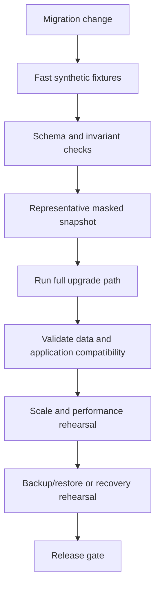

# Kiểm thử nâng cấp cùng dữ liệu đại diện trước khi triển khai

Thay đổi database thường có rủi ro lớn hơn việc thay một file ứng dụng. Một migration có thể chạy đúng trên vài dòng dữ liệu thử nhưng thất bại khi gặp bảng hàng triệu bản ghi, giá trị null, dữ liệu cũ không theo quy ước mới, khóa ngoại bị thiếu hoặc các giá trị trùng lặp đã tích lũy qua nhiều năm. Nó cũng có thể hoàn tất nhưng làm truy vấn chậm, giữ lock quá lâu hoặc khiến phiên bản ứng dụng cũ không còn hoạt động trong lúc rolling deployment.

Vì vậy, trước khi đưa thay đổi dữ liệu vào production, cần **kiểm thử quá trình nâng cấp trên tập dữ liệu đại diện**. Tập dữ liệu phải phản ánh đủ cấu trúc, phân bố, quy mô và các trường hợp biên của môi trường thật, đồng thời được chuẩn bị theo cách bảo vệ dữ liệu nhạy cảm. Mục tiêu là chứng minh migration có thể nâng cấp từ trạng thái nguồn được hỗ trợ sang trạng thái đích, bảo toàn các invariant nghiệp vụ, đáp ứng giới hạn thời gian/tài nguyên và có phương án phục hồi khi lỗi.

Trong CI/CD, việc kiểm thử này nối thay đổi schema, dữ liệu, ứng dụng, artifact và kế hoạch triển khai. Một migration xanh trên database rỗng chỉ chứng minh một trường hợp rất nhỏ; nó chưa đủ bằng chứng cho một lần nâng cấp production.

## 1. Vì sao phải dùng dữ liệu đại diện?

Schema mô tả kiểu và quan hệ của dữ liệu, nhưng không mô tả đầy đủ dữ liệu thực tế đang tồn tại. Hai database cùng schema có thể có đặc điểm rất khác:

- Một database có vài trăm bản ghi, database khác có hàng trăm triệu bản ghi.
- Dữ liệu mới đều hợp lệ, nhưng dữ liệu lịch sử có null, chuỗi rỗng, định dạng cũ hoặc giá trị ngoài dự kiến.
- Một trường thường có giá trị duy nhất trong môi trường thử nhưng bị trùng trong production.
- Phân bố dữ liệu lệch mạnh: một tenant chiếm phần lớn bản ghi, một trạng thái có số lượng áp đảo.
- Quan hệ giữa bảng có bản ghi mồ côi do lịch sử import hoặc quy trình cũ.
- Một số bản ghi có nội dung Unicode, múi giờ, số thập phân, blob lớn hoặc ngày tháng biên.

Migration có thể hoạt động trên dữ liệu sạch nhưng thất bại khi thêm unique constraint, chuyển kiểu, chuẩn hóa chuỗi hoặc tạo index trên bảng lớn. Dữ liệu đại diện giúp phát hiện những vấn đề đó trước khi thay đổi chạm tới người dùng.

Ví dụ, một migration chuẩn hóa email bằng `lower(trim(email))` có thể chạy tốt nếu mọi email đều khác nhau. Nhưng khi `Alice@example.com`, `alice@example.com` và ` alice@example.com ` cùng tồn tại, việc tạo unique index sau chuẩn hóa sẽ thất bại. Kiểm thử với dữ liệu đại diện cần làm lộ ra trường hợp trùng này và buộc nhóm xác định quy tắc xử lý trước triển khai.

## 2. Xác định những đặc điểm dữ liệu cần đại diện

Không cần sao chép mọi dòng dữ liệu thật. Cần hiểu đặc điểm nào ảnh hưởng đến migration và tạo bộ dữ liệu bao phủ những đặc điểm đó.

| Đặc điểm | Ví dụ cần đưa vào tập kiểm thử | Rủi ro có thể phát hiện |
|---|---|---|
| Quy mô | Bảng nhỏ, trung bình và gần quy mô production | Thời gian chạy, memory, disk, lock |
| Phân bố | Tenant lớn, tenant nhỏ, trạng thái phổ biến/hiếm | Skew, query chậm, batch không cân bằng |
| Giá trị thiếu | NULL, chuỗi rỗng, trường tùy chọn | Lỗi chuyển đổi hoặc constraint |
| Giá trị trùng | Email, mã ngoài, khóa nghiệp vụ lặp | Unique constraint và quy tắc hợp nhất |
| Dữ liệu lịch sử | Format cũ, enum đã ngừng dùng, version cũ | Migration không bao phủ dữ liệu legacy |
| Biên kiểu dữ liệu | Số âm, số rất lớn, decimal, ngày biên | Overflow, rounding, conversion |
| Văn bản | Unicode, dấu tiếng Việt, ký tự escape, chuỗi dài | Collation, encoding, truncation |
| Thời gian | UTC, múi giờ khác nhau, thời điểm chuyển DST | Sai lệch timestamp hoặc ngày nghiệp vụ |
| Quan hệ | Parent/child, orphan, cascade, nhiều cấp | Foreign key và thứ tự migration |
| Dữ liệu lớn | JSON, binary, payload dài | I/O, memory, transaction log |

Đặc điểm cần kiểm tra phải xuất phát từ schema, quy tắc nghiệp vụ, lịch sử dữ liệu và cách ứng dụng truy vấn. Một bảng có thể chỉ có ít cột nhưng chứa giá trị rất lớn; một bảng khác có nhiều quan hệ và ràng buộc phức tạp dù số dòng thấp.

## 3. Chọn nguồn dữ liệu và bảo vệ thông tin nhạy cảm

Có ba cách phổ biến để tạo bộ dữ liệu nâng cấp:

1. **Synthetic data:** tạo dữ liệu giả theo schema, phân bố và quy tắc nghiệp vụ đã biết.
2. **Masked/anonymized snapshot:** lấy snapshot nhất quán từ môi trường thật rồi thay thế hoặc loại bỏ thông tin nhạy cảm.
3. **Hybrid dataset:** kết hợp dữ liệu tổng hợp với một phần mẫu đã được xử lý an toàn để giữ các quan hệ và trường hợp hiếm khó mô phỏng.

Không đưa bản sao production thô vào laptop, CI runner hoặc môi trường thử nghiệm thông thường. Dữ liệu có thể chứa thông tin cá nhân, token, địa chỉ, giao dịch, thông tin thanh toán hoặc bí mật nghiệp vụ. Việc che dữ liệu phải được thực hiện trước khi dataset rời khỏi vùng được phép xử lý.

Khi masking:

- Thay thế định danh trực tiếp như tên, email, số điện thoại, địa chỉ và mã khách hàng.
- Loại bỏ token, session, credential, private key và trường bí mật.
- Bảo toàn quan hệ tham chiếu khi cần kiểm tra foreign key hoặc luồng nghiệp vụ.
- Giữ phân bố và đặc điểm thống kê quan trọng, ví dụ số đơn mỗi khách hàng hoặc tỷ lệ trạng thái.
- Giữ những trường hợp biên nhưng không để chúng tiết lộ danh tính thật.
- Kiểm tra lại kết quả masking để bảo đảm không còn dữ liệu nhạy cảm ở cột phụ, log, JSON hoặc blob.

Masking phải tránh làm sai lệch đặc tính cần kiểm thử. Ví dụ, nếu thay mọi email thành một chuỗi ngẫu nhiên nhưng vô tình làm mất các trường hợp trùng sau chuẩn hóa, bộ dữ liệu sẽ không còn kiểm tra được unique constraint mới. Có thể dùng tokenization ổn định hoặc quy tắc tổng hợp để giữ quan hệ và collision có chủ đích mà không giữ email thật.

Synthetic data cũng cần phản ánh dữ liệu xấu có thể tồn tại hợp pháp hoặc do lịch sử hệ thống. Đừng chỉ sinh dữ liệu “đẹp” theo validation hiện tại, vì migration thường phải xử lý dữ liệu được tạo bởi phiên bản cũ.

## 4. Xây dựng nhiều profile dữ liệu

Một bộ dữ liệu duy nhất thường không đáp ứng cả tốc độ CI lẫn độ tin cậy trước release. Có thể chia thành các profile:

| Profile | Quy mô và nội dung | Thời điểm chạy |
|---|---|---|
| Fast fixture | Nhỏ, bao phủ null, duplicate, boundary và quan hệ cơ bản | Mỗi pull request |
| Representative integration | Phân bố và quan hệ gần thực tế, có dữ liệu lịch sử | Mỗi thay đổi migration |
| Scale/performance | Quy mô gần production, skew và bảng lớn | Nightly, trước release hoặc thay đổi có rủi ro |
| Upgrade compatibility | Snapshot theo các phiên bản schema nguồn được hỗ trợ | Trước release lớn hoặc thay đổi tương thích |
| Recovery rehearsal | Snapshot có thể khôi phục, kèm backup/PITR test | Theo lịch và trước migration rủi ro cao |

Profile nhỏ cho feedback nhanh nhưng không thể thay thế profile quy mô lớn. Profile lớn cũng không cần chạy trên mọi pull request nếu chi phí quá cao. Pipeline cần ghi rõ profile nào đã chạy và gate nào phụ thuộc vào kết quả nào.

### Kiểm tra tính đại diện

Định kỳ so sánh profile thử nghiệm với số liệu tổng hợp của production:

- Số dòng theo bảng và theo tenant.
- Tỷ lệ NULL, empty, duplicate và giá trị hiếm.
- Phân bố theo trạng thái, ngày tạo và loại bản ghi.
- Kích thước trung vị, p95 và giá trị lớn nhất của trường payload.
- Độ sâu và độ rộng của quan hệ parent/child.
- Tỷ lệ bản ghi được tạo bởi các phiên bản ứng dụng cũ.

Không cần giữ dữ liệu cá nhân để so sánh. Các thống kê tổng hợp và phân bố thường đủ để phát hiện dataset thử nghiệm đã lệch khỏi thực tế.

## 5. Bắt đầu từ trạng thái nguồn thực tế

Một migration thường nâng cấp database từ một schema version cụ thể. Kiểm thử chỉ trên database mới nhất có thể bỏ sót lỗi khi khách hàng hoặc môi trường đang ở phiên bản cũ hơn.

Trước khi chạy migration, xác định:

- Những schema version nào còn được hỗ trợ nâng cấp trực tiếp.
- Có cần chạy tuần tự nhiều migration hay không.
- Phiên bản ứng dụng nào đang chạy trong từng môi trường.
- Có dữ liệu được tạo bởi code cũ mà schema hiện tại vẫn phải chấp nhận không.
- Có extension, collation, encoding hoặc cấu hình database riêng cần tái tạo không.

Ví dụ, production có thể đang chạy schema version 12 trong khi môi trường tích hợp đã ở version 15. Nếu release chỉ kiểm tra nâng cấp từ 15 lên 16, nhóm chưa biết liệu migration 13, 14, 15 có hoạt động đúng khi chạy nối tiếp trên dữ liệu lịch sử version 12 hay không.

Tạo database test từ một snapshot nhất quán hoặc fixture được tạo ở đúng schema nguồn. Sau đó chạy toàn bộ chuỗi migration được hỗ trợ theo thứ tự thật. Không sửa schema test bằng tay để làm cho nó giống đích trước khi chạy migration.

## 6. Kiểm thử migration trên bản sao cô lập

Quy trình nâng cấp nên chạy trên một database riêng, không ảnh hưởng môi trường đang phục vụ:

1. Tạo database hoặc instance test từ snapshot/fixture đã chuẩn bị.
2. Xác minh engine, major version, extension, collation và cấu hình tương thích với target.
3. Ghi nhận schema version, row count và các invariant ban đầu.
4. Chạy migration bằng đúng artifact, tool và command dự kiến dùng khi triển khai.
5. Thu thập thời gian, lock, disk, transaction log và lỗi.
6. Chạy kiểm tra schema, dữ liệu và truy vấn ứng dụng.
7. Kiểm tra phiên bản ứng dụng cũ/mới nếu cần coexistence.
8. Lưu report cùng commit, migration version và dataset profile.

Không nên dùng database dùng chung cho nhiều job song song nếu chúng có thể thay đổi schema hoặc dữ liệu. Mỗi lần kiểm thử cần môi trường cô lập và có thể tái tạo. Khi dùng snapshot, ghi rõ nguồn, thời điểm tạo, quy trình masking và checksum của dataset.

Database engine và phiên bản cũng quan trọng. PostgreSQL, MySQL và các phiên bản khác nhau có semantics DDL, locking, collation, index và transaction khác nhau. Chạy migration trên SQLite trong CI không chứng minh migration PostgreSQL sẽ có hành vi tương tự nếu production dùng PostgreSQL.

## 7. Xác minh tính đúng đắn sau migration

Migration thành công về cú pháp chưa chứng minh dữ liệu được chuyển đúng. Cần định nghĩa invariant trước khi chạy để so sánh trước và sau.

Những nhóm kiểm tra thường dùng:

- **Schema:** cột, kiểu dữ liệu, default, constraint, index, trigger và sequence đúng như mong đợi.
- **Row count:** số bản ghi trước/sau thay đổi phù hợp với quy tắc chuyển đổi.
- **Referential integrity:** không có orphan hoặc quan hệ bị mất ngoài dự kiến.
- **Uniqueness:** khóa nghiệp vụ và unique constraint không phát sinh collision.
- **Completeness:** dữ liệu bắt buộc không bị bỏ sót hoặc biến thành NULL ngoài ý muốn.
- **Value invariants:** tổng tiền, số lượng, trạng thái hoặc giá trị tổng hợp được bảo toàn theo quy tắc.
- **Format:** dữ liệu mới tuân theo định dạng, timezone, encoding và precision yêu cầu.
- **Application behavior:** phiên bản ứng dụng đích đọc/ghi được dữ liệu sau migration.

Ví dụ kiểm tra số bản ghi và giá trị thiếu:

```sql
SELECT COUNT(*) AS total_customers
FROM customers;

SELECT COUNT(*) AS missing_normalized_email
FROM customers
WHERE normalized_email IS NULL;
```

Ví dụ kiểm tra trùng sau chuẩn hóa:

```sql
SELECT lower(trim(email)) AS normalized_value, COUNT(*) AS occurrences
FROM customers
WHERE email IS NOT NULL
GROUP BY lower(trim(email))
HAVING COUNT(*) > 1;
```

Các truy vấn là ví dụ; điều kiện NULL và cách chuẩn hóa phải khớp với quy tắc nghiệp vụ thực tế. Nếu trùng lặp là hợp lệ theo nghiệp vụ, không được tự ý xóa hoặc gộp bản ghi chỉ để migration vượt qua gate. Cần xác định quy tắc giải quyết, owner dữ liệu và quy trình xử lý ngoại lệ trước khi áp dụng constraint.

Với bảng lớn, không nhất thiết so sánh từng dòng bằng một truy vấn duy nhất. Có thể dùng checksum theo partition, tổng hợp theo khóa, kiểm tra mẫu có trọng số hoặc đối chiếu theo batch. Cách lấy mẫu cần đủ nhạy để phát hiện sai lệch và phải kết hợp với các invariant toàn cục.

## 8. Kiểm tra migration trên dữ liệu lịch sử và trường hợp biên

Migration cần xử lý những giá trị có thể đã tồn tại trước khi quy tắc mới được áp dụng:

- NULL, chuỗi rỗng và chuỗi chỉ chứa khoảng trắng.
- Giá trị trùng do khác chữ hoa/thường hoặc dấu cách.
- Enum cũ đã bị loại khỏi code mới.
- Timestamp thiếu timezone hoặc được lưu theo quy ước cũ.
- Số thập phân vượt precision mới.
- Chuỗi dài hơn giới hạn cột mới.
- Bản ghi thiếu parent hoặc tham chiếu tới dữ liệu đã archive.
- JSON có field không biết hoặc kiểu dữ liệu thay đổi.
- Dữ liệu có Unicode, ký tự escape hoặc encoding cũ.

Hãy phân loại từng trường hợp thành: chuyển đổi tự động, giữ nguyên, đưa vào quarantine, cần xử lý thủ công hoặc chặn release. Tránh dùng một giá trị mặc định chung cho mọi dữ liệu không hợp lệ vì nó có thể làm mất nghĩa nghiệp vụ.

Nếu dữ liệu cần được làm sạch trước migration, tạo bước preflight có thể đếm và báo cáo các trường hợp vi phạm. Khi có thể, chạy preflight trước cửa sổ triển khai để giảm thời gian khóa và cho nhóm thời gian xử lý dữ liệu bất thường.

## 9. Đánh giá thời gian chạy, lock và tài nguyên

Một migration đúng về dữ liệu vẫn có thể không phù hợp production nếu nó khóa bảng quá lâu hoặc tiêu thụ quá nhiều tài nguyên.

Trên profile quy mô lớn, cần đo:

- Tổng thời gian migration và thời gian từng bước.
- Thời gian chờ lock và thời gian giữ lock.
- CPU, memory, disk I/O và dung lượng tạm.
- Transaction/WAL/binlog volume và replication lag.
- Thời gian tạo index, validate constraint và backfill.
- Ảnh hưởng tới query latency và connection pool của ứng dụng.
- Khả năng tiếp tục khi job bị gián đoạn.

Đặc biệt cẩn trọng với DDL có thể giữ lock mạnh trên bảng lớn. Cách tạo index online/concurrently và cách thêm constraint khác nhau theo engine. Không suy ra rằng thao tác chạy nhanh trên vài nghìn dòng sẽ có thời gian tương tự ở production.

Nếu migration backfill hàng triệu dòng, cân nhắc chia batch theo khóa ổn định, giới hạn tốc độ và ghi checkpoint. Mỗi batch cần có điều kiện tiến triển rõ ràng và không làm xử lý lại gây nhân đôi side effect. Đo replication lag để tránh làm replica tụt quá xa.

Không nên tối ưu chỉ bằng cách tăng timeout. Nếu migration cần nhiều giờ hoặc gây lock kéo dài, hãy xem lại cách chuyển đổi, chia giai đoạn, index và khả năng chạy online.

## 10. Thiết kế migration có thể tiếp tục và an toàn khi retry

CI job hoặc kết nối database có thể bị ngắt giữa migration. Một migration cần có hành vi được hiểu rõ khi chạy lại:

- Nếu transaction rollback toàn bộ, xác minh không có thay đổi dở dang ngoài transaction.
- Nếu migration chạy theo batch, lưu checkpoint và chỉ xử lý phần chưa hoàn thành.
- Dùng điều kiện cập nhật để không ghi đè dữ liệu đã được xử lý.
- Không tạo duplicate event hoặc side effect khi retry.
- Ghi version và trạng thái migration rõ ràng.
- Có cách phát hiện migration đã hoàn tất nhưng job chưa kịp ghi nhận kết quả.

Không phải mọi DDL đều transactional ở mọi database. Ví dụ một số thao tác index có thể không chạy trong transaction block. Cần hiểu semantics của engine và migration tool, không giả định rollback luôn đưa database về nguyên trạng.

Một migration tốt nên có precondition và postcondition. Precondition xác nhận schema/data nguồn phù hợp; postcondition xác nhận schema/data đích đạt invariant. Nếu precondition không thỏa, dừng với báo cáo rõ ràng thay vì cố chuyển đổi dữ liệu không hiểu được.

## 11. Kiểm tra tương thích giữa ứng dụng cũ và mới

Trong rolling deployment, nhiều phiên bản ứng dụng có thể cùng chạy trong một khoảng thời gian. Migration cần hỗ trợ giai đoạn coexistence đó.

Một chiến lược thường dùng là **expand-and-contract**:

1. Expand: thêm cột/bảng/index mới theo cách không phá code cũ.
2. Deploy code tương thích: code mới có thể đọc/ghi theo cách chuyển tiếp; code cũ vẫn hoạt động.
3. Backfill: chuyển dữ liệu theo batch và theo dõi tiến độ.
4. Switch: chuyển đọc/ghi sang cấu trúc mới sau khi xác minh.
5. Contract: chỉ xóa cột/bảng cũ khi mọi instance và consumer đã ngừng dùng, đồng thời hết rollback window.

Ví dụ thêm `display_name` thay cho việc đổi tên cột `name` ngay lập tức. Có thể thêm cột mới, cho code mới đọc cột mới nhưng vẫn hỗ trợ cột cũ trong giai đoạn chuyển tiếp, backfill dữ liệu, sau đó mới loại bỏ cột cũ ở một release sau.

Test cần chạy:

- Ứng dụng cũ với schema sau bước expand.
- Ứng dụng mới với schema đã expand nhưng chưa backfill xong.
- Ứng dụng mới với dữ liệu đã backfill.
- Hai phiên bản cùng hoạt động trong giai đoạn rolling nếu kiến trúc cho phép.
- Rollback ứng dụng về phiên bản cũ trong khi schema vẫn ở trạng thái mở rộng.

Không xóa cột hoặc đổi nghĩa dữ liệu ngay trong cùng release nếu phiên bản cũ còn có thể được khởi động lại. Contract là bước riêng sau khi đã chứng minh không còn consumer phụ thuộc.

## 12. Kiểm thử phục hồi và rollback dữ liệu

Rollback ứng dụng không đồng nghĩa rollback database. Dữ liệu đã chuyển đổi, ghi mới hoặc bị xóa có thể không thể đảo ngược bằng cách chạy migration ngược.

Trước triển khai, xác định chiến lược phục hồi:

- **Forward fix:** sửa migration hoặc dữ liệu bằng migration mới để đưa hệ thống về trạng thái đúng.
- **Restore/PITR:** khôi phục backup hoặc point-in-time recovery khi có mất mát dữ liệu nghiêm trọng.
- **Compensating migration:** thực hiện chuyển đổi ngược có kiểm soát nếu có thể chứng minh không mất thông tin.
- **Roll-forward application:** giữ schema mới và triển khai phiên bản ứng dụng sửa lỗi tương thích.

Kiểm thử backup/restore trên môi trường cô lập. Xác minh backup có thể phục hồi, thời gian restore, consistency giữa database và object storage/event log, cũng như khả năng ứng dụng chạy sau restore.

Ghi nhận RPO (mức mất dữ liệu chấp nhận được) và RTO (thời gian phục hồi mục tiêu) theo chính sách của hệ thống. Một bản backup tồn tại nhưng chưa từng restore thử không phải bằng chứng đầy đủ về khả năng phục hồi.

Nếu migration có thao tác không thể đảo ngược, ví dụ gộp bản ghi hoặc xóa dữ liệu, cần có backup/snapshot phù hợp, phê duyệt và phương án phục hồi trước khi chạy. Không viết migration down giả định có thể khôi phục dữ liệu đã bị loại bỏ.

## 13. Ví dụ kiểm thử nâng cấp với PostgreSQL

Giả sử hệ thống cần bổ sung trường email đã chuẩn hóa. Trước khi tạo unique constraint, cần xác định dữ liệu cũ có collision hay không.

Một migration theo giai đoạn có thể bắt đầu bằng cách thêm cột nullable:

```sql
ALTER TABLE customers
ADD COLUMN normalized_email text;
```

Backfill trên môi trường test:

```sql
UPDATE customers
SET normalized_email = lower(trim(email))
WHERE normalized_email IS NULL
  AND email IS NOT NULL;
```

Kiểm tra các bản ghi chưa được chuyển:

```sql
SELECT COUNT(*) AS rows_without_normalized_email
FROM customers
WHERE email IS NOT NULL
  AND normalized_email IS NULL;
```

Kiểm tra collision trước khi cân nhắc unique constraint:

```sql
SELECT normalized_email, COUNT(*) AS occurrences
FROM customers
WHERE normalized_email IS NOT NULL
GROUP BY normalized_email
HAVING COUNT(*) > 1;
```

Đây là ví dụ minh họa, không phải migration hoàn chỉnh để chạy trực tiếp trên production. Backfill một câu lệnh có thể giữ lock và tạo lượng WAL lớn trên bảng lớn; trong thực tế cần batch, quan sát tài nguyên và kiểm soát retry. Trước khi đặt NOT NULL hoặc unique constraint, phải xử lý các trường hợp thiếu/trùng theo quy tắc nghiệp vụ đã được phê duyệt. Nếu tạo index concurrently trong PostgreSQL, cần tuân theo giới hạn transaction của thao tác đó và cách migration tool quản lý transaction.

### Bộ kiểm tra trước và sau

Một test rehearsal nên:

1. Restore dataset profile từ schema nguồn.
2. Chạy preflight để đếm email null, empty và collision sau chuẩn hóa.
3. Chạy migration bằng đúng phiên bản migration artifact.
4. Chạy backfill theo cơ chế dự kiến và ghi thời gian.
5. Kiểm tra số dòng, dữ liệu null, collision và schema.
6. Chạy test ứng dụng cũ/mới theo giai đoạn tương thích.
7. Đo lock, WAL, I/O và replication lag nếu có replica.
8. Thử gián đoạn và tiếp tục lại nếu migration hỗ trợ resume.
9. Lưu report, migration version, dataset profile và commit.

Nếu preflight phát hiện collision, test phải thất bại hoặc chuyển sang bước xử lý dữ liệu đã định nghĩa. Không tự chọn một bản ghi để xóa chỉ để migration qua gate.

## 14. Tích hợp rehearsal vào CI/CD

Một pipeline nâng cấp có thể được chia theo mức chi phí:



Ví dụ job khái niệm:

```yaml
jobs:
  migration_fast:
    steps:
      - name: Start isolated database
        run: ./scripts/start-test-database.sh
      - name: Apply migrations to synthetic fixtures
        run: ./gradlew migrationTest
      - name: Verify invariants
        run: ./scripts/check-migration-invariants.sh

  migration_representative:
    needs: migration_fast
    steps:
      - name: Provision masked snapshot
        run: ./scripts/restore-masked-dataset.sh
      - name: Run supported upgrade path
        run: ./scripts/rehearse-upgrade.sh
      - name: Validate and publish evidence
        run: ./scripts/validate-upgrade-and-report.sh
```

Các script và task là placeholder cần triển khai theo nền tảng, database và migration tool của dự án. Dataset cần được cung cấp qua kênh bảo mật, có version/checksum và quyền truy cập giới hạn. Không tải snapshot production chưa masking vào CI runner.

Fast profile có thể chạy trên mỗi pull request; representative profile chạy khi migration thay đổi; scale và recovery rehearsal chạy định kỳ hoặc trước release rủi ro cao. Gate phải lưu rõ profile nào đã chạy, revision nào được kiểm tra và kết quả có còn phù hợp với artifact chuẩn bị phát hành hay không.

## 15. Lưu bằng chứng và tiêu chí chấp nhận

Một báo cáo rehearsal có giá trị cần cho biết:

- Database engine, version, extension và cấu hình chính.
- Dataset profile, nguồn tạo, snapshot time, masking version và checksum.
- Schema version nguồn và đích.
- Migration artifact/version, commit SHA và pipeline run.
- Thời gian từng migration và tổng thời gian.
- Row count, invariant, duplicate, orphan và constraint result.
- Lock wait, resource usage, WAL/replication lag nếu đo được.
- Kết quả test ứng dụng cũ/mới và compatibility.
- Kết quả backup/restore hoặc recovery rehearsal.
- Lỗi, ngoại lệ đã phê duyệt và người chịu trách nhiệm.

Tiêu chí chấp nhận nên được xác định trước khi chạy. Ví dụ: không có mất bản ghi ngoài dự kiến; không phát sinh orphan; không có duplicate ở khóa cần unique; migration hoàn tất trong giới hạn thời gian; lock nằm trong ngưỡng; phiên bản cũ vẫn hoạt động trong giai đoạn rolling; và có phương án phục hồi đã được thử.

Không nên chỉ lưu dòng `migration succeeded`. Một kết quả thành công không có dataset profile, schema version và invariant report sẽ khó được đánh giá hoặc tái lập.

## 16. Những sai lầm thường gặp

| Sai lầm | Hệ quả | Cách khắc phục |
|---|---|---|
| Chỉ test trên database rỗng | Bỏ sót dữ liệu lịch sử và collision | Dùng profile đại diện có dữ liệu legacy |
| Dùng dữ liệu production thô ở CI | Rò rỉ thông tin cá nhân và bí mật | Mask/anonymize hoặc tạo synthetic data |
| Chỉ kiểm thử trên schema mới nhất | Bỏ sót đường nâng cấp từ version cũ | Test mọi source version còn được hỗ trợ |
| Chỉ kiểm tra migration exit code | Dữ liệu có thể sai dù migration hoàn tất | Kiểm tra invariant, row count và hành vi ứng dụng |
| Dataset nhỏ nhưng kết luận về hiệu năng production | Bỏ sót lock, I/O và thời gian backfill | Có scale rehearsal gần quy mô thực |
| Thêm unique constraint mà không preflight | Migration thất bại vì collision | Phát hiện và xử lý dữ liệu trùng trước |
| Chạy backfill một transaction khổng lồ | Lock lâu, WAL lớn, rollback tốn kém | Batch, checkpoint và giới hạn tốc độ |
| Giả định migration down luôn an toàn | Mất dữ liệu hoặc schema không thể đảo ngược | Thiết kế forward fix, restore/PITR và thử phục hồi |
| Xóa cột cũ cùng release đầu tiên | Code cũ không còn tương thích khi rollback | Dùng expand-and-contract |
| Không ghi nhận dataset và migration version | Không thể tái lập kết quả | Lưu metadata và report đầy đủ |

## 17. Checklist kiểm thử nâng cấp với dữ liệu đại diện

- [ ] Xác định schema version nguồn và mọi đường nâng cấp còn được hỗ trợ.
- [ ] Có profile fast, representative, scale và recovery phù hợp.
- [ ] Dataset bao phủ quy mô, phân bố, NULL, duplicate, legacy, boundary và quan hệ dữ liệu.
- [ ] Dữ liệu nhạy cảm đã được synthetic hoặc masking trước khi đưa vào môi trường thử.
- [ ] Dataset có version, checksum, nguồn và quy trình tạo có thể truy vết.
- [ ] Database test dùng engine/version/extension/collation phù hợp target.
- [ ] Chạy toàn bộ chuỗi migration trên bản sao cô lập.
- [ ] Xác minh schema, row count, referential integrity, uniqueness và business invariants.
- [ ] Đo thời gian, lock, CPU, memory, disk, WAL và replication lag khi phù hợp.
- [ ] Kiểm tra retry/resume, transaction semantics và migration bị gián đoạn.
- [ ] Kiểm tra ứng dụng cũ/mới cùng hoạt động trong giai đoạn rolling.
- [ ] Kiểm tra backup/restore hoặc recovery plan trước thay đổi phá hủy.
- [ ] Lưu report gắn với commit, migration version, dataset profile và artifact.
- [ ] Có owner xử lý ngoại lệ và tiêu chí gate rõ ràng trước khi deploy.

Kiểm thử nâng cấp cùng dữ liệu đại diện giúp phát hiện lỗi mà database rỗng không thể bộc lộ: dữ liệu lịch sử bất thường, collision, quan hệ phức tạp, thời gian khóa và giới hạn tài nguyên. Khi dataset được chuẩn bị an toàn, migration được chạy trên bản sao cô lập, invariant được kiểm tra và phương án phục hồi được diễn tập, nhóm có cơ sở đáng tin cậy hơn để quyết định triển khai thay đổi dữ liệu.
