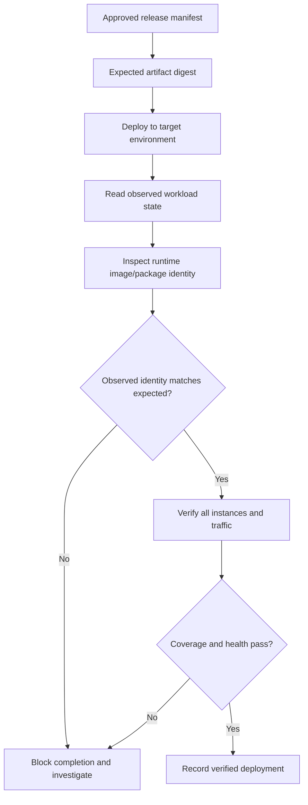

# Xác nhận đúng phiên bản đã chạy trên môi trường đích

## 1. Vì sao phải xác minh phiên bản sau triển khai?

Một pipeline báo deploy thành công chỉ cho biết các thao tác triển khai đã hoàn tất theo cách công cụ báo cáo. Điều đó chưa chứng minh mọi instance đang phục vụ đều chạy đúng artifact đã được phê duyệt. Có thể một số Pod vẫn dùng image cũ, một VM chưa được cập nhật, load balancer còn route tới instance cũ hoặc một rollout mới chỉ cập nhật một phần.

Trong CI/CD, mục tiêu không chỉ là gửi đúng lệnh deploy mà còn phải xác minh trạng thái thực tế trên môi trường đích. Nhóm cần trả lời được:

- Artifact nào đã được phê duyệt và dự kiến triển khai?
- Môi trường đích đã nhận đúng artifact digest đó chưa?
- Tất cả instance cần thiết đã chạy phiên bản mới chưa?
- Traffic thực tế có đang đi tới các instance đúng phiên bản không?
- Cấu hình và schema tương thích nào đang được áp dụng?
- Ứng dụng có khởi động, sẵn sàng và thực hiện được các luồng quan trọng không?
- Có bằng chứng đủ mới để kết luận rollout hoàn tất không?

Ví dụ, pipeline triển khai `order-service:2.4.1` lên Kubernetes và lệnh `kubectl rollout status` trả về thành công. Tuy nhiên, nếu Deployment dùng tag có thể thay đổi, hoặc Service vẫn có endpoint của workload khác, lệnh đó chưa chứng minh request thực tế chỉ tới image đã kiểm tra. Cần đối chiếu image được khai báo, image ID của container đang chạy, trạng thái Pod, endpoint và deployment record.

Xác minh phiên bản sau triển khai là một phần của release gate. Nếu bằng chứng không khớp, pipeline phải giữ trạng thái chưa hoàn tất, cảnh báo và kích hoạt quy trình điều tra hoặc phục hồi.

## 2. Phân biệt deploy command, desired state và observed state

Ba trạng thái này trả lời các câu hỏi khác nhau:

| Khái niệm | Ý nghĩa | Ví dụ |
|---|---|---|
| Deploy command/result | Công cụ đã gửi yêu cầu thay đổi và báo kết quả thao tác | Lệnh apply manifest trả exit code 0 |
| Desired state | Phiên bản và cấu hình mà hệ thống được yêu cầu chạy | Deployment khai báo image digest `sha256:abc...`, replicas 3 |
| Observed state | Trạng thái thực tế được nền tảng/runtime quan sát | Ba Pod ready, container imageID khớp digest mong muốn |

Một lệnh deploy thành công có thể chỉ xác nhận API server đã nhận manifest. Controller vẫn cần thời gian reconcile; Pod có thể chưa chạy, readiness có thể thất bại hoặc node không tải được image.

Desired state cũng không tự chứng minh observed state đã khớp. Cần đọc trạng thái từ nguồn runtime hoặc control plane và đối chiếu với release manifest. Với hệ thống GitOps, commit đã merge thể hiện trạng thái mong muốn; trạng thái `Synced`/`Ready` hoặc tương đương cần được xác minh riêng.

## 3. Định danh phiên bản bằng nhiều thuộc tính

Tên phiên bản dễ đọc rất hữu ích cho con người nhưng thường không đủ để xác định chính xác nội dung đang chạy. Một bản triển khai nên được định danh bằng tập thuộc tính có thể liên kết với nhau:

| Thuộc tính | Vai trò |
|---|---|
| Service/application name | Xác định thành phần được triển khai |
| Release ID | Định danh một lần phát hành |
| Source commit SHA | Xác định revision mã nguồn đã build |
| Artifact version/tag | Tên phiên bản hiển thị |
| Artifact digest | Xác định chính xác nội dung artifact/image |
| Build/pipeline run ID | Truy về lần build tạo artifact |
| Config revision/digest | Xác định cấu hình môi trường đã áp dụng |
| Environment/cluster/namespace | Xác định nơi phiên bản đang chạy |
| Deployment revision/rollout ID | Xác định lần cập nhật workload |
| Timestamp | Xác định thời điểm bắt đầu, hoàn tất và quan sát |

Trong production, artifact digest thường là định danh quan trọng nhất để xác nhận payload. Commit SHA giúp truy ngược mã nguồn; release ID liên kết các bằng chứng và quyết định; config revision giúp tái dựng môi trường thực thi.

Không nên chỉ dựa vào `2.4.1`, `latest`, tên branch hoặc tên image tag. Tag có thể bị di chuyển nếu registry cho phép overwrite. Hai image có cùng tag ở hai thời điểm có thể chứa nội dung khác nhau.

## 4. Đối chiếu artifact dự kiến với artifact thực tế

Trước khi deploy, pipeline nên ghi nhận artifact reference và digest đã được kiểm tra. Sau deploy, cần lấy thông tin từ môi trường đích và xác minh nội dung thực tế.

Luồng kiểm chứng tổng quát:



Đối với container, nên deploy bằng image digest khi nền tảng hỗ trợ, ví dụ `registry.example.com/order-service@sha256:...`. Sau đó đọc image được khai báo trong workload và image ID/runtime digest của từng container đang chạy.

Đối với package trên VM, kiểm tra version, checksum của file được cài và đường dẫn executable/process thực tế. Đối với ứng dụng serverless, đối chiếu revision/version ID của deployment với revision được cấp traffic.

Nếu artifact được copy giữa registry, cần xác minh digest ở đích. Một số thao tác chuyển đổi manifest có thể làm digest khác; khi đó cần quy trình xác minh nội dung và ghi nhận quan hệ nguồn-đích, không tự coi hai reference là cùng artifact.

## 5. Xác minh tất cả instance, không chỉ một instance

Trong hệ thống có nhiều replica hoặc nhiều máy chủ, kiểm tra một instance khỏe mạnh không chứng minh toàn bộ dịch vụ đã cập nhật. Rollout có thể ở trạng thái hỗn hợp: một số instance chạy phiên bản mới, số khác vẫn chạy phiên bản cũ.

Các điểm cần xác minh:

- Số instance mong muốn và số instance thực tế.
- Số instance đã tạo, đã sẵn sàng và đang nhận traffic.
- Phiên bản/digest trên từng instance.
- Instance cũ còn trong service discovery hoặc load balancer không.
- Có instance bị kẹt ở trạng thái terminating, pending hoặc crash loop không.
- Các vùng/zone/node pool có được cập nhật đầy đủ không.
- Có workload phụ như worker, scheduler hoặc consumer chưa được cập nhật không.

Nếu có 10 replica và chỉ 9 replica chạy digest mới, release chưa hoàn tất trừ khi policy cho phép rõ trạng thái đó. Nếu rollout theo canary hoặc progressive delivery, nhiều phiên bản cùng tồn tại có thể là chủ đích; khi đó phải xác minh tỷ lệ và nhóm traffic đúng kế hoạch.

## 6. Xác minh phiên bản thực sự nhận traffic

Workload có thể đã cập nhật nhưng traffic vẫn đi tới instance cũ do load balancer, ingress, service discovery, DNS cache hoặc routing rule chưa hội tụ.

Cần phân biệt:

- **Workload state:** instance nào đang chạy.
- **Endpoint state:** instance nào được service/proxy coi là backend hợp lệ.
- **Traffic state:** request thực tế được chuyển tới backend nào.

Các bước kiểm tra có thể gồm:

1. Xác minh endpoint/backend pool không còn instance cũ ngoài kế hoạch.
2. Gửi request kiểm tra qua đúng public/internal route mà người dùng sử dụng.
3. Thu thập response metadata hoặc trace để biết backend đã xử lý request.
4. Kiểm tra trên nhiều lần request và nhiều vùng nếu hệ thống phân tán.
5. Đối chiếu tỷ lệ traffic theo version trong metric hoặc telemetry.

Một endpoint `/version` có thể trả về version của process xử lý request, nhưng chỉ một request không đại diện cho toàn bộ backend pool. Nên lấy mẫu nhiều lần hoặc dùng telemetry gắn version với instance/pod để đánh giá mức phủ. Nếu response được cache tại CDN/proxy, cần hiểu cache behavior trước khi kết luận.

Không nên công khai commit SHA, thông tin nội bộ hoặc chi tiết build nhạy cảm qua endpoint version cho mọi người dùng. Có thể cung cấp metadata tối thiểu qua endpoint nội bộ có xác thực, hoặc dùng metric label/trace resource attribute trong hệ thống quan sát.

## 7. Kiểm tra health, readiness và hành vi nghiệp vụ

Đúng phiên bản chưa đồng nghĩa ứng dụng hoạt động đúng. Post-deployment validation cần nhiều lớp:

| Lớp kiểm tra | Mục đích | Ví dụ |
|---|---|---|
| Process/startup | Tiến trình khởi động được | Service active, startup probe đạt |
| Readiness | Instance có thể nhận traffic | Kết nối dependency bắt buộc, readiness endpoint trả healthy |
| Liveness | Tiến trình không bị treo cần restart | Liveness probe hoặc watchdog |
| Smoke test | Luồng chính hoạt động ở mức cơ bản | Health API, truy vấn đọc, tạo giao dịch thử nghiệm |
| Integration/synthetic test | Tương tác với dependency và luồng người dùng | Đăng nhập, tạo đơn thử, đọc dữ liệu qua API |
| Operational verification | Không có suy giảm bất thường sau deploy | Error rate, latency, queue lag, saturation |

Liveness và readiness có mục đích khác nhau. Liveness trả lời tiến trình có cần restart hay không; readiness trả lời instance có thể nhận traffic hay chưa. Một process có thể còn sống nhưng chưa sẵn sàng vì chưa kết nối database hoặc chưa nạp cấu hình.

Smoke test cần an toàn và có thể lặp lại. Nếu kiểm tra ghi dữ liệu, dùng tài khoản, dữ liệu và namespace thử nghiệm có thể dọn dẹp; tránh tạo giao dịch thật hoặc gửi thông báo thật ngoài ý muốn.

## 8. Xác minh cấu hình đi kèm phiên bản

Ứng dụng có thể chạy đúng artifact nhưng sai cấu hình. Deployment record nên liên kết artifact digest với config revision/digest và môi trường.

Các điểm cần xác minh:

- Config bundle/revision đúng với release manifest.
- Cấu hình hiệu lực sau khi hợp nhất file, environment variable và config service đúng như dự kiến.
- Secret reference/version được cấp đúng, còn hiệu lực và không bị lộ.
- Schema cấu hình tương thích với application version.
- Mọi instance đã nạp cùng revision hoặc khác biệt được policy cho phép.
- Feature flag và routing rule có trạng thái đúng với kế hoạch release.

Không lưu secret value vào deployment record hoặc log. Có thể lưu secret manager reference/version ID và trạng thái cấp phát. Với cấu hình động, cần ghi nhận revision mà từng instance đã nạp; config service trả thành công không chứng minh tất cả instance đã reload.

## 9. Ví dụ Kubernetes: kiểm tra rollout và image identity

Với Kubernetes Deployment, có thể kiểm tra nhiều lớp bằng `kubectl`.

Trước hết, xem trạng thái rollout:

```bash
kubectl rollout status deployment/order-service -n production --timeout=180s
```

Lệnh này chờ rollout hoàn tất theo điều kiện Deployment. Nó không tự chứng minh image digest trên mọi container khớp với release manifest, vì vậy cần kiểm tra thêm.

Xem image được khai báo trong Pod template:

```bash
kubectl get deployment order-service -n production \
  -o jsonpath='{.spec.template.spec.containers[?(@.name=="app")].image}{"\n"}'
```

Liệt kê Pod, trạng thái và image ID thực tế của container:

```bash
kubectl get pods -n production -l app=order-service \
  -o jsonpath='{range .items[*]}{.metadata.name}{"\t"}{.status.phase}{"\t"}{.status.containerStatuses[?(@.name=="app")].ready}{"\t"}{.status.containerStatuses[?(@.name=="app")].imageID}{"\n"}{end}'
```

Đối chiếu kết quả với digest dự kiến. `imageID` là định danh image mà container runtime báo cáo; định dạng có thể khác theo runtime. Với image multi-architecture, digest của OCI index và digest manifest theo platform có thể khác nhau. Cần xác định digest nào được release manifest pin và cách runtime báo cáo digest đã resolve cho node architecture tương ứng.

Kiểm tra số replica và trạng thái Deployment:

```bash
kubectl get deployment order-service -n production
kubectl get rs -n production -l app=order-service
kubectl get endpointslice -n production -l kubernetes.io/service-name=order-service
```

Các lệnh này giúp thấy desired/available replicas, ReplicaSet và endpoint slice. EndpointSlice cho biết backend được service công bố, nhưng để xác nhận traffic thực tế vẫn cần request/telemetry qua route.

Nếu dùng rollout có chủ đích nhiều phiên bản như canary, cần xác minh selector, service và routing policy để biết phiên bản nào nhận tỷ lệ traffic nào. Không áp dụng điều kiện “mọi Pod phải cùng digest” cho một giai đoạn canary được thiết kế có nhiều digest; thay vào đó kiểm tra đúng cohort và tỷ lệ mong muốn.

## 10. Ví dụ VM/systemd: xác minh package đang chạy

Với ứng dụng chạy trên VM, pipeline có thể cài mỗi release vào một thư mục riêng và dùng symlink `current` trỏ tới release đang hoạt động. Sau deploy, cần xác minh symlink, checksum file và process thực tế.

Ví dụ kiểm tra package:

```bash
readlink -f /opt/order-service/current
sha256sum /opt/order-service/current/order-service.jar
systemctl is-active order-service
systemctl show order-service -p MainPID
```

Sau khi lấy `MainPID`, có thể kiểm tra command line hoặc executable theo chính sách quyền của máy. Với Java, process có thể được khởi chạy bằng wrapper script hoặc symlink; vì vậy cần xác minh đường dẫn JAR thực tế trong command line, không chỉ kiểm tra file tại `current`.

Một cách mạnh hơn là service ghi release ID và artifact digest vào log khởi động hoặc telemetry resource attributes. Hệ thống giám sát có thể tổng hợp theo host/instance. Metadata đó cần được tạo từ deployment manifest đáng tin cậy, không chỉ từ biến môi trường tùy ý do process có thể tự đặt.

Không nên chỉ dựa vào `systemctl is-active`: unit có thể active nhưng process dùng file cũ, không bind đúng port hoặc không phục vụ nghiệp vụ. Cần kiểm tra endpoint và telemetry sau khi xác minh file/process identity.

## 11. Kiểm tra bằng endpoint version hoặc build info

Ứng dụng có thể cung cấp endpoint nội bộ như `/version`, `/info` hoặc `/actuator/info` để báo release ID, commit và build metadata.

Ví dụ response tối giản:

```json
{
  "service": "order-service",
  "release": "R-105",
  "version": "2.4.1",
  "commit": "8d3f2a1c",
  "artifactDigest": "sha256:abc..."
}
```

Endpoint này hữu ích để kiểm tra process nào trả lời request, nhưng có giới hạn:

- Có thể trả giá trị build-time không phản ánh file thực sự đang chạy nếu deploy sai.
- Có thể bị cache ở proxy/CDN.
- Một request chỉ kiểm tra một backend tại một thời điểm.
- Nếu endpoint không được bảo vệ, metadata có thể tiết lộ thông tin nội bộ.
- Giá trị trả về có thể bị cấu hình sai hoặc giả mạo nếu không liên kết với nguồn triển khai đáng tin cậy.

Vì vậy, kết hợp endpoint version với image/package identity, deployment controller state và telemetry. Endpoint là một bằng chứng hữu ích về process đang trả lời, không phải bằng chứng duy nhất.

## 12. Xác minh rollout theo từng loại chiến lược

Điều kiện xác minh phụ thuộc chiến lược triển khai:

| Chiến lược | Điều cần xác minh |
|---|---|
| Recreate | Không còn instance cũ phục vụ; instance mới chạy đúng digest và readiness đạt |
| Rolling update | Số replica mới/ready đạt mục tiêu; instance cũ đã được loại bỏ theo policy; không có endpoint sai phiên bản |
| Blue-Green | Môi trường mới đúng digest và healthy; traffic đã chuyển sang màu mới; môi trường cũ không còn nhận traffic ngoài kế hoạch |
| Canary | Cohort canary chạy đúng digest; tỷ lệ traffic đúng; metric guardrail đạt trước khi tăng traffic |
| Serverless revision | Revision/version mới đã được tạo và traffic allocation trỏ đúng tỷ lệ |

Trong rollout nhiều giai đoạn, trạng thái “đã deploy” có thể khác “đã hoàn tất rollout”. Release record nên ghi trạng thái như deploying, partially rolled out, verified, failed hoặc rolled back thay vì chỉ có một cờ boolean.

## 13. Kiểm tra phiên bản ở nhiều vùng và nhiều cụm

Hệ thống lớn có thể triển khai qua nhiều cluster, region hoặc data center. Một cluster cập nhật thành công không có nghĩa toàn bộ hệ thống đã cập nhật.

Nên tạo deployment matrix gồm:

- Service và workload.
- Region/cluster/namespace.
- Artifact digest dự kiến.
- Config revision dự kiến.
- Số instance desired/ready/observed.
- Tỷ lệ traffic.
- Trạng thái rollout và thời điểm xác minh.

Ví dụ:

| Vùng | Cluster | Digest dự kiến | Instance ready | Traffic | Kết quả |
|---|---|---|---:|---:|---|
| ap-southeast-1a | cluster-a | `sha256:abc...` | 6/6 | 50% | Verified |
| ap-southeast-1b | cluster-b | `sha256:abc...` | 6/6 | 50% | Verified |
| ap-southeast-1c | cluster-c | `sha256:abc...` | 4/6 | 0% | In progress |

Bảng này là ví dụ minh họa. Nếu cluster-c chưa sẵn sàng, release toàn cục chưa hoàn tất dù traffic hiện tại chưa route tới đó. Policy cần xác định vùng nào bắt buộc phải đạt, vùng nào có thể trì hoãn và cách xử lý khi một region không thể cập nhật.

## 14. Xác minh worker, scheduler và thành phần nền

Một ứng dụng thường có nhiều workload hơn web/API deployment. Có thể còn worker queue, cron job, scheduler, stream consumer, migration job hoặc sidecar. Nếu chỉ kiểm tra API deployment, nhóm có thể bỏ sót worker đang chạy phiên bản cũ.

Checklist theo thành phần:

- API/web workload: image/package digest, replica, readiness và route.
- Worker: version/digest, queue subscription, concurrency và trạng thái xử lý job.
- Scheduler/cron: schedule mới đã có hiệu lực, không chạy trùng hoặc bỏ lỡ job.
- Migration job: revision đã chạy, trạng thái hoàn tất và kết quả xác minh schema.
- Sidecar/agent: version tương thích với application và platform.
- Consumer: group membership, lag, offset/ack và khả năng tương thích message schema.

Với job chạy một lần, trạng thái `Completed` cần được liên kết với image digest và input revision. Với worker chạy dài hạn, cần xác minh mọi process đã được thay thế và không còn consumer cũ nhận message ngoài kế hoạch.

## 15. Kiểm tra dữ liệu, schema và tương thích sau deploy

Một phiên bản có thể chạy đúng digest nhưng vẫn không hoạt động vì schema database hoặc dữ liệu không tương thích. Post-deployment validation cần xác minh các điều kiện dữ liệu liên quan:

- Migration đã chạy đúng revision và không còn ở trạng thái dở dang.
- Ứng dụng mới kết nối được database và thực hiện truy vấn bắt buộc.
- Schema version hiện tại nằm trong tập được application hỗ trợ.
- Consumer/producer tương thích với schema message đang được sử dụng.
- Background job không xử lý lại dữ liệu ngoài ý muốn.
- Số lượng hoặc invariant nghiệp vụ quan trọng không bị vi phạm.
- Backup/restore point hoặc phương án roll-forward sẵn sàng theo mức rủi ro.

Không nên kiểm tra dữ liệu production bằng thao tác ghi thử có thể tạo giao dịch thật. Dùng truy vấn read-only, synthetic record được đánh dấu và dọn an toàn hoặc môi trường test phù hợp. Với thay đổi tài chính, đơn hàng hoặc quyền truy cập, cần kiểm tra invariant nghiệp vụ chứ không chỉ health endpoint.

## 16. Xác minh bằng metric, log và trace

Metadata phiên bản nên được gắn vào telemetry để biết phiên bản nào tạo ra lỗi hoặc độ trễ. Một số trường có thể dùng làm resource attributes hoặc labels:

- `service.name`
- `service.version`
- `deployment.environment`
- `release.id`
- `service.instance.id`
- `artifact.digest` hoặc một định danh digest rút gọn theo quy ước nội bộ
- `config.revision`

Không nên đưa digest, commit hoặc release ID có cardinality cao vào mọi metric label nếu hệ thống metrics bị ảnh hưởng bởi số lượng series. Có thể đặt thông tin chi tiết trong log/trace/resource metadata và dùng label giới hạn theo version/release cần theo dõi.

Sau deploy, so sánh các tín hiệu:

- Error rate và loại lỗi theo version.
- Latency p50/p95/p99.
- Tỷ lệ request thành công và business conversion.
- CPU, memory, restart count và saturation.
- Queue lag, retry và dead-letter count.
- Dependency error và timeout.
- Số instance theo version/config revision.

Một deployment chỉ nên được đánh dấu verified khi các kiểm tra bắt buộc đạt trong cửa sổ quan sát đủ đại diện. Nếu traffic quá thấp, metric chưa cập nhật hoặc telemetry bị mất, trạng thái cần là pending/insufficient evidence thay vì tự động pass.

## 17. Deployment record và bằng chứng kiểm toán

Sau khi xác minh, pipeline nên tạo deployment record bất biến hoặc có lịch sử sửa đổi rõ ràng. Record là cầu nối giữa CI, CD, môi trường và hệ thống quan sát.

Các trường nên có:

| Nhóm | Dữ liệu |
|---|---|
| Release | Release ID, service, version, source commit |
| Artifact | Repository/reference, digest, provenance link |
| Config | Config revision/digest, schema version, secret references/version IDs |
| Target | Environment, cluster, region, namespace, workload |
| Execution | Pipeline run, deploy job, identity, thời điểm bắt đầu/kết thúc |
| Observed state | Runtime image/package identity, replica/instance coverage, traffic allocation |
| Validation | Health, smoke, acceptance, metric guardrail và kết quả |
| Decision | Verified, partial, failed, rolled back; người/policy quyết định |
| Recovery | Previous artifact/config, rollback/roll-forward event nếu có |

Record không nên chứa secret value hoặc dữ liệu người dùng không cần thiết. Liên kết tới log/report cần có quyền truy cập phù hợp và retention tương ứng.

## 18. Xử lý mismatch giữa phiên bản dự kiến và thực tế

Khi observed state không khớp release manifest, không nên đánh dấu deploy thành công chỉ vì một số kiểm tra khác đạt.

Một quy trình điều tra:

1. Đánh dấu deployment là `mismatch` hoặc `verification_failed` và dừng bước promote tiếp theo.
2. Xác định workload/instance nào có digest, package version hoặc config revision khác.
3. Kiểm tra controller, rollout, node pull cache, registry reference, deployment job và quyền ghi workload.
4. Xác định instance sai phiên bản có đang nhận traffic không.
5. Nếu an toàn, loại instance sai khỏi traffic và hoàn tất rollout đúng artifact; nếu không, dừng rollout và thực hiện recovery plan.
6. Kiểm tra artifact/config thực tế, provenance, deployment audit và các thay đổi ngoài pipeline.
7. Xác minh lại toàn bộ instance và traffic sau khi khắc phục.
8. Ghi incident hoặc deployment exception và cập nhật bằng chứng.

Các nguyên nhân có thể gồm tag bị ghi đè, manifest cũ được controller reconcile lại, job deploy chạy nhầm environment, node không pull image mới, một instance không được drain, manual hotfix ngoài pipeline hoặc job khác cập nhật cùng workload.

Nếu không xác định được nguồn gốc artifact đang chạy, hãy coi đó là vấn đề tính toàn vẹn và giữ luồng phát hành ở trạng thái chặn cho đến khi có bằng chứng đáng tin cậy.

## 19. Điều kiện rollback hoặc roll-forward

Không phải mọi mismatch đều yêu cầu rollback toàn bộ. Quyết định phụ thuộc mức ảnh hưởng và khả năng sửa tại chỗ.

| Tình huống | Hành động có thể phù hợp |
|---|---|
| Một instance cũ còn sót nhưng không nhận traffic | Hoàn tất rollout, xác minh và loại bỏ instance cũ |
| Instance sai digest đang nhận traffic | Drain/loại khỏi traffic, triển khai lại đúng artifact và kiểm tra request |
| Artifact đúng nhưng config revision sai | Khôi phục config revision tương thích hoặc roll-forward config sau validation |
| Digest không thể xác minh hoặc nguồn không đáng tin | Dừng rollout, cô lập workload và triển khai lại từ artifact đã xác minh |
| Phiên bản mới đúng nhưng health/metric suy giảm | Dừng mở rộng, rollback hoặc roll-forward theo runbook |
| Migration không tương thích với bản cũ | Đánh giá roll-forward/repair; không tự động rollback ứng dụng |

Rollback cần sử dụng artifact digest và config revision đã biết, không chỉ tag cũ. Sau rollback, phải chạy lại xác minh phiên bản, health và traffic. Một lệnh rollback thành công không thay thế post-rollback verification.

## 20. Trạng thái xác minh sau triển khai

Nên dùng trạng thái chi tiết hơn một giá trị boolean:

| Trạng thái | Ý nghĩa | Điều kiện chuyển tiếp |
|---|---|---|
| Requested | Đã có yêu cầu deploy | Pipeline bắt đầu thực thi |
| Deploying | Đang cập nhật workload | Controller hoàn tất thao tác |
| Partially deployed | Một phần instance đã cập nhật | Hoàn tất phần còn lại hoặc xử lý exception |
| Deployed | Nền tảng báo workload đã áp dụng | Bắt đầu xác minh runtime identity và health |
| Verifying | Đang đối chiếu digest, config, endpoints và metric | Bằng chứng đủ và đạt hoặc phát hiện lỗi |
| Verified | Đúng phiên bản, đủ coverage và kiểm tra bắt buộc đạt | Có thể promote/đóng release |
| Verification failed | Sai phiên bản, thiếu bằng chứng hoặc health không đạt | Điều tra, retry có kiểm soát hoặc recovery |
| Rolled back | Đã khôi phục phiên bản trước | Cần xác minh lại trạng thái sau rollback |

`Deployed` và `Verified` không nên được dùng thay thế nhau. Deployment controller có thể hoàn tất cập nhật nhưng ứng dụng chưa đạt health hoặc chưa chứng minh mọi instance chạy đúng digest.

## 21. Ví dụ policy xác minh sau triển khai

Một policy giả định có thể biểu diễn các điều kiện cần thiết:

```yaml
postDeploymentValidation:
  target:
    environment: production
    service: order-service
  expected:
    releaseId: R-105
    artifactDigest: sha256:abc123...
    configRevision: cfg-32
  workload:
    desiredReplicas: 6
    readyReplicas: 6
    allRuntimeDigestsMatch: true
    oldInstancesServingTraffic: 0
  application:
    readiness: healthy
    smokeTests: passed
    configRevisionObserved: cfg-32
  traffic:
    routingVerified: true
    unexpectedVersionTraffic: 0
  operations:
    errorRateWithinGuardrail: true
    latencyWithinGuardrail: true
    observationWindowComplete: true
  decision: verified
```

Đây là cấu trúc minh họa, không phải schema của một công cụ cụ thể. Các giá trị boolean cần được tính từ dữ liệu runtime và telemetry đáng tin cậy. Nếu một trường không có dữ liệu, policy cần định nghĩa `pending` hoặc `failed`; không mặc định trường thiếu là `true`.

Trong rollout canary, policy cần mô tả digest và traffic allocation cho từng cohort thay vì yêu cầu mọi instance có cùng digest. Điều kiện thành công phải phản ánh chiến lược triển khai thực tế.

## 22. Checklist xác nhận đúng phiên bản trên môi trường đích

Trước khi đánh dấu release là verified, hãy kiểm tra:

- [ ] Release manifest ghi rõ service, environment, source commit và artifact digest dự kiến.
- [ ] Desired workload image/package reference khớp với release manifest.
- [ ] Runtime identity/image ID/checksum trên từng instance được đối chiếu.
- [ ] Số instance ready đạt yêu cầu và không còn instance cũ ngoài kế hoạch.
- [ ] Endpoint/service discovery/load balancer trỏ tới đúng backend.
- [ ] Request thực tế hoặc telemetry xác nhận phiên bản đang nhận traffic.
- [ ] Config revision/schema và secret references phù hợp với artifact.
- [ ] Worker, scheduler, consumer và migration job cũng được xác minh.
- [ ] Startup/readiness và smoke/integration test bắt buộc đạt.
- [ ] Metric/log/trace trong cửa sổ quan sát không vi phạm guardrail.
- [ ] Deployment record lưu artifact digest, config revision, target và kết quả kiểm tra.
- [ ] Mismatch hoặc thiếu bằng chứng khiến release bị chặn và có quy trình recovery.
- [ ] Sau rollback, phiên bản thực tế và traffic được xác minh lại.

## 23. Nguyên tắc thực hành cốt lõi

1. Không coi lệnh deploy thành công là bằng chứng ứng dụng đã chạy đúng phiên bản.
2. Đối chiếu artifact digest đã phê duyệt với desired state và runtime identity thực tế.
3. Xác minh tất cả instance, workload phụ và vùng triển khai theo policy.
4. Kiểm tra endpoint và traffic thực tế, không chỉ trạng thái Pod hoặc service process.
5. Xác minh cấu hình, secret reference và schema tương thích đi cùng artifact.
6. Kết hợp process, readiness, smoke test, metric, log và trace để đánh giá hành vi.
7. Phân biệt deployed, partially deployed, verifying, verified và rolled back.
8. Ghi deployment record liên kết release, artifact, config, environment, identity và bằng chứng.
9. Chặn promote tiếp theo khi digest hoặc bằng chứng không khớp; điều tra và recovery có kiểm soát.
10. Sau rollback hoặc roll-forward, thực hiện lại toàn bộ kiểm tra phiên bản và traffic cần thiết.

Xác nhận đúng phiên bản đã chạy trên môi trường đích là bước nối giữa ý định phát hành và trạng thái thật của hệ thống. Khi artifact digest, cấu hình, instance, traffic và bằng chứng vận hành được đối chiếu với nhau, nhóm có thể chứng minh release đã được triển khai đúng, phát hiện rollout một phần và phản ứng nhanh khi môi trường chạy khác với phiên bản đã phê duyệt.
