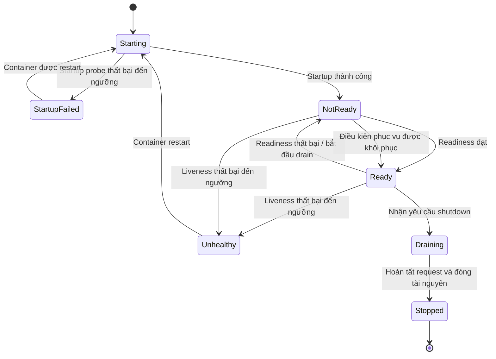
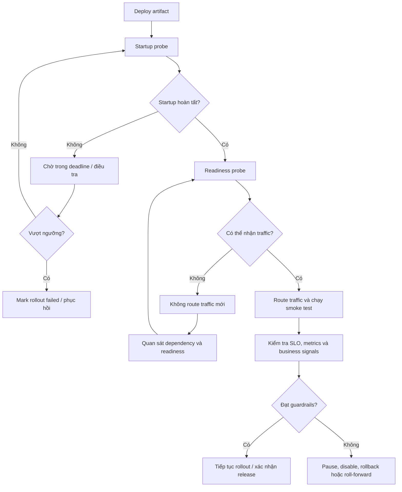

# Phân biệt tiến trình còn sống với dịch vụ sẵn sàng nhận lưu lượng

Một container có thể đang chạy nhưng ứng dụng bên trong đã treo, không xử lý được request hoặc chưa kết nối xong đến database. Ngược lại, ứng dụng có thể vẫn hoạt động bình thường nhưng tạm thời chưa đủ điều kiện nhận thêm lưu lượng vì đang khởi động, đang drain để dừng hoặc một dependency thiết yếu chưa sẵn sàng. Nếu chỉ kiểm tra process còn tồn tại, hệ thống có thể tiếp tục gửi traffic đến instance không phục vụ được. Nếu dùng một health check quá sâu cho mọi mục đích, sự cố ở dependency dùng chung có thể khiến toàn bộ instance bị restart cùng lúc.

Trong vận hành, cần phân biệt ít nhất ba trạng thái: **liveness** cho biết tiến trình có còn hoạt động theo cách có thể tự tiếp tục hay không; **readiness** cho biết instance có thể nhận và xử lý lưu lượng mới hay không; **startup** cho biết ứng dụng đã hoàn tất giai đoạn khởi động ban đầu hay chưa. Ba tín hiệu này phục vụ các quyết định khác nhau của bộ điều phối.

## 1. Process còn sống không đồng nghĩa dịch vụ sẵn sàng

Một process được xem là còn sống khi hệ điều hành hoặc container runtime vẫn quan sát thấy tiến trình chưa kết thúc. Điều đó chỉ xác nhận process tồn tại. Nó không chứng minh event loop còn xử lý, thread pool không bị deadlock, HTTP server đã bind port, cấu hình đã tải đủ hay dependency đã sẵn sàng.

Một dịch vụ sẵn sàng nhận lưu lượng cần đáp ứng hợp đồng phục vụ đã định nghĩa. Tùy ứng dụng, điều kiện đó có thể gồm:

- HTTP/gRPC server đã khởi tạo và có thể nhận request.
- Cấu hình bắt buộc đã được tải và xác thực.
- Connection pool đến database hoặc broker thiết yếu đã ở trạng thái dùng được.
- Các thành phần nội bộ quan trọng không bị lỗi hoặc quá tải đến mức không thể phục vụ.
- Instance không ở trạng thái bảo trì, drain hoặc shutdown.
- Có đủ năng lực để nhận thêm traffic theo chính sách capacity.

Không phải mọi dependency đều cần thiết cho mọi request. Một dịch vụ có thể tiếp tục phục vụ chức năng đọc khi hệ thống gửi email đang lỗi. Nếu readiness kiểm tra cả email provider và trả về false, toàn bộ traffic có thể bị chuyển khỏi instance dù phần lớn chức năng vẫn hoạt động. Readiness phải phản ánh đúng phạm vi chức năng mà instance cam kết phục vụ.

| Trạng thái | Câu hỏi | Hành động điển hình |
|---|---|---|
| Process alive | Process còn tồn tại? | Runtime có thể tiếp tục theo dõi tiến trình |
| Liveness healthy | Ứng dụng còn có khả năng tự phục hồi và xử lý vòng đời? | Giữ container chạy; nếu thất bại liên tục, restart container |
| Readiness healthy | Instance có thể nhận request mới ngay lúc này? | Cho phép đưa instance vào endpoint phục vụ traffic |
| Startup complete | Ứng dụng đã qua giai đoạn khởi tạo ban đầu? | Bắt đầu áp dụng liveness/readiness theo cấu hình |

## 2. Liveness probe: kiểm tra ứng dụng còn hoạt động hay không

Liveness probe trả lời câu hỏi: tiến trình có đang ở trạng thái mà nó có thể tiếp tục hoạt động, hay đã rơi vào tình trạng treo/hỏng không thể tự phục hồi?

Ví dụ lỗi mà liveness có thể phát hiện:

- Deadlock khiến các thread phục vụ request không còn tiến triển.
- Event loop bị chặn và không xử lý callback.
- Internal worker quan trọng bị treo, trong khi process vẫn tồn tại.
- Ứng dụng rơi vào trạng thái nội bộ không thể phục hồi bằng thao tác thông thường.
- HTTP server nội bộ không còn phản hồi do lỗi nghiêm trọng của process.

Khi liveness thất bại đủ số lần liên tiếp theo cấu hình, nền tảng điều phối có thể restart container hoặc process. Restart chỉ hữu ích nếu ứng dụng có khả năng khởi động lại và phục hồi từ trạng thái đó. Nếu nguyên nhân là database đang outage, restart hàng loạt không làm database khỏe lại; nó có thể khiến hệ thống chịu thêm tải reconnect và tạo vòng lặp crash.

### 2.1. Liveness nên kiểm tra điều gì?

Một liveness check tốt thường nông và nhanh:

- Process hoặc server nội bộ phản hồi được một thao tác rất nhẹ.
- Event loop/dispatcher hoặc thành phần điều phối cốt lõi vẫn tiến triển.
- Ứng dụng không ở trạng thái fatal đã biết.
- Check không cần gọi chuỗi dependency bên ngoài dài hoặc thực hiện truy vấn tốn kém.

Liveness không nên kiểm tra mọi dependency bên ngoài. Nếu database tạm thời mất kết nối, nhiều instance cùng đánh dấu liveness thất bại rồi restart sẽ tạo ra thundering herd: tất cả cùng khởi động, cùng mở connection và làm dependency đang yếu càng quá tải.

### 2.2. Khi nào không nên restart?

Nếu ứng dụng có thể tiếp tục phục vụ một phần chức năng hoặc tự kết nối lại dependency, việc restart có thể gây hại nhiều hơn lợi. Ví dụ, database bảo trì trong vài phút; ứng dụng vẫn chạy, trả lỗi có kiểm soát cho chức năng cần database và tiếp tục phục vụ health/status endpoint. Đây thường là tình huống readiness có thể false, còn liveness vẫn true.

Chỉ để liveness thất bại khi có bằng chứng ứng dụng không thể tự phục hồi hoặc đã vi phạm điều kiện sống còn được định nghĩa. Đừng dùng liveness làm nút “restart khi bất kỳ điều gì không tốt”.

## 3. Readiness probe: kiểm tra khả năng nhận lưu lượng mới

Readiness probe trả lời câu hỏi: nếu bộ định tuyến gửi một request mới đến instance ngay bây giờ, instance có thể xử lý request đó theo hợp đồng đã cam kết không?

Khi readiness thất bại, hành vi phổ biến của orchestrator là đánh dấu instance không sẵn sàng và ngừng đưa nó vào danh sách endpoint nhận traffic mới. Process vẫn chạy; container không bị restart chỉ vì readiness false. Khi readiness trở lại thành công, instance có thể được đưa lại vào endpoint phục vụ.

Readiness có thể false trong các trường hợp:

- Ứng dụng đang warm up, nạp model, cache hoặc dữ liệu khởi tạo.
- Connection pool đến database thiết yếu chưa sẵn sàng.
- Instance đang quá tải và chính sách cho phép tạm ngừng nhận request mới.
- Ứng dụng đang drain để shutdown hoặc chuyển vai trò.
- Dependency bắt buộc cho mọi request đang không khả dụng.
- Cấu hình bắt buộc chưa hợp lệ hoặc service chưa hoàn tất initialization.

### 3.1. Readiness gắn với khả năng phục vụ, không chỉ khả năng kết nối

Một TCP port mở chỉ cho biết có process lắng nghe. HTTP endpoint trả 200 chỉ cho biết handler health đã phản hồi. Cần xác định endpoint đó có kiểm tra các điều kiện thực sự cần cho việc nhận traffic hay không.

Ví dụ, service xử lý đơn hàng cần database để đọc/ghi đơn. Nếu connection pool chưa tạo được connection nào, readiness nên false. Nhưng nếu dịch vụ gửi email không khả dụng và email chỉ là tác vụ phụ được xử lý bất đồng bộ, readiness có thể vẫn true trong khi metric/alert báo lỗi email queue.

### 3.2. Readiness không phải kiểm thử end-to-end

Readiness được gọi thường xuyên và phải nhanh, ổn định, ít side effect. Không nên thực hiện một luồng thanh toán thật, tạo dữ liệu mới hoặc gọi nhiều hệ thống ngoài trong mỗi probe. Kiểm thử end-to-end/synthetic transaction nên là bước post-deployment validation riêng, có dữ liệu kiểm thử và tần suất phù hợp.

## 4. Startup probe: bảo vệ ứng dụng có thời gian khởi động dài

Startup probe trả lời câu hỏi: ứng dụng đã hoàn tất giai đoạn khởi động ban đầu chưa? Nó đặc biệt hữu ích cho ứng dụng cần giải mã cấu hình, tải model, warm cache, chạy initialization hoặc phục hồi dữ liệu trước khi có thể phục vụ.

Trong Kubernetes, khi container có startup probe, kubelet chưa thực thi liveness và readiness probe cho container đó cho đến khi startup probe thành công. Nếu startup probe thất bại liên tục đến ngưỡng `failureThreshold`, container bị restart theo chính sách. Sau khi startup thành công, liveness và readiness bắt đầu hoạt động theo cấu hình của chúng.

Không nên đặt `initialDelaySeconds` quá dài chỉ để đoán thời gian startup nếu startup probe có thể kiểm tra điều kiện hoàn tất trực tiếp. Probe giúp ứng dụng có khoảng thời gian khởi động được giới hạn và có thể quan sát.

## 5. So sánh liveness, readiness và startup

| Thuộc tính | Startup | Liveness | Readiness |
|---|---|---|---|
| Mục đích | Xác định khởi tạo ban đầu đã hoàn tất | Phát hiện trạng thái hỏng không thể tự phục hồi | Xác định có thể nhận traffic mới hay không |
| Khi thất bại liên tục | Có thể restart container | Có thể restart container | Đánh dấu không sẵn sàng, ngừng route traffic mới |
| Ảnh hưởng đến routing | Gián tiếp: chưa Ready khi startup chưa xong | Không trực tiếp quyết định endpoint traffic | Trực tiếp ảnh hưởng endpoint/service routing |
| Phụ thuộc bên ngoài | Chỉ kiểm tra dependency thật sự cần để hoàn tất startup | Nên hạn chế dependency bên ngoài | Có thể kiểm tra dependency thiết yếu cho request |
| Tần suất | Trong giai đoạn khởi động | Trong suốt vòng đời container sau startup | Trong suốt vòng đời container |
| Ví dụ | Model đã tải xong, schema/config đã nạp | Event loop không còn tiến triển | Database pool sẵn sàng, instance không draining |

Một ứng dụng có thể dùng cả ba probe. Không phải ứng dụng nào cũng cần startup probe; ứng dụng khởi động rất nhanh và đơn giản có thể chỉ cần liveness/readiness. Quyết định nên dựa trên hành vi startup và khả năng tự phục hồi, không dựa trên việc thêm đủ ba endpoint cho đẹp cấu hình.

## 6. Vòng đời trạng thái của một instance



Sơ đồ mô tả trạng thái khái niệm. Trạng thái `Ready` có thể chuyển về `NotReady` mà không restart; đây là hành vi quan trọng để ứng dụng tạm ngừng nhận traffic trong khi vẫn duy trì process. Khi shutdown, ứng dụng nên chủ động chuyển readiness sang false trước khi kết thúc để bộ định tuyến có thời gian ngừng gửi request mới.

## 7. Thiết kế endpoint health có ý nghĩa

Một số ứng dụng cung cấp các endpoint riêng, ví dụ:

| Endpoint | Mục tiêu | Kiểm tra gợi ý |
|---|---|---|
| `/health/startup` | Hoàn tất initialization | Config bắt buộc, migration/initialization nội bộ, model/cache cần thiết |
| `/health/live` | Process có thể tiếp tục hoạt động | Server/event loop và trạng thái nội bộ cốt lõi |
| `/health/ready` | Có thể nhận request mới | Thành phần bắt buộc cho chức năng chính, trạng thái drain/overload |
| `/health` hoặc `/status` | Tóm tắt trạng thái cho người vận hành | Có thể tổng hợp nhiều dependency, không nhất thiết dùng làm probe |

Tách endpoint giúp mỗi probe có semantics riêng. Không dùng một endpoint `/health` tổng hợp tất cả dependency cho cả liveness và readiness nếu điều đó làm liveness phụ thuộc vào database, email, analytics, payment gateway và mọi dịch vụ phụ khác.

### 7.1. HTTP status code

Với HTTP probe trong Kubernetes, response status trong khoảng 200–399 được xem là thành công. Nếu endpoint redirect sang trang login hoặc trả 302, probe có thể được coi là thành công dù ứng dụng chưa sẵn sàng. Nên dùng endpoint nội bộ không cần xác thực tương tác và trả status rõ ràng; tránh redirect hoặc trả 200 cho mọi trạng thái.

### 7.2. Kiểm tra dependency có chọn lọc

Readiness nên kiểm tra dependency thiết yếu theo hợp đồng phục vụ. Có thể phân loại:

- **Critical dependency:** không thể xử lý request chính nếu thiếu, ví dụ database chính của dịch vụ giao dịch.
- **Degraded dependency:** một số chức năng bị suy giảm nhưng service vẫn có thể phục vụ phần còn lại, ví dụ email hoặc analytics bất đồng bộ.
- **Optional integration:** không nên làm instance ngừng nhận toàn bộ traffic khi integration này lỗi.

Nếu readiness gọi tất cả dependency, một lỗi ở hệ thống phụ có thể làm toàn bộ service bị loại khỏi load balancer. Nếu readiness không kiểm tra dependency thiết yếu nào, traffic có thể đổ vào instance chắc chắn trả lỗi. Cần chọn dựa trên hành vi request thực tế và thiết kế degraded mode.

### 7.3. Probe phải nhanh và không gây side effect

Probe được gọi lặp lại trên nhiều instance. Nó nên:

- Có thời gian phản hồi ngắn và giới hạn timeout.
- Không tạo dữ liệu, gửi email, trừ tiền hoặc thay đổi trạng thái nghiệp vụ.
- Không chạy truy vấn nặng hoặc scan toàn bộ dữ liệu.
- Không gọi chuỗi hệ thống ngoài sâu qua nhiều tầng.
- Có log/metric đủ để chẩn đoán nhưng không ghi secret hoặc payload nhạy cảm.
- Có xử lý timeout và exception rõ ràng.

## 8. Cấu hình probe trong Kubernetes

Kubernetes hỗ trợ các loại probe như `httpGet`, `tcpSocket`, `exec` và `grpc` (với cấu hình phù hợp). Mỗi loại có trade-off:

| Loại probe | Cách hoạt động | Khi phù hợp | Hạn chế |
|---|---|---|---|
| HTTP GET | Gọi endpoint và kiểm tra status | Web service có health endpoint | Endpoint có thể trả 200 sai semantics hoặc redirect |
| TCP socket | Kiểm tra có thể mở kết nối đến port | Service không có HTTP health endpoint | Port mở không chứng minh ứng dụng xử lý request đúng |
| Exec | Chạy lệnh bên trong container và xét exit code | Kiểm tra nội bộ đặc thù | Tạo process phụ, có chi phí và có thể phụ thuộc shell/tool |
| gRPC | Gọi gRPC Health Checking Protocol | Service gRPC triển khai health service chuẩn | Cần cấu hình port/service và triển khai protocol tương ứng |

Ví dụ Deployment có startup, liveness và readiness riêng:

```yaml
apiVersion: apps/v1
kind: Deployment
metadata:
  name: orders
spec:
  replicas: 3
  selector:
    matchLabels:
      app: orders
  template:
    metadata:
      labels:
        app: orders
    spec:
      terminationGracePeriodSeconds: 45
      containers:
        - name: orders
          image: registry.example.com/orders@sha256:0123456789abcdef...
          ports:
            - name: http
              containerPort: 8080
          startupProbe:
            httpGet:
              path: /health/startup
              port: http
            periodSeconds: 5
            timeoutSeconds: 2
            failureThreshold: 30
          livenessProbe:
            httpGet:
              path: /health/live
              port: http
            periodSeconds: 10
            timeoutSeconds: 2
            failureThreshold: 3
          readinessProbe:
            httpGet:
              path: /health/ready
              port: http
            periodSeconds: 5
            timeoutSeconds: 2
            failureThreshold: 2
            successThreshold: 1
```

Digest image trong ví dụ là placeholder. Các endpoint cần được ứng dụng triển khai theo đúng semantics. `failureThreshold: 30` với chu kỳ 5 giây cho startup tạo cửa sổ thử startup xấp xỉ 150 giây (còn phụ thuộc thời điểm bắt đầu và timeout). Nếu startup không thành công trong giới hạn, kubelet restart container theo chính sách.

### 8.1. Các tham số quan trọng

- `initialDelaySeconds`: số giây chờ trước khi bắt đầu probe. Có thể không cần nếu dùng startup probe phù hợp.
- `periodSeconds`: khoảng thời gian giữa các lần probe.
- `timeoutSeconds`: thời gian tối đa chờ một lần probe; mặc định Kubernetes thường là 1 giây nếu không khai báo.
- `failureThreshold`: số lần thất bại liên tiếp trước khi coi probe thất bại.
- `successThreshold`: số lần thành công liên tiếp để chuyển lại trạng thái thành công; với liveness và startup phải là 1, readiness có thể dùng giá trị lớn hơn.
- `terminationGracePeriodSeconds`: thời gian cho container kết thúc graceful; có thể cấu hình riêng cho probe khi phiên bản Kubernetes hỗ trợ.

Các tham số cần được chọn theo thời gian startup, latency endpoint và mức độ nhạy của hệ thống. Nếu timeout quá ngắn, CPU throttling hoặc tải tạm thời có thể tạo false negative. Nếu period và failure threshold quá dài, phát hiện lỗi sẽ chậm. Hãy tính tổng thời gian phát hiện gần đúng và kiểm thử trong điều kiện tải thực tế.

### 8.2. Readiness ảnh hưởng Service và EndpointSlice

Khi readiness của Pod false, Pod thường không được coi là endpoint sẵn sàng để Service gửi traffic mới. Điều này giúp loại instance không thể phục vụ khỏi tập endpoint mà không cần dừng container. Khi readiness true trở lại, endpoint có thể được đưa lại vào phục vụ.

Việc cập nhật EndpointSlice, kube-proxy, ingress hoặc service mesh có độ trễ hội tụ. Không giả định traffic biến mất tức thời ngay khi readiness đổi trạng thái. Ứng dụng vẫn cần xử lý request đang chạy và graceful shutdown.

### 8.3. Readiness và rolling update

Deployment controller dùng trạng thái availability của Pod để điều phối rollout. `minReadySeconds` có thể yêu cầu Pod giữ Ready trong một khoảng thời gian trước khi được tính là available. Nếu readiness không đạt, rollout có thể không tiến triển và cuối cùng vượt `progressDeadlineSeconds`. Thông số deadline làm Deployment báo tiến trình thất bại; nó không tự động rollback về revision trước.

Với rolling update, readiness đúng giúp không đưa Pod mới vào traffic quá sớm và không loại Pod cũ trước khi Pod mới thực sự sẵn sàng. Tuy nhiên, phải tính thêm `maxSurge`, `maxUnavailable`, capacity, PodDisruptionBudget và thời gian drain; probe không thay thế các chính sách rollout này.

## 9. Graceful shutdown và trạng thái draining

Khi nhận SIGTERM hoặc tín hiệu dừng, ứng dụng nên chuyển sang trạng thái không nhận request mới trước khi process kết thúc:

1. Đánh dấu instance đang draining và readiness trả false.
2. Ngừng nhận công việc mới từ HTTP server, queue consumer hoặc scheduler.
3. Chờ endpoint/service discovery và load balancer ngừng route traffic mới theo thời gian hội tụ cần thiết.
4. Hoàn tất request đang xử lý trong deadline cho phép.
5. Ack hoặc trả lại message theo semantics của broker; không mất công việc đang xử lý.
6. Đóng connection pool, thread, file và tài nguyên khác.
7. Kết thúc process trước khi hết grace period; nếu quá hạn, runtime có thể kill cưỡng bức.

Readiness false là một tín hiệu để ngừng nhận traffic mới, nhưng không đảm bảo mọi hệ thống định tuyến đã cập nhật ngay. Có thể cần `preStop` hook hoặc thời gian chờ drain theo nền tảng, nhưng không dùng sleep tùy tiện thay cho cơ chế shutdown có kiểm soát.

## 10. Ví dụ health endpoint trong ứng dụng Java

Một service Spring Boot có thể cung cấp health indicator riêng cho liveness và readiness thông qua Spring Boot Actuator. Khi bật probe groups, framework có thể tạo endpoint liveness/readiness theo cấu hình tương ứng.

Ví dụ cấu hình:

```yaml
management:
  endpoint:
    health:
      probes:
        enabled: true
      group:
        liveness:
          include: livenessState
        readiness:
          include: readinessState,db
  endpoints:
    web:
      exposure:
        include: health
```

Ví dụ này minh họa nhóm health; cần xác nhận tên indicator `db`, trạng thái readiness và phiên bản Spring Boot trong ứng dụng thực tế. Không đưa mọi integration vào readiness group theo mặc định. Nếu database là dependency thiết yếu cho request chính thì có thể đưa vào; nếu service có degraded mode khi database phụ lỗi, cần thiết kế indicator phù hợp hơn.

Ứng dụng có thể quản lý readiness state trong lifecycle:

- Khi bắt đầu shutdown, chuyển readiness state sang refusing traffic.
- Khi initialization hoàn tất, chuyển readiness sang accepting traffic.
- Khi phát hiện trạng thái không thể phục vụ, chuyển readiness false và phát metric/log giải thích.
- Chỉ dùng liveness false khi process cần được restart để phục hồi.

Không expose endpoint health chi tiết ra Internet nếu nó tiết lộ hostname, version, connection string, dependency hoặc thông tin nhạy cảm. Có thể dùng endpoint nội bộ cho kubelet và endpoint tổng quan đã lọc thông tin cho người vận hành.

## 11. Ví dụ ứng dụng: database outage nhưng process vẫn sống

Một service `orders` có ba replica. Database chính tạm thời mất kết nối trong 30 giây:

**Nếu dùng một health check sâu cho cả liveness và readiness:** cả ba replica đều trả unhealthy; kubelet restart chúng. Khi database phục hồi, ba replica cùng khởi động, cùng mở connection pool và tạo tải reconnect tăng đột biến. Một số replica tiếp tục restart vì database chưa ổn định.

**Nếu tách đúng semantics:** liveness vẫn true vì process, event loop và server nội bộ hoạt động; readiness false vì request tạo/đọc đơn cần database. Service tạm ngừng route request đến các replica không thể phục vụ. Ứng dụng tiếp tục thử reconnect theo backoff và có thể phục vụ endpoint hoặc chức năng không phụ thuộc database nếu thiết kế cho phép. Khi connection pool phục hồi, readiness true và traffic quay lại.

Trường hợp này không có nghĩa readiness luôn phải false khi database lỗi. Nếu ứng dụng có cache hoặc degraded mode đáp ứng một tập request cụ thể, có thể tiếp tục phục vụ tập đó. Điều quan trọng là readiness phải khớp với hợp đồng mà load balancer đang dùng: nó chỉ chọn instance cho loại traffic mà instance có thể xử lý an toàn.

## 12. Các lỗi thiết kế probe thường gặp

| Lỗi thiết kế | Hệ quả | Cách sửa |
|---|---|---|
| Dùng cùng endpoint sâu cho liveness và readiness | Dependency outage gây restart hàng loạt | Tách endpoint và semantics |
| Chỉ kiểm tra process/port | Process treo hoặc chưa sẵn sàng vẫn nhận traffic | Readiness kiểm tra khả năng phục vụ thật |
| Readiness gọi mọi dịch vụ ngoài | Một integration phụ lỗi làm toàn service bị loại khỏi traffic | Chỉ kiểm tra dependency thiết yếu, hỗ trợ degraded mode |
| Liveness kiểm tra database | Database outage gây restart loop | Giữ liveness nông, dùng readiness cho dependency cần thiết |
| Probe chạy truy vấn nặng | Health check tạo thêm tải khi hệ thống đang yếu | Dùng check nhẹ, timeout ngắn và giới hạn tần suất |
| Endpoint luôn trả 200 | Bộ điều phối nhận tín hiệu sai | Trả status theo trạng thái thật và test endpoint |
| Redirect sang trang login | HTTP probe có thể xem redirect là thành công | Endpoint nội bộ không redirect và không cần interactive auth |
| Timeout quá ngắn | False negative khi CPU bị throttling hoặc tải tăng | Đo latency và đặt timeout theo thực tế |
| Startup không được tách riêng | Liveness restart ứng dụng khởi động chậm | Dùng startup probe hoặc cấu hình thời gian hợp lý |
| Shutdown không chuyển readiness false | Request mới đến instance đang dừng | Draining, readiness transition và graceful shutdown |
| Probe có side effect | Tạo dữ liệu hoặc thực hiện thao tác nghiệp vụ lặp lại | Probe chỉ đọc trạng thái và không gây side effect |

## 13. Kiểm chứng health check trong CI/CD

Health endpoint là một phần của hợp đồng vận hành nên cần được kiểm tra trước khi deploy.

### 13.1. Unit và component tests

- Khi initialization chưa hoàn tất, startup chưa thành công.
- Khi process ở trạng thái fatal, liveness báo thất bại theo thiết kế.
- Khi database thiết yếu không khả dụng, readiness phản ánh đúng chính sách phục vụ.
- Khi dependency phụ lỗi nhưng degraded mode vẫn phục vụ được, readiness không bị hạ sai.
- Khi nhận shutdown signal, readiness chuyển false và worker ngừng nhận việc mới.
- Probe không ghi dữ liệu hoặc gây side effect.

### 13.2. Integration tests

- Chạy ứng dụng với database/broker/service container và kiểm tra trạng thái chuyển đổi.
- Ngắt kết nối dependency, quan sát readiness và liveness riêng.
- Khôi phục dependency, xác minh readiness trở lại mà không cần restart không cần thiết.
- Kiểm tra timeout, retry/backoff và hành vi khi dependency phản hồi chậm.
- Xác minh endpoint không lộ secret hoặc metadata nhạy cảm.

### 13.3. Deployment rehearsal

Trên staging, thử:

- Deploy phiên bản mới và đo thời gian startup/readiness.
- Làm probe fail có kiểm soát và xác nhận traffic ngừng được route đến instance đó.
- Khởi động shutdown và xác nhận request đang chạy được drain.
- Tạo tình huống dependency outage để kiểm tra không có restart storm.
- Quan sát Deployment rollout status, EndpointSlice, Pod events và metrics.
- Xác minh rollback hoặc roll-forward khi readiness không đạt.

## 14. Theo dõi health sau triển khai

Probe chỉ là một phần của post-deployment validation. Cần kết hợp:

- **Instance health:** số Pod/instance Ready, restart count, startup duration, readiness transition.
- **Traffic health:** request rate, 4xx/5xx, timeout, connection reset và latency p95/p99.
- **Dependency health:** database pool, broker lag, downstream error và retry rate.
- **Resource health:** CPU throttling, memory pressure, OOM, disk và connection saturation.
- **Business health:** tỷ lệ giao dịch thành công, đơn hàng tạo được, thanh toán hoàn tất hoặc tác vụ xử lý đúng.

Một hệ thống có tất cả Pod Ready nhưng tỷ lệ thanh toán thành công giảm vẫn không thể xem là khỏe. Ngược lại, một dependency phụ bị lỗi nhưng luồng chính vẫn đáp ứng SLO có thể là degraded state cần cảnh báo, không nhất thiết phải loại mọi instance khỏi traffic.

### 14.1. Alert theo trạng thái và xu hướng

Alert hữu ích có thể gồm:

- Không đủ số replica Ready trong một khoảng thời gian.
- Readiness liên tục chuyển true/false (flapping).
- Startup duration vượt baseline hoặc startup probe thất bại.
- Liveness failures/restart count tăng đột biến.
- Rollout không tiến triển hoặc vượt deadline.
- Tỷ lệ 5xx/latency tăng sau khi deploy.
- Dependency unavailable kéo dài hoặc queue lag vượt ngưỡng.

Tránh alert chỉ vì một probe thất bại đơn lẻ. Dùng cửa sổ thời gian, mức độ ảnh hưởng và SLO để giảm nhiễu, nhưng vẫn phát hiện được sự cố nghiêm trọng đủ nhanh.

## 15. Quy trình post-deployment validation có health checks

Một quy trình sau deploy có thể gồm:

1. Xác minh deployment controller đã nhận đúng artifact digest và revision.
2. Theo dõi startup probe cho đến khi instance qua giai đoạn khởi động.
3. Xác nhận readiness đạt và endpoint routing đã cập nhật.
4. Xác minh liveness không phát sinh restart bất thường.
5. Chạy smoke/synthetic transaction từ vị trí quan sát phù hợp.
6. Kiểm tra error rate, latency, saturation, dependency và business metrics.
7. So sánh với baseline trước deploy và các ngưỡng SLO/guardrail.
8. Nếu đạt, tiếp tục rollout hoặc mở rộng traffic theo kế hoạch.
9. Nếu không đạt, pause rollout, giữ bằng chứng và chọn disable, rollback hoặc roll-forward.
10. Ghi release record gồm artifact digest, môi trường, thời điểm, kết quả và quyết định.



## 16. Checklist phân biệt liveness và readiness

- [ ] Liveness chỉ kiểm tra trạng thái ứng dụng không thể tự phục hồi; không phụ thuộc mọi dịch vụ ngoài.
- [ ] Readiness phản ánh khả năng nhận request mới theo hợp đồng phục vụ thực tế.
- [ ] Startup probe được dùng khi ứng dụng có giai đoạn khởi động dài hoặc initialization đặc thù.
- [ ] Readiness failure không bị nhầm với yêu cầu restart container.
- [ ] Endpoint probe nhanh, không có side effect và có timeout hợp lý.
- [ ] Dependency được phân loại critical, degraded và optional.
- [ ] HTTP/TCP/exec/gRPC probe được chọn theo khả năng và semantics phù hợp.
- [ ] Các tham số period, timeout, failure threshold và success threshold đã được tính/kiểm thử.
- [ ] Readiness transition được quan sát cùng Service/EndpointSlice/load balancer.
- [ ] Graceful shutdown chuyển readiness false, drain traffic và hoàn tất công việc đang chạy.
- [ ] Rolling update có capacity, `maxSurge`, `maxUnavailable`, `minReadySeconds` và deadline phù hợp.
- [ ] CI kiểm tra health state transitions, dependency outage và shutdown behavior.
- [ ] Post-deploy validation kết hợp probe với smoke test, metrics, SLO và business signals.
- [ ] Có cách pause rollout và phục hồi khi startup/readiness hoặc guardrail thất bại.

Liveness và readiness không phải hai tên gọi khác nhau cho cùng một health check. Liveness quyết định khi nào một tiến trình cần được khởi động lại; readiness quyết định khi nào một instance nên nhận lưu lượng mới; startup bảo vệ giai đoạn initialization trước khi hai cơ chế kia bắt đầu. Khi endpoint phản ánh đúng trạng thái, dependency được chọn lọc, shutdown có drain và CI/CD kiểm tra các chuyển trạng thái này, hệ thống có thể tránh restart không cần thiết, không route traffic đến instance chưa sẵn sàng và xác minh triển khai dựa trên hành vi thực tế.
