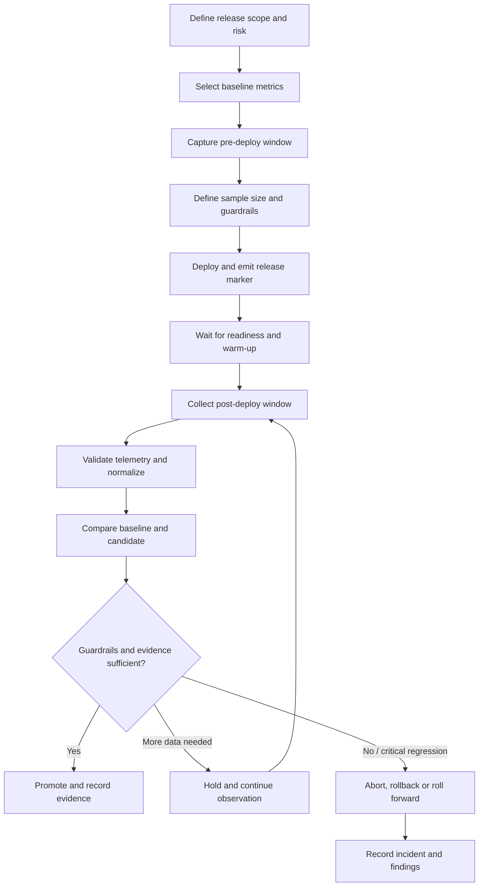

# Đối chiếu với mức nền trước khi triển khai

Một deployment có thể hoàn tất mà không có lỗi từ công cụ CI/CD, nhưng điều đó chưa chứng minh phiên bản mới hoạt động tốt trong production. Sau khi traffic bắt đầu đi qua phiên bản mới, độ trễ có thể tăng, tỷ lệ giao dịch thành công có thể giảm, queue có thể tích tụ hoặc một nhóm người dùng có thể gặp lỗi mà health check không phát hiện.

Để biết thay đổi có làm hệ thống tốt hơn hay xấu đi, nhóm cần so sánh trạng thái sau triển khai với một **mức nền (baseline)** đáng tin cậy được ghi nhận trước khi thay đổi. Baseline cung cấp điểm tham chiếu cho metric kỹ thuật và nghiệp vụ. Việc đối chiếu phải tính đến lưu lượng, thời điểm, nhóm người dùng, cấu hình, mùa vụ và những thay đổi khác xảy ra cùng lúc.

**Đối chiếu baseline không chỉ là nhìn dashboard trước và sau deployment.** Nhóm cần xác định trước metric nào quan trọng, cửa sổ thời gian nào có thể so sánh, dữ liệu có đủ mẫu không, ngưỡng nào yêu cầu dừng rollout và bằng chứng nào cho phép kết luận. Nếu không có baseline phù hợp hoặc telemetry không đầy đủ, trạng thái đúng là chưa đủ dữ liệu để xác nhận, không phải mặc định mọi thứ đều ổn.

## 1. Baseline là gì và dùng để làm gì?

Baseline là tập giá trị tham chiếu mô tả hành vi bình thường hoặc đã được chấp nhận của hệ thống trước khi triển khai một thay đổi. Baseline có thể gồm giá trị trung bình, phân vị, tỷ lệ, phạm vi dao động, phân bố theo giờ hoặc các chỉ số nghiệp vụ trong một khoảng thời gian.

Ví dụ, trước khi phát hành phiên bản mới của `orders-api`, nhóm ghi nhận:

- Tỷ lệ HTTP 5xx trong giờ cao điểm.
- p95 và p99 latency theo endpoint.
- Tỷ lệ tạo đơn thành công.
- Thời gian xử lý queue và số message tồn đọng.
- Database connection usage và query latency.
- Tỷ lệ thanh toán thất bại.

Sau triển khai, nhóm đo lại cùng các metric trong điều kiện tương đương và xem mức thay đổi có vượt giới hạn chấp nhận hay không.

Baseline giúp:

1. Phát hiện regression mà health check đơn giản có thể bỏ sót.
2. Phân biệt dao động bình thường với thay đổi bất thường.
3. Đánh giá tác động của release lên hiệu năng và kết quả nghiệp vụ.
4. Quyết định tiếp tục rollout, giữ nguyên tỷ lệ, dừng hoặc phục hồi.
5. Lưu bằng chứng giải thích vì sao một deployment được xem là thành công.

Baseline không phải lúc nào cũng là một con số duy nhất. Một dịch vụ có tải khác nhau giữa giờ cao điểm và ban đêm cần baseline theo thời điểm hoặc theo loại traffic. Một endpoint đọc dữ liệu có thể có latency khác endpoint tạo giao dịch; gộp chung có thể che khuất regression ở một nhóm.

## 2. Phân biệt baseline, target, SLO và guardrail

Các khái niệm này thường xuất hiện cùng nhau nhưng có vai trò khác nhau.

| Khái niệm | Ý nghĩa | Ví dụ |
|---|---|---|
| Baseline | Hành vi tham chiếu trước thay đổi hoặc của phiên bản ổn định | p95 latency hiện tại là 180 ms trong giờ cao điểm |
| Target | Mức kết quả mong muốn | p95 latency mục tiêu dưới 200 ms |
| SLI | Chỉ số đo chất lượng dịch vụ | Tỷ lệ request thành công |
| SLO | Mục tiêu chất lượng trong một cửa sổ thời gian | 99,9% request thành công trong 30 ngày |
| Guardrail | Giới hạn không được vi phạm trong rollout hoặc thử nghiệm | Không để tỷ lệ thanh toán thành công giảm quá 0,3 điểm phần trăm |
| Alert threshold | Ngưỡng phát cảnh báo cho người vận hành | 5xx vượt 2% trong 10 phút |

Baseline cho biết hệ thống đang hoạt động ra sao; SLO cho biết mức chất lượng cần duy trì; guardrail quyết định mức thay đổi nào có thể chấp nhận trong lần phát hành. Một baseline có thể đã kém hơn SLO. Khi đó không nên xem trạng thái cũ là chuẩn tốt chỉ vì nó tồn tại lâu.

Ví dụ, nếu p95 latency hiện tại là 450 ms trong khi SLO nội bộ yêu cầu dưới 400 ms, một release làm latency giảm còn 420 ms là cải thiện so với baseline nhưng vẫn chưa đạt mục tiêu. Báo cáo cần thể hiện cả hai sự thật.

## 3. Chọn baseline đáng tin cậy

Chất lượng kết luận phụ thuộc nhiều vào việc chọn baseline. Nếu cửa sổ trước triển khai có sự cố, traffic khác thường hoặc một chiến dịch lớn, phép so sánh có thể gây hiểu nhầm.

### Các nguồn baseline

| Nguồn | Khi phù hợp | Hạn chế |
|---|---|---|
| Phiên bản stable ngay trước release | So sánh trực tiếp thay đổi mới với trạng thái đang phục vụ | Có thể bị ảnh hưởng bởi sự kiện bất thường trong cửa sổ gần nhất |
| Cửa sổ lịch sử tương ứng | Hệ thống có chu kỳ ngày/tuần hoặc mùa vụ | Cần chọn ngày và điều kiện tương đương |
| Cohort control chạy song song | Canary hoặc thử nghiệm có nhóm đối chứng | Cần phân nhóm công bằng và đủ mẫu |
| Baseline SLO/SLI dài hạn | Đánh giá chất lượng tổng thể | Không nhất thiết nhạy với tác động ngắn hạn của một release |
| Synthetic test cố định | So sánh hành vi endpoint và luồng nghiệp vụ có kiểm soát | Không đại diện đầy đủ cho traffic thực |

Trong nhiều trường hợp, nên kết hợp baseline gần nhất của phiên bản stable với baseline lịch sử cùng thời điểm. Cohort control có thể tăng độ tin cậy khi canary cho phép phiên bản cũ và mới chạy song song.

### Baseline phải được chụp trước khi triển khai

Ghi nhận baseline trước khi bắt đầu rollout và lưu kèm:

- Thời điểm bắt đầu/kết thúc cửa sổ.
- Phiên bản, commit hoặc artifact digest đang chạy.
- Môi trường, region và cấu hình liên quan.
- Lưu lượng, số request và phân bố loại request.
- Các incident, maintenance hoặc chiến dịch đặc biệt trong cửa sổ.
- Metric, đơn vị, truy vấn và cách tính.

Không nên tạo baseline sau khi đã triển khai rồi dùng dữ liệu mới làm điểm tham chiếu cho chính deployment đó. Nếu bỏ lỡ baseline, có thể dùng dữ liệu stable gần nhất hoặc cohort đối chứng, nhưng cần ghi rõ nguồn và độ tin cậy.

## 4. Chọn cửa sổ thời gian trước và sau triển khai

Một cửa sổ baseline và một cửa sổ sau triển khai chỉ có thể so sánh khi đại diện cho điều kiện tương tự.

Các yếu tố cần xem xét:

- Cùng khung giờ hoặc cùng ngày trong tuần nếu traffic có tính chu kỳ.
- Cùng region, endpoint, loại người dùng hoặc nhóm giao dịch.
- Lưu lượng và phân bố request không chênh lệch quá lớn, hoặc đã chuẩn hóa.
- Đã loại trừ maintenance, incident hoặc batch bất thường nếu chúng không thuộc phạm vi đánh giá.
- Có đủ thời gian để tác động của release xuất hiện.
- Có tính đến thời gian warm-up, cache cold start và background job.

Ví dụ, so sánh 15 phút đầu sau deployment vào 2 giờ sáng với 15 phút giờ cao điểm buổi trưa không phải là so sánh công bằng. Nếu hệ thống có chu kỳ theo tuần, baseline cùng thứ và cùng khung giờ của tuần trước có thể hữu ích hơn cửa sổ liền kề.

### Cửa sổ quá ngắn và quá dài

- Quá ngắn: số mẫu ít, dao động ngẫu nhiên lớn và có thể chưa chạm tới tác vụ chạy theo lịch.
- Quá dài: nhiều yếu tố bên ngoài thay đổi, làm khó xác định tác động của deployment.

Chọn cửa sổ theo tốc độ traffic, tần suất giao dịch, SLO và rủi ro. Một API có hàng triệu request mỗi phút có thể đánh giá sớm hơn một batch job chạy một lần mỗi giờ.

## 5. Đo mức thay đổi: tuyệt đối và tương đối

Để so sánh rõ ràng, cần phân biệt chênh lệch tuyệt đối với thay đổi tương đối.

Chênh lệch tuyệt đối:

\[
\Delta = X_{after} - X_{baseline}
\]

Thay đổi tương đối khi baseline khác 0:

\[
\text{Change\%} = \frac{X_{after} - X_{baseline}}{X_{baseline}} \times 100\%
\]

Ví dụ, p95 latency tăng từ 200 ms lên 230 ms:

- Chênh lệch tuyệt đối: +30 ms.
- Thay đổi tương đối: +15%.

Với tỷ lệ, cần phân biệt **percentage point** và **percent change**. Nếu error rate tăng từ 1% lên 1,5%, mức tăng là 0,5 điểm phần trăm, tương đương tăng tương đối 50%. Hai cách diễn đạt không thể thay thế nhau.

Không nên tính phần trăm thay đổi khi baseline bằng 0 hoặc quá nhỏ mà không chọn cách diễn giải khác. Trong trường hợp này, hãy báo số sự kiện, mẫu số và khoảng tin cậy thay vì tạo một tỷ lệ không ổn định.

## 6. Chuẩn hóa theo lưu lượng và cơ cấu request

Số lượng lỗi tuyệt đối có thể tăng chỉ vì traffic tăng, dù chất lượng mỗi request không thay đổi. Ngược lại, số lỗi giảm khi traffic giảm không chứng minh phiên bản mới tốt hơn.

Ví dụ:

| Giai đoạn | Request | Request lỗi | Error rate |
|---|---:|---:|---:|
| Baseline | 100.000 | 500 | 0,50% |
| Sau deploy | 200.000 | 800 | 0,40% |

Số lỗi tăng từ 500 lên 800 nhưng error rate giảm từ 0,50% xuống 0,40%. Cần nhìn cả số lượng tuyệt đối lẫn tỷ lệ để hiểu tải và chất lượng.

### Chuẩn hóa theo đơn vị nghiệp vụ

Với hệ thống xử lý giao dịch, có thể theo dõi:

- Lỗi trên mỗi 1.000 request.
- Thời gian xử lý trên mỗi đơn hàng.
- Chi phí hạ tầng trên mỗi giao dịch thành công.
- Tỷ lệ retry trên mỗi message được nhận.
- Số bản ghi sai trên tổng số bản ghi xử lý.

### Phân tích cơ cấu traffic

Một release có thể nhận nhiều request đơn giản hơn hoặc ít tenant lớn hơn so với baseline. Metric tổng hợp có thể cải thiện dù một segment quan trọng bị regression.

Nên phân đoạn theo các chiều có ý nghĩa như endpoint, region, tenant tier, loại giao dịch, client version hoặc workload class. Tránh phân đoạn quá nhiều làm metric cardinality tăng mạnh hoặc lộ dữ liệu cá nhân.

## 7. So sánh metric kỹ thuật

Metric kỹ thuật phản ánh sức khỏe và khả năng phục vụ của hệ thống. Một bộ chỉ số thường dùng gồm bốn nhóm golden signals: latency, traffic, errors và saturation.

| Nhóm | Metric | Điều cần so sánh |
|---|---|---|
| Latency | p50, p95, p99 theo endpoint | Phân vị có tăng bất thường không; tail latency có xấu đi không |
| Traffic | Request rate, throughput, concurrent sessions | Tải có tương đương hoặc đã chuẩn hóa chưa |
| Errors | 4xx/5xx, timeout, exception, retry | Tỷ lệ và loại lỗi có thay đổi không |
| Saturation | CPU, memory, thread pool, connection pool, disk, queue | Tài nguyên có tiến gần giới hạn không |

Không nên chỉ dùng latency trung bình. Một số ít request rất chậm có thể bị che khuất trong mean nhưng xuất hiện rõ ở p95 hoặc p99. Đồng thời, phân vị cần đủ số mẫu và cách tính nhất quán giữa hai cửa sổ.

### So sánh theo phiên bản

Gắn nhãn version hoặc release ID vào metrics giúp tách stable và candidate. Ví dụ PromQL minh họa:

```promql
sum(rate(http_requests_total{version="candidate",status=~"5.."}[5m]))
/
sum(rate(http_requests_total{version="candidate"}[5m]))
```

Truy vấn trên tính error rate 5xx của phiên bản candidate trong cửa sổ 5 phút. Có thể viết truy vấn tương tự cho stable rồi so sánh trong cùng khoảng thời gian. Label thực tế phụ thuộc cách instrument và hệ thống metrics.

Nếu chỉ so sánh metric toàn service, lỗi của canary nhỏ có thể bị hòa loãng bởi stable đang nhận phần lớn traffic. Ngược lại, metric theo version cần đủ mẫu và cần xét tải thực tế của từng phiên bản.

## 8. So sánh metric nghiệp vụ

Metric kỹ thuật xanh không đảm bảo người dùng nhận kết quả đúng. Một API có thể trả HTTP 200 nhưng tạo sai tổng tiền, ghi trùng đơn hàng hoặc không phát event cần thiết.

Metric nghiệp vụ cần được chọn theo mục tiêu của service:

| Miền nghiệp vụ | Metric tham khảo |
|---|---|
| E-commerce | Tỷ lệ tạo đơn, checkout completion, đơn bị hủy, phí tính sai |
| Payment | Authorization success, duplicate charge, refund failure, reconciliation mismatch |
| Authentication | Login success, token refresh failure, lockout rate, unauthorized access |
| Messaging | Message processed, duplicate, dead-letter count, consumer lag |
| Data pipeline | Record accepted/rejected, freshness, completeness, reconciliation difference |
| Search | Zero-result rate, relevance feedback, query success, latency |

Metric nghiệp vụ cần có định nghĩa ổn định. Ví dụ, “đơn hàng thành công” phải xác định trạng thái nào được tính, loại đơn nào bị loại trừ và mẫu số là request checkout hay đơn hàng đã xác nhận.

Với thao tác có side effect, cần kiểm tra tính toàn vẹn dữ liệu như giao dịch trùng, tổng tiền không khớp, message bị mất hoặc bản ghi không có quan hệ tương ứng. Các kiểm tra này đôi khi cần chạy bất đồng bộ sau deployment vì kết quả đối soát không xuất hiện ngay.

## 9. Chọn metric theo thay đổi đang phát hành

Không phải release nào cũng cần cùng một bộ metric. Ngoài baseline chung của service, cần chọn metric liên quan trực tiếp đến đường code hoặc tài nguyên bị thay đổi.

| Loại thay đổi | Metric cần ưu tiên |
|---|---|
| Thay đổi API handler | Error rate, p95/p99, timeout, response schema |
| Thay đổi database query | Query latency, lock wait, connection usage, slow query, DB CPU |
| Thay đổi cache | Hit ratio, miss rate, eviction, backend request rate, stale data |
| Thay đổi queue consumer | Lag, processing time, retry, dead-letter, duplicate handling |
| Thay đổi authentication | Login/token success, 401/403, refresh failures, suspicious access |
| Thay đổi thanh toán | Authorization success, duplicate charge, reconciliation, refund errors |
| Thay đổi frontend | JS error, page load, interaction latency, conversion theo client version |
| Thay đổi hạ tầng | Availability, saturation, network errors, capacity và failover |

Nếu metric liên quan không có instrumentation, hãy bổ sung trước hoặc cùng release. Không thể kết luận một thay đổi an toàn chỉ vì những metric đang có đều ổn định.

## 10. Kiểm tra chất lượng của dữ liệu đo

So sánh chỉ có ý nghĩa nếu dữ liệu trước và sau được thu thập theo cùng định nghĩa và cách tính.

Trước khi kết luận, kiểm tra:

- Metric có xuất hiện ở cả hai cửa sổ không?
- Đơn vị, label và aggregation có nhất quán không?
- Có thay đổi instrumentation hoặc sampling cùng lúc không?
- Clock, timestamp và timezone có đồng nhất không?
- Có mất telemetry, scrape failure hoặc log drop không?
- Denominator có bằng 0 hoặc quá nhỏ không?
- Có duplicate event hoặc delayed event làm sai số liệu không?
- Có thay đổi retention hoặc query filter giữa hai lần đo không?

Nếu deployment đồng thời đổi metric name hoặc sampling, cần map dữ liệu cũ và mới hoặc dùng một metric độc lập khác để đối chiếu. Không so sánh hai chuỗi có định nghĩa khác nhau như thể chúng tương đương.

### Telemetry bị thiếu

Metric không có dữ liệu không có nghĩa là không có lỗi. Nếu metric bắt buộc bị mất, quality gate nên trả trạng thái `unknown` hoặc `insufficient_data`, giữ rollout hoặc dừng theo mức rủi ro. Với cổng production quan trọng, không nên tự động promote khi không thể quan sát điều kiện an toàn.

## 11. Mẫu nhỏ, dao động và ý nghĩa thống kê

Khi số request ít, một vài lỗi có thể làm tỷ lệ thay đổi rất lớn. Ngược lại, một regression nhỏ có thể bị che khuất nếu chỉ nhìn trung bình trong thời gian ngắn.

Ví dụ:

| Giai đoạn | Request | Lỗi | Error rate |
|---|---:|---:|---:|
| Baseline nhỏ | 100 | 1 | 1,0% |
| Sau deploy nhỏ | 100 | 3 | 3,0% |
| Baseline lớn | 100.000 | 1.000 | 1,0% |
| Sau deploy lớn | 100.000 | 1.100 | 1,1% |

Hai trường hợp đều có thay đổi tỷ lệ, nhưng độ tin cậy và ý nghĩa vận hành khác nhau. Cần xem số mẫu, khoảng tin cậy, mức tác động và hậu quả của lỗi.

### Các nguyên tắc

- Đặt số request/giao dịch tối thiểu trước khi đánh giá.
- Dùng cửa sổ đủ dài để bao phủ chu kỳ tải và tác vụ quan trọng.
- Theo dõi cả số lượng lỗi và tỷ lệ lỗi.
- Với tỷ lệ, xem xét khoảng tin cậy thay vì chỉ một ước lượng điểm.
- Không kết luận từ việc nhìn dashboard liên tục rồi dừng ngay khi thấy kết quả thuận lợi.
- Với nhiều metric, xác định trước metric chính và guardrail để tránh chọn lọc kết quả sau khi quan sát.

Ý nghĩa thống kê không thay thế đánh giá tác động. Một mức tăng lỗi nhỏ có thể có ý nghĩa thống kê nhưng không đáng kể với người dùng; một lỗi hiếm nhưng gây mất tiền hoặc lộ dữ liệu có thể cần dừng ngay dù số mẫu chưa đủ để đạt kiểm định thống kê.

## 12. Baseline tĩnh, baseline động và cohort đối chứng

### Baseline tĩnh

Baseline tĩnh là snapshot hoặc phạm vi tham chiếu được cố định trước release. Nó dễ giải thích và phù hợp để đánh giá thay đổi trong một release cụ thể.

Hạn chế là hệ thống có thể thay đổi tự nhiên theo thời gian. Baseline của tháng trước có thể không còn đại diện cho tải hiện tại sau khi số người dùng tăng gấp đôi.

### Baseline động

Baseline động cập nhật theo dữ liệu gần đây, ví dụ median của cùng khung giờ trong nhiều ngày hoặc một rolling window. Nó phản ánh xu hướng mới nhưng có thể bị “nhiễm” bởi chính regression nếu dữ liệu sau deploy được đưa vào baseline quá sớm.

Trong giai đoạn đánh giá release, nên đóng băng baseline tham chiếu hoặc tách dữ liệu candidate khỏi nguồn cập nhật baseline. Chỉ cập nhật baseline sau khi phiên bản mới được chấp nhận và hành vi ổn định.

### Cohort đối chứng

Nếu có thể giữ một nhóm stable trong cùng thời điểm, nhóm đó giúp kiểm soát các yếu tố chung như traffic, thời tiết hoặc sự kiện marketing. So sánh canary với stable trong cùng cửa sổ thường hữu ích hơn so sánh hai thời điểm xa nhau.

Tuy nhiên, cohort phải đủ tương đồng. Nếu canary chỉ nhận user nội bộ hoặc tenant nhỏ, không thể mặc định hành vi đó đại diện cho toàn bộ khách hàng.

## 13. Phân biệt tương quan và nguyên nhân

Nếu error rate tăng ngay sau deployment, release có thể là nguyên nhân, nhưng cần xem xét những thay đổi xảy ra đồng thời:

- Traffic tăng đột biến do chiến dịch.
- Một dependency bên ngoài gặp sự cố.
- Database maintenance hoặc network degradation.
- Thay đổi cấu hình, secret hoặc feature flag khác.
- Một deployment khác trong cùng service hoặc upstream/downstream.
- Instrumentation thay đổi khiến metric được ghi nhận khác trước.

Deployment marker giúp xác định thời điểm thay đổi. Correlation ID, trace, version label và change log giúp nối metric với request và phiên bản cụ thể.

Khi có canary/stable chạy song song, so sánh cùng thời điểm có thể giảm nhiễu. Nếu cả stable và candidate đều xấu đi cùng lúc, nguyên nhân có thể là dependency hoặc tải chung. Nếu chỉ candidate xấu, khả năng release liên quan cao hơn.

Không nên khẳng định quan hệ nhân quả chỉ từ việc hai sự kiện xảy ra gần nhau. Báo cáo nên phân biệt “có tương quan”, “có bằng chứng liên quan” và “đã xác định nguyên nhân”.

## 14. Xây dựng guardrail và ngưỡng hành động

Một ngưỡng tốt phải gắn với SLO, baseline, mức độ nghiêm trọng và khả năng phục hồi. Ngưỡng quá nhạy tạo cảnh báo giả; ngưỡng quá rộng để regression lan xa.

Ví dụ guardrail minh họa:

| Metric | Điều kiện tham khảo | Hành động |
|---|---|---|
| 5xx rate | Tăng hơn 0,5 điểm phần trăm so với stable trong cửa sổ đủ mẫu | Dừng tăng rollout, điều tra |
| p95 latency | Tăng hơn 15% so với baseline và vượt ngưỡng SLO | Giữ hoặc rollback tùy mức độ |
| Payment success | Giảm vượt ngưỡng nghiệp vụ đã thống nhất | Dừng rollout ngay và kiểm tra giao dịch |
| Queue lag | Tăng liên tục và vượt thời gian xử lý cho phép | Giữ tỷ lệ, kiểm tra consumer và capacity |
| Data reconciliation | Có chênh lệch ngoài tolerance | Dừng rollout hoặc tắt chức năng ghi |
| Telemetry availability | Metric bắt buộc không có dữ liệu | Hold hoặc abort theo policy |

Các con số chỉ là ví dụ. Ngưỡng production cần được xây dựng theo SLO, baseline và hậu quả của lỗi. Với dữ liệu thanh toán hoặc quyền truy cập, một sự cố nghiêm trọng có thể yêu cầu dừng ngay mà không chờ hết cửa sổ thống kê.

### Phân biệt hành động

- `PROMOTE`: đủ mẫu, các guardrail đạt và có thể mở rộng traffic.
- `HOLD`: giữ nguyên tỷ lệ để thu thập thêm dữ liệu hoặc điều tra tín hiệu chưa rõ.
- `ABORT`: dừng rollout vì vi phạm guardrail hoặc phát hiện lỗi nghiêm trọng.
- `ROLLBACK`: đưa traffic/workload về phiên bản ổn định khi điều kiện cho phép.
- `ROLL_FORWARD`: triển khai bản sửa mới nếu rollback không an toàn hoặc không giải quyết được trạng thái dữ liệu.

Không nên gộp `HOLD` và `ABORT`. Một dao động nhỏ có thể cần thêm dữ liệu; một lỗi gây mất dữ liệu hoặc giao dịch sai cần hành động khẩn cấp.

## 15. Quy trình đối chiếu baseline sau deployment

Một quy trình thực tế có thể chia thành các bước:

1. **Xác định mục tiêu release:** ghi rõ thành phần, phạm vi và loại thay đổi.
2. **Chọn metric:** chọn metric kỹ thuật, nghiệp vụ và bảo mật liên quan trực tiếp.
3. **Chụp baseline:** lưu cửa sổ, version, traffic, cấu hình và chất lượng dữ liệu trước deploy.
4. **Đặt guardrail:** định nghĩa ngưỡng, số mẫu, cửa sổ quan sát và hành động tương ứng.
5. **Đánh dấu deployment:** ghi release ID, commit SHA, artifact digest, thời điểm và môi trường.
6. **Chờ warm-up:** cho instance mới sẵn sàng, cache ổn định và telemetry bắt đầu đầy đủ.
7. **Thu thập dữ liệu sau deploy:** đo cùng metric và cùng định nghĩa trong cửa sổ phù hợp.
8. **Chuẩn hóa và phân đoạn:** tính rate, phân vị và metric trên mỗi đơn vị nghiệp vụ; tách theo version/region/endpoint nếu cần.
9. **So sánh:** tính chênh lệch tuyệt đối, tương đối, số mẫu và mức bất định.
10. **Đưa ra quyết định:** promote, hold, abort, rollback hoặc roll forward.
11. **Lưu bằng chứng:** report, dashboard snapshot/metric query, deployment record và người quyết định.



## 16. Phân biệt kiểm tra ngay sau deploy và theo dõi dài hạn

Một số tác động xuất hiện ngay khi traffic chuyển; một số chỉ xuất hiện sau nhiều giờ hoặc khi có chu kỳ xử lý.

| Giai đoạn | Mục tiêu | Kiểm tra thường dùng |
|---|---|---|
| Ngay sau deploy | Xác nhận instance và dependency sẵn sàng | Readiness, smoke test, error rate, startup logs |
| Sau warm-up | Xác nhận hành vi trong traffic thực ban đầu | Latency, 5xx, resource saturation, business success |
| Cửa sổ rollout | Quyết định mở rộng traffic | Baseline comparison, cohort metrics, guardrails |
| Sau khi hoàn tất rollout | Phát hiện lỗi trễ và side effect | Queue lag, reconciliation, scheduled jobs, support tickets |
| Theo dõi dài hạn | Đánh giá SLO và regression tích lũy | Error budget, trend, cost per transaction, data quality |

Không nên đóng validation chỉ vì smoke test pass. Smoke test xác nhận một số đường chính hoạt động tại thời điểm chạy; nó không chứng minh hệ thống giữ được chất lượng khi tải tăng hoặc khi batch job đến hạn.

## 17. Gắn baseline với canary và progressive delivery

Canary là một trường hợp đặc biệt hữu ích của baseline comparison vì phiên bản stable và candidate có thể chạy song song.

Ở mỗi giai đoạn:

- So sánh metric candidate với stable trong cùng cửa sổ.
- Đảm bảo hai nhóm nhận traffic có đặc điểm tương đương hoặc đã phân tầng.
- Đặt số mẫu tối thiểu cho từng phiên bản.
- Giữ nguyên baseline tham chiếu trong suốt release.
- Không promote nếu telemetry candidate bị thiếu.
- Ghi lại tỷ lệ traffic và thời điểm thay đổi để giải thích metric.

Ví dụ, nếu candidate nhận 5% traffic nhưng chỉ có 20 request trong cửa sổ 10 phút, không nên kết luận error rate thấp là bằng chứng đủ mạnh. Có thể giữ tỷ lệ, tăng thời gian quan sát hoặc dùng synthetic checks bổ sung.

Với rollout không có stable song song, baseline lịch sử cần được chọn cẩn thận hơn và phải tính đến các yếu tố thời gian, traffic và thay đổi ngoài release.

## 18. Tự động hóa baseline và báo cáo trong CI/CD

Pipeline có thể tự động thu thập baseline, phát deployment marker, chờ cửa sổ quan sát, tính metric và tạo báo cáo. Tuy nhiên, cần bảo vệ truy vấn, policy và nguồn dữ liệu để kết quả không bị sửa hoặc gắn nhầm release.

Ví dụ YAML khái niệm:

```yaml
post_deployment_validation:
  release:
    id: "${RELEASE_ID}"
    artifact_digest: "${ARTIFACT_DIGEST}"
    environment: production

  baseline:
    source: stable_revision
    window: 30m
    capture_before_deploy: true
    metrics:
      - http_5xx_rate
      - request_latency_p95
      - order_success_rate
      - queue_lag

  observation:
    warmup: 5m
    window: 20m
    minimum_requests: 5000
    compare_by: [version, region, endpoint]

  decisions:
    insufficient_data: HOLD
    guardrail_failure: ABORT
    all_checks_pass: PROMOTE

  evidence:
    include:
      - baseline_window
      - post_deploy_window
      - metric_deltas
      - sample_counts
      - deployment_marker
      - decision_and_actor
```

Các giá trị là ví dụ và cần điều chỉnh theo service. Trong hệ thống thật, baseline có thể lấy từ metrics backend, log analytics hoặc observability platform. Cần lưu query version và label filter để lần sau có thể tái tạo kết quả.

### Ví dụ báo cáo so sánh

| Metric | Baseline | Sau deploy | Chênh lệch | Đánh giá |
|---|---:|---:|---:|---|
| 5xx rate | 0,40% | 0,35% | -0,05 điểm % | Cải thiện nhẹ |
| p95 latency | 210 ms | 245 ms | +16,7% | Cần kiểm tra guardrail |
| Order success | 99,6% | 99,7% | +0,1 điểm % | Ổn định/cải thiện |
| Queue lag | 12 s | 28 s | +16 s | Cần kiểm tra consumer |

Không thể kết luận release thành công chỉ vì hai metric cải thiện. p95 latency và queue lag đang xấu đi; cần xem SLO, số mẫu, segment và tác động nghiệp vụ trước khi promote.

## 19. Ví dụ xuyên suốt: đối chiếu baseline cho orders-api

Giả sử nhóm phát hành phiên bản mới của `orders-api` để giảm thời gian xác nhận đơn hàng. Thay đổi bao gồm tối ưu truy vấn database và chuyển một bước xử lý sang queue.

**Trước deploy:** nhóm chọn baseline 30 phút trong cùng khung giờ của các ngày gần đây, loại trừ một cửa sổ có incident database. Baseline được lưu cùng artifact stable digest, request volume, region và metric query. Metric chính là p95 thời gian xác nhận đơn; guardrail gồm 5xx, order success rate, queue lag và database connection usage.

**Sau deploy:** pipeline phát deployment marker, đợi readiness và cache warm-up, sau đó thu thập metric trong cửa sổ đã định. Candidate được gắn version label để so sánh riêng với stable. Số request tối thiểu phải đạt trước khi quyết định.

**Kết quả:** p95 giảm 12%, 5xx không thay đổi đáng kể, nhưng queue lag tăng gấp đôi và một số đơn hàng ở region cụ thể bị xác nhận chậm. Metric tổng hợp toàn hệ thống có vẻ tốt, nhưng phân đoạn theo region cho thấy regression.

**Quyết định:** giữ nguyên tỷ lệ rollout, không promote. Trace cho thấy consumer ở một region xử lý message chậm do connection pool bị giới hạn. Nhóm điều chỉnh cấu hình, phát hành bản sửa và lặp lại validation với baseline đã được ghi nhận.

**Hoàn tất:** sau khi queue lag và p95 ổn định trong cửa sổ đủ mẫu, nhóm tăng traffic và promote. Report lưu baseline, post-deploy values, segment, sample count, query version, release digest và quyết định.

Ví dụ cho thấy metric tổng hợp có thể che khuất một nhóm bị ảnh hưởng. Đối chiếu cần vừa nhìn toàn hệ thống vừa phân tích những segment gắn với thay đổi.

## 20. Những anti-pattern thường gặp

| Anti-pattern | Hệ quả | Cách cải thiện |
|---|---|---|
| Không chụp baseline trước deploy | Không có điểm tham chiếu đáng tin cậy | Ghi baseline trước rollout và lưu kèm release ID |
| So sánh hai khung giờ khác nhau | Seasonality làm sai kết luận | Chọn cửa sổ tương đương hoặc chuẩn hóa theo traffic |
| Chỉ nhìn giá trị tuyệt đối | Traffic tăng làm số lỗi tăng dù tỷ lệ giảm | Xem cả count, rate và denominator |
| Chỉ nhìn average latency | Tail latency bị che khuất | Theo dõi p50/p95/p99 và phân bố |
| Gộp mọi endpoint/region | Regression ở segment bị hòa loãng | Phân đoạn theo chiều có ý nghĩa |
| Dùng metric không cùng định nghĩa | So sánh sai dữ liệu | Version hóa query, schema và metric definition |
| Coi telemetry thiếu là không có lỗi | Promote khi không đủ bằng chứng | Trả `unknown/insufficient_data`, hold hoặc abort |
| Kết luận nhân quả từ tương quan | Quy lỗi nhầm cho deployment | Dùng deployment marker, cohort stable và trace để điều tra |
| Đặt quá nhiều ngưỡng không có owner | Alert fatigue và quyết định thiếu nhất quán | Chọn metric chính, guardrail và owner rõ |
| Dừng khi thấy một metric tốt | Bỏ sót tác động nghiệp vụ hoặc hạ tầng | Đánh giá bộ metric và điều kiện dừng đã định trước |
| Không lưu query/baseline metadata | Không thể tái tạo kết luận | Lưu cửa sổ, query version, labels và artifact digest |

## 21. Checklist đối chiếu với mức nền trước triển khai

Trước khi xác nhận một deployment đạt yêu cầu, nhóm có thể rà soát:

- [ ] Baseline được ghi nhận trước khi bắt đầu triển khai.
- [ ] Baseline gắn với version/artifact stable và môi trường cụ thể.
- [ ] Cửa sổ trước/sau có điều kiện thời gian và tải tương đương.
- [ ] Metric có định nghĩa, đơn vị, query và label nhất quán.
- [ ] Có cả metric kỹ thuật và metric nghiệp vụ liên quan đến thay đổi.
- [ ] Theo dõi latency phân vị, error rate, traffic và saturation phù hợp.
- [ ] Có denominator và sample count cho metric dạng tỷ lệ.
- [ ] Đã chuẩn hóa theo request/giao dịch hoặc phân đoạn khi cần.
- [ ] Đã kiểm tra telemetry completeness, sampling và data quality.
- [ ] Số mẫu và cửa sổ quan sát đáp ứng điều kiện tối thiểu.
- [ ] Guardrail, ngưỡng và hành động promote/hold/abort đã định nghĩa trước.
- [ ] Có so sánh candidate với stable hoặc baseline lịch sử phù hợp.
- [ ] Các thay đổi đồng thời và yếu tố gây nhiễu được ghi nhận.
- [ ] Không coi thiếu dữ liệu là pass.
- [ ] Có theo dõi sau rollout cho queue, batch, reconciliation và side effect trễ.
- [ ] Báo cáo lưu baseline, metric delta, sample count, release ID và artifact digest.
- [ ] Quyết định và người chịu trách nhiệm được ghi nhận.

## 22. Kết luận

Đối chiếu với mức nền trước triển khai giúp nhóm xác định phiên bản mới có làm thay đổi chất lượng dịch vụ và kết quả nghiệp vụ hay không. Baseline cần được chọn từ dữ liệu đáng tin cậy, ghi nhận trước deployment, có cửa sổ tương đương và gắn với phiên bản, môi trường cùng cách tính metric rõ ràng.

Một quy trình tốt kết hợp metric kỹ thuật, metric nghiệp vụ, chuẩn hóa theo traffic, phân đoạn theo endpoint/region/cohort, kiểm tra chất lượng dữ liệu và đánh giá số mẫu. Guardrail cần xác định trước hành động promote, hold hoặc abort; telemetry thiếu phải được xem là chưa đủ bằng chứng. Khi pipeline lưu baseline, deployment marker, metric delta và quyết định cùng artifact digest, việc xác minh sau triển khai trở nên nhất quán, có thể tái tạo và hữu ích cho cả vận hành lẫn cải tiến release tiếp theo.
